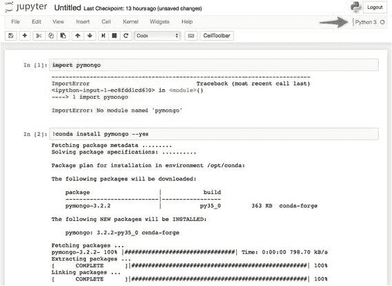
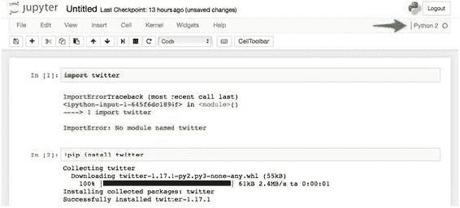

# 临时容器扩展

最后，让我们讨论一下使用 `jovyan` 用户向运行中的容器添加库的最佳实践。不过在此之前，我应该提一下对运行中的容器进行更改所产生的影响。在第 2 章中，你探讨了容器中的持久化问题，但当时仅针对使用 Jupyter 时可能正在处理的文件。你希望确保对文件的更改在容器的生命周期结束后仍然存在。然而，我并未讨论你可能安装的库的持久化问题，无论是使用 `base-notebook` 的操作系统 Debian 所青睐的 `apt` 包管理器在系统层面进行安装，还是使用任何包含的 Python 包管理器在 Python 层面进行安装。在实践中，你将面临完全相同的挑战。然而，对于系统和 Python 库，我建议按照上述最佳实践，通过 Dockerfile 进行这些更改。话虽如此，将 Python 代码的编写与 Docker 镜像的维护分离开来也是一种最佳实践。毫无疑问，在开发过程中，你会遇到希望快速安装某个库的情况。最佳实践当然是快速安装所需的库并继续开发。但是，你应该意识到你所做操作的影响。一旦你停止并移除进行了这些更改的容器，这些更改就会消失。这是设计使然。你还必须防止自己因为希望保留对容器所做的更改，而在其生命周期结束后仍长期保留老旧的容器。考虑到这一点，我发现以下方法是在运行中的容器上安装临时包的最佳实践。`ipython` 的魔法命令 `sx`⁸（`!`（感叹号）是其简写形式）可用于在 notebook 中向底层系统的 shell 运行命令。通过这种方式，你可以即时通过 `conda`（清单 7-23）、`pip`（清单 7-25）或 `apt`（清单 7-27）安装库，而无需打开容器的终端。请注意，`apt` 要求在容器运行时已向 `jovyan` 授予了无密码 `sudo` 权限，如上所述。

```
In [1]: import pymongo
        --------------------------------------------------------------------
        ImportError                               Traceback (most recent call last)
        <ipython-input-1-ec8fdd1cd630> in <module>()
        ----> 1 import pymongo
        ImportError: No module named 'pymongo'

In [2]: !conda install pymongo --yes
        Fetching package metadata .........
        Solving package specifications: ..........
        ...
        Linking packages ...
        [      COMPLETE      ]|######################################| 100%
```

清单 7-23. 使用 `ipython` 魔法 Shell 进程命令通过 `conda` 安装包

库将被安装到的环境取决于正在运行的内核。图 7-4 显示了 Python 3 内核。回想一下，这与 `conda` 的 root 环境相关联。



图 7-4. 使用 notebook 将 `pymongo` 安装到 root 环境中

你可以通过打开容器的 shell 并运行 `conda list`（清单 7-24）来验证该包是否确实已添加到正确的环境中。

```
$ docker exec -it kickass_engelbart bash
jovyan@67cf8215ed6a:∼$ conda list --name root | grep pymongo
pymongo                   3.2.2                    py35_0    conda-forge
jovyan@67cf8215ed6a:∼$ conda list --name python2 | grep pymongo
jovyan@67cf8215ed6a:∼$
```

清单 7-24. 验证库安装

该库在 root 环境中可用，但在 `python2` 环境中不可用。如果你切换内核并再次运行该命令，它将在 `python2` 环境中可用。只要容器在运行，这些对容器的更改就会持续存在。如果你希望这些更改不仅仅用于最微不足道的用途，建议按照上述方法，通过对镜像本身进行更改来使这些更改永久生效。

在清单 7-25 中，你通过 notebook 使用 `pip` 将 `twitter` 安装到 `python2` 环境中。结果见图 7-5。



图 7-5. 使用 notebook 将 `twitter` 安装到 `python2` 环境中

```
In [1]: import twitter
        --------------------------------------------------------------------
        ImportError                               Traceback (most recent call last)
        <ipython-input-1-645f6dc1896f> in <module>()
        ----> 1 import twitter
        ImportError: No module named 'twitter'

In [2]: !pip install twitter
        Collecting twitter
          Downloading twitter-1.17.1-py2.py3-none-any.whl (55kB)
            100% |████████████████████████████████| 61kB 2.4MB/s ta 0:00:01
        Installing collected packages: twitter
        Successfully installed twitter-1.17.1
```

清单 7-25. 使用 `ipython` 魔法 Shell 进程命令通过 `pip` 安装包

同样，你可以通过打开容器的 shell 并运行 `conda list`（清单 7-26）来验证该包是否确实已添加到正确的环境中。

```
$ docker exec -it kickass_engelbart bash
jovyan@67cf8215ed6a:∼$ conda list --name root | grep twitter
jovyan@67cf8215ed6a:∼$ conda list --name python2 | grep twitter
twitter                   1.17.1                    <pip>
jovyan@67cf8215ed6a:∼$
```

清单 7-26. 验证库安装


### 维护对镜像的半持久化更改

具有 DevOps 思维的读者无疑会对在运行的 Jupyter 容器中安装库感到困扰。到目前为止，您一直坚持这样的理念：使用容器的最佳实践是，它们可以随时关闭、移除和重启，而不会对工作流程造成任何损失。如果您要删除 `kickass_engelbart` 并在新容器中启动笔记本，这个新容器将不会安装 `twitter` 或 `mongo`。这只会带来轻微的不便，因为您在笔记本的 `magix-sx` 命令中记录了需要安装的库：`!conda install pymongo --yes` 和 `!pip install twitter`。不过，您可能希望将这些更改持久化到某个已定义的容器中。

**警告**：不建议将此做法作为永久性的镜像开发实践。建议将其作为针对特定项目的临时措施。

您可以使用 `docker commit` 命令将临时更改（列表 7-27）添加到镜像中。我建议使用标签来命名镜像。此处，您将 `twitter-mongo` 标签添加到基础镜像 `jupyter/scipy-notebook` 上。

```
$ docker commit kickass_engelbart jupyter/scipy-notebook:twitter-mongo
```

**列表 7-27.** 使用标签将临时更改持久化到镜像中

在列表 7-28 中，您将显示镜像缓存中的镜像。您可以看到本地缓存中现在有两个镜像：`jupyter/scipy-notebook:latest` 和 `jupyter/scipy-notebook:twitter-mongo`。

```
$ docker images
REPOSITORY              TAG            IMAGE ID      CREATED        SIZE
jupyter/scipy-notebook  twitter-mongo  dfbb7599770d  4 seconds ago  5.37GB
jupyter/scipy-notebook  latest         3dc12029099d  24 hours ago   5.35GB
```

**列表 7-28.** 显示本地镜像

您可以像启动其他镜像一样，使用 `docker run` 来启动您修改后的镜像（列表 7-29）。

```
$ docker run -d -v `pwd`:/home/jovyan -p 8888:8888 jupyter/scipy-notebook:twitter-mongo
```

**列表 7-29.** 启动 `jupyter/scipy-notebook:twitter-mongo`

## 本章小结

在本章中，您了解了 Jupyter 团队定义的 Docker 镜像，这些镜像用于使用 Docker 快速启动和扩展 Jupyter Notebook 服务器。我简要讨论了默认的笔记本安全策略。我还介绍了几种使用 Jupyter 团队的镜像作为基础来扩展 Jupyter 镜像的策略。学完本章后，希望您能轻松找到适合您工作的 Jupyter 镜像，并在此基础上进行扩展以满足特定项目的需求。

**脚注**

1.  [`jupyter.org/`](http://jupyter.org/)
2.  [`jupyter.org/about.html`](http://jupyter.org/about.html)
3.  [`github.com/jupyter/docker-stacks`](https://github.com/jupyter/docker-stacks)
4.  [www.debian.org/releases/jessie/](http://www.debian.org/releases/jessie/)
5.  Jovyan 意为“与木星（Jupyter）相关”。
6.  [`jupyter-notebook.readthedocs.io/en/latest/security.html`](http://jupyter-notebook.readthedocs.io/en/latest/security.html)
7.  [`conda.io/docs/using/envs.html`](https://conda.io/docs/using/envs.html)
8.  [`ipython.org/ipython-doc/3/interactive/magics.html#magic-sx`](https://ipython.org/ipython-doc/3/interactive/magics.html#magic-sx)

© Joshua Cook 2017  
Joshua Cook, *Docker for Data Science*  
`doi.org/10.1007/978-1-4842-3012-1_8`

