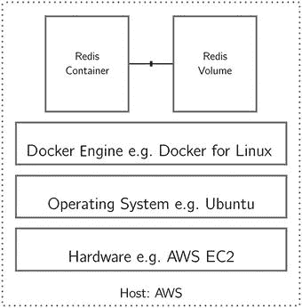
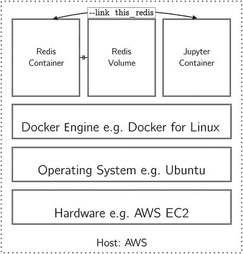
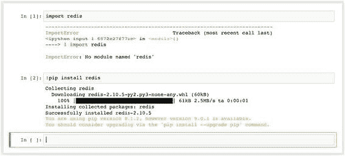
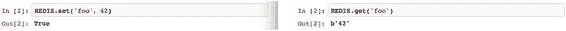
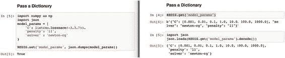
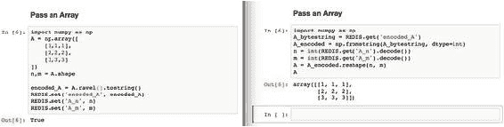
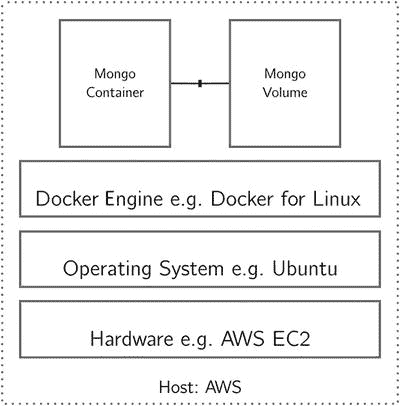
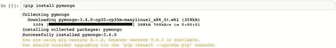
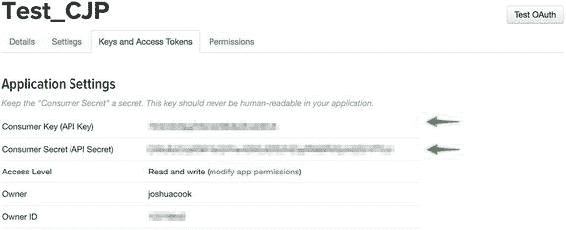
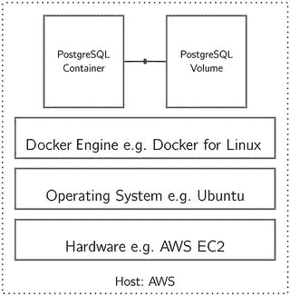

# 序列化格式与方法

本书侧重于使用 Python 进行工作。因此，它将重点介绍两种 Python 特有的数据序列化方法：pickling 和通过字节串进行序列化。此外，你还会了解两种基于文本的数据序列化方法的适用场景：`JSON` 和 `YAML`。`JSON`（JavaScript 对象表示法）是 JavaScript 编程语言的一个机器可读子集，已被编程社区采纳为一种人类可读、与语言无关的序列化方法。`YAML` 是解决同一问题的另一种方案。`JSON` 和 `YAML` 都能使用标准的原始数据类型：整数、浮点数、布尔值和空值，以及字符串。为了提供更大的数据结构，两者都使用关联数组（通常称为字典）和有序列表（也称为数组、向量、列表或序列）。字典使用键值对存储数据；列表使用数字索引存储数据。两者主要在语法上有所不同。`JSON`（清单 8-1）使用嵌套的花括号和方括号来定义数据结构，而 `YAML`（清单 8-2）则使用空白符达到相同目的。请注意，在以下两个示例中，所使用的任何键都不具有任何语法意义。

```
{'this_json' : 'is a JSON object',
 'a nested object' : {
   'obj_id' : 123,
   'object value' : 'temperamental',
   'is_nested' : true
   },
 'a list': [1,2,3,4],
 'a list of strings': ['green eggs', 'ham'],
 'last_used' : null
}
```

清单 8-1. 一个 JSON 对象示例

```
this_yaml: is a YAML object
a_nested_object:
  obj_id: 123
  object_value: 'temperamental'
  is_nested: true
a_list:
  - 1
  - 2
  - 3
  - 4
a_list_of_strings:
  - green eggs
  - ham
last_used: null
```

清单 8-2. 一个 YAML 对象示例

## Python 中的二进制编码

Python 的 `pickle` 模块是将 Python 对象和数据序列化为二进制字节流的首选方法。pickling 数据与使用 `JSON` 或 `YAML` 序列化之间存在一些根本性差异。如前所述，`JSON` 和 `YAML` 都是人类可读的。而转换为字节流的对象则不可读。`JSON` 和 `YAML` 序列化的对象可以被任何语言编写的进程读取，而 pickled 对象则只能在 Python 中读取。由于 pickled 对象无需考虑互操作性，因此可以 pickle 各种各样的 Python 对象，而使用 `JSON` 或 `YAML` 只能序列化字典。对于数据科学家而言，这包括但不限于 `numpy` 数组、`pandas` 的 `DataFrame` 或 `sklearn` 的 `Model`。在下一章中，你将探索使用 Python 将数据编码为二进制字节流的各种方法。

## Redis

Redis¹ 是一个开源的内存数据结构存储系统。它存储与给定键关联的多种不同类型的数据值。在你的技术栈中，你将使用 Redis 实现两个目的。首先，它将作为一个缓存，用于在 Python 进程生命周期之外或在 Jupyter Notebook 之间持久化对象。其次，你将使用 Redis 作为消息代理，以便使用名为 `rq` 的 Python 库从你的 notebook 执行延迟作业处理。在本章中，你将讨论第一个用例；第二个用例的讨论将在第 10 章进行。

### 拉取 redis 镜像

你可以使用 `docker pull` 从 Docker Hub 获取 `redis` 镜像，如清单 8-3 所示。`redis` 镜像的 Docker Hub 页面² 概述了我在接下来几页中将讨论的大部分内容，包括基本配置、持久化存储以及从另一个容器连接到 Redis。

```
$ docker pull redis
Using default tag: latest
latest: Pulling from library/redis
6d827a3ef358: Already exists
787f13ab8ea9: Pull complete
...
Digest: sha256:1b358a2b0dc2629af3ed75737e2f07e5b3408eabf76a8fa99606ec0c276a93f8
Status: Downloaded newer image for redis:latest
```

清单 8-3. 从 Docker Hub 拉取 redis 镜像

**注意：** 你的本地 Docker 镜像缓存中已经存在 `redis` 镜像的第一层，`pull` 命令会通知你层 `6d827a3ef358` “Already exists”。这是因为 Redis 使用了与 Jupyter 相同的基础镜像，也就是说，它们各自的 Dockerfile 都以 `FROM debian:jesse` 开头。

你可以通过以分离模式（`-d`）运行一个 Redis 容器（清单 8-4），并通过 `redis-cli` 向服务器发送 `ping` 命令（清单 8-5），来最低限度地验证镜像功能。要通过 `redis-cli` 与 Redis 交互，你需要通过 `docker exec` 语句向正确的容器发出命令。当容器中运行的 Redis 服务器响应 `PONG` 时，你就知道一切正常。

```
$ docker run -d redis
96d6ddb6d06f1422b11193ac84a18346f3be53fd7912dc38b6301c0573171647
```

清单 8-4. 以分离模式运行 Redis 容器

在清单 8-5 中，你通过 `docker exec` 向正在运行的 Redis 容器发出命令，并使用其容器 ID 的前四个字符 `96d6` 来引用该容器。

```
$ docker exec 96d6 redis-cli ping
PONG
```

清单 8-5. Ping Redis 服务器

最后，你关闭并移除正在运行的 Redis 容器（清单 8-6）。

```
$ docker stop 96d6
96d6
$ docker rm 96d6
96d6
```

清单 8-6. 关闭并移除正在运行的 Redis 容器

## Docker 数据卷与持久化

在考虑使用 Docker 运行数据存储时，将它们视为由 Docker 管理的服务（或微服务）会很有帮助。回想一下，容器本身应该是短暂的。你应该能够随意启动、停止和丢弃容器。如果你的数据存储中的数据保存在容器内部，那么每次容器被循环时，数据都会丢失。就像运行 Jupyter Notebook 服务器时一样，数据在容器生命周期之外的持久化对于你所有的数据存储容器来说都是至关重要的。让我们将“服务”这个概念松散地定义为一个容器及其持久化数据。

**注意：** 值得强调的是，我是在松散地定义“服务”这个概念。我们这里不涉及 Docker 工具 `service`。在使用 notebook 时，你通过使用卷标志（`-v`）挂载主机目录作为数据卷来持久化数据（清单 3-32）。对于你的数据存储，你将通过使用数据卷来解决这个问题。³ 数据卷是一个专门设计的容器，专门用于在关联容器的生命周期之外持久化数据。现在，你可以将服务视为容器及其链接的卷（图 8-1）。由于数据卷在单个容器的生命周期之外仍然存在，你可以启动、停止和移除容器，并将一个新容器附加到现有的数据卷上，而不会丢失任何数据。



图 8-1. 由 Docker 管理的作为持久化服务的 Redis

### 创建并查看新的数据卷

首先，创建一个新的数据卷（清单 8-7）。

```
$ docker volume create --name redis-dbstore
redis-dbstore
```

清单 8-7. 创建一个新的 Redis 数据卷容器

卷独立于容器存在，因此可以使用 `docker volume ls` 命令独立查看它们（清单 8-8）。

```
$ docker volume ls
DRIVER              VOLUME NAME
local               redis-dbstore
```

清单 8-8. 查看当前 Docker 卷


### 将 Redis 启动为持久化服务

你将在运行时连接到新创建的卷，以便让 Redis 容器能够在其生命周期结束后持久化数据。除了连接数据卷，你还需要以分离模式（`-d`）运行 Redis 容器，并为其指定一个名称（`--name`）（见代码清单 8-9）。注意：你将 Docker 卷挂载到了 Redis 容器中的 `/data` 目录。该位置在用于定义 Redis 镜像的 Dockerfile 中指定，你可以在 Docker Hub 的 Redis 公共页面上查看该文件。⁴ 每个数据存储都需要谨慎处理，因为它们会在不同的位置查找自己的数据缓存（见表 8-1）。

**表 8-1.** 各镜像在容器内的数据缓存位置

| 镜像 | 数据缓存位置 |
| --- | --- |
| Redis | `/data` |
| Mongo | `/data/db` |
| Postgres | `/var/lib/postgresql/data` |

```
$ docker run -d --name this_redis -v redis-dbstore:/data redis
b216a67caedc934b09341cf1642e89079be09d52b607ce4ddecdeaae5b5ae704
```
**代码清单 8-9.** 使用附加卷启动 Redis

你可以通过以下方式验证数据的持久性。在代码清单 8-10 中，你使用 `redis-cli` 在 Redis 服务器上创建了一个新的 `incr` 对象，并额外 ping 了两次 `incr` 以确保无误。

```
$ docker exec this_redis redis-cli incr mycounter
1
$ docker exec this_redis redis-cli incr mycounter
2
$ docker exec this_redis redis-cli incr mycounter
3
```
**代码清单 8-10.** 通过 `redis-cli` 创建新的 `incr` 对象

在代码清单 8-11 中，你关闭并移除了名为 `this_redis` 的容器。

```
$ docker stop this_redis && docker rm this_redis
this_redis
this_redis
```
**代码清单 8-11.** 关闭并移除 `this_redis`

接下来，在代码清单 8-12 中，你使用与之前相同的命令启动了一个新容器。如果数据已持久化，那么后续的 `incr` 命令将返回 4（见代码清单 8-13）。

```
$ docker run -d --name this_redis -v redis-dbstore:/data redis
12fe7cea2e63aa2055585fd97b6b9205774a59bbf716672f71e5d75858c7cd72
```
**代码清单 8-12.** 启动一个新的 Redis 实例以供使用

```
$ docker exec this_redis redis-cli incr mycounter
4
```
**代码清单 8-13.** 通过 `redis-cli` 发出 `incr` 命令

你收到响应 4，是因为你创建并依次附加到每个容器的卷，使得 Redis 数据能够在容器实例之间持久化。你可以将此视为启动和停止 Redis 作为一个原生进程，该进程每次运行时都会重新连接到磁盘上的一个存储文件。

### 通过传统链接连接容器

解决了持久化问题后，现在我们来攻克下一个难关：连接到你的容器。连接到同一主机上运行的容器的最简单方法，是在运行时使用 `--link` 标志。只需在用于启动新容器的 `docker run` 命令中添加 `--link` 标志，并引用一个已命名的正在运行的容器即可。在代码清单 8-14 中，你启动了一个新的 Jupyter 容器，并将其与你已命名的 Redis 容器 `this_redis` 建立链接，如图 8-2 所示。


**图 8-2.** 在同一系统上连接 Redis 和 Jupyter

```
$ docker run -d -v `pwd`:/home/jovyan --link this_redis jupyter/scipy-notebook
d6f09196bf85861df23eeb2f11bd68396287464d00febe27cda93024a3666251
```
**代码清单 8-14.** 启动一个新的 Jupyter 容器，并与正在运行的 Redis 容器建立链接

花点时间研究一下此链接所创建的连接形式是值得的。为此，你将打开一个 bash shell 进入正在运行的 Jupyter 容器，并检查其环境（见代码清单 8-15）。同样，你使用容器 ID `d6f0` 的前四个字符作为简写来方便连接。

```
$ docker exec -it d6f0 bash
jovyan@d6f09196bf85:∼$ env | grep THIS_REDIS
THIS_REDIS_PORT_6379_TCP=tcp://172.17.0.2:6379
THIS_REDIS_NAME=/determined_wilson/this_redis
THIS_REDIS_PORT=tcp://172.17.0.2:6379
THIS_REDIS_PORT_6379_TCP_PORT=6379
THIS_REDIS_ENV_REDIS_VERSION=3.2.8
THIS_REDIS_PORT_6379_TCP_PROTO=tcp
THIS_REDIS_ENV_GOSU_VERSION=1.7
THIS_REDIS_ENV_REDIS_DOWNLOAD_SHA1=6780d1abb66f33a97aad0edbe020403d0a15b67f
THIS_REDIS_ENV_REDIS_DOWNLOAD_URL=http://download.redis.io/releases/redis-3.2.8.tar.gz
THIS_REDIS_PORT_6379_TCP_ADDR=172.17.0.2
```
**代码清单 8-15.** 探索正在运行的 Jupyter 容器的环境

在这里，你使用 `env` 命令行工具来显示已定义的环境变量。然后，你将命令的输出通过管道（`|`）传递给 `grep` 工具，并匹配模式 `THIS_REDIS`。请注意，Docker 已经定义了多个以 `THIS_REDIS` 命名的环境变量。这个环境变量始终是容器名称的全大写版本。你的容器名为 `this_redis`，因此环境变量将使用 `THIS_REDIS`。你可以使用这些环境变量中的任何一个来方便地连接到 Redis，而无需在每次运行容器时都记下 IP 地址。在代码清单 8-16 中，你通过使用环境变量 `THIS_REDIS_PORT_6379_TCP_ADDR` 从 Jupyter 容器向 Redis 容器发送 ping 来演示这一点。请注意，你使用了 `$` 语法来引用环境变量。⁵

```
jovyan@d6f09196bf85:∼$ ping -c 4 $THIS_REDIS_PORT_6379_TCP_ADDR
PING 172.17.0.2 (172.17.0.2): 56 data bytes
64 bytes from 172.17.0.2: icmp_seq=0 ttl=64 time=0.470 ms
64 bytes from 172.17.0.2: icmp_seq=1 ttl=64 time=0.136 ms
64 bytes from 172.17.0.2: icmp_seq=2 ttl=64 time=0.120 ms
64 bytes from 172.17.0.2: icmp_seq=3 ttl=64 time=0.085 ms
--- 172.17.0.2 ping statistics ---
4 packets transmitted, 4 packets received, 0% packet loss
round-trip min/avg/max/stddev = 0.085/0.203/0.470/0.155 ms
```
**代码清单 8-16.** 从 Jupyter 向 Redis 发送 Ping

**警告：** 在撰写本文时，`--link` 标志是一个已弃用的传统功能。根据 Docker 文档，“它最终可能会被移除。” 就我们的目的而言，它提供了一种非常直接的容器连接方法，我认为值得讨论，尽管它已被弃用。


### 在 Jupyter 中使用 Redis

这种最简连接足以验证你的容器能够相互通信，但你还需要能够从 Jupyter Notebook 内部与 `redis` 服务器进行交互。默认情况下，`jupyter/scipy-notebook` 镜像不包含从 Python 进程与 Redis 服务器交互所需的 Redis Python 库。虽然最佳实践是定义一个包含所需库的新镜像，但此处你将在运行中的容器内临时安装 Redis 库，以演示如何快速从 notebook 内部与 Redis 服务器交互。在代码清单 8-17 和图 8-3 中，你可以看到该容器实际上并没有 Python 库 `Redis`，之后你通过 Jupyter notebook 的子进程执行 `pip` 来安装该库。⁶

  
图 8-3. 通过 Jupyter Notebook 的 shell 调用安装 Redis

```
In [1]: import redis
        -----------------------------------------------------------------
        ImportError                     Traceback (most recent call last)
        <ipython-input-1-6872e27f77ac> in <module>()
        ----> 1 import redis
        ImportError: No module named 'redis'

In [2]: !pip install redis
        Collecting redis
          Downloading redis-2.10.5-py2.py3-none-any.whl (60kB)
            100% |████████████████████████████████| 61kB 2.5MB/s ta 0:00:01
        Installing collected packages: redis
        Successfully installed redis-2.10.5
        You are using pip version 8.1.2, however version 9.0.1 is available.
        You should consider upgrading via the 'pip install --upgrade pip' command.
```

代码清单 8-17. 通过 shell 调用在 Jupyter Notebook 中安装 Redis

### 一个简单的 Redis 示例

配置好带有 Python Redis 库的 `jupyter/scipy-notebook` 容器后，你就可以开始使用该服务了。你可以将 Redis 视为能够让你读写 RAM 中的值，从而允许你在进程生命周期之外或在当前运行的进程之间持久化这些值。下面的每个示例都通过使用 Redis 在两个正在运行的 Jupyter Notebook 之间共享值来演示这一点。图 8-4 演示了使用代码清单 8-18 中概述的模式，将两个独立的 notebook 连接到 Redis 服务。

  
图 8-4. 从两个独立的 notebook 实例化 Redis 连接

```
In [1]: from redis import Redis
        from os import environ
        REDIS = Redis(host=environ['THIS_REDIS_PORT_6379_TCP_ADDR'])
```

代码清单 8-18. 连接到 Redis 服务

接下来，在图 8-5 中，你使用代码清单 8-19 和 8-20 中的代码模式，在左侧 notebook 中设置一个键值对，并在右侧 notebook 中检索该值。

  
图 8-5. 从一个 notebook 存储键值对，供另一个 notebook 检索

```
In [2]: REDIS.set('foo', 42)
```

代码清单 8-19. 在 Redis 中设置键值对

```
In [2]: REDIS.get('foo')
Out[2]: b'42'
```

代码清单 8-20. 从 Redis 获取值

你在此处所做之事的强大之处可能起初并不明显。你已将值从一个 notebook 共享到另一个 notebook（即从一个 Python 进程到另一个进程）。这样的工具可能极具价值。

### 跨 Notebook 跟踪迭代过程

在图 8-6 中，你将看到如何使用 Redis 来跟踪迭代过程的进展。你使用代码清单 8-21 中概述的代码模式来模拟迭代过程的执行，并使用代码清单 8-22 中的代码模式来检查正在执行过程中的进度。

  
图 8-6. 跨 notebook 跟踪迭代过程

```
In [3]: import time
        def some_iterative_process():
            time.sleep(1)

In [4]: count = 0
        REDIS.set('count', 0)
        while count < 30:
            some_iterative_process()
            count = REDIS.incr('count')
```

代码清单 8-21. 模拟迭代过程

```
In [2]: REDIS.get('count')
Out[2]: 8
```

代码清单 8-22. 从 Redis 获取增量值

左侧 notebook 上的 `In [*]` 表示进程正在运行。你通过从 Redis 检索 `count` 来获取右侧 notebook 中的当前计数。`count` 由右侧运行的进程在每次迭代时持续更新。

### 通过 JSON 转储传递字典

你还可以使用 Redis 将值的字典从一个 notebook 传递到另一个 notebook。图 8-7 使用一个包含潜在模型参数的字典演示了这一点。你使用代码清单 8-23 中的代码模式来定义字典并将其传递给 Redis。你使用代码清单 8-24 中的模式首先从 Redis 加载对象，然后将其转换为 Python 字典。

  
图 8-7. 通过 JSON 转储传递字典

```
In [5]: import numpy as np
        import json
        model_params = {
            'C': list(np.logspace(-3,3,7)),
            'penalty': 'l1',
            'solver' : 'newton-cg'
        }
        REDIS.set('model_params', json.dumps(model_params))
Out[5]: True
```

代码清单 8-23. 定义字典并将其传递给 Redis

```
In [4]: REDIS.get('model_params')
Out[4]: b'{"C": [0.001, 0.01, 0.1, 1.0, 10.0, 100.0, 1000.0],
        "solver": "newton-cg", "penalty": "l1"}'

In [5]: import json
        json.loads(REDIS.get('model_params').decode())
Out[5]: {'C': [0.001, 0.01, 0.1, 1.0, 10.0, 100.0, 1000.0],
        'penalty': 'l1',
        'solver': 'newton-cg'}
```

代码清单 8-24. 从 Redis 加载字典

在接收 notebook 中，当你最初从 Redis 加载对象时，它会以字节串的形式返回，正如在 `Out[4]` 中显示字符串时前面的 `b` 所表示的那样。Redis 返回的大多数对象都将以字节串形式返回，你必须特别小心地处理它们。此处，你希望该对象是一个字典。要使对象作为字典加载，你首先使用 Python `bytes` 类中包含的 `.decode()` 函数。这会将对象转换为字符串。然后，你将此字符串传递给 `json.loads()` 函数，该函数将字符串转换为你在 `Out[5]` 中看到的字典。


### 将 NumPy 数组作为字节串传递

`numpy` 处理字节串的天然能力使其成为 Redis 的绝佳搭档，并且传递 numpy 数组和向量非常直接。在代码清单 8-25 和 8-26 中，你将编码并存储一个 numpy 数组，然后加载并解码它。请注意，为了将数组转换为字节串，你必须先将其转换为向量。这可以通过使用 `np.array` 类中包含的 `.ravel()` 函数来完成。该函数将形状为 `(n, m)` 的数组转换为形状为 `(n*m,)` 的向量。然后，你使用 `.tostring()` 函数将向量转换为字节串。要从字节串转换回来，你可以在使用 `.reshape()` 函数将结果向量转换回数组之前，使用 numpy 函数 `np.fromstring()`。请参见图 8-8。 图 8-8. 将 numpy 数组作为字节串传递。在整个过程中，你必须手动跟踪原始数组的形状。在本例中，你通过将行数 (`n`) 和列数 (`m`) 存储在 Redis 中，然后在需要时检索它们来实现这一点。

```
In [6]: import numpy as np
        A = np.array([
            [1,1,1],
            [2,2,2],
            [3,3,3]
        ])
        n,m = A.shape
        encoded_A = A.ravel().tostring()
        REDIS.set('encoded_A', encoded_A)
        REDIS.set('A_n', n)
        REDIS.set('A_m', m)
Out[6]: True
```

代码清单 8-25. 将 numpy 数组编码为字节串并传递给 Redis

```
In [6]: import numpy as np
        A_bytestring = REDIS.get('encoded_A')
        A_encoded = np.fromstring(A_bytestring, dtype=int)
        n = int(REDIS.get('A_n').decode())
        m = int(REDIS.get('A_m').decode())
        A = A_encoded.reshape(n, m)
        A
Out[6]: array([[1, 1, 1],
               [2, 2, 2],
               [3, 3, 3]])
```

代码清单 8-26. 加载并解码 numpy 数组

**注意：** 默认情况下，`np.fromstring()` 会将传递的字节串转换为浮点数值的向量。由于你传递的是一个整数向量，因此在从字节串转换时必须指定此类型，就像你使用 `np.fromstring(A_bytestring, dtype=int)` 所做的那样。

## MongoDB

Redis 是一个数据结构存储库。它主要关注存储单个对象实例。MongoDB 是一个数据库。它关注存储同一类型的多个实例。MongoDB 将其存储的每个实例称为文档，并使用类似 JSON 的格式存储这些文档。这种格式也适用于 Python 字典类。与其他数据库相比，MongoDB 以其灵活性而闻名。你无需处理复杂的模式来存储对象实例，而是可以快速轻松地将对象添加到 MongoDB 集合中，而无需考虑模式本身的概念。这种数据库方法被称为 NoSQL，而 MongoDB 可能是使用最广泛的 NoSQL 数据库。关于数据持久化，你将使用与设置 Redis 相同的方法。关于网络，你将采用略有不同的方法。你不会将 MongoDB 配置为与 Jupyter 服务一起运行，而是将 Mongo 配置为在 AWS 实例上运行。这样做的好处在于网络方面。如果你将 Mongo 容器中的必要端口暴露给主机容器上的相应端口，则无需再担心网络问题。你只需连接到 AWS 机器的 IP 地址即可。我发现这个解决方案在实践中比配置桥接网络来连接同一主机系统上的两个容器稍微容易一些，并且没有使用之前讨论过的现已弃用的 `--link` 方法。

**注意：** 由于建议的做法是让你使用 `t2.micro` 跟随本书进行操作，因此你可能目前正在使用 AWS 实例来完成本书中的工作。这是有意为之，我希望情况仍然如此。以下部分的目的是让你在与当前工作系统不同的系统上运行 MongoDB。如果你当前正在 AWS 实例上工作，这意味着你现在将在两个 AWS 实例上工作。你将让这两个实例通过开放的互联网相互通信。

### 设置一个新的 AWS t2.micro

你在本书第 1 章中已经完成了这项工作，因此我将仅概述使新的 `t2.micro` 上线所需的步骤：

1. 从 AWS EC2 控制台，选择“启动实例”。
2. 在“选择 AMI”选项卡上，选择 Ubuntu Server 16.04。
3. 在“选择实例类型”选项卡上，选择 `t2.micro`。
4. 在“添加存储”选项卡上，使用默认设置 8GB。
5. 在“配置安全组”选项卡上，选择“创建新的安全组”。
   a. 确认可以接受来自任何位置的端口 22 上的入站 SSH 流量。
   b. 添加一条规则，接受来自任何位置的端口 2376 上的入站流量。此端口将允许你从 Docker Hub 拉取镜像。
   c. 添加一条规则，接受来自任何位置的端口 27017 上的入站流量。这是访问 MongoDB 的默认端口。
6. 审核并启动实例，注意确认你可以访问与 AWS 账户一起存储的 SSH 密钥。

**注意：** 你已将端口 27017 添加到此安全组，以便你可以通过开放的 Web 在其默认端口上访问 MongoDB。如果 Redis 配置在其自己的 AWS 实例上，则需要将端口 6379 添加到安全组。如果 PostgreSQL 配置在其自己的 AWS 实例上，则需要将 5432 添加到安全组。

### 为 Docker 配置新的 AWS t2.micro

和之前一样，你为新实例配置 Docker 以便开展工作。同样，我将概述步骤，不做过多解释。此配置的代码在代码清单 8-27 中提供。需要更多信息的读者请参阅本书第 1 章中对此过程的详细描述。

1. 记下新配置的 AWS 实例的 IP 地址。
2. 使用该 IP 地址通过 SSH 登录到实例。
3. 通过 shell 脚本安装 Docker。
4. 将 `ubuntu` 用户添加到 `docker` 组。
5. 注销并重新登录。

```
(local) $ ssh ubuntu@255.255.255.255
(remote) $ curl -sSL https://get.docker.com/ | sh
(remote) $ sudo usermod -aG docker  ubuntu
```

代码清单 8-27. 使用 Docker 配置 AWS 实例

执行完最后一个命令后，退出到 AWS 的 ssh 会话，然后重新登录以配置 MongoDB。

### 拉取 mongo 镜像

与 `redis` 镜像一样，你将从其 Docker Hub 上的公共页面检索 `mongo` 镜像。⁷ 该页面还提供了有关配置 Mongo 的详细信息。出于你的目的，你最感兴趣的是阅读有关默认配置的具体细节。在代码清单 8-28 中，你拉取了镜像。

```
(local) $ ssh ubuntu@255.255.255.255
(remote) $ docker pull mongo
```

代码清单 8-28. 拉取 mongo 镜像


### 创建并查看新的数据卷

与 `Redis` 类似，你将通过创建一个数据卷来持久化 `MongoDB` 的相关数据，该数据卷的生命周期将超越运行 `Mongo` 的容器。同样，你可以将 `MongoDB` 视为一个由运行 `Mongo` 的容器和相关数据卷组成的“服务”（图 8-9）。要设置此功能，你只需为 `Mongo` 数据创建一个数据卷，如清单 8-29 所示。


图 8-9. 由 Docker 管理的作为持久化服务的 MongoDB

```
$ docker volume create --name mongo-dbstore
$ docker volume ls
DRIVER              VOLUME NAME
local               mongo-dbstore
local               redis-dbstore
```

清单 8-29. 创建并查看新的 Mongo 数据卷

### 将 MongoDB 作为持久化服务启动

你在运行时连接到新创建的卷，以便允许你的 `Mongo` 容器在其生命周期结束后仍能持久化数据（清单 8-30）。

> **注意：** 你将 Docker 卷挂载到 `Mongo` 容器中的 `/data/db` 目录。此位置在用于定义 `mongo` 镜像的 `Dockerfile` 中指定，你可以在 Docker Hub 的 `Mongo` 公共页面上查看该文件。⁸

```
$ docker run -d --name this_mongo -v mongo-dbstore:/data/db -p 27017:27017 mongo
38a2f19d72a09851dc32cb874817a45274e888dd93aca01b5500cbfe9fb9364c
```

清单 8-30. 使用附加卷启动 mongo

### 验证 MongoDB 安装

你可以通过 `MongoDB` 客户端 `mongo`（通过 `docker exec` 发出）连接到正在运行的 `MongoDB`，从而验证你正在运行 `mongo` 服务（清单 8-31）。

> **警告：** 镜像和客户端共享相同的名称 `mongo`。在工作时，务必清楚当前引用的是哪一个。在发出清单 8-31 中的命令时，`mongo` 指的是你用来与正在运行的 `MongoDB` 交互的命令行客户端。

在清单 8-31 中，你连接后向 `mongo` 集合插入了一个简单的文档。你将 JSON 对象 `{"foo":1}` 插入到 `test` 集合中。然后，你使用 `.find()` 命令搜索你插入的文档。

```
$ docker exec -it this_mongo mongo
MongoDB shell version v3.4.4
...
> db.test.insert({"foo":1})
WriteResult({ "nInserted" : 1 })
> db.test.find()
{ "_id" : ObjectId("591a00ee33e4717a80d8c92d"), "foo" : 1 }
```

清单 8-31. 连接到 mongo 并插入文档

### 在 Jupyter 中使用 MongoDB

与 `Redis` 类似，你需要能够从 `Jupyter` notebook 内部连接到 `MongoDB`。和之前一样，你需要安装必要的 Python 库 `pymongo`，你将通过 notebook 发出 `pip install` 命令来完成此操作（图 8-10，清单 8-32）。


图 8-10. 通过 Jupyter Notebook 的 shell 调用安装 pymongo

```
In [1]: !pip install pymongo
        Collecting pymongo
          Downloading pymongo-3.4.0-cp35-cp35m-manylinux1_x86_64.whl (359kB)
            100% |████████████████████████████████| 368kB 700kB/s ta 0:00:01
        Installing collected packages: pymongo
        Successfully installed pymongo-3.4.0
```

清单 8-32. 通过 Jupyter Notebook 的 shell 调用安装 pymongo

### MongoDB 结构

作为一种 NoSQL 数据库，`MongoDB` 采用极简的结构方法。`MongoDB` 有三种实体：

1. 数据库
2. 集合
3. 文档

这些实体之间的关系是：数据库包含集合，集合包含文档（图 8-11）。每个文档⁹ 是 JSON 数据记录的二进制表示。文档由键值对组成，其中值可以是任何 BSON 数据类型。¹⁰


图 8-11. MongoDB 层次结构

### pymongo

`pymongo`¹¹ 是一个 Python 模块，包含推荐用于处理数据库的 `MongoDB` 工具。你首先（清单 8-33）使用 `pymongo.MongoClient` 实例化一个到 `MongoDB` 的连接。这里，你使用运行 `MongoDB` 的 AWS 实例的 IP 地址。

```
In [2]: from pymongo import MongoClient
        client = MongoClient('255.255.255.255', 27017)
```

清单 8-33. 连接到 MongoDB

> **注意：** 如果像你之前所做的那样（清单 8-30）使用默认端口 `27017`，则无需指定端口。

`pymongo` 为数据库和集合都提供了一个非常有用的“获取或创建”机制。数据库和集合可以通过属性样式（`client.database_name`）或字典样式（`client['test-database']`）进行访问。如果数据库存在，此方法将返回对现有数据库或集合的引用（“获取”）。如果数据库不存在，此方法将创建数据库或集合，然后返回对其的引用（“创建”）。创建发生在插入文档时。

在清单 8-34 中，你显示了当前存在的数据库。

```
In [3]: client.database_names()
Out[3]: ['admin', 'local', 'test']
```

清单 8-34. 显示数据库

接下来，在清单 8-35 中，你创建了一个对新数据库的引用，并再次显示数据库。请注意，名为 `my_database` 的数据库尚不存在。

```
In [4]: db_ref = client.my_database
        client.database_names()
Out[4]: ['admin', 'local', 'test']
```

清单 8-35. 创建数据库引用并显示数据库

接下来，在清单 8-36 中，你在 `my_database` 中创建了一个对新集合的引用，然后显示数据库以及与 `my_database` 关联的集合。请注意，数据库 `my_database` 仍然不存在。

```
In [5]: coll_ref = db_ref.my_collection
        client.database_names(), db_ref.collection_names()
Out[5]: (['admin', 'local', 'test'], [])
```

清单 8-36. 创建集合引用并显示数据库和集合

在清单 8-37 中，你创建了一个新的 Python 字典，并使用 `.insert_one()` 类函数将该字典插入到你的集合中。

```
In [6]: sample_doc = {"name":"Joshua", "message":"Hi!", 'my_array' : [1,2,3,4,5,6,7,9]}
        coll_ref.insert_one(sample_doc)
Out[6]: <pymongo.results.InsertOneResult at 0x7efc749726c0>
```

清单 8-37. 向集合中插入文档

在清单 8-38 中，你显示了数据库以及与 `my_database` 关联的集合。可以看出，现在你的数据库和集合都已存在，因为它们是在插入时创建的。

```
In [7]: client.database_names(), db_ref.collection_names()
Out[7]: (['admin',
          'local',
          'my_database',
          'test'],
         ['my_collection'])
```

清单 8-38. 显示数据库和集合

在清单 8-39 中，你演示了 `MongoDB` 的一个有趣行为。你使用 `.drop()` 类函数从 `my_collection` 中删除所有元素，然后再次显示数据库以及与 `my_database` 关联的集合。请注意，`my_database` 和 `my_collection` 都不再存在。换句话说，数据库和集合仅作为文档的容器而存在。

```
In [8]: my_collection.drop()
        client.database_names(), db_ref.collection_names()
Out[8]: (['admin', 'local', 'test'], [])
```

清单 8-39. 删除 my_collection 中的所有文档并显示数据库和集合


### Mongo 与 Twitter

为了演示 MongoDB 与 Jupyter 的简单用法，你将实现一个基础的 Twitter 流式采集器，将捕获的推文插入到 MongoDB 集合中。Twitter 数据是 NoSQL 数据库 MongoDB 的理想用例。通过 Twitter API 获取的每条推文都以非结构化的嵌套 JSON 对象形式接收。如果用户试图管理推文中内建的各种一对一、一对多和多对一关系，将此类对象添加到 SQL 数据库绝非易事，需要涉及大量外键和 `JoinTables`。而将此类对象添加到 Mongo 则轻而易举。MongoDB 原生的二进制 JSON (BSON) 格式正是为接收此类对象而设计的。

### 获取 Twitter 凭证

为了继续操作，你必须获取访问 Twitter API 的 API 凭证。这需要创建一个 Twitter 应用。请按以下步骤操作：

1.  访问 [`apps.twitter.com`](https://apps.twitter.com) 并登录。
2.  选择“创建新应用”（图 8-12）。  
      
    *图 8-12. 创建一个新的 Twitter 应用*
3.  为新应用命名、添加描述和网站。就你的目的而言，这些字段的值无关紧要，但网站需要具有有效的 URL 结构。
4.  同意开发者协议，并点击“创建你的 Twitter 应用”（图 8-13）。  
      
    *图 8-13. 同意开发者条款并创建应用*

新应用创建完成后，你将看到新应用的详细信息，如图 8-14 所示。  
  
*图 8-14. 你的新 Twitter 应用*

接下来，你需要在“密钥和访问令牌”选项卡中访问你的凭证。你总共需要四个值：

1.  消费者密钥 (API 密钥)（图 8-15）  
      
    *图 8-15. 消费者密钥和消费者密钥密文*
2.  消费者密钥密文 (API 密钥密文)（图 8-15）
3.  访问令牌（图 8-17）
4.  访问令牌密文（图 8-17）

消费者密钥和消费者密钥密文应在创建应用时默认生成。访问令牌和访问令牌密文则需要手动生成（图 8-16）。  
  
*图 8-16. 生成访问令牌*  
  
*图 8-17. 访问令牌和访问令牌密文*

获取这些项目后，将值作为字符串输入到新 Jupyter Notebook 的单元格中，如代码清单 8-40 所示。请注意，代码模式已包含在内以便于复制粘贴，但读者需要将每个 `None` 值替换为相应的凭证字符串值。

```
In [9]: CONSUMER_KEY = None
        CONSUMER_SECRET = None
        ACCESS_TOKEN = None
        ACCESS_SECRET = None
```

*代码清单 8-40. 将 Twitter 凭证加载为字符串*

在代码清单 8-41 中，你使用系统调用安装 `twitter` 库，就像之前安装 `pymongo` 和 `redis` 一样。

```
In [10]: !pip install twitter
         Collecting twitter
           Downloading twitter-1.17.1-py2.py3-none-any.whl (55kB)
             100% |████████████████████████████████| 61kB 932kB/s ta 0:00:011
         Installing collected packages: twitter
         Successfully installed twitter-1.17.1
```

*代码清单 8-41. 安装 twitter 库*

接下来，你使用 Python 的 `twitter` 模块和刚刚加载的凭证实例化一个 `twitter.OAuth` 对象（代码清单 8-42）。你将使用此对象来建立与 Twitter API 的连接。

```
In [11]: from twitter import OAuth
         oauth = OAuth(ACCESS_TOKEN, ACCESS_SECRET, CONSUMER_KEY, CONSUMER_SECRET)
```

*代码清单 8-42. 实例化 twitter.OAuth 对象*

### 按地理位置收集推文

在此示例中，你将使用 Twitter 的公共流。能够连接到流式端点的应用将收到通过 Twitter 流动的公共数据样本，并且无需轮询或担心 API 速率限制。换句话说，公共流是一种安全且经许可的方式来收集实时公共推文的样本。即便如此，此样本也会返回大量无序数据。为了给你的 Twitter 流提供一定程度的秩序，你将使用地理定位边界框（bbox）来限制传入的推文。你可以使用 Klokantech BoundingBox 工具轻松获取感兴趣位置的 bbox。在图 8-18 中，你获取了美国加利福尼亚州圣莫尼卡的 bbox，确保选择 CSV Raw 作为复制粘贴格式。  
  
*图 8-18. 获取加利福尼亚州圣莫尼卡的 bbox*

当你使用 bbox 过滤推文时，你将只获得落在该 bbox 内的地理定位推文。每个边界框应指定为一对经纬度坐标对，边界框的西南角在前，遵循 geoJSON 顺序（经度，纬度）。获取这些值后，你使用它们来定义你的 bbox（代码清单 8-43），将 CSV 值列表定义为字符串。

```
In [12]: los_angeles_bbox = "-118.551346,33.96666,-118.443428,34.05056"
```

*代码清单 8-43. 为加利福尼亚州圣莫尼卡定义 bbox*

最后，你实例化一个 `twitter.TwitterStream` 对象，用于收集推文（代码清单 8-44）。`twitter.TwitterStream` 提供了 Python 中 Twitter 流 API 的接口。在此对象上调用方法的结果是一个迭代器，它生成从 Twitter 流解码为 JSON 对象的推文。

```
In [13]: from twitter import TwitterStream
         twitter_stream = TwitterStream(auth=oauth)
         twitterator = twitter_stream.statuses.filter(locations=los_angeles_bbox)
```

*代码清单 8-44. 实例化 TwitterStream 及其关联的迭代器*

实例化 `twitterator` 后，每次后续的 `next` 调用都会生成一条推文（代码清单 8-45），这是一个庞大的嵌套 JSON 对象。

```
In [14]: next(twitterator)
         {
          ...
          'created_at': 'Sun May 28 20:20:10 +0000 2017',
          ...
          'place': {'attributes': {},
           'bounding_box': {'coordinates': [[[-118.668404, 33.704538],
              [-118.668404, 34.337041],
              [-118.155409, 34.337041],
              [-118.155409, 33.704538]]],
            'type': 'Polygon'},
          ...
          },
          ...
          'quoted_status': {
           ...
            'text': "I'm in LA now and it's freakin' awesome ʿ",
           ...
          }
         }
```

*代码清单 8-45. 获取下一条推文*


### 将推文插入 Mongo

Twitter 是获取杂乱“真实”数据的绝佳来源。将其整理到数据库中正是 MongoDB 大显身手之处。使用你的 `twitterator` 对象和 `.insert_one()` 类函数，只需一行代码即可完成此操作（清单 8-46）。

```
In [14]: my_collection.insert_one(next(twitterator))
Out[14]: <pymongo.results.InsertOneResult at 0x7f697c03cbd0>
```

**清单 8-46.** 将下一条推文插入 `my_collection`

你可以使用 `.count()`（清单 8-47）和 `.find_one()`（清单 8-48）类函数验证推文的插入并检索它。

```
In [15]: my_collection.count()
Out[15]: 1
```

**清单 8-47.** 统计 `my_collection` 中的对象数量

```
In [15]: my_collection.find_one()
Out[16]: {'_id': ObjectId('592b57ae042cee05c85ecf1d'),
          ...
          'text': '@sccrphobia11 Cubs 4 Dodgers 9 All runs in game were scored by homers by both
                  teams. 7 HRs in all through 7 innings.',
          ...
          }
```

**清单 8-48.** 从 `my_collection` 读取一个对象

## PostgreSQL

PostgreSQL¹⁸ 是一个开源的对象关系型数据库系统。我倾向于使用 PostgreSQL 而非其他结构化查询语言（SQL）数据库，是因为它在业界被广泛采用，并且拥有原生的数组和二进制对象类型。SQL 数据库的一个主要卖点是其处理结构化数据的能力。创建这些结构本身是一门艺术，远远超出了本文的范围。在此，我将重点介绍 PostgreSQL 在处理 CSV 文件方面的天然优势。我还会简要解释 PostgreSQL 的数组和二进制类型，它们是我们使用 `numpy`/`scipy` 技术栈工作的天然伙伴。你将继续使用 `docker volume` 工具来持久化数据，使其超越容器的生命周期。你将看到管理 Docker 网络的第三种方法，即探索 `docker network` 工具。

**注意** 使用 `docker network` 配置网络连接应被视为一种高级技术。你可以跳过本节，对你的学习没有影响，并使用上述任一技术连接到 PostgreSQL。如果你确实尝试使用 `docker network` 配置与 PostgreSQL 的连接，我假设你正在运行 Jupyter 的主机系统上工作。

### 拉取 postgres 镜像

和之前一样，你从 Docker Hub¹⁹ 上的公共页面获取 `postgres` 镜像。在清单 8-49 中，你拉取了该镜像。

```
$ docker pull postgres
Using default tag: latest
latest: Pulling from library/postgres
...
Digest: sha256:a2e6e6012a9056fa7647df5746119768bdb0bf4e82bb04819d5a8e450968a967
Status: Downloaded newer image for postgres:latest
```

**清单 8-49.** 拉取 `postgres` 镜像

### 创建新的数据卷

遵循之前的模式，你可以将 PostgreSQL 视为一个“服务”，它由运行 `postgres` 的容器和一个关联的数据卷组成（图 8-19）。在清单 8-50 中，你创建了一个新的数据卷。



**图 8-19.** 由 Docker 管理的作为持久化服务的 PostgreSQL

```
$ docker volume create --name pg-datastore
```

**清单 8-50.** 创建一个新的 `postgres` 数据卷

### 将 PostgreSQL 作为持久化服务启动

再次，你在运行时连接到新的数据卷（清单 8-51）。

**注意** 你将 Docker 卷挂载到 Postgres 容器中的 `/var/lib/postgresql/data` 目录。

```
$ docker run -d --name this_postgres -v pg-dbstore:/var/lib/postgresql/data -p 5432:5432 postgres
f9751d99f09d691dc3f04d246c502f1fa4ff3ae059632428a65affa3e5307f17
```

**清单 8-51.** 显示默认的 Docker 网络

### 验证 PostgreSQL 安装

你可以通过 PostgreSQL 客户端 `psql`（通过 `docker exec` 发出）连接到正在运行的容器来验证你的 PostgreSQL 服务（清单 8-53）。请注意，为此你必须指定一个 `DBNAME` 和一个 `USERNAME`（清单 8-52）。根据 `postgres` 镜像的定义，这两者的默认值都是 `postgres`。

```
$ docker exec this_postgres psql --help
psql is the PostgreSQL interactive terminal.
Usage:
  psql [OPTION]... [DBNAME [USERNAME]]
...
```

**清单 8-52.** 显示 `psql` 帮助信息

```
$ docker exec -it this_postgres psql postgres postgres
psql (9.6.3)
Type "help" for help.

postgres=# CREATE TABLE test ( _id INTEGER, name TEXT);
CREATE TABLE
postgres=# INSERT INTO test VALUES (1,'Joshua');
INSERT 0 1
postgres=# SELECT * FROM test LIMIT 1;
 _id |  name
-----+--------
   1 | Joshua
(1 row)

postgres=# \q
```

**清单 8-53.** 连接到 `postgres`，创建表，插入并查询一条记录

### Docker 容器网络


你可以使用 Docker 网络连接两个容器，例如 `postgres` 服务和 `jupyter` 服务。默认情况下，Docker 安装会为你创建三个网络。你无需创建任何额外的网络，但需要了解默认网络的工作方式。清单 8-54 展示了通过 `docker network ls` 命令为你创建的三个网络。

```
$ docker network ls
NETWORK ID          NAME                DRIVER
c9fced8bcbc9        bridge              bridge
3bec69979ce4        host                host
d8d9192909eb        none                null
```

清单 8-54. 显示默认的 Docker 网络

在本文中，你只会用到 `bridge` 网络。这是新容器在运行时默认连接的网络。你可以在类 Unix 主机上运行 `ifconfig` 命令来查看此网络，如清单 8-55 所示。

```
$ ifconfig
...
docker0   Link encap:Ethernet  HWaddr 02:42:e4:f6:31:5a 
          inet addr:172.17.0.1  Bcast:0.0.0.0  Mask:255.255.0.0 
          inet6 addr: fe80::42:e4ff:fef6:315a/64 Scope:Link 
          UP BROADCAST RUNNING MULTICAST  MTU:1500  Metric:1 
          RX packets:49037 errors:0 dropped:0 overruns:0 frame:0 
          TX packets:38968 errors:0 dropped:0 overruns:0 carrier:0 
          collisions:0 txqueuelen:0 
          RX bytes:31550630 (31.5 MB)  TX bytes:4105362 (4.1 MB) 
...
```

清单 8-55. 显示主机网络配置

你可以通过 `docker exec` 命令使用 `bash` shell 连接到一个正在运行的 `postgres` 容器，如清单 8-56 所示。

```
$  docker exec -it this_postgres bash
root@f9751d99f09d:/#
```

清单 8-56. 连接到 `this_postgres`

在正在运行的容器内部，你可以使用相同的 `ifconfig` 命令查看其网络配置（清单 8-57）。请注意，你需要先使用包管理器 `apt` 安装工具 `ifconfig`。

```
root@f9751d99f09d:/data# apt update
Get:1 http://security.debian.org jessie/updates InRelease [63.1 kB]
...
Fetched 9949 kB in 3s (2535 kB/s)
root@f9751d99f09d:/data# apt install net-tools
...
root@f9751d99f09d:/data# ifconfig
...
eth0      Link encap:Ethernet  HWaddr 02:42:ac:11:00:04 
          inet addr:172.17.0.2  Bcast:0.0.0.0  Mask:255.255.0.0 
          inet6 addr: fe80::42:acff:fe11:4/64 Scope:Link 
          UP BROADCAST RUNNING MULTICAST  MTU:1500  Metric:1 
          RX packets:1715 errors:0 dropped:0 overruns:0 frame:0 
          TX packets:492 errors:0 dropped:0 overruns:0 carrier:0 
          collisions:0 txqueuelen:0 
          RX bytes:10299480 (9.8 MiB)  TX bytes:35243 (34.4 KiB) 
...
root@f9751d99f09d:/data# exit
```

清单 8-57. 容器网络配置

你可以在清单 8-57 中看到，`postgres` 容器在其运行的网络上有一个地址 `172.17.0.2`。在清单 8-55 中，你看到 Docker 桥接网络存在于主机上的 `172.17.0.1`。

**注意：** 从容器内部检查网络并非配置网络所必需。这仅用于演示目的。

接下来，在清单 8-58 中，你使用 `docker network inspect` 工具检查 `bridge` 网络。

```
$ docker network inspect bridge
[
    {
        "Name": "bridge",
        "Id": "c9fced8bcbc9279ec29d880199e20795777c0bf9b2e7578f0d594a03981ff524",
        "Scope": "local",
        "Driver": "bridge",
        "EnableIPv6": false,
        "IPAM": {
            "Driver": "default",
            "Options": null,
            "Config": [
                {
                    "Subnet": "172.17.0.1/16"
                }
            ]
        },
        "Internal": false,
        "Containers": {
            "f9751d99f09d691dc3f04d246c502f1fa4ff3ae059632428a65affa3e5307f17": {
                "Name": "this_postgres",
                "EndpointID": "a9820c6df3120c7fc4a98f09372b1e51252ceb937aaa18f7a9eec001cc6e2760",
                "MacAddress": "02:42:ac:11:00:04",
                "IPv4Address": "172.17.0.2/16",
                "IPv6Address": ""
            }
        },
 ...
    }
]
```

清单 8-58. 检查桥接网络

这里你可以看到地址为 `172.17.0.1` 的 `bridge` 网络，以及运行在该网络上地址为 `172.17.0.2` 的 `postgres` 容器。

### 最小化验证 Jupyter-PostgreSQL 连接

接下来，你将尝试使用 Jupyter Notebook 连接到正在运行的 `postgres` 容器。在清单 8-59 中，你使用 `docker run` 命令启动一个新的 Jupyter 容器。

```
$ docker run -v `pwd`:/home/jovyan -p 8888:8888 jupyter/scipy-notebook
```

清单 8-59. 启动一个 Jupyter 容器

首先，你使用 `docker ps` 命令识别正在运行的 Jupyter 容器，如清单 8-60 所示。

```
$ docker ps
CONTAINER ID IMAGE    COMMAND             CREATED        STATUS       PORTS
f9751d99f09d  postgres  "docker-entrypoint.sh" 22 minutes ago  Up 22 minutes ...
cce1148863a2 jupyter/scipy-notebook                       "tini--start-notebo" 2 minutes ago  Up 2 minutes ...
```

清单 8-60. 显示正在运行的容器

如前所述，当你启动一个新容器时，默认情况下它会连接到 `bridge` 网络。在清单 8-61 中，你使用 `docker network inspect` 工具验证了这一点。

```
$ docker network inspect bridge
docker network inspect bridge
[
    {
        "Name": "bridge",
        ...
        "Containers": {
            "12fe7cea2e63b622c7804d1df96fbe2afce25d014e850b4fdec4e2e5498fde1b": {
                "Name": "this_postgres",
                "EndpointID": "a9820c6df3120c7fc4a98f09372b1e51252ceb937aaa18f7a9eec001cc6e2760",
                "MacAddress": "02:42:ac:11:00:04",
                "IPv4Address": "172.17.0.2/16",
                "IPv6Address": ""
            },
            "cce1148863a22d11272ca031ded06139b2f0372d92aca269fd0d50234a30cf1c": {
                "Name": "hungry_cray",
                "EndpointID": "cde785070465ea79d4d9296895cb09f5975ec06a22caca090fab789ca10b1d90",
                "MacAddress": "02:42:ac:11:00:03",
                "IPv4Address": "172.17.0.3/16",
                "IPv6Address": ""
            },
        },
     ...
]
```

清单 8-61. 检查桥接网络

这里你看到 `postgres` 容器仍在 `172.17.0.2` 上运行，而 `jupyter/scipy-notebook` 容器在 `172.17.0.3` 上运行。更重要的是，由于这两个容器位于同一网络上，你将能够从一个容器连接到另一个容器。在清单 8-62 中，你通过打开一个 `bash` shell 进入 `jupyter/scipy-notebook` 容器，并验证你可以通过 `bridge` 网络上的 IP 地址 ping 通 `postgres` 容器来确认这一点。

```
$ docker exec -it hungry_cray bash
jovyan@cce1148863a2:∼$ ping -c 3 172.17.0.2
PING 172.17.0.2 (172.17.0.2): 56 data bytes
64 bytes from 172.17.0.2: icmp_seq=0 ttl=64 time=0.138 ms
64 bytes from 172.17.0.2: icmp_seq=1 ttl=64 time=0.103 ms
64 bytes from 172.17.0.2: icmp_seq=2 ttl=64 time=0.116 ms
--- 172.17.0.2 ping statistics ---
3 packets transmitted, 3 packets received, 0% packet loss
round-trip min/avg/max/stddev = 0.103/0.119/0.138/0.000 ms
```

清单 8-62. 从 `jupyter/scipy-notebook` 容器 ping Postgres 容器

### 通过名称连接容器


