# 1. 引言

Joshua Cook (1) 美国加利福尼亚州圣莫尼卡

典型的数据科学家脑海中始终萦绕着一系列极其复杂的问题，这些问题超越了系统基础设施方面的考量。然而，基础设施问题终究会不可避免地出现。简单来说，我们可以区分“建模问题”和“工程问题”。数据科学家在解决前者方面具有独特优势，但在解决后者时往往力不从心。`Docker` 已被系统管理员和 `DevOps` 社区广泛采用，作为应对高可用性和高性能计算挑战的现代解决方案。`Docker` 被用于以下方面：将传统应用迁移到更现代的“微服务”架构、促进新代码集成的持续集成与持续部署，以及优化基础设施资源利用。在本书中，我将探讨 `Docker` 作为数据科学家工具的应用，特别是与流行的交互式编程平台 `Jupyter` 的结合使用。通过使用 `Docker` 和 `Jupyter`，数据科学家可以轻松掌控系统配置与维护，快速构建易于部署和扩展的数据解决方案，并能轻松克隆整个系统以实现可复现性和沟通。简而言之，我认为掌握 `Docker` 技能足以让数据科学家在系统运维方面具备“危险”的能力。在此基础上，我提出 `Docker` 可以为数据科学家的工具箱增添高性能和高可用性工具，并从根本上改变模型的开发、原型设计和扩展方式。

## “大数据”

即便是最资深的数据巫师，也难以给出“大数据”的精确定义。我倾向于认为，大数据是指那些若不明确考虑其规模就无法有效管理的数据范围。这无疑会因个人和开发团队而异。我相信，掌握本文介绍的 `Docker` 相关概念和技术，将极大地提升任何读者对大数据规模与范围的理解。

## 推荐学习方法

在第一章中，你将直接开始在云系统上使用 `Docker` 和 `Jupyter`。我希望读者能扎实掌握 `Python` 数值计算栈，尽管我相信只要具备足够的好奇心并善于利用搜索引擎，几乎任何人都能顺利阅读本书。为了完成本书的学习，我建议使用沙盒系统。如果你能在隔离的、非关键任务的环境中安装 `Docker`，就可以在无需担心“搞坏东西”的情况下完成本书的学习。为此，我将介绍如何使用亚马逊云服务（`AWS`）搭建一个基于云的最小化系统来运行 `Docker`。在撰写本书时，`AWS` 是主流的云服务提供商。我并不认为其主导地位是使用其服务的先验理由。相反，我在此提供 `AWS` 解决方案，是因为它最容易被大多数人所采用。此外，我相信这种方法也适用于其他云服务提供商，如 `DigitalOcean` 或 `Google Cloud Platform`，前提是读者能通过安全外壳（`ssh`）访问这些系统，并且它们运行的是 `Linux` 变体。我将介绍如何使用弹性计算云（`EC2`）配置系统。新用户在其 `T2.micro` 平台上可获得 750 小时的免费使用时长，我相信这对于典型读者完成本书的学习绰绰有余。在接下来的几页中，我将概述为完成本书学习而配置 `AWS EC2` 系统的过程。该过程包括：

1. 配置密钥对

2. 创建新的安全组

3. 创建新的 `EC2` 实例

4. 配置新实例以使用 `Docker`

### 设置新的 AWS 账户

首先，如果你还没有 `AWS` 账户，请先创建一个。注意：此操作可在任何区域进行，但建议读者记下所选的工作区域（图 1-1）。出于我已遗忘的原因，我选择在 `us-west-2` 区域工作。

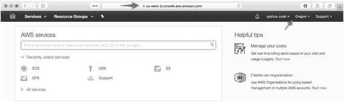

图 1-1. 读者应注意自己工作的区域

### 配置密钥对

为了与运行在 `AWS EC2` 上的沙盒系统交互，你需要一个 `ssh` 密钥对。Amazon `EC2` 使用公钥加密技术来促进与运行中 `EC2` 实例的所有连接。对你而言，这意味着需要在本地系统与将在 `EC2` 实例上配置的沙盒系统之间建立安全连接。为此，你需要在本地创建一个 `ssh` 密钥对，并将密钥对的公钥部分导入 `AWS`。当你创建新实例时，`AWS` 会使用该公钥配置新实例，这样你就可以使用本地的私钥连接到该实例。注意：建议 Windows 用户使用 `Git for Windows` 软件包中提供的优秀 `Git BASH` 工具，下载地址为：[`git-for-windows.github.io`](https://git-for-windows.github.io)。`Git BASH` 将包含你所需的所有命令行工具，包括 `ssh-keygen` 和 `ssh`。在代码清单 1-1 中，你使用 `ssh-keygen` 工具在本地系统上创建密钥对。为此目的（即一个可丢弃的沙盒 `AWS` 系统），你可以将所有字段留空，包括使用 `ssh` 密钥的密码短语。密钥的保存位置因系统而异。我系统上的默认位置是 `~/.ssh/id_rsa`，其中 `~` 表示当前用户的主目录。此过程将创建 `id_rsa` 和 `id_rsa.pub` 这一密钥对。你需要将 `id_rsa.pub` 密钥放入希望访问的系统中，从而能够使用 `id_rsa` 文件通过 `ssh` 连接到这些系统。

```
$ ssh-keygen -t rsa
正在生成公钥/私钥 rsa 密钥对。
输入保存密钥的文件（/home/ubuntu/.ssh/id_rsa）：
输入密码短语（空表示无密码短语）：
再次输入相同密码短语：
您的身份信息已保存在 /home/ubuntu/.ssh/id_rsa 中。
您的公钥已保存在 /home/ubuntu/.ssh/id_rsa.pub 中。
密钥指纹为：
SHA256:g5IYNQMf1n1jW5p36Y9I/qSPxnckhT665KtiB06xu2U ubuntu@ip-172-31-43-19
密钥的随机艺术图像为：
+---[RSA 2048]----+
|  ..*. .         |
|   + +. . + .    |
|  . .    o *   o |
|   o . .. + . + .|
|  . o . So . + . |
|     .  +.  . = .|
|       o oE+.o.* |
|        =o.o*+o o|
|       ..+.o**o. |
+----[SHA256]-----+
```

代码清单 1-1. 创建新的密钥对

在代码清单 1-2 中，你使用 `cat` 工具验证密钥的内容。你显示了一个在远程 `Ubuntu` 系统上创建的公钥，这可以从密钥末尾（`ubuntu@ip-172-31-43-19`）看出。这在任何系统上都应类似。

```
$ cat ~/.ssh/id_rsa.pub
ssh-rsa AAAAB3NzaC1yc2EAAAADAQABAAABAQDdnHPEiq1a4OsDDY+g9luWQS8pCjBmR64MmsrQ9MaIaE5shIcFB1Kg3pGwJpypiZjoSh9pS55S9LckNsBfn8Ff42ALLjR8y+WlJKVk/0DvDXgGVcCc0t/uTvxVx0bRruYxLW167J89UnxnJuRZDLeY9fDOfIzSR5eglhCWVqiOzB+OsLqR1W04Xz1oStID78UiY5msW+EFg25Hg1wepYMCJG/Zr43ByOYPGseUrbCqFBS1KlQnzfWRfEKHZbtEe6HbWwz1UDL2NrdFXxZAIXYYoCVtl4WXd/WjDwSjbMmtf3BqenVKZcP2DQ9/W+geIGGjvOTfUdsCHennYIEUfEEP ubuntu@ip-172-31-43-19
```

代码清单 1-2. 验证新创建的 `ssh` 密钥

### 在 AWS 上创建新的密钥对

登录 AWS 控制面板，导航至 EC2 控制面板，如图 1-2 所示。首先，访问“服务”（图 1-2，#1），然后访问“EC2”（图 1-2，#2）。可以从 AWS 网站的任何页面访问“服务”链接。

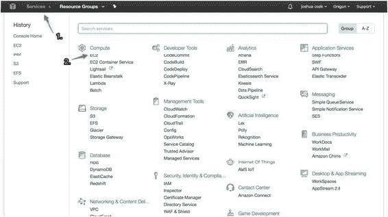

图 1-2. 访问 EC2 控制面板

进入 EC2 控制面板后，使用任一链接访问密钥对窗格（图 1-3）。

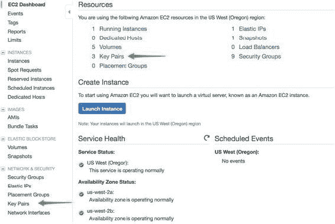

图 1-3. 在 EC2 控制面板中访问密钥对

在密钥对窗格中，选择“导入密钥对”。这将激活一个模态窗口，您可以使用它来创建一个与 AWS 账户上某个区域关联的新密钥对。请确保为密钥对指定一个对计算机友好的名称，例如 `from-MacBook-2017`。将您的公钥（`id_rsa.pub`）的内容粘贴到公钥内容中。在单击“导入”之前，您的密钥应如图 1-4 所示。单击“导入”以创建新密钥。

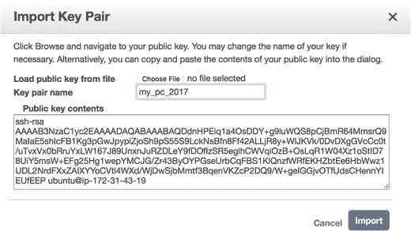

图 1-4. 导入新的密钥对

> **注意**
>
> 许多 AWS 资源是按区域唯一创建的。在一个区域创建的密钥对在另一个区域不可用。

您已在 AWS 和本地系统之间创建了一个密钥对。当您创建新实例时，您将指示 AWS 使用此密钥对配置该实例，从而您可以从本地系统访问基于云的系统。

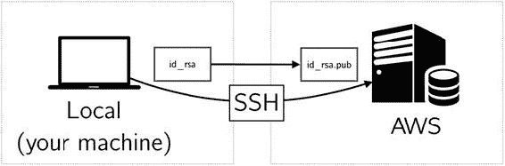

图 1-5. 使用 SSH 密钥从本地机器连接到 AWS

> **注意**
>
> 术语可能有点令人困惑。AWS 将上传的公钥称为“密钥对”。需要明确的是，您上传的是在本地系统上创建的密钥对的公钥部分（例如 `id_rsa.pub`）。私钥将保留在您的系统上（例如 `id_rsa`）。

### 创建新的安全组

在 EC2 控制面板中，使用任一链接访问安全组窗格（图 1-6）。

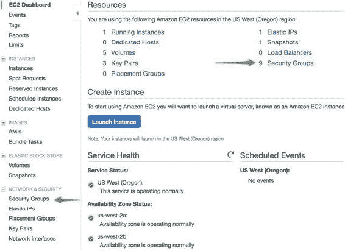

图 1-6. 在 EC2 控制面板中访问安全组

在安全组窗格中，单击“创建安全组”。为安全组指定一个对计算机友好的组名，例如 `jupyter_docker`。为安全组添加描述，例如“开放 Jupyter 和 Docker 默认端口的访问”。使用默认 VPC。访问“入站”选项卡并配置以下安全规则：

*   SSH：端口范围：22，来源：任意位置
*   HTTP：端口范围：80，来源：任意位置
*   HTTPS：端口范围：443，来源：任意位置
*   自定义 TCP 规则：端口范围：2376，来源：任意位置
*   自定义 TCP 规则：端口范围：8888，来源：任意位置

添加完所有这些规则后，应如图 1-7 所示。表 1-1 列出了端口以及通过这些端口可访问的服务。

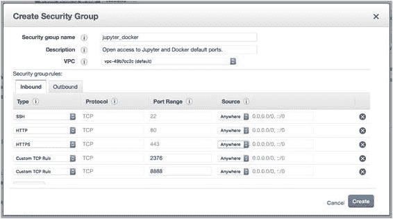

图 1-7. 新安全组的入站规则

**表 1-1. 端口及用途**

| 端口 | 可用服务 |
|------|----------|
| 22   | SSH      |
| 80   | HTTP     |
| 443  | HTTPS    |
| 2376 | Docker Hub|
| 8888 | Jupyter  |

### 创建新的 EC2 实例

要创建新实例，请从 EC2 控制面板开始，然后点击“启动实例”按钮（图 1-8）。

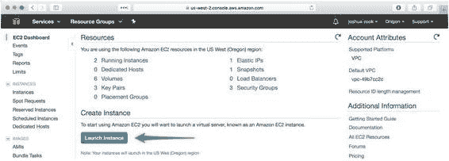

图 1-8. 启动新实例

启动新实例是一个多步骤的过程，引导用户完成所有必要的配置。第一个选项卡是“选择 AMI”。AMI 是亚马逊机器镜像⁷，包含运行沙盒机器所需的软件。我建议选择符合免费套餐资格的最新稳定版 Ubuntu Server。在撰写本文时，该版本为 `ami-efd0428f`，Ubuntu Server 16.04 LTS (HVM)，SSD 卷类型（图 1-9）。

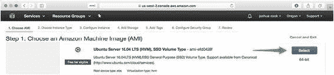

图 1-9. 选择最新的稳定版 Ubuntu Server 作为 AMI

第二个选项卡是“选择实例类型”。在使用中，我发现免费套餐 `t2.micro`（图 1-10）足以满足许多应用，尤其是在阅读本书时可能进行的沙盒类工作。也就是说，在阅读本书的过程中，你可能不会对数据集进行长时间处理，而是学习如何配置不同的系统。因此，你的内存需求可能会降低。最终目标是让读者能够随意创建和销毁机器。达到这种掌握程度后，读者可以为任何应用选择最低要求。

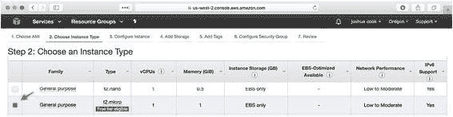

图 1-10. 使用 `t2.micro` 类型

第三个选项卡“配置实例”可以安全地忽略。第四个选项卡是“添加存储”。此选项也取决于预期用途。需要注意的是，Jupyter Docker 镜像在本地镜像缓存中可能占用超过 5GB 的磁盘空间。因此，建议将默认的 8GB 提高到 20GB 左右。

第五个选项卡“添加标签”可以安全地忽略。第六个选项卡“配置安全组”对于系统的正常运行至关重要。之前，你配置了一个新的安全组供系统使用。你需要将刚刚创建的安全组 `jupyter_docker` 分配给你正在配置的实例。选择“选择现有安全组”，然后选择你刚刚创建的安全组。验证选项卡底部的入站规则中是否开放了端口 22、80、443、2376 和 8888（图 1-11）。

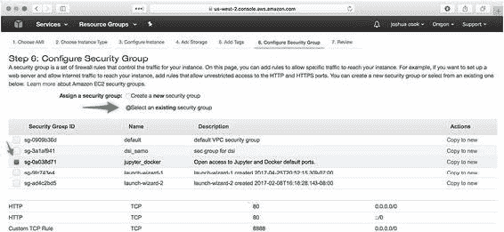

图 1-11. 为所有流量配置安全组

> **注意**
>
> 大多数读者在最后阶段会收到来自 AWS 的警告，大意是“提高实例的安全性。您的安全组 `jupyter_docker` 对世界开放。”作者认为，可以安全地忽略此警告。该警告告知我们，我们准备启动的实例可以在开放网络上访问。这是有意为之且经过设计的。在第一次也是最后一次关于系统安全的讨论中，我们将忽略这个担忧，并迅速转向开发短生命周期的可扩展系统。

最后，点击“审核和启动”。在这里，你将看到要创建的 EC2 实例的具体配置。验证你正在创建一个 `t2.micro` 实例，运行最新且符合免费套餐资格的 Ubuntu Server 版本，并且对所有流量开放，然后点击“启动”按钮（图 1-12）。

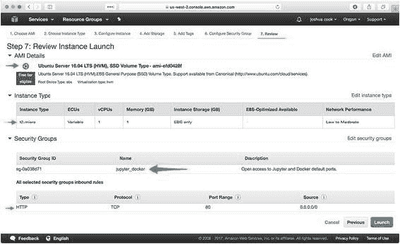

图 1-12. 启动新的 EC2 实例

在最后的确认步骤中，你会看到一个标题为“选择现有密钥对或创建新密钥对”的模态框。选择你之前创建的密钥对。勾选确认可以访问该密钥对的复选框，然后启动实例（图 1-13）。

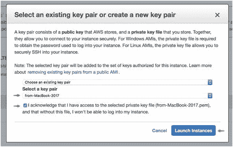

图 1-13. 选择之前导入的密钥对

你应该会看到一条通知，提示实例正在运行。点击右下角的“查看实例”选项卡，进入 EC2 控制面板的“实例”窗格，你应该会看到新实例正在运行。记下新实例的 IP 地址（图 1-14）。

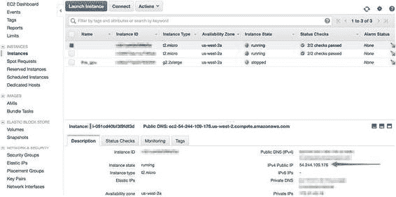

图 1-14. 记下正在运行的实例的 IP 地址

#### 配置新 EC2 实例以使用 Docker

设置好 EC2 实例后，你使用刚获得的 IP 地址通过 `ssh` 登录到该实例，以便为新实例配置 Docker（清单 1-3）。

```
$ ssh ubuntu@54.244.109.176
Welcome to Ubuntu 16.04.2 LTS (GNU/Linux 4.4.0-64-generic x86_64)
...
```

清单 1-3. 通过 SSH 登录 EC2 实例

> **注意**
>
> 首次访问 EC2 实例时，你应该会看到以下消息：
>
> `The authenticity of host '54.244.109.176 (54.244.109.176)' can't be established ... Are you sure you want to continue connecting (yes/no)?`
>
> 这是预期行为。你应该按 `<ENTER>` 键接受，或输入 `yes` 然后按 `<ENTER>` 键。

接下来（清单 1-4），你使用 Docker 团队提供的便捷安装脚本来安装和配置 Docker。该脚本从 `get.docker.com` 获取，并通过管道（`|`）传递给 shell（`sh`）。

```
$ curl -sSL https://get.docker.com/ | sh
apparmor is enabled in the kernel and apparmor utils were already installed
+ sudo -E sh -c sleep 3; apt-get update
...
+ sudo -E sh -c docker version
Client:
 Version:      17.04.0-ce
 API version:  1.28
 Go version:   go1.7.5
 Git commit:   4845c56
 Built:        Mon Apr  3 18:07:42 2017
 OS/Arch:      linux/amd64
Server:
 Version:      17.04.0-ce
 API version:  1.28 (minimum version 1.12)
 Go version:   go1.7.5
 Git commit:   4845c56
 Built:        Mon Apr  3 18:07:42 2017
 OS/Arch:      linux/amd64
 Experimental: false
...
```

清单 1-4. 通过 Shell 脚本安装 Docker

在清单 1-5 中，你将 `ubuntu` 用户添加到 `docker` 组。默认情况下，命令行 `docker` 客户端需要 `sudo` 权限才能向 `docker` 守护进程发出命令。你可以将 `ubuntu` 用户添加到 `docker` 组，以允许 `ubuntu` 用户无需 `sudo` 即可向 `docker` 发出命令。

```
$ sudo usermod -aG docker ubuntu
```

清单 1-5. 将 Ubuntu 用户添加到 Docker 组

最后，为了强制更改生效，你重新启动系统（清单 1-6）。作为重启系统的替代方案，用户可以简单地断开并重新连接到远程系统。

```
$ sudo reboot
```

清单 1-6. 重启 Docker 守护进程

重启将导致与 EC2 实例的安全 shell 连接关闭。等待片刻后，重新连接到系统。此时，你的系统就可以使用了。向 `docker` 客户端发出命令时，应该不再需要 `sudo`。你可以通过连接到远程系统并检查 `docker` 版本来验证这一点（清单 1-7）。

```
$ ssh ubuntu@54.244.109.176
$ docker -v
Docker version 17.04.0-ce, build 4845c56
```

清单 1-7. 登录远程系统并检查 Docker 版本

# 数据的基础设施限制

在开始使用 Docker 和 Jupyter 构建可扩展的计算编程系统之前，让我们先在这个新的 AWS 实例上进行一系列简单的实验。你将通过一系列简单的问题开始：

> 对于 `t2.micro` 实例来说，多大的数据集会大到无法加载到内存中？在 `t2.micro` 实例上，多大的数据集会导致 Jupyter 无法拟合不同类型的简单机器学习分类模型（例如 K 近邻模型）？决策树模型呢？逻辑回归模型呢？支持向量分类器呢？

为了回答这些问题，你将按照以下步骤进行：

1.  在你的 AWS 实例上使用 Docker 运行 `jupyter/scipy-notebook` 镜像。

2.  在运行时以及加载每个数据集时，使用 `docker stats` 监控内存使用情况。

3.  使用 `sklearn.datasets.make_classification` 函数在 Jupyter Notebook 中创建任意大小的数据集，并执行拟合操作。

4.  在每次模型拟合完成后，重启 Python 内核。

5.  记录导致内存异常的数据集大小。

## 拉取 `jupyter/scipy-notebook` 镜像

由于你正在一个全新配置的 AWS 实例上工作，你必须首先拉取你想要使用的 Docker 镜像，即 `jupyter/scipy-notebook`。这可以使用 `docker pull` 命令来完成，如清单 1-8 所示。该镜像从 Project Jupyter 的公共 Docker Hub 账户中拉取。

```
ubuntu@ip-172-31-6-246:~$ docker pull jupyter/scipy-notebook
Using default tag: latest
latest: Pulling from jupyter/scipy-notebook
693502eb7dfb: Pull complete
a3782c2efb41: Pull complete
9cb32b776a40: Pull complete
e539f5722cd5: Pull complete
b4690d4047c6: Pull complete
121dc465f5c6: Pull complete
c352772bbcfd: Pull complete
eeda14d1c421: Pull complete
0057b9e76c8a: Pull complete
e63bd87d75dd: Pull complete
055904fbc069: Pull complete
d336770b8a83: Pull complete
d61dbef85c7d: Pull complete
c1559927bbf2: Pull complete
ee5b638d15a3: Pull complete
dc937a931aca: Pull complete
4327c0faf37c: Pull complete
b37332c24e8c: Pull complete
b230bdb41817: Pull complete
765fecb84d9c: Pull complete
97efa424ddfa: Pull complete
ccfb7ed42913: Pull complete
2fb2abb673ce: Pull complete
Digest: sha256:04ad7bdf5b9b7fe88c3d0f71b91fd5f71fb45277ff7729dbe7ae20160c7a56df
Status: Downloaded newer image for jupyter/scipy-notebook:latest
```

清单 1-8. 拉取 `jupyter/scipy-notebook` 镜像。

一旦你拉取了镜像，它就会出现在你的 `docker images` 缓存中。任何时候你想运行一个新的 Jupyter 容器，Docker 都会从缓存中的镜像加载该容器。

## 运行 `jupyter/scipy-notebook` 镜像

在清单 1-9 中，你使用最小可行的 `docker run` 命令运行了一个 Jupyter Notebook 服务器。这里，`-p` 标志用于将主机（你的 EC2 实例）上的端口 `8888` 链接到 Docker 容器中 Jupyter Notebook 服务器运行的端口 `8888`。

```
$ docker run -p 8888:8888 jupyter/scipy-notebook
[I 22:10:01.236 NotebookApp] Writing notebook server cookie secret to /home/jovyan/.local/share/jupyter/runtime/notebook_cookie_secret
[W 22:10:01.326 NotebookApp] WARNING: The notebook server is listening on all IP addresses and not using encryption. This is not recommended.
[I 22:10:01.351 NotebookApp] JupyterLab alpha preview extension loaded from /opt/conda/lib/python3.5/site-packages/jupyterlab
[I 22:10:01.358 NotebookApp] Serving notebooks from local directory: /home/jovyan/work
[I 22:10:01.358 NotebookApp] 0 active kernels
[I 22:10:01.358 NotebookApp] The Jupyter Notebook is running at: http://[all ip addresses on your system]:8888/?token=7b02e3aadb29c42ff066a7290d81dd48e44ce62bd7f2bd0a
[I 22:10:01.359 NotebookApp] Use Control-C to stop this server and shut down all kernels (twice to skip confirmation).
[C 22:10:01.359 NotebookApp] 
    Copy/paste this URL into your browser when you connect for the first time, to login with a token:
    http://localhost:8888/?token=7b02e3aadb29c42ff066a7290d81dd48e44ce62bd7f2bd0a
```

清单 1-9. 运行 Jupyter Notebook 服务器。

正在运行的 Jupyter Notebook 服务器的输出为你提供了一个身份验证令牌（`token=7b02e3aadb29c42ff066a7290d81dd48e44ce62bd7f2bd0a`），你可以使用它通过浏览器访问 Notebook 服务器。你可以使用提供的 URL 来执行此操作，但需要将 `localhost` 替换为你的 EC2 实例的 IP 地址（清单 1-10）。

```
http://54.244.109.176:8888/?token=1c32913725d84a76e7b3f04c45b91e17b77f3c3574779101
```

清单 1-10. 在 AWS 上运行的 Jupyter 实例的 URL，其中访问令牌作为查询参数传递。

## 监控内存使用情况

在清单 1-11 中，你使用 `docker ps` 命令查看正在运行的容器。你将看到一个使用 `jupyter/scipy-notebook` 镜像运行的容器。

```
$ docker ps
CNID  IMAGE      COMMAND    CREATED     STATUS     PORTS           NAMES
cfef  jupyter/   scipy...   "tini..."  10 min ago  Up 10 min  0.0.0.0:8888->  friendly_
                                                                   8888/tcp        curie
```

清单 1-11. 监控正在运行的 Docker 容器。

接下来，你使用 `docker stats` 来监控正在运行容器的活动内存使用情况（清单 1-12）。`docker stats` 是一个活动进程，你将用它来全程监控内存使用情况。

# 多大的数据集会导致内存异常？

你可以在这里看到与上述问题相关的几件事。服务器当前没有使用任何分配的 CPU。你可以看到 Docker 容器有近 1GB 的可用内存，其中使用了 5%，大约 50MB。这 1GB 与你对 `t2.micro` 可用内存量的预期相符。

## 监控 Docker 内存使用情况

```
$ docker stats
CONTAINER     CPU %  MEM USAGE / LIMIT    MEM %  NET I/O    BLOCK I/O   PIDS
cfef9714b1c5  0.00%  49.73MiB / 990.7MiB  5.02%  60.3kB /   10.4MB / 0B 2
                                                         1.36MB
```

清单 1-12. 监控 Docker 内存使用情况

您将使用 Jupyter Notebook 来运行测试。首先，您需要使用 Python 3 内核创建一个新的 notebook（图 1-15）。

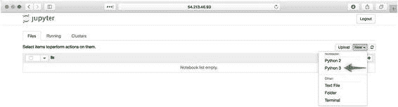

图 1-15. 创建一个新的 notebook

在代码清单 1-13 中，您将再次检查内存使用情况。（启动一个新的 notebook 后，当前内存使用量增加到约 1GB 的 9%。）

```
$ docker stats
CONTAINER     CPU %  MEM USAGE / LIMIT    MEM %  NET I/O   BLOCK I/O    PIDS
cfef9714b1c5  0.01%  87.18MiB / 990.7MiB  8.80%  64.2kB /  12.6MB /     13
                                                 1.48MB    217kB
```

代码清单 1-13. 监控 Docker 内存使用情况

如果您关闭并停止（图 1-16）正在运行的 notebook，您可以看到内存使用量恢复到约 1GB 的 5% 的基线水平（代码清单 1-14）。

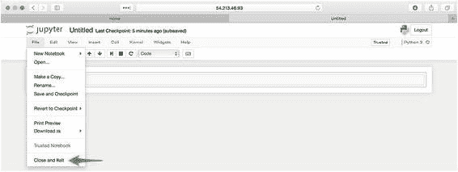

图 1-16. 关闭并停止正在运行的 notebook

```
$ docker stats
CONTAINER     CPU %  MEM USAGE / LIMIT    MEM %  NET I/O   BLOCK I/O    PIDS
cfef9714b1c5  0.00%  55.31MiB / 990.7MiB  5.58%  109kB /   12.4MB /     4
                                                 1.56MB    397kB
```

代码清单 1-14. 监控 Docker 内存使用情况

Python 机器学习库 `scikit-learn`¹¹ 有一个专门用于加载规范数据集和生成合成数据集的模块：`sklearn.datasets`。重新启动您的 notebook，并从该模块加载 `make_classification` 函数（代码清单 1-15，图 1-17），使用从模块导入函数的标准 Python 语法。再次检查内存使用情况（代码清单 1-16）。


图 1-17. 导入 `make_classification`

```
In [1]: from sklearn.datasets import make_classification
```

代码清单 1-15. 导入 `make_classification`

```
$ docker stats
CONTAINER     CPU %  MEM USAGE / LIMIT    MEM %   NET I/O  BLOCK I/O    PIDS
cfef9714b1c5  0.04%  148.3MiB / 990.7MiB  14.97%  242kB /  49.3MB /     13
                                                  4.03MB   340kB
```

代码清单 1-16. 监控 Docker 内存使用情况

接下来（代码清单 1-17，图 1-18），您将使用默认值创建一个新的分类数据集。然后，您将使用 `%whos` IPython 魔法命令¹² 来显示数据集在内存中的大小。之后，您将检查内存使用情况（代码清单 1-18）。

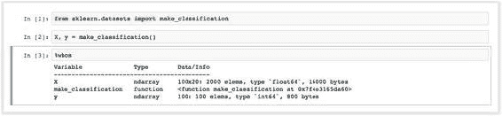

图 1-18. 导入 `make_classification`

```
In [2]: X, y = make_classification()

In [3]: %whos
Variable              Type        Data/Info
-------------------------------------------
X                     ndarray     100x20: 2000 elems, type 'float64', 16000 bytes
make_classification   function    <function make_classification at 0x7feb192669d8>
y                     ndarray     100: 100 elems, type 'int64', 800 bytes
```

代码清单 1-17. 使用默认值创建一个新的分类数据集

```
$ docker stats
CONTAINER     CPU %  MEM USAGE / LIMIT    MEM %   NET I/O  BLOCK I/O  PIDS
cfef9714b1c5  0.01%  152MiB / 990.7MiB    15.35%  268kB /  54.1MB /   13
                                                  4.1MB    926kB
```

代码清单 1-18. 监控 Docker 内存使用情况

到目前为止，您对系统的负载很小。请注意与此默认分类数据集关联的数据集大小、Python 内存大小和 Docker 系统使用情况，然后重启 Python 内核（图 1-19）。

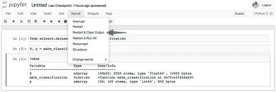

图 1-19. 重启 Python 内核

接下来，您将重新运行相同的实验，将特征集的大小增加 10 倍（代码清单 1-19，图 1-20）。在代码清单 1-20 中，您将检查 Docker 系统使用情况。

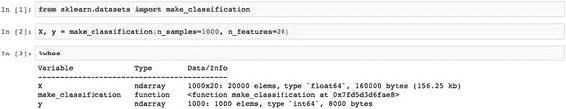

图 1-20. 导入 `make_classification`

```
In [2]: X, y = make_classification(n_samples=1000, n_features=20)

In [3]: %whos
Variable              Type        Data/Info
-------------------------------------------
X                     ndarray     100x20: 2000 elems, type `float64`, 160000 bytes
make_classification   function    <function make_classification at 0x7feb192669d8>
y                     ndarray     100: 100 elems, type `int64`, 8000 bytes
```

代码清单 1-19. 创建一个新的分类数据集

```
$ docker stats
CONTAINER     CPU %  MEM USAGE / LIMIT    MEM %   NET I/O   BLOCK I/O   PIDS
cfef9714b1c5  0.01%  149.7MiB / 990.7MiB  15.11%  286kB /   54.5MB /    13
                                                  4.13MB    1.13MB
```

**代码清单 1-20.** 监控 Docker 内存使用情况

重复实验几次，将结果记录在表 1-2 中。每次重启内核，创建一个比前一个数据集大 10 倍的新数据集，然后使用 IPython 魔法命令`%whos`和`docker stats`工具检查内存使用情况。

**表 1-2.** t2.micro 上的分类数据集内存占用

| 特征集形状 | Python 内存大小 | Docker 系统使用量 |
| --- | --- | --- |
| 100 × 20 | .016MB | 152MB |
| 1000 × 20 | .16MB | 149.7MB |
| 1000 × 200 | 1.525MB | 152.8MB |
| 10000 × 200 | 15.25MB | 162.6MB |
| 10000 × 2000 | 152.6MB | 279.7MB |
| 100000 × 2000 | 内存异常 | N/A |

在创建每个数据集后重启 Python 内核。请注意导致内存异常的数据集大小。当您尝试创建一个大小为 100000 × 2000 的分类数据集时，您会遇到`MemoryError`，如代码清单 1-21 和图 1-21 所示。

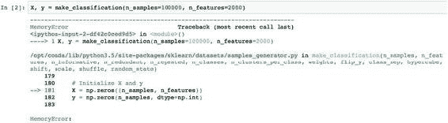

**图 1-21.** 尝试创建分类数据集时出现`MemoryError`

```
In [2]: X, y = make_classification(n_samples=100000, n_features=2000)
---------------------------------------------------------------------------
MemoryError                               Traceback (most recent call last)
<ipython-input-2-df42c0ced9d5> in <module>()
----> 1 X, y = make_classification(n_samples=100000, n_features=2000)

/opt/conda/lib/python3.5/site-packages/sklearn/datasets/samples_generator.py in make_classification(n_samples, n_features, n_informative, n_redundant, n_repeated, n_classes, n_clusters_per_class, weights, flip_y, class_sep, hypercube, shift, scale, shuffle, random_state)
    179
    180     # Initialize X and y
--> 181     X = np.zeros((n_samples, n_features))
    182     y = np.zeros(n_samples, dtype=np.int)
    183
MemoryError:
```

**代码清单 1-21.** 尝试创建分类数据集时出现`MemoryError`

至此，您已经达到了当前系统的内存上限。这并不是一个特别大的数据集：100,000 行和 2000 列。但同样，您使用的也不是一个特别大的系统：单个 CPU 和 1GB 内存。当然，您可以想象在某些情况下，您需要在更大的系统上处理更大的数据集。

### 多大的数据集对于拟合不同类型的简单模型来说算太大？

接下来，我们来回答第二个问题。我们将通过启动一个全新的 Docker 容器来完成。首先，在代码清单 1-22 中，你再次使用`docker ps`来显示正在运行的容器。

```
$ docker ps
CNID IMAGE     COMMAND   CREATED      STATUS      PORTS            NAMES
cfef jupyter/  "tini..." 53 min ago   Up 53 min   0.0.0.0:8888->   friendly_
     scipy...                                 8888/tcp         curie
```

**代码清单 1-22.** 监控正在运行的 Docker 容器

在代码清单 1-23 中，你停止并移除了这个容器。

```
$ docker stop friendly_curie
friendly_curie
ubuntu@ip-172-31-1-64:∼$ docker rm friendly_curie
friendly_curie
```

**代码清单 1-23.** 停止并移除一个正在运行的容器

接下来，在代码清单 1-24 中，你启动了一个全新的`jupyter/scipy-notebook`容器。

```
$ docker run -p 8888:8888 jupyter/scipy-notebook
[I 20:05:42.246 NotebookApp] Writing notebook server cookie secret to /home/jovyan/.local/share/jupyter/runtime/notebook_cookie_secret ...
    Copy/paste this URL into your browser when you connect for the first time,
    to login with a token:
        http://localhost:8888/?token=7a65c3c7dc6ea294a38397a48cc1ffe110ea138aef6d42c4
```

**代码清单 1-24.** 运行 Jupyter Notebook 服务器

请务必记下新的安全令牌（`7a65c3c7dc6ea294a38397a48cc1ffe110ea138aef6d42c4`），并再次使用 AWS 实例的 IP 地址代替`localhost`（代码清单 1-25）。

```
http://54.244.109.176:8888/?token=7a65c3c7dc6ea294a38397a48cc1ffe110ea138aef6d42c4
```

**代码清单 1-25.** 在 AWS 上运行的新 Jupyter 实例的 URL，访问令牌作为查询参数传递

在开始之前，通过`docker stats`测量当前容器的基线使用情况（代码清单 1-26）。

```
$ docker stats
CONTAINER     CPU %  MEM USAGE / LIMIT    MEM %   NET I/O  BLOCK I/O    PIDS
22efba43b763  0.00%  43.29MiB / 990.7MiB  4.37%   768B /   0B / 0B      2
                                                   486B
```

**代码清单 1-26.** 监控 Docker 内存使用情况

你再次创建一个新的 Python 3 Notebook，并着手回答第二个问题。在代码清单 1-27 中，你检查了运行全新 notebook 时 Docker 机器的内存使用情况。

```
$ docker stats
CONTAINER     CPU %  MEM USAGE / LIMIT    MEM %   NET I/O   BLOCK I/O   PIDS
22efba43b763  0.04%  90.69MiB / 990.7MiB  9.15%   58.8kB /  0B / 217kB  13
                                                   1.3MB
```

**代码清单 1-27.** 监控 Docker 内存使用情况


解决这个问题的方法会略有不同，并且会更频繁地使用 `docker stats`。`%whos` IPython 魔法命令不能用于显示拟合模型的内存使用情况，事实上，并不存在一种简单的测量内存使用的方法。¹³ 你将利用你对 `make_classification` 创建的数据所占内存空间的知识，以及刚刚测量的基线性能。你将使用代码清单 1-28 中的代码模式来执行此分析。

```
from sklearn.datasets import make_classification
from sklearn.<model_module> import <model>
X, y = make_classification(<shape>)
model = <model>()
model.fit(X, y)
model.score(X, y)
```

代码清单 1-28. 创建一个新的分类数据集并执行朴素模型拟合

例如，使用以下代码来拟合最小的 `KNeighborsClassifier`（代码清单 1-29）、`DecisionTreeClassifier`（代码清单 1-30）、`LogisticRegression`（代码清单 1-31）和 `SVC`（代码清单 1-32）。然后，你将为后续的每次测试修改数据的规模。

```
from sklearn.datasets import make_classification
from sklearn.neighbors import KNeighborsClassifier
X, y = make_classification(1000, 20)
model = KNeighborsClassifier()
model.fit(X, y)
model.score(X, y)
```

代码清单 1-29. 拟合最小的 KNeighborsClassifier

```
from sklearn.datasets import make_classification
from sklearn.tree import DecisionTreeClassifier
X, y = make_classification(1000, 20)
model = DecisionTreeClassifier()
model.fit(X, y)
model.score(X, y)
```

代码清单 1-30. 拟合最小的 DecisionTreeClassifier

```
from sklearn.datasets import make_classification
from sklearn.linear_model import LogisticRegression
X, y = make_classification(1000, 20)
model = LogisticRegression()
model.fit(X, y)
model.score(X, y)
```

代码清单 1-31. 拟合最小的 LogisticRegression

```
from sklearn.datasets import make_classification
from sklearn.neighbors import SVC
X, y = make_classification(1000, 20)
model = SVC()
model.fit(X, y)
model.score(X, y)
```

代码清单 1-32. 拟合最小的 SVC

然后，你使用 `docker stats` 检查 Docker 系统的使用情况。在每次测试之间，你使用 `docker restart`（代码清单 1-33）后跟容器 ID `22efba43b763` 来重置容器上的内存使用情况。重启容器后，你通常还需要确认重启 Jupyter 内核（图 1-22）。

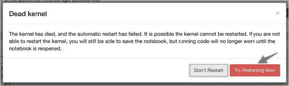

图 1-22. 确认重启 Jupyter 内核

```
$ docker restart 22efba43b763
```

代码清单 1-33. 重启你的 Docker 容器

本次实验的结果记录在表 1-3 和图 1-23 中。

表 1-3. 数据集分类及模型在 t2.micro 上的内存占用

| 特征集形状 | 模型类型 | 数据集系统使用量 (MB) | 数据集与拟合峰值系统使用量 (MB) | 差值 (MB) |
| --- | --- | --- | --- | --- |
| 基线（无 Notebook 运行） | 不适用 | 不适用 | 不适用 | 40.98 |
| 基线（Notebook 运行） | 不适用 | 不适用 | 不适用 | 76.14 |
| 100 × 20 | KNeighborsClassifier | 99.9 | 100.0 | 0.1 |
| 100 × 20 | DecisionTreeClassifier | 103.2 | 103.3 | 0.1 |
| 100 × 20 | LogisticRegression | 102.5 | 102.6 | 0.1 |
| 100 × 20 | SVC | 101.2 | 101.4 | 0.2 |
| 1000 × 20 | KNeighborsClassifier | 100.3 | 100.4 | 0.1 |
| 1000 × 20 | DecisionTreeClassifier | 103.7 | 103.8 | 0.1 |
| 1000 × 20 | LogisticRegression | 104.9 | 105.1 | 0.2 |
| 1000 × 20 | SVC | 104.9 | 105.5 | 0.6 |
| 1000 × 200 | KNeighborsClassifier | 106.3 | 106.9 | 0.6 |
| 1000 × 200 | DecisionTreeClassifier | 104.8 | 105.7 | 0.9 |
| 1000 × 200 | LogisticRegression | 102.0 | 102.3 | 0.3 |
| 1000 × 200 | SVC | 104.6 | 106.0 | 1.4 |
| 10000 × 200 | KNeighborsClassifier | 115.5 | 117.8 | 2.3 |
| 10000 × 200 | DecisionTreeClassifier | 119.8 | 127.8 | 8.0 |
| 10000 × 200 | LogisticRegression | 121.3 | 122.6 | 1.3 |
| 10000 × 200 | SVC | 121.1 | 286.7 | 165.6 |
| 10000 × 2000 | KNeighborsClassifier | 256.4 | 275.1 | 18.7 |
| 10000 × 2000 | DecisionTreeClassifier | 257.1 | 333.6 | 76.5 |
| 10000 × 2000 | LogisticRegression | 258.6 | 564.9 | 306.3 |
| 10000 × 2000 | SVC | 256.3 | 491.9 | 235.6 |

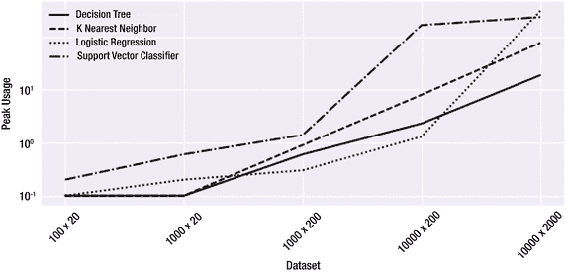

图 1-23. 数据集与各模型峰值使用量对比

### 测量 T2.Micro 上可容纳的数据规模

在之前的测试中，一个 10000 行 x 2000 列的数据集是你能成功加载到内存中的最大数据集。在这次测试中，你成功地对每个能加载到内存的数据集，拟合了四种不同机器学习模型的朴素实现。话虽如此，你可以看到，无论是 `LogisticRegression` 还是 `SVC`（支持向量分类器）都无法处理更大的数据量。

## 总结


在本章中，我介绍了本文的核心主题——`Docker` 和 `Jupyter`，并讨论了学习本文时推荐的一种实践方法，即在亚马逊云服务上使用一次性 Linux 实例。我提供了配置、启动和配置此类实例的详细说明。启动实例后，你使用 `Docker` 和 `Jupyter` 探索了一个玩具级的大数据示例，在使用 `scikit-learn` 生成的合成分类数据集加载和拟合模型时，诊断了内存性能。我并不期望本章能让你彻底掌握如何使用 `Docker` 和 `Jupyter` 构建执行数据科学的系统。相反，我希望它能作为对该主题的实质性介绍。与其简单陈述 `Docker` 和 `Jupyter` 是什么，我更希望你能通过使用它们来了解这两项技术。在接下来的章节中，你将探索 `Docker` 和 `Jupyter` 生态系统的许多方面。之后，你将了解开源数据存储 `Redis`、`MongoDB` 和 `PostgreSQL`，以及如何将它们集成到基于 Docker 的应用程序中。最后，你将学习 `Docker Compose` 工具，以及如何将所有部分整合到一个 `docker-compose.yml` 文件中。

脚注 1 [www.docker.com/use-cases](http://www.docker.com/use-cases)
2 [www.digitalocean.com](http://www.digitalocean.com)
3 [`cloud.google.com`](https://cloud.google.com)
4 创建新 AWS 账户的说明可在 [`aws.amazon.com/premiumsupport/knowledge-center/create-and-activate-aws-account/`](https://aws.amazon.com/premiumsupport/knowledge-center/create-and-activate-aws-account/) 找到。
5 [`docs.aws.amazon.com/AWSEC2/latest/UserGuide/ec2-key-pairs.html`](http://docs.aws.amazon.com/AWSEC2/latest/UserGuide/ec2-key-pairs.html)
6 [www.gnu.org/software/bash/manual/html_node/Tilde-Expansion.html](http://www.gnu.org/software/bash/manual/html_node/Tilde-Expansion.html)
7 [`docs.aws.amazon.com/AWSEC2/latest/UserGuide/AMIs.html`](http://docs.aws.amazon.com/AWSEC2/latest/UserGuide/AMIs.html)
8 [`scikit-learn.org/stable/tutorial/machine_learning_map/`](http://scikit-learn.org/stable/tutorial/machine_learning_map/)
9 [`hub.docker.com/u/jupyter/`](http://hub.docker.com/u/jupyter/)
10 我的 `t2.micro` 只有一个 CPU。
11 [`scikit-learn.org/`](http://scikit-learn.org/)
12 [`ipython.org/ipython-doc/3/interactive/magics.html#magic-whos`](https://ipython.org/ipython-doc/3/interactive/magics.html#magic-whos)
13 [`stackoverflow.com/questions/449560/how-do-i-determine-the-size-of-an-object-in-python`](https://stackoverflow.com/questions/449560/how-do-i-determine-the-size-of-an-object-in-python)

© Joshua Cook 2017

Joshua Cook, *Docker for Data Science*

`doi.org/10.1007/978-1-4842-3012-1_2`


