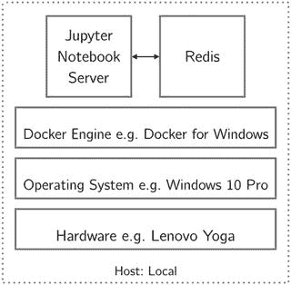
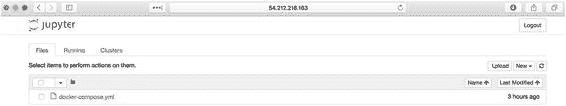
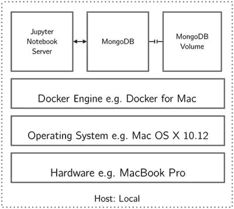

# 构建一个简单的 Docker Compose 应用

你将构建第一个 Docker Compose 应用，它是一个与 Redis 服务器协同运行的 Jupyter Notebook 服务器（图 9-1）。


图 9-1. 一个简单的 Docker Compose 应用

首先，你需要创建一个目录来存放项目（清单 9-5）。

```
$ mkdir ch_9_jupyter_redis
$ cd ch_9_jupyter_redis
```
清单 9-5. 创建目录以存放项目

接下来（清单 9-6），你将使用命令行文本编辑器`vim`创建一个`docker-compose.yml`文件（清单 9-7）来定义此应用。

```
$ vim docker-compose.yml
```
清单 9-6. 创建`docker-compose.yml`

```
version: '3'
services:
  this_jupyter:
    image: jupyter/scipy-notebook
    ports:
     - 8888:8888
    volumes:
      - .:/home/jovyan
  this_redis:
    image: redis:alpine
```
清单 9-7. `jupyter_redis`的`docker-compose.yml`文件

你使用 Compose 文件定义了两个服务：`this_jupyter`和`this_redis`。`this_jupyter`服务：

- 使用 Docker Hub 仓库中的`jupyter/scipy-notebook`镜像，由`image:`关键字指定。

- 将本地目录（`.`）挂载到（希望你已经熟悉的）jupyter 工作目录`/home/jovyan`，由`volumes:`关键字指定。

- 将暴露的端口`8888`转发到主机上的端口`8888`，由`ports:`关键字指定。

- 将容器链接到 Redis 容器，由`links:`参数指定。

`redis`服务使用 Docker Hub 仓库中标签为`alpine`的`redis`镜像。

注意：在`docker-compose.yml`文件中定义的每个容器，其定义必须以`image:`参数或`build:`参数开头。我将在本章下一节讨论`build:`参数。

## 使用 Compose 运行你的应用

你已使用`docker-compose.yml`文件定义了应用。现在（清单 9-8），使用`docker-compose`命令行工具启动应用。你将使用`-d`参数指定以分离模式启动应用。

```
$ docker-compose up
Creating network "ch9jupyterredis_default" with the default driver
Creating ch9jupyterredis_this_redis_1
Creating ch9jupyterredis_this_jupyter_1
```
清单 9-8. 启动 Compose 应用`jupyter_redis`

`docker-compose up`命令首先指示 Docker 引擎执行以下操作之一：

1. 如果容器定义以`image:`关键字开头，则检查本地镜像缓存中是否存在指定的镜像。

2. 如果容器定义以`build:`关键字开头，则从引用的 Dockerfile 构建镜像。

在这里，你为两个容器传递了同一个镜像的关键词。在这种情况下，你正在使用的两个镜像当前都位于镜像缓存中。如果它们不在缓存中，Docker 引擎会从 Docker Hub 拉取它们。接下来，`docker-compose up`命令指示 Docker 引擎创建一个网络，应用程序的容器可以通过该网络进行通信。这里创建了一个名为`ch9jupyterredis_default`的网络。清单 9-14 展示了如何使用这个网络。最后，`docker-compose up`命令指示 Docker 引擎创建`docker-compose.yml`文件中定义的容器。这相当于运行清单 9-9 中的两个命令，但有一个例外：`docker-compose`创建的连接优于`--link`标志创建的链接，稍后你将看到这一点。

警告 不要执行清单 9-9。此处列出它只是为了展示如果你手动实例化这两个容器时需要运行的命令。

```
$ docker run --name ch9jupyterredis_this_redis_1 redis
$ docker run -v `pwd`:/home/jovyan -p 8888:8888 --name ch9jupyterredis_this_jupyter_1 --link ch9jupyterredis_this_redis_1 jupyter/scipy-notebook
```
清单 9-9. 手动实例化`docker-compose.yml`中定义的两个容器

这种方法很繁琐，我希望读者能立即看到使用`docker-compose`在使命令行选项的定义更加直接方面的表面优势。在清单 9-10 中，你使用`docker-compose ps`来显示与当前`docker-compose.yml`文件关联的容器的进程信息。

```
$ docker-compose ps
NameCommand
----------------------------------------------------------------------------
ch9jupyterredis_this_jupyter_1     tini -- start-notebook.sh
ch9jupyterredis_this_redis_1       docker-entrypoint.sh redis ...
State     Ports
----------------------------------------------------------------------------
Up         0.0.0.0:8888->8888/tcp
Up         6379/tcp
```
清单 9-10. 显示当前`docker-compose.yml`的容器

此命令不会像`docker ps`那样显示其他容器的信息。在清单 9-11 中，你更改目录以向上移动一级。完成后，你所在的目录没有`docker-compose`命令可以引用的`docker-compose.yml`文件。当你在没有`docker-compose.yml`文件的目录中请求`docker-compose ps`信息时，会收到一个错误。收到错误后，你返回项目目录。

```
$ cd ..
$ ls
ch_9_jupyter_redis
$ docker-compose ps
ERROR:
        Can't find a suitable configuration file in this directory or any
        parent. Are you in the right directory?
        Supported filenames: docker-compose.yml, docker-compose.yaml
$ cd ch_9_jupyter_redis
```
清单 9-11. 在没有`docker-compose.yml`的目录中请求`docker-compose ps`信息

你可以像操作任何其他 Docker 容器一样操作已创建的容器。在清单 9-12 中，你使用`docker exec`连接到你的 Jupyter 容器。在那里，你检查`env`并将其通过管道 (`|`) 传递给`grep`以搜索`redis`项，以便检查与 Jupyter 容器链接到 Redis 容器相关的环境变量。

```
$ docker exec ch9jupyterredis_this_jupyter_1 bash
jovyan@63f28e183a88:∼$ env | grep redis
```
清单 9-12. 检查 Jupyter 环境变量中的`redis`

请注意，没有显示任何内容。在清单 9-13 中，你通过显示完整的环境来验证这一点。

# 使用持久化功能的 Jupyter 与 Mongo

## 检查 Jupyter 环境变量

```
jovyan@db36cb53ea93:∼$ env
HOSTNAME=db36cb53ea93
NB_USER=jovyan
SHELL=/bin/bash
TERM=xterm
LC_ALL=en_US.UTF-8
LS_COLORS=
...
PWD=/home/jovyan
LANG=en_US.UTF-8
SHLVL=1
HOME=/home/jovyan
LANGUAGE=en_US.UTF-8
XDG_CACHE_HOME=/home/jovyan/.cache/
DEBIAN_FRONTEND=noninteractive
CONDA_DIR=/opt/conda
NB_UID=1000
_=/usr/bin/env
```
**清单 9-13.** 检查 Jupyter 环境变量

在第 8 章的清单 8-12 中，你做了几乎相同的事情。你创建了一个指向正在运行的 `Redis` 容器的链接，尽管在那种情况下，你是通过向 `docker run` 参数传递 `--link` 标志来实现的。然后，你通过 `bash` shell 连接到正在运行的 `Jupyter` 容器，并 `grep` 了 `THIS_REDIS` 的环境变量。如果你还记得，你发现了一些变量，这些变量可以用来代替通过其本地 IP 地址引用 `Redis` 容器。可以看出，当你通过 `docker-compose` 创建由 `Jupyter` 和 `Redis` 组成的应用程序时，情况并非如此。你将需要以不同的方式连接到 `Redis`。幸运的是，正如你稍后将看到的，这要容易得多，非常容易。

趁现在，获取 `Jupyter` 容器的安全令牌，以便你能够通过浏览器访问 `Jupyter`（清单 9-14）。

```
jovyan@63f28e183a88:∼$ jupyter notebook list
Currently running servers:
http://localhost:8888/?token=bca81e140ba43b4a3b20591812a6af32289fc66131e8e5e0 :: /home/jovyan
```
**清单 9-14.** 通过连接到容器的 `bash` Shell 获取 Jupyter 安全令牌

和之前一样，你将使用此令牌在浏览器中访问 `Jupyter`，如有必要，将 `localhost` 替换为相应的 IP 地址。在图 9-2 中，你导航到远程 AWS `t2.micro` 上的 `Jupyter` 站点。你可以看到 `-v` 标志使本地目录中的唯一文件（即 `docker-compose.yml` 文件）可供 `Jupyter Notebook` 服务器使用。


**图 9-2.** 在 `t2.micro` 上运行的 Jupyter

清单 9-15 展示了从 `Jupyter Notebook` 到 `Redis` 容器的一个简单连接。在这里，你利用了 `docker-compose` 创建的链接。这个链接非常简单，就是 `docker-compose.yml` 文件中定义的服务名称，即 `this_redis`。

```
In [1]: !pip install redis
        Collecting redis
          Downloading redis-2.10.5-py2.py3-none-any.whl (60kB)
            100% |████████████████████████████████| 61kB 2.7MB/s ta 0:00:011
        Installing collected packages: redis
        Successfully installed redis-2.10.5
        You are using pip version 8.1.2, however version 9.0.1 is available.
        You should consider upgrading via the 'pip install --upgrade pip' command.
In [2]: import redis
In [3]: REDIS = redis.Redis(host='this_redis')
In [4]: REDIS.incr('my_incrementor')
Out[4]: 1
In [5]: REDIS.get('my_incrementor')
Out[5]: b'1'
```
**清单 9-15.** 从 `jupyter` 连接到 `redis`

最后，在清单 9-16 中，你使用 `docker-compose down` 命令拆除你的简单应用程序。

```
$ docker-compose down
Stopping ch9jupyterredis_this_jupyter_1 ... done
Stopping ch9jupyterredis_this_redis_1 ... done
Removing ch9jupyterredis_this_jupyter_1 ... done
Removing ch9jupyterredis_this_redis_1 ... done
Removing network ch9jupyterredis_default
```
**清单 9-16.** 通过 `docker-compose down` 拆除应用程序

请注意，`docker-compose down` 不仅会停止你的容器，还会在移除用于连接容器的自定义网络之前，将它们一并移除。

## 使用持久化功能的 Jupyter 与 Mongo

在第 8 章中，你配置了一个由 `Jupyter` 容器和 `MongoDB` 容器组成的双容器系统，这两个容器运行在 AWS 上的两个独立主机系统中。在这里，你将使用 `Docker Compose` 创建功能等效的系统。使用 `Docker Compose` 构建系统的一个优势是，你能够在同一台主机上运行这两个服务，而无需投入大量精力管理网络配置。你之前配置简单的 Compose 应用时已经看到，只需使用你在 `docker-compose.yml` 文件中为服务指定的名称，就能访问 `Redis`。你将利用这种简单的网络配置方法，并采用两种新的 `Docker Compose` 技术：数据卷的配置和环境变量的定义。图 9-3 展示了你将配置的系统的示意图。


**图 9-3.** 包含两个服务和一个数据卷的 Docker Compose 应用

再次，你首先创建一个目录来存放你的项目（清单 9-17）。回想一下，`docker-compose` 使用 `docker-compose.yml` 文件与 `Docker` 引擎通信，因此最佳实践是为每个项目创建一个新目录，并为其提供独立的 `docker-compose.yml` 文件。在清单 9-18 中，你创建了新的 `docker-compose.yml` 文件（清单 9-19）。

```
$ mkdir ch_9_jupyter_mongo
$ cd ch_9_jupyter_mongo
```
**清单 9-17.** 创建存放项目的目录

```
$ vim docker-compose.yml
```
**清单 9-18.** 创建 `docker-compose.yml` 文件

```
version: '3'
services:
  this_jupyter:
    build: docker/jupyter
    ports:
      - "8888:8888"
    volumes:
      - .:/home/jovyan
    env_file:
      - config/jupyter.env
  this_mongo:
    image: mongo
    volumes:
      - mongo_data:/data/db
volumes:
  mongo_data:
```
**清单 9-19.** `ch_9_jupyter_mongo/docker-compose.yml` 文件

虽然你再次使用 Compose 文件定义了两个服务 `this_jupyter` 和 `this_mongo`，但与之前的应用相比，你对这个文件做了更多操作。首先，`this_jupyter` 服务不是通过 `image:` 关键字定义的，而是使用了 `build:` 关键字。清单 9-22 展示了你将用于构建的 `Dockerfile`。此外，你添加了 `env_file:` 关键字。清单 9-24 展示了你将使用的环境文件。在 `this_mongo` 的定义中，你添加了一个 `volumes:` 关键字，该关键字引用了稍后在 Compose 文件中定义的 `mongo_data` 卷。

### 指定构建上下文

在这里，你通过提供一个指向所需构建上下文的路径字符串来指定`build`关键字。在第 5 章中，你了解到构建上下文指的是用于构建特定镜像的文件集合。换句话说，构建上下文是一个目录，其中包含要使用的 Dockerfile 以及构建所需的其他任何文件。在这里，你指定了一个构建上下文`docker/jupyter`。在清单 9-20 中，你相对于`docker-compose.yml`文件的位置创建了这个目录。请注意，传递给`mkdir`命令的`-p`标志允许你创建嵌套的目录结构。在这种嵌套目录结构中，你采用了一种最佳实践，这将在第 10 章中讨论。

```
$ mkdir -p docker/jupyter
$ tree .
├── docker
│   └── jupyter
└── docker-compose.yml
```

**清单 9-20.** 创建`this_jupyter`构建上下文

接下来（清单 9-21），你需要创建 Dockerfile（清单 9-22），该文件将定义你的新镜像。在定义 Dockerfile 时，你采用了第 7 章中定义的最佳实践。

```
$ vim docker/jupyter/Dockerfile
```

**清单 9-21.** 创建`docker/jupyter/Dockerfile`

```
FROM jupyter/scipy-notebook
USER root
RUN conda install --yes --name root spacy pymongo
RUN ["bash", "-c", "source activate root && pip install twitter"]
RUN python -m spacy download en
USER jovyan
```

**清单 9-22.** `docker/jupyter/Dockerfile`

> **注意：** 由于你不打算使用 Python 2 内核运行任何代码，因此无需在`python2`环境中安装这些库。相反，你只安装到`root`环境，正如你在第 6 章中回忆的那样，这是 Python 3 环境。

### 指定环境文件

在第 8 章中，你获得了一组 OAuth 凭据，可用于直接从 Twitter 的流式 API 中流式传输推文。从安全角度来看，最佳实践是将这些凭据存储在单独的文件中。在这里，你将把这些凭据存储在一个名为`jupyter.env`的环境文件中。你已使用`env_file:`关键字告诉 Docker Compose 使用此文件。在清单 9-23 中，你创建了`config`目录来存放此文件，然后创建了清单 9-24 中所示的新文件。和之前一样，将环境文件中的虚拟字符串替换为你的实际 API 凭据。

```
$ mkdir config
$ vim config/jupyter.env
```

**清单 9-23.** 创建`config`目录和`config/jupyter.env`

```
CONSUMER_KEY=dummy_consumer_key
CONSUMER_SECRET=dummy_consumer_secrete
ACCESS_TOKEN=dummy_access_token
ACCESS_SECRET=dummy_access_secret
```

**清单 9-24.** `config/jupyter.env`

> **警告：** `config/jupyter.env`文件应被视为 bash 脚本。这意味着变量定义在等号两侧不能有空格。在 bash 中，`var=1`是变量赋值，⁶ 而`var = 1`是一个布尔比较，它会首先尝试执行`var1`。⁷

在清单 9-25 中，你使用`tree`工具来展示应用目录的最终状态。

```
$ tree .
├── config
│   └── jupyter.env
├── docker
│   └── jupyter
│       └── Dockerfile
└── docker-compose.yml
```

**清单 9-25.** 使用`tree`展示应用目录

### 数据持久化

在第 8 章中，你使用了 Docker 数据卷来在容器的生命周期之外持久化数据。你是通过`docker volume`工具实现的，在基础设施即代码的背景下，你应该将其视为一种手动方法。使用`docker-compose.yml`文件，可以像定义服务一样定义卷（即，使用代码指定卷的创建）。此外，你可以定义应用将如何使用该卷（即，你可以指定将其挂载到特定服务）。在清单 9-19 中，你定义了一个名为`mongo_data`的卷，然后将该卷链接到你的`mongo`服务。

### 使用 Compose 构建你的应用