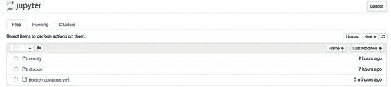

# 构建并运行应用程序

在运行应用程序之前，你需要先构建它。这是因为你定义的至少一个服务使用了 `build:` 关键字（而非 `image:` 关键字）来定义用于实例化其容器的镜像。在代码清单 9-26 中，你将执行此构建。值得注意的是，该命令只会影响那些使用 `build:` 关键字定义的服务。你可以看到构建过程跳过了 `this_mongo`，因为它使用的是镜像。

```
$ docker-compose build
this_mongo uses an image, skipping
Building this_jupyter
Step 1/6 : FROM jupyter/scipy-notebook
 ---> 3dc12029099d
Step 2/6 : USER root
 ---> Using cache
 ---> d0fe6db71e0b
Step 3/6 : RUN conda install --yes --name root spacy pymongo
 ---> Running in 26e516e316c3
...
Step 4/6 : RUN bash -c source activate root && pip install twitter
 ---> Running in 5a07f7033056
...
Step 5/6 : RUN python -m spacy download en
 ---> Running in 319588ae94c6
...
Step 6/6 : USER jovyan
 ---> Running in 5c0f78fd96f2
 ---> d928c6dcf4fd
Removing intermediate container 5c0f78fd96f2
Successfully built d928c6dcf4fd
Successfully tagged ch9jupytermongo_this_jupyter:latest
```

**代码清单 9-26.** 使用 `docker-compose build` 构建应用程序

> **警告**
> 当运行 `docker-compose up` 时，Docker 客户端会检查本地镜像缓存，看每个定义的服务关联的镜像是否存在于缓存中。对于使用 `build:` 关键字定义的服务，如果镜像不在缓存中，则会构建该镜像。也就是说，`docker-compose build` 会被隐式调用。但这仅在镜像不在本地镜像缓存中时才会发生。这意味着，如果对 Dockerfile 或其他应用程序文件进行了更改，`docker-compose up` 命令无法检测到这些更改并触发构建。对于不熟悉的人来说，可能觉得 `docker-compose up` 会隐式调用构建，但实际上这只在镜像不在缓存中时才会发生。因此，建议的最佳实践是在运行 `docker-compose up` 之前始终运行 `docker-compose build`。

最后，完成构建后，你再次使用 `docker-compose up` 命令运行应用程序（代码清单 9-27）。

```
$ docker-compose up -d
Starting ch9jupytermongo_this_mongo_1
Starting ch9jupytermongo_this_jupyter_1
ubuntu@LOCAL:∼/ch_9_jupyter_mongo
```

**代码清单 9-27.** 启动 Compose 应用程序 `jupyter_mongo`

在代码清单 9-28 中，你再次使用 `docker-compose ps` 工具来显示当前应用程序关联容器的进程信息。

```
$ docker-compose ps
Name                           Command
-----------------------------------------------------------
ch9jupytermongo_this_jupyter_1 tini -- start-notebook.sh
ch9jupytermongo_this_mongo_1   docker-entrypoint.sh mongod
State      Ports
-----------------------------------------------------------
Up         0.0.0.0:8888->8888/tcp
Up         27017/tcp
```

**代码清单 9-28.** 显示当前 `docker-compose.yml` 的容器

接下来（代码清单 9-29），你获取 Jupyter 容器的安全令牌，以便能够通过浏览器访问 Jupyter。

```
$ docker exec ch9jupytermongo_this_jupyter_1 jupyter notebook list
Currently running servers:
http://localhost:8888/?token=0029b465c514ce18856a5a2751a95466504fac18b43531ce :: /home/jovyan
```

**代码清单 9-29.** 通过 Shell 调用容器获取 Jupyter 安全令牌

最后，在图 9-4 中，你打开浏览器，使用与主机系统关联的 IP 地址访问 Jupyter。



**图 9-4.** 在 t2.micro 上运行的 Jupyter

为了测试你的系统，你将再次使用基于位置的过滤器来流式传输推文。与第 8 章一样，你将把收集到的每条推文插入 MongoDB。为了增加一点复杂性，在将推文插入 MongoDB 之前，你将使用 spaCy 库将该推文文本编码为 numpy 向量。为了将向量存储在 MongoDB 中，你需要将向量序列化为二进制字节流。你在第 8 章中使用 Redis 完成了此操作，这里你使用 MongoDB 执行相同的操作。

你首先配置 Twitter 身份验证。你从 `os` 模块导入 `environ` 对象，并从 `twitter` 模块导入 `OAuth` 类。`environ` 对象⁸ 是一个映射⁹对象，表示操作系统的字符串环境。它在导入时被捕获。在这里，你将使用它来引用包含你凭据的环境变量，这些变量定义在 `docker-compose.yml` 和 `config/jupyter.env` 文件中；请参见代码清单 9-30。

```
In [1]: from os import environ
        from twitter import OAuth
```

**代码清单 9-30.** 导入配置 Twitter 身份验证所需的模块

在代码清单 9-31 中，你使用存储的凭据实例化一个 `OAuth` 对象。请注意，每个值都像字典一样通过其键来访问。

```
In [2]: oauth = OAuth(environ['ACCESS_TOKEN'],
                      environ['ACCESS_SECRET'],
                      environ['CONSUMER_KEY'],
                      environ['CONSUMER_SECRET'])
```

**代码清单 9-31.** 实例化 `OAuth` 对象

在代码清单 9-32 中，你导入 `TwitterStream` 类，并使用你定义的身份验证实例化该类的对象。

```
In [3]: from twitter import TwitterStream
        los_angeles_bbox = "-118.55, 33.97, -118.44, 34.05"
        twitterator = (TwitterStream(auth=oauth)
                       .statuses
                       .filter(locations=los_angeles_bbox))
```

**代码清单 9-32.** 实例化 `TwitterStream`

最后，在代码清单 9-33 中，你从流中拉取一条推文，然后显示其键。

```
In [4]: this_tweet = next(twitterator)
        this_tweet.keys()
```

**代码清单 9-33.** 拉取一条推文并显示其 `keys`

现在你内存中有一条推文，可以将其插入 MongoDB。在插入之前，你将使用 spaCy 库将推文编码为向量。你将把编码后的向量作为二进制字节流添加到包含推文的字典中。首先（代码清单 9-34），你导入 `spacy` 并加载 `en` 模型。在 t2.micro 上执行此操作时，你会收到一个内存错误。

```
In [5]: import spacy
        nlp = spacy.load('en')
        --------------------------------------------------------------------
        MemoryError                        Traceback (most recent call last)
        <ipython-input-8-e0448d429293> in <module>()
              1 import spacy
              2
        ----> 3 nlp = spacy.load('en')
```

**代码清单 9-34.** 导入 `spacy` 并加载 `en` 语言模型

好吧，起初这样的错误可能令人烦恼甚至令人生畏，但能够有效处理此类问题正是你首先学习这项技术的主要原因。在代码清单 9-35 中，你使用 `docker stats` 工具来诊断你的错误。请注意，`docker-compose` 没有自己的 `docker stats` 工具，因此你只需使用之前一直在使用的标准工具。

```
CONTAINER     CPU %   MEM USAGE / LIMIT     MEM %
698ba3322462  0.02%   539.2MiB / 990.7MiB   54.43%
a37b17785360  0.37%   49.77MiB / 990.7MiB   5.02%
NET I/O           BLOCK I/O         PIDS
1.26MB / 1.88MB   89.1GB / 1.42MB   15
21.8kB / 28.9kB   184GB / 15.5MB    22
```

**代码清单 9-35.** 使用 `docker stats` 诊断内存错误

值得注意的是，你的系统上运行着两个容器，而 `docker stats` 没有给它们提供人类可读的名称。你可以从内存使用情况推断出 `698ba3322462` 是 Jupyter 容器。你可以使用 `Ctrl+C` 终止 `docker stats` 工具，并使用 `docker ps` 来验证这一点，如代码清单 9-36 所示。

```
CONTAINER ID IMAGE                        ... NAMES
698ba3322462 ch9jupytermongo_this_jupyter ... ch9jupytermongo_this_jupyter_1
a37b17785360 mongo                        ... ch9jupytermongo_this_mongo_1
```

**代码清单 9-36.** 使用 `docker ps` 诊断内存错误

果然，是 Jupyter 容器使用了超过一半的系统内存……并且处于失败状态！它甚至没有完成加载模型。根据 spaCy 关于其特定模型的文档，¹⁰ 加载英语模型似乎需要 1GB 的 RAM。考虑到这是你 t2.micro 上的全部 RAM，你将无法在 t2.micro 上加载 spaCy 英语模型。

让我们暂时搁置这个问题的解决方案。首先，你像在第 8 章中那样，将推文插入 MongoDB（代码清单 9-37）。你通过导入 `pymongo` 模块并实例化一个数据库客户端，然后使用该客户端插入 `this_tweet` 来完成此操作。在代码清单 9-38 中，你统计 `tweet_collection` 中的推文数量以验证其插入。

```
In [6]: import pymongo
        mongo_cli = pymongo.MongoClient('this_mongo')
        result = (mongo_cli
                  .twitter_database
                  .tweet_collection
                  .insert_one(this_tweet) )
```

**代码清单 9-37.** 将单条推文插入 MongoDB

```
In [6]: (mongo_cli
         .twitter_database
         .tweets_collection.count())
Out[6]: 1
```

**代码清单 9-38.** 统计 `tweet_collection` 中的推文数量


