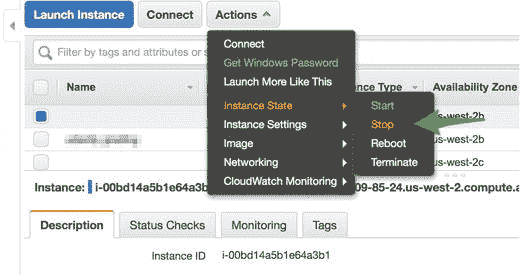
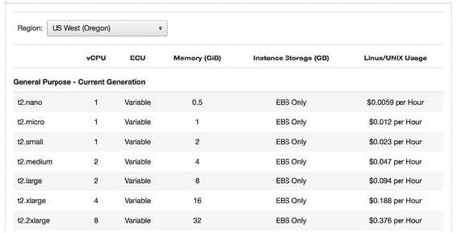
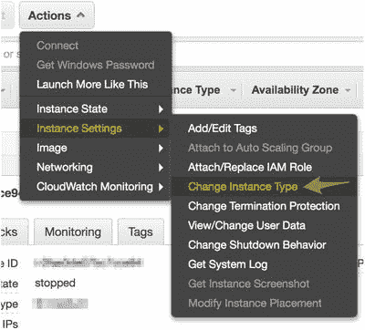
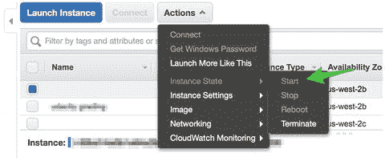

# 通过实例类型扩展 AWS 应用

在第 1 章中，你探讨了不同规模数据集、模型和模型拟合过程的内存使用情况。其目的是检查 AWS `t2.micro` 实例上的内存限制，这是本书推荐使用的系统。当时，这项检查完全是学术性的。而现在，你遇到了实际的系统限制。你希望加载一个通过 `spaCy` 库提供的语言模型，但它根本无法在你的 `t2.micro` 实例上运行。你将使用 Docker、Docker-Compose 和 AWS 创建一个高效的方法来解决这个问题。为此，你需要：

1.  关闭你的 Docker Compose 应用，但保留数据卷。
2.  关闭你的 AWS 实例。
3.  将你的 AWS 实例类型更改为能够满足需求的类型，即 `t2.medium`。
4.  重启 AWS 实例，并记下生成的新 IP 地址。
5.  重启 Docker Compose 应用。
6.  执行你的计算任务。

在代码清单 9-39 中，你通过关闭应用来准备对 AWS 实例进行更改。因为你只执行了基本的 `docker-compose down` 命令，所以你的 Docker 卷将在整个过程中保持不变，并且你不会丢失 MongoDB 中的推文数据。它只包含一条推文，但这足以用于演示目的。

```
$ docker-compose down
Stopping ch9jupytermongo_this_jupyter_1 ... done
Stopping ch9jupytermongo_this_mongo_1 ... done
Removing ch9jupytermongo_this_jupyter_1 ... done
Removing ch9jupytermongo_this_mongo_1 ... done
Removing network ch9jupytermongo_default
```

代码清单 9-39. 关闭 Docker Compose 应用

在图 9-5 中，你导航到 EC2 控制面板并关闭正在运行的实例。为此，你从“操作”菜单的“实例状态”菜单项中选择“停止”。这是更改实例类型的第一步。必须停止实例才能进行更改。



图 9-5. 停止 AWS 实例

你一直在使用 `t2.micro` 实例。图 9-6 显示了在美国西部（俄勒冈）区域启动的实例的按需实例定价和技术规格。如图所示，AWS `t2.micro` 实例有 1GB 内存，不足以加载你想要使用的 `spaCy` 库。为安全起见，请将你的实例类型更改为具有 4GB 内存的 `t2.medium`。这应该足以加载 1GB 的 `spaCy` 模型。

在图 9-7 中，你更改了 AWS 实例类型。从“操作”菜单的“实例设置”菜单项中选择“更改实例类型”。



图 9-6. 美国西部（俄勒冈）区域的按需实例定价和规格



图 9-7. 更改实例类型

更改实例类型后，在图 9-8 中，你通过“操作”菜单中“实例状态”菜单项的“启动”再次启动实例。



图 9-8. 启动 AWS 实例

**警告：** 停止你的 AWS 实例将释放你一直在使用的 IP 地址。当实例再次启动时，你需要获取分配给系统的新 IP 地址。

在图 9-9 中，你识别出分配给实例的新 IP 地址。


图 9-9. 新的 IP 地址

## 重启 Docker Compose 应用

你已经成功修改了与 EC2 实例关联的虚拟硬件。现在重启你的 Docker Compose 应用。由于你使用了 Docker 卷来持久化数据，因此在此过程中不应丢失任何数据。

在代码清单 9-40 中，你重新连接到 AWS 实例并导航到应用目录。

```
(local) $ ssh ubuntu@54.244.99.222
(AWS) $ cd ch_9_jupyter_mongo/
```

代码清单 9-40. 重新连接到 AWS 实例并导航到应用目录

在代码清单 9-41 中，你以分离模式启动应用。

```
$ docker-compose up -d
```

代码清单 9-41. 以分离模式启动 Docker Compose 应用

在代码清单 9-42 中，你获取 Jupyter Notebook 服务器的新安全令牌。

```
$ docker exec ch9jupytermongo_this_jupyter_1 jupyter notebook list
Currently running servers:
http://localhost:8888/?token=981014c28f5c8f694fd0321f418fddce6904f46857ace0bc :: /home/jovyan
```

代码清单 9-42. 获取 Jupyter Notebook 服务器安全令牌

## 完成计算

修改了系统的虚拟硬件后，你回到手头的任务。在代码清单 9-43 中，你逐步完成工作。

```
In [1]: from os import environ
        from twitter import OAuth
        oauth = OAuth(environ['ACCESS_TOKEN'],
                      environ['ACCESS_SECRET'],
                      environ['CONSUMER_KEY'],
                      environ['CONSUMER_SECRET'])

In [2]: from twitter import TwitterStream
        los_angeles_bbox = "-118.55, 33.97, -118.44, 34.05"
        twitterator = (TwitterStream(auth=oauth)
                       .statuses
                       .filter(locations=los_angeles_bbox))

In [3]: tw = next(twitterator)

In [4]: tw.keys()
Out[4]: dict_keys(['text', 'source', 'in_reply_to_status_id_str', 'favorited',
        'is_quote_status', 'in_reply_to_status_id', 'lang', 'filter_level', 'geo',
        'favorite_count', 'created_at', 'entities', 'coordinates', 'in_reply_to_user_id_str',
        'retweeted', 'truncated', 'retweet_count', 'id', 'contributors', 'in_reply_to_user_id',
        'user', 'place', 'in_reply_to_screen_name', 'id_str', 'timestamp_ms'])

In [5]: import pymongo
        mongo_server = pymongo.MongoClient('this_mongo')

In [6]: mongo_server.twitter.tweets.count()
Out[6]: 1

In [7]: result = (mongo_server
                  .twitter
                  .tweets
                  .insert_one(tw))

In [8]: mongo_server.twitter.tweets.count()
Out[8]: 2
```

代码清单 9-43. 重新运行初步工作

请注意，在代码清单 9-43 的 `Out[6]` 中，你收到的 MongoDB 中存储的推文计数输出为 1。这验证了你在更改实例类型之前插入到 MongoDB 中的那条推文在更改后仍然存在。

### 将推文编码为文档向量


