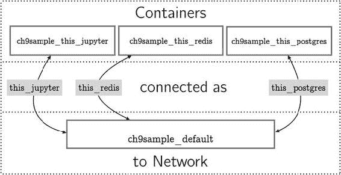

# Docker Compose 网络

在第 8 章中，你通过手动配置 Docker 网络，在 Jupyter Notebook 服务器所在的同一系统上启动并配置了一个 PostgreSQL 数据库。虽然这个过程并不简单，但完成该章节的学习可以让你深入了解 Docker 如何配置其内部网络，供容器之间相互连接。而使用 Docker Compose 则有一种更简单的方法。请注意，对于使用版本 2 或更高版本的 `docker-compose.yml` 文件，Docker Compose 中的网络配置有显著不同。我仍然推荐使用版本 3，并在此说明以保持完整性。也就是说，我将继续假设你使用的是版本 3，但你应该了解 Docker Compose 中从版本 1 到版本 2 在网络方面的重大升级。在运行时，Docker Compose 会自动为应用程序设置一个单一网络。在 `docker-compose.yml` 文件中定义的服务容器默认会加入此网络，并立即对应用程序中的其他容器可用，且可通过定义服务时使用的名称进行发现。请参考清单 9-57 中示例 `docker-compose.yml` 文件定义的应用程序，假设该文件位于名为 `ch_9_sample` 的目录中。

```
version: "3"
services:
  this_jupyter:
    image: jupyter/scipy-notebook
    ports:
      - "8888:8888"
  this_redis:
    image: redis:alpine
  this_posstgres:
    image: postgres:alpine
```

清单 9-57. 示例 `docker-compose.yml` 文件

当你运行 `docker-compose up` 时，`docker-compose` 会指示 Docker 引擎执行以下操作：
1. 创建一个名为 `ch9sample_default` 的网络。
2. 创建一个名为 `ch9sample_this_jupyter` 的容器，并将容器内的端口 `8888` 暴露到主机的端口 `8888` 上。
3. 指示 `ch9sample_this_jupyter` 使用名称 `this_jupyter` 加入 `ch9sample_default` 网络。
4. 创建一个名为 `ch9sample_this_redis` 的容器。
5. 指示 `ch9sample_this_redis` 使用名称 `this_redis` 加入 `ch9sample_default` 网络。
6. 创建一个名为 `ch9sample_this_postgres` 的容器。
7. 指示 `ch9sample_this_postgres` 使用名称 `this_postgres` 加入 `ch9sample_default` 网络。

现在，应用程序中的每个容器都可以使用容器在网络上的名称（例如 `this_jupyter`、`this_redis` 或 `this_postgres`）来访问其他所有容器（图 9-10）。



图 9-10. 一个示例的默认 Docker Compose 网络配置