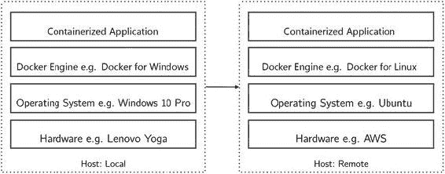
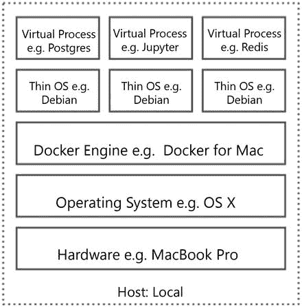
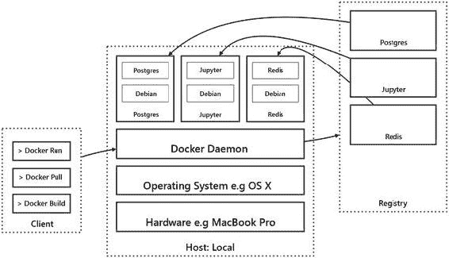
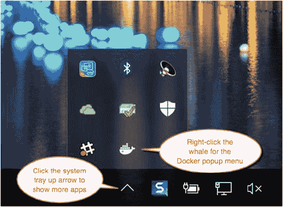
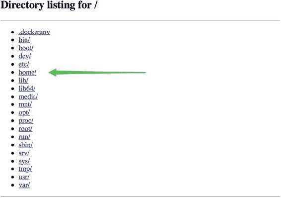

# 2. Docker

Joshua Cook¹  

(1) 美国加利福尼亚州圣莫尼卡

`Docker` 是一种将进程与其运行的系统隔离的方法。它允许我们将用于定义应用程序的代码以及运行该应用程序所需的资源，与其运行的硬件隔离开来。我们为软件增加了一层复杂性，但这样做也带来了一个优势：确保我们的本地开发环境与我们将部署应用程序的任何可能环境完全相同。如果一个系统能运行 `Docker`，那么该系统就能运行我们的进程。通过添加这一层薄薄的抽象层，我们实现了硬件无关性。

表面上看，这似乎是一项不可能完成的任务。截至 2014 年，有 285 个积极维护的 Linux 发行版，以及 OS X 和 Windows 的多个主要版本。我们怎么可能编写一个系统来支持所有可能的开发、测试和生产环境呢？`Docker` 通过容器化解决了这个问题。我们永远无法保证远程环境会运行与我们本地相同的操作系统。我们通常确切地知道它永远不会（我在 Mac OS X 上开发，通常部署到运行 Ubuntu 的系统上）。也就是说，如图 2-1 所示，我们可以保证我们的开发和部署环境都能运行 `Docker` 引擎。我们将应用程序编写为由 `Docker` 引擎作为容器运行——我们将应用程序容器化——从而确保跨平台的兼容性。我们不关心底层的操作系统或硬件，只关心它是否运行着 `Docker` 引擎。



**图 2-1.** 跨异构基础设施部署。请注意，不同系统的技术栈可能完全不同，但我们部署的是相同的容器。

使用 `Docker` 工具套件，我们将应用程序构建为以 `Docker` 容器的方式运行。构建完成后，我们通过在本地系统上运行镜像来验证它们。确认无误后，将我们的容器化应用程序部署到运行 `Docker` 引擎的远程机器上就变得轻而易举了。无论操作系统或硬件如何，我们都以完全相同的方式运行系统。`Docker` 让开发者可以忽略操作系统。

## Docker 不是虚拟机

`Docker` 不是虚拟机技术。¹ 尽管如此，简要了解一下虚拟机技术是什么还是很有用的。许多人会熟悉虚拟机技术，尤其是使用 `VirtualBox` 等工具运行的虚拟机。使用这些工具之一，一台计算机（宿主机）可以运行多个虚拟机实例（客户机）。每个客户机在磁盘上使用一个大文件来定义其隔离的操作系统和文件系统。每个客户机作为宿主机 CPU 上的一个资源密集型进程运行。对于大多数用户而言，客户机的行为就像一台独立的计算机，在实际使用中与其运行的宿主机非常相似。换句话说，虚拟机感觉像是虚拟化的硬件。虚拟机技术的缺点包括：消耗大量硬盘空间来存储庞大的操作系统，以及消耗大量 CPU 资源来维护完整操作系统所需的所有进程。

# 容器化

容器化是一种虚拟化方法，但容器并非大多数人认知中的虚拟机。这种混淆情有可原。与容器类似，甚至可以使用`Vagrant`软件来定义虚拟机。但需要明确的是，虚拟机使用的是某一种虚拟化技术，而容器化则完全是另一种不同类型的虚拟化。[`Linux 容器`](https://linuxcontainers.org/lxc/introduction/)（`LXC`）项目是一个供应商中立的项目，旨在提供一套原生的工具和库，用于将进程与运行它们的更广泛的`Linux`系统隔离开来。`LXC`与其宿主机运行在同一个操作系统上。`LXC`的既定目标是“创建一个尽可能接近标准`Linux`安装的环境，但无需单独的内核。”换句话说，`LXC`允许进程被容器化。

容器化旨在虚拟化进程。因此，一个被容器化的进程是在为其目的而优化的环境中运行，但使用的是宿主机的系统资源。`LXC`库经过精心设计，允许容器化进程作为虚拟化进程（见图 2-2）在其宿主机系统上运行，而无需运行完整的操作系统。与虚拟机相比，`LXC`具有开销低、性能更好的特点。

 图 2-2. 一个虚拟化进程

2015 年 6 月，`Docker`协助发起了[`开放容器项目`](https://www.opencontainers.org/about)。`Docker`将其库 `runc` 捐赠出来，作为`LXC`的迭代版本。虽然`Docker`的核心不再运行`LXC`，但其原则依然不变：[`Docker` 不是虚拟机](https://blog.docker.com/2016/03/containers-are-not-vms/)。`Docker`正在利用虚拟化技术来实现进程或服务与宿主系统的隔离。

在本书中，你将始终面临通过`Docker`运行进程时的两个问题：网络连接（连接到你的进程）以及维护数据的持久性。随着容器管理方面的这些最新创新，`Docker`正朝着更强大的工具方向发展，以管理这两个问题。通过`Docker`管理网络和持久性，一旦这些进程被抽象化或容器化，它们就可以在任何系统上随意运行。

# 一个容器化应用

除了提供运行容器化应用的方法之外，Docker 还提供了一套用于将应用构建为微服务的工具。Docker 的构建系统提供了一种将应用及其所有依赖项打包在一起的系统。那些熟悉 Ruby 的 bundler 和 `Gemfile` 系统，或者 Python 的 `conda` 和 `environment.yml` 系统的人，会很容易上手使用 `Dockerfile`，通过一个最小的文本文件来定义其系统的需求。使用这个 `Dockerfile`，无状态且不可变的应用被定义为在运行 Docker 引擎的宿主机系统上作为“已编译”的进程运行。通过这种方式，Docker 试图将软件工程师从其代码所依赖的硬件中解放出来。

# Docker 容器生态系统

你将从关注容器的生态系统开始了解 Docker。之后，你将利用 Docker 的工具，用你构建的容器来组合更大的系统。在 Docker 容器的直接生态系统（见图 2-3）中，跟踪以下概念非常重要：

 图 2-3. Docker 生态系统

*   `Docker CLI` 客户端
*   宿主机
*   Docker 引擎或守护进程
*   Docker 镜像
*   Docker 容器
*   Docker 仓库，通常是 `Docker Hub`
*   `Docker Compose`

**注意：** 你将完全避免使用 GUI 工具 `Kitematic`，而采用完全面向命令行的方式来管理 Docker。

## Docker 客户端

`Docker` 客户端是一个命令行界面，用于向 `Docker` 引擎发出指令，而无需关心引擎在你系统上实现的具体细节。这类似于 Web 的客户端-服务器架构，其中客户端系统使用一个接口（通常是 Web 浏览器，但也可能是 RESTful API）与远程服务器交互。在 Docker 的情况下，`Docker` 客户端与执行容器和容器化工作的 `Docker` 引擎进行通信。在阅读本书的过程中，你将使用 `Docker` 命令行界面作为你的客户端，而引擎将在你的本地系统上运行，或者按照第 1 章的建议在 `t2.micro` 实例上运行。使用 `Docker` 客户端，你告诉 `Docker` 守护进程从仓库拉取一个镜像。然后你可以告诉 `Docker` 守护进程运行该镜像。完成这些操作后，你可能会询问引擎当前正在运行哪些 `ps` 或容器。² 要列出 `Docker` 客户端可用的命令，可以运行不带参数的 `docker` 或执行 `docker help`。根据你的 Docker 系统配置，你可能需要在每个 `docker` 命令前加上 `sudo`。为了避免在 `docker` 命令中使用 `sudo`，你的系统管理员可以创建一个名为 `docker` 的 Unix 组，并将用户添加到该组中。

## 宿主机

宿主机是你将运行 `Docker` 守护进程/引擎的机器。在本地，宿主机将取决于你的 Docker 配置。如果你运行的是 `Docker` for Linux、`Docker` for Mac 或 `Docker` for Windows，那么宿主机就是你的系统本身。如果你运行的是 `Docker Toolbox`，那么宿主机将是在 Oracle 的 `VirtualBox` 软件上运行的一个虚拟机。`Docker Toolbox` 提供了协助正确创建此虚拟机的工具。你也可以设置一台远程机器作为你的宿主机。重要的是，虽然你总是需要一个宿主机，但宿主机的具体细节是无关紧要的。宿主机可以是 Mac 上的一个虚拟机、`Amazon Web Services` 上的一个 `c4.8xlarge` `EC2` 实例，或者你大学地下室的一台裸机服务器。无论如何，你的应用行为都是一样的。在某些情况下，可能需要识别宿主机的 IP 地址。对于 `Docker` for Linux、`Docker` for Mac 或 `Docker` for Windows，这通常不是必需的，在这些环境中 Docker 要么是原生运行（Linux），要么是类似原生运行（Mac、Windows）。在其他情况下，可以使用 `docker-machine` 命令行工具来识别宿主机的 IP 地址，具体命令是 `docker-machine ls`（参见代码清单 2-1）。

```
$ docker-machine ls
NAME      ACTIVE   DRIVER      STATE     URL       SWARM   DOCKER    ERRORS
default   -        virtualbox  Running   tcp://192.168.99.100:2376  v1.13.0
```

代码清单 2-1. 显示与正在运行的附加 Docker 引擎关联的 Docker 宿主机

## Docker 引擎

`Docker` 引擎是一个管理容器的持久化进程。它作为后台服务或守护进程在宿主机上运行。事实上，引擎有时也被称为 `Docker` 守护进程。`Docker` 引擎执行 Docker 的核心工作：构建、运行和分发你的 Docker 容器。在本书中，你将直接与引擎交互，但会通过 `Docker` 客户端进行。Docker 的强大之处在于你能够通过 `Docker` 客户端与引擎协同工作。你将把进程的管理工作交给 `Docker` 引擎。如果你能在某个系统上做到这一点，那么你可以信赖，你在任何其他能够运行 `Docker` 引擎的机器上所做的任何工作都会有相同的行为。

### Docker 镜像与 Docker 容器

`Docker` 镜像是只读的。这并非意味着我们不能对镜像进行修改，而是指一旦我们做出修改，得到的就是一种新的镜像。我喜欢用具有不可变数据结构的语言（例如 Python 中的元组）来类比。一旦你定义了一个元组，就无法修改它，尽管你可以定义一个新元组，该元组以原始元组为基础并以某种方式对其进行修改。`Docker` 引擎有几种构建我们自己的镜像的方法。这些方法包括使用 `Docker` 客户端以及通过一种称为 `Dockerfile` 的领域特定语言（DSL）。我们也可以下载其他人创建的镜像。`Docker` 容器是 `Docker` 镜像的实例。它们是独立的，包含应用程序单个实例运行所需的一切（操作系统、依赖项、源代码、元数据），并且可以被运行、启动、停止、移动和删除。它们也是隔离且安全的。用面向对象编程的概念来理解 `Docker` 镜像和容器会很有帮助。镜像是我们可能创建的容器的已定义的“类”。而容器则是该类的“实例”或“对象”。`Docker` 引擎将管理主机上运行的多个容器。当引擎从镜像运行一个容器时，它会在镜像之上添加一个读写层，我们的应用程序可以在其中运行。然而，说实话，将镜像-容器关系类比为面向对象编程是一种较弱的类比。一个更强的类比是将 `Docker` 类比为一种编译型语言。在这个类比中，我们可以将 `Dockerfile` 视为源代码，将镜像视为编译后的二进制文件，将正在运行的容器视为正在运行的进程。考虑到我们使用命令 `docker ps` 来显示当前正在运行的容器，这显然是一个有意为之的类比。这个类比在几个方面都很有帮助。首先，它将构建过程置于我们理解 `Docker` 工作的前沿。其次，它有助于强化容器是短暂的这一概念，就像正在运行的进程一样。当它们的生命周期结束时，它们的状态实际上就丢失了。

### Docker 注册表

`Docker` 注册表保存着镜像。这些是公共或私有的存储库，你可以从中上传或下载镜像。就本书而言，你将使用 `Docker Hub` 上的公共 `Docker` 注册表。`Docker Hub` 是你将使用的主要开源技术（包括 `Jupyter`、`PostgreSQL`、`Redis` 和 `MongoDB`）的官方镜像来源。

### Docker Compose

`Docker Compose` 是一个用于组装由多个容器组成的微服务和应用程序的工具。这些微服务和应用程序使用单个 `YAML` 文件进行设计，并且可以通过单个命令进行构建、运行和扩展。`Docker Compose` 对于数据科学家构建由 `Jupyter` 和一个或多个数据存储（例如 `Redis`）组成的独立计算系统特别有用。

## 获取 Docker

在撰写本文时，在主流操作系统上安装 `Docker` 有四种核心方式：

*   Linux 版 `Docker`
*   Mac 版 `Docker`
*   Windows 版 `Docker`
*   `Docker Toolbox`

建议将系统配置为至少使用 `2GB` 内存。在允许 `Docker` 引擎使用所有可用资源（如 CPU 和内存）方面，我没有遇到重大问题。请注意，我再次建议读者使用第 1 章中概述的 `t2.micro` 上的沙箱系统。第 1 章包含配置运行 Ubuntu 的 AWS 实例的说明。

### Linux 版 Docker

Linux 版 `Docker` 在大多数主流 Linux 操作系统上原生运行。它通过使用 `bash` 或类似 shell 的命令行驱动。值得注意的是，在远程服务器上运行 Linux 版 `Docker` 是最常见的配置。对于 Mac 和 Windows 开发者来说，熟悉这种配置是一项值得做的练习。话虽如此，不同平台的体验非常相似。有关可用操作系统列表的详细说明，请访问 `https://docs.docker.com/engine/installation/`。在此，我重点介绍 Ubuntu 系统的安装说明。对于其他 Linux 发行版的安装，读者应参考该链接以获取具体说明。

#### 在 Ubuntu 系统上安装 Docker

从命令行安装 `Docker` 提供了最高程度的灵活性。在 Ubuntu 系统上（此处我使用 Ubuntu 16.04.2），可以通过 `apt` 工具完成。注意：这些说明适用于在 Ubuntu 上安装 `Docker`。希望在其他 Linux 变体上安装 `Docker` 的用户应参考其系统的具体说明，网址为 `https://docs.docker.com/engine/installation/`。在清单 2-2 中，你使用 `apt search` 来检查与 `Docker` 相关的、可通过 `apt` 安装的软件包。你首先运行 `apt update` 以确保拥有最新的可用软件包列表。

```
$ apt update
$ apt search docker
Sorting... Done
Full Text Search... Done
...
docker/xenial 1.5-1 amd64
  System tray for KDE3/GNOME2 docklet applications
docker-compose/xenial 1.5.2-1 all
  Punctual, lightweight development environments using Docker
docker-doc/xenial-updates 1.12.6-0ubuntu1∼16.04.1 all
  Linux container runtime -- documentation
docker-registry/xenial 2.3.0∼ds1-1 amd64
  Docker toolset to pack, ship, store, and deliver content
docker.io/xenial-updates 1.12.6-0ubuntu1∼16.04.1 amd64
  Linux container runtime
...
```

清单 2-2. 显示可供安装的 Docker 软件包

你最感兴趣的软件包是 `docker.io` 软件包。该软件包包含 `Docker` 守护进程（也称为 `Docker` 容器运行时）和 `Docker` 命令行界面（CLI）可执行文件。在清单 2-3 中，你使用 `apt policy` 来显示 `docker.io` 软件包的可用元信息。在撰写本文时，通过 `apt` 可用的 `docker.io` 软件包是 1.12.6 版本。

```
$ apt policy docker.io
docker.io:
  Installed: (none)
  Candidate: 1.12.6-0ubuntu1∼16.04.1
  Version table:
     1.12.6-0ubuntu1∼16.04.1 500
        500 http://us-west-2.ec2.archive.ubuntu.com/ubuntu xenial-updates/universe amd64 Packages
     1.10.3-0ubuntu6 500
        500 http://us-west-2.ec2.archive.ubuntu.com/ubuntu xenial/universe amd64 Packages
```

清单 2-3. 显示 `docker.io` 软件包的元信息

注意：每个策略声明前面的 500 是一个优先级数字，表示该软件包在系统上是“可安装的”。你通过确保没有安装旧版本的 `docker` 来开始安装（清单 2-4）。如果你收到消息“Package 'docker' is not installed, so not removed”，这意味着 `docker` 未安装，你可以继续。

```
$ sudo apt remove docker
Reading package lists... Done
Building dependency tree
Reading state information... Done
Package 'docker' is not installed, so not removed
0 upgraded, 0 newly installed, 0 to remove and 43 not upgraded.
```

清单 2-4. 移除先前安装的 `docker`

#### 配置 Docker 仓库

要安装 Docker，你将采用 Docker 推荐的最佳实践，即从 Docker 仓库进行安装。为此，你首先需要设置该仓库。你将针对 Docker CE 进行此操作。首先，在清单 2-5 中，你将允许 `apt` 通过 HTTPS 使用仓库。

```
$ sudo apt-get install \
>     apt-transport-https \
>     ca-certificates \
>     curl \
>     software-properties-common
Reading package lists... Done
Building dependency tree
Reading state information... Done
ca-certificates is already the newest version (20160104ubuntu1).
apt-transport-https is already the newest version (1.2.19).
curl is already the newest version (7.47.0-1ubuntu2.2).
software-properties-common is already the newest version (0.96.20.5).
0 upgraded, 0 newly installed, 0 to remove and 43 not upgraded.
```

清单 2-5. 允许 `apt` 通过 HTTPS 使用仓库

然后，在清单 2-6 中，你将添加 Docker 的官方 GPG 密钥。

```
$ curl -fsSL https://download.docker.com/linux/ubuntu/gpg | sudo apt-key add -
OK
$ sudo apt-key fingerprint 0EBFCD88
pub   4096R/0EBFCD88 2017-02-22
      Key fingerprint = 9DC8 5822 9FC7 DD38 854A  E2D8 8D81 803C 0EBF CD88
uid                  Docker Release (CE deb) <docker@docker.com>
sub   4096R/F273FCD8 2017-02-22
```

清单 2-6. 添加 Docker 的官方 GPG 密钥

最后，在清单 2-7 中，你将为你的系统架构添加相应的 Docker 仓库。

```
$ sudo add-apt-repository \
>    "deb [arch=$(dpkg --print-architecture)] https://download.docker.com/linux/ubuntu \
>    $(lsb_release -cs) \
>    stable"
```

清单 2-7. 添加你系统特定的 Docker 仓库

#### 从 Docker 仓库安装

配置好 Docker 仓库后，你可以使用标准的 `apt update`（清单 2-8）和 `apt install`（清单 2-9）命令进行安装。

```
$ sudo apt update
...
Get:6 https://download.docker.com/linux/ubuntu xenial/stable amd64 Packages [1,479 B]
...
43 packages can be upgraded. Run 'apt list --upgradable' to see them.
```

清单 2-8. 更新 `apt` 注册表

```
$ sudo apt install -y docker-ce
Reading package lists... Done
...
Preparing to unpack .../docker-ce_17.03.1∼ce-0∼ubuntu-xenial_amd64.deb ...
Unpacking docker-ce (17.03.1∼ce-0∼ubuntu-xenial) ...
...
Processing triggers for ureadahead (0.100.0-19) ...
```

清单 2-9. 安装 `docker`。

#### 以非 root 用户身份管理 Docker

在 Linux 系统上，Docker 引擎绑定到一个 Unix 端口，而不是 TCP 端口。此端口通常由 `root` 拥有，并且必须通过 `sudo` 访问才能接收来自 Docker 客户端的命令。Linux 系统上 Docker 用户的一种常见模式是创建一个 `docker` 组并将用户添加到该组，如清单 2-10 所示。当 Docker 守护进程重启时，它会使绑定到 Docker 引擎的端口对 `docker` 组可读/写。结果是用户能够向引擎发出命令，而无需在其命令前加上 `sudo`。请注意，严格来说，这不是必需的。

### 清单 2-10. 在 Linux 系统上创建 `docker` 组

```
$ sudo groupadd docker
$ sudo usermod -aG docker $USER
```

注销并重新登录以查看更改生效。此时，用户将能够通过 `docker` 向引擎发出命令，而无需使用 `sudo`。

## Docker for Mac

Docker for Mac 使用 HyperKit⁴ 虚拟机运行 Docker。它通过 `bash` 或类似的 shell 从命令行驱动。详细说明以及具体的系统要求可在 `docs.docker.com/docker-for-mac/` 找到。建议使用稳定版渠道进行安装。用于 `bash` 补全的脚本已预装在 Docker for Mac 应用程序中。要激活 `bash` 补全，只需将这些文件符号链接到你的 `bash_completion.d/` 目录（参见清单 2-11）。

### 清单 2-11. 在 Mac OS X 上符号链接 Bash 补全文件

```
$ ln -s /Applications/Docker.app/Contents/Resources/etc/docker.bash-completion /usr/local/etc/bash_completion.d/docker
$ ln -s /Applications/Docker.app/Contents/Resources/etc/docker-machine.bash-completion /usr/local/etc/bash_completion.d/docker-machine
$ ln -s /Applications/Docker.app/Contents/Resources/etc/docker-compose.bash-completion /usr/local/etc/bash_completion.d/docker-compose
```

## Docker for Windows

Docker for Windows 使用 Microsoft Hyper-V 运行。它通过 PowerShell 从命令行驱动。详细说明以及具体的系统要求可在 `docs.docker.com/docker-for-windows/` 找到。安装 Docker for Windows 可能有些挑战。需要注意的是，Docker for Windows 只能在 Windows 10 专业版或企业版 64 位操作系统上使用，并且需要：

*   支持二级地址转换 (SLAT) 的 64 位处理器
*   至少 4GB 系统内存
*   BIOS 级别的硬件虚拟化支持

以下注意事项在以往的安装过程中很有帮助：

*   如果在 Docker 安装过程中提示启用 Hyper-V，请务必按“确定”。
*   从 Docker 设置中选择“共享驱动器”，并确保共享 `C:` 盘。这可以通过 Docker 设置完成（图 2-4）。 图 2-4. 访问 Docker 设置
*   如有必要，请禁用防火墙或创建例外。
*   确保使用 Windows PowerShell 来访问并向引擎发出命令。

## Docker Toolbox

Docker Toolbox 适用于不满足更原生实现的 Docker for Mac 或 Docker for Windows 要求的较旧 Mac 或 Windows 系统。Docker Toolbox 包含几个工具：

*   Docker Machine，用于运行 `docker-machine` 命令
*   Docker Engine，用于运行 `docker` 命令
*   Docker Compose，用于运行 `docker-compose` 命令
*   Kitematic，Docker 图形用户界面
*   一个为 Docker 命令行环境预配置的 shell
*   Oracle VirtualBox

安装说明可在此处找到：`docs.docker.com/toolbox/overview/`。Docker Toolbox 用户需要使用 Docker Quickstart Terminal 命令行环境来向 Docker 引擎发出命令。安装 Docker Toolbox 将使用 VirtualBox 创建一个本地的 `docker-machine`，作为主机。

# Docker 快速入门

使用 Docker 运行代码，最基本的方式包括以下步骤：

1. 拉取预编译的镜像，或根据 `Dockerfile` 构建镜像。
2. 将镜像作为新容器运行。

如果你是首次安装 Docker，可以尝试一些简单的命令来验证 Docker 客户端是否正确安装并已添加到系统路径中。清单 2-12、2-13 和 2-14 展示了三种验证方法：`docker version`、`docker help` 或 `which docker` 都是很好的简单测试命令。

```
$ docker version
sudo docker version
Client:
  Version:      17.03.1-ce
  API version:  1.27
  Go version:   go1.7.5
  Git commit:   c6d412e
  Built:        Mon Mar 27 17:14:09 2017
  OS/Arch:      linux/amd64
Server:
  Version:      17.03.1-ce
  API version:  1.27 (minimum version 1.12)
  Go version:   go1.7.5
  Git commit:   c6d412e
  Built:        Mon Mar 27 17:14:09 2017
  OS/Arch:      linux/amd64
  Experimental: false
```

**清单 2-12. 显示 Docker 版本**

**注意：** 运行此命令会显示 Docker 客户端和服务器上运行的 Docker 版本信息。

```
$ docker help
Usage: docker COMMAND
A self-sufficient runtime for containers
...
```

**清单 2-13. 显示 Docker 帮助信息**

```
$ which docker
/usr/local/bin/docker
```

**清单 2-14. 显示 Docker 二进制文件的位置**

## 运行第一个容器：Hello, World!

确认 Docker 客户端已正确安装后，就可以继续运行经典的 "Hello, World!" 示例，如清单 2-15 所示。

```
$ docker run hello-world
Unable to find image 'hello-world:latest' locally
latest: Pulling from library/hello-world
78445dd45222: Pull complete
Digest: sha256:c5515758d4c5e1e838e9cd307f6c6a0d620b5e07e6f927b07d05f6d12a1ac8d7
Status: Downloaded newer image for hello-world:latest
Hello from Docker!
```

**清单 2-15. 运行 `hello-world` 镜像**

这条消息表明你的安装似乎工作正常。为了生成这条消息，Docker 执行了以下步骤：

1. Docker 客户端联系了 Docker 守护进程。
2. Docker 守护进程从 Docker Hub 拉取了 `hello-world` 镜像。
3. Docker 守护进程基于该镜像创建了一个新容器，该容器运行了可执行文件，并产生了你当前正在阅读的输出。
4. Docker 守护进程将该输出流式传输到 Docker 客户端，然后由客户端发送到你的终端。

## 更复杂的操作与交互

如果想尝试更复杂的操作，你可以使用命令`$ docker run -it ubuntu bash`运行一个 Ubuntu 容器。通过 [`cloud.docker.com/`](https://cloud.docker.com/) 上的免费 Docker ID，你可以共享镜像、自动化工作流以及实现更多功能。更多示例和想法，请访问 [`docs.docker.com/engine/userguide/`](https://docs.docker.com/engine/userguide/)。

至此，你已经验证了 Docker 已正确安装并能正常运行。当你执行此命令时，Docker 客户端会将 `run hello-world` 命令发送给 Docker 引擎。Docker 引擎随后执行以下操作：

1. 在本地镜像缓存中检查 `hello-world` 镜像。
2. 如果本地不存在该镜像，则从 Docker Hub 下载。
3. 使用该镜像创建一个新容器。
4. 分配文件系统，并在镜像顶层添加一个可读写层。
5. 为系统设置一个 IP 地址。
6. 执行镜像 `Dockerfile` 中指定的 shell 命令 `/hello`。
7. 该进程完成后，终止容器并关闭。

清单 2-16 展示了一个基本的 Docker 命令：运行最新的 Ubuntu 镜像（`run ubuntu`）并通过 bash shell（`-i -t /bin/bash`）连接到它。当你执行此命令时，Docker 客户端将命令发送给 Docker 引擎。Docker 引擎执行以下操作：

1. 在本地镜像缓存中检查 `ubuntu` 镜像。
2. 从 Docker Hub 下载镜像（除非本地已存在）。
3. 使用该镜像创建一个新容器。
4. 分配文件系统，并在镜像顶层添加一个可读写层。
5. 为系统设置一个 IP 地址。
6. 在容器内执行 `/bin/bash` 进程。
7. 通过你当前的终端连接到正在运行的 `/bin/bash` 进程。

```
$ docker run -it ubuntu  /bin/bash
root@eb5f4278d040:/#
```

**清单 2-16. 运行基础 `ubuntu` 镜像并通过 Shell 连接到它**

你将连接到正在运行的 Ubuntu 容器，直到你将其关闭。你可以与此进程进行交互（参见清单 2-17），就像它是通过 bash shell 连接的原生 Ubuntu 系统一样。

```
root@8b9461e1d7dd:/# ls
bin   dev  home  lib64  mnt  proc  run   srv  tmp  var
boot  etc  lib   media  opt  root  sbin  sys  usr
root@8b9461e1d7dd:/# ps
  PID TTY          TIME CMD
    1 ?        00:00:00 bash
   12 ?        00:00:00 ps
root@8b9461e1d7dd:/# ps aux
USER       PID %CPU %MEM    VSZ   RSS TTY      STAT START   TIME COMMAND
root         1  0.0  0.1  18240   3212 ?       S<s  04:00   0:00 /bin/bash
root        13  0.0  0.1  34424   2808 ?       R<+  04:01   0:00 ps aux
root@8b9461e1d7dd:/# exit
joshuacook@LOCALHOST:~$
```

**清单 2-17. 与作为 Docker 容器运行的 Ubuntu 进行交互**

在这里，你通过输入 `Ctrl+D` 结束了会话，就像通过 `ssh` 连接到远程系统一样。这样，控制权就返回到了你的本地系统，即运行 Docker 的主机。

注意观察你的 Ubuntu 镜像运行时的状态是很有用的。`ls` 显示一个完整的标准 Linux 文件系统并不奇怪。`ps` 只返回几个项目也不奇怪。但 `ps aux` 只返回两个项目则非常不寻常。`ps aux` 显示 (a) 所有用户的进程，(u) 显示进程所有者，(x) 包括未连接到任何终端的进程。换句话说，运行 `ps aux` 实际上显示了系统上当前运行的所有进程。再次强调，系统上仅运行着你连接的 shell（PID 1 `/bin/bash`）和你用来显示运行进程的 `ps aux`（PID 13 `ps aux`）是非常不寻常的。请仔细体会这一点。本质上，你的 Docker 容器只运行了一个进程。关于这一点，我们稍后会详细讨论。

### Docker 中的基本网络配置

在继续学习之前，你需要了解的最后一个入门知识是 Docker 中的网络配置。你将使用的许多容器都需要通过 TCP 或 HTTP 等网络协议从主机进行访问。幸运的是，Docker 为我们处理了网络问题。简单来说，你将通过发布端口来管理 Docker 的网络。发布端口时，你明确地将运行中容器的一个端口或端口范围绑定到主机。这是通过（小写 p）`-p` 标志完成的。此命令明确了主机与容器之间的连接。因此，它只能作为参数传递给 Docker 引擎。发布端口时使用的模式是 `-p host_port:container_port`。例如，假设我运行一个 Flask⁵ 应用，该应用定义在一个名为 `my_flask_app` 的容器中，端口为 5000，通过命令 `docker run -p 7777:5000 my_flask_app` 运行。在这种情况下，我将容器中的端口 5000 发布到主机上的端口 7777。换句话说，容器中端口 5000 上可用的任何内容，在主机上的端口 7777 上也将可用。对我这个本地最终用户来说，其效果是我可以在浏览器中通过 `http://localhost:7777`（如果使用 Docker Toolbox，则通过主机 IP 的端口 7777）访问我定义的 Flask 应用。Python 模块 `SimpleHTTPServer` 可用于为启动它的目录运行一个文件服务器。在代码清单 2-18 中，你使用单个命令通过 Docker 容器启动一个文件服务器。Docker 守护进程拉取 `python` 镜像，并使用它通过命令 `python -m SimpleHTTPServer` 运行 Python 模块。该服务器在容器内的默认端口 8000 上运行。你将其链接到主机上的端口 5000，并能够通过浏览器（图 2-5）在 `http://localhost:8000` 访问文件服务器。

  

图 2-5. 可通过浏览器访问的本地文件服务器

```
$ docker run -v ∼:/home -p 5000:8000 python:2.7 python -m SimpleHTTPServer
Unable to find image 'python:2.7' locally
2.7: Pulling from library/python
6d827a3ef358: Already exists
2726297beaf1: Pull complete
7d27bd3d7fec: Pull complete
44ae682c18a3: Pull complete
824bd01a76a3: Pull complete
69702776c399: Pull complete
7be4e7612dd4: Pull complete
Digest: sha256:bda277274d53484e4026f96379205760a424061933f91816a6d66784c5e8afdf
Status: Downloaded newer image for python:2.7
172.17.0.1 - - [16/Apr/2017 14:58:54] "GET / HTTP/1.1" 200 -
```

代码清单 2-18. 通过 Docker 容器启动文件服务器

**注意** 在不同系统上运行 Docker 存在细微差别。在大多数情况下，Docker Toolbox 用户将能够通过 `http://192.168.99.100:5000` 访问简单的文件服务器。Linux/Mac/Windows 的 Docker 用户应使用 `http://localhost:5000`。

## 总结

在本章中，我正式介绍了 Docker 及其生态系统。我定义了容器化及其对我们工作的用处。我提供了在几个流行操作系统上安装 Docker 的说明。最后，你运行了 Docker 的 `hello-world` 镜像和 Docker 的 `python` 镜像，并使用后者运行了一个简单的 Web 服务器。完成本章后，我希望你理解了 Docker 到底是什么，并对其存在的原因有了一些了解。我希望你了解 Docker 生态系统的各个组件。读者应该能够通过 Docker 客户端运行基本命令，例如 `docker help`、`docker ps` 和 `docker run`。在下一章中，我将正式介绍 Jupyter。与本书中的一切一样，我将使用 Docker 来进行介绍。在后续章节中，你将更深入地探索 Docker 生态系统的各个组件，例如 Docker 引擎（或守护进程）、Dockerfile 和 Docker Hub。

脚注  

1 [`blog.docker.com/2016/03/containers-are-not-vms/`](https://blog.docker.com/2016/03/containers-are-not-vms/)  

2 此命令是 bash 命令 `ps` 的后代。在 bash 中，此命令列出正在运行的进程，而在 Docker 中，此命令列出正在运行的容器。这符合我们对 Docker 容器作为虚拟化进程的理解。  

3 [`hub.docker.com`](https://hub.docker.com)  

4 [`github.com/docker/HyperKit/`](https://github.com/docker/HyperKit/)  

5 [`flask.pocoo.org`](http://flask.pocoo.org)  

© Joshua Cook 2017  

Joshua Cook, *Docker for Data Science*  

`doi.org/10.1007/978-1-4842-3012-1_3`


