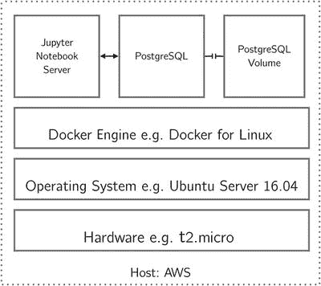

# 带持久化存储的 Jupyter 和 Postgres

在本章的最后一个应用中，你将构建一个 Jupyter Notebook 和 PostgreSQL 应用程序（图 9-11）。你将配置 PostgreSQL 使用数据卷以实现持久化存储。你还会设置 Postgres 使用构建方式而非直接使用镜像。


*图 9-11. 一个包含两个服务和一个数据卷的 Docker Compose 应用程序*

在第 8 章中，我提到 PostgreSQL 天生擅长处理 CSV 文件。此外，PostgreSQL 的公共镜像包含多个构建钩子，有助于在运行时初始化数据库。根据 Docker Hub 上的 `postgres` 文档¹¹：

> 在入口点调用 `initdb` 创建默认的 `postgres` 用户和数据库后，它会运行该目录中找到的任何 `*.sql` 文件，并执行任何 `*.sh` 脚本，以在启动服务之前进行进一步的初始化。

这意味着你可以将 SQL 文件和 shell 脚本作为镜像构建过程的一部分添加进去，这些文件将在运行时自动执行，并为你设置好数据库。同样，你首先创建一个目录来存放你的项目（清单 9-58）。在清单 9-59 中，你创建新的 `docker-compose.yml` 文件（清单 9-60）。

```
$ mkdir ch_9_jupyter_postgres
$ cd ch_9_jupyter_postgres
```

*清单 9-58. 创建项目目录*

```
$ vim docker-compose.yml
```

*清单 9-59. 创建 `docker-compose.yml` 文件*

```yaml
version: '3'
services:
  this_jupyter:
    build: docker/jupyter
    ports:
      - "8888:8888"
    volumes:
      - .:/home/jovyan
  this_postgres:
    build: docker/postgres
    volumes:
      - postgres_data:/var/lib/postgresql/data
volumes:
  postgres_data:
```

*清单 9-60. `ch_9_jupyter_postgres/docker-compose.yml` 文件*

### 指定构建上下文

读者会注意到，这里定义的两个服务都使用了 `build:` 关键字，而不是 `image:` 关键字。这意味着你的项目将需要两个构建上下文，每个镜像一个。在代码清单 9-61 中，你创建了两个构建上下文，然后使用 `tree` 命令显示当前项目。

```
$ mkdir -p docker/jupyter
$ mkdir -p docker/postgres
$ tree .
├── docker
│   ├── jupyter
│   └── postgres
└── docker-compose.yml
```

*代码清单 9-61. 创建两个构建上下文*

接下来，在代码清单 9-62 中，你为 `this_jupyter` 服务创建了第一个 `Dockerfile`（代码清单 9-63）。你使用这个 `Dockerfile` 仅仅是为了安装将要用于访问 PostgreSQL 的 `psycopg2` 模块。

```
$ vim docker/jupyter/Dockerfile
```

*代码清单 9-62. 创建 `docker/jupyter/Dockerfile`*

```dockerfile
FROM jupyter/scipy-notebook
USER root
RUN conda install --yes --name root psycopg2
USER jovyan
```

*代码清单 9-63. `docker/jupyter/Dockerfile`*

在代码清单 9-64 中，你为 `this_postgres` 服务创建了第二个 `Dockerfile`（代码清单 9-65）。在这个 `Dockerfile` 中，你使用 `postgres:alpine` 镜像作为基础镜像，并将构建上下文中的两个文件 `get_data.sh`（代码清单 9-66）和 `initdb.sql`（代码清单 9-67）复制到镜像中。如上所述，由于你将这两个文件添加到了 `/docker-entrypoint-initdb.d/` 目录下，因此在运行时，shell 脚本将由 `bash` 执行，SQL 文件将由 PostgreSQL 执行。你将利用这一点在数据库中创建一个表并填充数据。

```
$ vim docker/postgres/Dockerfile
```

*代码清单 9-64. 创建 `docker/postgres/Dockerfile`*

```dockerfile
FROM postgres:alpine
COPY get_data.sh /docker-entrypoint-initdb.d/get_data.sh
COPY initdb.sql /docker-entrypoint-initdb.d/initdb.sql
```

*代码清单 9-65. `docker/postgres/Dockerfile`*

**注意：** 你用于填充数据库的 CSV 文件来自 UCI 机器学习库。¹² 该数据存在一个问题，即某些值缺失，并被替换为 `?` 字符。为了解决这个问题，我使用了流编辑器工具 `sed`¹³ 将所有 `?` 字符替换为空（即从文件中完全移除 `?` 字符）。

```bash
#!/bin/bash
wget -P /tmp/ http://archive.ics.uci.edu/ml/machine-learning-databases/breast-cancer-wisconsin/breast-cancer-wisconsin.data
sed 's/?//' /tmp/breast-cancer-wisconsin.data > /tmp/bcdata-clean.csv
```

*代码清单 9-66. `docker/postgres/get_data.sh`*

```sql
CREATE TABLE bc_data (
    sample_id INTEGER UNIQUE PRIMARY KEY,
    clump_thickness INTEGER,
    uniformity_of_cell_size INTEGER,
    uniformity_of_cell_shape INTEGER,
    marginal_adhesion INTEGER,
    single_epithelial_cell_size INTEGER,
    bare_nuclei INTEGER,
    bland_chromatin INTEGER,
    normal_nucleoli INTEGER,
    mitoses INTEGER,
    class INTEGER
);
COPY bc_data FROM /tmp/bcdata-clean.csv DELIMITER ',' CSV;
```

*代码清单 9-67. `docker/postgres/initdb.sql`*

在代码清单 9-68 中，你使用 `tree` 工具展示了项目的最终状态。

```
$ tree .
├── docker
│   ├── jupyter
│   │   └── Dockerfile
│   └── postgres
│       ├── Dockerfile
│       ├── get_data.sh
│       └── initdb.sql
└── docker-compose.yml
```

*代码清单 9-68. 使用 `tree` 显示应用程序目录*

### 使用 Compose 构建并运行应用程序

在准备运行应用程序时，你使用 `docker-compose build` 来构建用于定义服务的两个镜像（代码清单 9-69）。

### 代码清单 9-69. 使用 `docker-compose build` 构建应用程序

```
$ docker-compose build
Building this_jupyter
Step 1/4 : FROM jupyter/scipy-notebook
...
Step 2/4 : USER root
...
Step 3/4 : RUN conda install --yes --name root psycopg2
...
Step 4/4 : USER jovyan
...
Successfully built b98e9ab6ee7e
Successfully tagged ch9jupyterpostgres_this_jupyter:latest
Building this_postgres
Step 1/3 : FROM postgres:alpine
...
Step 2/3 : COPY get_data.sh /docker-entrypoint-initdb.d/get_data.sh
...
Step 3/3 : COPY initdb.sql /docker-entrypoint-initdb.d/initdb.sql
...
Successfully built 97b956a4da7a
Successfully tagged ch9jupyterpostgres_this_postgres:latest
```

最后，在代码清单 9-70 中，你使用 `docker-compose up` 运行应用程序。请注意，在创建和启动服务容器之前，会先创建默认网络和用于数据持久化的卷。

### 代码清单 9-70. 启动 Compose 应用程序 `jupyter_postgres`

```
$ docker-compose up -d
Creating network "ch9jupyterpostgres_default" with the default driver
Creating volume "ch9jupyterpostgres_postgres_data" with default driver
Creating ch9jupyterpostgres_this_jupyter_1
Creating ch9jupyterpostgres_this_postgres_1
Starting ch9jupyterpostgres_this_jupyter_1
Starting ch9jupyterpostgres_this_postgres_1
```

在代码清单 9-71 中，你显示了应用程序的进程信息。

### 代码清单 9-71. 显示当前 `docker-compose.yml` 的容器

```
$ docker-compose ps
Name                                Command
-----------------------------------------------------------
ch9jupyterpostgres_this_jupyter_1   tini -- start-notebook.sh
ch9jupyterpostgres_this_postgres_1  docker-entrypoint.sh postgres
State      Ports
---------------------------------------------------------------------------
Up         0.0.0.0:8888->8888/tcp
Up         5432/tcp
```

在代码清单 9-72 中，你使用 `docker-compose logs` 显示与 `this_postgres` 服务相关的日志。

### 代码清单 9-72. 显示 `this_postgres` 的日志

```
$ docker-compose logs this_postgres
Attaching to ch9jupyterpostgres_this_postgres_1
this_postgres_1  | The files belonging to this database system will be owned by user "postgres".
...
this_postgres_1  | /usr/local/bin/docker-entrypoint.sh: running /docker-entrypoint-initdb.d/get_data.sh
this_postgres_1  | Connecting to archive.ics.uci.edu (128.195.10.249:80)
this_postgres_1  | breast-cancer-wiscon 100% |*******************************| 19889   0:00:00 ETA
...
this_postgres_1  | /usr/local/bin/docker-entrypoint.sh: running /docker-entrypoint-initdb.d/initdb.sql
this_postgres_1  | CREATE TABLE
this_postgres_1  | COPY 699
...
```

你希望在这里看到的是数据的成功收集和插入。你还可以通过 `docker exec`（代码清单 9-73）连接到正在运行的服务，以验证是否插入了正确数量的行。这里你使用了名为 `wc`¹⁴ 的字数统计工具来统计下载文件中的行数。

### 代码清单 9-73. 通过 `docker exec` 连接到 `this_postgres`

```
$ docker exec -it ch9jupyterpostgres_this_postgres_1 bash
bash-4.3# wc -l /tmp/breast-cancer-wisconsin.data
699 /tmp/breast-cancer-wisconsin.data
```

最后，你连接到 Jupyter 来测试一些代码。在代码清单 9-74 中，你对 `bc_data` 表中的行数进行了简单计数。

### 代码清单 9-74. 统计 `bc_data` 表中的行数

```
In [1]: import psycopg2 as pg2
In [2]: con = pg2.connect(host='this_postgres', user='postgres', database='postgres')
        cur = con.cursor()
        cur.execute("SELECT COUNT(*) FROM bc_data;")
        cur.fetchall()
Out[2]: [(699,)]
```

请注意，你通过将主机指定为 `'this_postgres'`，利用了为你创建的网络。

## 总结

在本章中，我介绍了 `Docker Compose` 工具。随后，你运用目前讨论的所有技术与工具，使用该工具构建了多服务数据应用。你构建了一个简单的 `Jupyter-Redis` 应用，又构建了一个更复杂的 `Jupyter-MongoDB` 应用，并探索了如何使用 `Docker Compose` 配置数据持久化。在使用 `Jupyter-MongoDB` 应用的过程中，你学会了如何在以 AWS 实例运行时切换应用的底层虚拟硬件。最后，你构建了一个 `Jupyter-PostgreSQL` 应用。在构建该应用时，你了解了如何利用 `postgres` Docker 镜像中定义的构建钩子，在运行时将数据加载到数据库中。完成本章学习后，希望你能够运用 `Jupyter` 以及我所介绍的任何或全部数据存储，设计出属于自己的简单多服务应用。在下一章中，我将重新探讨交互式编程范式，并介绍以该范式为核心构建软件的理念。你将使用 `Docker Compose` 来构建此软件。

脚注  
1 [`github.com/docker/compose`](https://github.com/docker/compose)  
2 [`blog.rstudio.org/2016/03/29/feather/`](https://blog.rstudio.org/2016/03/29/feather/)  
3 [www.vim.org](http://www.vim.org)  
4 [`github.com/jupyter/docker-stacks/blob/master/base-notebook/Dockerfile#L80`](https://github.com/jupyter/docker-stacks/blob/master/base-notebook/Dockerfile#L80)  
5 [`alpinelinux.org`](https://alpinelinux.org)

6 [`tldp.org/LDP/abs/html/varassignment.html`](http://tldp.org/LDP/abs/html/varassignment.html)

7 [`tldp.org/LDP/abs/html/gotchas.html#WSBAD`](http://tldp.org/LDP/abs/html/gotchas.html#WSBAD)

8 [`docs.python.org/3/library/os.html#os.environ`](https://docs.python.org/3/library/os.html#os.environ)

9 [`docs.python.org/3/glossary.html#term-mapping`](https://docs.python.org/3/glossary.html#term-mapping)

10 [`spacy.io/docs/usage/models`](https://spacy.io/docs/usage/models)

11 [`hub.docker.com/_/postgres/`](https://hub.docker.com/_/postgres/)

12 [`archive.ics.uci.edu/ml/datasets.html`](http://archive.ics.uci.edu/ml/datasets.html)

13 [`www.gnu.org/software/sed/manual/sed.html`](http://www.gnu.org/software/sed/manual/sed.html)

14 [`linux.die.net/man/1/wc`](https://linux.die.net/man/1/wc)

© Joshua Cook 2017

Joshua Cook, `面向数据科学的 Docker`

`doi.org/10.1007/978-1-4842-3012-1_10`