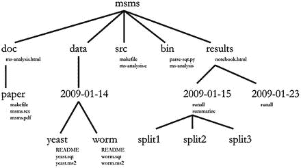
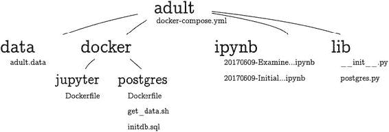

# 10. 交互式软件开发

Joshua Cook¹
(1) 美国加利福尼亚州圣莫尼卡

数据科学家进行软件开发的方式与传统软件工程不同，且远未被充分理解。对于传统软件开发者而言，无论使用何种语言，都存在围绕复用性、可扩展性和稳定性构建的框架。其中最著名的可能是 Ruby 语言的 `Rails` 框架。`Rails` 从其底层架构开始，就围绕其所采用的范式——模型-视图-控制器（Model-View-Controller）设计模式进行编写，该模式在面向用户的软件实现中备受青睐。清单 10-1 展示了新 `Rails` 应用的创建过程及其默认文件结构。请注意，新应用根据其使用模式创建了清晰的目录。

```
$ rails new myapp
      create
      ...
$ tree -L 1 myapp/app
myapp/app/
├── assets
├── channels
├── controllers
├── helpers
├── jobs
├── mailers
├── models
└── views
```

清单 10-1. 一个默认的 Rails 应用

数据科学领域的软件开发并没有这样的设计模式，可以围绕其构建类似的框架。在第三章中，我介绍了交互式计算作为传统编程替代方案的理念。在本章中，我提议将交互式计算本身作为潜在框架的基石理念。你将开发一个项目框架，其基础设施由 `docker-compose.yml` 定义，并围绕作为交互式计算驱动器的 `Jupyter` 构建。该框架的目标与交互式计算项目的目标一致。该框架应便于实现以下方面：
- 迭代
- 硬件的扩展与分发
- 工作的共享与文档化

## 计算生物学项目组织快速指南

为了给这个框架寻找灵感，让我们看看华盛顿大学 William Noble 的工作。¹ Noble 的工作描述了“执行计算实验的一种良好策略”，重点关注“诸如组织文件目录和记录进度等相对平凡的问题”。Noble 专注于构建项目的几个关键原则：
- 文件和目录组织
- 工作文档化
- 工作执行
- 版本控制

图 10-1 展示了 Noble 为一个名为 `msms` 的示例项目设计的文件和目录组织图。



图 10-1. Noble 的示例项目 `msms`

## 交互式开发的项目框架

你将直接借鉴这项工作来开发你的框架。你将使用按顺序编号的 `Jupyter Notebooks`，作为记录和执行工作的方法。这些笔记本既成为活动的详细记录，也成为驱动这些活动的手段。此外，你将展示一个围绕使用 `Jupyter Notebook` 作为工作驱动器而设计的目录层次结构。图 10-2 展示了一个为交互式开发构建的目录层次结构。



图 10-2. 为交互式开发构建的目录层次结构

你将使用以下目录来构建项目的目录层次结构：
- `data`
    - 包含原始数据文件
- `docker`
    - 包含一个子目录，用于存放每个需要通过构建来定义的镜像
    - 每个子目录将成为相应镜像的构建上下文
- `ipynb`
    - 包含所有 `Jupyter Notebook` 文件
    - 替代 `bin`、`doc` 和 `results` 目录
    - 笔记本是驱动器、脚本、文档和演示文稿
    - 笔记本以日期和活动命名，以便原地排序
- `lib`
    - 包含项目特定的代码模块，在项目开发过程中定义