# 项目根目录设计模式

在第 3 章中，我曾提出：

> Jupyter 并不能取代 vim、Sublime Text 或 PyCharm。Jupyter 取代的是 `if __name__ == "__main__":`。

`if __name__ == "__main__":` 设计模式为运行 Python 程序提供了一个启动钩子。我在此提出的项目框架并非围绕这种代码运行方式构建，因此也不需要这样的启动钩子。相反，你是以 Jupyter Notebook 作为驱动器来构建这个框架的。你需要的是一个将模块导入到 notebook 中的模式。维护清晰的项目目录结构要求你将 notebook 和 Python 模块分别存放在不同的目录中。此外，我认为将两者嵌套放置也不够美观。这会在导入时引发问题。给定如代码清单 10-2 所示的目录结构，你无法将 `lib/` 中的模块（例如代码清单 10-3 所示的 `some_module.py`）直接导入到 `ipynb/` 中的 Jupyter Notebook 模块里。

```
$ tree .
├── ipynb
│   └── some_notebook.ipynb
└── lib
    ├── __init__.py
    ├── some_module.py
```

代码清单 10-2. 示例项目结构

```
#!/bin/python
def say_hello ():
    print("Hello!")
```

代码清单 10-3. 一个演示用的 Python 模块 `some_module.py`

让我们通过使用我称之为项目根目录设计模式（代码清单 10-4）来解决这个问题。

```
In [1]: from os import chdir
        chdir('/home/jovyan')
```

代码清单 10-4. 项目根目录设计模式

项目根目录设计模式会将 Python 内核的当前工作目录更改为项目的根目录。这由 `docker-compose.yml` 文件（代码清单 10-8）中挂载卷的配置来保证，该配置将当前目录（`.`）挂载到 jupyter 镜像的工作目录 `/home/jovyan`。因此，在 Jupyter Notebook（运行在 jupyter 镜像上）中执行 `chdir('/home/jovyan')`，可以确保你位于项目根目录。此外，由于在 `chdir` 语句中使用了绝对路径，你可以幂等地运行此命令。在任何 Jupyter Notebook 中将其作为第一个命令运行，意味着你可以随意从 `lib` 目录进行导入（代码清单 10-5）。

```
In [2]: from lib.some_module import say_hello
        say_hello()
        Hello!
```

代码清单 10-5. 从 `lib.some_module` 导入

## 初始化项目

在第 9 章中，你使用 `docker-compose.yml` 文件设计了一个由 Jupyter Notebook 服务器和 PostgreSQL 数据库组成的应用。你使用了 `docker-compose` 构建工具和 postgres 镜像的设计来收集数据并初始化数据库。在这里，你再次执行相同的操作，从 UCI 机器学习库收集数据。不过在本章中，你将正式化数据收集过程，并使用 Jupyter Notebook 记录该过程。在代码清单 10-6 中，你初始化了项目。你为项目创建了一个全局目录 `ch10_adult`。在该项目下创建了三个子目录：`docker/`、`ipynb/` 和 `lib/`。你使用 `touch` 命令创建了一个新的 `__init__.py` ² 文件。这会使 `lib/` 目录成为一个 Python 模块。最后，你使用 `git init` 将项目仓库初始化为一个 git 仓库。

```
$ mkdir ch10_adult
$ cd ch10_adult/
$ mkdir docker ipynb lib
$ touch lib/__init__.py
$ git init
已初始化空的 Git 仓库于 /home/ubuntu/ch10_adult/.git/
```

代码清单 10-6. 初始化 `ch10_adult` 项目

在代码清单 10-7 中，你创建了 `docker-compose.yml` 文件（代码清单 10-8），该文件将定义项目的基础设施。请注意，你从简单开始。在这个阶段，你只有一个服务，即 Jupyter Notebook 服务器。

```
$ vi docker-compose.yml
```

代码清单 10-7. 创建 `docker-compose.yml` 文件

```
version: '3'
services:
  this_jupyter:
    image: jupyter/scipy-notebook
    ports:
      - "8888:8888"
    volumes:
      - .:/home/jovyan
```

代码清单 10-8. `docker-compose.yml`

定义好基础设施后，你将应用启动上线（代码清单 10-9）。由于你使用了 `image:` 关键字而非 `build:` 关键字来定义服务所用的镜像，因此在启动应用之前无需执行构建。启动后，你使用 `docker-compose ps` 工具来检查与应用相关的正在运行的容器（代码清单 10-10）。为了通过浏览器访问 Jupyter，你需要获取一个当前的身份验证令牌（代码清单 10-11）。

```
$ docker-compose up -d
正在启动 ch10adult_this_jupyter_1
```

代码清单 10-9. 启动初始系统

```
$ docker-compose ps
名称                          命令                          状态                  端口
----------------------------------------------------------------------------
ch10adult_this_jupyter_1  tini -- start-notebook.sh  Up   0.0.0.0:8888->8888/tcp
```

代码清单 10-10. 检查正在运行的容器

```
$ docker exec ch10adult_this_jupyter_1 jupyter notebook list
当前正在运行的服务器：
http://localhost:8888/?token=d6dc404c5e3c25ffd993579aeb06eeb2a801c4cbc75f727e :: /home/jovyan
```

代码清单 10-11. 获取身份验证令牌

## 检查数据库需求

此时，你的应用仅包含一个服务，即 Jupyter Notebook 服务器。项目开发的下一阶段是引入一个数据库。在这里，你将启动一个 notebook，并使用 `pandas` 检查数据样本，以便为处理数据制定一个模式。然后，你将准备 `postgres` 构建上下文，以便为数据库填充数据。

首先，在浏览器中导航到 Jupyter Notebook 服务器。请注意，Notebook 服务器的主目录由项目根目录的文件组成。在图 10-3 中，你导航到 `ipynb` 目录，并将在其中创建一个新的 Python 3 Notebook（图 10-4）。

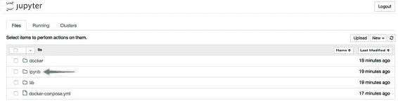

图 10-3. 导航到 `ipynb` 目录

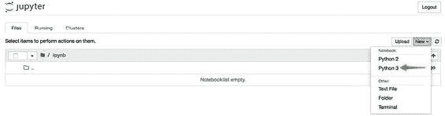

图 10-4. 创建一个新的 Python 3 notebook

Noble 提到需要“一个按时间顺序组织的实验笔记本”。我建议在这个项目框架中，Jupyter Notebook 可以满足这一需求。为了按时间顺序组织你的工作，你只需以年-月-日格式命名你的 notebook 文件，后跟要执行任务的高级描述。因此，将第一个 notebook 命名为 `20170611-Examine_Database_Requirements.ipynb`。

在代码清单 10-12 中，你以项目根设计模式开始 notebook，之后导入 `pandas`（代码清单 10-13）。

```
In [1]: from os import chdir
        chdir('/home/jovyan')
```

代码清单 10-12. 项目根设计模式

```
In [2]: import random
        import pandas as pd
```

代码清单 10-13. 导入必要的库

## 使用Jupyter探索和加载UCI数据集

在图 10-5 中，你利用 Jupyter 的 markdown 注释功能来包含数据集的信息。该数据集是从 UCI 机器学习库获取的成人数据集。你从数据集附带的描述中获取包含的 markdown 内容。

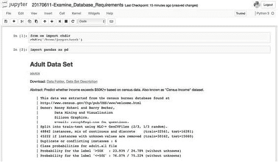

图 10-5. 使用 markdown 包含来自 UCI 机器学习库的数据集信息

## 使用Jupyter Shell管理文件

代码清单 10-14 演示了使用 Jupyter shell 调用 `ls` 命令的项目根设计模式的效果。在代码清单 10-15 中，你再次使用 Jupyter shell 调用 `mkdir` 命令创建一个顶级目录 `data`，然后第三次使用 Jupyter shell 调用 `wget` 工具来获取数据集（代码清单 10-16）。

```
In [3]: ls -l
        total 16
        drwxrwxr-x 2 jovyan 1000 4096 Jun 11 23:53 docker
        -rw-rw-r-- 1 jovyan 1000  145 Jun 11 23:55 docker-compose.yml
        drwxrwxr-x 3 jovyan 1000 4096 Jun 12 03:12 ipynb
        drwxrwxr-x 2 jovyan 1000 4096 Jun 11 23:53 lib
```

代码清单 10-14. 列出当前目录

```
In [4]: !mkdir data
```

代码清单 10-15. 创建数据目录

```
In [5]: !wget -P data/ \
        http://archive.ics.uci.edu/ml/machine-learning-databases/adult/adult.data
        --2017-06-12 03:28:31--  http://archive.ics.uci.edu/ml/machine-learning-
        databases/adult/adult.data
        Resolving archive.ics.uci.edu (archive.ics.uci.edu)... 128.195.10.249
        Connecting to archive.ics.uci.edu (archive.ics.uci.edu)|128.195.10.249|:80... connected.
        HTTP request sent, awaiting response... 200 OK
        Length: 3974305 (3.8M) [text/plain]
        Saving to: 'data/adult.data'
        data/adult.data    100%[===============>]  3.79M  7.93MB/s  in 0.5s
        2017-06-12 03:28:31 (7.93 MB/s) - 'data/adult.data' saved [3974305/3974305]
```

代码清单 10-16. 获取数据集

在代码清单 10-17 中，你使用 `wc` 工具统计文件中的行数。在代码清单 10-18 中，你使用 `head` 工具检查文件是否包含标题行。请注意，显示的两行都是数据行，因此该文件不包含标题行。

```
In [6]: !wc -l data/adult.data
        32562 data/adult.data
```

代码清单 10-17. 统计文件中的行数

```
In [7]: !head -n 2 data/adult.data
        39, State-gov, 77516, Bachelors, 13, Never-married, Adm-clerical, Not-in-family, White,
        Male, 2174, 0, 40, United-States, <=50K
        50, Self-emp-not-inc, 83311, Bachelors, 13, Married-civ-spouse, Exec-managerial,
        Husband, White, Male, 0, 0, 13, United-States, <=50K
```

代码清单 10-18. 检查文件是否包含标题

## 使用Pandas加载数据集

在代码清单 10-19 中，你使用 `pandas.read_csv` 函数加载数据集的 10% 样本。为此，你首先定义两个变量：`number_of_rows` 和 `sample_size`。第一个是数据集中存在的行数，第二个是你希望包含在样本中的行数。接下来，你使用 `random.sample` 函数创建一个列表 `rows_to_skip`。`random.sample` 接受两个参数：一个要从中采样的列表和一个样本大小。在这里，你创建一个从 0 到 `number_of_rows` 的数字范围，并请求一个大小为 `number_of_rows - sample_size` 的样本集。返回的样本列表经过排序，成为你要跳过的行。此列表在运行时传递给 `pandas.read_csv`。其效果是 `pandas.read_csv` 将加载一个大小为 `sample_size` 的数据集。`pandas.read_csv` 的输出是一个 `pandas.DataFrame` 对象。你将此 `pandas.DataFrame` 保存为 `adult_df`。你将为对象属性 `adult_df.columns` 分配一个列名列表（从 UCI 机器学习库的数据集描述中获取）。

```
In [8]: number_of_rows = 32562
        sample_size = 3300
        rows_to_skip = random.sample(range(number_of_rows), number_of_rows - sample_size)
        rows_to_skip.sort()
        adult_df = pd.read_csv('data/adult.data', header=None, skiprows=rows_to_skip)
        adult_df.columns = [
            'age',
            'workclass',
            'fnlwgt',
            'education',
            'education_num',
            'marital_status',
            'occupation',
            'relationship',
            'race',
            'gender',
            'capital_gain',
            'capital_loss',
            'hours_per_week',
            'native_country',
            'income_label'
        ]
```

代码清单 10-19. 使用 `pandas` 加载文件

在图 10-6 中，你使用 `adult_df.sample(3)` 显示加载的 DataFrame 的一个样本。

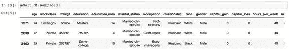

图 10-6. 加载的 DataFrame 的一个样本

## 验证数据类型与元信息

此时，你开始构建一个模式，用于将数据集加载到 PostgreSQL 数据库中。在图 10-7 中，你使用 Jupyter markdown 注释 UCI 提供的不同特征列的数据类型，然后检查 `adult_df.dtypes` 以显示 `pandas.DataFrame` 中每列的数据类型。如果数据在 CSV 文件中格式正确，那么 `pandas` 将为每列分配正确的数据类型。如果 `pandas.DataFrame` 的数据类型与 UCI 提供的元信息中的数据类型匹配，那么你应该能够在加载时依赖数据的完整性，并能够使用建议的数据类型来定义你的模式。请注意，`pandas.DataFrame` 的数据类型确实与元信息中的数据类型匹配，因此你可以将元信息作为模式的基础，而无需特殊的数据处理。

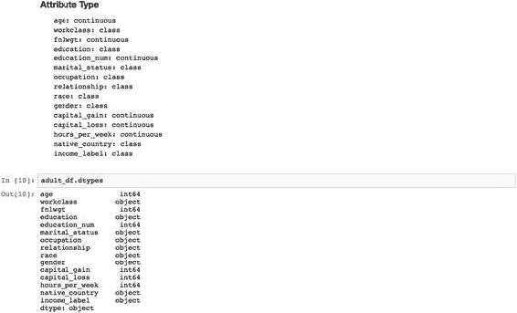

图 10-7. 将 UCI 机器学习库的元信息与 DataFrame 数据类型进行比较

完成初步工作后，你保存文件并通过从“文件”菜单中选择“关闭并停止”来停止 notebook（图 10-8）。你将利用在此发现的内容来构建你的数据库。

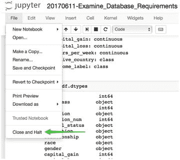

图 10-8. 关闭并停止 notebook

## 通过 Git 管理项目

在进入项目下一阶段之前，你需要使用`git`提交所有最近的更改。在代码清单 10-20 中，你使用`git status`工具检查项目状态（即代码中存在哪些更改）。由于自初始化项目以来你尚未进行任何提交，因此除了刚刚为编写模式所做的准备工作外，还会存在与初始`docker-compose.yml`文件定义相关的更改。

```
$ git status
位于分支 master
初始提交
未跟踪的文件：
  （使用 "git add <文件>..." 以包含要提交的内容）
        data/
        docker-compose.yml
        ipynb/
```

代码清单 10-20. 检查项目状态

你将分别跟踪所完成的每个工作部分。首先，在代码清单 10-21 中，你添加并提交了初始`docker-compose.yml`文件的创建。然后，在代码清单 10-22 中，你对模式准备工作执行相同操作。由于这些工作是所有尚未暂存的内容，你可以使用`-A`标志来表示希望添加“所有”内容。

```
$ git add docker-compose.yml
$ git commit -m '初始 docker-compose.yml 文件'
[master (根提交) 3029c78] 初始 docker-compose.yml 文件
 1 个文件已更改，8 行插入(+)
 创建模式 100644 docker-compose.yml
```

代码清单 10-21. 添加并提交初始`docker-compose.yml`文件

```
$ git add -A
$ git commit -m '模式准备工作'
[master 13de8e1] 模式准备工作
 3 个文件已更改，33336 行插入(+)
 创建模式 100644 data/adult.data
 创建模式 100644 ipynb/.ipynb_checkpoints/20170611-Examine_Database_Requirements-checkpoint.ipynb
 创建模式 100644 ipynb/20170611-Examine_Database_Requirements.ipynb
 创建模式 100644 docker-compose.yml
```

代码清单 10-22. 添加并提交模式准备工作

请注意，最近这次提交还添加了一个`.ipynb_checkpoints`目录。这是不期望的。在代码清单 10-23 中，你创建了一个`.gitignore`（代码清单 10-24）文件，并添加了一些你不想通过`git`跟踪的文件。在代码清单 10-25 中，你重置了`git HEAD`以移除最近一次提交。最后，在代码清单 10-26 中，你再次执行了整个流程。

```
$ vi .gitignore
```

代码清单 10-23. 创建`.gitignore`文件

```
**/.ipynb_checkpoints
**/*.pyc
```

代码清单 10-24. `.gitignore`

```
$ git reset HEAD∼1
$ git status
位于分支 master
未跟踪的文件：
  （使用 "git add <文件>..." 以包含要提交的内容）
        .gitignore
        data/
        ipynb/
无文件要提交，但存在未跟踪的文件（使用 "git add" 以跟踪）
```

代码清单 10-25. 将`git HEAD`重置到倒数第二次提交并显示状态

```
$ git add -A
$ git commit -m '模式准备工作'
[master ad896e2] 模式准备工作
 3 个文件已更改，32951 行插入(+)
 创建模式 100644 .gitignore
 创建模式 100644 data/adult.data
 创建模式 100644 ipynb/20170611-Examine_Database_Requirements.ipynb
```

代码清单 10-26. 添加并提交模式准备工作

`警告`

将数据文件添加到`git`提交时需谨慎。如果将本地`git`仓库与基于云的版本控制系统（如 GitHub）同步，文件必须小于 100MB 才能上传到 GitHub。从`git`提交中移除文件（尤其是当它不是最近一次提交时）可能颇具挑战性，并且即使已从最近一次提交中移除，其存在也会导致同步失败。如果需要云备份，建议使用`bash`工具`split`⁶ 将 CSV 文件拆分为小于 100MB 的较小文件。

## 向应用程序添加数据库

你最初使用基本的 Jupyter 服务启动了应用程序，以便对数据集进行初步分析。完成此操作后，让我们利用所学知识，使用适当的模式将此数据集填充到 PostgreSQL 数据库中。图 10-9 显示了系统下一次迭代的示意图。

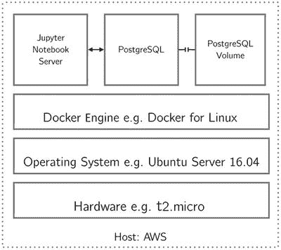

图 10-9. 应用程序的第二次迭代

为此，你需要在`docker-compose.yml`文件中添加几项内容（代码清单 10-27）：

- 使用构建的镜像而非现有镜像来定义 Jupyter Notebook 服务，以便包含你的数据库接口库`psycopg2`。

- 定义一个 PostgreSQL 服务，利用你在第 9 章中看到的构建钩子。

- 创建一个数据卷供 PostgreSQL 服务使用。

```yaml
version: '3'
services:
  this_jupyter:
    build: docker/jupyter
    ports:
      - "8888:8888"
    volumes:
      - .:/home/jovyan
  this_postgres:
    build: docker/postgres
    volumes:
      - postgres_data:/var/lib/postgresql/data
volumes:
  postgres_data:
```

`清单 10-27. docker-compose.yml 的下一个版本`

这里，你使用了之前见过的几种模式，但特别需要注意的是，你必须将新的数据卷挂载到`this_postgres`容器内的正确位置。

接下来，为两个新的构建上下文创建目录（清单 10-28），并创建一个`Dockerfile`（清单 10-30）来定义你的`this_jupyter`服务（清单 10-29）。此时，你只做了一项更改：在 Python 3 环境中添加`psycopg2`。

```
$ mkdir docker/jupyter docker/postgres
```

`清单 10-28. 创建新的构建上下文`

```
$ vim docker/jupyter/Dockerfile
```

`清单 10-29. 创建 docker/jupyter/Dockerfile`

```
FROM jupyter/scipy-notebook
USER root
RUN conda install --yes --name root psycopg2
USER jovyan
```

`清单 10-30. docker/jupyter/Dockerfile`

然后，定义`this_postgres`服务的构建上下文。与第 9 章一样，PostgreSQL 的构建上下文要复杂得多，包含多个文件：一个`Dockerfile`（清单 10-31 和 32）；一个用于获取和清理数据的 bash 脚本`get_data.sh`（清单 10-34）；以及一个用于初始化数据库的 SQL 文件`initdb.sql`（清单 10-36）。

`注意`

从 UCI 机器学习库获取的数据 CSV 文件末尾包含一个空行。PostgreSQL 无法容忍任何异常行为，如果不特殊处理这个空行，它会拒绝`docker/postgres/initdb.sql`文件（清单 10-35）中的数据复制操作。与第 9 章一样，我在`get_data.sh`文件中使用`sed`工具处理了这个问题（清单 10-33）。这里，我使用了模式`/^\s*$/d`。它的作用是匹配仅由空白字符组成的任何行，包括空行（`^\s*$`），并使用`d`命令将其删除。

```
$ vim docker/postgres/Dockerfile
```

`清单 10-31. 创建 docker/postgres/Dockerfile`

```
## 清单 10-32. `docker/postgres/Dockerfile`

```
FROM postgres:alpine
COPY get_data.sh /docker-entrypoint-initdb.d/get_data.sh
COPY initdb.sql /docker-entrypoint-initdb.d/initdb.sql
```

## 清单 10-33. 创建 `docker/postgres/get_data.sh`

```
$ vim docker/postgres/get_data.sh
```

## 清单 10-34. `docker/postgres/get_data.sh`

```
#!/bin/bash
wget -P /tmp/ http://archive.ics.uci.edu/ml/machine-learning-databases/adult/adult.data
sed '/^\s*$/d' /tmp/adult.data > /tmp/adult-clean.csv
```

## 清单 10-35. 创建 `docker/postgres/initdb.sql`

```
$ vim docker/postgres/initdb.sql
```

## 清单 10-36. `docker/postgres/initdb.sql`

```
CREATE TABLE adult (
    age INTEGER,
    workclass TEXT,
    fnlwgt INTEGER,
    education TEXT,
    education_num INTEGER,
    marital_status TEXT,
    occupation TEXT,
    relationship TEXT,
    race TEXT,
    gender TEXT,
    capital_gain INTEGER,
    capital_loss INTEGER,
    hours_per_week INTEGER,
    native_country TEXT,
    income_label TEXT
);
COPY adult FROM '/tmp/adult.data' DELIMITER ',' CSV;
```

在清单 10-37 中，你使用 `tree` 命令展示你的项目。

## 清单 10-37. 展示项目

```
$ tree .
.
├── data
│   └── adult.data
├── docker
│   ├── jupyter
│   │   └── Dockerfile
│   └── postgres
│       ├── Dockerfile
│       ├── get_data.sh
│       └── initdb.sql
├── docker-compose.yml
├── ipynb
│   └── 20170611-Examine_Database_Requirements.ipynb
└── lib
```

在清单 10-38 中，你启动更新后的应用程序。请注意，你在 `docker-compose up` 命令中添加了 `--build` 标志，以确保新的构建上下文在使用前已被构建。然后，你使用 `docker-compose ps`（清单 10-39）检查正在运行的容器。

## 清单 10-38. 启动应用程序

```
$ docker-compose up -d --build
Creating network "ch10adult_default" with the default driver
Creating volume "ch10adult_postgres_data" with default driver
Building this_jupyter ...
Building this_postgres ...
Successfully built de96ba591ad9
Successfully tagged ch10adult_this_postgres:latest
Creating ch10adult_this_jupyter_1
Creating ch10adult_this_postgres_1
```

配置 PostgreSQL 数据库的种子数据可能很棘手。当通过抽象层（就像你现在所做的那样）进行此操作时，任务的难度可能会增加。你的 `initdb.sql` 文件由 `this_postgres` 容器在运行时执行。这可能会给任何问题的诊断和故障排除带来挑战。我提供以下方法来验证数据库初始化是否成功：

- 通过 `docker-compose ps` 确认数据库正在运行。`initdb.sql` 文件中的语法错误会导致数据库在运行时失败并退出。如果发生这种情况，`docker-compose ps` 将显示 `ch10adult_this_postgres_1` 容器的状态为 `Exit`（清单 10-39）。

- 检查 `this_postgres` 服务的日志（清单 10-40）。如果初始化成功，日志应包含初始化脚本和 SQL 文件的执行记录。请注意，在清单 10-40 中，您可以看到已成功将 32561 条记录复制到数据库中。

- 通过 `docker exec` 调用 `psql` 工具连接到正在运行的容器（清单 10-41）。

## 清单 10-39. 检查正在运行的容器

```
$ docker-compose ps
          Name                       Command               State            Ports
----------------------------------------------------------------------------
ch10adult_this_jupyter_1   tini--start-notebook.sh         Up      0.0.0.0:8888->8888/tcp
ch10adult_this_postgres_1  docker-entrypoint.sh postgres   Up      5432/tcp
```

## 清单 10-40. 检查 `this_postgres` 日志

```
... this_postgres_1  | /usr/local/bin/docker-entrypoint.sh: running /docker-entrypoint-initdb.d/get_data.sh
this_postgres_1  | Connecting to archive.ics.uci.edu (128.195.10.249:80)
this_postgres_1  | adult.data             9% |**                             |   363k  0:00:09 ETA
this_postgres_1  | adult.data           100% |*******************************|  3881k  0:00:00 ETA
this_postgres_1  |
this_postgres_1  |
this_postgres_1  | /usr/local/bin/docker-entrypoint.sh: running /docker-entrypoint-initdb.d/initdb.sql
this_postgres_1  | CREATE TABLE
this_postgres_1  | COPY 32561
...
```

## 清单 10-41. 通过 `psql` 连接到 `this_postgres`

```
$ docker exec -it ch10adult_this_postgres_1 psql postgres postgres
psql (9.6.3)
Type "help" for help.

postgres=# SELECT COUNT(*) FROM adult;
 count
-------
 32561
(1 row)
```

在验证 `this_postgres` 服务已正确配置后，您将这些基础设施更改提交到您的 `git` 日志中（清单 10-42）。在清单 10-43 中，您添加所有文件并提交更改。
```

## 交互式开发

本项目框架的一个主要目标是促进一种称为交互式开发的新型软件开发方式。模块的交互式开发步骤如下：

1.  使用 Jupyter 在笔记本中交互式地编写代码。
2.  当代码块变得过大或需要重复使用时，将这段代码抽象为 Jupyter 中的一个函数。
3.  在 Jupyter 中测试这个新函数的性能。
4.  将此函数移动到您的代码库中的一个模块中。
5.  根据需要导入代码以供使用。

让我们用一个您将经常使用的简单方法来演示此过程：从 Jupyter 到数据库的基本连接。在这种情况下，您将把该函数抽象到您的代码库中，以遵循不重复代码的最佳实践。首先，导航到`ipynb/`并创建一个新文件。您使用当前日期和您将要执行的操作来重命名该文件（例如`20170613-Initial_Database_Connection.ipynb`）。在列表 10-45 中，您以项目根目录设计模式开始笔记本，之后导入`psycopg2`（列表 10-46）。

```
In [1]: from os import chdir
        chdir('/home/jovyan')
```

列表 10-45. 项目根目录设计模式

```
In [2]: import psycopg2 as pg2
```

列表 10-46. 导入必要的库

在列表 10-47 中，您像之前一样连接到数据库，实例化一个连接和该连接上的游标。您利用了 Docker Compose 为您创建的网络，并通过其在网络上的名称`this_postgres`（即您为 PostgreSQL 服务指定的名称）来引用它。在列表 10-48 中，您使用游标向数据库执行查询，打印查询结果，然后关闭连接。

```
In [3]: con = pg2.connect(host='this_postgres', user='postgres', database='postgres')
        cur = con.cursor()
```

列表 10-47. 连接到`postgres`并创建游标

```
In [4]: cur.execute("SELECT COUNT(*) FROM adult;")
        print(cur.fetchall())
        con.close()
        [(32561,)]
```

列表 10-48. 查询数据库并关闭连接

列表 10-47 中的代码是您将经常使用的代码。虽然只有两行代码，但由于您会频繁使用它，因此值得将其抽象成一个函数。在图 10-10 中，您在 Jupyter 单元格中编写此函数，然后使用 Tab 补全来显示该函数的文档字符串。

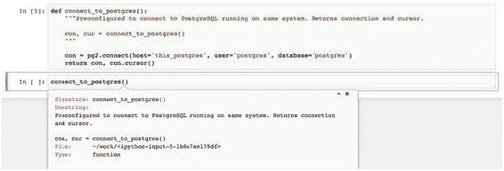

图 10-10. 定义一个函数并显示其文档字符串

接下来，您在列表 10-49 中验证您的`connect_to_postgres`函数是否按预期工作。

```
In [6]: con, cur = connect_to_postgres()
        cur.execute("SELECT COUNT(*) FROM adult;")
        print(cur.fetchall())
        con.close()
        [(32561,)]
```

列表 10-49. 测试`connect_to_postgres`

在验证了您用于访问`this_postgres`的函数正常工作后，您可以将该函数添加到一个外部 Python 模块中以供导入。由于您已完成此笔记本，您应该保存，然后关闭并停止该笔记本。

### 使用 Jupyter 创建 Python 模块

你将利用 Jupyter 服务器创建和编辑文本文件的能力，构建一个`lib.postgres`模块。在图 10-11 中，你通过 Notebook 服务器导航到`lib/`目录，然后在`lib/`目录下创建一个新的文本文件。在图 10-12 中，你将这个文件重命名为`postgres.py`。接下来，你将清单 10-50 中的代码填入这个新文本文件。

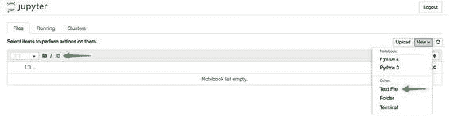

图 10-11. 创建一个新的文本文件

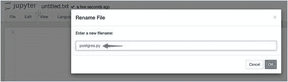

图 10-12. 将新文件重命名为`postgres.py`

```python
"""用于与 PostgreSQL 交互的辅助模块。"""
import psycopg2 as pg2

def connect_to_postgres():
    """预配置用于连接 PostgreSQL。返回连接和游标。
    con, cur = connect_to_postgres()
    """
    con = pg2.connect(host='this_postgres', user='postgres', database='postgres')
    return con, con.cursor()
```

清单 10-50. `lib.postgres`模块

接下来，你创建一个新的 notebook 来测试你编写的函数。为每个任务都创建一个新的 notebook 可能有点刻板。你在这里这样做是为了突出交互式开发方法的理想工作流程。你创建一个名为`20170613-Verify_Database_Connection.ipynb`的新 notebook。在清单 10-51 中，你以项目根目录设计模式开始这个 notebook。在清单 10-52 中，你导入`lib.postgres`并验证`connect_to_postgres`函数是否按预期工作。

```python
In [1]: from os import chdir
        chdir('/home/jovyan')
```

清单 10-51. 项目根目录设计模式

```python
In [2]: import lib.postgres as psql
        con, cur = psql.connect_to_postgres()
        cur.execute("SELECT COUNT(*) FROM bc_data;")
        print(cur.fetchall())
        con.close()
        [(32561,)]
```

清单 10-52. 测试 `psql.connect_to_postgres`

最后，你使用 `git` 跟踪你的工作。在清单 10-53 中，你检查项目的状态。在清单 10-54 中，你添加并提交所有近期的工作。

```
$ git status
On branch master
Untracked files:
  (use "git add <file>..." to include in what will be committed)
        ipynb/20170613-Initial_Database_Connection.ipynb
        ipynb/20170613-Verify_Database_Connection.ipynb
        lib/
```

清单 10-53. 检查项目状态

```
$ git add -A
ubuntu@LOCAL:∼/ch10_adult (master)
$ git commit -m 'initial database connection'
[master d2461f6] initial database connection
 4 files changed, 185 insertions(+)
 create mode 100644 ipynb/20170613-Initial_Database_Connection.ipynb
 create mode 100644 ipynb/20170613-Verify_Database_Connection.ipynb
 create mode 100644 lib/__init__.py
 create mode 100644 lib/postgres.py
```

清单 10-54. 添加所有文件并提交

在清单 10-55 中，你显示项目的当前状态。

```
$ tree .
.
├── data
│   └── adult.data
├── docker
│   ├── jupyter
│   │   └── Dockerfile
│   └── postgres
│       ├── Dockerfile
│       ├── get_data.sh
│       └── initdb.sql
├── docker-compose.yml
├── ipynb
│   ├── 20170611-Examine_Database_Requirements.ipynb
│   ├── 20170613-Initial_Database_Connection.ipynb
│   └── 20170613-Verify_Database_Connection.ipynb
└── lib
    ├── __init__.py
    ├── postgres.py
    └── __pycache__
        ├── __init__.cpython-35.pyc
        └── postgres.cpython-35.pyc
```

清单 10-55. 当前项目状态

## 为应用程序添加延迟处理

现在，你将迭代你的应用程序，使其达到最终状态。你将在现有应用程序中添加一个 `Redis` 服务，以及两个基于 `Jupyter` 镜像变体定义的其他服务。在第 9 章中，我讨论了如何使用 `Redis` 缓存中间结果。在这里，你将探索 `Redis` 的另一个用途，即作为延迟作业处理系统的骨干。除了 `Redis`，延迟作业处理系统还将使用一个 Worker 服务（用于执行延迟作业）和一个 Monitor 服务（用于通过 Web 浏览器监控延迟作业的状态）。图 10-13 显示了最终应用程序的示意图。

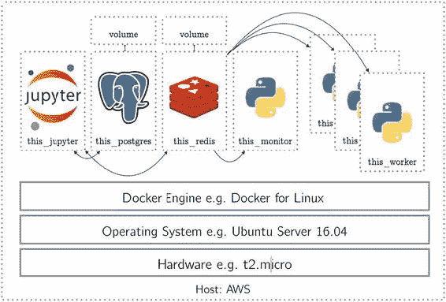

图 10-13. 最终应用程序示意图

为此，你需要在 `docker-compose.yml` 文件中添加一些内容（清单 10-56）：

*   使用 `image:` 关键字定义一个 `Redis` 服务。
*   创建一个供 `Redis` 服务使用的数据卷。
*   使用与 `Jupyter` 服务相同的构建上下文定义一个 Worker 服务。
*   使用与 `Jupyter` 服务相同的构建上下文定义一个 Monitor 服务。

虽然 Worker 服务和 Monitor 服务都将使用 `docker/jupyter` 构建上下文来定义，但你将在运行时使用 `entrypoint:` 关键字扩展这些镜像。此关键字指定了镜像启动时应执行的命令（换句话说，即定义容器行为的核心进程）。Worker 服务将使用 `rqworker` 工具与 `Redis` 交互，以获取并执行排队的作业。你使用 `entrypoint:` 关键字的 exec 形式，并利用 `yaml` 列表来指定实例化进程。入口点包括：

*   `tini`
    *   第 5 章中提到的 PID 1 工具，`Jupyter` 用它来实例化所有容器
*   `--`
    *   使用 `tini` 实例化容器的最佳实践 ⁷
*   `rqworker`
    *   你将用来运行 Worker 服务的进程
*   `-u`
    *   URL 标志
*   `redis://this_redis:6379`
    *   `Redis` 可用的 URL
    *   使用 `Redis` 服务在 `Docker Compose` 创建的网络上的名称

Monitor 服务将使用 `rq-dashboard` 工具，以提供一个基于 Web 的仪表板，用于监控排队作业的状态。你使用 `entrypoint:` 关键字的 exec 形式，并利用 `yaml` 列表来指定实例化进程。入口点包括：

*   `tini`
*   `--`
*   `rq-dashboard`
    *   你将用来运行 Monitor 服务的进程
*   `-H`
    *   主机标志
*   `this_redis`
    *   `Redis` 服务在 `Docker Compose` 创建的网络上的名称
*   `-p`
    *   端口标志
*   `5000`
    *   你的 Monitor 服务可用的端口

与之前一样，你无需显式指定容器之间的链接，让 `Docker Compose` 为你建立链接。你需要确保将 `redis_data` 卷挂载到 `this_redis` 容器内的正确位置。

```
version: '3'
services:
  this_jupyter:
    build: docker/jupyter
    ports:
      - "8888:8888"
    volumes:
      - .:/home/jovyan
  this_postgres:
    build: docker/postgres
    volumes:
      - postgres_data:/var/lib/postgresql/data
  this_redis:
    image: redis
    volumes:
      - redis_data:/data
  this_worker:
    build: docker/jupyter
    volumes:
      - .:/home/jovyan
    entrypoint:
      - "tini"
      - "--"
      - "rqworker"
      - "-u"
      - "redis://this_redis:6379"
  this_monitor:
    build: docker/jupyter
    volumes:
      - .:/home/jovyan
    ports:
      - "5000:5000"
    entrypoint:
      - "tini"
      - "--"
      - "rq-dashboard"
      - "-H"
      - "this_redis"
      - "-p"
      - "5000"
volumes:
  postgres_data:
  redis_data:
```

清单 10-56. 你的 `docker-compose.yml` 的下一版本

接下来（清单 10-57），你将更新 `Jupyter` Dockerfile（清单 10-58），以包含驱动 Worker 和 Monitor 服务所需的库。

```
$ vim docker/jupyter/Dockerfile
```

清单 10-57. 更新 `docker/jupyter/Dockerfile`

## 扩展 Postgres 模块

```
FROM jupyter/scipy-notebook
USER root
RUN conda install --yes --name root psycopg2
RUN conda install --yes --name root redis rq
RUN ["bash", "-c", "source activate root && pip install rq-dashboard"]
USER jovyan
```

清单 10-58. `docker/jupyter/Dockerfile`

在清单 10-59 中，你使用 `tree` 命令展示你的项目。

```
$ tree .
├── data
│   └── adult.data
├── docker
│   ├── jupyter
│   │   └── Dockerfile
│   └── postgres
│       ├── Dockerfile
│       ├── get_data.sh
│       └── initdb.sql
├── docker-compose.yml
├── ipynb
│   ├── 20170611-Examine_Database_Requirements.ipynb
│   ├── 20170613-Initial_Database_Connection.ipynb
│   └── 20170613-Verify_Database_Connection.ipynb
└── lib
    ├── __init__.py
    ├── postgres.py
    └── __pycache__
        ├── __init__.cpython-35.pyc
        └── postgres.cpython-35.pyc
```

清单 10-59. 展示项目

在清单 10-60 中，你启动更新后的应用程序。请注意，你继续在 `docker-compose up` 命令中使用 `--build` 标志，以确保新的构建上下文在使用前已被构建。然后，你使用 `docker-compose ps`（清单 10-61）检查正在运行的容器。

```
$ docker-compose up -d --build
Creating network "ch10adult_default" with the default driver
Creating volume "ch10adult_postgres_data" with default driver
Creating volume "ch10adult_redis_data" with default driver
...
Creating ch10adult_this_worker_1
Creating ch10adult_this_redis_1
Creating ch10adult_this_postgres_1
Creating ch10adult_this_jupyter_1
Creating ch10adult_this_monitor_1
```

清单 10-60. 启动应用程序

```
$ docker-compose ps
          Name              Command                      State              Ports
----------------------------------------------------------------------------
ch10adult_this_jupyter_1   tini--start-notebook.sh       Up    0.0.0.0:8888->8888/tcp
ch10adult_this_monitor_1   tini--rq-dashboard -H th ...  Up    0.0.0.0:5000->5000/tcp...
ch10adult_this_postgres_1  docker-entrypoint.sh postgres Up    5432/tcp
ch10adult_this_redis_1     docker-entrypoint.sh redis ... Up    6379/tcp
ch10adult_this_worker_1    tini--rqworker -u redis: ...  Up    8888/tcp
```

清单 10-61. 检查正在运行的容器

配置延迟任务系统也可能是一个挑战，就像配置 PostgreSQL 数据库一样。可以使用非常相似的方法进行故障排除。

- 通过 `docker-compose ps` 确认服务正在运行。
- 检查服务的日志（清单 10-62 和 10-63）。
- 通过 `docker exec` 调用 `bash` 工具连接到正在运行的容器。

```
$ docker-compose logs this_monitor
Attaching to ch10adult_this_monitor_1
this_monitor_1   | RQ Dashboard version 0.3.8
this_monitor_1   |  * Running on http://0.0.0.0:5000/ (Press CTRL+C to quit)
```

清单 10-62. 检查 `this_monitor` 日志

```
$ docker-compose logs this_worker
Attaching to ch10adult_this_worker_1
this_worker_1    | 20:28:59 RQ worker 'rq:worker:6a695d66b402.5' started, version 0.6.0
this_worker_1    | 20:28:59 Cleaning registries for queue: default
this_worker_1    | 20:28:59
this_worker_1    | 20:28:59 *** Listening on default......
```

清单 10-63. 检查 `this_worker` 日志

在确认新服务已正确配置后，你将此基础设施变更提交到你的 git 日志中（清单 10-64）。在清单 10-65 中，你添加所有文件并提交变更。

```
$ git status
On branch master
Changes not staged for commit:
  (use "git add <file>..." to update what will be committed)
  (use "git checkout -- <file>..." to discard changes in working directory)
        modified:   docker-compose.yml
        modified:   docker/jupyter/Dockerfile
no changes added to commit (use "git add" and/or "git commit -a")
```

清单 10-64. 检查项目状态

```
$ git add -A
ubuntu@LOCAL:∼/ch10_adult (master)
$ git commit -m 'add delayed job system'
[master 9564efd] add delayed job system
 2 files changed, 31 insertions(+), 1 deletion(-)
```

清单 10-65. 添加并提交变更

由于你已经停止并重新启动了 Jupyter Notebook 服务器，你需要获取一个新的身份验证令牌，以便再次在浏览器中访问该服务器（清单 10-66）。

```
$ docker exec ch10adult_this_jupyter_1 jupyter notebook list
Currently running servers:
http://localhost:8888/?token=46e478574fe9cf238c6e2e6bc9b9daccb7efa7154dfd9d08 :: /home/jovyan
```

清单 10-66. 获取身份验证令牌

## 扩展 Postgres 模块

让我们再次演示本章描述的交互式开发范式，这次你将扩展之前创建的 `postgres` 模块。这次，你将首先开发一个用于编码目标的函数。这个函数将由一个或多个工作进程逐行执行。你将：

- 使用 Jupyter 在笔记本中交互式地编写代码。
- 在 Jupyter 中将此代码抽象为一个函数。
- 在 Jupyter 中测试这个新函数的性能。
- 将此函数移动到你的代码库模块中。
- 通过任务队列将该函数传递给工作进程。

首先，导航到`ipynb/`目录并创建一个新文件。用当前日期和即将执行的任务重命名该文件（例如`20170619-Develop_encoding_target_function.ipynb`）。在代码清单 10-67中，你以项目根目录设计模式开始编写笔记本，随后导入`connect_to_`（代码清单 10-68）。

```
In [1]: from os import chdir
        chdir('/home/jovyan')
```

代码清单 10-67. 项目根目录设计模式

```
In [2]: from lib.postgres import connect_to_postgres
```

代码清单 10-68. 导入数据库连接

在图 10-14中，你使用一个 Markdown 单元格来包含数据集的属性类型元信息，就像之前在`20170611-Examine_Database_Requirements.ipynb`中所做的那样。

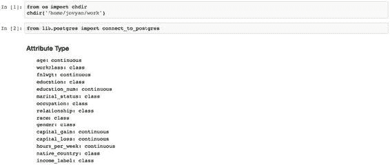

图 10-14. 显示属性类型元信息

在代码清单 10-69中，你在数据库中创建新列。与第 8 章一样，你通过`BEGIN`和`COMMIT`语句手动管理事务。请注意，每次事务后都要关闭连接。

```
In [3]: con, cur = connect_to_postgres()
        cur.execute("""
        BEGIN;
        ALTER TABLE adult ADD COLUMN _id SERIAL PRIMARY KEY;
        ALTER TABLE adult ADD COLUMN target BOOLEAN;
        COMMIT;
        """)
        con.close()
```

代码清单 10-69. 创建新列

最佳实践是监控数据库的更改。在代码清单 10-70中，你通过`docker exec`使用`psql`来检查`adult`表。

```
$ docker exec -it ch10adult_this_postgres_1 psql postgres postgres
psql (9.6.3)
Type "help" for help.

postgres=# \d adult
                              Table "public.adult"
     Column     |  Type   |                      Modifiers
----------------+---------+-----------------------------------------------------
 age            | integer |
 workclass      | text    |
 fnlwgt         | integer |
 education      | text    |
 education_num  | integer |
 marital_status | text    |
 occupation     | text    |
 relationship   | text    |
 race           | text    |
 gender         | text    |
 capital_gain   | integer |
 capital_loss   | integer |
 hours_per_week | integer |
 native_country | text    |
 income_label   | text    |
 _id            | integer | not null default nextval('adult__id_seq'::regclass)
 target         | boolean |
Indexes:
    "adult_pkey" PRIMARY KEY, btree (_id)
```

代码清单 10-70. 通过`docker exec`调用`psql`检查`adult`表

在代码清单 10-71中，你检索目标列`income_label`的唯一值。

```
In [4]: con, cur = connect_to_postgres()
        cur.execute("""SELECT DISTINCT(income_label) FROM adult;""")
        print(cur.fetchall())
        con.close()
        [(' >50K',), (' <=50K',)]
```

代码清单 10-71. 检索名为`income_label`的目标列的唯一值

虽然`income_label`本质上是分类变量，但它只有两个值，因此可以编码为布尔值。在代码清单 10-72中，你编写了一个简短的 Jupyter 脚本来实现这一点。首先，你查询数据库，检索`target`列为`NULL`的单行数据的`_id`和`income_label`。然后创建一个布尔值变量`greater_than_50k`。最后，更新给定`_id`的表并关闭数据库连接。

```
In [5]: con, cur = connect_to_postgres()
        cur.execute("""SELECT _id, income_label FROM adult WHERE target IS NULL;""")
        this_id, income_label = cur.fetchone()
        greater_than_50k = (income_label == ' >50K')
        cur.execute("""
        BEGIN;
        UPDATE adult
        SET target = {}
        WHERE _id = {};
        COMMIT;
        """.format(greater_than_50k, this_id))
        con.close()
```

代码清单 10-72. 将单个实例的目标编码为布尔值

在代码清单 10-73中，你验证更新是否成功。

```
In [6]: con, cur = connect_to_postgres()
        cur.execute("""
        SELECT _id, income_label, target
        FROM adult WHERE _id = {};
        """.format(this_id))
        print(this_id, cur.fetchone())
        con.close()
        10 (10, ' >50K', True)
```

代码清单 10-73. 验证更新

验证脚本运行正常后，你开始将脚本抽象成一个函数（代码清单 10-74）。

```
In [7]: def encode_target(_id):
            """Encode the target for a single row as a boolean value. Takes a row _id."""
            con, cur = connect_to_postgres()
            cur.execute("""SELECT _id, income_label FROM adult where _id = {}""".format(_id))
            this_id, income_label = cur.fetchone()
            assert this_id == _id
            greater_than_50k = (income_label == ' >50K')
            cur.execute("""
                BEGIN;
                UPDATE adult
                SET target = {}
                WHERE _id = {};
                COMMIT;
            """.format(greater_than_50k, _id))
            con.close()
```

代码清单 10-74. `encode_target`函数

在代码清单 10-75和10-76中，你测试新函数并验证其成功运行。

### 更新你的 Python 模块

在 Figure 10-15 中，你使用笔记本服务器导航到`lib/`目录，然后在`lib/`目录中选择`postgres.py`，以便通过 Jupyter Notebook 服务器的文本界面更新该模块。接下来，你将 Listing 10-74 中的代码添加到文件中，如图 Figure 10-16 所示。请注意，当所有当前更改都已保存时，文本文件名旁边会出现一个复选标记，如图 Figure 10-17 所示。

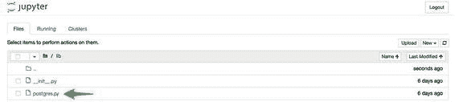
Figure 10-15. 打开`postgres.py`进行编辑

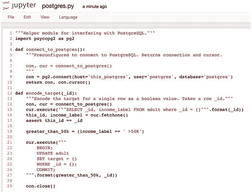
Figure 10-16. `postgres.py`的最新版本


Figure 10-17. `postgres.py`的所有更改已保存

接下来，你将创建一个新的笔记本，通过延迟作业系统使用`encode_target`函数对`adult`表中的所有行进行编码。你创建了一个名为`20170619-Encode_target.ipynb`的新笔记本。在 Listing 10-77 中，你以项目根目录设计模式开始笔记本。在 Listing 10-78 中，你从`lib.postgres`导入所需的函数。

```
In [1]: from os import chdir
        chdir('/home/jovyan')
```

Listing 10-77. 项目根目录设计模式

```
In [2]: from lib.postgres import connect_to_postgres, encode_target
```

Listing 10-78. 从`lib.postgres`导入函数

在 Listing 10-79 中，你看到一个新的设计模式：从`rq`库实例化一个`Queue`。`Queue`通过连接到特定的 Redis 服务器进行实例化。和之前一样，你使用 Docker Compose 在网络上创建的 Redis 服务的名称`this_redis`。

```
In [3]: from redis import Redis
        from rq import Queue
        REDIS = Redis(host='this_redis')
        Q = Queue(connection=REDIS)
```

Listing 10-79. 创建到 Redis 的连接和新队列

在 Listing 10-80 中，你将所有部分整合在一起。你创建一个到 PostgreSQL 的新连接。你使用`for`循环从`adult`表中提取 100 行中`target`尚未编码的行的`_id`。对于每一行，你使用`.enqueue()`函数将`encode_target`函数及其关联的`_id`添加到作业队列中。请注意，要传递的参数（即运行时传递给`encode_target`的`_id`）作为第二个参数传递给`.enqueue()`。

```
In [4]: con, cur = connect_to_postgres()
        for _ in range(100):
            cur.execute("""SELECT _id FROM adult WHERE target IS NULL;""")
            this_id, = cur.fetchone()
            Q.enqueue(encode_target, this_id)
        con.close()
```

Listing 10-80. 向队列添加 100 个目标编码请求

在至少执行一次此单元格期间（除非进行修改，否则你需要运行此特定单元格超过 300 次才能对整个表进行编码），我建议使用基于浏览器的监视器，以及“跟踪”Docker Compose 日志，以观察 Worker 处理这些函数。基于浏览器的监视器将在与 Jupyter Notebook 服务器相同的 IP 地址上可用，但端口为 5000（Figure 10-18）。Listing 10-81 展示了使用`--follow`标志“跟踪”Docker Compose 日志的方法。每个作业进程在执行时都会通过此日志。

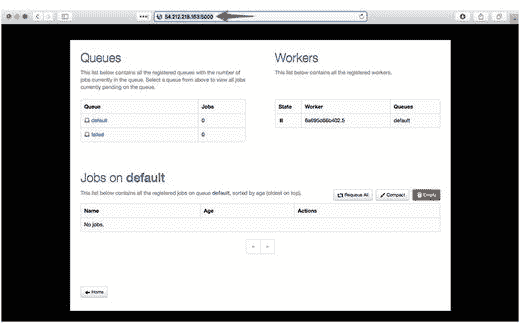
Figure 10-18. 基于浏览器的队列和 Worker 监视器

```
$ docker-compose logs --follow this_worker
...
this_worker_1    | 01:43:04 *** Listening on default...
this_worker_1    | 01:43:04 default: lib.postgres.encode_target(24) (914a8229-a876-438f-98d4-d6cd39a469b2)
this_worker_1    | 01:43:04 default: Job OK (914a8229-a876-438f-98d4-d6cd39a469b2)
this_worker_1    | 01:43:04 Result is kept for 500 seconds
this_worker_1    | 01:43:04
this_worker_1    | 01:43:04 *** Listening on default...
this_worker_1    | 01:43:04 default: lib.postgres.encode_target(24) (215ed343-0ca5-4f75-86e6-d8237e4a5983)
this_worker_1    | 01:43:04 default: Job OK (215ed343-0ca5-4f75-86e6-d8237e4a5983)
this_worker_1    | 01:43:04 Result is kept for 500 seconds
this_worker_1    | 01:43:04
this_worker_1    | 01:43:04 *** Listening on default...
this_worker_1    | 01:43:04 default: lib.postgres.encode_target(24) (1dfe0282-cf90-49de-a904-8a2ced103c50)
this_worker_1    | 01:43:04 default: Job OK (1dfe0282-cf90-49de-a904-8a2ced103c50)
this_worker_1    | 01:43:04 Result is kept for 500 seconds
...
```

Listing 10-81. 跟踪 Docker Compose 日志

最后，你使用`git`跟踪你的工作。在 Listing 10-82 中，你检查项目的状态。在 Listing 10-83 中，你添加并提交所有最近的工作。

```
$ git status
On branch master
Changes not staged for commit:
  (use "git add <file>..." to update what will be committed)
  (use "git checkout -- <file>..." to discard changes in working directory)
        modified:   lib/postgres.py
Untracked files:
  (use "git add <file>..." to include in what will be committed)
        ipynb/20170619-Develop_encoding_target_function.ipynb
        ipynb/20170619-Encode_target.ipynb
no changes added to commit (use "git add" and/or "git commit -a")      lib/
```

Listing 10-82. 检查项目状态

```
$ git add -A
$ git commit -m 'function and queueing for target encoding'
[master 93f3033] function and queueing for target encoding
 3 files changed, 319 insertions(+)
 create mode 100644 ipynb/20170619-Develop_encoding_target_function.ipynb
 create mode 100644 ipynb/20170619-Encode_target.ipynb
```

Listing 10-83. 添加所有文件并提交

在 Listing 10-84 中，你显示项目的当前状态。

```
$ tree .
.
├── data
│   └── adult.data
├── docker
│   ├── jupyter
│   │   └── Dockerfile
│   └── postgres
│       ├── Dockerfile
│       ├── get_data.sh
│       └── initdb.sql
├── docker-compose.yml
├── ipynb
│   ├── 20170611-Examine_Database_Requirements.ipynb
│   ├── 20170613-Initial_Database_Connection.ipynb
│   ├── 20170613-Verify_Database_Connection.ipynb
│   ├── 20170619-Develop_encoding_target_function.ipynb
│   └── 20170619-Encode_target.ipynb
└── lib
    ├── __init__.py
    ├── postgres.py
    └── __pycache__
        ├── __init__.cpython-35.pyc
        └── postgres.cpython-35.pyc
```

Listing 10-84. 当前项目状态

## 总结