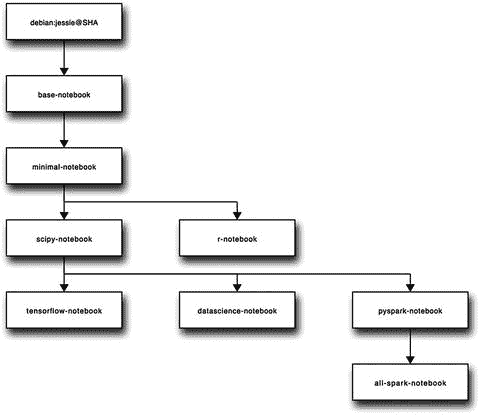
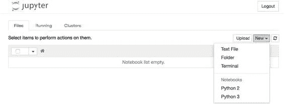
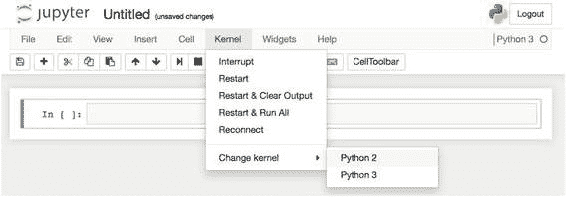
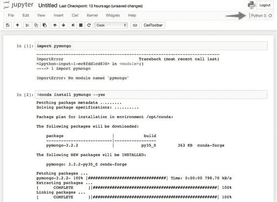
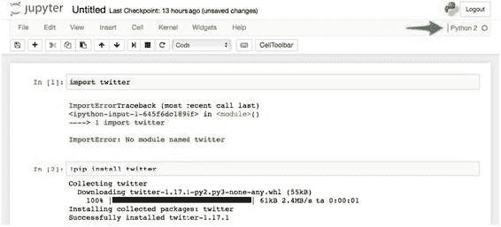

# 7. 固执己见的 Jupyter 堆栈

Joshua Cook (1) (1) 美国加利福尼亚州圣莫尼卡

> Jupyter Notebook 基于一套用于交互式计算的开放标准。——Project Jupyter¹

Project Jupyter 源于学术环境，该项目不仅产生了一款突破性的应用程序，还为一套交互式计算范式定义了一套完善的协议。就 Notebook 而言，这些协议包括 Notebook 文档格式、交互式计算协议和内核。这些协议以及其他定义 Jupyter 生态系统的协议由一个公开管理的指导委员会维护。² 除了定义通过 Jupyter 进行交互式计算的协议以及维护构成生态系统的众多项目之外，Project Jupyter 还维护着一个 GitHub 仓库，其中包含许多定义明确的 Jupyter Docker 镜像：固执己见的 Jupyter 堆栈。³

在 Docker 容器中启动 Jupyter Notebook 服务器是一件轻而易举的事情。在清单 7-1 中，你使用 `-P`（发布所有）标志来执行此操作，该标志会将所有暴露的端口发布到主机上的随机端口。

```bash
$ docker run -d -P jupyter/scipy-notebook
72da8ca9ac9d4c694477350c500e9d793769788a26148a144e6c29448b5b4840
```

清单 7-1. 启动 Jupyter `scipy-notebook` 服务器

要使用此容器，你需要知道容器中的端口 `8888` 已发布到主机系统上的哪个端口（清单 7-2），并且需要获取 Notebook 服务器的安全令牌（清单 7-3）。在清单 7-2 中，你使用 `docker port` 命令来获取容器的端口映射，使用启动容器时返回的容器 ID `72da8ca9ac9d4...` 的前四个字符 `72da`。

> **注意：** 只要能够建立唯一的容器引用，就可以使用尽可能少的字符来引用 Docker 容器。如果其他容器 ID 不以 `7` 开头，则容器 `72da8ca9ac9d4c694477350c500e9d793769788a26148a144e6c29448b5b4840` 可以用 `7` 来引用。

```bash
$ docker port 72da
8888/tcp -> 0.0.0.0:32769
```

清单 7-2. 获取容器的端口映射

在清单 7-3 中，你使用 `docker exec` 命令向正在运行的 Docker 容器内的 Jupyter Notebook 服务器发送命令。你再次使用容器 ID 的前四个字符来引用容器，然后向容器发送命令 `jupyter notebook list`。这会产生打开一个容器 shell、在 shell 中运行此命令、显示结果并关闭 shell 的效果。

```bash
$ docker exec 72da jupyter notebook list
Currently running servers:
http://localhost:8888/?token=61d6ead40b05daea402d9843ad7932bc937da41841575765 :: /home/jovyan
```

清单 7-3. 获取正在运行的 Jupyter Notebook 服务器的安全令牌

请记住，此处提供的 URL 指的是可以在 Docker 容器内访问 Notebook 服务器的 URL。实际位置是使用你的 Docker 机器的 IP（`localhost` 或你的 AWS 实例的 IP，或你运行 Docker 的虚拟机）以及你在上一条命令中获得的端口。清单 7-4 显示了在 Linux 版 Docker、Mac 版 Docker 或 Windows 版 Docker 下使用的 URL。清单 7-5 显示了在 Docker Toolbox 下最可能使用的 URL。（请参阅第 1 章的清单 1-10，回顾如何在 AWS 上访问你的 Jupyter 系统。）

```http
http://localhost:32769/?token=61d6ead40b05daea402d9843ad7932bc937da41841575765
```

清单 7-4. 如果使用 Linux/Mac/Windows 版 Docker，当前的 Jupyter URL

```http
http://192.168.99.100:32769/?token=61d6ead40b05daea402d9843ad7932bc937da41841575765
```

清单 7-5. 如果使用 Docker Toolbox，可能的当前 Jupyter URL

## 高级概述

Project Jupyter Docker 堆栈提供了八个 Notebook 镜像，从所有后续镜像所依赖的 `base-notebook` 镜像开始：

1. `base-notebook`

2. `minimal-notebook`

3. `scipy-notebook`

4. `r-notebook`

5. `tensorflow-notebook`

6. `datascience-notebook`

7. `pyspark-notebook`

8. `all-spark-notebook`

每个镜像在 GitHub 的 [jupyter/docker-stacks](https://github.com/jupyter/docker-stacks) 项目中都有一个同名的文件夹，并且在 Docker Hub 上 [jupyter](http://hub.docker.com/u/jupyter/) 用户命名空间下也有一个等效的仓库。图 7-1 显示了这些镜像的依赖关系。



图 7-1. Jupyter Docker 堆栈依赖关系图

> **注意：** `base-notebook` 使用 Debian “jesse”⁴，因此为每个 Notebook 镜像提供容器操作系统。

### `jupyter/base-notebook`

`jupyter/base-notebook` 镜像定义了一个极简的 Jupyter Notebook 服务器。它仅预装了适用于 Python 3 的 Miniconda，并未预装 Python 2 或任何科学计算包（从 `numpy` 开始）。但它定义了贯穿整个技术栈用于构建 Jupyter 镜像的基本模式：使用 init 二进制文件 `tini`、添加非特权用户 `jovyan`，以及包含用于运行服务器的各种启动脚本。在实践中你很少会直接使用 `base-notebook` 镜像，但会将其中的开发模式视为最佳实践。你对下游镜像所做的任何修改都需要考虑这些实践。在第 2 章中，当你将本地文件卷挂载到容器中运行的服务器时，就已经遵循了这些实践。你使用 `-v pwd:/home/jovyan` 标志将工作目录中的文件挂载到容器目录 `/home/jovyan`，如代码清单 7-6 所示。

```bash
$ docker run -d -v `pwd`:/home/jovyan -P jupyter/scipy-notebook
```

代码清单 7-6. 将主机目录挂载到容器

将 `/home/jovyan` 目录作为 notebook 根目录的定义，位于定义 `base-notebook` 镜像的 Dockerfile 中（代码清单 7-7）。

```dockerfile
...
ENV NB_USER jovyan
...
WORKDIR /home/$NB_USER/work
...
```

代码清单 7-7. `base-notebook` Dockerfile

### Notebook 安全性

将 notebook 服务器作为可通过开放网络公开访问的服务器来运行并不罕见。此外，notebook 服务器能够运行任意代码。因此，限制对 notebook 服务器的访问是一种最佳实践。Opinionated Jupyter Stacks 定义了一系列安全最佳实践，这些实践主要定义在 `base-notebook` 镜像的 Dockerfile 中。默认情况下，在容器中运行的 notebook 服务器要求在通过浏览器访问时，将随机生成的安全令牌作为查询参数传递。你之前已经看到，可以通过 `docker exec` 向运行中的容器发送 `jupyter notebook list` 命令来获取此令牌（代码清单 7-3）。`base-notebook` 镜像定义了 `start-notebook.sh` 脚本，该脚本作为运行时传递给 `tini` 的默认命令。此脚本可用于定义替代的身份验证方法，但**不推荐**这样做。

在能够保证安全性的安装环境中（或者你愿意放宽限制，例如临时 AWS 实例），你可能希望授予 `jovyan` 用户 `sudo` 权限。这可以通过传递环境变量 `GRANT_SUDO=yes` 来实现。此外，容器必须由 root 用户运行。代码清单 7-8 展示了运行 notebook 服务器并授予 `jovyan` 用户无密码 `sudo` 权限的完整命令。

```
$ docker run -d -e GRANT_SUDO=yes --user root jupyter/scipy-notebook
a811689f2e09737e2c9686849320a424889b2ac9eeb57e0f3df2940edc600628
```

**代码清单 7-8.** 运行 Notebook 服务器并授予 `jovyan` 用户无密码 `sudo` 权限

在探索性工作中，授予 `jovyan` 用户 `sudo` 权限非常有用。你可能希望快速安装不属于镜像的 Linux 二进制文件，而无需经历完整的镜像构建周期。授予 `sudo` 权限后，这便成为可能。如果你通过 `docker exec` 连接到运行中的容器，可以看到 `tini` 已由 root 用户启动（代码清单 7-9）。`GRANT_SUDO` 标志的作用是通过 `su jupyter notebook` 启动由 `jovyan` 拥有的 `jupyter notebook` 进程。

```
$ docker exec -it a811 ps aux
USER    PID  %CPU  %MEM VSZ    RSS    TTY  STAT  START  TIME  COMMAND
root    1    1.0   0.0  4224   668    ?    Ss    23:41  0:00  tini -- start-notebook.sh
root    6    0.4   0.1  46360  3084   ?    S     23:41  0:00  su jovyan -c env ...
jovyan  9    33.2  2.4  183488 50612  ?    Ss    23:41  0:01  /opt/conda/bin/python ...
root    13   0.0   0.1  19100  2556   ?    Rs    23:41  0:00  ps aux
```

**代码清单 7-9.** 以 `root` 身份连接到运行中的容器并查看运行进程

未使用此标志运行的 notebook 服务器（代码清单 7-10）将如代码清单 7-11 所示。请注意，`tini` 由 `jovyan` 启动，并且没有运行 `su` 命令来授予 `jovyan` `sudo` 权限。

```
$ docker run -d jupyter/base-notebook
e900cbb66babb23f8b7764506482e32e300b8ad351e4ea15a0260266ca517738
```

**代码清单 7-10.** 运行 Notebook 服务器

```
$ docker exec e900 ps aux
USER     PID  %CPU  %MEM   VSZ    RSS   TTY STAT  START  TIME  COMMAND
jovyan   1    0.0   0.0    4224   656   ?   Ss    23:35  0:00  tini -- start-notebook.sh
jovyan   5    1.1   2.4    183404 50576 ?   S     23:35  0:01  /opt/conda/bin/python ...
jovyan   2    0.0   0.1    19100  2436  ?   Rs    23:37  0:00  ps aux
```

**代码清单 7-11.** 以 `jovyan` 身份连接到运行中的容器并查看运行进程

### 默认环境

`base-notebook` Dockerfile 安装了 `miniconda3` 和最新稳定版的 Python 3。它还定义了默认的 conda 环境 `root`，该环境将用于管理你的 Python 3 安装。你可以通过向 `base-notebook` 容器运行交互式 `bash` shell 来查看 `miniconda` 版本和 Python 3 环境的名称（代码清单 7-12）。请注意，`ipython`、`python`、`pip`、`easy_install` 和 `conda` 在此环境中均可用，并且它们引用的是 `base-notebook` Dockerfile 中安装的 conda/python 版本。

```
$ docker run -it --rm jupyter/base-notebook bash
jovyan@c9fb2312c5b8:~$ conda info -a
Current conda install:

               platform : linux-64
          conda version : 4.2.12
       conda is private : False
      conda-env version : 4.2.12
    conda-build version : not installed
         python version : 3.5.2.final.0
...
# conda environments:
#
root                  *  /opt/conda
```

**代码清单 7-12.** 识别 Python 3 `conda` 环境

值得注意的是，你也可以在已运行的容器中执行相同的命令，如代码清单 7-13 所示。代码清单 7-13 通过 shell（而非 `bash` shell）运行命令，并在命令执行完毕后关闭 shell。此处，`wizardly_hawking` 指的是运行中容器的随机生成名称。

```
$ docker exec wizardly_hawking conda info -a
Current conda install:
...
```

**代码清单 7-13.** 另一种识别 Python 3 `conda` 环境的方法

这里可以看到你正在运行 Python 3.5.2，并且只有一个 Python 环境 `root`。你可以通过激活 `root` 环境并检查 Python 版本来验证 `root` 环境是否运行的是 3.5.2（代码清单 7-14）。`source activate` 命令的作用是配置全局 `python`，使其使用位于 `/opt/conda/bin/python` 的 `python` 二进制文件。

```
jovyan@ c9fb2312c5b8:~$ source activate root
(root) jovyan@ c9fb2312c5b8:~$ python --version
Python 3.5.2 :: Continuum Analytics, Inc.
(root) jovyan@ c9fb2312c5b8:~$ which python
/opt/conda/bin/python
```

**代码清单 7-14.** 检查 `root` 环境的 Python 版本

### 管理 Python 版本

随着 `IPython` 6 的发布以及对 Python 2 支持的终止，笔者认为，在 Docker 镜像中已无需显式地管理环境。完全可以为运行最新稳定版 Python 分配一个 Docker 镜像，为运行某个有用但无需更新的旧版 Python 应用程序分配另一个镜像，再为在同一系统上运行 Python 的最新 alpha 版本分配第三个镜像。事实上，这正是 Docker 的完美用例。当每个实现运行在各自的容器中时，其依赖项彼此完全隔离。然而，就目前而言，随着社区继续从 Python 2 向 Python 3 进行有计划的迁移，我们仍需继续显式管理容器内运行的环境，主要目的是为了同时维护 `py2` 和 `py3` 环境。为此，我们将使用 `conda` 原生的环境管理能力。⁷ 在深入探讨环境实现的细节之前，值得注意的一点是，在运行中的笔记本或创建新笔记本时切换环境是一项非常简单的任务。我们研究环境是为了理解添加默认未安装的新库的最佳方式。图 7-2 展示了如何创建使用不同 Python 内核的新笔记本。图 7-3 展示了如何为正在运行的笔记本切换内核。

  

图 7-2. 创建新笔记本时选择内核

  

图 7-3. 在运行中的笔记本里切换内核

## 使用 Dockerfile 简单扩展 Jupyter 镜像

# 扩展 Jupyter 镜像

在大部分工作中，您会从 Jupyter Docker 堆栈中获取一个镜像，然后根据需要使用第 4 章描述的构建过程添加您工作所需的特定库。例如，假设您希望使用 Python 机器学习库 `scikit-learn` 对 Twitter 数据进行语义分析项目，并将数据存储在 MongoDB 数据库中。`scikit-learn` 默认包含在 `jupyter/scipy-notebook` 镜像中，但 Python 的 MongoDB 接口库 `pymongo` 并不包含。构建此镜像的一种简单方法可能使用清单 7-15 中描述的 `Dockerfile`。

```
FROM jupyter/scipy-notebook
RUN pip install pymongo
```

清单 7-15. 为语义分析扩展 `jupyter/scipy-notebook` 的 Dockerfile

然后，您可以使用 `docker build` 命令（清单 7-16）构建镜像，并使用 `docker run`（清单 7-17）运行由此镜像定义的容器。

```
$ docker build -t semantic_analysis .
```

清单 7-16. 构建 `semantic_analysis` 镜像

```
$ docker run -d -P semantic_analysis
67cf8215ed6ad75c3709455bcdfffb72fb92df2abae3627962ba63677e06c45a
$ docker port 67cf
8888/tcp -> 0.0.0.0:32776
$ docker exec 67cf jupyter notebook list
Currently running servers:
http://localhost:8888/?token=d57ccd98004c383215c03ce25a7df85ec7796e04f8ca4723 :: /home/jovyan
```

清单 7-17. 运行 `semantic_analysis` 容器

现在，您可以使用 URL `http://localhost:32776/?token=d57ccd98004c383215c03ce25a7df85ec7796e04f8ca4723` 访问您的 `semantic_analysis` 容器。

## 使用 conda 环境扩展 Jupyter 镜像

管理 Python 环境的原始工具是 [virtualenv 工具](https://virtualenv.pypa.io/en/stable/)，至今仍被广泛使用。`virtualenv` 和 `conda` 环境都允许用户在同一系统上创建隔离的 Python 环境，类似于 Ruby 编程的 [Bundler](http://bundler.io/) 工具。Jupyter Docker 堆栈使用 `conda` 环境来管理环境，您将利用现有环境为 Python 2 内核安装包，独立于为 Python 3 内核安装包，反之亦然。您可以使用 `source activate` 命令手动在两者之间来回切换。在必要时，笔记本服务器会在内核启动时自动完成此操作。在清单 7-18 中，您检查了 `jupyter/scipy-notebook` 镜像上的 `conda` 环境。请注意，`base-notebook` 和 `minimal-notebook` 只有 Python 3，但 `scipy-notebook` 及其所有子镜像同时包含 Python 2 和 Python 3。

```
$ docker run -it --rm jupyter/scipy-notebook bash
jovyan@83a2aec2da92:∼$ which python
/opt/conda/bin/python
jovyan@83a2aec2da92:∼$ python --version
Python 3.5.2 :: Continuum Analytics, Inc.
jovyan@83a2aec2da92:∼$ source activate root
(root) jovyan@83a2aec2da92:∼$ python --version
Python 3.5.2 :: Continuum Analytics, Inc.
(root) jovyan@83a2aec2da92:∼$ source activate python2
(python2) jovyan@83a2aec2da92:∼$ python --version
Python 2.7.12
```

清单 7-18. 显示默认、`root` 和 `python2` 环境中 `python` 二进制文件的位置和版本

对基础 Jupyter 镜像进行正确的扩展，应该针对镜像上可用的每个 `conda` 环境进行，如清单 7-19 所示。在这里，您正在为两个 `conda` 环境安装 `pymongo` 库。

```
FROM jupyter/scipy-notebook
USER root
# python 3 环境名为 root
RUN conda install --name root \
    pymongo
# python 2 环境名为 python2
RUN conda install --name python2 \
    pymongo
USER jovyan
```

清单 7-19. 正确扩展 `jupyter/scipy-notebook` 镜像

> **注意：** 您切换到 `root` 用户来安装库，并在完成后切换回 `jovyan` 用户。这被认为是最佳实践，并确保您不会以过高的系统权限运行笔记本服务器。

再次，您使用 `docker build` 命令（清单 7-20）构建镜像，并使用 `docker run`（清单 7-21）运行由此镜像定义的容器。无需为镜像赋予新名称。您只需覆盖之前的 `semantic_analysis` 镜像即可。

```
$ docker build -t semantic_analysis .
```

清单 7-20. 构建 `semantic_analysis` 镜像

```
$ docker run -d -P semantic_analysis
ca525dbeb79b8e38a52db192b7388136e61e4a1534817f76ba5eefd8ffc0246e
$ docker port ca52
8888/tcp -> 0.0.0.0:32777
$ docker exec ca52 jupyter notebook list
Currently running servers:
http://localhost:8888/?token=d57ccd98004c383215c03ce25a7df85ec7796e04f8ca4723 :: /home/jovyan
```

清单 7-21. 运行 `semantic_analysis` 容器

现在，您可以使用 URL `http://localhost:32777/?token=d57ccd98004c383215c03ce25a7df85ec7796e04f8ca4723` 访问您新的 `semantic_analysis` 容器。

### 通过 pip 安装库

扩展 Jupyter 镜像的最后一个考虑因素是，某些 Python 库可能只能通过 `pip` 获得。您可能希望安装用于与 Twitter API 交互的 Python 库 [twitter](https://pypi.python.org/pypi/twitter)。同样，您应该为两个 `conda` 环境都安装该库，正如您在清单 7-22 中所做的那样。

```
FROM jupyter/scipy-notebook
USER root
# python 3 环境名为 root
RUN conda install --yes --name root \
    pymongo
# python 2 环境名为 python2
RUN conda install --yes --name python2 \
    pymongo
# 通过 bash 激活相应环境并使用 pip 安装库
RUN ["bash", "-c", "source activate root && pip install twitter"]
RUN ["bash", "-c", "source activate python2 && pip install twitter"]
USER jovyan
```

清单 7-22. 使用 `pip` 正确扩展 `jupyter/scipy-notebook` 镜像

# 使用`joyvan`安装库

在清单 7-22 中，你使用了 `Dockerfile` `RUN` 语法的一种变体。之前你使用 `RUN` 指令时采用的是 `RUN <command>` 语法。这被称为 `RUN` 指令的 shell 形式。以这种形式使用命令的效果是，通过 `/bin/sh` 或默认 shell 将命令发送到镜像。使用此语法通过 `pip` 安装将无法生效。这是因为，为了安装到正确的 conda 环境中，你需要使用 `source` 命令激活相应的环境。`source` 命令在默认 shell（`/bin/sh`）中不可用，但在 `bash` 中可用。为了使用 `bash`，你必须使用 `RUN` 指令的另一种语法，即 exec 形式。exec 形式使用语法 `RUN ["executable", "param1", "param2"]`。你使用 `RUN ["bash", "-c", "source activate <environment> && pip install twitter"]`。这会在你的镜像中打开一个 `bash` shell，并执行以下操作：
1. 激活相应的环境
2. 通过 `pip` 安装 `twitter`

# 临时容器扩展

最后，让我们讨论一下使用 `jovyan` 用户向运行中的容器添加库的最佳实践。不过在此之前，我应该提一下对运行中的容器进行更改所产生的影响。在第 2 章中，你探讨了容器中的持久化问题，但当时仅针对使用 Jupyter 时可能正在处理的文件。你希望确保对文件的更改在容器的生命周期结束后仍然存在。然而，我并未讨论你可能安装的库的持久化问题，无论是使用 `base-notebook` 的操作系统 Debian 所青睐的 `apt` 包管理器在系统层面进行安装，还是使用任何包含的 Python 包管理器在 Python 层面进行安装。在实践中，你将面临完全相同的挑战。然而，对于系统和 Python 库，我建议按照上述最佳实践，通过 Dockerfile 进行这些更改。话虽如此，将 Python 代码的编写与 Docker 镜像的维护分离开来也是一种最佳实践。毫无疑问，在开发过程中，你会遇到希望快速安装某个库的情况。最佳实践当然是快速安装所需的库并继续开发。但是，你应该意识到你所做操作的影响。一旦你停止并移除进行了这些更改的容器，这些更改就会消失。这是设计使然。你还必须防止自己因为希望保留对容器所做的更改，而在其生命周期结束后仍长期保留老旧的容器。考虑到这一点，我发现以下方法是在运行中的容器上安装临时包的最佳实践。`ipython` 的魔法命令 `!sx`⁸（`!`（感叹号）是其简写形式）可用于在 notebook 中向底层系统的 shell 运行命令。通过这种方式，你可以即时通过 `conda`（清单 7-23）、`pip`（清单 7-25）或 `apt`（清单 7-27）安装库，而无需打开容器的终端。请注意，`apt` 要求在容器运行时已向 `jovyan` 授予了无密码 `sudo` 权限，如上所述。

```
In [1]: import pymongo
        --------------------------------------------------------------------
        ImportError                               Traceback (most recent call last)
        <ipython-input-1-ec8fdd1cd630> in <module>()
        ----> 1 import pymongo
        ImportError: No module named 'pymongo'

In [2]: !conda install pymongo --yes
        Fetching package metadata .........
        Solving package specifications: ..........
        ...
        Linking packages ...
        [      COMPLETE      ]|######################################| 100%
```

清单 7-23. 使用 `ipython` 魔法 Shell 进程命令通过 `conda` 安装包

库将被安装到的环境取决于正在运行的内核。图 7-4 显示了 Python 3 内核。回想一下，这与 `conda` 的 root 环境相关联。



图 7-4. 使用 notebook 将 `pymongo` 安装到 root 环境中

你可以通过打开容器的 shell 并运行 `conda list`（清单 7-24）来验证该包是否确实已添加到正确的环境中。

```
$ docker exec -it kickass_engelbart bash
jovyan@67cf8215ed6a:∼$ conda list --name root | grep pymongo
pymongo                   3.2.2                    py35_0    conda-forge
jovyan@67cf8215ed6a:∼$ conda list --name python2 | grep pymongo
jovyan@67cf8215ed6a:∼$
```

清单 7-24. 验证库安装

该库在 root 环境中可用，但在 `python2` 环境中不可用。如果你切换内核并再次运行该命令，它将在 `python2` 环境中可用。只要容器在运行，这些对容器的更改就会持续存在。如果你希望这些更改不仅仅用于最微不足道的用途，建议按照上述方法，通过对镜像本身进行更改来使这些更改永久生效。

在清单 7-25 中，你通过 notebook 使用 `pip` 将 `twitter` 安装到 `python2` 环境中。结果见图 7-5。



图 7-5. 使用 notebook 将 `twitter` 安装到 `python2` 环境中

```
In [1]: import twitter
        --------------------------------------------------------------------
        ImportError                               Traceback (most recent call last)
        <ipython-input-1-645f6dc1896f> in <module>()
        ----> 1 import twitter
        ImportError: No module named 'twitter'

In [2]: !pip install twitter
        Collecting twitter
          Downloading twitter-1.17.1-py2.py3-none-any.whl (55kB)
            100% |████████████████████████████████| 61kB 2.4MB/s ta 0:00:01
        Installing collected packages: twitter
        Successfully installed twitter-1.17.1
```

清单 7-25. 使用 `ipython` 魔法 Shell 进程命令通过 `pip` 安装包

同样，你可以通过打开容器的 shell 并运行 `conda list`（清单 7-26）来验证该包是否确实已添加到正确的环境中。

```
$ docker exec -it kickass_engelbart bash
jovyan@67cf8215ed6a:∼$ conda list --name root | grep twitter
jovyan@67cf8215ed6a:∼$ conda list --name python2 | grep twitter
twitter                   1.17.1                    <pip>
jovyan@67cf8215ed6a:∼$
```

清单 7-26. 验证库安装

### 维护对镜像的半持久化更改

具有 DevOps 思维的读者无疑会对在运行的 Jupyter 容器中安装库感到困扰。到目前为止，您一直坚持这样的理念：使用容器的最佳实践是，它们可以随时关闭、移除和重启，而不会对工作流程造成任何损失。如果您要删除 `kickass_engelbart` 并在新容器中启动笔记本，这个新容器将不会安装 `twitter` 或 `mongo`。这只会带来轻微的不便，因为您在笔记本的 `magix-sx` 命令中记录了需要安装的库：`!conda install pymongo --yes` 和 `!pip install twitter`。不过，您可能希望将这些更改持久化到某个已定义的容器中。

**警告**：不建议将此做法作为永久性的镜像开发实践。建议将其作为针对特定项目的临时措施。

您可以使用 `docker commit` 命令将临时更改（列表 7-27）添加到镜像中。我建议使用标签来命名镜像。此处，您将 `twitter-mongo` 标签添加到基础镜像 `jupyter/scipy-notebook` 上。

```
$ docker commit kickass_engelbart jupyter/scipy-notebook:twitter-mongo
```

**列表 7-27.** 使用标签将临时更改持久化到镜像中

在列表 7-28 中，您将显示镜像缓存中的镜像。您可以看到本地缓存中现在有两个镜像：`jupyter/scipy-notebook:latest` 和 `jupyter/scipy-notebook:twitter-mongo`。

```
$ docker images
REPOSITORY              TAG            IMAGE ID      CREATED        SIZE
jupyter/scipy-notebook  twitter-mongo  dfbb7599770d  4 seconds ago  5.37GB
jupyter/scipy-notebook  latest         3dc12029099d  24 hours ago   5.35GB
```

**列表 7-28.** 显示本地镜像

您可以像启动其他镜像一样，使用 `docker run` 来启动您修改后的镜像（列表 7-29）。

```
$ docker run -d -v `pwd`:/home/jovyan -p 8888:8888 jupyter/scipy-notebook:twitter-mongo
```

**列表 7-29.** 启动 `jupyter/scipy-notebook:twitter-mongo`

## 本章小结

在本章中，您了解了 Jupyter 团队定义的 Docker 镜像，这些镜像用于使用 Docker 快速启动和扩展 Jupyter Notebook 服务器。我简要讨论了默认的笔记本安全策略。我还介绍了几种使用 Jupyter 团队的镜像作为基础来扩展 Jupyter 镜像的策略。学完本章后，希望您能轻松找到适合您工作的 Jupyter 镜像，并在此基础上进行扩展以满足特定项目的需求。

### 脚注

1. [`jupyter.org/`](http://jupyter.org/)
2. [`jupyter.org/about.html`](http://jupyter.org/about.html)
3. [`github.com/jupyter/docker-stacks`](https://github.com/jupyter/docker-stacks)
4. [www.debian.org/releases/jessie/](http://www.debian.org/releases/jessie/)
5. Jovyan 意为“与木星（Jupyter）相关”。
6. [`jupyter-notebook.readthedocs.io/en/latest/security.html`](http://jupyter-notebook.readthedocs.io/en/latest/security.html)
7. [`conda.io/docs/using/envs.html`](https://conda.io/docs/using/envs.html)
8. [`ipython.org/ipython-doc/3/interactive/magics.html#magic-sx`](https://ipython.org/ipython-doc/3/interactive/magics.html#magic-sx)

© Joshua Cook 2017

Joshua Cook, *Docker for Data Science*

`doi.org/10.1007/978-1-4842-3012-1_8`
```


