# 8. 数据存储

Joshua Cook¹

(1) 美国加利福尼亚州圣莫尼卡

在本章中，让我们将讨论范围扩展到 `Jupyter Notebook` 服务器之外，探索开源数据存储技术，以及如何使用 `Docker` 简化使用这些技术的过程。我认为，使用 `Docker` 可以将流程简化到这样的程度：即使对于最小的数据集，使用数据存储也成为一种切实可行的做法。我将向您展示一系列设计和部署数据存储的最佳实践，这些实践足以处理除最大数据集之外的所有情况。

遵循 `Docker` 最佳实践，您将在本章中使用 `Docker Hub` 官方镜像。您将在此处研究三种数据存储技术：`Redis`、`MongoDB` 和 `PostgreSQL`。将这三种技术作为由 `Docker` 管理的服务进行部署和使用，需要您特别关注两件事：

1.  使用卷管理 `Docker` 容器中的持久性

2.  `Docker` 容器之间的网络连接

关于数据持久性，您将建立一个简单而有效的使用 `Docker` 卷的最佳实践，该实践将针对每个数据存储重复使用。关于网络连接，您将探索三种不同的选项：传统链接、在独立的 `AWS` 实例上部署服务以及手动创建桥接网络。您将了解用于运行 `Redis` 的传统链接、用于运行 Mongo 的 `AWS` 以及用于运行 `PostgreSQL` 的手动网络创建，但需要明确的是，这些技术中的任何一种都可以应用于任何数据存储。我仅出于学习目的以这种方式呈现它们。建议您掌握所有三种网络技术，并为您参与的每个项目选择最佳选项。您将从各自的 `Docker Hub` 社区页面获取每个数据存储。

## 序列化

任何数据科学家工作流程中的核心任务都是数据结构和对象状态的存储、传输和重建。此过程称为序列化。这是一个已得到很好解决的问题，您将拥有多种工具来管理此任务。在本章中，您将从将内存中的对象转换为其二进制表示形式以及使用流行的 `JSON` 格式进行文本文件序列化这两个方面来研究序列化。在第 `9` 章中，您将看到第二种文本文件序列化格式：`YAML` 格式。您进行序列化和反序列化主要是为了跨进程共享对象和数据。特别是，您将把数据存储在数据库中，以及在 `Redis` 中缓存对象，以便在单独的笔记本或进程中使用它们。稍后，在第 `9` 章中，您将开始使用代码定义应用程序架构。在这种情况下，您将序列化您的应用程序配置。

# 序列化格式与方法

本书侧重于使用 Python 进行工作。因此，它将重点介绍两种 Python 特有的数据序列化方法：pickling 和通过字节串进行序列化。此外，你还会了解两种基于文本的数据序列化方法的适用场景：`JSON` 和 `YAML`。`JSON`（JavaScript 对象表示法）是 JavaScript 编程语言的一个机器可读子集，已被编程社区采纳为一种人类可读、与语言无关的序列化方法。`YAML` 是解决同一问题的另一种方案。`JSON` 和 `YAML` 都能使用标准的原始数据类型：整数、浮点数、布尔值和空值，以及字符串。为了提供更大的数据结构，两者都使用关联数组（通常称为字典）和有序列表（也称为数组、向量、列表或序列）。字典使用键值对存储数据；列表使用数字索引存储数据。两者主要在语法上有所不同。`JSON`（清单 8-1）使用嵌套的花括号和方括号来定义数据结构，而 `YAML`（清单 8-2）则使用空白符达到相同目的。请注意，在以下两个示例中，所使用的任何键都不具有任何语法意义。

```json
{'this_json' : 'is a JSON object',
 'a nested object' : {
   'obj_id' : 123,
   'object value' : 'temperamental',
   'is_nested' : true
   },
 'a list': [1,2,3,4],
 'a list of strings': ['green eggs', 'ham'],
 'last_used' : null
}
```

清单 8-1. 一个 JSON 对象示例

```yaml
this_yaml: is a YAML object
a_nested_object:
  obj_id: 123
  object_value: 'temperamental'
  is_nested: true
a_list:
  - 1
  - 2
  - 3
  - 4
a_list_of_strings:
  - green eggs
  - ham
last_used: null
```

清单 8-2. 一个 YAML 对象示例

## Python 中的二进制编码

Python 的 `pickle` 模块是将 Python 对象和数据序列化为二进制字节流的首选方法。pickling 数据与使用 `JSON` 或 `YAML` 序列化之间存在一些根本性差异。如前所述，`JSON` 和 `YAML` 都是人类可读的。而转换为字节流的对象则不可读。`JSON` 和 `YAML` 序列化的对象可以被任何语言编写的进程读取，而 pickled 对象则只能在 Python 中读取。由于 pickled 对象无需考虑互操作性，因此可以 pickle 各种各样的 Python 对象，而使用 `JSON` 或 `YAML` 只能序列化字典。对于数据科学家而言，这包括但不限于 `numpy` 数组、`pandas` 的 `DataFrame` 或 `sklearn` 的 `Model`。在下一章中，你将探索使用 Python 将数据编码为二进制字节流的各种方法。

## Redis

Redis¹ 是一个开源的内存数据结构存储系统。它存储与给定键关联的多种不同类型的数据值。在你的技术栈中，你将使用 Redis 实现两个目的。首先，它将作为一个缓存，用于在 Python 进程生命周期之外或在 Jupyter Notebook 之间持久化对象。其次，你将使用 Redis 作为消息代理，以便使用名为 `rq` 的 Python 库从你的 notebook 执行延迟作业处理。在本章中，你将讨论第一个用例；第二个用例的讨论将在第 10 章进行。

### 拉取 redis 镜像

你可以使用 `docker pull` 从 Docker Hub 获取 `redis` 镜像，如清单 8-3 所示。`redis` 镜像的 Docker Hub 页面² 概述了我在接下来几页中将讨论的大部分内容，包括基本配置、持久化存储以及从另一个容器连接到 Redis。

```console
$ docker pull redis
Using default tag: latest
latest: Pulling from library/redis
6d827a3ef358: Already exists
787f13ab8ea9: Pull complete
...
Digest: sha256:1b358a2b0dc2629af3ed75737e2f07e5b3408eabf76a8fa99606ec0c276a93f8
Status: Downloaded newer image for redis:latest
```

清单 8-3. 从 Docker Hub 拉取 redis 镜像

**注意：** 你的本地 Docker 镜像缓存中已经存在 `redis` 镜像的第一层，`pull` 命令会通知你层 `6d827a3ef358` “Already exists”。这是因为 Redis 使用了与 Jupyter 相同的基础镜像，也就是说，它们各自的 Dockerfile 都以 `FROM debian:jesse` 开头。

你可以通过以分离模式（`-d`）运行一个 Redis 容器（清单 8-4），并通过 `redis-cli` 向服务器发送 `ping` 命令（清单 8-5），来最低限度地验证镜像功能。要通过 `redis-cli` 与 Redis 交互，你需要通过 `docker exec` 语句向正确的容器发出命令。当容器中运行的 Redis 服务器响应 `PONG` 时，你就知道一切正常。

```console
$ docker run -d redis
96d6ddb6d06f1422b11193ac84a18346f3be53fd7912dc38b6301c0573171647
```

清单 8-4. 以分离模式运行 Redis 容器

在清单 8-5 中，你通过 `docker exec` 向正在运行的 Redis 容器发出命令，并使用其容器 ID 的前四个字符 `96d6` 来引用该容器。

```console
$ docker exec 96d6 redis-cli ping
PONG
```

清单 8-5. Ping Redis 服务器

最后，你关闭并移除正在运行的 Redis 容器（清单 8-6）。

```console
$ docker stop 96d6
96d6
$ docker rm 96d6
96d6
```

清单 8-6. 关闭并移除正在运行的 Redis 容器

## Docker 数据卷与持久化

在考虑使用 Docker 运行数据存储时，将它们视为由 Docker 管理的服务（或微服务）会很有帮助。回想一下，容器本身应该是短暂的。你应该能够随意启动、停止和丢弃容器。如果你的数据存储中的数据保存在容器内部，那么每次容器被循环时，数据都会丢失。就像运行 Jupyter Notebook 服务器时一样，数据在容器生命周期之外的持久化对于你所有的数据存储容器来说都是至关重要的。让我们将“服务”这个概念松散地定义为一个容器及其持久化数据。

**注意：** 值得强调的是，我是在松散地定义“服务”这个概念。我们这里不涉及 Docker 工具 `service`。在使用 notebook 时，你通过使用卷标志（`-v`）挂载主机目录作为数据卷来持久化数据（清单 3-32）。对于你的数据存储，你将通过使用数据卷来解决这个问题。³ 数据卷是一个专门设计的容器，专门用于在关联容器的生命周期之外持久化数据。现在，你可以将服务视为容器及其链接的卷（图 8-1）。由于数据卷在单个容器的生命周期之外仍然存在，你可以启动、停止和移除容器，并将一个新容器附加到现有的数据卷上，而不会丢失任何数据。

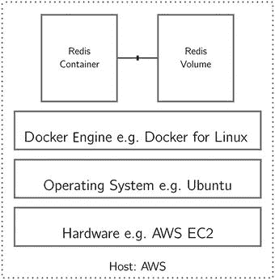

图 8-1. 由 Docker 管理的作为持久化服务的 Redis

### 创建并查看新的数据卷

首先，创建一个新的数据卷（清单 8-7）。

```console
$ docker volume create --name redis-dbstore
redis-dbstore
```

清单 8-7. 创建一个新的 Redis 数据卷容器

卷独立于容器存在，因此可以使用 `docker volume ls` 命令独立查看它们（清单 8-8）。

```console
$ docker volume ls
DRIVER              VOLUME NAME
local               redis-dbstore
```

清单 8-8. 查看当前 Docker 卷

### 将 Redis 启动为持久化服务

你将在运行时连接到新创建的卷，以便让 Redis 容器能够在其生命周期结束后持久化数据。除了连接数据卷，你还需要以分离模式（`-d`）运行 Redis 容器，并为其指定一个名称（`--name`）（见代码清单 8-9）。注意：你将 Docker 卷挂载到了 Redis 容器中的 `/data` 目录。该位置在用于定义 Redis 镜像的 Dockerfile 中指定，你可以在 Docker Hub 的 Redis 公共页面上查看该文件。⁴ 每个数据存储都需要谨慎处理，因为它们会在不同的位置查找自己的数据缓存（见表 8-1）。

## 表 8-1. 各镜像在容器内的数据缓存位置

| 镜像 | 数据缓存位置 |
| --- | --- |
| Redis | `/data` |
| Mongo | `/data/db` |
| Postgres | `/var/lib/postgresql/data` |

```bash
$ docker run -d --name this_redis -v redis-dbstore:/data redis
b216a67caedc934b09341cf1642e89079be09d52b607ce4ddecdeaae5b5ae704
```

## 代码清单 8-9. 使用附加卷启动 Redis

你可以通过以下方式验证数据的持久性。在代码清单 8-10 中，你使用 `redis-cli` 在 Redis 服务器上创建了一个新的 `incr` 对象，并额外 ping 了两次 `incr` 以确保无误。

```bash
$ docker exec this_redis redis-cli incr mycounter
1
$ docker exec this_redis redis-cli incr mycounter
2
$ docker exec this_redis redis-cli incr mycounter
3
```

## 代码清单 8-10. 通过 `redis-cli` 创建新的 `incr` 对象

在代码清单 8-11 中，你关闭并移除了名为 `this_redis` 的容器。

```bash
$ docker stop this_redis && docker rm this_redis
this_redis
this_redis
```

## 代码清单 8-11. 关闭并移除 `this_redis`

接下来，在代码清单 8-12 中，你使用与之前相同的命令启动了一个新容器。如果数据已持久化，那么后续的 `incr` 命令将返回 4（见代码清单 8-13）。

```bash
$ docker run -d --name this_redis -v redis-dbstore:/data redis
12fe7cea2e63aa2055585fd97b6b9205774a59bbf716672f71e5d75858c7cd72
```

## 代码清单 8-12. 启动一个新的 Redis 实例以供使用

```bash
$ docker exec this_redis redis-cli incr mycounter
4
```

## 代码清单 8-13. 通过 `redis-cli` 发出 `incr` 命令

你收到响应 4，是因为你创建并依次附加到每个容器的卷，使得 Redis 数据能够在容器实例之间持久化。你可以将此视为启动和停止 Redis 作为一个原生进程，该进程每次运行时都会重新连接到磁盘上的一个存储文件。

### 通过传统链接连接容器

解决了持久化问题后，现在我们来攻克下一个难关：连接到你的容器。连接到同一主机上运行的容器的最简单方法，是在运行时使用 `--link` 标志。只需在用于启动新容器的 `docker run` 命令中添加 `--link` 标志，并引用一个已命名的正在运行的容器即可。在代码清单 8-14 中，你启动了一个新的 Jupyter 容器，并将其与你已命名的 Redis 容器 `this_redis` 建立链接，如图 8-2 所示。

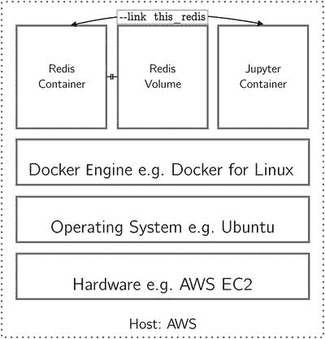

图 8-2. 在同一系统上连接 Redis 和 Jupyter

```bash
$ docker run -d -v `pwd`:/home/jovyan --link this_redis jupyter/scipy-notebook
d6f09196bf85861df23eeb2f11bd68396287464d00febe27cda93024a3666251
```

## 代码清单 8-14. 启动一个新的 Jupyter 容器，并与正在运行的 Redis 容器建立链接

花点时间研究一下此链接所创建的连接形式是值得的。为此，你将打开一个 bash shell 进入正在运行的 Jupyter 容器，并检查其环境（见代码清单 8-15）。同样，你使用容器 ID `d6f0` 的前四个字符作为简写来方便连接。

```bash
$ docker exec -it d6f0 bash
jovyan@d6f09196bf85:∼$ env | grep THIS_REDIS
THIS_REDIS_PORT_6379_TCP=tcp://172.17.0.2:6379
THIS_REDIS_NAME=/determined_wilson/this_redis
THIS_REDIS_PORT=tcp://172.17.0.2:6379
THIS_REDIS_PORT_6379_TCP_PORT=6379
THIS_REDIS_ENV_REDIS_VERSION=3.2.8
THIS_REDIS_PORT_6379_TCP_PROTO=tcp
THIS_REDIS_ENV_GOSU_VERSION=1.7
THIS_REDIS_ENV_REDIS_DOWNLOAD_SHA1=6780d1abb66f33a97aad0edbe020403d0a15b67f
THIS_REDIS_ENV_REDIS_DOWNLOAD_URL=http://download.redis.io/releases/redis-3.2.8.tar.gz
THIS_REDIS_PORT_6379_TCP_ADDR=172.17.0.2
```

## 代码清单 8-15. 探索正在运行的 Jupyter 容器的环境

在这里，你使用 `env` 命令行工具来显示已定义的环境变量。然后，你将命令的输出通过管道（`|`）传递给 `grep` 工具，并匹配模式 `THIS_REDIS`。请注意，Docker 已经定义了多个以 `THIS_REDIS` 命名的环境变量。这个环境变量始终是容器名称的全大写版本。你的容器名为 `this_redis`，因此环境变量将使用 `THIS_REDIS`。你可以使用这些环境变量中的任何一个来方便地连接到 Redis，而无需在每次运行容器时都记下 IP 地址。在代码清单 8-16 中，你通过使用环境变量 `THIS_REDIS_PORT_6379_TCP_ADDR` 从 Jupyter 容器向 Redis 容器发送 ping 来演示这一点。请注意，你使用了 `$` 语法来引用环境变量。⁵

```bash
jovyan@d6f09196bf85:∼$ ping -c 4 $THIS_REDIS_PORT_6379_TCP_ADDR
PING 172.17.0.2 (172.17.0.2): 56 data bytes
64 bytes from 172.17.0.2: icmp_seq=0 ttl=64 time=0.470 ms
64 bytes from 172.17.0.2: icmp_seq=1 ttl=64 time=0.136 ms
64 bytes from 172.17.0.2: icmp_seq=2 ttl=64 time=0.120 ms
64 bytes from 172.17.0.2: icmp_seq=3 ttl=64 time=0.085 ms
--- 172.17.0.2 ping statistics ---
4 packets transmitted, 4 packets received, 0% packet loss
round-trip min/avg/max/stddev = 0.085/0.203/0.470/0.155 ms
```

## 代码清单 8-16. 从 Jupyter 向 Redis 发送 Ping

**警告：** 在撰写本文时，`--link` 标志是一个已弃用的传统功能。根据 Docker 文档，“它最终可能会被移除。” 就我们的目的而言，它提供了一种非常直接的容器连接方法，我认为值得讨论，尽管它已被弃用。

### 在 Jupyter 中使用 Redis

这种最简连接足以验证你的容器能够相互通信，但你还需要能够从 Jupyter Notebook 内部与 `redis` 服务器进行交互。默认情况下，`jupyter/scipy-notebook` 镜像不包含从 Python 进程与 Redis 服务器交互所需的 Redis Python 库。虽然最佳实践是定义一个包含所需库的新镜像，但此处你将在运行中的容器内临时安装 `Redis` 库，以演示如何快速从 notebook 内部与 `Redis` 服务器交互。在代码清单 8-17 和图 8-3 中，你可以看到该容器实际上并没有 Python 库 `Redis`，之后你通过 Jupyter notebook 的子进程执行 `pip` 来安装该库。⁶

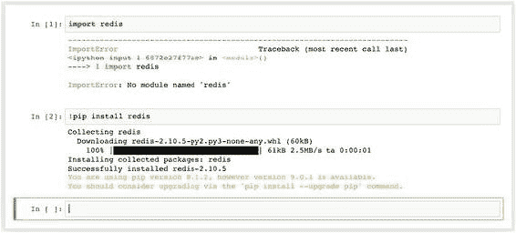
图 8-3. 通过 Jupyter Notebook 的 shell 调用安装 Redis

```
In [1]: import redis
        -----------------------------------------------------------------
        ImportError                     Traceback (most recent call last)
        <ipython-input-1-6872e27f77ac> in <module>()
        ----> 1 import redis
        ImportError: No module named 'redis'

In [2]: !pip install redis
        Collecting redis
          Downloading redis-2.10.5-py2.py3-none-any.whl (60kB)
            100% |████████████████████████████████| 61kB 2.5MB/s ta 0:00:01
        Installing collected packages: redis
        Successfully installed redis-2.10.5
        You are using pip version 8.1.2, however version 9.0.1 is available.
        You should consider upgrading via the 'pip install --upgrade pip' command.
```

代码清单 8-17. 通过 shell 调用在 Jupyter Notebook 中安装 Redis

### 一个简单的 Redis 示例

配置好带有 Python `Redis` 库的 `jupyter/scipy-notebook` 容器后，你就可以开始使用该服务了。你可以将 `Redis` 视为能够让你读写 RAM 中的值，从而允许你在进程生命周期之外或在当前运行的进程之间持久化这些值。下面的每个示例都通过使用 `Redis` 在两个正在运行的 Jupyter Notebook 之间共享值来演示这一点。图 8-4 演示了使用代码清单 8-18 中概述的模式，将两个独立的 notebook 连接到 `Redis` 服务。


图 8-4. 从两个独立的 notebook 实例化 Redis 连接

```
In [1]: from redis import Redis
        from os import environ
        REDIS = Redis(host=environ['THIS_REDIS_PORT_6379_TCP_ADDR'])
```

代码清单 8-18. 连接到 Redis 服务

接下来，在图 8-5 中，你使用代码清单 8-19 和 8-20 中的代码模式，在左侧 notebook 中设置一个键值对，并在右侧 notebook 中检索该值。

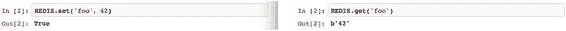
图 8-5. 从一个 notebook 存储键值对，供另一个 notebook 检索

```
In [2]: REDIS.set('foo', 42)
```

代码清单 8-19. 在 Redis 中设置键值对

```
In [2]: REDIS.get('foo')
Out[2]: b'42'
```

代码清单 8-20. 从 Redis 获取值

你在此处所做之事的强大之处可能起初并不明显。你已将值从一个 notebook 共享到另一个 notebook（即从一个 Python 进程到另一个进程）。这样的工具可能极具价值。

### 跨 Notebook 跟踪迭代过程

在图 8-6 中，你将看到如何使用 `Redis` 来跟踪迭代过程的进展。你使用代码清单 8-21 中概述的代码模式来模拟迭代过程的执行，并使用代码清单 8-22 中的代码模式来检查正在执行过程中的进度。


图 8-6. 跨 notebook 跟踪迭代过程

```
In [3]: import time
        def some_iterative_process():
            time.sleep(1)

In [4]: count = 0
        REDIS.set('count', 0)
        while count < 30:
            some_iterative_process()
            count = REDIS.incr('count')
```

代码清单 8-21. 模拟迭代过程

```
In [2]: REDIS.get('count')
Out[2]: 8
```

代码清单 8-22. 从 Redis 获取增量值

左侧 notebook 上的 `In [*]` 表示进程正在运行。你通过从 `Redis` 检索 `count` 来获取右侧 notebook 中的当前计数。`count` 由右侧运行的进程在每次迭代时持续更新。

### 通过 JSON 转储传递字典

你还可以使用 `Redis` 将值的字典从一个 notebook 传递到另一个 notebook。图 8-7 使用一个包含潜在模型参数的字典演示了这一点。你使用代码清单 8-23 中的代码模式来定义字典并将其传递给 `Redis`。你使用代码清单 8-24 中的模式首先从 `Redis` 加载对象，然后将其转换为 Python 字典。

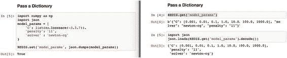
图 8-7. 通过 JSON 转储传递字典

```
In [5]: import numpy as np
        import json
        model_params = {
            'C': list(np.logspace(-3,3,7)),
            'penalty': 'l1',
            'solver' : 'newton-cg'
        }
        REDIS.set('model_params', json.dumps(model_params))
Out[5]: True
```

代码清单 8-23. 定义字典并将其传递给 Redis

```
In [4]: REDIS.get('model_params')
Out[4]: b'{"C": [0.001, 0.01, 0.1, 1.0, 10.0, 100.0, 1000.0],
        "solver": "newton-cg", "penalty": "l1"}'

In [5]: import json
        json.loads(REDIS.get('model_params').decode())
Out[5]: {'C': [0.001, 0.01, 0.1, 1.0, 10.0, 100.0, 1000.0],
        'penalty': 'l1',
        'solver': 'newton-cg'}
```

代码清单 8-24. 从 Redis 加载字典

在接收 notebook 中，当你最初从 Redis 加载对象时，它会以字节串的形式返回，正如在 `Out[4]` 中显示字符串时前面的 `b` 所表示的那样。Redis 返回的大多数对象都将以字节串形式返回，你必须特别小心地处理它们。此处，你希望该对象是一个字典。要使对象作为字典加载，你首先使用 Python `bytes` 类中包含的 `.decode()` 函数。这会将对象转换为字符串。然后，你将此字符串传递给 `json.loads()` 函数，该函数将字符串转换为你在 `Out[5]` 中看到的字典。

### 将 NumPy 数组作为字节串传递

`numpy` 处理字节串的天然能力使其成为 Redis 的绝佳搭档，并且传递 numpy 数组和向量非常直接。在代码清单 8-25 和 8-26 中，你将编码并存储一个 numpy 数组，然后加载并解码它。请注意，为了将数组转换为字节串，你必须先将其转换为向量。这可以通过使用 `np.array` 类中包含的 `.ravel()` 函数来完成。该函数将形状为 `(n, m)` 的数组转换为形状为 `(n*m,)` 的向量。然后，你使用 `.tostring()` 函数将向量转换为字节串。要从字节串转换回来，你可以在使用 `.reshape()` 函数将结果向量转换回数组之前，使用 numpy 函数 `np.fromstring()`。请参见图 8-8。

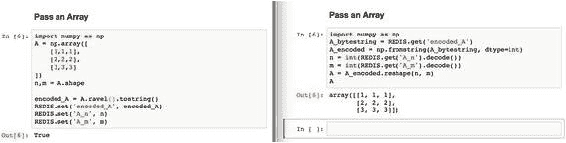

图 8-8. 将 numpy 数组作为字节串传递。在整个过程中，你必须手动跟踪原始数组的形状。在本例中，你通过将行数 (`n`) 和列数 (`m`) 存储在 Redis 中，然后在需要时检索它们来实现这一点。

```
In [6]: import numpy as np
        A = np.array([
            [1,1,1],
            [2,2,2],
            [3,3,3]
        ])
        n,m = A.shape
        encoded_A = A.ravel().tostring()
        REDIS.set('encoded_A', encoded_A)
        REDIS.set('A_n', n)
        REDIS.set('A_m', m)
Out[6]: True
```

代码清单 8-25. 将 numpy 数组编码为字节串并传递给 Redis

```
In [6]: import numpy as np
        A_bytestring = REDIS.get('encoded_A')
        A_encoded = np.fromstring(A_bytestring, dtype=int)
        n = int(REDIS.get('A_n').decode())
        m = int(REDIS.get('A_m').decode())
        A = A_encoded.reshape(n, m)
        A
Out[6]: array([[1, 1, 1],
               [2, 2, 2],
               [3, 3, 3]])
```

代码清单 8-26. 加载并解码 numpy 数组

**注意：** 默认情况下，`np.fromstring()` 会将传递的字节串转换为浮点数值的向量。由于你传递的是一个整数向量，因此在从字节串转换时必须指定此类型，就像你使用 `np.fromstring(A_bytestring, dtype=int)` 所做的那样。

## MongoDB

Redis 是一个数据结构存储库。它主要关注存储单个对象实例。MongoDB 是一个数据库。它关注存储同一类型的多个实例。MongoDB 将其存储的每个实例称为文档，并使用类似 JSON 的格式存储这些文档。这种格式也适用于 Python 字典类。与其他数据库相比，MongoDB 以其灵活性而闻名。你无需处理复杂的模式来存储对象实例，而是可以快速轻松地将对象添加到 MongoDB 集合中，而无需考虑模式本身的概念。这种数据库方法被称为 NoSQL，而 MongoDB 可能是使用最广泛的 NoSQL 数据库。

关于数据持久化，你将使用与设置 Redis 相同的方法。关于网络，你将采用略有不同的方法。你不会将 MongoDB 配置为与 Jupyter 服务一起运行，而是将 Mongo 配置为在 AWS 实例上运行。这样做的好处在于网络方面。如果你将 Mongo 容器中的必要端口暴露给主机容器上的相应端口，则无需再担心网络问题。你只需连接到 AWS 机器的 IP 地址即可。我发现这个解决方案在实践中比配置桥接网络来连接同一主机系统上的两个容器稍微容易一些，并且没有使用之前讨论过的现已弃用的 `--link` 方法。

**注意：** 由于建议的做法是让你使用 `t2.micro` 跟随本书进行操作，因此你可能目前正在使用 AWS 实例来完成本书中的工作。这是有意为之，我希望情况仍然如此。以下部分的目的是让你在与当前工作系统不同的系统上运行 MongoDB。如果你当前正在 AWS 实例上工作，这意味着你现在将在两个 AWS 实例上工作。你将让这两个实例通过开放的互联网相互通信。

### 设置一个新的 AWS t2.micro

你在本书第 1 章中已经完成了这项工作，因此我将仅概述使新的 `t2.micro` 上线所需的步骤：

1. 从 AWS EC2 控制台，选择“启动实例”。
2. 在“选择 AMI”选项卡上，选择 Ubuntu Server 16.04。
3. 在“选择实例类型”选项卡上，选择 `t2.micro`。
4. 在“添加存储”选项卡上，使用默认设置 8GB。
5. 在“配置安全组”选项卡上，选择“创建新的安全组”。
   a. 确认可以接受来自任何位置的端口 22 上的入站 SSH 流量。
   b. 添加一条规则，接受来自任何位置的端口 2376 上的入站流量。此端口将允许你从 Docker Hub 拉取镜像。
   c. 添加一条规则，接受来自任何位置的端口 27017 上的入站流量。这是访问 MongoDB 的默认端口。
6. 审核并启动实例，注意确认你可以访问与 AWS 账户一起存储的 SSH 密钥。

**注意：** 你已将端口 27017 添加到此安全组，以便你可以通过开放的 Web 在其默认端口上访问 MongoDB。如果 Redis 配置在其自己的 AWS 实例上，则需要将端口 6379 添加到安全组。如果 PostgreSQL 配置在其自己的 AWS 实例上，则需要将 5432 添加到安全组。

### 为 Docker 配置新的 AWS t2.micro

和之前一样，你为新实例配置 Docker 以便开展工作。同样，我将概述步骤，不做过多解释。此配置的代码在代码清单 8-27 中提供。需要更多信息的读者请参阅本书第 1 章中对此过程的详细描述。

1. 记下新配置的 AWS 实例的 IP 地址。
2. 使用该 IP 地址通过 SSH 登录到实例。
3. 通过 shell 脚本安装 Docker。
4. 将 `ubuntu` 用户添加到 `docker` 组。
5. 注销并重新登录。

```
(local) $ ssh ubuntu@255.255.255.255
(remote) $ curl -sSL https://get.docker.com/ | sh
(remote) $ sudo usermod -aG docker  ubuntu
```

代码清单 8-27. 使用 Docker 配置 AWS 实例

执行完最后一个命令后，退出到 AWS 的 ssh 会话，然后重新登录以配置 MongoDB。

### 拉取 mongo 镜像

与 `redis` 镜像一样，你将从其 Docker Hub 上的公共页面检索 `mongo` 镜像。⁷ 该页面还提供了有关配置 Mongo 的详细信息。出于你的目的，你最感兴趣的是阅读有关默认配置的具体细节。在代码清单 8-28 中，你拉取了镜像。

```
(local) $ ssh ubuntu@255.255.255.255
(remote) $ docker pull mongo
```

代码清单 8-28. 拉取 mongo 镜像

### 创建并查看新的数据卷

与 `Redis` 类似，你将通过创建一个数据卷来持久化 `MongoDB` 的相关数据，该数据卷的生命周期将超越运行 `Mongo` 的容器。同样，你可以将 `MongoDB` 视为一个由运行 `Mongo` 的容器和相关数据卷组成的“服务”（图 8-9）。要设置此功能，你只需为 `Mongo` 数据创建一个数据卷，如清单 8-29 所示。

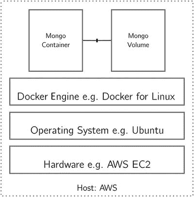

图 8-9. 由 Docker 管理的作为持久化服务的 MongoDB

```
$ docker volume create --name mongo-dbstore
$ docker volume ls
DRIVER              VOLUME NAME
local               mongo-dbstore
local               redis-dbstore
```

清单 8-29. 创建并查看新的 Mongo 数据卷

### 将 MongoDB 作为持久化服务启动

你在运行时连接到新创建的卷，以便允许你的 `Mongo` 容器在其生命周期结束后仍能持久化数据（清单 8-30）。

> **注意：** 你将 Docker 卷挂载到 `Mongo` 容器中的 `/data/db` 目录。此位置在用于定义 `mongo` 镜像的 `Dockerfile` 中指定，你可以在 Docker Hub 的 `Mongo` 公共页面上查看该文件。⁸

```
$ docker run -d --name this_mongo -v mongo-dbstore:/data/db -p 27017:27017 mongo
38a2f19d72a09851dc32cb874817a45274e888dd93aca01b5500cbfe9fb9364c
```

清单 8-30. 使用附加卷启动 mongo

### 验证 MongoDB 安装

你可以通过 `MongoDB` 客户端 `mongo`（通过 `docker exec` 发出）连接到正在运行的 `MongoDB`，从而验证你正在运行 `mongo` 服务（清单 8-31）。

> **警告：** 镜像和客户端共享相同的名称 `mongo`。在工作时，务必清楚当前引用的是哪一个。在发出清单 8-31 中的命令时，`mongo` 指的是你用来与正在运行的 `MongoDB` 交互的命令行客户端。

在清单 8-31 中，你连接后向 `mongo` 集合插入了一个简单的文档。你将 JSON 对象 `{"foo":1}` 插入到 `test` 集合中。然后，你使用 `.find()` 命令搜索你插入的文档。

```
$ docker exec -it this_mongo mongo
MongoDB shell version v3.4.4
...
> db.test.insert({"foo":1})
WriteResult({ "nInserted" : 1 })
> db.test.find()
{ "_id" : ObjectId("591a00ee33e4717a80d8c92d"), "foo" : 1 }
```

清单 8-31. 连接到 mongo 并插入文档

### 在 Jupyter 中使用 MongoDB

与 `Redis` 类似，你需要能够从 `Jupyter` notebook 内部连接到 `MongoDB`。和之前一样，你需要安装必要的 Python 库 `pymongo`，你将通过 notebook 发出 `pip install` 命令来完成此操作（图 8-10，清单 8-32）。

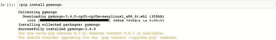

图 8-10. 通过 Jupyter Notebook 的 shell 调用安装 pymongo

```
In [1]: !pip install pymongo
        Collecting pymongo
          Downloading pymongo-3.4.0-cp35-cp35m-manylinux1_x86_64.whl (359kB)
            100% |████████████████████████████████| 368kB 700kB/s ta 0:00:01
        Installing collected packages: pymongo
        Successfully installed pymongo-3.4.0
```

清单 8-32. 通过 Jupyter Notebook 的 shell 调用安装 pymongo

### MongoDB 结构

作为一种 NoSQL 数据库，`MongoDB` 采用极简的结构方法。`MongoDB` 有三种实体：

1. 数据库

2. 集合

3. 文档

这些实体之间的关系是：数据库包含集合，集合包含文档（图 8-11）。每个文档⁹ 是 JSON 数据记录的二进制表示。文档由键值对组成，其中值可以是任何 BSON 数据类型。¹⁰

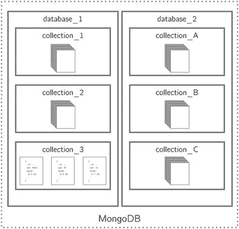

图 8-11. MongoDB 层次结构

### pymongo

`pymongo`¹¹ 是一个 Python 模块，包含推荐用于处理数据库的 `MongoDB` 工具。你首先（清单 8-33）使用 `pymongo.MongoClient` 实例化一个到 `MongoDB` 的连接。这里，你使用运行 `MongoDB` 的 AWS 实例的 IP 地址。

```
In [2]: from pymongo import MongoClient
        client = MongoClient('255.255.255.255', 27017)
```

清单 8-33. 连接到 MongoDB

> **注意：** 如果像你之前所做的那样（清单 8-30）使用默认端口 `27017`，则无需指定端口。

`pymongo` 为数据库和集合都提供了一个非常有用的“获取或创建”机制。数据库和集合可以通过属性样式（`client.database_name`）或字典样式（`client['test-database']`）进行访问。如果数据库存在，此方法将返回对现有数据库或集合的引用（“获取”）。如果数据库不存在，此方法将创建数据库或集合，然后返回对其的引用（“创建”）。创建发生在插入文档时。

在清单 8-34 中，你显示了当前存在的数据库。

```
In [3]: client.database_names()
Out[3]: ['admin', 'local', 'test']
```

清单 8-34. 显示数据库

接下来，在清单 8-35 中，你创建了一个对新数据库的引用，并再次显示数据库。请注意，名为 `my_database` 的数据库尚不存在。

```
In [4]: db_ref = client.my_database
        client.database_names()
Out[4]: ['admin', 'local', 'test']
```

清单 8-35. 创建数据库引用并显示数据库

接下来，在清单 8-36 中，你在 `my_database` 中创建了一个对新集合的引用，然后显示数据库以及与 `my_database` 关联的集合。请注意，数据库 `my_database` 仍然不存在。

```
In [5]: coll_ref = db_ref.my_collection
        client.database_names(), db_ref.collection_names()
Out[5]: (['admin', 'local', 'test'], [])
```

清单 8-36. 创建集合引用并显示数据库和集合

在清单 8-37 中，你创建了一个新的 Python 字典，并使用 `.insert_one()` 类函数将该字典插入到你的集合中。

```
In [6]: sample_doc = {"name":"Joshua", "message":"Hi!", 'my_array' : [1,2,3,4,5,6,7,9]}
        coll_ref.insert_one(sample_doc)
Out[6]: <pymongo.results.InsertOneResult at 0x7efc749726c0>
```

清单 8-37. 向集合中插入文档

在清单 8-38 中，你显示了数据库以及与 `my_database` 关联的集合。可以看出，现在你的数据库和集合都已存在，因为它们是在插入时创建的。

```
In [7]: client.database_names(), db_ref.collection_names()
Out[7]: (['admin',
          'local',
          'my_database',
          'test'],
         ['my_collection'])
```

清单 8-38. 显示数据库和集合

在清单 8-39 中，你演示了 `MongoDB` 的一个有趣行为。你使用 `.drop()` 类函数从 `my_collection` 中删除所有元素，然后再次显示数据库以及与 `my_database` 关联的集合。请注意，`my_database` 和 `my_collection` 都不再存在。换句话说，数据库和集合仅作为文档的容器而存在。
```

# MongoDB 与 Twitter

为了演示 MongoDB 与 Jupyter 的简单用法，你将实现一个基础的 Twitter 流式采集器，将捕获的推文插入到 MongoDB 集合中。Twitter 数据是 NoSQL 数据库 MongoDB 的理想用例。通过 Twitter API 获取的每条推文都以非结构化的嵌套 JSON 对象形式接收。如果用户试图管理推文中内建的各种一对一、一对多和多对一关系，将此类对象添加到 SQL 数据库绝非易事，需要涉及大量外键和 `JoinTables`。而将此类对象添加到 Mongo 则轻而易举。MongoDB 原生的二进制 JSON (BSON) 格式正是为接收此类对象而设计的。

## 获取 Twitter 凭证

为了继续操作，你必须获取访问 Twitter API 的 API 凭证。这需要创建一个 Twitter 应用。请按以下步骤操作：

1.  访问 [`apps.twitter.com`](https://apps.twitter.com) 并登录。

2.  选择“创建新应用”（图 8-12）。

    

    *图 8-12. 创建一个新的 Twitter 应用*

3.  为新应用命名、添加描述和网站。就你的目的而言，这些字段的值无关紧要，但网站需要具有有效的 URL 结构。

4.  同意开发者协议，并点击“创建你的 Twitter 应用”（图 8-13）。

    

    *图 8-13. 同意开发者条款并创建应用*

新应用创建完成后，你将看到新应用的详细信息，如图 8-14 所示。


*图 8-14. 你的新 Twitter 应用*

接下来，你需要在“密钥和访问令牌”选项卡中访问你的凭证。你总共需要四个值：

1.  消费者密钥 (API 密钥)（图 8-15）

    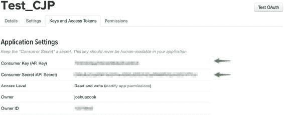

    *图 8-15. 消费者密钥和消费者密钥密文*

2.  消费者密钥密文 (API 密钥密文)（图 8-15）

3.  访问令牌（图 8-17）

4.  访问令牌密文（图 8-17）

消费者密钥和消费者密钥密文应在创建应用时默认生成。访问令牌和访问令牌密文则需要手动生成（图 8-16）。


*图 8-16. 生成访问令牌*


*图 8-17. 访问令牌和访问令牌密文*

获取这些项目后，将值作为字符串输入到新 Jupyter Notebook 的单元格中，如代码清单 8-40 所示。请注意，代码模式已包含在内以便于复制粘贴，但读者需要将每个 `None` 值替换为相应的凭证字符串值。

```
In [9]: CONSUMER_KEY = None
        CONSUMER_SECRET = None
        ACCESS_TOKEN = None
        ACCESS_SECRET = None
```

*代码清单 8-40. 将 Twitter 凭证加载为字符串*

在代码清单 8-41 中，你使用系统调用安装 `twitter` 库，就像之前安装 `pymongo` 和 `redis` 一样。

```
In [10]: !pip install twitter
         Collecting twitter
           Downloading twitter-1.17.1-py2.py3-none-any.whl (55kB)
             100% |████████████████████████████████| 61kB 932kB/s ta 0:00:011
         Installing collected packages: twitter
         Successfully installed twitter-1.17.1
```

*代码清单 8-41. 安装 twitter 库*

接下来，你使用 Python 的 `twitter` 模块和刚刚加载的凭证实例化一个 `twitter.OAuth` 对象（代码清单 8-42）。你将使用此对象来建立与 Twitter API 的连接。

```
In [11]: from twitter import OAuth
         oauth = OAuth(ACCESS_TOKEN, ACCESS_SECRET, CONSUMER_KEY, CONSUMER_SECRET)
```

*代码清单 8-42. 实例化 twitter.OAuth 对象*

## 按地理位置收集推文

在此示例中，你将使用 Twitter 的公共流。能够连接到流式端点的应用将收到通过 Twitter 流动的公共数据样本，并且无需轮询或担心 API 速率限制。换句话说，公共流是一种安全且经许可的方式来收集实时公共推文的样本。即便如此，此样本也会返回大量无序数据。为了给你的 Twitter 流提供一定程度的秩序，你将使用地理定位边界框（bbox）来限制传入的推文。你可以使用 Klokantech BoundingBox 工具轻松获取感兴趣位置的 bbox。在图 8-18 中，你获取了美国加利福尼亚州圣莫尼卡的 bbox，确保选择 CSV Raw 作为复制粘贴格式。


*图 8-18. 获取加利福尼亚州圣莫尼卡的 bbox*

当你使用 bbox 过滤推文时，你将只获得落在该 bbox 内的地理定位推文。每个边界框应指定为一对经纬度坐标对，边界框的西南角在前，遵循 geoJSON 顺序（经度，纬度）。获取这些值后，你使用它们来定义你的 bbox（代码清单 8-43），将 CSV 值列表定义为字符串。

```
In [12]: los_angeles_bbox = "-118.551346,33.96666,-118.443428,34.05056"
```

*代码清单 8-43. 为加利福尼亚州圣莫尼卡定义 bbox*

最后，你实例化一个 `twitter.TwitterStream` 对象，用于收集推文（代码清单 8-44）。`twitter.TwitterStream` 提供了 Python 中 Twitter 流 API 的接口。在此对象上调用方法的结果是一个迭代器，它生成从 Twitter 流解码为 JSON 对象的推文。

```
In [13]: from twitter import TwitterStream
         twitter_stream = TwitterStream(auth=oauth)
         twitterator = twitter_stream.statuses.filter(locations=los_angeles_bbox)
```

*代码清单 8-44. 实例化 TwitterStream 及其关联的迭代器*

实例化 `twitterator` 后，每次后续的 `next` 调用都会生成一条推文（代码清单 8-45），这是一个庞大的嵌套 JSON 对象。

```
In [8]: my_collection.drop()
        client.database_names(), db_ref.collection_names()
Out[8]: (['admin', 'local', 'test'], [])
```

*清单 8-39. 删除 my_collection 中的所有文档并显示数据库和集合*

```
In [14]: next(twitterator)
         {
          ...
          'created_at': 'Sun May 28 20:20:10 +0000 2017',
          ...
          'place': {'attributes': {},
           'bounding_box': {'coordinates': [[[-118.668404, 33.704538],
              [-118.668404, 34.337041],
              [-118.155409, 34.337041],
              [-118.155409, 33.704538]]],
            'type': 'Polygon'},
          ...
          },
          ...
          'quoted_status': {
           ...
            'text': "I'm in LA now and it's freakin' awesome ʿ",
           ...
          }
         }
```

*代码清单 8-45. 获取下一条推文*

### 将推文插入 Mongo

Twitter 是获取杂乱“真实”数据的绝佳来源。将其整理到数据库中正是 MongoDB 大显身手之处。使用你的 `twitterator` 对象和 `.insert_one()` 类函数，只需一行代码即可完成此操作（清单 8-46）。

```
In [14]: my_collection.insert_one(next(twitterator))
Out[14]: <pymongo.results.InsertOneResult at 0x7f697c03cbd0>
```

**清单 8-46.** 将下一条推文插入 `my_collection`

你可以使用 `.count()`（清单 8-47）和 `.find_one()`（清单 8-48）类函数验证推文的插入并检索它。

```
In [15]: my_collection.count()
Out[15]: 1
```

**清单 8-47.** 统计 `my_collection` 中的对象数量

```
In [15]: my_collection.find_one()
Out[16]: {'_id': ObjectId('592b57ae042cee05c85ecf1d'),
          ...
          'text': '@sccrphobia11 Cubs 4 Dodgers 9 All runs in game were scored by homers by both
                  teams. 7 HRs in all through 7 innings.',
          ...
          }
```

**清单 8-48.** 从 `my_collection` 读取一个对象

## PostgreSQL

PostgreSQL¹⁸ 是一个开源的对象关系型数据库系统。我倾向于使用 PostgreSQL 而非其他结构化查询语言（SQL）数据库，是因为它在业界被广泛采用，并且拥有原生的数组和二进制对象类型。SQL 数据库的一个主要卖点是其处理结构化数据的能力。创建这些结构本身是一门艺术，远远超出了本文的范围。在此，我将重点介绍 PostgreSQL 在处理 CSV 文件方面的天然优势。我还会简要解释 PostgreSQL 的数组和二进制类型，它们是我们使用 `numpy`/`scipy` 技术栈工作的天然伙伴。你将继续使用 `docker volume` 工具来持久化数据，使其超越容器的生命周期。你将看到管理 Docker 网络的第三种方法，即探索 `docker network` 工具。

**注意** 使用 `docker network` 配置网络连接应被视为一种高级技术。你可以跳过本节，对你的学习没有影响，并使用上述任一技术连接到 PostgreSQL。如果你确实尝试使用 `docker network` 配置与 PostgreSQL 的连接，我假设你正在运行 Jupyter 的主机系统上工作。

### 拉取 postgres 镜像

和之前一样，你从 Docker Hub¹⁹ 上的公共页面获取 `postgres` 镜像。在清单 8-49 中，你拉取了该镜像。

```
$ docker pull postgres
Using default tag: latest
latest: Pulling from library/postgres
...
Digest: sha256:a2e6e6012a9056fa7647df5746119768bdb0bf4e82bb04819d5a8e450968a967
Status: Downloaded newer image for postgres:latest
```

**清单 8-49.** 拉取 `postgres` 镜像

### 创建新的数据卷

遵循之前的模式，你可以将 PostgreSQL 视为一个“服务”，它由运行 `postgres` 的容器和一个关联的数据卷组成（图 8-19）。在清单 8-50 中，你创建了一个新的数据卷。

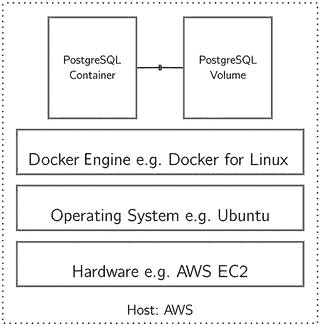

**图 8-19.** 由 Docker 管理的作为持久化服务的 PostgreSQL

```
$ docker volume create --name pg-datastore
```

**清单 8-50.** 创建一个新的 `postgres` 数据卷

### 将 PostgreSQL 作为持久化服务启动

再次，你在运行时连接到新的数据卷（清单 8-51）。

**注意** 你将 Docker 卷挂载到 Postgres 容器中的 `/var/lib/postgresql/data` 目录。

```
$ docker run -d --name this_postgres -v pg-dbstore:/var/lib/postgresql/data -p 5432:5432 postgres
f9751d99f09d691dc3f04d246c502f1fa4ff3ae059632428a65affa3e5307f17
```

**清单 8-51.** 显示默认的 Docker 网络

### 验证 PostgreSQL 安装

你可以通过 PostgreSQL 客户端 `psql`（通过 `docker exec` 发出）连接到正在运行的容器来验证你的 PostgreSQL 服务（清单 8-53）。请注意，为此你必须指定一个 `DBNAME` 和一个 `USERNAME`（清单 8-52）。根据 `postgres` 镜像的定义，这两者的默认值都是 `postgres`。

```
$ docker exec this_postgres psql --help
psql is the PostgreSQL interactive terminal.
Usage:
  psql [OPTION]... [DBNAME [USERNAME]]
...
```

**清单 8-52.** 显示 `psql` 帮助信息

```
$ docker exec -it this_postgres psql postgres postgres
psql (9.6.3)
Type "help" for help.

postgres=# CREATE TABLE test ( _id INTEGER, name TEXT);
CREATE TABLE
postgres=# INSERT INTO test VALUES (1,'Joshua');
INSERT 0 1
postgres=# SELECT * FROM test LIMIT 1;
 _id |  name
-----+--------
   1 | Joshua
(1 row)

postgres=# \q
```

**清单 8-53.** 连接到 `postgres`，创建表，插入并查询一条记录

### Docker 容器网络

你可以使用 Docker 网络连接两个容器，例如 `postgres` 服务和 `jupyter` 服务。默认情况下，Docker 安装会为你创建三个网络。你无需创建任何额外的网络，但需要了解默认网络的工作方式。清单 8-54 展示了通过 `docker network ls` 命令为你创建的三个网络。

## Docker 网络基础与容器连接

```bash
$ docker network ls
NETWORK ID          NAME                DRIVER
c9fced8bcbc9        bridge              bridge
3bec69979ce4        host                host
d8d9192909eb        none                null
```

清单 8-54. 显示默认的 Docker 网络

在本文中，你只会用到 `bridge` 网络。这是新容器在运行时默认连接的网络。你可以在类 Unix 主机上运行 `ifconfig` 命令来查看此网络，如清单 8-55 所示。

```bash
$ ifconfig
...
docker0   Link encap:Ethernet  HWaddr 02:42:e4:f6:31:5a 
          inet addr:172.17.0.1  Bcast:0.0.0.0  Mask:255.255.0.0 
          inet6 addr: fe80::42:e4ff:fef6:315a/64 Scope:Link 
          UP BROADCAST RUNNING MULTICAST  MTU:1500  Metric:1 
          RX packets:49037 errors:0 dropped:0 overruns:0 frame:0 
          TX packets:38968 errors:0 dropped:0 overruns:0 carrier:0 
          collisions:0 txqueuelen:0 
          RX bytes:31550630 (31.5 MB)  TX bytes:4105362 (4.1 MB) 
...
```

清单 8-55. 显示主机网络配置

你可以通过 `docker exec` 命令使用 `bash` shell 连接到一个正在运行的 `postgres` 容器，如清单 8-56 所示。

```bash
$ docker exec -it this_postgres bash
root@f9751d99f09d:/#
```

清单 8-56. 连接到 `this_postgres`

在正在运行的容器内部，你可以使用相同的 `ifconfig` 命令查看其网络配置（清单 8-57）。请注意，你需要先使用包管理器 `apt` 安装工具 `ifconfig`。

```bash
root@f9751d99f09d:/data# apt update
Get:1 http://security.debian.org jessie/updates InRelease [63.1 kB]
...
Fetched 9949 kB in 3s (2535 kB/s)
root@f9751d99f09d:/data# apt install net-tools
...
root@f9751d99f09d:/data# ifconfig
...
eth0      Link encap:Ethernet  HWaddr 02:42:ac:11:00:04 
          inet addr:172.17.0.2  Bcast:0.0.0.0  Mask:255.255.0.0 
          inet6 addr: fe80::42:acff:fe11:4/64 Scope:Link 
          UP BROADCAST RUNNING MULTICAST  MTU:1500  Metric:1 
          RX packets:1715 errors:0 dropped:0 overruns:0 frame:0 
          TX packets:492 errors:0 dropped:0 overruns:0 carrier:0 
          collisions:0 txqueuelen:0 
          RX bytes:10299480 (9.8 MiB)  TX bytes:35243 (34.4 KiB) 
...
root@f9751d99f09d:/data# exit
```

清单 8-57. 容器网络配置

你可以在清单 8-57 中看到，`postgres` 容器在其运行的网络上有一个地址 `172.17.0.2`。在清单 8-55 中，你看到 Docker 桥接网络存在于主机上的 `172.17.0.1`。

**注意：** 从容器内部检查网络并非配置网络所必需。这仅用于演示目的。

接下来，在清单 8-58 中，你使用 `docker network inspect` 工具检查 `bridge` 网络。

```bash
$ docker network inspect bridge
[
    {
        "Name": "bridge",
        "Id": "c9fced8bcbc9279ec29d880199e20795777c0bf9b2e7578f0d594a03981ff524",
        "Scope": "local",
        "Driver": "bridge",
        "EnableIPv6": false,
        "IPAM": {
            "Driver": "default",
            "Options": null,
            "Config": [
                {
                    "Subnet": "172.17.0.1/16"
                }
            ]
        },
        "Internal": false,
        "Containers": {
            "f9751d99f09d691dc3f04d246c502f1fa4ff3ae059632428a65affa3e5307f17": {
                "Name": "this_postgres",
                "EndpointID": "a9820c6df3120c7fc4a98f09372b1e51252ceb937aaa18f7a9eec001cc6e2760",
                "MacAddress": "02:42:ac:11:00:04",
                "IPv4Address": "172.17.0.2/16",
                "IPv6Address": ""
            }
        },
 ...
    }
]
```

清单 8-58. 检查桥接网络

这里你可以看到地址为 `172.17.0.1` 的 `bridge` 网络，以及运行在该网络上地址为 `172.17.0.2` 的 `postgres` 容器。

## 最小化验证 Jupyter-PostgreSQL 连接

接下来，你将尝试使用 Jupyter Notebook 连接到正在运行的 `postgres` 容器。在清单 8-59 中，你使用 `docker run` 命令启动一个新的 Jupyter 容器。

```bash
$ docker run -v `pwd`:/home/jovyan -p 8888:8888 jupyter/scipy-notebook
```

清单 8-59. 启动一个 Jupyter 容器

首先，你使用 `docker ps` 命令识别正在运行的 Jupyter 容器，如清单 8-60 所示。

```bash
$ docker ps
CONTAINER ID IMAGE    COMMAND             CREATED        STATUS       PORTS
f9751d99f09d  postgres  "docker-entrypoint.sh" 22 minutes ago  Up 22 minutes ...
cce1148863a2 jupyter/scipy-notebook                       "tini--start-notebo" 2 minutes ago  Up 2 minutes ...
```

清单 8-60. 显示正在运行的容器

如前所述，当你启动一个新容器时，默认情况下它会连接到 `bridge` 网络。在清单 8-61 中，你使用 `docker network inspect` 工具验证了这一点。

## Docker 网络检查

```
$ docker network inspect bridge
docker network inspect bridge
[
    {
        "Name": "bridge",
        ...
        "Containers": {
            "12fe7cea2e63b622c7804d1df96fbe2afce25d014e850b4fdec4e2e5498fde1b": {
                "Name": "this_postgres",
                "EndpointID": "a9820c6df3120c7fc4a98f09372b1e51252ceb937aaa18f7a9eec001cc6e2760",
                "MacAddress": "02:42:ac:11:00:04",
                "IPv4Address": "172.17.0.2/16",
                "IPv6Address": ""
            },
            "cce1148863a22d11272ca031ded06139b2f0372d92aca269fd0d50234a30cf1c": {
                "Name": "hungry_cray",
                "EndpointID": "cde785070465ea79d4d9296895cb09f5975ec06a22caca090fab789ca10b1d90",
                "MacAddress": "02:42:ac:11:00:03",
                "IPv4Address": "172.17.0.3/16",
                "IPv6Address": ""
            },
        },
     ...
]
```

清单 8-61. 检查桥接网络

这里你看到 `postgres` 容器仍在 `172.17.0.2` 上运行，而 `jupyter/scipy-notebook` 容器在 `172.17.0.3` 上运行。更重要的是，由于这两个容器位于同一网络上，你将能够从一个容器连接到另一个容器。在清单 8-62 中，你通过打开一个 `bash` shell 进入 `jupyter/scipy-notebook` 容器，并验证你可以通过 `bridge` 网络上的 IP 地址 ping 通 `postgres` 容器来确认这一点。

```
$ docker exec -it hungry_cray bash
jovyan@cce1148863a2:∼$ ping -c 3 172.17.0.2
PING 172.17.0.2 (172.17.0.2): 56 data bytes
64 bytes from 172.17.0.2: icmp_seq=0 ttl=64 time=0.138 ms
64 bytes from 172.17.0.2: icmp_seq=1 ttl=64 time=0.103 ms
64 bytes from 172.17.0.2: icmp_seq=2 ttl=64 time=0.116 ms
--- 172.17.0.2 ping statistics ---
3 packets transmitted, 3 packets received, 0% packet loss
round-trip min/avg/max/stddev = 0.103/0.119/0.138/0.000 ms
```

清单 8-62. 从 `jupyter/scipy-notebook` 容器 ping Postgres 容器

## 通过名称连接容器

# 使用 Docker 桥接网络实现容器通信

要使用桥接网络连接到另一个 Docker 容器，你需要识别该容器在桥接网络上的 IP 地址，这是一个相当复杂的过程。出于你的目的，创建一个额外的网络并将容器连接到该网络可能会更简单。

如果你一直按照步骤操作到这里，现在应该有两个正在运行的容器：一个 `jupyter/scipy-notebook` 容器和一个 Postgres 容器，如代码清单 8-63 所示。

```
$ docker ps
CONTAINER ID   IMAGE                 COMMAND                  CREATED          ...  NAMES
f9751d99f09d   postgres              "docker-entrypoint.sh"   22 minutes ago   ...  this_postgres
cce1148863a2   jupyter/scipy-notebook "tini -- start-notebo"  2 minutes ago    ...  hungry_cray
```

**代码清单 8-63.** 显示正在运行的容器

使用 `docker network` 工具，可以创建一个网络，并将这些正在运行的容器连接到该网络。一旦将这些容器连接到新网络，你就可以通过名称（`this_postgres` 和 `hungry_cray`）连接到它们。

首先，使用 `docker network create` 命令创建一个新的桥接网络，供你的容器使用（代码清单 8-64）。

```
$ docker network create jupyter_bridge
b8146c1af3a91abe4c123b9234d372e098fd71f1f0facd3e8251da2e864253ee
```

**代码清单 8-64.** 创建一个新的桥接网络

你可以使用 `docker network inspect` 命令检查新网络，如代码清单 8-65 所示。

```
$ docker network inspect jupyter_bridge
[
    {
        "Name": "jupyter_bridge",
        "Id": "b8146c1af3a91abe4c123b9234d372e098fd71f1f0facd3e8251da2e864253ee",
        "Scope": "local",
        "Driver": "bridge",
        "EnableIPv6": false,
        "IPAM": {
            "Driver": "default",
            "Options": {},
            "Config": [
                {
                    "Subnet": "172.18.0.0/16",
                    "Gateway": "172.18.0.1"
                }
            ]
        },
        "Internal": false,
        "Containers": {},
        "Options": {},
        "Labels": {}
    }
]
```

**代码清单 8-65.** 检查新的桥接网络

这里你看到了刚刚创建的新网络。可以看到它当前没有连接任何容器。在代码清单 8-66 中，你将 `jupyter/scipy-notebook` 容器（`hungry_cray`）和 Postgres 容器（`this_postgres`）连接到刚刚创建的新网络，之后再次检查该网络。

```
$ docker network connect jupyter_bridge hungry_cray
$ docker network connect jupyter_bridge this_postgres
$ docker network inspect jupyter_bridge
[
    {
        "Name": "jupyter_bridge",
    ...
        "Containers": {
            "cce1148863a22d11272ca031ded06139b2f0372d92aca269fd0d50234a30cf1c": {
                "Name": "hungry_cray",
                "EndpointID": "e01136684ea417200178a0afaaf634f39cd92f332cb91b34a81dd7f7fcbbfc43",
                "MacAddress": "02:42:ac:19:00:02",
                "IPv4Address": "172.25.0.2/16",
                "IPv6Address": ""
            },
            "f9751d99f09d691dc3f04d246c502f1fa4ff3ae059632428a65affa3e5307f17": {
                "Name": "this_postgres",
                "EndpointID": "ae9a95c157092da3adbcb251ff9c370820f6b7ad9f20a8df44cb971352af4cc9",
                "MacAddress": "02:42:ac:19:00:03",
                "IPv4Address": "172.25.0.3/16",
                "IPv6Address": ""
            }
        },
    ...
    }
]
```

**代码清单 8-66.** 将正在运行的容器添加到新的桥接网络

因为已将这两个容器连接到同一个非默认的桥接网络，它们将能够通过容器名称解析彼此的位置，如代码清单 8-67 所示。

```
$ docker exec -it hungry_cray bash
jovyan@cce1148863a2:~$ ping -c 3 this_postgres
PING this_redis (172.25.0.3): 56 data bytes
64 bytes from 172.25.0.3: icmp_seq=0 ttl=64 time=0.248 ms
64 bytes from 172.25.0.3: icmp_seq=1 ttl=64 time=0.082 ms
64 bytes from 172.25.0.3: icmp_seq=2 ttl=64 time=0.081 ms
--- this_redis ping statistics ---
3 packets transmitted, 3 packets received, 0% packet loss
round-trip min/avg/max/stddev = 0.081/0.137/0.248/0.078 ms
```

**代码清单 8-67.** 从 `jupyter/scipy-notebook` 容器 Ping Postgres 容器

> **注意：** 仅通过默认桥接网络连接的容器将无法解析彼此的容器名称。

## 将 PostgreSQL 与 Jupyter 结合使用

你将使用相同的既定模式，从 Jupyter notebook 内部连接到 PostgreSQL。首先，你将执行 `!pip install` 来安装 `psycopg2` 库，该库将用于连接到 PostgreSQL 数据库（代码清单 8-68）。

```
In [1]: !pip install psycopg2
        Collecting psycopg2
          Downloading psycopg2-2.7.1-cp35-cp35m-manylinux1_x86_64.whl (2.7MB)
            100% |████████████████████████████████| 2.7MB 333kB/s eta 0:00:01
        Installing collected packages: psycopg2
        Successfully installed psycopg2-2.7.1
```

**代码清单 8-68.** 通过 Jupyter Notebook 的 Shell 调用安装 `psycopg2`

## Jupyter、PostgreSQL、Pandas 和 psycopg2

Pandas，就像本书中提到的几乎所有其他技术一样，是一个开源库。`pandas` 是 Python 数据分析库。它与从 `numpy` 到 `scikit-learn` 的整个 Python 数值计算栈配合良好。它直观易用，是每位数据科学家工具箱中的必备工具。甚至可以说，它能让 R 语言程序员在 Python 领域感到更舒适。在这里，你将在适当的地方使用 `pandas` 来补充 `psycopg2` 与 PostgreSQL 的连接。

## 最小化验证

你将首先对连接进行最小化验证。具体步骤如下：

1.  为你的工作导入几个库（代码清单 8-69）。

2.  实例化一个连接以及与该连接关联的游标（代码清单 8-70）。

3.  使用游标执行查询（代码清单 8-71）。

4.  在 `pandas.DataFrame` 中显示查询结果（代码清单 8-72）。

5.  关闭连接（代码清单 8-73）。

> **注意：** 在代码清单 8-69 中，你导入了一个额外的模块 `psycopg2.extras`。你将在代码清单 8-70 中使用此模块来指定你想要使用一种特殊的游标类型，即 `psycopg2.extras.RealDictCursor`。使用这种游标类型，你可以轻松地将查询结果传递给 `pandas.DataFrame`，从而将列名从数据库无缝传递到数据框。

```
In [2]: import pandas as pd
        import psycopg2 as pg2
        import psycopg2.extras as pgex
```

**代码清单 8-69.** 导入必要的库

```
In [3]: con = pg2.connect(host='this_postgres', user='postgres', database='postgres')
        cur = con.cursor(cursor_factory=pgex.RealDictCursor)
```

**代码清单 8-70.** 实例化连接和游标

```
In [4]: cur.execute("SELECT * FROM test;")
```

**代码清单 8-71.** 执行查询

```
In [5]: pd.DataFrame(cur.fetchall())
Out[5]:         _id     name
        0       1       Joshua
```

**代码清单 8-72.** 从查询中获取所有结果并在 `pandas.DataFrame` 中显示

```
In [6]: con.close()
```

**代码清单 8-73.** 关闭连接

# 将数据加载到 PostgreSQL 中

将数据加载到 PostgreSQL 中可能颇具挑战性。在后续章节中，你将探索如何使用 Dockerfile 加载数据，并认为这是最佳实践。为了快速插入数据（例如在本章剩余部分探索一些简单的 Jupyter-Postgres 交互时所需），你将使用 Jupyter 中的简单 SQL 语句，并通过 `BEGIN` 和 `COMMIT` 手动管理事务。

在清单 8-74 中，你创建了一个名为 `from_jupyter_test` 的新表，其中包含四种数据类型：`INTEGER`、`TEXT`、`DOUBLE PRECISION[]`、`BYTEA`。虽然读者无疑熟悉前两种数据类型，但在此我要特别提一下后两种。`DOUBLE PRECISION[]` 类型后面的方括号表示这是一个 `DOUBLE PRECISION`（浮点）值的数组。`BYTEA` 是一种二进制类型，你将使用它来保存 numpy 数组，就像之前使用 Redis 一样。
```
In [7]: con = pg2.connect(host='this_postgres', user='postgres', database='postgres')
        cur = con.cursor(cursor_factory=pgex.RealDictCursor)
        cur.execute("""
        BEGIN;
        CREATE TABLE from_jupyter_test (
            _id INTEGER,
            name TEXT,
            list DOUBLE PRECISION[],
            vector BYTEA
        );
        COMMIT;
        """)
```
清单 8-74. 从 Jupyter 在 PostgreSQL 中创建表

在清单 8-75 中，你向数据库中插入了两行。请注意插入时对列表类型的特殊处理。还要注意你只插入了三个值。默认情况下，这些值将与表中的前三列对齐。
```
In [8]: cur.execute("""
        BEGIN;
        INSERT INTO from_jupyter_test VALUES (1, 'spam', '{1,2,3,4,5}');
        INSERT INTO from_jupyter_test VALUES (2, 'eggs', '{1,4,9,16,25}');
        COMMIT;
        """)
```
清单 8-75. 向 PostgreSQL 中插入两行

最后，你查询 `from_jupyter_test` 表并将结果显示在 `pandas.DataFrame` 中（清单 8-76），然后关闭连接（清单 8-77）。
```
In [9]: cur.execute("""
        SELECT * FROM from_jupyter_test;""")
        pd.DataFrame(cur.fetchall())
Out[9]:         _id     list                            name    vector
        0       1       [1.0, 2.0, 3.0, 4.0, 5.0]       spam    None
        1       2       [1.0, 4.0, 9.0, 16.0, 25.0]     eggs    None
```
清单 8-76. 从 `from_jupyter_test` 中选择所有行并显示在 `pandas.DataFrame` 中
```
In [10]: con.close()
```
清单 8-77. 关闭连接

# PostgreSQL 二进制类型与 Numpy

与 `Redis` 一样，`PostgreSQL` 有一个原生二进制类型 `BYTEA`，使其非常适合与 numpy 进行计算工作。与此类型之间的转换是一个相当直接的过程。在这里，你将

1. 查询 PostgreSQL 数据库中的所有列表（清单 8-78）并将它们显示为原生 Python 对象。

2. 将这些列表转换为 `numpy.array` 对象（清单 8-79）。

3. 使用 `psycopg2.Binary` 将 `numpy.array` 对象转换为 PostgreSQL 二进制对象（清单 8-80）。

4. 对数据库执行两次 SQL 更新，将表中的 `vector` 值设置为相应的二进制对象（清单 8-81）。

5. 查询所有值并显示在 `pandas.DataFrame` 中（清单 8-82）。

6. 查询 `vector` 值，一次获取一个，并将它们转换回 `numpy.array` 对象（清单 8-83）。

```
In [11]: cur.execute("""
         SELECT list FROM from_jupyter_test;""")
         results = cur.fetchall()
         results
Out[11]: [{'list': [1.0, 2.0, 3.0, 4.0, 5.0]}, {'list': [1.0, 4.0, 9.0, 16.0, 25.0]}]
```

清单 8-78. 查询列表值并显示结果

```
In [12]: import numpy as np
         ary_1 = np.array(results[0]['list'])
         ary_2 = np.array(results[1]['list'])
```

清单 8-79. 将列表转换为 `numpy.array` 对象

```
In [13]: bin_ary_1 = pg2.Binary(ary_1)
         bin_ary_2 = pg2.Binary(ary_2)
```

清单 8-80. 将 `numpy.array` 对象转换为二进制对象

```
In [14]: update_sql = """
         BEGIN;
         UPDATE from_jupyter_test
         SET vector = {}
         WHERE _id={};
         COMMIT;
         """.format(pg2.Binary(bin_ary_1), 1)
         cur.execute(update_sql)

In [15]: update_sql = """
         BEGIN;
         UPDATE from_jupyter_test
         SET vector = {}
         WHERE _id={};
         COMMIT;
         """.format(pg2.Binary(bin_ary_2), 2)
         cur.execute(update_sql)
```

清单 8-81. 执行 SQL 更新

```
In [16]: cur.execute("""
         SELECT * FROM from_jupyter_test;""")
         pd.DataFrame(cur.fetchall())
Out[16]:     _id     list                     name   vector
        0         1     [1.0, 2.0, 3.0, 4.0, 5.0]    spam    [b'\x00', b'\x00', ...
        1         2     [1.0, 4.0, 9.0, 16.0, 25.0]  eggs    [b'\x00', b'\x00', ...
```

清单 8-82. 查询并显示所有值

```
In [17]: cur.execute("""
         SELECT vector FROM from_jupyter_test;""")
         result = cur.fetchone()
         result
Out[17]: {'vector': <memory at 0x7f8fd643b708>}

In [18]: np.frombuffer(result['vector'])
Out[18]: array([ 1.,  2.,  3.,  4.,  5.])

In [19]: result = cur.fetchone()

In [20]: np.frombuffer(result['vector'])
Out[20]: array([ 1.,   4.,   9.,  16.,  25.])
```

清单 8-83. 将向量值转换为 `numpy.array`

## 总结

这是本书中最长的章节之一，内容与之前的部分有显著不同。我介绍了三种数据存储（`Redis`、`MongoDB` 和 `PostgreSQL`），并讨论了如何将它们与 `Docker` 结合使用，特别是在数据持久化和网络方面。我探讨了如何将 `numpy` 向量序列化以存储在 `Redis` 和 `PostgreSQL` 中。我还介绍了 `Docker Volumes` 和 `Docker Networks`。这一章值得反复阅读，我希望它能作为未来项目的参考。我希望你读完本章后，能够理解这三种数据存储各自适用的场景，并且有信心能够以本章为参考，配置其中任意一种。本书已接近尾声。在最后两章中，我们将大量使用这些数据存储，研究如何使用 `Docker Compose` 构建更大的应用程序，并最终重新审视交互式编程的概念，以及在这种范式下构建软件可能是什么样子。

### 脚注

1 [`redis.io`](https://redis.io)

2 [`hub.docker.com/_/redis`](http://hub.docker.com/_/redis)

3 [`docs.docker.com/edge/engine/reference/commandline/volume/`](https://docs.docker.com/edge/engine/reference/commandline/volume/)

4 [`hub.docker.com/_/redis/`](https://hub.docker.com/_/redis/)

5 [`tldp.org/LDP/abs/html/ivr.html`](http://tldp.org/LDP/abs/html/ivr.html)

6 [`ipython.readthedocs.io/en/stable/interactive/python-ipython-diff.html?highlight=!ls#quick-overview`](http://ipython.readthedocs.io/en/stable/interactive/python-ipython-diff.html?highlight=!ls#quick-overview)

7 [`hub.docker.com/_/mongo/`](https://hub.docker.com/_/mongo/)

8 [`hub.docker.com/_/mongo/`](https://hub.docker.com/_/mongo/)

9 [`docs.mongodb.com/manual/core/document/#bson-document-format`](https://docs.mongodb.com/manual/core/document/#bson-document-format)

10 [`docs.mongodb.com/manual/reference/bson-types/`](https://docs.mongodb.com/manual/reference/bson-types/)

11 [`api.mongodb.com/python/current/`](http://api.mongodb.com/python/current/)

12 [`dev.twitter.com/streaming/public`](https://dev.twitter.com/streaming/public)

13 [`dev.twitter.com/streaming/overview/request-parameters#locations`](https://dev.twitter.com/streaming/overview/request-parameters#locations)

14 [`wiki.openstreetmap.org/wiki/Bounding_Box`](http://wiki.openstreetmap.org/wiki/Bounding_Box)

15 [`boundingbox.klokantech.com`](http://boundingbox.klokantech.com)

16 [`github.com/sixohsix/twitter#the-twitterstream-class`](https://github.com/sixohsix/twitter#the-twitterstream-class)

17 [`docs.python.org/3/howto/functional.html?#functional-howto-iterators`](https://docs.python.org/3/howto/functional.html?#functional-howto-iterators)

18 [www.postgresql.org/about/](http://www.postgresql.org/about/)

19 [`hub.docker.com/_/postgres/`](https://hub.docker.com/_/postgres/)

© Joshua Cook 2017 Joshua Cook Docker for Data Science `doi.org/10.1007/978-1-4842-3012-1_9`

# 9. Docker Compose

Joshua Cook (1) 美国加利福尼亚州圣莫尼卡

到目前为止，我的讨论都集中在单个容器或运行在同一系统上的、单独管理的容器对上。在本章中，你将扩展自己的能力，使用 `Docker Compose` 工具开发由多个容器组成的应用程序。系统配置指的是安装必要的库、配置资源分配和网络连接，以及管理持久化和状态特定数据。过去，系统的配置和维护可能由系统管理员或运维工程师手动完成。近年来，`DevOps` 社区围绕一个名为“基础设施即代码”（`IaC`）的软件应用构建概念蓬勃发展。`IaC` 是使用为特定目的开发的软件来配置系统的实践，而不是手动完成。

你已经看到了如何使用 `Docker` 工具集来配置系统。通过使用 `Dockerfile`，可以用代码来配置特定容器所需的系统库和 Python 库。在本章中，你将探索如何使用 `Docker Compose` 工具来配置资源分配、多个容器之间的连接、环境变量以及其他状态特定数据，此外还有持久化数据。掌握了这些概念后，你将开始将你设计的多容器系统视为单一的容器化应用程序。此外，使用 `Docker Compose`，你将能够通过简单的命令行界面来启动、停止和扩展你的应用程序。

在接下来的内容中，我将讨论这一切对数据科学家意味着什么。具体来说，我将强调以这种方式工作的三个强大优势，即能够：

1. 在本地开发，在任何地方部署

2. 快速轻松地与利益相关者分享复杂的应用程序

3. 无需依赖 IT 资源，个人即可管理基础设施

## 安装 docker-compose

如果你正在运行 `Docker for Linux`，可以使用此处提供的说明安装 `docker-compose`：[`github.com/docker/compose/releases`](https://github.com/docker/compose/releases)。这包括那些一直遵循推荐的最佳实践，在可丢弃的云系统上进行操作的读者。使用 `Docker for Linux` 的用户需要遵循这些说明。如果你使用的是 `Docker for Mac`、`Docker for Windows` 或 `Docker Toolbox`，可以跳过下一节，因为 `docker-compose` 会在安装 `Docker` 时默认安装。

在撰写本文时，安装过程如下所述。第一组命令（清单 9-1）从 GitHub 获取最新的编译好的二进制文件，然后将该二进制文件移动到系统上的适当位置。第二个命令（清单 9-2）允许本地系统执行该二进制文件。

```
$ sudo curl -L https://github.com/docker/compose/releases/download/1.15.0/docker-compose-`uname -s`-`uname -m` > docker-compose
sudo mv docker-compose /usr/local/bin/docker-compose
  % Total    % Received % Xferd  Average Speed   Time    Time     Time  Current
                                 Dload  Upload   Total   Spent    Left  Speed
100   600   0   600   0   0     2327      0 --:--:-- --:--:-- --:--:--  2334
100 8066k 100 8066k   0   0    1122k      0  0:00:07  0:00:07 --:--:-- 1556k
```

清单 9-1. 下载 `docker-compose` 二进制文件

```
$ sudo chmod +x /usr/local/bin/docker-compose
```

清单 9-2. 授予 `docker-compose` 二进制文件执行权限

在清单 9-3 中，你测试你的 `docker-compose` 安装。

```
$ docker-compose --version
docker-compose version 1.12.0, build b31ff33
```

清单 9-3. 测试 `docker-compose`

# 什么是 docker-compose？

Docker Compose 是一款用于管理多容器 Docker 应用的工具。Compose 通过一个 `docker-compose.yml` 文件来定义应用。开发者维护一个包含应用源代码的目录，该目录可能包含 Python 或 C 语言文件库、零个或多个定义容器的 `Dockerfile`、CSV、feather 或 JSON 等原始数据文件，以及诸如 Python 项目的 `requirements.txt` 文件等其他配置脚本。`docker-compose.yml` 文件位于此目录的顶层。通过单个 `docker-compose` 命令即可构建、运行、停止和移除应用。`docker-compose` 工具在与 Docker 引擎通信时会引用该文件，就好像整个应用是一个单独的 Docker 容器一样。

## Docker Compose 版本

Docker Compose 文件语法目前为第 3 版。对于新项目，Docker 建议使用最新版本。尽管如此，所有版本都是向后兼容的，并且互联网上许多 `docker-compose.yml` 文件仍在使用早期版本。版本号在 `docker-compose.yml` 文件中作为第一个值指定，如清单 9-4 所示。如果未指定版本，则将使用第 1 版。

```
version: '3'
services:
  db:
    image: postgres
    volumes:
      - data:/var/lib/postgresql/data
volumes:
  data:
    driver: mydriver
```

清单 9-4. 显示版本规范的 `docker-compose.yml` 文件

# 构建一个简单的 Docker Compose 应用

你将构建第一个 Docker Compose 应用，它是一个与 Redis 服务器协同运行的 Jupyter Notebook 服务器（图 9-1）。

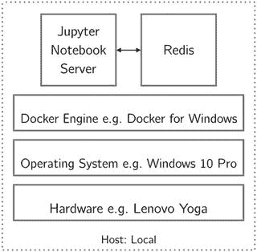
图 9-1. 一个简单的 Docker Compose 应用

首先，你需要创建一个目录来存放项目（清单 9-5）。

```
$ mkdir ch_9_jupyter_redis
$ cd ch_9_jupyter_redis
```
清单 9-5. 创建目录以存放项目

接下来（清单 9-6），你将使用命令行文本编辑器`vim`创建一个`docker-compose.yml`文件（清单 9-7）来定义此应用。

```
$ vim docker-compose.yml
```
清单 9-6. 创建`docker-compose.yml`

```
version: '3'
services:
  this_jupyter:
    image: jupyter/scipy-notebook
    ports:
     - 8888:8888
    volumes:
      - .:/home/jovyan
  this_redis:
    image: redis:alpine
```
清单 9-7. `jupyter_redis`的`docker-compose.yml`文件

你使用 Compose 文件定义了两个服务：`this_jupyter`和`this_redis`。`this_jupyter`服务：

- 使用 Docker Hub 仓库中的`jupyter/scipy-notebook`镜像，由`image:`关键字指定。

- 将本地目录（`.`）挂载到（希望你已经熟悉的）jupyter 工作目录`/home/jovyan`，由`volumes:`关键字指定。

- 将暴露的端口`8888`转发到主机上的端口`8888`，由`ports:`关键字指定。

- 将容器链接到 Redis 容器，由`links:`参数指定。

`redis`服务使用 Docker Hub 仓库中标签为`alpine`的`redis`镜像。

注意：在`docker-compose.yml`文件中定义的每个容器，其定义必须以`image:`参数或`build:`参数开头。我将在本章下一节讨论`build:`参数。

## 使用 Compose 运行你的应用

你已使用`docker-compose.yml`文件定义了应用。现在（清单 9-8），使用`docker-compose`命令行工具启动应用。你将使用`-d`参数指定以分离模式启动应用。

```
$ docker-compose up
Creating network "ch9jupyterredis_default" with the default driver
Creating ch9jupyterredis_this_redis_1
Creating ch9jupyterredis_this_jupyter_1
```
清单 9-8. 启动 Compose 应用`jupyter_redis`

`docker-compose up`命令首先指示 Docker 引擎执行以下操作之一：

1. 如果容器定义以`image:`关键字开头，则检查本地镜像缓存中是否存在指定的镜像。

2. 如果容器定义以`build:`关键字开头，则从引用的 Dockerfile 构建镜像。

在这里，你为两个容器传递了同一个镜像的关键词。在这种情况下，你正在使用的两个镜像当前都位于镜像缓存中。如果它们不在缓存中，Docker 引擎会从 Docker Hub 拉取它们。接下来，`docker-compose up`命令指示 Docker 引擎创建一个网络，应用程序的容器可以通过该网络进行通信。这里创建了一个名为`ch9jupyterredis_default`的网络。清单 9-14 展示了如何使用这个网络。最后，`docker-compose up`命令指示 Docker 引擎创建`docker-compose.yml`文件中定义的容器。这相当于运行清单 9-9 中的两个命令，但有一个例外：`docker-compose`创建的连接优于`--link`标志创建的链接，稍后你将看到这一点。

警告 不要执行清单 9-9。此处列出它只是为了展示如果你手动实例化这两个容器时需要运行的命令。

```
$ docker run --name ch9jupyterredis_this_redis_1 redis
$ docker run -v `pwd`:/home/jovyan -p 8888:8888 --name ch9jupyterredis_this_jupyter_1 --link ch9jupyterredis_this_redis_1 jupyter/scipy-notebook
```
清单 9-9. 手动实例化`docker-compose.yml`中定义的两个容器

这种方法很繁琐，我希望读者能立即看到使用`docker-compose`在使命令行选项的定义更加直接方面的表面优势。在清单 9-10 中，你使用`docker-compose ps`来显示与当前`docker-compose.yml`文件关联的容器的进程信息。

```
$ docker-compose ps
NameCommand
----------------------------------------------------------------------------
ch9jupyterredis_this_jupyter_1     tini -- start-notebook.sh
ch9jupyterredis_this_redis_1       docker-entrypoint.sh redis ...
State     Ports
----------------------------------------------------------------------------
Up         0.0.0.0:8888->8888/tcp
Up         6379/tcp
```
清单 9-10. 显示当前`docker-compose.yml`的容器

此命令不会像`docker ps`那样显示其他容器的信息。在清单 9-11 中，你更改目录以向上移动一级。完成后，你所在的目录没有`docker-compose`命令可以引用的`docker-compose.yml`文件。当你在没有`docker-compose.yml`文件的目录中请求`docker-compose ps`信息时，会收到一个错误。收到错误后，你返回项目目录。

```
$ cd ..
$ ls
ch_9_jupyter_redis
$ docker-compose ps
ERROR:
        Can't find a suitable configuration file in this directory or any
        parent. Are you in the right directory?
        Supported filenames: docker-compose.yml, docker-compose.yaml
$ cd ch_9_jupyter_redis
```
清单 9-11. 在没有`docker-compose.yml`的目录中请求`docker-compose ps`信息

你可以像操作任何其他 Docker 容器一样操作已创建的容器。在清单 9-12 中，你使用`docker exec`连接到你的 Jupyter 容器。在那里，你检查`env`并将其通过管道 (`|`) 传递给`grep`以搜索`redis`项，以便检查与 Jupyter 容器链接到 Redis 容器相关的环境变量。

```
$ docker exec ch9jupyterredis_this_jupyter_1 bash
jovyan@63f28e183a88:∼$ env | grep redis
```
清单 9-12. 检查 Jupyter 环境变量中的`redis`

请注意，没有显示任何内容。在清单 9-13 中，你通过显示完整的环境来验证这一点。

# 使用持久化功能的 Jupyter 与 Mongo

## 检查 Jupyter 环境变量

```
jovyan@db36cb53ea93:∼$ env
HOSTNAME=db36cb53ea93
NB_USER=jovyan
SHELL=/bin/bash
TERM=xterm
LC_ALL=en_US.UTF-8
LS_COLORS=
...
PWD=/home/jovyan
LANG=en_US.UTF-8
SHLVL=1
HOME=/home/jovyan
LANGUAGE=en_US.UTF-8
XDG_CACHE_HOME=/home/jovyan/.cache/
DEBIAN_FRONTEND=noninteractive
CONDA_DIR=/opt/conda
NB_UID=1000
_=/usr/bin/env
```
**清单 9-13.** 检查 Jupyter 环境变量

在第 8 章的清单 8-12 中，你做了几乎相同的事情。你创建了一个指向正在运行的 `Redis` 容器的链接，尽管在那种情况下，你是通过向 `docker run` 参数传递 `--link` 标志来实现的。然后，你通过 `bash` shell 连接到正在运行的 `Jupyter` 容器，并 `grep` 了 `THIS_REDIS` 的环境变量。如果你还记得，你发现了一些变量，这些变量可以用来代替通过其本地 IP 地址引用 `Redis` 容器。可以看出，当你通过 `docker-compose` 创建由 `Jupyter` 和 `Redis` 组成的应用程序时，情况并非如此。你将需要以不同的方式连接到 `Redis`。幸运的是，正如你稍后将看到的，这要容易得多，非常容易。

趁现在，获取 `Jupyter` 容器的安全令牌，以便你能够通过浏览器访问 `Jupyter`（清单 9-14）。

```
jovyan@63f28e183a88:∼$ jupyter notebook list
Currently running servers:
http://localhost:8888/?token=bca81e140ba43b4a3b20591812a6af32289fc66131e8e5e0 :: /home/jovyan
```
**清单 9-14.** 通过连接到容器的 `bash` Shell 获取 Jupyter 安全令牌

和之前一样，你将使用此令牌在浏览器中访问 `Jupyter`，如有必要，将 `localhost` 替换为相应的 IP 地址。在图 9-2 中，你导航到远程 AWS `t2.micro` 上的 `Jupyter` 站点。你可以看到 `-v` 标志使本地目录中的唯一文件（即 `docker-compose.yml` 文件）可供 `Jupyter Notebook` 服务器使用。

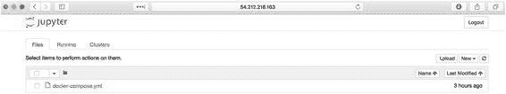
**图 9-2.** 在 `t2.micro` 上运行的 Jupyter

清单 9-15 展示了从 `Jupyter Notebook` 到 `Redis` 容器的一个简单连接。在这里，你利用了 `docker-compose` 创建的链接。这个链接非常简单，就是 `docker-compose.yml` 文件中定义的服务名称，即 `this_redis`。

```
In [1]: !pip install redis
        Collecting redis
          Downloading redis-2.10.5-py2.py3-none-any.whl (60kB)
            100% |████████████████████████████████| 61kB 2.7MB/s ta 0:00:011
        Installing collected packages: redis
        Successfully installed redis-2.10.5
        You are using pip version 8.1.2, however version 9.0.1 is available.
        You should consider upgrading via the 'pip install --upgrade pip' command.
In [2]: import redis
In [3]: REDIS = redis.Redis(host='this_redis')
In [4]: REDIS.incr('my_incrementor')
Out[4]: 1
In [5]: REDIS.get('my_incrementor')
Out[5]: b'1'
```
**清单 9-15.** 从 `jupyter` 连接到 `redis`

最后，在清单 9-16 中，你使用 `docker-compose down` 命令拆除你的简单应用程序。

```
$ docker-compose down
Stopping ch9jupyterredis_this_jupyter_1 ... done
Stopping ch9jupyterredis_this_redis_1 ... done
Removing ch9jupyterredis_this_jupyter_1 ... done
Removing ch9jupyterredis_this_redis_1 ... done
Removing network ch9jupyterredis_default
```
**清单 9-16.** 通过 `docker-compose down` 拆除应用程序

请注意，`docker-compose down` 不仅会停止你的容器，还会在移除用于连接容器的自定义网络之前，将它们一并移除。

## 使用持久化功能的 Jupyter 与 Mongo

在第 8 章中，你配置了一个由 `Jupyter` 容器和 `MongoDB` 容器组成的双容器系统，这两个容器运行在 AWS 上的两个独立主机系统中。在这里，你将使用 `Docker Compose` 创建功能等效的系统。使用 `Docker Compose` 构建系统的一个优势是，你能够在同一台主机上运行这两个服务，而无需投入大量精力管理网络配置。你之前配置简单的 Compose 应用时已经看到，只需使用你在 `docker-compose.yml` 文件中为服务指定的名称，就能访问 `Redis`。你将利用这种简单的网络配置方法，并采用两种新的 `Docker Compose` 技术：数据卷的配置和环境变量的定义。图 9-3 展示了你将配置的系统的示意图。

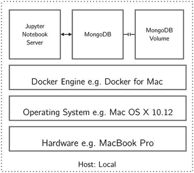
**图 9-3.** 包含两个服务和一个数据卷的 Docker Compose 应用

再次，你首先创建一个目录来存放你的项目（清单 9-17）。回想一下，`docker-compose` 使用 `docker-compose.yml` 文件与 `Docker` 引擎通信，因此最佳实践是为每个项目创建一个新目录，并为其提供独立的 `docker-compose.yml` 文件。在清单 9-18 中，你创建了新的 `docker-compose.yml` 文件（清单 9-19）。

```
$ mkdir ch_9_jupyter_mongo
$ cd ch_9_jupyter_mongo
```
**清单 9-17.** 创建存放项目的目录

```
$ vim docker-compose.yml
```
**清单 9-18.** 创建 `docker-compose.yml` 文件

```
version: '3'
services:
  this_jupyter:
    build: docker/jupyter
    ports:
      - "8888:8888"
    volumes:
      - .:/home/jovyan
    env_file:
      - config/jupyter.env
  this_mongo:
    image: mongo
    volumes:
      - mongo_data:/data/db
volumes:
  mongo_data:
```
**清单 9-19.** `ch_9_jupyter_mongo/docker-compose.yml` 文件

虽然你再次使用 Compose 文件定义了两个服务 `this_jupyter` 和 `this_mongo`，但与之前的应用相比，你对这个文件做了更多操作。首先，`this_jupyter` 服务不是通过 `image:` 关键字定义的，而是使用了 `build:` 关键字。清单 9-22 展示了你将用于构建的 `Dockerfile`。此外，你添加了 `env_file:` 关键字。清单 9-24 展示了你将使用的环境文件。在 `this_mongo` 的定义中，你添加了一个 `volumes:` 关键字，该关键字引用了稍后在 Compose 文件中定义的 `mongo_data` 卷。

### 指定构建上下文

在这里，你通过提供一个指向所需构建上下文的路径字符串来指定`build`关键字。在第 5 章中，你了解到构建上下文指的是用于构建特定镜像的文件集合。换句话说，构建上下文是一个目录，其中包含要使用的 Dockerfile 以及构建所需的其他任何文件。在这里，你指定了一个构建上下文`docker/jupyter`。在清单 9-20 中，你相对于`docker-compose.yml`文件的位置创建了这个目录。请注意，传递给`mkdir`命令的`-p`标志允许你创建嵌套的目录结构。在这种嵌套目录结构中，你采用了一种最佳实践，这将在第 10 章中讨论。

```
$ mkdir -p docker/jupyter
$ tree .
├── docker
│   └── jupyter
└── docker-compose.yml
```

**清单 9-20.** 创建`this_jupyter`构建上下文

接下来（清单 9-21），你需要创建 Dockerfile（清单 9-22），该文件将定义你的新镜像。在定义 Dockerfile 时，你采用了第 7 章中定义的最佳实践。

```
$ vim docker/jupyter/Dockerfile
```

**清单 9-21.** 创建`docker/jupyter/Dockerfile`

```
FROM jupyter/scipy-notebook
USER root
RUN conda install --yes --name root spacy pymongo
RUN ["bash", "-c", "source activate root && pip install twitter"]
RUN python -m spacy download en
USER jovyan
```

**清单 9-22.** `docker/jupyter/Dockerfile`

> **注意：** 由于你不打算使用 Python 2 内核运行任何代码，因此无需在`python2`环境中安装这些库。相反，你只安装到`root`环境，正如你在第 6 章中回忆的那样，这是 Python 3 环境。

### 指定环境文件

在第 8 章中，你获得了一组 OAuth 凭据，可用于直接从 Twitter 的流式 API 中流式传输推文。从安全角度来看，最佳实践是将这些凭据存储在单独的文件中。在这里，你将把这些凭据存储在一个名为`jupyter.env`的环境文件中。你已使用`env_file:`关键字告诉 Docker Compose 使用此文件。在清单 9-23 中，你创建了`config`目录来存放此文件，然后创建了清单 9-24 中所示的新文件。和之前一样，将环境文件中的虚拟字符串替换为你的实际 API 凭据。

```
$ mkdir config
$ vim config/jupyter.env
```

**清单 9-23.** 创建`config`目录和`config/jupyter.env`

```
CONSUMER_KEY=dummy_consumer_key
CONSUMER_SECRET=dummy_consumer_secrete
ACCESS_TOKEN=dummy_access_token
ACCESS_SECRET=dummy_access_secret
```

**清单 9-24.** `config/jupyter.env`

> **警告：** `config/jupyter.env`文件应被视为 bash 脚本。这意味着变量定义在等号两侧不能有空格。在 bash 中，`var=1`是变量赋值，⁶ 而`var = 1`是一个布尔比较，它会首先尝试执行`var1`。⁷

在清单 9-25 中，你使用`tree`工具来展示应用目录的最终状态。

```
$ tree .
├── config
│   └── jupyter.env
├── docker
│   └── jupyter
│       └── Dockerfile
└── docker-compose.yml
```

**清单 9-25.** 使用`tree`展示应用目录

### 数据持久化

在第 8 章中，你使用了 Docker 数据卷来在容器的生命周期之外持久化数据。你是通过`docker volume`工具实现的，在基础设施即代码的背景下，你应该将其视为一种手动方法。使用`docker-compose.yml`文件，可以像定义服务一样定义卷（即，使用代码指定卷的创建）。此外，你可以定义应用将如何使用该卷（即，你可以指定将其挂载到特定服务）。在清单 9-19 中，你定义了一个名为`mongo_data`的卷，然后将该卷链接到你的`mongo`服务。

### 使用 Compose 构建你的应用

# 构建并运行应用程序

在运行应用程序之前，你需要先构建它。这是因为你定义的至少一个服务使用了 `build:` 关键字（而非 `image:` 关键字）来定义用于实例化其容器的镜像。在代码清单 9-26 中，你将执行此构建。值得注意的是，该命令只会影响那些使用 `build:` 关键字定义的服务。你可以看到构建过程跳过了 `this_mongo`，因为它使用的是镜像。

```
$ docker-compose build
this_mongo uses an image, skipping
Building this_jupyter
Step 1/6 : FROM jupyter/scipy-notebook
 ---> 3dc12029099d
Step 2/6 : USER root
 ---> Using cache
 ---> d0fe6db71e0b
Step 3/6 : RUN conda install --yes --name root spacy pymongo
 ---> Running in 26e516e316c3
...
Step 4/6 : RUN bash -c source activate root && pip install twitter
 ---> Running in 5a07f7033056
...
Step 5/6 : RUN python -m spacy download en
 ---> Running in 319588ae94c6
...
Step 6/6 : USER jovyan
 ---> Running in 5c0f78fd96f2
 ---> d928c6dcf4fd
Removing intermediate container 5c0f78fd96f2
Successfully built d928c6dcf4fd
Successfully tagged ch9jupytermongo_this_jupyter:latest
```

**代码清单 9-26.** 使用 `docker-compose build` 构建应用程序

> **警告**
> 当运行 `docker-compose up` 时，Docker 客户端会检查本地镜像缓存，看每个定义的服务关联的镜像是否存在于缓存中。对于使用 `build:` 关键字定义的服务，如果镜像不在缓存中，则会构建该镜像。也就是说，`docker-compose build` 会被隐式调用。但这仅在镜像不在本地镜像缓存中时才会发生。这意味着，如果对 `Dockerfile` 或其他应用程序文件进行了更改，`docker-compose up` 命令无法检测到这些更改并触发构建。对于不熟悉的人来说，可能觉得 `docker-compose up` 会隐式调用构建，但实际上这只在镜像不在缓存中时才会发生。因此，建议的最佳实践是在运行 `docker-compose up` 之前始终运行 `docker-compose build`。

最后，完成构建后，你再次使用 `docker-compose up` 命令运行应用程序（代码清单 9-27）。

```
$ docker-compose up -d
Starting ch9jupytermongo_this_mongo_1
Starting ch9jupytermongo_this_jupyter_1
ubuntu@LOCAL:∼/ch_9_jupyter_mongo
```

**代码清单 9-27.** 启动 Compose 应用程序 `jupyter_mongo`

在代码清单 9-28 中，你再次使用 `docker-compose ps` 工具来显示当前应用程序关联容器的进程信息。

```
$ docker-compose ps
Name                           Command
-----------------------------------------------------------
ch9jupytermongo_this_jupyter_1 tini -- start-notebook.sh
ch9jupytermongo_this_mongo_1   docker-entrypoint.sh mongod
State      Ports
-----------------------------------------------------------
Up         0.0.0.0:8888->8888/tcp
Up         27017/tcp
```

**代码清单 9-28.** 显示当前 `docker-compose.yml` 的容器

接下来（代码清单 9-29），你获取 Jupyter 容器的安全令牌，以便能够通过浏览器访问 Jupyter。

```
$ docker exec ch9jupytermongo_this_jupyter_1 jupyter notebook list
Currently running servers:
http://localhost:8888/?token=0029b465c514ce18856a5a2751a95466504fac18b43531ce :: /home/jovyan
```

**代码清单 9-29.** 通过 Shell 调用容器获取 Jupyter 安全令牌

最后，在图 9-4 中，你打开浏览器，使用与主机系统关联的 IP 地址访问 Jupyter。

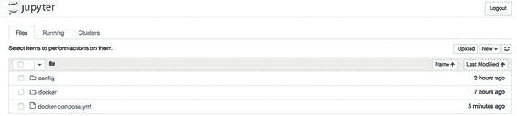

**图 9-4.** 在 `t2.micro` 上运行的 Jupyter

为了测试你的系统，你将再次使用基于位置的过滤器来流式传输推文。与第 8 章一样，你将把收集到的每条推文插入 MongoDB。为了增加一点复杂性，在将推文插入 MongoDB 之前，你将使用 spaCy 库将该推文文本编码为 `numpy` 向量。为了将向量存储在 MongoDB 中，你需要将向量序列化为二进制字节流。你在第 8 章中使用 Redis 完成了此操作，这里你使用 MongoDB 执行相同的操作。

你首先配置 Twitter 身份验证。你从 `os` 模块导入 `environ` 对象，并从 `twitter` 模块导入 `OAuth` 类。`environ` 对象⁸ 是一个映射⁹对象，表示操作系统的字符串环境。它在导入时被捕获。在这里，你将使用它来引用包含你凭据的环境变量，这些变量定义在 `docker-compose.yml` 和 `config/jupyter.env` 文件中；请参见代码清单 9-30。

```
In [1]: from os import environ
        from twitter import OAuth
```

**代码清单 9-30.** 导入配置 Twitter 身份验证所需的模块

在代码清单 9-31 中，你使用存储的凭据实例化一个 `OAuth` 对象。请注意，每个值都像字典一样通过其键来访问。

```
In [2]: oauth = OAuth(environ['ACCESS_TOKEN'],
                      environ['ACCESS_SECRET'],
                      environ['CONSUMER_KEY'],
                      environ['CONSUMER_SECRET'])
```

**代码清单 9-31.** 实例化 `OAuth` 对象

在代码清单 9-32 中，你导入 `TwitterStream` 类，并使用你定义的身份验证实例化该类的对象。

```
In [3]: from twitter import TwitterStream
        los_angeles_bbox = "-118.55, 33.97, -118.44, 34.05"
        twitterator = (TwitterStream(auth=oauth)
                       .statuses
                       .filter(locations=los_angeles_bbox))
```

**代码清单 9-32.** 实例化 `TwitterStream`

最后，在代码清单 9-33 中，你从流中拉取一条推文，然后显示其键。

```
In [4]: this_tweet = next(twitterator)
        this_tweet.keys()
```

**代码清单 9-33.** 拉取一条推文并显示其 `keys`

现在你内存中有一条推文，可以将其插入 MongoDB。在插入之前，你将使用 spaCy 库将推文编码为向量。你将把编码后的向量作为二进制字节流添加到包含推文的字典中。首先（代码清单 9-34），你导入 `spacy` 并加载 `en` 模型。在 `t2.micro` 上执行此操作时，你会收到一个内存错误。

```
In [5]: import spacy
        nlp = spacy.load('en')
        --------------------------------------------------------------------
        MemoryError                        Traceback (most recent call last)
        <ipython-input-8-e0448d429293> in <module>()
              1 import spacy
              2
        ----> 3 nlp = spacy.load('en')
```

**代码清单 9-34.** 导入 `spacy` 并加载 `en` 语言模型

好吧，起初这样的错误可能令人烦恼甚至令人生畏，但能够有效处理此类问题正是你首先学习这项技术的主要原因。在代码清单 9-35 中，你使用 `docker stats` 工具来诊断你的错误。请注意，`docker-compose` 没有自己的 `docker stats` 工具，因此你只需使用之前一直在使用的标准工具。

```
CONTAINER     CPU %   MEM USAGE / LIMIT     MEM %
698ba3322462  0.02%   539.2MiB / 990.7MiB   54.43%
a37b17785360  0.37%   49.77MiB / 990.7MiB   5.02%
NET I/O           BLOCK I/O         PIDS
1.26MB / 1.88MB   89.1GB / 1.42MB   15
21.8kB / 28.9kB   184GB / 15.5MB    22
```

**代码清单 9-35.** 使用 `docker stats` 诊断内存错误

值得注意的是，你的系统上运行着两个容器，而 `docker stats` 没有给它们提供人类可读的名称。你可以从内存使用情况推断出 `698ba3322462` 是 `Jupyter` 容器。你可以使用 `Ctrl+C` 终止 `docker stats` 工具，并使用 `docker ps` 来验证这一点，如代码清单 9-36 所示。

```
CONTAINER ID IMAGE                        ... NAMES
698ba3322462 ch9jupytermongo_this_jupyter ... ch9jupytermongo_this_jupyter_1
a37b17785360 mongo                        ... ch9jupytermongo_this_mongo_1
```

**代码清单 9-36.** 使用 `docker ps` 诊断内存错误

果然，是 `Jupyter` 容器使用了超过一半的系统内存……并且处于失败状态！它甚至没有完成加载模型。根据 `spaCy` 关于其特定模型的文档，¹⁰ 加载英语模型似乎需要 1GB 的 RAM。考虑到这是你 `t2.micro` 上的全部 RAM，你将无法在 `t2.micro` 上加载 `spaCy` 英语模型。

让我们暂时搁置这个问题的解决方案。首先，你像在第 8 章中那样，将推文插入 `MongoDB`（代码清单 9-37）。你通过导入 `pymongo` 模块并实例化一个数据库客户端，然后使用该客户端插入 `this_tweet` 来完成此操作。在代码清单 9-38 中，你统计 `tweet_collection` 中的推文数量以验证其插入。

```
In [6]: import pymongo
        mongo_cli = pymongo.MongoClient('this_mongo')
        result = (mongo_cli
                  .twitter_database
                  .tweet_collection
                  .insert_one(this_tweet) )
```

**代码清单 9-37.** 将单条推文插入 `MongoDB`

```
In [6]: (mongo_cli
         .twitter_database
         .tweets_collection.count())
Out[6]: 1
```

**代码清单 9-38.** 统计 `tweet_collection` 中的推文数量

# 通过实例类型扩展 AWS 应用

在第 1 章中，你探讨了不同规模数据集、模型和模型拟合过程的内存使用情况。其目的是检查 AWS `t2.micro` 实例上的内存限制，这是本书推荐使用的系统。当时，这项检查完全是学术性的。而现在，你遇到了实际的系统限制。你希望加载一个通过 `spaCy` 库提供的语言模型，但它根本无法在你的 `t2.micro` 实例上运行。你将使用 Docker、Docker-Compose 和 AWS 创建一个高效的方法来解决这个问题。为此，你需要：

1.  关闭你的 Docker Compose 应用，但保留数据卷。
2.  关闭你的 AWS 实例。
3.  将你的 AWS 实例类型更改为能够满足需求的类型，即 `t2.medium`。
4.  重启 AWS 实例，并记下生成的新 IP 地址。
5.  重启 Docker Compose 应用。
6.  执行你的计算任务。

在代码清单 9-39 中，你通过关闭应用来准备对 AWS 实例进行更改。因为你只执行了基本的 `docker-compose down` 命令，所以你的 Docker 卷将在整个过程中保持不变，并且你不会丢失 MongoDB 中的推文数据。它只包含一条推文，但这足以用于演示目的。

```
$ docker-compose down
Stopping ch9jupytermongo_this_jupyter_1 ... done
Stopping ch9jupytermongo_this_mongo_1 ... done
Removing ch9jupytermongo_this_jupyter_1 ... done
Removing ch9jupytermongo_this_mongo_1 ... done
Removing network ch9jupytermongo_default
```

代码清单 9-39. 关闭 Docker Compose 应用

在图 9-5 中，你导航到 EC2 控制面板并关闭正在运行的实例。为此，你从“操作”菜单的“实例状态”菜单项中选择“停止”。这是更改实例类型的第一步。必须停止实例才能进行更改。

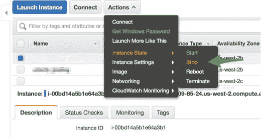
图 9-5. 停止 AWS 实例

你一直在使用 `t2.micro` 实例。图 9-6 显示了在美国西部（俄勒冈）区域启动的实例的按需实例定价和技术规格。如图所示，AWS `t2.micro` 实例有 1GB 内存，不足以加载你想要使用的 `spaCy` 库。为安全起见，请将你的实例类型更改为具有 4GB 内存的 `t2.medium`。这应该足以加载 1GB 的 `spaCy` 模型。

在图 9-7 中，你更改了 AWS 实例类型。从“操作”菜单的“实例设置”菜单项中选择“更改实例类型”。

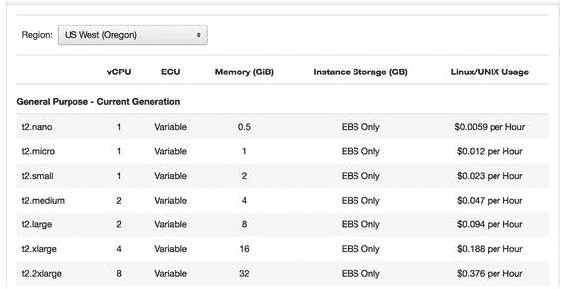
图 9-6. 美国西部（俄勒冈）区域的按需实例定价和规格

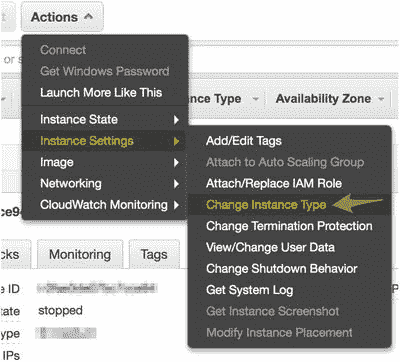
图 9-7. 更改实例类型

更改实例类型后，在图 9-8 中，你通过“操作”菜单中“实例状态”菜单项的“启动”再次启动实例。

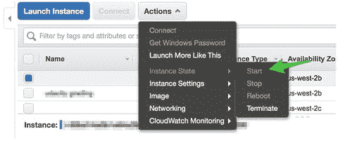
图 9-8. 启动 AWS 实例

警告： 停止你的 AWS 实例将释放你一直在使用的 IP 地址。当实例再次启动时，你需要获取分配给系统的新 IP 地址。

在图 9-9 中，你识别出分配给实例的新 IP 地址。


图 9-9. 新的 IP 地址

## 重启 Docker Compose 应用

你已经成功修改了与 EC2 实例关联的虚拟硬件。现在重启你的 Docker Compose 应用。由于你使用了 Docker 卷来持久化数据，因此在此过程中不应丢失任何数据。

在代码清单 9-40 中，你重新连接到 AWS 实例并导航到应用目录。

```
(local) $ ssh ubuntu@54.244.99.222
(AWS) $ cd ch_9_jupyter_mongo/
```

代码清单 9-40. 重新连接到 AWS 实例并导航到应用目录

在代码清单 9-41 中，你以分离模式启动应用。

```
$ docker-compose up -d
```

代码清单 9-41. 以分离模式启动 Docker Compose 应用

在代码清单 9-42 中，你获取 Jupyter Notebook 服务器的新安全令牌。

```
$ docker exec ch9jupytermongo_this_jupyter_1 jupyter notebook list
Currently running servers:
http://localhost:8888/?token=981014c28f5c8f694fd0321f418fddce6904f46857ace0bc :: /home/jovyan
```

代码清单 9-42. 获取 Jupyter Notebook 服务器安全令牌

## 完成计算

修改了系统的虚拟硬件后，你回到手头的任务。在代码清单 9-43 中，你逐步完成工作。

```
In [1]: from os import environ
        from twitter import OAuth
        oauth = OAuth(environ['ACCESS_TOKEN'],
                      environ['ACCESS_SECRET'],
                      environ['CONSUMER_KEY'],
                      environ['CONSUMER_SECRET'])

In [2]: from twitter import TwitterStream
        los_angeles_bbox = "-118.55, 33.97, -118.44, 34.05"
        twitterator = (TwitterStream(auth=oauth)
                       .statuses
                       .filter(locations=los_angeles_bbox))

In [3]: tw = next(twitterator)

In [4]: tw.keys()
Out[4]: dict_keys(['text', 'source', 'in_reply_to_status_id_str', 'favorited',
        'is_quote_status', 'in_reply_to_status_id', 'lang', 'filter_level', 'geo',
        'favorite_count', 'created_at', 'entities', 'coordinates', 'in_reply_to_user_id_str',
        'retweeted', 'truncated', 'retweet_count', 'id', 'contributors', 'in_reply_to_user_id',
        'user', 'place', 'in_reply_to_screen_name', 'id_str', 'timestamp_ms'])

In [5]: import pymongo
        mongo_server = pymongo.MongoClient('this_mongo')

In [6]: mongo_server.twitter.tweets.count()
Out[6]: 1

In [7]: result = (mongo_server
                  .twitter
                  .tweets
                  .insert_one(tw))

In [8]: mongo_server.twitter.tweets.count()
Out[8]: 2
```

代码清单 9-43. 重新运行初步工作

请注意，在代码清单 9-43 的 `Out[6]` 中，你收到的 MongoDB 中存储的推文计数输出为 1。这验证了你在更改实例类型之前插入到 MongoDB 中的那条推文在更改后仍然存在。

### 将推文编码为文档向量

# 处理后的文本

在第 8 章中，你学习了如何将`numpy`向量序列化以插入`Redis`和`PostgreSQL`。现在，在将序列化的`numpy`向量插入`MongoDB`之前，你需要在此过程中增加一个额外步骤。此前，这些向量仅仅是演示向量，没有任何意义。现在，你将使用`spacy.nlp`英文模型将收集到的推文编码为表示推文的`numpy`向量，即文档向量。

在代码清单 9-44 中，你加载了`spacy.nlp`英文模型。这次加载成功了。请注意，我特意避免深入讨论`spaCy`库，因为这超出了本书的范围。感兴趣的读者可参考该库的文档：[`spacy.io`](http://spacy.io)。

```
In [9]: import spacy
        nlp = spacy.load('en')
```

**代码清单 9-44.** 导入`spacy`并加载英文模型

在代码清单 9-45 中，你执行了对所有推文文档的搜索。搜索返回的不是结果本身，而是一个游标，你可以用它逐个遍历文档。这非常有用，因为任何时候内存中最多只会有一个文档。你使用`.next()`类函数来检索第一条推文。

```
In [10]: cursor = mongo_server.twitter.tweets.find()
         stored_tweet = cursor.next()
```

**代码清单 9-45.** 创建搜索所有推文的游标并检索单条推文

在代码清单 9-46 中，你显示了推文的文本。

```
In [11]: stored_tweet['text']
Out[11]: 'Amazing day exploring the Sunken City.  #California is unbelievable....
         https://t.co/INl0o1znc7'
```

**代码清单 9-46.** 显示单条推文的文本

在代码清单 9-47 中，你使用`spacy.nlp`英文模型，根据推文文本创建了一个文档对象。该文档对象包含关联的文档向量，作为属性`.vector`。在代码清单 9-48 中，你使用`.shape`属性显示了该向量的维度。

```
In [12]: doc = nlp(stored_tweet['text'])
```

**代码清单 9-47.** 从推文文本创建文档向量

```
In [13]: doc.vector.shape
Out[13]: (300,)
```

**代码清单 9-48.** 显示文档向量的形状

在代码清单 9-49 中，你更新了`MongoDB`中的推文文档。`.update_one()`函数接受两个字典参数。第一个参数是用于搜索要更新文档的字典。这里，你指定要更新`_id`与`stored_tweet`匹配的文档。第二个参数指定要更新的值。在这种情况下，你希望将键`'document_vector'`设置为文档向量的序列化值。请注意，你使用`.tostring()`函数来序列化文档向量以便存储。

```
In [14]: mongo_server.twitter.tweets.update_one(
             {'_id': stored_tweet['_id']},
             {'$set': {'document_vector': doc.vector.tostring()}})
Out[14]: <pymongo.results.UpdateResult at 0x7f2796c6d750>
```

**代码清单 9-49.** 使用序列化的文档向量更新`MongoDB`中的推文文档

然后，你对第二条推文重复此过程。在代码清单 9-50 中，你检索了第二条推文并显示其文本。在代码清单 9-51 中，你创建了文档向量。在代码清单 9-52 中，你更新了`MongoDB`中的推文文档。

```
In [15]: stored_tweet = cursor.next()
         stored_tweet['text']
Out[15]: "Idk what's so soothing about their fingers changing"
```

**代码清单 9-50.** 检索下一条推文并显示文本

```
In [16]: doc = nlp(stored_tweet['text'])
```

**代码清单 9-51.** 从推文文本创建文档向量

```
In [17]: mongo_server.twitter.tweets.update_one(
             {'_id': stored_tweet['_id']},
             {'$set': {'document_vector': doc.vector.tostring()}})
Out[17]: <pymongo.results.UpdateResult at 0x7f2796c48fc0>
```

**代码清单 9-52.** 使用序列化的文档向量更新`MongoDB`中的推文文档

## 将 AWS 实例类型切换为`t2.micro`

完成两条推文的编码后，你已经完成了任务中资源密集型的部分，不再需要`spacy.nlp`英文模型。这意味着你可以将 AWS 实例类型切换回`t2.micro`。操作方式与切换到`t2.medium`完全相同。由于你已经将结果写入`MongoDB`，并使用 Docker 卷持久化`MongoDB`中的数据，你的工作将在切换过程中保持不变。要进行切换，你需要：
1.  停止 Docker Compose 应用程序。
2.  关闭 AWS 实例。
3.  将 AWS 实例的实例类型更改回`t2.micro`。
4.  重新启动 AWS 实例，注意生成的新 IP 地址。
5.  重新启动 Docker Compose 应用程序。

### 从 MongoDB 检索推文并进行比较

使用你的`t2.micro`实例，你可以对推文向量进行一些比较。为此，你需要创建一个新的 Jupyter Notebook。在代码清单 9-53 中，你连接到了`MongoDB`。

```
In [1]: import pymongo
        mongo_server = pymongo.MongoClient('this_mongo')
```

**代码清单 9-53.** 连接到`MongoDB`

在代码清单 9-54 中，你使用`.find()`搜索`MongoDB`中的所有推文。这次，你不使用游标，而是将返回的游标转换为列表。不过多深入 Python 的具体操作，效果是创建了一个从`MongoDB`拉取的推文列表。因为你使用了关键字参数`projection`来请求`document_vector`，所以该列表将只包含每条推文的`_id`和`document_vector`。

```
In [2]: tweet_vectors = list(mongo_server.twitter.tweets.find(projection=['document_vector']))
```

**代码清单 9-54.** 从`MongoDB`检索文档向量列表

在代码清单 9-55 中，你将字节流文档向量反序列化为`numpy`向量，以便用于计算。你像在第 8 章中那样，使用`.fromstring()`函数完成此操作。

```
In [3]: import numpy as np
        tweet_vectors_np = [tw['document_vector'] for tw in tweet_vectors]
        tweet_vectors_np = [np.fromstring(tw) for tw in tweet_vectors_np]
```

**代码清单 9-55.** 创建`numpy`文档向量列表

在代码清单 9-56 中，你对两个推文文档向量执行了余弦相似度计算。结果显示，这两条推文非常相似，至少根据`spacy.nlp`英文模型编码是如此。

```
In [4]: from sklearn.metrics.pairwise import cosine_similarity
        cosine_similarity(tweet_vectors_np[0].reshape(1, -1),
                          tweet_vectors_np[1].reshape(1, -1))
Out[4]: array([[ 0.99992551]])
```

**代码清单 9-56.** 计算两条推文的余弦相似度

# Docker Compose 网络

在第 8 章中，你通过手动配置 Docker 网络，在 Jupyter Notebook 服务器所在的同一系统上启动并配置了一个 PostgreSQL 数据库。虽然这个过程并不简单，但完成该章节的学习可以让你深入了解 Docker 如何配置其内部网络，供容器之间相互连接。而使用 Docker Compose 则有一种更简单的方法。请注意，对于使用版本 2 或更高版本的 `docker-compose.yml` 文件，Docker Compose 中的网络配置有显著不同。我仍然推荐使用版本 3，并在此说明以保持完整性。也就是说，我将继续假设你使用的是版本 3，但你应该了解 Docker Compose 中从版本 1 到版本 2 在网络方面的重大升级。在运行时，Docker Compose 会自动为应用程序设置一个单一网络。在 `docker-compose.yml` 文件中定义的服务容器默认会加入此网络，并立即对应用程序中的其他容器可用，且可通过定义服务时使用的名称进行发现。请参考清单 9-57 中示例 `docker-compose.yml` 文件定义的应用程序，假设该文件位于名为 `ch_9_sample` 的目录中。

```
version: "3"
services:
  this_jupyter:
    image: jupyter/scipy-notebook
    ports:
      - "8888:8888"
  this_redis:
    image: redis:alpine
  this_posstgres:
    image: postgres:alpine
```

清单 9-57. 示例 `docker-compose.yml` 文件

当你运行 `docker-compose up` 时，`docker-compose` 会指示 Docker 引擎执行以下操作：
1. 创建一个名为 `ch9sample_default` 的网络。
2. 创建一个名为 `ch9sample_this_jupyter` 的容器，并将容器内的端口 `8888` 暴露到主机的端口 `8888` 上。
3. 指示 `ch9sample_this_jupyter` 使用名称 `this_jupyter` 加入 `ch9sample_default` 网络。
4. 创建一个名为 `ch9sample_this_redis` 的容器。
5. 指示 `ch9sample_this_redis` 使用名称 `this_redis` 加入 `ch9sample_default` 网络。
6. 创建一个名为 `ch9sample_this_postgres` 的容器。
7. 指示 `ch9sample_this_postgres` 使用名称 `this_postgres` 加入 `ch9sample_default` 网络。

现在，应用程序中的每个容器都可以使用容器在网络上的名称（例如 `this_jupyter`、`this_redis` 或 `this_postgres`）来访问其他所有容器（图 9-10）。

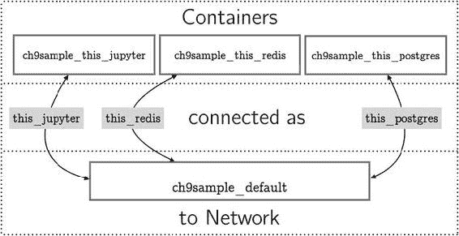

图 9-10. 一个示例的默认 Docker Compose 网络配置

# 带持久化存储的 Jupyter 和 Postgres

在本章的最后一个应用中，你将构建一个 Jupyter Notebook 和 PostgreSQL 应用程序（图 9-11）。你将配置 PostgreSQL 使用数据卷以实现持久化存储。你还会设置 Postgres 使用构建方式而非直接使用镜像。

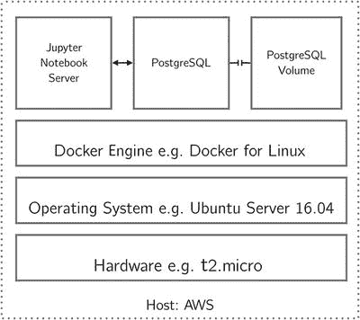
*图 9-11. 一个包含两个服务和一个数据卷的 Docker Compose 应用程序*

在第 8 章中，我提到 PostgreSQL 天生擅长处理 CSV 文件。此外，PostgreSQL 的公共镜像包含多个构建钩子，有助于在运行时初始化数据库。根据 Docker Hub 上的 `postgres` 文档¹¹：

> 在入口点调用 `initdb` 创建默认的 `postgres` 用户和数据库后，它会运行该目录中找到的任何 `*.sql` 文件，并执行任何 `*.sh` 脚本，以在启动服务之前进行进一步的初始化。

这意味着你可以将 SQL 文件和 shell 脚本作为镜像构建过程的一部分添加进去，这些文件将在运行时自动执行，并为你设置好数据库。同样，你首先创建一个目录来存放你的项目（清单 9-58）。在清单 9-59 中，你创建新的 `docker-compose.yml` 文件（清单 9-60）。

```
$ mkdir ch_9_jupyter_postgres
$ cd ch_9_jupyter_postgres
```

*清单 9-58. 创建项目目录*

```
$ vim docker-compose.yml
```

*清单 9-59. 创建 `docker-compose.yml` 文件*

```yaml
version: '3'
services:
  this_jupyter:
    build: docker/jupyter
    ports:
      - "8888:8888"
    volumes:
      - .:/home/jovyan
  this_postgres:
    build: docker/postgres
    volumes:
      - postgres_data:/var/lib/postgresql/data
volumes:
  postgres_data:
```

*清单 9-60. `ch_9_jupyter_postgres/docker-compose.yml` 文件*

### 指定构建上下文

读者会注意到，这里定义的两个服务都使用了 `build:` 关键字，而不是 `image:` 关键字。这意味着你的项目将需要两个构建上下文，每个镜像一个。在代码清单 9-61 中，你创建了两个构建上下文，然后使用 `tree` 命令显示当前项目。

```
$ mkdir -p docker/jupyter
$ mkdir -p docker/postgres
$ tree .
├── docker
│   ├── jupyter
│   └── postgres
└── docker-compose.yml
```

*代码清单 9-61. 创建两个构建上下文*

接下来，在代码清单 9-62 中，你为 `this_jupyter` 服务创建了第一个 `Dockerfile`（代码清单 9-63）。你使用这个 `Dockerfile` 仅仅是为了安装将要用于访问 PostgreSQL 的 `psycopg2` 模块。

```
$ vim docker/jupyter/Dockerfile
```

*代码清单 9-62. 创建 `docker/jupyter/Dockerfile`*

```dockerfile
FROM jupyter/scipy-notebook
USER root
RUN conda install --yes --name root psycopg2
USER jovyan
```

*代码清单 9-63. `docker/jupyter/Dockerfile`*

在代码清单 9-64 中，你为 `this_postgres` 服务创建了第二个 `Dockerfile`（代码清单 9-65）。在这个 `Dockerfile` 中，你使用 `postgres:alpine` 镜像作为基础镜像，并将构建上下文中的两个文件 `get_data.sh`（代码清单 9-66）和 `initdb.sql`（代码清单 9-67）复制到镜像中。如上所述，由于你将这两个文件添加到了 `/docker-entrypoint-initdb.d/` 目录下，因此在运行时，shell 脚本将由 `bash` 执行，SQL 文件将由 PostgreSQL 执行。你将利用这一点在数据库中创建一个表并填充数据。

```
$ vim docker/postgres/Dockerfile
```

*代码清单 9-64. 创建 `docker/postgres/Dockerfile`*

```dockerfile
FROM postgres:alpine
COPY get_data.sh /docker-entrypoint-initdb.d/get_data.sh
COPY initdb.sql /docker-entrypoint-initdb.d/initdb.sql
```

*代码清单 9-65. `docker/postgres/Dockerfile`*

**注意：** 你用于填充数据库的 CSV 文件来自 UCI 机器学习库。¹² 该数据存在一个问题，即某些值缺失，并被替换为 `?` 字符。为了解决这个问题，我使用了流编辑器工具 `sed`¹³ 将所有 `?` 字符替换为空（即从文件中完全移除 `?` 字符）。

```bash
#!/bin/bash
wget -P /tmp/ http://archive.ics.uci.edu/ml/machine-learning-databases/breast-cancer-wisconsin/breast-cancer-wisconsin.data
sed 's/?//' /tmp/breast-cancer-wisconsin.data > /tmp/bcdata-clean.csv
```

*代码清单 9-66. `docker/postgres/get_data.sh`*

```sql
CREATE TABLE bc_data (
    sample_id INTEGER UNIQUE PRIMARY KEY,
    clump_thickness INTEGER,
    uniformity_of_cell_size INTEGER,
    uniformity_of_cell_shape INTEGER,
    marginal_adhesion INTEGER,
    single_epithelial_cell_size INTEGER,
    bare_nuclei INTEGER,
    bland_chromatin INTEGER,
    normal_nucleoli INTEGER,
    mitoses INTEGER,
    class INTEGER
);
COPY bc_data FROM /tmp/bcdata-clean.csv DELIMITER ',' CSV;
```

*代码清单 9-67. `docker/postgres/initdb.sql`*

在代码清单 9-68 中，你使用 `tree` 工具展示了项目的最终状态。

```
$ tree .
├── docker
│   ├── jupyter
│   │   └── Dockerfile
│   └── postgres
│       ├── Dockerfile
│       ├── get_data.sh
│       └── initdb.sql
└── docker-compose.yml
```

*代码清单 9-68. 使用 `tree` 显示应用程序目录*

### 使用 Compose 构建并运行应用程序

在准备运行应用程序时，你使用 `docker-compose build` 来构建用于定义服务的两个镜像（代码清单 9-69）。

### 代码清单 9-69. 使用 `docker-compose build` 构建应用程序

```
$ docker-compose build
Building this_jupyter
Step 1/4 : FROM jupyter/scipy-notebook
...
Step 2/4 : USER root
...
Step 3/4 : RUN conda install --yes --name root psycopg2
...
Step 4/4 : USER jovyan
...
Successfully built b98e9ab6ee7e
Successfully tagged ch9jupyterpostgres_this_jupyter:latest
Building this_postgres
Step 1/3 : FROM postgres:alpine
...
Step 2/3 : COPY get_data.sh /docker-entrypoint-initdb.d/get_data.sh
...
Step 3/3 : COPY initdb.sql /docker-entrypoint-initdb.d/initdb.sql
...
Successfully built 97b956a4da7a
Successfully tagged ch9jupyterpostgres_this_postgres:latest
```

最后，在代码清单 9-70 中，你使用 `docker-compose up` 运行应用程序。请注意，在创建和启动服务容器之前，会先创建默认网络和用于数据持久化的卷。

### 代码清单 9-70. 启动 Compose 应用程序 `jupyter_postgres`

```
$ docker-compose up -d
Creating network "ch9jupyterpostgres_default" with the default driver
Creating volume "ch9jupyterpostgres_postgres_data" with default driver
Creating ch9jupyterpostgres_this_jupyter_1
Creating ch9jupyterpostgres_this_postgres_1
Starting ch9jupyterpostgres_this_jupyter_1
Starting ch9jupyterpostgres_this_postgres_1
```

在代码清单 9-71 中，你显示了应用程序的进程信息。

### 代码清单 9-71. 显示当前 `docker-compose.yml` 的容器

```
$ docker-compose ps
Name                                Command
-----------------------------------------------------------
ch9jupyterpostgres_this_jupyter_1   tini -- start-notebook.sh
ch9jupyterpostgres_this_postgres_1  docker-entrypoint.sh postgres
State      Ports
---------------------------------------------------------------------------
Up         0.0.0.0:8888->8888/tcp
Up         5432/tcp
```

在代码清单 9-72 中，你使用 `docker-compose logs` 显示与 `this_postgres` 服务相关的日志。

### 代码清单 9-72. 显示 `this_postgres` 的日志

```
$ docker-compose logs this_postgres
Attaching to ch9jupyterpostgres_this_postgres_1
this_postgres_1  | The files belonging to this database system will be owned by user "postgres".
...
this_postgres_1  | /usr/local/bin/docker-entrypoint.sh: running /docker-entrypoint-initdb.d/get_data.sh
this_postgres_1  | Connecting to archive.ics.uci.edu (128.195.10.249:80)
this_postgres_1  | breast-cancer-wiscon 100% |*******************************| 19889   0:00:00 ETA
...
this_postgres_1  | /usr/local/bin/docker-entrypoint.sh: running /docker-entrypoint-initdb.d/initdb.sql
this_postgres_1  | CREATE TABLE
this_postgres_1  | COPY 699
...
```

你希望在这里看到的是数据的成功收集和插入。你还可以通过 `docker exec`（代码清单 9-73）连接到正在运行的服务，以验证是否插入了正确数量的行。这里你使用了名为 `wc`¹⁴ 的字数统计工具来统计下载文件中的行数。

### 代码清单 9-73. 通过 `docker exec` 连接到 `this_postgres`

```
$ docker exec -it ch9jupyterpostgres_this_postgres_1 bash
bash-4.3# wc -l /tmp/breast-cancer-wisconsin.data
699 /tmp/breast-cancer-wisconsin.data
```

最后，你连接到 Jupyter 来测试一些代码。在代码清单 9-74 中，你对 `bc_data` 表中的行数进行了简单计数。

### 代码清单 9-74. 统计 `bc_data` 表中的行数

```
In [1]: import psycopg2 as pg2
In [2]: con = pg2.connect(host='this_postgres', user='postgres', database='postgres')
        cur = con.cursor()
        cur.execute("SELECT COUNT(*) FROM bc_data;")
        cur.fetchall()
Out[2]: [(699,)]
```

请注意，你通过将主机指定为 `'this_postgres'`，利用了为你创建的网络。

## 总结

在本章中，我介绍了 `Docker Compose` 工具。随后，你运用目前讨论的所有技术与工具，使用该工具构建了多服务数据应用。你构建了一个简单的 `Jupyter-Redis` 应用，又构建了一个更复杂的 `Jupyter-MongoDB` 应用，并探索了如何使用 `Docker Compose` 配置数据持久化。在使用 `Jupyter-MongoDB` 应用的过程中，你学会了如何在以 AWS 实例运行时切换应用的底层虚拟硬件。最后，你构建了一个 `Jupyter-PostgreSQL` 应用。在构建该应用时，你了解了如何利用 `postgres` Docker 镜像中定义的构建钩子，在运行时将数据加载到数据库中。完成本章学习后，希望你能够运用 `Jupyter` 以及我所介绍的任何或全部数据存储，设计出属于自己的简单多服务应用。在下一章中，我将重新探讨交互式编程范式，并介绍以该范式为核心构建软件的理念。你将使用 `Docker Compose` 来构建此软件。

脚注  
1 [`github.com/docker/compose`](https://github.com/docker/compose)  
2 [`blog.rstudio.org/2016/03/29/feather/`](https://blog.rstudio.org/2016/03/29/feather/)  
3 [www.vim.org](http://www.vim.org)  
4 [`github.com/jupyter/docker-stacks/blob/master/base-notebook/Dockerfile#L80`](https://github.com/jupyter/docker-stacks/blob/master/base-notebook/Dockerfile#L80)  
5 [`alpinelinux.org`](https://alpinelinux.org)

6 [`tldp.org/LDP/abs/html/varassignment.html`](http://tldp.org/LDP/abs/html/varassignment.html)

7 [`tldp.org/LDP/abs/html/gotchas.html#WSBAD`](http://tldp.org/LDP/abs/html/gotchas.html#WSBAD)

8 [`docs.python.org/3/library/os.html#os.environ`](https://docs.python.org/3/library/os.html#os.environ)

9 [`docs.python.org/3/glossary.html#term-mapping`](https://docs.python.org/3/glossary.html#term-mapping)

10 [`spacy.io/docs/usage/models`](https://spacy.io/docs/usage/models)

11 [`hub.docker.com/_/postgres/`](https://hub.docker.com/_/postgres/)

12 [`archive.ics.uci.edu/ml/datasets.html`](http://archive.ics.uci.edu/ml/datasets.html)

13 [`www.gnu.org/software/sed/manual/sed.html`](http://www.gnu.org/software/sed/manual/sed.html)

14 [`linux.die.net/man/1/wc`](https://linux.die.net/man/1/wc)

© Joshua Cook 2017

Joshua Cook, `面向数据科学的 Docker`

`doi.org/10.1007/978-1-4842-3012-1_10`

# 10. 交互式软件开发

Joshua Cook¹
(1) 美国加利福尼亚州圣莫尼卡

数据科学家进行软件开发的方式与传统软件工程不同，且远未被充分理解。对于传统软件开发者而言，无论使用何种语言，都存在围绕复用性、可扩展性和稳定性构建的框架。其中最著名的可能是 Ruby 语言的 `Rails` 框架。`Rails` 从其底层架构开始，就围绕其所采用的范式——模型-视图-控制器（Model-View-Controller）设计模式进行编写，该模式在面向用户的软件实现中备受青睐。清单 10-1 展示了新 `Rails` 应用的创建过程及其默认文件结构。请注意，新应用根据其使用模式创建了清晰的目录。

```
$ rails new myapp
      create
      ...
$ tree -L 1 myapp/app
myapp/app/
├── assets
├── channels
├── controllers
├── helpers
├── jobs
├── mailers
├── models
└── views
```

清单 10-1. 一个默认的 Rails 应用

数据科学领域的软件开发并没有这样的设计模式，可以围绕其构建类似的框架。在第三章中，我介绍了交互式计算作为传统编程替代方案的理念。在本章中，我提议将交互式计算本身作为潜在框架的基石理念。你将开发一个项目框架，其基础设施由 `docker-compose.yml` 定义，并围绕作为交互式计算驱动器的 `Jupyter` 构建。该框架的目标与交互式计算项目的目标一致。该框架应便于实现以下方面：
- 迭代
- 硬件的扩展与分发
- 工作的共享与文档化

## 计算生物学项目组织快速指南

为了给这个框架寻找灵感，让我们看看华盛顿大学 William Noble 的工作。¹ Noble 的工作描述了“执行计算实验的一种良好策略”，重点关注“诸如组织文件目录和记录进度等相对平凡的问题”。Noble 专注于构建项目的几个关键原则：
- 文件和目录组织
- 工作文档化
- 工作执行
- 版本控制

图 10-1 展示了 Noble 为一个名为 `msms` 的示例项目设计的文件和目录组织图。

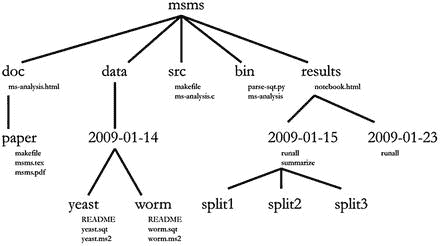

图 10-1. Noble 的示例项目 `msms`

## 交互式开发的项目框架

你将直接借鉴这项工作来开发你的框架。你将使用按顺序编号的 `Jupyter Notebooks`，作为记录和执行工作的方法。这些笔记本既成为活动的详细记录，也成为驱动这些活动的手段。此外，你将展示一个围绕使用 `Jupyter Notebook` 作为工作驱动器而设计的目录层次结构。图 10-2 展示了一个为交互式开发构建的目录层次结构。

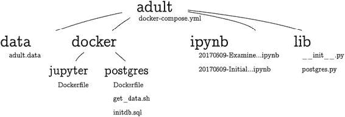

图 10-2. 为交互式开发构建的目录层次结构

你将使用以下目录来构建项目的目录层次结构：
- `data`
    - 包含原始数据文件
- `docker`
    - 包含一个子目录，用于存放每个需要通过构建来定义的镜像
    - 每个子目录将成为相应镜像的构建上下文
- `ipynb`
    - 包含所有 `Jupyter Notebook` 文件
    - 替代 `bin`、`doc` 和 `results` 目录
    - 笔记本是驱动器、脚本、文档和演示文稿
    - 笔记本以日期和活动命名，以便原地排序
- `lib`
    - 包含项目特定的代码模块，在项目开发过程中定义

# 项目根目录设计模式

在第 3 章中，我曾提出：

> Jupyter 并不能取代 vim、Sublime Text 或 PyCharm。Jupyter 取代的是 `if __name__ == "__main__":`。

`if __name__ == "__main__":` 设计模式为运行 Python 程序提供了一个启动钩子。我在此提出的项目框架并非围绕这种代码运行方式构建，因此也不需要这样的启动钩子。相反，你是以 Jupyter Notebook 作为驱动器来构建这个框架的。你需要的是一个将模块导入到 notebook 中的模式。维护清晰的项目目录结构要求你将 notebook 和 Python 模块分别存放在不同的目录中。此外，我认为将两者嵌套放置也不够美观。这会在导入时引发问题。给定如代码清单 10-2 所示的目录结构，你无法将 `lib/` 中的模块（例如代码清单 10-3 所示的 `some_module.py`）直接导入到 `ipynb/` 中的 Jupyter Notebook 模块里。

```
$ tree .
├── ipynb
│   └── some_notebook.ipynb
└── lib
    ├── __init__.py
    ├── some_module.py
```

代码清单 10-2. 示例项目结构

```
#!/bin/python
def say_hello ():
    print("Hello!")
```

代码清单 10-3. 一个演示用的 Python 模块 `some_module.py`

让我们通过使用我称之为项目根目录设计模式（代码清单 10-4）来解决这个问题。

```
In [1]: from os import chdir
        chdir('/home/jovyan')
```

代码清单 10-4. 项目根目录设计模式

项目根目录设计模式会将 Python 内核的当前工作目录更改为项目的根目录。这由 `docker-compose.yml` 文件（代码清单 10-8）中挂载卷的配置来保证，该配置将当前目录（`.`）挂载到 jupyter 镜像的工作目录 `/home/jovyan`。因此，在 Jupyter Notebook（运行在 jupyter 镜像上）中执行 `chdir('/home/jovyan')`，可以确保你位于项目根目录。此外，由于在 `chdir` 语句中使用了绝对路径，你可以幂等地运行此命令。在任何 Jupyter Notebook 中将其作为第一个命令运行，意味着你可以随意从 `lib` 目录进行导入（代码清单 10-5）。

```
In [2]: from lib.some_module import say_hello
        say_hello()
        Hello!
```

代码清单 10-5. 从 `lib.some_module` 导入

## 初始化项目

在第 9 章中，你使用 `docker-compose.yml` 文件设计了一个由 Jupyter Notebook 服务器和 PostgreSQL 数据库组成的应用。你使用了 `docker-compose` 构建工具和 postgres 镜像的设计来收集数据并初始化数据库。在这里，你再次执行相同的操作，从 UCI 机器学习库收集数据。不过在本章中，你将正式化数据收集过程，并使用 Jupyter Notebook 记录该过程。在代码清单 10-6 中，你初始化了项目。你为项目创建了一个全局目录 `ch10_adult`。在该项目下创建了三个子目录：`docker/`、`ipynb/` 和 `lib/`。你使用 `touch` 命令创建了一个新的 `__init__.py` ² 文件。这会使 `lib/` 目录成为一个 Python 模块。最后，你使用 `git init` 将项目仓库初始化为一个 git 仓库。

```
$ mkdir ch10_adult
$ cd ch10_adult/
$ mkdir docker ipynb lib
$ touch lib/__init__.py
$ git init
已初始化空的 Git 仓库于 /home/ubuntu/ch10_adult/.git/
```

代码清单 10-6. 初始化 `ch10_adult` 项目

在代码清单 10-7 中，你创建了 `docker-compose.yml` 文件（代码清单 10-8），该文件将定义项目的基础设施。请注意，你从简单开始。在这个阶段，你只有一个服务，即 Jupyter Notebook 服务器。

```
$ vi docker-compose.yml
```

代码清单 10-7. 创建 `docker-compose.yml` 文件

```
version: '3'
services:
  this_jupyter:
    image: jupyter/scipy-notebook
    ports:
      - "8888:8888"
    volumes:
      - .:/home/jovyan
```

代码清单 10-8. `docker-compose.yml`

定义好基础设施后，你将应用启动上线（代码清单 10-9）。由于你使用了 `image:` 关键字而非 `build:` 关键字来定义服务所用的镜像，因此在启动应用之前无需执行构建。启动后，你使用 `docker-compose ps` 工具来检查与应用相关的正在运行的容器（代码清单 10-10）。为了通过浏览器访问 Jupyter，你需要获取一个当前的身份验证令牌（代码清单 10-11）。

```
$ docker-compose up -d
正在启动 ch10adult_this_jupyter_1
```

代码清单 10-9. 启动初始系统

```
$ docker-compose ps
名称                          命令                          状态                  端口
----------------------------------------------------------------------------
ch10adult_this_jupyter_1  tini -- start-notebook.sh  Up   0.0.0.0:8888->8888/tcp
```

代码清单 10-10. 检查正在运行的容器

```
$ docker exec ch10adult_this_jupyter_1 jupyter notebook list
当前正在运行的服务器：
http://localhost:8888/?token=d6dc404c5e3c25ffd993579aeb06eeb2a801c4cbc75f727e :: /home/jovyan
```

代码清单 10-11. 获取身份验证令牌

## 检查数据库需求

此时，你的应用仅包含一个服务，即 Jupyter Notebook 服务器。项目开发的下一阶段是引入一个数据库。在这里，你将启动一个 notebook，并使用 `pandas` 检查数据样本，以便为处理数据制定一个模式。然后，你将准备 `postgres` 构建上下文，以便为数据库填充数据。

首先，在浏览器中导航到 Jupyter Notebook 服务器。请注意，Notebook 服务器的主目录由项目根目录的文件组成。在图 10-3 中，你导航到 `ipynb` 目录，并将在其中创建一个新的 Python 3 Notebook（图 10-4）。

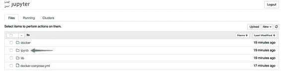

图 10-3. 导航到 `ipynb` 目录

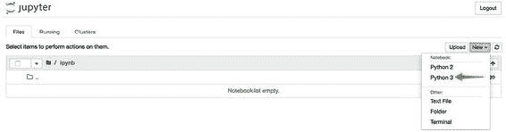

图 10-4. 创建一个新的 Python 3 notebook

Noble 提到需要“一个按时间顺序组织的实验笔记本”。我建议在这个项目框架中，Jupyter Notebook 可以满足这一需求。为了按时间顺序组织你的工作，你只需以年-月-日格式命名你的 notebook 文件，后跟要执行任务的高级描述。因此，将第一个 notebook 命名为 `20170611-Examine_Database_Requirements.ipynb`。

在代码清单 10-12 中，你以项目根设计模式开始 notebook，之后导入 `pandas`（代码清单 10-13）。

```
In [1]: from os import chdir
        chdir('/home/jovyan')
```

代码清单 10-12. 项目根设计模式

```
In [2]: import random
        import pandas as pd
```

代码清单 10-13. 导入必要的库

## 使用Jupyter探索和加载UCI数据集

在图 10-5 中，你利用 Jupyter 的 markdown 注释功能来包含数据集的信息。该数据集是从 UCI 机器学习库获取的成人数据集。你从数据集附带的描述中获取包含的 markdown 内容。

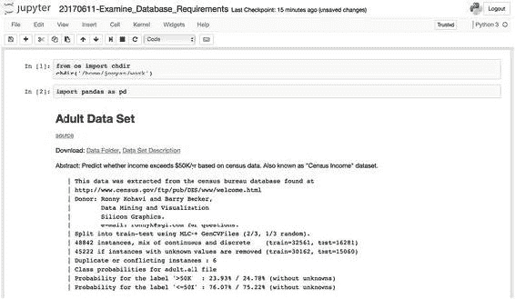

图 10-5. 使用 markdown 包含来自 UCI 机器学习库的数据集信息

## 使用Jupyter Shell管理文件

代码清单 10-14 演示了使用 Jupyter shell 调用 `ls` 命令的项目根设计模式的效果。在代码清单 10-15 中，你再次使用 Jupyter shell 调用 `mkdir` 命令创建一个顶级目录 `data`，然后第三次使用 Jupyter shell 调用 `wget` 工具来获取数据集（代码清单 10-16）。

```
In [3]: ls -l
        total 16
        drwxrwxr-x 2 jovyan 1000 4096 Jun 11 23:53 docker
        -rw-rw-r-- 1 jovyan 1000  145 Jun 11 23:55 docker-compose.yml
        drwxrwxr-x 3 jovyan 1000 4096 Jun 12 03:12 ipynb
        drwxrwxr-x 2 jovyan 1000 4096 Jun 11 23:53 lib
```

代码清单 10-14. 列出当前目录

```
In [4]: !mkdir data
```

代码清单 10-15. 创建数据目录

```
In [5]: !wget -P data/ \
        http://archive.ics.uci.edu/ml/machine-learning-databases/adult/adult.data
        --2017-06-12 03:28:31--  http://archive.ics.uci.edu/ml/machine-learning-
        databases/adult/adult.data
        Resolving archive.ics.uci.edu (archive.ics.uci.edu)... 128.195.10.249
        Connecting to archive.ics.uci.edu (archive.ics.uci.edu)|128.195.10.249|:80... connected.
        HTTP request sent, awaiting response... 200 OK
        Length: 3974305 (3.8M) [text/plain]
        Saving to: 'data/adult.data'
        data/adult.data    100%[===============>]  3.79M  7.93MB/s  in 0.5s
        2017-06-12 03:28:31 (7.93 MB/s) - 'data/adult.data' saved [3974305/3974305]
```

代码清单 10-16. 获取数据集

在代码清单 10-17 中，你使用 `wc` 工具统计文件中的行数。在代码清单 10-18 中，你使用 `head` 工具检查文件是否包含标题行。请注意，显示的两行都是数据行，因此该文件不包含标题行。

```
In [6]: !wc -l data/adult.data
        32562 data/adult.data
```

代码清单 10-17. 统计文件中的行数

```
In [7]: !head -n 2 data/adult.data
        39, State-gov, 77516, Bachelors, 13, Never-married, Adm-clerical, Not-in-family, White,
        Male, 2174, 0, 40, United-States, <=50K
        50, Self-emp-not-inc, 83311, Bachelors, 13, Married-civ-spouse, Exec-managerial,
        Husband, White, Male, 0, 0, 13, United-States, <=50K
```

代码清单 10-18. 检查文件是否包含标题

## 使用Pandas加载数据集

在代码清单 10-19 中，你使用 `pandas.read_csv` 函数加载数据集的 10% 样本。为此，你首先定义两个变量：`number_of_rows` 和 `sample_size`。第一个是数据集中存在的行数，第二个是你希望包含在样本中的行数。接下来，你使用 `random.sample` 函数创建一个列表 `rows_to_skip`。`random.sample` 接受两个参数：一个要从中采样的列表和一个样本大小。在这里，你创建一个从 0 到 `number_of_rows` 的数字范围，并请求一个大小为 `number_of_rows - sample_size` 的样本集。返回的样本列表经过排序，成为你要跳过的行。此列表在运行时传递给 `pandas.read_csv`。其效果是 `pandas.read_csv` 将加载一个大小为 `sample_size` 的数据集。`pandas.read_csv` 的输出是一个 `pandas.DataFrame` 对象。你将此 `pandas.DataFrame` 保存为 `adult_df`。你将为对象属性 `adult_df.columns` 分配一个列名列表（从 UCI 机器学习库的数据集描述中获取）。

```
In [8]: number_of_rows = 32562
        sample_size = 3300
        rows_to_skip = random.sample(range(number_of_rows), number_of_rows - sample_size)
        rows_to_skip.sort()
        adult_df = pd.read_csv('data/adult.data', header=None, skiprows=rows_to_skip)
        adult_df.columns = [
            'age',
            'workclass',
            'fnlwgt',
            'education',
            'education_num',
            'marital_status',
            'occupation',
            'relationship',
            'race',
            'gender',
            'capital_gain',
            'capital_loss',
            'hours_per_week',
            'native_country',
            'income_label'
        ]
```

代码清单 10-19. 使用 `pandas` 加载文件

在图 10-6 中，你使用 `adult_df.sample(3)` 显示加载的 DataFrame 的一个样本。

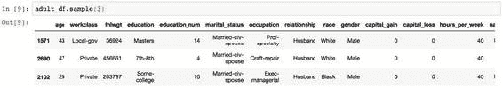

图 10-6. 加载的 DataFrame 的一个样本

## 验证数据类型与元信息

此时，你开始构建一个模式，用于将数据集加载到 PostgreSQL 数据库中。在图 10-7 中，你使用 Jupyter markdown 注释 UCI 提供的不同特征列的数据类型，然后检查 `adult_df.dtypes` 以显示 `pandas.DataFrame` 中每列的数据类型。如果数据在 CSV 文件中格式正确，那么 `pandas` 将为每列分配正确的数据类型。如果 `pandas.DataFrame` 的数据类型与 UCI 提供的元信息中的数据类型匹配，那么你应该能够在加载时依赖数据的完整性，并能够使用建议的数据类型来定义你的模式。请注意，`pandas.DataFrame` 的数据类型确实与元信息中的数据类型匹配，因此你可以将元信息作为模式的基础，而无需特殊的数据处理。

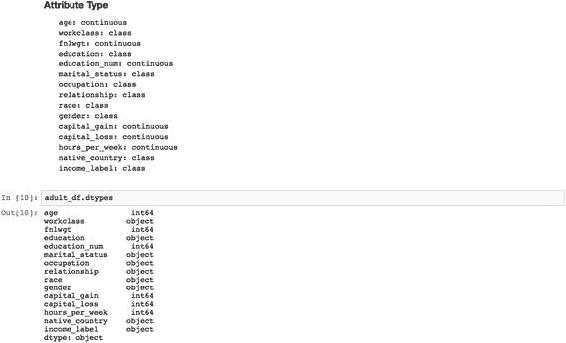

图 10-7. 将 UCI 机器学习库的元信息与 DataFrame 数据类型进行比较

完成初步工作后，你保存文件并通过从“文件”菜单中选择“关闭并停止”来停止 notebook（图 10-8）。你将利用在此发现的内容来构建你的数据库。

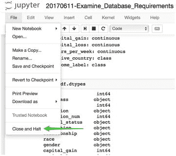

图 10-8. 关闭并停止 notebook

## 通过 Git 管理项目

在进入项目下一阶段之前，你需要使用`git`提交所有最近的更改。在代码清单 10-20 中，你使用`git status`工具检查项目状态（即代码中存在哪些更改）。由于自初始化项目以来你尚未进行任何提交，因此除了刚刚为编写模式所做的准备工作外，还会存在与初始`docker-compose.yml`文件定义相关的更改。

```
$ git status
位于分支 master
初始提交
未跟踪的文件：
  （使用 "git add <文件>..." 以包含要提交的内容）
        data/
        docker-compose.yml
        ipynb/
```

代码清单 10-20. 检查项目状态

你将分别跟踪所完成的每个工作部分。首先，在代码清单 10-21 中，你添加并提交了初始`docker-compose.yml`文件的创建。然后，在代码清单 10-22 中，你对模式准备工作执行相同操作。由于这些工作是所有尚未暂存的内容，你可以使用`-A`标志来表示希望添加“所有”内容。

```
$ git add docker-compose.yml
$ git commit -m '初始 docker-compose.yml 文件'
[master (根提交) 3029c78] 初始 docker-compose.yml 文件
 1 个文件已更改，8 行插入(+)
 创建模式 100644 docker-compose.yml
```

代码清单 10-21. 添加并提交初始`docker-compose.yml`文件

```
$ git add -A
$ git commit -m '模式准备工作'
[master 13de8e1] 模式准备工作
 3 个文件已更改，33336 行插入(+)
 创建模式 100644 data/adult.data
 创建模式 100644 ipynb/.ipynb_checkpoints/20170611-Examine_Database_Requirements-checkpoint.ipynb
 创建模式 100644 ipynb/20170611-Examine_Database_Requirements.ipynb
 创建模式 100644 docker-compose.yml
```

代码清单 10-22. 添加并提交模式准备工作

请注意，最近这次提交还添加了一个`.ipynb_checkpoints`目录。这是不期望的。在代码清单 10-23 中，你创建了一个`.gitignore`（代码清单 10-24）文件，并添加了一些你不想通过`git`跟踪的文件。在代码清单 10-25 中，你重置了`git HEAD`以移除最近一次提交。最后，在代码清单 10-26 中，你再次执行了整个流程。

```
$ vi .gitignore
```

代码清单 10-23. 创建`.gitignore`文件

```
**/.ipynb_checkpoints
**/*.pyc
```

代码清单 10-24. `.gitignore`

```
$ git reset HEAD∼1
$ git status
位于分支 master
未跟踪的文件：
  （使用 "git add <文件>..." 以包含要提交的内容）
        .gitignore
        data/
        ipynb/
无文件要提交，但存在未跟踪的文件（使用 "git add" 以跟踪）
```

代码清单 10-25. 将`git HEAD`重置到倒数第二次提交并显示状态

```
$ git add -A
$ git commit -m '模式准备工作'
[master ad896e2] 模式准备工作
 3 个文件已更改，32951 行插入(+)
 创建模式 100644 .gitignore
 创建模式 100644 data/adult.data
 创建模式 100644 ipynb/20170611-Examine_Database_Requirements.ipynb
```

代码清单 10-26. 添加并提交模式准备工作

`警告`

将数据文件添加到`git`提交时需谨慎。如果将本地`git`仓库与基于云的版本控制系统（如 GitHub）同步，文件必须小于 100MB 才能上传到 GitHub。从`git`提交中移除文件（尤其是当它不是最近一次提交时）可能颇具挑战性，并且即使已从最近一次提交中移除，其存在也会导致同步失败。如果需要云备份，建议使用`bash`工具`split`⁶ 将 CSV 文件拆分为小于 100MB 的较小文件。

## 向应用程序添加数据库

你最初使用基本的 Jupyter 服务启动了应用程序，以便对数据集进行初步分析。完成此操作后，让我们利用所学知识，使用适当的模式将此数据集填充到 PostgreSQL 数据库中。图 10-9 显示了系统下一次迭代的示意图。

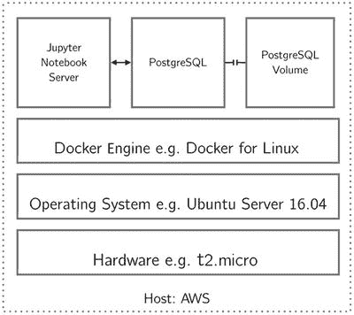

图 10-9. 应用程序的第二次迭代

为此，你需要在`docker-compose.yml`文件中添加几项内容（代码清单 10-27）：

- 使用构建的镜像而非现有镜像来定义 Jupyter Notebook 服务，以便包含你的数据库接口库`psycopg2`。

- 定义一个 PostgreSQL 服务，利用你在第 9 章中看到的构建钩子。

- 创建一个数据卷供 PostgreSQL 服务使用。

```yaml
version: '3'
services:
  this_jupyter:
    build: docker/jupyter
    ports:
      - "8888:8888"
    volumes:
      - .:/home/jovyan
  this_postgres:
    build: docker/postgres
    volumes:
      - postgres_data:/var/lib/postgresql/data
volumes:
  postgres_data:
```

`清单 10-27. docker-compose.yml 的下一个版本`

这里，你使用了之前见过的几种模式，但特别需要注意的是，你必须将新的数据卷挂载到`this_postgres`容器内的正确位置。

接下来，为两个新的构建上下文创建目录（清单 10-28），并创建一个`Dockerfile`（清单 10-30）来定义你的`this_jupyter`服务（清单 10-29）。此时，你只做了一项更改：在 Python 3 环境中添加`psycopg2`。

```
$ mkdir docker/jupyter docker/postgres
```

`清单 10-28. 创建新的构建上下文`

```
$ vim docker/jupyter/Dockerfile
```

`清单 10-29. 创建 docker/jupyter/Dockerfile`

```
FROM jupyter/scipy-notebook
USER root
RUN conda install --yes --name root psycopg2
USER jovyan
```

`清单 10-30. docker/jupyter/Dockerfile`

然后，定义`this_postgres`服务的构建上下文。与第 9 章一样，PostgreSQL 的构建上下文要复杂得多，包含多个文件：一个`Dockerfile`（清单 10-31 和 32）；一个用于获取和清理数据的 bash 脚本`get_data.sh`（清单 10-34）；以及一个用于初始化数据库的 SQL 文件`initdb.sql`（清单 10-36）。

`注意`

从 UCI 机器学习库获取的数据 CSV 文件末尾包含一个空行。PostgreSQL 无法容忍任何异常行为，如果不特殊处理这个空行，它会拒绝`docker/postgres/initdb.sql`文件（清单 10-35）中的数据复制操作。与第 9 章一样，我在`get_data.sh`文件中使用`sed`工具处理了这个问题（清单 10-33）。这里，我使用了模式`/^\s*$/d`。它的作用是匹配仅由空白字符组成的任何行，包括空行（`^\s*$`），并使用`d`命令将其删除。

```
$ vim docker/postgres/Dockerfile
```

`清单 10-31. 创建 docker/postgres/Dockerfile`

## 清单 10-32. `docker/postgres/Dockerfile`

```
FROM postgres:alpine
COPY get_data.sh /docker-entrypoint-initdb.d/get_data.sh
COPY initdb.sql /docker-entrypoint-initdb.d/initdb.sql
```

## 清单 10-33. 创建 `docker/postgres/get_data.sh`

```
$ vim docker/postgres/get_data.sh
```

## 清单 10-34. `docker/postgres/get_data.sh`

```
#!/bin/bash
wget -P /tmp/ http://archive.ics.uci.edu/ml/machine-learning-databases/adult/adult.data
sed '/^\s*$/d' /tmp/adult.data > /tmp/adult-clean.csv
```

## 清单 10-35. 创建 `docker/postgres/initdb.sql`

```
$ vim docker/postgres/initdb.sql
```

## 清单 10-36. `docker/postgres/initdb.sql`

```
CREATE TABLE adult (
    age INTEGER,
    workclass TEXT,
    fnlwgt INTEGER,
    education TEXT,
    education_num INTEGER,
    marital_status TEXT,
    occupation TEXT,
    relationship TEXT,
    race TEXT,
    gender TEXT,
    capital_gain INTEGER,
    capital_loss INTEGER,
    hours_per_week INTEGER,
    native_country TEXT,
    income_label TEXT
);
COPY adult FROM '/tmp/adult.data' DELIMITER ',' CSV;
```

在清单 10-37 中，你使用 `tree` 命令展示你的项目。

## 清单 10-37. 展示项目

```
$ tree .
.
├── data
│   └── adult.data
├── docker
│   ├── jupyter
│   │   └── Dockerfile
│   └── postgres
│       ├── Dockerfile
│       ├── get_data.sh
│       └── initdb.sql
├── docker-compose.yml
├── ipynb
│   └── 20170611-Examine_Database_Requirements.ipynb
└── lib
```

在清单 10-38 中，你启动更新后的应用程序。请注意，你在 `docker-compose up` 命令中添加了 `--build` 标志，以确保新的构建上下文在使用前已被构建。然后，你使用 `docker-compose ps`（清单 10-39）检查正在运行的容器。

## 清单 10-38. 启动应用程序

```
$ docker-compose up -d --build
Creating network "ch10adult_default" with the default driver
Creating volume "ch10adult_postgres_data" with default driver
Building this_jupyter ...
Building this_postgres ...
Successfully built de96ba591ad9
Successfully tagged ch10adult_this_postgres:latest
Creating ch10adult_this_jupyter_1
Creating ch10adult_this_postgres_1
```

配置 PostgreSQL 数据库的种子数据可能很棘手。当通过抽象层（就像你现在所做的那样）进行此操作时，任务的难度可能会增加。你的 `initdb.sql` 文件由 `this_postgres` 容器在运行时执行。这可能会给任何问题的诊断和故障排除带来挑战。我提供以下方法来验证数据库初始化是否成功：

- 通过 `docker-compose ps` 确认数据库正在运行。`initdb.sql` 文件中的语法错误会导致数据库在运行时失败并退出。如果发生这种情况，`docker-compose ps` 将显示 `ch10adult_this_postgres_1` 容器的状态为 `Exit`（清单 10-39）。

- 检查 `this_postgres` 服务的日志（清单 10-40）。如果初始化成功，日志应包含初始化脚本和 SQL 文件的执行记录。请注意，在清单 10-40 中，您可以看到已成功将 32561 条记录复制到数据库中。

- 通过 `docker exec` 调用 `psql` 工具连接到正在运行的容器（清单 10-41）。

## 清单 10-39. 检查正在运行的容器

```
$ docker-compose ps
          Name                       Command               State            Ports
----------------------------------------------------------------------------
ch10adult_this_jupyter_1   tini--start-notebook.sh         Up      0.0.0.0:8888->8888/tcp
ch10adult_this_postgres_1  docker-entrypoint.sh postgres   Up      5432/tcp
```

## 清单 10-40. 检查 `this_postgres` 日志

```
... this_postgres_1  | /usr/local/bin/docker-entrypoint.sh: running /docker-entrypoint-initdb.d/get_data.sh
this_postgres_1  | Connecting to archive.ics.uci.edu (128.195.10.249:80)
this_postgres_1  | adult.data             9% |**                             |   363k  0:00:09 ETA
this_postgres_1  | adult.data           100% |*******************************|  3881k  0:00:00 ETA
this_postgres_1  |
this_postgres_1  |
this_postgres_1  | /usr/local/bin/docker-entrypoint.sh: running /docker-entrypoint-initdb.d/initdb.sql
this_postgres_1  | CREATE TABLE
this_postgres_1  | COPY 32561
...
```

## 清单 10-41. 通过 `psql` 连接到 `this_postgres`

```
$ docker exec -it ch10adult_this_postgres_1 psql postgres postgres
psql (9.6.3)
Type "help" for help.

postgres=# SELECT COUNT(*) FROM adult;
 count
-------
 32561
(1 row)
```

在验证 `this_postgres` 服务已正确配置后，您将这些基础设施更改提交到您的 `git` 日志中（清单 10-42）。在清单 10-43 中，您添加所有文件并提交更改。
```

## 交互式开发

本项目框架的一个主要目标是促进一种称为交互式开发的新型软件开发方式。模块的交互式开发步骤如下：

1.  使用 Jupyter 在笔记本中交互式地编写代码。
2.  当代码块变得过大或需要重复使用时，将这段代码抽象为 Jupyter 中的一个函数。
3.  在 Jupyter 中测试这个新函数的性能。
4.  将此函数移动到您的代码库中的一个模块中。
5.  根据需要导入代码以供使用。

让我们用一个您将经常使用的简单方法来演示此过程：从 Jupyter 到数据库的基本连接。在这种情况下，您将把该函数抽象到您的代码库中，以遵循不重复代码的最佳实践。首先，导航到`ipynb/`并创建一个新文件。您使用当前日期和您将要执行的操作来重命名该文件（例如`20170613-Initial_Database_Connection.ipynb`）。在列表 10-45 中，您以项目根目录设计模式开始笔记本，之后导入`psycopg2`（列表 10-46）。

```
In [1]: from os import chdir
        chdir('/home/jovyan')
```

列表 10-45. 项目根目录设计模式

```
In [2]: import psycopg2 as pg2
```

列表 10-46. 导入必要的库

在列表 10-47 中，您像之前一样连接到数据库，实例化一个连接和该连接上的游标。您利用了 Docker Compose 为您创建的网络，并通过其在网络上的名称`this_postgres`（即您为 PostgreSQL 服务指定的名称）来引用它。在列表 10-48 中，您使用游标向数据库执行查询，打印查询结果，然后关闭连接。

```
In [3]: con = pg2.connect(host='this_postgres', user='postgres', database='postgres')
        cur = con.cursor()
```

列表 10-47. 连接到`postgres`并创建游标

```
In [4]: cur.execute("SELECT COUNT(*) FROM adult;")
        print(cur.fetchall())
        con.close()
        [(32561,)]
```

列表 10-48. 查询数据库并关闭连接

列表 10-47 中的代码是您将经常使用的代码。虽然只有两行代码，但由于您会频繁使用它，因此值得将其抽象成一个函数。在图 10-10 中，您在 Jupyter 单元格中编写此函数，然后使用 Tab 补全来显示该函数的文档字符串。

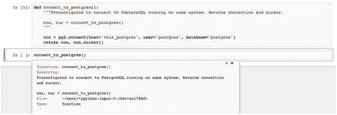

图 10-10. 定义一个函数并显示其文档字符串

接下来，您在列表 10-49 中验证您的`connect_to_postgres`函数是否按预期工作。

```
In [6]: con, cur = connect_to_postgres()
        cur.execute("SELECT COUNT(*) FROM adult;")
        print(cur.fetchall())
        con.close()
        [(32561,)]
```

列表 10-49. 测试`connect_to_postgres`

在验证了您用于访问`this_postgres`的函数正常工作后，您可以将该函数添加到一个外部 Python 模块中以供导入。由于您已完成此笔记本，您应该保存，然后关闭并停止该笔记本。

### 使用 Jupyter 创建 Python 模块

你将利用 Jupyter 服务器创建和编辑文本文件的能力，构建一个`lib.postgres`模块。在图 10-11 中，你通过 Notebook 服务器导航到`lib/`目录，然后在`lib/`目录下创建一个新的文本文件。在图 10-12 中，你将这个文件重命名为`postgres.py`。接下来，你将清单 10-50 中的代码填入这个新文本文件。

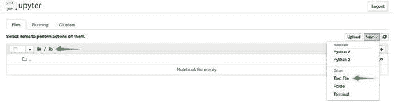

图 10-11. 创建一个新的文本文件

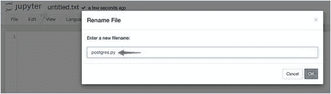

图 10-12. 将新文件重命名为`postgres.py`

```python
"""用于与 PostgreSQL 交互的辅助模块。"""
import psycopg2 as pg2

def connect_to_postgres():
    """预配置用于连接 PostgreSQL。返回连接和游标。
    con, cur = connect_to_postgres()
    """
    con = pg2.connect(host='this_postgres', user='postgres', database='postgres')
    return con, con.cursor()
```

清单 10-50. `lib.postgres`模块

接下来，你创建一个新的 notebook 来测试你编写的函数。为每个任务都创建一个新的 notebook 可能有点刻板。你在这里这样做是为了突出交互式开发方法的理想工作流程。你创建一个名为`20170613-Verify_Database_Connection.ipynb`的新 notebook。在清单 10-51 中，你以项目根目录设计模式开始这个 notebook。在清单 10-52 中，你导入`lib.postgres`并验证`connect_to_postgres`函数是否按预期工作。

```python
In [1]: from os import chdir
        chdir('/home/jovyan')
```

清单 10-51. 项目根目录设计模式

```python
In [2]: import lib.postgres as psql
        con, cur = psql.connect_to_postgres()
        cur.execute("SELECT COUNT(*) FROM bc_data;")
        print(cur.fetchall())
        con.close()
        [(32561,)]
```

清单 10-52. 测试 `psql.connect_to_postgres`

最后，你使用 `git` 跟踪你的工作。在清单 10-53 中，你检查项目的状态。在清单 10-54 中，你添加并提交所有近期的工作。

```
$ git status
On branch master
Untracked files:
  (use "git add <file>..." to include in what will be committed)
        ipynb/20170613-Initial_Database_Connection.ipynb
        ipynb/20170613-Verify_Database_Connection.ipynb
        lib/
```

清单 10-53. 检查项目状态

```
$ git add -A
ubuntu@LOCAL:∼/ch10_adult (master)
$ git commit -m 'initial database connection'
[master d2461f6] initial database connection
 4 files changed, 185 insertions(+)
 create mode 100644 ipynb/20170613-Initial_Database_Connection.ipynb
 create mode 100644 ipynb/20170613-Verify_Database_Connection.ipynb
 create mode 100644 lib/__init__.py
 create mode 100644 lib/postgres.py
```

清单 10-54. 添加所有文件并提交

在清单 10-55 中，你显示项目的当前状态。

```
$ tree .
.
├── data
│   └── adult.data
├── docker
│   ├── jupyter
│   │   └── Dockerfile
│   └── postgres
│       ├── Dockerfile
│       ├── get_data.sh
│       └── initdb.sql
├── docker-compose.yml
├── ipynb
│   ├── 20170611-Examine_Database_Requirements.ipynb
│   ├── 20170613-Initial_Database_Connection.ipynb
│   └── 20170613-Verify_Database_Connection.ipynb
└── lib
    ├── __init__.py
    ├── postgres.py
    └── __pycache__
        ├── __init__.cpython-35.pyc
        └── postgres.cpython-35.pyc
```

清单 10-55. 当前项目状态

## 为应用程序添加延迟处理

现在，你将迭代你的应用程序，使其达到最终状态。你将在现有应用程序中添加一个 `Redis` 服务，以及两个基于 `Jupyter` 镜像变体定义的其他服务。在第 9 章中，我讨论了如何使用 `Redis` 缓存中间结果。在这里，你将探索 `Redis` 的另一个用途，即作为延迟作业处理系统的骨干。除了 `Redis`，延迟作业处理系统还将使用一个 Worker 服务（用于执行延迟作业）和一个 Monitor 服务（用于通过 Web 浏览器监控延迟作业的状态）。图 10-13 显示了最终应用程序的示意图。

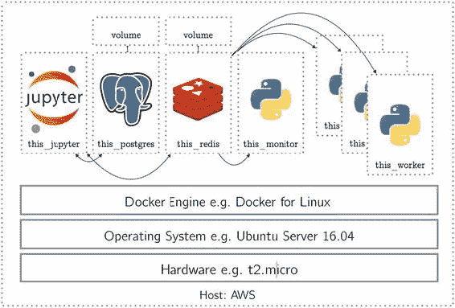

图 10-13. 最终应用程序示意图

为此，你需要在 `docker-compose.yml` 文件中添加一些内容（清单 10-56）：

*   使用 `image:` 关键字定义一个 `Redis` 服务。
*   创建一个供 `Redis` 服务使用的数据卷。
*   使用与 `Jupyter` 服务相同的构建上下文定义一个 Worker 服务。
*   使用与 `Jupyter` 服务相同的构建上下文定义一个 Monitor 服务。

虽然 Worker 服务和 Monitor 服务都将使用 `docker/jupyter` 构建上下文来定义，但你将在运行时使用 `entrypoint:` 关键字扩展这些镜像。此关键字指定了镜像启动时应执行的命令（换句话说，即定义容器行为的核心进程）。Worker 服务将使用 `rqworker` 工具与 `Redis` 交互，以获取并执行排队的作业。你使用 `entrypoint:` 关键字的 exec 形式，并利用 `yaml` 列表来指定实例化进程。入口点包括：

*   `tini`
    *   第 5 章中提到的 PID 1 工具，`Jupyter` 用它来实例化所有容器
*   `--`
    *   使用 `tini` 实例化容器的最佳实践 ⁷
*   `rqworker`
    *   你将用来运行 Worker 服务的进程
*   `-u`
    *   URL 标志
*   `redis://this_redis:6379`
    *   `Redis` 可用的 URL
    *   使用 `Redis` 服务在 `Docker Compose` 创建的网络上的名称

Monitor 服务将使用 `rq-dashboard` 工具，以提供一个基于 Web 的仪表板，用于监控排队作业的状态。你使用 `entrypoint:` 关键字的 exec 形式，并利用 `yaml` 列表来指定实例化进程。入口点包括：

*   `tini`
*   `--`
*   `rq-dashboard`
    *   你将用来运行 Monitor 服务的进程
*   `-H`
    *   主机标志
*   `this_redis`
    *   `Redis` 服务在 `Docker Compose` 创建的网络上的名称
*   `-p`
    *   端口标志
*   `5000`
    *   你的 Monitor 服务可用的端口

与之前一样，你无需显式指定容器之间的链接，让 `Docker Compose` 为你建立链接。你需要确保将 `redis_data` 卷挂载到 `this_redis` 容器内的正确位置。

```
version: '3'
services:
  this_jupyter:
    build: docker/jupyter
    ports:
      - "8888:8888"
    volumes:
      - .:/home/jovyan
  this_postgres:
    build: docker/postgres
    volumes:
      - postgres_data:/var/lib/postgresql/data
  this_redis:
    image: redis
    volumes:
      - redis_data:/data
  this_worker:
    build: docker/jupyter
    volumes:
      - .:/home/jovyan
    entrypoint:
      - "tini"
      - "--"
      - "rqworker"
      - "-u"
      - "redis://this_redis:6379"
  this_monitor:
    build: docker/jupyter
    volumes:
      - .:/home/jovyan
    ports:
      - "5000:5000"
    entrypoint:
      - "tini"
      - "--"
      - "rq-dashboard"
      - "-H"
      - "this_redis"
      - "-p"
      - "5000"
volumes:
  postgres_data:
  redis_data:
```

清单 10-56. 你的 `docker-compose.yml` 的下一版本

接下来（清单 10-57），你将更新 `Jupyter` Dockerfile（清单 10-58），以包含驱动 Worker 和 Monitor 服务所需的库。

```
$ vim docker/jupyter/Dockerfile
```

清单 10-57. 更新 `docker/jupyter/Dockerfile`

## 扩展 Postgres 模块

```
FROM jupyter/scipy-notebook
USER root
RUN conda install --yes --name root psycopg2
RUN conda install --yes --name root redis rq
RUN ["bash", "-c", "source activate root && pip install rq-dashboard"]
USER jovyan
```

清单 10-58. `docker/jupyter/Dockerfile`

在清单 10-59 中，你使用 `tree` 命令展示你的项目。

```
$ tree .
├── data
│   └── adult.data
├── docker
│   ├── jupyter
│   │   └── Dockerfile
│   └── postgres
│       ├── Dockerfile
│       ├── get_data.sh
│       └── initdb.sql
├── docker-compose.yml
├── ipynb
│   ├── 20170611-Examine_Database_Requirements.ipynb
│   ├── 20170613-Initial_Database_Connection.ipynb
│   └── 20170613-Verify_Database_Connection.ipynb
└── lib
    ├── __init__.py
    ├── postgres.py
    └── __pycache__
        ├── __init__.cpython-35.pyc
        └── postgres.cpython-35.pyc
```

清单 10-59. 展示项目

在清单 10-60 中，你启动更新后的应用程序。请注意，你继续在 `docker-compose up` 命令中使用 `--build` 标志，以确保新的构建上下文在使用前已被构建。然后，你使用 `docker-compose ps`（清单 10-61）检查正在运行的容器。

```
$ docker-compose up -d --build
Creating network "ch10adult_default" with the default driver
Creating volume "ch10adult_postgres_data" with default driver
Creating volume "ch10adult_redis_data" with default driver
...
Creating ch10adult_this_worker_1
Creating ch10adult_this_redis_1
Creating ch10adult_this_postgres_1
Creating ch10adult_this_jupyter_1
Creating ch10adult_this_monitor_1
```

清单 10-60. 启动应用程序

```
$ docker-compose ps
          Name              Command                      State              Ports
----------------------------------------------------------------------------
ch10adult_this_jupyter_1   tini--start-notebook.sh       Up    0.0.0.0:8888->8888/tcp
ch10adult_this_monitor_1   tini--rq-dashboard -H th ...  Up    0.0.0.0:5000->5000/tcp...
ch10adult_this_postgres_1  docker-entrypoint.sh postgres Up    5432/tcp
ch10adult_this_redis_1     docker-entrypoint.sh redis ... Up    6379/tcp
ch10adult_this_worker_1    tini--rqworker -u redis: ...  Up    8888/tcp
```

清单 10-61. 检查正在运行的容器

配置延迟任务系统也可能是一个挑战，就像配置 PostgreSQL 数据库一样。可以使用非常相似的方法进行故障排除。

- 通过 `docker-compose ps` 确认服务正在运行。
- 检查服务的日志（清单 10-62 和 10-63）。
- 通过 `docker exec` 调用 `bash` 工具连接到正在运行的容器。

```
$ docker-compose logs this_monitor
Attaching to ch10adult_this_monitor_1
this_monitor_1   | RQ Dashboard version 0.3.8
this_monitor_1   |  * Running on http://0.0.0.0:5000/ (Press CTRL+C to quit)
```

清单 10-62. 检查 `this_monitor` 日志

```
$ docker-compose logs this_worker
Attaching to ch10adult_this_worker_1
this_worker_1    | 20:28:59 RQ worker 'rq:worker:6a695d66b402.5' started, version 0.6.0
this_worker_1    | 20:28:59 Cleaning registries for queue: default
this_worker_1    | 20:28:59
this_worker_1    | 20:28:59 *** Listening on default......
```

清单 10-63. 检查 `this_worker` 日志

在确认新服务已正确配置后，你将此基础设施变更提交到你的 git 日志中（清单 10-64）。在清单 10-65 中，你添加所有文件并提交变更。

```
$ git status
On branch master
Changes not staged for commit:
  (use "git add <file>..." to update what will be committed)
  (use "git checkout -- <file>..." to discard changes in working directory)
        modified:   docker-compose.yml
        modified:   docker/jupyter/Dockerfile
no changes added to commit (use "git add" and/or "git commit -a")
```

清单 10-64. 检查项目状态

```
$ git add -A
ubuntu@LOCAL:∼/ch10_adult (master)
$ git commit -m 'add delayed job system'
[master 9564efd] add delayed job system
 2 files changed, 31 insertions(+), 1 deletion(-)
```

清单 10-65. 添加并提交变更

由于你已经停止并重新启动了 Jupyter Notebook 服务器，你需要获取一个新的身份验证令牌，以便再次在浏览器中访问该服务器（清单 10-66）。

```
$ docker exec ch10adult_this_jupyter_1 jupyter notebook list
Currently running servers:
http://localhost:8888/?token=46e478574fe9cf238c6e2e6bc9b9daccb7efa7154dfd9d08 :: /home/jovyan
```

清单 10-66. 获取身份验证令牌

## 扩展 Postgres 模块

让我们再次演示本章描述的交互式开发范式，这次你将扩展之前创建的 `postgres` 模块。这次，你将首先开发一个用于编码目标的函数。这个函数将由一个或多个工作进程逐行执行。你将：

- 使用 Jupyter 在笔记本中交互式地编写代码。
- 在 Jupyter 中将此代码抽象为一个函数。
- 在 Jupyter 中测试这个新函数的性能。
- 将此函数移动到你的代码库模块中。
- 通过任务队列将该函数传递给工作进程。

首先，导航到`ipynb/`目录并创建一个新文件。用当前日期和即将执行的任务重命名该文件（例如`20170619-Develop_encoding_target_function.ipynb`）。在代码清单 10-67中，你以项目根目录设计模式开始编写笔记本，随后导入`connect_to_`（代码清单 10-68）。

```
In [1]: from os import chdir
        chdir('/home/jovyan')
```

代码清单 10-67. 项目根目录设计模式

```
In [2]: from lib.postgres import connect_to_postgres
```

代码清单 10-68. 导入数据库连接

在图 10-14中，你使用一个 Markdown 单元格来包含数据集的属性类型元信息，就像之前在`20170611-Examine_Database_Requirements.ipynb`中所做的那样。

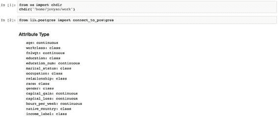

图 10-14. 显示属性类型元信息

在代码清单 10-69中，你在数据库中创建新列。与第 8 章一样，你通过`BEGIN`和`COMMIT`语句手动管理事务。请注意，每次事务后都要关闭连接。

```
In [3]: con, cur = connect_to_postgres()
        cur.execute("""
        BEGIN;
        ALTER TABLE adult ADD COLUMN _id SERIAL PRIMARY KEY;
        ALTER TABLE adult ADD COLUMN target BOOLEAN;
        COMMIT;
        """)
        con.close()
```

代码清单 10-69. 创建新列

最佳实践是监控数据库的更改。在代码清单 10-70中，你通过`docker exec`使用`psql`来检查`adult`表。

```
$ docker exec -it ch10adult_this_postgres_1 psql postgres postgres
psql (9.6.3)
Type "help" for help.

postgres=# \d adult
                              Table "public.adult"
     Column     |  Type   |                      Modifiers
----------------+---------+-----------------------------------------------------
 age            | integer |
 workclass      | text    |
 fnlwgt         | integer |
 education      | text    |
 education_num  | integer |
 marital_status | text    |
 occupation     | text    |
 relationship   | text    |
 race           | text    |
 gender         | text    |
 capital_gain   | integer |
 capital_loss   | integer |
 hours_per_week | integer |
 native_country | text    |
 income_label   | text    |
 _id            | integer | not null default nextval('adult__id_seq'::regclass)
 target         | boolean |
Indexes:
    "adult_pkey" PRIMARY KEY, btree (_id)
```

代码清单 10-70. 通过`docker exec`调用`psql`检查`adult`表

在代码清单 10-71中，你检索目标列`income_label`的唯一值。

```
In [4]: con, cur = connect_to_postgres()
        cur.execute("""SELECT DISTINCT(income_label) FROM adult;""")
        print(cur.fetchall())
        con.close()
        [(' >50K',), (' <=50K',)]
```

代码清单 10-71. 检索名为`income_label`的目标列的唯一值

虽然`income_label`本质上是分类变量，但它只有两个值，因此可以编码为布尔值。在代码清单 10-72中，你编写了一个简短的 Jupyter 脚本来实现这一点。首先，你查询数据库，检索`target`列为`NULL`的单行数据的`_id`和`income_label`。然后创建一个布尔值变量`greater_than_50k`。最后，更新给定`_id`的表并关闭数据库连接。

```
In [5]: con, cur = connect_to_postgres()
        cur.execute("""SELECT _id, income_label FROM adult WHERE target IS NULL;""")
        this_id, income_label = cur.fetchone()
        greater_than_50k = (income_label == ' >50K')
        cur.execute("""
        BEGIN;
        UPDATE adult
        SET target = {}
        WHERE _id = {};
        COMMIT;
        """.format(greater_than_50k, this_id))
        con.close()
```

代码清单 10-72. 将单个实例的目标编码为布尔值

在代码清单 10-73中，你验证更新是否成功。

```
In [6]: con, cur = connect_to_postgres()
        cur.execute("""
        SELECT _id, income_label, target
        FROM adult WHERE _id = {};
        """.format(this_id))
        print(this_id, cur.fetchone())
        con.close()
        10 (10, ' >50K', True)
```

代码清单 10-73. 验证更新

验证脚本运行正常后，你开始将脚本抽象成一个函数（代码清单 10-74）。

```
In [7]: def encode_target(_id):
            """Encode the target for a single row as a boolean value. Takes a row _id."""
            con, cur = connect_to_postgres()
            cur.execute("""SELECT _id, income_label FROM adult where _id = {}""".format(_id))
            this_id, income_label = cur.fetchone()
            assert this_id == _id
            greater_than_50k = (income_label == ' >50K')
            cur.execute("""
                BEGIN;
                UPDATE adult
                SET target = {}
                WHERE _id = {};
                COMMIT;
            """.format(greater_than_50k, _id))
            con.close()
```

代码清单 10-74. `encode_target`函数

在代码清单 10-75和10-76中，你测试新函数并验证其成功运行。

### 更新你的 Python 模块

在 Figure 10-15 中，你使用笔记本服务器导航到`lib/`目录，然后在`lib/`目录中选择`postgres.py`，以便通过 Jupyter Notebook 服务器的文本界面更新该模块。接下来，你将 Listing 10-74 中的代码添加到文件中，如图 Figure 10-16 所示。请注意，当所有当前更改都已保存时，文本文件名旁边会出现一个复选标记，如图 Figure 10-17 所示。

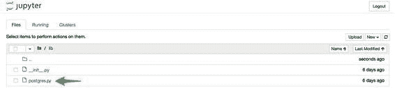
Figure 10-15. 打开`postgres.py`进行编辑

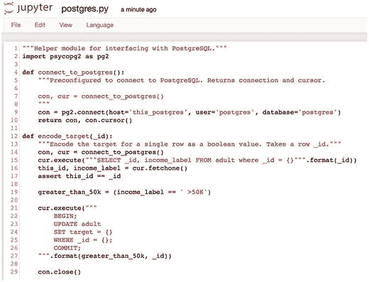
Figure 10-16. `postgres.py`的最新版本


Figure 10-17. `postgres.py`的所有更改已保存

接下来，你将创建一个新的笔记本，通过延迟作业系统使用`encode_target`函数对`adult`表中的所有行进行编码。你创建了一个名为`20170619-Encode_target.ipynb`的新笔记本。在 Listing 10-77 中，你以项目根目录设计模式开始笔记本。在 Listing 10-78 中，你从`lib.postgres`导入所需的函数。

```
In [1]: from os import chdir
        chdir('/home/jovyan')
```

Listing 10-77. 项目根目录设计模式

```
In [2]: from lib.postgres import connect_to_postgres, encode_target
```

Listing 10-78. 从`lib.postgres`导入函数

在 Listing 10-79 中，你看到一个新的设计模式：从`rq`库实例化一个`Queue`。`Queue`通过连接到特定的 Redis 服务器进行实例化。和之前一样，你使用 Docker Compose 在网络上创建的 Redis 服务的名称`this_redis`。

```
In [3]: from redis import Redis
        from rq import Queue
        REDIS = Redis(host='this_redis')
        Q = Queue(connection=REDIS)
```

Listing 10-79. 创建到 Redis 的连接和新队列

在 Listing 10-80 中，你将所有部分整合在一起。你创建一个到 PostgreSQL 的新连接。你使用`for`循环从`adult`表中提取 100 行中`target`尚未编码的行的`_id`。对于每一行，你使用`.enqueue()`函数将`encode_target`函数及其关联的`_id`添加到作业队列中。请注意，要传递的参数（即运行时传递给`encode_target`的`_id`）作为第二个参数传递给`.enqueue()`。

```
In [4]: con, cur = connect_to_postgres()
        for _ in range(100):
            cur.execute("""SELECT _id FROM adult WHERE target IS NULL;""")
            this_id, = cur.fetchone()
            Q.enqueue(encode_target, this_id)
        con.close()
```

Listing 10-80. 向队列添加 100 个目标编码请求

在至少执行一次此单元格期间（除非进行修改，否则你需要运行此特定单元格超过 300 次才能对整个表进行编码），我建议使用基于浏览器的监视器，以及“跟踪”Docker Compose 日志，以观察 Worker 处理这些函数。基于浏览器的监视器将在与 Jupyter Notebook 服务器相同的 IP 地址上可用，但端口为 5000（Figure 10-18）。Listing 10-81 展示了使用`--follow`标志“跟踪”Docker Compose 日志的方法。每个作业进程在执行时都会通过此日志。

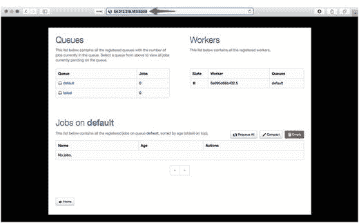
Figure 10-18. 基于浏览器的队列和 Worker 监视器

```
$ docker-compose logs --follow this_worker
...
this_worker_1    | 01:43:04 *** Listening on default...
this_worker_1    | 01:43:04 default: lib.postgres.encode_target(24) (914a8229-a876-438f-98d4-d6cd39a469b2)
this_worker_1    | 01:43:04 default: Job OK (914a8229-a876-438f-98d4-d6cd39a469b2)
this_worker_1    | 01:43:04 Result is kept for 500 seconds
this_worker_1    | 01:43:04
this_worker_1    | 01:43:04 *** Listening on default...
this_worker_1    | 01:43:04 default: lib.postgres.encode_target(24) (215ed343-0ca5-4f75-86e6-d8237e4a5983)
this_worker_1    | 01:43:04 default: Job OK (215ed343-0ca5-4f75-86e6-d8237e4a5983)
this_worker_1    | 01:43:04 Result is kept for 500 seconds
this_worker_1    | 01:43:04
this_worker_1    | 01:43:04 *** Listening on default...
this_worker_1    | 01:43:04 default: lib.postgres.encode_target(24) (1dfe0282-cf90-49de-a904-8a2ced103c50)
this_worker_1    | 01:43:04 default: Job OK (1dfe0282-cf90-49de-a904-8a2ced103c50)
this_worker_1    | 01:43:04 Result is kept for 500 seconds
...
```

Listing 10-81. 跟踪 Docker Compose 日志

最后，你使用`git`跟踪你的工作。在 Listing 10-82 中，你检查项目的状态。在 Listing 10-83 中，你添加并提交所有最近的工作。

```
$ git status
On branch master
Changes not staged for commit:
  (use "git add <file>..." to update what will be committed)
  (use "git checkout -- <file>..." to discard changes in working directory)
        modified:   lib/postgres.py
Untracked files:
  (use "git add <file>..." to include in what will be committed)
        ipynb/20170619-Develop_encoding_target_function.ipynb
        ipynb/20170619-Encode_target.ipynb
no changes added to commit (use "git add" and/or "git commit -a")      lib/
```

Listing 10-82. 检查项目状态

```
$ git add -A
$ git commit -m 'function and queueing for target encoding'
[master 93f3033] function and queueing for target encoding
 3 files changed, 319 insertions(+)
 create mode 100644 ipynb/20170619-Develop_encoding_target_function.ipynb
 create mode 100644 ipynb/20170619-Encode_target.ipynb
```

Listing 10-83. 添加所有文件并提交

在 Listing 10-84 中，你显示项目的当前状态。

```
$ tree .
.
├── data
│   └── adult.data
├── docker
│   ├── jupyter
│   │   └── Dockerfile
│   └── postgres
│       ├── Dockerfile
│       ├── get_data.sh
│       └── initdb.sql
├── docker-compose.yml
├── ipynb
│   ├── 20170611-Examine_Database_Requirements.ipynb
│   ├── 20170613-Initial_Database_Connection.ipynb
│   ├── 20170613-Verify_Database_Connection.ipynb
│   ├── 20170619-Develop_encoding_target_function.ipynb
│   └── 20170619-Encode_target.ipynb
└── lib
    ├── __init__.py
    ├── postgres.py
    └── __pycache__
        ├── __init__.cpython-35.pyc
        └── postgres.cpython-35.pyc
```

Listing 10-84. 当前项目状态


