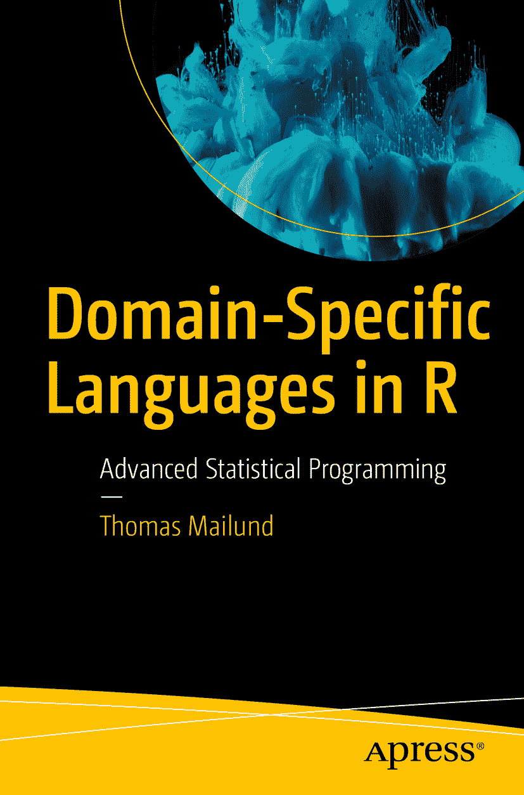

托马斯·梅隆德（Thomas Mailund）
R 语言领域特定语言
高级统计编程

作者在本书中引用的任何源代码或其他补充材料，读者均可通过书籍产品页面在 GitHub 上获取，网址为[www.apress.com/9781484235874](http://www.apress.com/9781484235874)。如需更详细信息，请访问[www.apress.com/source-code](http://www.apress.com/source-code)。  
ISBN 978-1-4842-3587-4  
电子版 ISBN 978-1-4842-3588-1  
[`doi.org/10.1007/978-1-4842-3588-1`](https://doi.org/10.1007/978-1-4842-3588-1)  
美国国会图书馆控制号：2018947391  
© 托马斯·梅隆德 2018  
本作品受版权保护。出版商保留所有权利，涉及全部或部分材料，特别是翻译、重印、插图复用、朗诵、广播、微缩胶片复制或任何其他物理形式，以及电子改编、计算机软件等的信息传输或存储检索，或目前已知或未来开发的类似或不同方法。  
本书中可能出现商标名称、标识和图像。我们仅在编辑风格中使用这些名称、标识和图像，以维护商标所有者的利益，无意侵犯商标权。本书中使用商品名称、商标、服务标志及类似术语，即使未被明确标识，也不应视为对其是否受专有权利保护的立场表达。  
尽管本书中的建议和信息在出版时被认为是真实准确的，但作者、编辑和出版商均不对可能存在的任何错误或遗漏承担法律责任。出版商对本书包含的材料不作任何明示或暗示的保证。  
本书在全球图书贸易中由 Springer Science+Business Media New York 发行，地址：233 Spring Street, 6th Floor, New York, NY 10013。电话：1-800-SPRINGER，传真：(201) 348-4505，电子邮件：orders-ny@springer-sbm.com，或访问 www.springeronline.com。Apress Media, LLC 是加利福尼亚州的有限责任公司，其唯一成员（所有人）为 Springer Science + Business Media Finance Inc (SSBM Finance Inc)。SSBM Finance Inc 是特拉华州的公司。

目录
第 1 章：引言 1  
本书读者对象 1  
领域特定语言 2  
第 2 章：矩阵表达式 9  
解析表达式 10  
元编程解析 14  
表达式操作 18  
优化乘法 20  
表达式重写 23  
表达式求值 27  
第 3 章：编程语言的组成部分 31  
文本、词法单元、语法与语义 32  
定义语法 36  
设计语义 46  
第 4 章：函数、类与运算符 55  
S3 面向对象编程系统 56  
对象与类 56  
泛型函数 58  
运算符重载 63  
组泛型 68  
优先级和求值顺序 70  
代码块 73  
第 5 章：解析与操作表达式 77  
引用与求值 78  
探索表达式 84  
操作表达式 94  
第 6 章：Lambda 表达式 101  
匿名函数 101  
语法替代方案的实验 104  
请勿在家尝试 107  
第 7 章：环境与表达式 109  
作用域与环境 109  
默认参数、惰性求值与 Promise 114  
引号与非标准求值 124  
第 8 章：整洁求值 135  
Quosure 136  
准引用 147  
第 9 章：列表推导式 159  
第 10 章：连续时间马尔可夫链 167  
构建马尔可夫链 170  
构建速率矩阵 174  
轨迹 177  
计算似然值 180  
第 11 章：模式匹配 183  
构造函数 185  
模式匹配 196  
列表 203  
搜索树 207  
第 12 章：动态规划 215  
解析表达式 221  
求值表达式 229  
修复求值环境 242  
第 13 章：结论 247  
参考文献 249  
索引 251  
关于作者与技术审校者  
关于作者  
关于技术审校者

