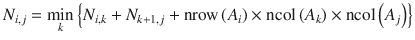

# 2. 矩阵表达式

下一章我们将以更理论化的方式讨论计算机语言，但这里我们会考虑一个具体案例——第 1 章中提到的矩阵表达式。这个示例是一个相对简单的领域特定语言，但解析矩阵表达式、优化它们然后进行求值，都是我们通常在实现任何 DSL 时都必须经历的阶段，该实现也将包含我们后面会更详细讲解的大多数技术的示例。本示例会使用一些我将在本书后面部分才解释的技巧，因此某些方面在此刻可能不明显，但整体思路应该是清晰的，并且理想情况下能作为后续章节内容的预览。

我们编写矩阵表达式语言的目标，是为了改进内置矩阵表达式的默认性能。我们通过采取比 R 更全局化的视角来实现这一点——R 会从左到右逐个处理每个操作符，而我们将分析表达式并重新排列它们以提升性能。为此，我们必须执行以下步骤：

1.  将表达式解析为我们可以处理的数据。
2.  将表达式重新排列成效率更高的形式。
3.  提供对表达式求值的方法。

在本章中，我们使用以下库：

```r
library(microbenchmark)
```

## 解析表达式

为简单起见，我们只考虑矩阵乘法和矩阵加法。我们不包含标量乘法、矩阵求逆或转置等任何其他功能。在示例中为表达式语言增加更多组件，将遵循我们为乘法和加法所需的相同理念。在 R 中嵌入 DSL 方面，这不会教给我们任何新东西。当你理解了这个例子，就能轻松自己完成类似扩展。

基于这些限制，我们可以说一个矩阵表达式要么就是一个矩阵，要么是两个矩阵表达式的乘积，要么是两个矩阵表达式的和。我们可以将其表示为一个类层次结构：一个（抽象）超类代表表达式，三个（具体）子类分别代表实际数据、乘积和求和。如果你不熟悉 R 中的面向对象编程，我们将在第 4 章为你提供一份简短的必知指南。用于创建这三个具体类对象的构造器可以如下所示：

```r
m <- function(data) {
  structure(list(data = data),
    nrow = nrow(data),
    ncol = ncol(data),
    def_expr = deparse(substitute(data)),
    class = c("matrix_data", "matrix_expr"))
}
matrix_mult <- function(A, B) {
  structure(list(left = A, right = B),
    nrow = nrow(A),
    ncol = ncol(B),
    class = c("matrix_mult", "matrix_expr"))
}
matrix_sum <- function(A, B) {
  structure(list(left = A, right = B),
    nrow = nrow(A),
    ncol = ncol(B),
    class = c("matrix_sum", "matrix_expr"))
}
```

我们只需将构造器的参数包装在一个列表中，并设置相应的类属性，同时存储行数和列数，因为我们在优化矩阵乘法时会需要它们，正如我们在第 1 章中看到的那样。

我们在 `m` 函数中设置的 `def_expr` 属性唯一目的是美化打印。它使得我们在后续页面中操作的表达式输出更易于理解。严格来说，操作表达式并不需要任何美化打印，但它确实能使调试更容易，所以我倾向于总是为此编写一些代码。对于矩阵表达式，我们可以使用以下代码：

```r
toString.matrix_data <- function(x, ...) {
  paste0("[", attr(x, "def_expr"), "]")
}
toString.matrix_mult <- function(x, ...) {
  paste0("(", toString(x$left), " * ", toString(x$right), ")")
}
toString.matrix_sum <- function(x, ...) {
  paste0("(", toString(x$left), " + ", toString(x$right), ")")
}
print.matrix_expr <- function(x, ...) {
  cat(toString(x), "\n")
}
```

使用构造器和美化打印代码，我们可以尝试构建一个小型表达式。

```r
A <- matrix(1, nrow = 10, ncol = 20)
B <- matrix(1, nrow = 20, ncol = 10)
C <- matrix(1, nrow = 10, ncol = 10)
matrix_sum(matrix_mult(m(A), m(B)), m(C))
## (([A] * [B]) + [C])
```

到目前为止我们所做的事情，还谈不上是提供了一种语言。我们只是实现了一些构造器函数。然而，如果我们重载矩阵表达式的乘法和加法操作符，我们就能得到至少开始像一种语言的东西。

```r
`*.matrix_expr` <- function(A, B) {
  stopifnot(ncol(A) == nrow(B))
  matrix_mult(A, B)
}
`+.matrix_expr` <- function(A, B) {
  stopifnot(dim(A) == dim(B))
  matrix_sum(A, B)
}
```

有了这些，我们就可以用更熟悉的方式编写相同的表达式了。

```r
m(A) * m(B) + m(C)
## (([A] * [B]) + [C])
```

我在操作符的代码中加入了一些断言——即对 `stopifnot()` 的调用——以确保操作符涉及的矩阵维度是有效的。我们也可以将这些断言放在构造器函数中，但稍后我们将要操作一些已知维度有效的表达式，因此在那里就不需要检查了。我们不期望用户直接调用构造器，而是使用操作符，所以这里是将检查放入的自然位置。


我们在加法运算符中使用`dim`函数进行完整性检查，因此需要一个能作用于矩阵表达式的版本。它可能长这样：

```
dim.matrix_expr <- function(x) {
c(attr(x, "nrow"), attr(x, "ncol"))
}
```

你可能好奇为什么需要`m`函数。毕竟，除了包装矩阵之外，它对表达式没有任何贡献。我们能不能直接使用矩阵？答案是否定的，这与我们如何使用运算符重载有关。为了让`*`和`+`成为矩阵表达式版本，我们需要赋予它们的第一个参数是一个矩阵表达式。如果我们直接这样写：

```
A * B + C
## Error in A * B: non-conformable arrays
```

我们实际上是在调用 R 矩阵类的运算符。而且由于`*`不是矩阵乘法（你需要使用`%*%`，因为`*`运算符是逐元素乘法），你会得到一个错误。

我们需要一种方法，将 R 的矩阵引导到我们表达式语言中的矩阵。这就是我们使用`m`的目的。

## 元编程解析

使用像`m`这样的显式函数来引导我们进入矩阵表达式语言，是利用 R 自身解析器为我们服务的最简单方法，但这并非唯一方法。在 R 中，我们可以像操作数据一样操作表达式，这一特性称为元编程，我们会在第 5 章中再次讨论。目前，只需知道表达式可以递归地探索即可。我们可以使用谓词`is.name`来检查表达式是否引用了一个变量，使用谓词`is.call`来检查它是否是一个函数调用——所有运算符都是函数调用。因此，给定一个不使用`m`函数、从而未进入我们 DSL 的表达式，我们可以将其转换为如下形式：

```
build_matrix_expr <- function(expr) {
if (is.name(expr)) {
return(substitute(m(name), list(name = expr)))
}
if (is.call(expr)) {
if (expr[[1]] == as.name("("))
return(build_matrix_expr(expr[[2]]))
if (expr[[1]] == as.name("*") ||
expr[[1]] == as.name("%*%")) {
return(call('*',
build_matrix_expr(expr[[2]]),
build_matrix_expr(expr[[3]])))
}
if (expr[[1]] == as.name("+")) {
return(call('+',
build_matrix_expr(expr[[2]]),
build_matrix_expr(expr[[3]])))
}
}
stop(paste("Parse error for", expr))
}
```

在这个实现中，我们同时考虑了`*`和`%*%`矩阵乘法，这样我们就能将使用了矩阵乘法的 R 表达式视为此类。另请注意，我们考虑了括号调用。在 R 中，括号也是函数调用，如果我们希望语言允许使用括号，就必须处理它们——就像这里，我们只是继续递归。当我们使用`m`和运算符重载显式编写表达式时，我们不必担心这一点，因为 R 已经负责赋予括号正确的语义。

为了使这个函数生效，它需要一个所谓的“引号表达式”。如果我们在 R 中直接写一个原始表达式，那么在我们操作它之前，R 就会尝试求值。我们甚至没来得及重写表达式，就会得到一个错误。

```
build_matrix_expr(A * B)
## Error in A * B: non-conformable arrays
```

为了避免这种情况，我们需要引用该表达式。

```
build_matrix_expr(quote(A * B))
## m(A) * m(B)
```

我们可以通过将函数包装在另一个为我们做这件事的函数中，来避免每次调用该函数时都显式地引用表达式。如果我们在函数参数上调用`substitute`函数，我们会得到它包含的表达式，这样我们就可以编写如下函数：

```
parse_matrix_expr <- function(expr) {
expr <- substitute(expr)
build_matrix_expr(expr)
}
```

现在，我们不再需要引用表达式来进行重写。

```
parse_matrix_expr(A * B)
## m(A) * m(B)
```

这并非一个完美的解决方案，并且存在一些陷阱，其中之一是你无法直接从其他函数中使用这个函数。`substitute`函数可能难以使用。更进一步的问题是，我们正在创建一个新的表达式，但它是 R 表达式，而不是我们希望在矩阵表达式语言中得到的数据结构。你可以将 R 表达式视为一段文字形式的代码；它尚未被求值以成为我们想要的结果。为此，我们需要`eval`函数，并且我们需要在正确的上下文中对表达式求值。处理表达式，尤其是在不同环境中对表达式求值，是 R 编程中较为高级的方面之一，所以如果现在看起来复杂，请不要气馁。我们将在第 7 章中详细讨论。目前，我们只需使用这个函数：

```
parse_matrix_expr <- function(expr) {
expr <- substitute(expr)
modified_expr <- build_matrix_expr(expr)
eval(modified_expr, parent.frame())
}
```

它获取（被引用的）表达式，构建相应的矩阵表达式，然后在“父框架”（即我们调用函数的那个环境）中对该表达式求值。使用此函数，我们可以从一个原本普通的 R 表达式中获取我们矩阵语言中的数据结果。

```
parse_matrix_expr(A * B)
## ([A] * [B])
```

我们在这里采用的方法涉及将一个 R 表达式翻译成另一个，以使用我们的`m`函数将我们从 R 转移到矩阵表达式。这涉及对表达式进行两次解析：一次在我们转换它时，另一次在我们要求 R 对结果求值时。这种方法也比直接使用`m`函数表现力弱。我们可以用任何生成矩阵的表达式调用`m`，但在表达式转换中，我们只允许使用标识符。

作为替代方案，我们可以直接使用构造函数构建矩阵表达式。当遇到`*`、`%*%`或`+`调用时，我们将使用`matrix_mult`和`matrix_sum`；否则，我们将调用`m`。这样，任何我们无法识别为乘法或加法的表达式都将被解释为我们应将其视为矩阵的值。然而，这种方法增加了一个复杂性。当我们调用函数`m`时，需要用值来调用它，但我们在遍历表达式时拥有的是被引用的表达式。我们需要对这些表达式求值，并且需要在正确的环境中求值。我们需要在遍历过程中传递一个环境，才能使这项工作正常进行。

```
build_matrix_expr <- function(expr, env) {
if (is.call(expr)) {
if (expr[[1]] == as.name("("))
return(build_matrix_expr(expr[[2]], env))
if (expr[[1]] == as.name("*") || expr[[1]] == as.name("%*%"))
return(matrix_mult(build_matrix_expr(expr[[2]], env),
build_matrix_expr(expr[[3]], env)))
if (expr[[1]] == as.name("+"))
return(matrix_sum(build_matrix_expr(expr[[2]], env),
build_matrix_expr(expr[[3]], env)))
}
data_matrix <- m(eval(expr, env))
attr(data_matrix, "def_expr") <- deparse(expr)
data_matrix
}
```

这个函数的大部分内容应该是不言自明的，除了我们显式设置数据矩阵的`def_expr`属性的那一部分。该属性用于漂亮的打印输出，当我们调用`m`函数时，它会被设置为我们调用`m`时使用的文字表达式。对于我们用此函数创建的所有矩阵，这个值将是`eval(expr, env)`。为了避免这种情况，我们显式地将其设置为求值时使用的表达式。

同样，我们可以将该函数包装在另一个函数中，以获取引用的表达式并提供我们应该在其中对表达式求值的环境。

```
parse_matrix_expr <- function(expr) {
expr <- substitute(expr)
build_matrix_expr(expr, parent.frame())
}
parse_matrix_expr(A * B + matrix(1, nrow = 10, ncol = 10))
## (([A] * [B]) + [matrix(1, nrow = 10, ncol = 10)])
```

关于操作表达式，特别是关于它们如何被求值，还有更多需要了解的内容，但我们将在后续章节中再回到这个话题。


## 表达式操作

我们编写这个矩阵 DSL 的目标是优化这些矩阵表达式的求值过程。虽然可以考虑多种优化方案，但 R 语言自带的矩阵实现已经相当高效。如果试图用自建代码替代其计算功能——至少在 R 层面实现替代方案时——很难超越其性能。因此，重点应放在表达式的算术重写上。

我们可以递归地重写表达式，并使用一个针对三个具体类进行特化的泛型函数。一个（尚未实现任何功能的）模板如下所示：

```
rearrange_matrix_expr <- function(expr) {
UseMethod("rearrange_matrix_expr")
}
rearrange_matrix_expr.matrix_data <- function(expr) {
expr
}
rearrange_matrix_expr.matrix_mult <- function(expr) {
matrix_mult(rearrange_matrix_expr(expr$left),
rearrange_matrix_expr(expr$right))
}
rearrange_matrix_expr.matrix_sum <- function(expr) {
matrix_sum(rearrange_matrix_expr(expr$left),
rearrange_matrix_expr(expr$right))
}
```

这些函数会遍历矩阵表达式并返回相同的表达式结构。不过，我们可以根据表达式的模式修改这些函数，从而开始进行重排。

我们可以根据以下两条规则合理估算求值一个表达式所需的运算次数：1）将一个 `n × k` 矩阵与一个 `k × m` 矩阵相乘需要 `n × k × m` 次运算；2）将两个 `n × m` 矩阵相加需要 `n × m` 次运算。如果能够通过重写表达式减少所需运算次数，就相当于改进了表达式。

存在一些显而易见的模式可以尝试匹配并重写。例如，`(A + B)C` 总是优于 `AC + BC`。不过，我们或许可以预期，编写表达式的程序员已经知道这一点，因此这类明显的重写可能收益甚微。真正可能带来性能提升的场景是表达式由多个矩阵相乘构成时。此时，乘法顺序会影响所需运算次数，而最优顺序取决于矩阵的维度；我们无法仅通过算术表达式直接看出最佳括号位置以获得最优性能。

## 优化乘法运算

在开始重写乘法表达式之前，我们应先找出如何确定最优乘法顺序。假设我们有以下矩阵乘法：`A[1] × A[2] × … × A[n]`。我们需要在某处设置括号，例如 `(A[1] × A[2] × …A[i]) × (A[i+1]…× A[n])`，以确定最后一次乘法。如果首先以某种顺序分别计算前 `i` 个矩阵和后 `n – i` 个矩阵的乘积，那么最后一次乘法就是这两个结果的乘积。假设 `(A[1] × …A[i])` 的维度为 `n × k`，`(A[i+1]…× A[n])` 的维度为 `k × m`，则该方法需要 `n × k × m` 次运算，再加上生成这两个矩阵所需的时间。假设前 `i` 个矩阵的最优乘法需要 `N[1,i]` 次运算，后 `n – i` 个矩阵的最优乘法需要 `N[i+1,n]` 次运算，那么在此处设置括号的最优解需要 `N[1,i] + N[i+1,n] + n × k × m` 次运算。显然，为了获得最优性能，必须选择最佳的 `i` 值作为顶层括号位置，因此需要针对 `i` 最小化此表达式。递归地，我们可以分别求解序列 `1` 到 `i` 和 `i + 1` 到 `n` 以获取最优性能。

换句话说，计算矩阵 `A[i], A[i+1], …, A[j]` 所需的最小运算次数可递归计算为：当 `i = j` 时，`N[i,j] = 0`；否则：



若直接递归计算，会多次重复计算相同值，但使用动态规划我们可以高效地计算 `N[i,j]` 表，并基于该表回溯找出设置括号的最优方式。

在下面的实现中，我们假设输入是一组矩阵的列表。然后我们将它们的维度收集到一个表格 `dims` 中以便快速访问。接着，我们创建一个表格来表示 `N[i,j]` 值，并根据上述方程填充它。表格填充完成后，我们通过回溯，根据维度、表格和矩阵列表，找出将矩阵从 `1` 到 `n` 相乘的最优方式。

```
arrange_optimal_matrix_mult <- function(matrices) {
n <- length(matrices)
dims <- matrix(0, nrow = n, ncol = 2)
for (i in seq_along(matrices)) {
dims[i,] <- dim(matrices[[i]])
}
N <- matrix(0, nrow = n, ncol = n)
for (len in 2:n) {
for (i in 1:(n - len + 1)) {
j <- i + len - 1
k <- i:(j - 1)
N[i,j] <- min(dims[i,1]*dims[k,2]*dims[j,2] + N[i,k] + N[k + 1,j])
}
}
# 回溯表格。此函数将稍后定义。
backtrack_matrix_mult(1, n, dims, N, matrices)
}
```

我们使用矩阵维度表，是因为它允许我们通过向量化表达式（基于 `k`）来计算表达式的最小值，而直接用 `A` 列表则不易实现。我们按区间长度循环，而不是仅用 `i` 和 `j`，因为动态规划算法需要按长度递增的顺序计算 `N[i,j]` 值。如果不按此顺序，就无法保证表达式中使用的 `N` 值已被填充。不过除此之外，我们只是实现了前面概述的计算过程。

回溯函数同样简单。我们需要找出将矩阵 `i` 到 `j` 相乘的最优方式，并且已有告诉我们 `N[i,j]` 值的表格。因此，应找到一个分割点，使得该值可通过递归得到。这就是设置括号的位置，然后递归地对左右两侧求解，直到达到单个矩阵的基准情形——该情形本身就应当作为结果返回。

```
backtrack_matrix_mult <- function(i, j, dims, N, matrices) {
if (i == j) {
matrices[[i]]
} else {
k <- i:(j - 1)
candidates <- dims[i,1]*dims[k,2]*dims[j,2] + N[i,k] + N[k + 1,j]
split <- k[which(N[i,j] == candidates)][1]
left <- backtrack_matrix_mult(i, split, dims, N, matrices)
right <- backtrack_matrix_mult(split + 1, j, dims, N, matrices)
matrix_mult(left, right)
}
}
```

在回溯函数的每一步中，我们使用 `matrix_mult` 构建一个乘法对象，从而以此方式重排原始表达式。


### 表达式重写

有了动态规划算法，我们就知道如何以最优顺序安排乘法运算。然而，我们需要将这些运算放入一个列表中，以便在回溯函数中通过索引在常数时间内访问。但作为输入的是一个表达式，它给出了一个由混合乘法、加法和数据对象构成的树。因此，在重排过程中，我们首先要做的是将乘法的各个组成部分收集到一个列表中。

遍历表达式中的所有相关值相当简单。我们对所有 `matrix_mult` 对象进行递归，而不处理 data 或 `matrix_sum` 对象，因为我们要收集的正是这些乘法对象。逐一遍历树并逐个元素地增长一个实际的 `list` 对象是低效的：每当你将一个 `list` 对象的长度增加一个元素时，你需要复制所有旧元素。相反，我们可以实现一个链表——我们可以在常数时间内将元素插入其前端——并稍后将其转换为一个 `list` 对象。

为了直观展示这一过程，我们可以先考虑一个更简单的树。

```
leaf <- function(x) structure(x, class = c("leaf", "tree"))
inner <- function(left, right)
structure(list(left = left, right = right),
class = c("inner", "tree"))
```

假设我们有这样一棵树（并且我们事先不知道它有四个叶子节点）：

```
tree <- inner(leaf(1), inner(inner(leaf(2), leaf(3)), leaf(4)))
```

再假设我们希望构造一个包含所有叶子节点值的列表。

实现链表的一种方法是使用一个包含两个值的 `list` 对象：即链表的头部（一个实际的值）和链表的尾部（另一个列表，或者可能表示空列表的 `NULL`）。

由于 `head` 和 `tail` 是 R 中有用的内置函数，我们改用 `car` 和 `cdr` 来命名这两个元素。这是它们在 Lisp 编程语言以及许多其他函数式编程语言中的名称。我们可以像这样从一个 `car` 和 `cdr` 元素构造一个列表：

```
cons <- function(car, cdr) list(car = car, cdr = cdr)
```

为了遍历树，我们使用递归，但我们不想显式地测试子树的类别。通常我们会这样做：有一个测试基例（即叶子节点）的情况，以及另一个针对内部节点的情况。这种方法对于这个简单的树来说是合理的。然而，一旦我们开始处理包含多种不同节点类型的表达式时，哪些应被视为基例或递归情况可能就不那么明显了。对于任何特定的遍历，最好使用泛型函数。

```
collect_leaves_rec <- function(tree, lst)
UseMethod("collect_leaves_rec")
collect_leaves_rec.leaf <- function(tree, lst) {
cons(tree, lst)
}
collect_leaves_rec.inner <- function(tree, lst) {
collect_leaves_rec(tree$left, collect_leaves_rec(tree$right, lst))
}
```

对于这个简单的例子来说，使用这样的泛型函数无疑是小题大做，但它说明了这个想法，该想法对于更复杂的树将很有用。每个节点类型负责处理自身，并在需要时可能进一步递归。这里，叶子节点的处理程序将树（即叶子节点本身）前置到递归传递下来的列表前端。结果是一个更新后的列表，我们从递归中返回它。对于内部节点，我们首先向右递归调用，传入 `lst` 对象。这将把右子树中的元素前置到列表前端，创建一个新列表，然后我们将这个新列表传递给对左子树的递归。

这种遍历的结果是一个包含所有叶子节点的链表。要从中创建一个 `list` 对象，我们需要遍历该链表并计算其长度，分配一个该长度的 `list`，然后再次遍历链表以将元素插入到 `list` 中。这是在 R 中少数几个用循环比用函数式解决方案更容易完成的任务之一，因此我们将采用循环方式。

```
lst_length <- function(lst) {
len <- 0
while (!is.null(lst)) {
lst <- lst$cdr
len <- len + 1
}
len
}
lst_to_list <- function(lst) {
v <- vector(mode = "list", length = lst_length(lst))
index <- 1
while (!is.null(lst)) {
v[[index]] <- lst$car
lst <- lst$cdr
index <- index + 1
}
v
}
```

为了提升示例的可读性，我们只需添加一个函数，使其返回一个 `vector` 而不是 `list`。

```
lst_to_vec <- function(lst) unlist(lst_to_list(lst))
```

现在我们可以结合遍历和从链表转换的方法来实现我们想要的函数。

```
collect_leaves <- function(tree) {
lst_to_vec(collect_leaves_rec(tree, NULL))
}
collect_leaves(tree)
## [1] 1 2 3 4
```

我们可以用同样的方法来实现之前 `rearrange_matrix_expr.matrix_mult` 函数的更好版本——该版本可以对乘法进行重排，而不仅仅是返回原始表达式。我们需要它收集乘法的各个组成部分——这些包括 data 和 sum 对象——然后使用动态规划算法对它们进行重排。

```
rearrange_matrix_expr.matrix_mult <- function(expr) {
matrices <- collect_mult_components(expr)
arrange_optimal_matrix_mult(matrices)
}
```

`collect_mult_components` 函数可以使用类似这样的泛型函数通过遍历来实现：

```
collect_mult_components_rec <- function(expr, lst)
UseMethod("collect_mult_components_rec")
collect_mult_components_rec.default <- function(expr, lst)
cons(rearrange_matrix_expr(expr), lst)
collect_mult_components_rec.matrix_mult <- function(expr, lst)
collect_mult_components_rec(expr$left,
collect_mult_components_rec(expr$right, lst))
collect_mult_components <- function(expr)
lst_to_list(collect_mult_components_rec(expr, NULL))
```

我们使用默认实现将非乘法的表达式前置到正在构建的列表前端，同时对乘法对象进行递归调用。一旦我们将所需的所有组件收集到一个链表中，我们就将其转换成一个 `list` 对象，这样我们就可以通过索引查找元素，正如动态规划算法所需要的那样。

为了观察重排的实际效果，我们可以创建上一章中使用的表达式。我们有四个矩阵相乘，且没有设置任何括号。

```
A <- matrix(1, nrow = 400, ncol = 300)
B <- matrix(1, nrow = 300, ncol = 30)
C <- matrix(1, nrow = 30, ncol = 500)
D <- matrix(1, nrow = 500, ncol = 400)
expr <- m(A) * m(B) * m(C) * m(D)
```

这会隐式地设置括号，使得表达式将从左到右进行计算。

```
expr
## ((([A] * [B]) * [C]) * [D])
```

然而，这不是最优顺序。相反，更好的做法是先将 `A` 与 `B` 相乘、`C` 与 `D` 相乘，然后再将结果相乘。

```
rearrange_matrix_expr(expr)
## (([A] * [B]) * ([C] * [D]))
```


## 表达式求值

我们不仅要操作矩阵表达式，更要对其进行求值。这可以通过递归方式轻松实现，再次使用泛型函数来处理不同的情况。

```
eval_matrix_expr <- function(expr) UseMethod("eval_matrix_expr")
eval_matrix_expr.matrix_data <- function(expr) expr$data
eval_matrix_expr.matrix_mult <- function(expr)
eval_matrix_expr(expr$left) %*% eval_matrix_expr(expr$right)
eval_matrix_expr.matrix_sum <- function(expr)
eval_matrix_expr(expr$left) + eval_matrix_expr(expr$right)
```

基本情况，即 `matrix_data` 情况，会返回一个应为矩阵的 R 对象。在递归调用中，我们对递归调用的结果使用矩阵乘法（`%*%`）和加法（`+`），因此这些运算符的操作对象都是 R 对象——这意味着这里的 `+` 运算符并非我们之前用于创建 `matrix_sum` 对象的那个运算符。

由于我们有意延迟矩阵表达式的求值，以便重新排列它们以获得最优求值顺序，因此需要一种方法来触发实际的求值。同时，这也是重新排列表达式的自然位置，因此我们为此编写了一个函数。

```
v <- function(expr) eval_matrix_expr(rearrange_matrix_expr(expr))
```

当然，我们也可以将解析（即我们之前讨论的元编程方法）与表达式求值结合起来。我们可以编写一个函数来对如下表达式进行更快的求值：

```
fast <- function(expr) {
v(build_matrix_expr(substitute(expr), parent.frame()))
}
```

只要我们坚持使用 `%*%` 和 `+` 运算符，这个函数的求值结果将与普通矩阵表达式相同。

```
all(A %*% B %*% C %*% D == fast(A %*% B %*% C %*% D))
## [1] TRUE
```

然而，由于我们改变了 `*` 的定义，该函数并不通用。不过，你可以修改解析器，并拥有一个用于加速矩阵乘法的优化器。

```
res <- microbenchmark(A %*% B %*% C %*% D,
fast(A %*% B %*% C %*% D))
options(microbenchmark.unit="relative")
print(res, signif = 3, order = "mean")
## Unit: relative
##                       expr min   lq mean median
##  fast(A %*% B %*% C %*% D) 1.0 1.00 1.00   1.00
##        A %*% B %*% C %*% D 5.8 5.79 5.09   5.85
##    uq  max neval
##  1.00 1.00   100
##  5.41 2.36   100
```

`build_matrix_expr` 中的递归在首次遇到无法识别的调用对象时会停止，并创建一个数据对象。更好的实现会尝试深入挖掘并优化尽可能多的表达式部分，但这更多是元编程的练习，而非领域特定语言的练习。

作为一种领域特定语言，矩阵代数实际上非常简单。简单到你可能根本不认为它是一种语言，但它确实是；代数符号是一种极其有用的领域特定语言，以至于我们如此熟悉它，以至于忘记了它与替代方案——自然语言——相比有多么神奇。尽管如此，我们在本章中实现的方案非常简单，虽然我们可能会使用元编程技术进行代码优化，但可能不会为如此简单的东西编写领域特定语言。然而，这个例子说明了我们在大多数领域特定语言中看到的表达式读取、分析和求值的阶段。在其他领域特定语言中，这三个阶段可能更简单或更复杂（“分析”步骤可能完全缺失），并且它们可能被合并，使得解析和求值作为一个步骤完成，但从概念上讲，这些通常是我们会看到的步骤。

