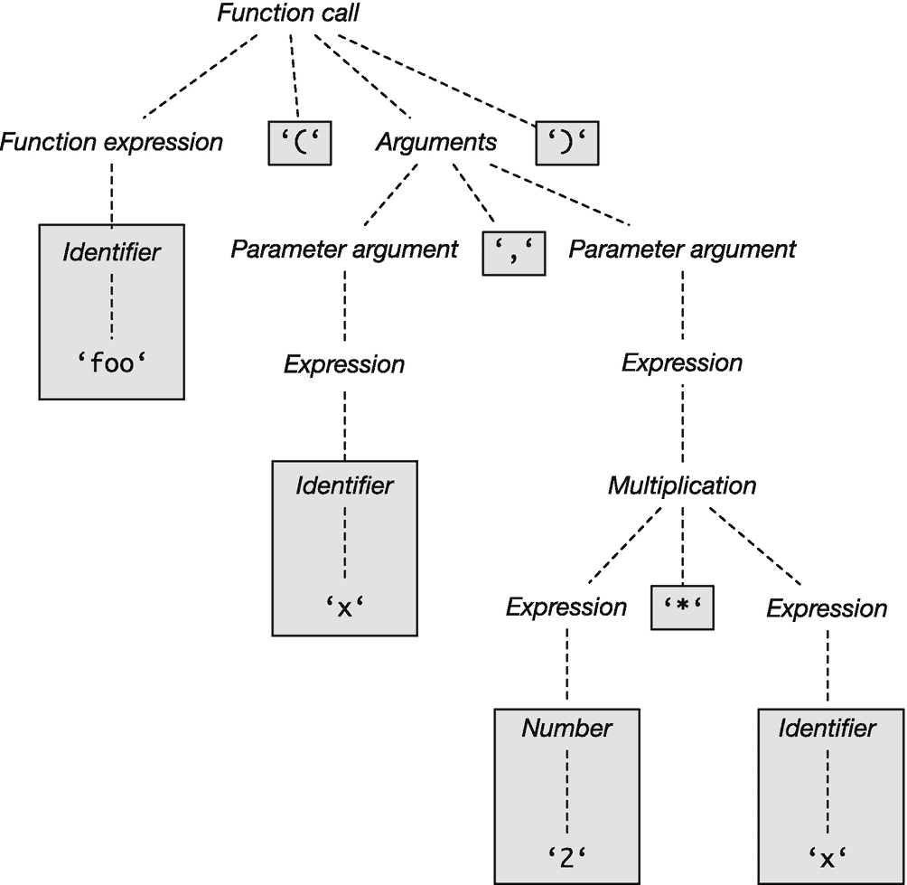
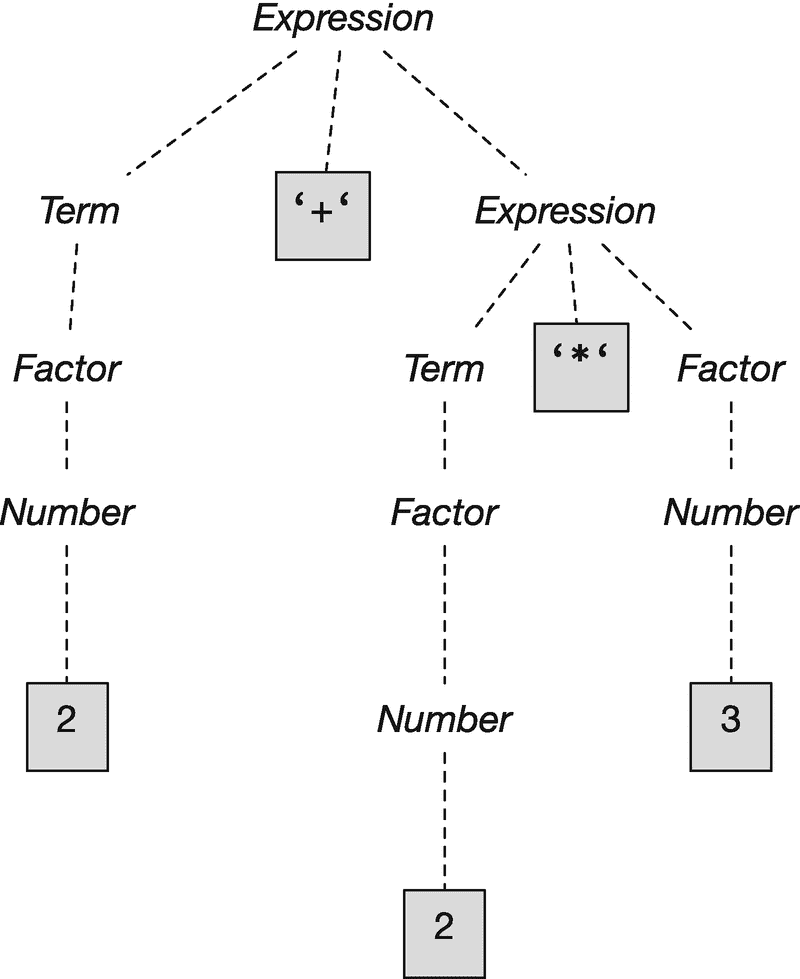

# 3. 编程语言的组成部分

虽然这并非一本关于编译器或计算机语言的通用书籍，但对我们处理计算机语言的软件组件（至少是领域特定计算机语言的组件）有一些基本了解将大有裨益。

在编写处理语言的软件时，我们通常将其结构化为从原始输入文本到期望结果（通常是运行中的代码或某些期望的数据结构）的多个不同处理阶段。然而，在处理嵌入式领域特定语言时，解析领域特定语言、操作语言中的表达式以及对其求值之间不一定有明确的界限。在许多情况下，嵌入式领域特定语言描述了一系列应按顺序执行的操作——例如，`ggplot2` 中的图形变换或 `magrittr` 和 `dplyr` 中的数据操作。在这种情况下，你不一定需要将对领域特定语言表达式的求值拆分为解析阶段和求值阶段；你可以在 R 解析器看到这些变换时逐一执行它们。但从概念上讲，仍然涉及两个步骤——解析领域特定语言语句和对其求值——并且对于更复杂的领域特定语言，你必须明确这一点。然而，即使是对于简单的领域特定语言，将不同的处理阶段分开也有好处。这会带来一些编程开销，因为你需要在实现其语义之前以某种显式形式表示输入语言，但它也允许你将各个处理阶段的责任分离到独立的软件模块中，从而使它们更容易实现和测试。

本章描述了计算机语言的各个组成部分以及处理领域特定语言所涉及的阶段。我们将使用以下包：

```
library(magrittr) # 用于 %>% 运算符
library(Matrix)   # 用于 `exam` 函数
```


## 文本、令牌、语法与语义

首先，我们需要定义一些术语。由于本书并非关于语言或解析器理论，我将为后续需要用到的术语提供若干非正式的工作定义。

当我们审视一门语言时，可以从不同细节层次进行观察，从最基本的构成元素到表达式与语句所关联的含义。对于口语而言，最基本的元素是音素——即该语言中使用的不同发音。音素组合成单词，单词组合成句子，而句子则具有含义。对于书面语言而言，原子元素是字形——即使用字母表书写的语言（如英语）中的字母。字母序列可以构成单词，但书面句子不仅包含单词，还有标点符号。我们可以将这些统称为**令牌**（tokens）。一串令牌构成一个句子，同样，我们为句子赋予含义。

对于计算机语言而言，我们在符号字符串上也有类似的抽象层次。最原始的层次仅仅是输入字符流，但我们会有相应的规则将这些字符序列转换为令牌序列。这一过程被称为**词法分析**（tokenization）。编程语言的正式定义会规定该语言中可用的令牌有哪些，以及字符串应如何被转换为令牌串。

考虑以下 R 代码字符串：

```
foo(x, 2*x)
```

这显然是一个函数调用，但对于词法分析器来说，它看到的是一串需要转换为令牌序列的字符。它将产生如下结果：

```
identifier["foo"] '(' identifier["x"],
number[2], '*', identifier["x"]
')'
```

这里我采用了一种自创的表示法，但其核心思想是：词法分析器会识别出标识符和数字（并记录这些标识符与数字的具体内容），以及诸如 `'('`、`'*'` 和 `')'` 这样的逐字令牌。

然而，词法分析器在处理如下字符串时同样会感到满意：

```
foo x ( 2 ) x *
```

并将其转换为以下令牌序列：

```
identifier["foo"] identifier["x"] '('
number[2] ')' identifer["x"] '*'
```

这显然不是一段合法的 R 代码，但词法分析器并不关心这一点。它仅仅将字符串转换为令牌序列（附带一些相关数据，例如标识符对应的字符串 `"foo"` 与 `"x"`，以及数字对应的值 `2`）。它不关心语言中更高级的层次。

当涉及对内嵌语言进行词法分析时，我们受限于该语言所认可的合法令牌。我们不能随意创建各种令牌，因为我们编写的所有内嵌 DSL 都必须同时也是合法的 R 代码。我们能够使用的令牌要么是已有的 R 令牌，要么是我们定义的具有特殊含义的变量和函数。这通常意味着通过函数调用创建对象，以及定义用于运算符重载的函数。

一门语言认为合法的令牌串由其**语法**（grammar）定义。¹ **解析器**（parser）负责将令牌序列转换为表达式或语言语句。通常，解析器所做的工作是将令牌串转换为表达式树——通常称为**抽象语法树**（abstract syntax tree，AST）。² 相比于原始输入和词法分析结果中简单的线性结构，树形结构为代码赋予了更多的结构性。对于之前我们进行词法分析的那个函数调用，其抽象语法树的一个示例如图 3-1 所示。在此图中，*斜体*标签指代语法中的句法概念，而 `等宽字体` 标签指代逐字输入文本。令牌以灰色方框显示。如我们所见，这些令牌可以是逐字文本，也可以附带某些语法信息以描述其令牌类型（在此示例中，令牌类型要么是标识符，要么是数字）。当有关联信息时，我选择将其在树中显示为两个节点：一个描述令牌的语法类别（标识符或数字），另一个则是包含实际信息的子节点（本案例中为 `foo`、`x` 和 `2`）。



图 3-1 一个具体函数调用的抽象语法树示例

符合语法规则的语句是解析器认为合法的语句。如果回到自然语言领域，这类句子就是遵循语法规则的句子。这组合法句子的集合与具有某种含义的句子集合是不同的。完全有可能构造出毫无意义但语法正确的句子。语言学家诺姆·乔姆斯基创造的句子“无色的绿色思想狂怒地睡觉”正是这样的例子：它完全符合语法，却又完全无意义。**语义**（semantics）这个术语用于将语法句子与其含义联系起来。当你在编程语言中遇到运行时异常时，就会理解这种区别。如果程序运行时出现异常，说明你构造了一个语法正确的句子——否则解析器会报告语法错误——但该句子在某种其他方面违反了语言规则。一个语法正确的句子并不一定具有明确的含义。例如，将两个变量相加的表达式 `x + y` 是符合语法的，但如果变量包含两种不兼容的类型（例如 `x` 是字符串而 `y` 是数字），则该句子违反了语言的类型规则。对于编程语言而言，**语义**定义了语句实际描述的计算过程。编译器或解释器——对于 R 程序而言是后者——为语法正确的语句赋予含义。³

对于内嵌 DSL 而言，程序的语义是指一旦我们解析了表达式之后，如何对其进行求值。我们不会正式地规定语义或实现解释器，因此对于本书而言，DSL 的语义部分就是普通的 R 程序。通常，我们使用内嵌 DSL 的目的是作为某个库或框架的接口。正是这个框架的功能性为 DSL 的使用提供了语义；而实际的语言仅仅是与框架交互的接口。


## 指定语法

由于我们使用 R 来解析表达式，因此在哪些内容可以被视为词法单元方面没有太多灵活性，并且我们能够实现的语法类型也存在一些限制。不过，在如何组合函数和运算符方面，我们对语法仍有一定的灵活度。

为了在本书中指定语法，我将采用传统方法，通过描述在特定语法内生成有效句子的"规则"来实现。请考虑以下语法：

```
EXPRESSION ::= NUMBER
|  EXPRESSION '+' EXPRESSION
|  EXPRESSION '*' EXPRESSION
|  '(' EXPRESSION ')'
```

该语法描述了生成表达式的规则，这些表达式由数字的加法和乘法组成，并使用括号对表达式进行分组。

你应该这样理解："一个表达式要么是一个数字，要么是两个表达式的和，要么是两个表达式的积，要么是一个带括号的表达式"。这个定义是递归的——用一个表达式来定义另一个表达式——但我们有一个基础情形，即数字，它让我们能够创建一个基础表达式，并且从这个基础表达式出发，我们可以生成更复杂的表达式。

我在这里用于指定语法的语法本身也是一种语法——如果你愿意，可以称之为元语法。你应该这样理解：我们要定义的语法对象位于 `::=` 对象的左侧。之后，我们有一个或多个构造此类对象的方式序列，彼此之间用 `|` 分隔。这些用于构造我们所定义对象的规则，将是其他语法对象的一个序列。它们可以是我们通过其他规则定义的对象（我会将其全部用大写字母表示，并称之为元变量），也可以是具体的词法单元（我会用单引号括起来，比如第二个创建和的规则中的 `'+'`）。这种表示法包含的信息与我在图 3-1 中使用的图形表示法相同，在该图形中，元变量以斜体显示，具体词法单元则放在灰色框中。

像这样的元语法被用来正式地定义语言，并且有许多工具可以让你根据元语法中的语法规范自动创建解析器。我会以非正式的方式使用这种自制的元语法。我将其作为一种简洁的方法来描述我们创建的 DSL 的语法，或者仅仅是语法的伪代码。

为了创建一个表达式，我们必须遵循元语法规则，使用提供的四种替代方案之一：要么将表达式简化为一个数字（一个和或积），要么创建另一个带括号的表达式。例如，我们可以依次应用这些规则，得到以下结果：

```
EXPRESSION > EXPRESSION '*' EXPRESSION                     (3)
> '(' EXPRESSION ')' '*' EXPRESSION             (4)
> '(' EXPRESSION '+' EXPRESSION ')' '*' EXPRESSION (2)
> '(' number[2] '+' number[2] ')' '*' number[3]  (1x3)
```

这让我们能够根据规则构造出表达式 `(2 + 2) * 3`。

如果存在多种方式可以从元变量转换到相同的终结规则序列（即有规则可以导出完全相同的词法单元序列），那么我们就会在解释语言时遇到问题。相同的词法单元序列可能被解释为指明两个不同的语法对象。对于表达式语法，当我们遇到像 `2 + 2 * 3` 这样的表达式时，就会产生歧义。我们可以用两种不同的方式解析这个表达式，具体取决于我们从元变量 `EXPRESSION` 推导到具体表达式时应用了哪些规则。我们可以先应用乘法规则，得到相当于 `(2 + 2) * 3` 的结果；或者可以先应用加法规则，得到 `2 + (2 * 3)`。根据传统的数学符号，我们知道应该得到第二个表达式，因为乘法比加法具有更高的优先级⁴，所以 `*` 符号将 2 和 3 结合得比 `+` 将 2 和 2 结合得更紧密，但语法并不能保证这一点。这种语法是有歧义的。

可以通过将语法修改如下来解决这个问题：

```
EXPRESSION ::= TERM '+' EXPRESSION | TERM
TERM ::= TERM '*' FACTOR | FACTOR
FACTOR ::= '(' EXPR ')' | NUMBER
```

这是一个更复杂的语法，它允许你创建相同的表达式，但通过三个元变量来相互递归定义。它的结构确保了乘积自然比和结合得更紧密——构造表达式 `2 + 2 * 3` 的唯一方式就是图 3-2 中所示的解析树。我们应用规则的顺序可以变化，但解析树始终是这种形式，并且乘积比和结合得更紧密。



图 3-2

`2 + 2 * 3` 的解析树

出于显而易见的原因，无歧义的语法比有歧义的语法更可取，但创建无歧义语法可能会使语法的规范变得复杂，正如我们在表达式中所见。这可以通过制作一个更智能的解析器来缓解，该解析器可以考虑运算符优先级等因素，或者在解析字符串时跟踪上下文。无论我们是编写更智能的解析器还是无歧义的语法，我们都不会长时间处理像图 3-2 中那样复杂的表达式树——这棵树显式地展示了所有语法元变量，但在实践中，我们会在解析之后、处理表达式之前对其进行简化。

在编写嵌入式 DSL 时，我们必须使用 R 的解析器，并且必须遵守其规则。如果你完全编写自己的解析器，可以在解析词法单元序列时传递上下文，但如果你想利用 R 的解析器并创建嵌入式 DSL，那么最好确保所有语法上有效的词法单元序列都能无歧义地指向一个语法元变量。优先级歧义以及结合性都将由 R 来处理——这意味着 `1 + 2 + 3 + 4` 会被解释为 `(((1 + 2) + 3) + 4)`。利用 R 的解析规则将使我们能够构建这样的语言：只要我们稍加注意语言的设计，每个表达式都能唯一地匹配一个解析器元变量。

作为不仅仅是表达式的语法示例，想象一下我们想要一种用于指定图的语言——这里的图是指网络或状态机，而不是绘图。我们可以定义一个用于有向无环图（DAG）的语法，规定一个 DAG 要么是一个空图，要么是一个图后跟一条边。

```
DAG ::= 'dag()' | DAG '+' EDGE
```

我们使用函数 `dag()` 创建一个空 DAG。调用此函数会将我们带入图规范 DSL 中，并为我们提供一个可用于在 R 中编程语法操作的对象。我们将使用加号运算符来向 DAG 添加边。这是一个有点随意的选择，但它使解析器的实现变得容易，因为我们只需重载通用的 `+` 函数即可。对于边，我们保持简单，只要求有一个"起始节点"和一个"目标节点"。我们可以定义自己的中缀运算符来创建它们。

```
EDGE ::= NODE '%=>%' NODE
```

我们不能定义任意我们想要的中缀运算符——例如，如果我们想让运算符是 `==>`，那么我们会遇到麻烦，因为 R 的解析器会将其解释为两个词法单元：`==` 和 `>`。不过，只要我们将其命名为以百分号开头和结尾的名称，我们总是可以定义自己的运算符。我们也可以通过重载来重用现有的中缀运算符，就像我们用加号将边添加到 DAG 那样，但对于这种图形语法，如果我们尝试这样做，可能会遇到一些问题，我们将在后面看到。对于节点，我们现在不进行更多展开。它们是原子词法单元——例如，我们可以要求它们为字符串。⁵


在下一章中，我们将深入探讨如何编写解析器，但对于这种简单的语言，我们可以快速创建一个。解析器需要收集边，因此我们将使用链表来处理，自然地，创建一个空的有向无环图（DAG）就是让其包含一个空的边列表。然后，向 DAG 添加边就意味着将这些边添加到列表的前端。这样的实现非常简单：

```
cons %` <- function(from, to) c(from, to)
`+.dag` <- function(dag, edge) {
dag$edges <- cons(edge, dag$edges)
dag
}
```

仅凭这四个函数，我们就可以使用如下语法创建一个 DAG：

```
dag() +
"foo" %=>% "bar" +
"bar" %=>% "baz"
```

这可能不是我们能想出的最佳语法，但它比嵌套函数调用更容易阅读。

```
add_edge <- function(dag, from, to) {
dag$edges <- cons(c(from, to), dag$edges)
dag
}
add_edge(add_edge(dag(), "foo", "bar"), "bar", "baz")
```

不过，对于熟悉 `magrittr` 的管道操作符的人来说，使用它可能会更具可读性。

```
dag() %>% add_edge("foo", "bar") %>% add_edge("bar", "baz")
```

无论如何，我们已经构建了一个小型语言，只需定义四个函数即可解析——如果忽略并非该语言特有的链表 `cons` 函数，那么只需要三个函数。

我们使用了 `%=>%` 来构造边。我们可以使用 `=>` 吗？简短的回答是：不行。R 的解析器会将其视为两个标记，即 `=` 和 `>`，尽管我们可以使用反引号使其成为有效的标识符来定义这个名称的函数，但我们无法得到一个中缀操作符。

```
`=>` `("foo", "bar")
"foo" => "bar"
## 错误: :3:8: 意外的 '>'
## 2: `=>`("foo", "bar")
## 3: "foo" =>
##           ^
```

如果我们想要一个不使用百分号的中缀操作符，就必须重载 R 已有的某个操作符——而 `=>` 并非其中之一（大于等于号是 `>=`）。

那么，我们可以改用 `>` 吗？这个操作符是 R 的中缀操作符，因此我们可以重载它。为此，我们只需要一个节点类型。如果我们将节点指定为字符串，就必须修改字符串的操作符，但我们不想这样做——这可能会破坏大量现有代码——所以最好的方法是定义一个节点类来操作。

```
node .node` <- function(from, to) c(from, to)
```

有了这些函数，我们就可以使用以下语法创建一条边：

```
node("foo") > node("bar")
## [1] "foo" "bar"
```

然而，将 `%` 中缀操作符改为 `>` 会改变优先级。`%` 操作符的优先级高于 `+`，这就是为什么我们之前可以将边添加到 DAG 中；但 `>` 的优先级低于 `+`，所以我们会先将左侧节点添加到 DAG，然后才调用 `>` 操作符。

```
dag() + node("foo") > node("bar")
## $edges
## $edges$car
## [1] "foo"
## attr(,"class")
## [1] "node"
##
## $edges$cdr
## NULL
##
##
## [[2]]
## [1] "bar"
```

当然，我们可以使用括号来修复这个问题。

```
dag() + (node("foo") > node("bar"))
## $edges
## $edges$car
## [1] "foo" "bar"
##
## $edges$cdr
## NULL
##
##
## attr(,"class")
## [1] "dag"
```

依赖程序员记住添加括号并不特别安全，因此更好的解决方案是确保优先级正确。我们可以通过选择不同的操作符来向 DAG 添加边来实现这一点。例如，如果我们将 `+` 替换为 `|`，就能得到正确的行为，因为 `|` 的优先级低于 `>`。

```
`|.dag`  node("bar")
## $edges
## $edges$car
## [1] "foo" "bar"
##
## $edges$cdr
## NULL
##
##
## attr(,"class")
## [1] "dag"
```

使用操作符重载有利有弊。将字符串标记改为节点标记需要更多的输入，但另一方面，我们可以在解析表达式时利用这一点进行验证，确保节点是字符串。

或者，我们可以使用元编程，显式地遍历表达式，以确保 `>` 操作符是用于创建边的操作符，而不是用于字符串比较，类似于我们在上一章中重写矩阵表达式的方法。

暂且回到 `magrittr` 的解决方案，我认为值得指出的是，语言设计并不仅仅是定义新的语法。我们这里为了定义图而设计的语言，其功能与管道操作符相同，因此在这个特定案例中，我们不需要指定新的语法结构就能获得所有想要的好处。使用管道时，我们避免了使代码难以阅读的嵌套函数调用，并且可以将 DAG 指定为一个不断添加边的列表。管道操作符对大多数程序员来说都很熟悉，最重要的是，如果使用它，我们就不需要实现任何解析代码。不过，当我们定义操作 DAG 的函数时，我们仍然在创建领域特定语言。提供一套能够表达领域思想的词汇的函数，同样是语言设计。`dplyr` 包就是一个例子——它与管道操作符一起使用，将各种操作串联起来，因此它并没有提供太多新的语法，但它为指定数据操作提供了一种非常强大的语言。

在我们探讨的各种解决方案中，我更喜欢基于管道的方案。它使得扩展边的信息（不仅仅是“起始”节点和“目标”节点）变得容易——而二元操作符很难做到这一点——并且我们无需任何语言代码就能实现；我们只需要让 DAG 成为所有我们将要添加到该语言中的操作函数的第一个参数即可。当然，这个解决方案之所以可行，仅仅是因为我们考虑的语言是一系列简单的操作。情况并非总是如此，所以有时我们确实需要多做一些工作。


## 设计语义

我们编写领域特定语言（DSL）是为了达到某种效果——我们希望将意义（即语义）与 DSL 中的表达式关联起来，并且期望 DSL 表达式能产生某种结果，无论是通过执行计算还是构建数据结构来实现。DSL 的目的仅仅是为语言所需的任何语义提供一个便捷的接口。

如果我们总是让解析代码构建一棵解析树，那么处理 DSL 的下一步就是操作这棵树以达到预期效果。其中可能涉及多个步骤——例如，我们在矩阵表达式示例中重写了表达式以优化计算——但在处理过程的最后，我们将执行 DSL 表达式所描述的命令。

执行 DSL 有时很直接，可以作为对解析树的最终遍历来完成。这就是我们在矩阵表达式中所做的——DSL 的目标是重写表达式而非求值，而求值本身只是简单的矩阵乘法和加法。在其他情况下，通过为语言要执行的操作建立一个框架，将语义模型与 DSL 分离是合理的。为语言的语义建立框架，可以让我们独立于作为接口的语言来开发和测试语义模型；甚至允许我们使用不同的输入语言来操作同一个语义模型——不过我并不推荐为了达到相同目标而使用多种不同的语言。

为了说明这一点，我们可以考虑一种用于指定有限状态连续时间马尔可夫链（CTMC）的语言。我选择这个例子是因为我们在实现图 DSL 时已经实现过有限状态系统的几个版本，而对于 CTMC，我们只需为所有边关联速率。连续时间马尔可夫链广泛应用于数学建模中，其实现主要归结为指定一个瞬时速率矩阵。这是一个指定了从一个状态转移到另一个状态的速率的矩阵。这样的矩阵中，所有非对角线元素应为非负值，而对角线元素则应等于该行其他元素之和的相反数。在使用 CTMC 的框架中，我们很可能会实现处理速率矩阵的功能，但在指定 CTMC 时，使用领域特定语言可能更方便。

将图规范翻译成矩阵称之为语言的“语义”可能有些牵强，但如果我们把 DSL 视为一种指定模型的方式，并将（想象中的）操作这些模型的框架视为语言的一部分，那么我认为这是合理的。使用该语言包括指定 CTMC、将其翻译成对应的速率矩阵，然后按预期操作它。语言部分的作用在于将规范翻译成矩阵。

正如之前展示的图，我们需要指定链中的边。每条边都需要关联一个速率，因此最自然的语法是管道版本——用这个版本可以更简单地指定一条边的三个值：“从”状态、“到”状态和速率。我将把这三个值分别保存在三个不同的链表中，因为这样更容易构建矩阵。

我们重用了上一章编写的这两个函数：

```
cons <- function(car, cdr) list(car = car, cdr = cdr)
lst_length <- function(lst) {
len <- 0
while (!is.null(lst)) {
lst <- lst$cdr
len <- len + 1
}
len
}
lst_to_list <- function(lst) {
v <- vector(mode = "list", length = lst_length(lst))
index <- 1
while (!is.null(lst)) {
v[[index]] <- lst$car
lst <- lst$cdr
index <- index + 1
}
v
}
```

然后我们定义了以下用于指定 CTMC 的函数：

```
ctmc <- function()
structure(list(from = NULL,
rate = NULL,
to = NULL),
class = "ctmc")
add_edge <- function(ctmc, from, rate, to) {
ctmc$from <- cons(from, ctmc$from)
ctmc$rate <- cons(rate, ctmc$rate)
ctmc$to <- cons(to, ctmc$to)
ctmc
}
```

现在，将这些链表翻译成速率矩阵只是一个普通的编程任务。我们从“from”和“to”列表中收集节点——先将它们转换成 R 列表，因为一旦收集完元素，处理 R 列表会更方便——然后获取唯一的节点名称。这些名称成为速率矩阵的行和列，接着我们遍历所有边来插入速率。之后，设置对角线元素，工作就完成了。

```
rate_matrix <- function(ctmc) {
from <- lst_to_list(ctmc$from) %>% unlist
rate <- lst_to_list(ctmc$rate) %>% unlist
to <- lst_to_list(ctmc$to) %>% unlist
nodes <- c(from, to) %>% unique %>% unlist
n <- length(nodes)
Q <- matrix(0, nrow = n, ncol = n)
rownames(Q) <- colnames(Q) <- nodes
for (i in seq_along(from)) {
Q[from[[i]], to[[i]]] <- rate[[i]]
}
diag(Q) <- - rowSums(Q)
Q
}
```

现在，使用这个小语言构建 CTMC 速率矩阵就变得非常简单：

```
Q <- ctmc() %>%
add_edge("foo", 1, "bar") %>%
add_edge("foo", 2, "baz") %>%
add_edge("bar", 2, "baz") %>%
rate_matrix()
Q
##     bar foo baz
## bar  -2   0   2
## foo   1  -3   2
## baz   0   0   0
```

一旦我们将 CTMC 翻译成这个矩阵，就可以认为语言设计完成了。然而，将 CTMC 的构建与我们可以对 CTMC 执行的操作集成在一起，对于 DSL 的易用性至关重要，并且也可以被视为语言的一部分。在这种特殊情况下，好消息是实际的语言设计已经为我们完成了。管道运算符告诉了我们如何将 CTMC 与进一步的处理结合起来——我们只需编写可以在管道中使用的函数。例如，如果我们想知道 CTMC 在一段时间间隔内的转移概率——即我们想知道在给定时间内从任意一个状态转移到其他状态的概率——我们可以添加一个函数来实现。概率可以通过矩阵指数计算（如果你不熟悉 CTMC 理论，请先相信我）。为了使这样一个函数与管道兼容，我们只需将管道中从左端传入的数据设为函数的第一个参数。因此，我们可以这样写：

```
transitions_over_time <- function(Q, t) {
expm(Q * t)
}
P <- Q %>% transitions_over_time(0.2)
P
## 3 x 3 Matrix of class "dgeMatrix"
##           bar       foo     baz
## bar 0.6703200 0.0000000 0.32968
## foo 0.1215084 0.5488116 0.32968
## baz 0.0000000 0.0000000 1.00000
```

即使有了语言结构（管道运算符），仍然有一些语言设计工作要做。毕竟，数据通过管道的流向并不总是显而易见。一个例子是当我们想要演化状态概率向量时。

```
probs <- c(foo=0.1, bar=0.9, baz=0.0)
```

将概率向量通过管道传递是否更自然？

```
evolve <- function(probs, Q, t) {
probs %*% expm(Q * t)
}
evolve(probs, Q, 0.2)
## 1 x 3 Matrix of class "dgeMatrix"
##            bar        foo     baz
## [1,] 0.6154389 0.05488116 0.32968
```

或者，始终让 CTMC（或其速率矩阵）通过管道传递是否更自然？

```
evolve <- function(Q, t, probs) {
probs %*% expm(Q * t)
}
Q %>% evolve(0.2, probs)
## 1 x 3 Matrix of class "dgeMatrix"
##            bar        foo     baz
## [1,] 0.6154389 0.05488116 0.32968
```

如果我们把系统看作随时间演化，前一种方式可能感觉更自然；但后一种方式更适合这样的管道：先构建 CTMC，然后将其翻译成速率矩阵，最后演化系统。

```
ctmc() %>%
add_edge("foo", 1, "bar") %>%
add_edge("foo", 2, "baz") %>%
add_edge("bar", 2, "baz") %>%
rate_matrix() %>%
evolve(0.2, probs)
## 1 x 3 Matrix of class "dgeMatrix"
##            bar        foo     baz
## [1,] 0.6154389 0.05488116 0.32968
```

只有通过用例和实验，我们才能知道哪种语言设计才是最佳的。但话说回来，这也正是设计语言如此有趣的原因。


