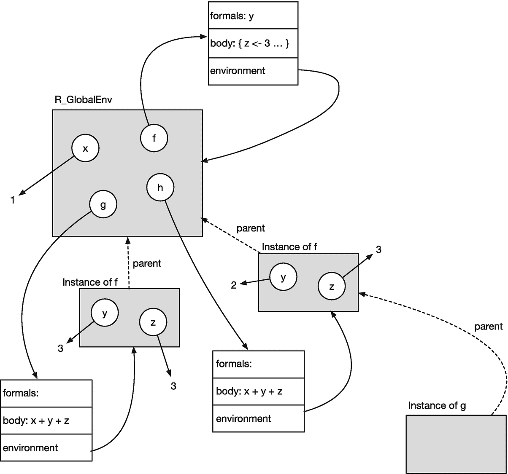
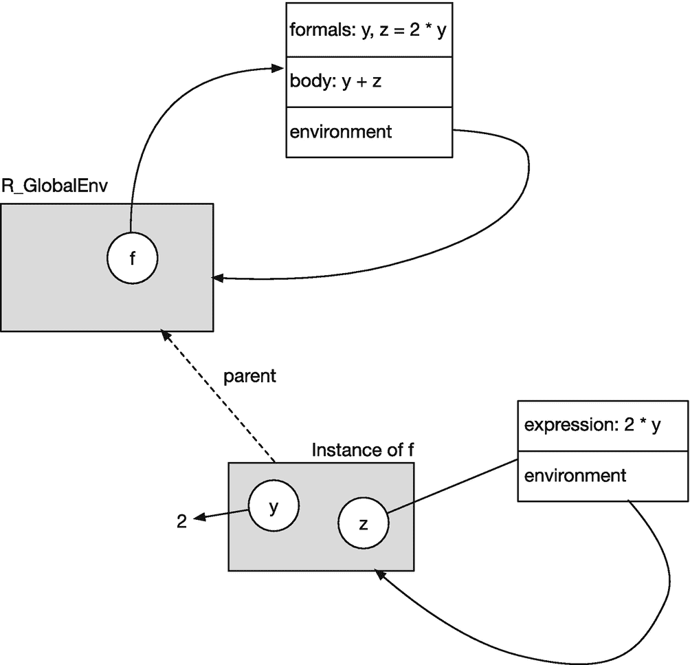
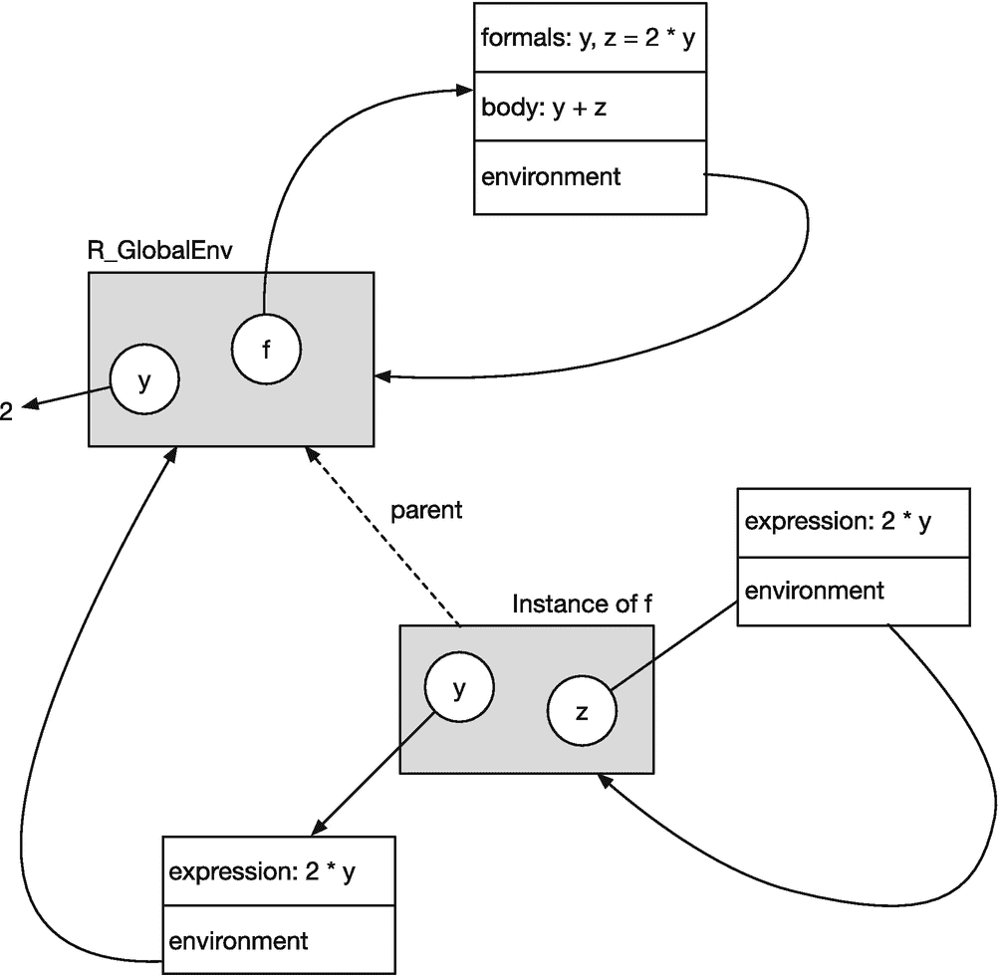
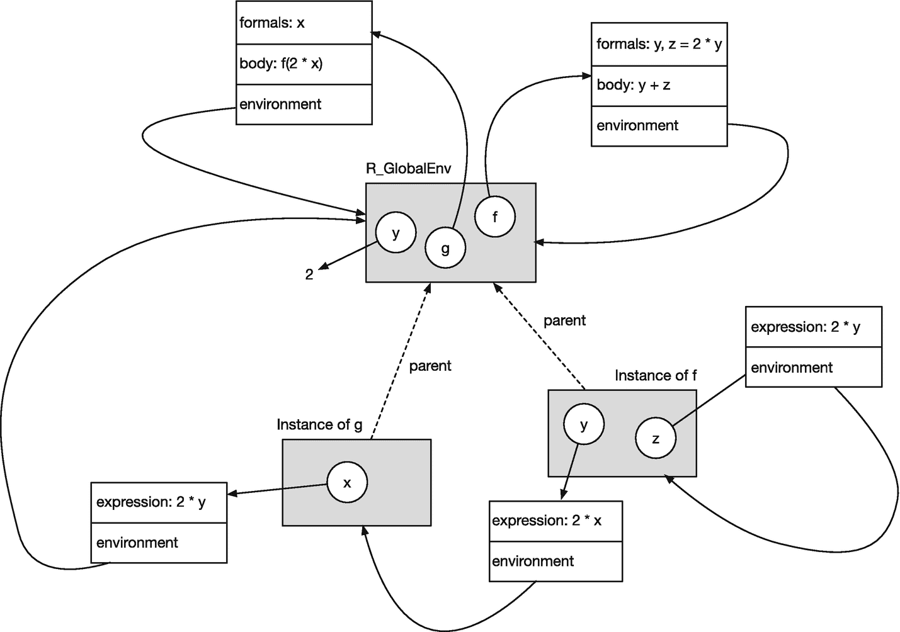
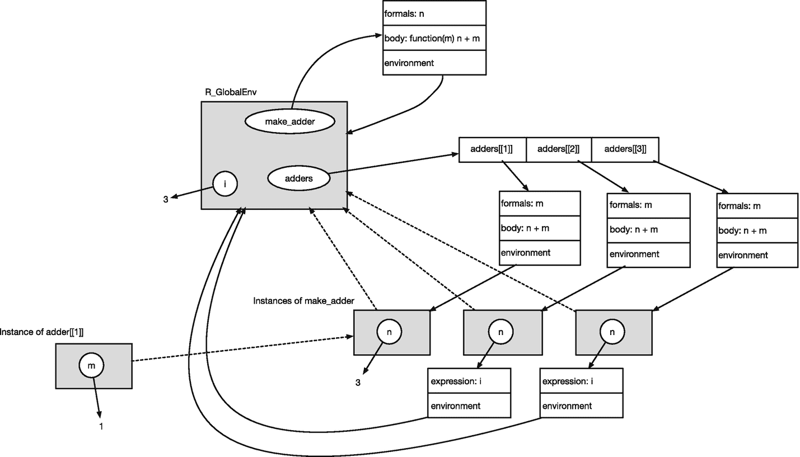
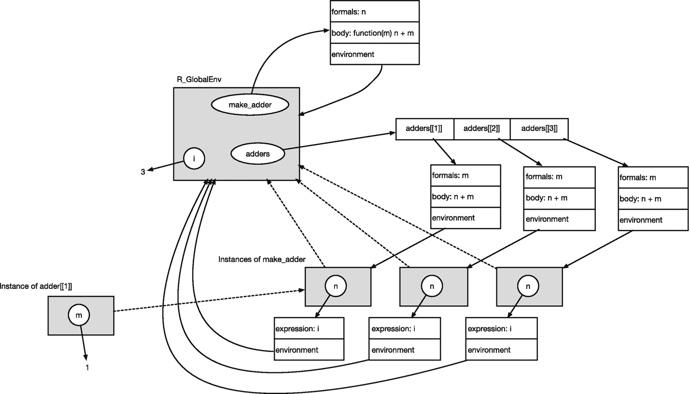

# 7. 环境与表达式

在前面的几个示例中，我们已经使用环境来在不同于常规求值的上下文中求值表达式，这种做法被称为非标准求值。许多我们可能在 R 中实现的领域特定语言都需要某种非标准求值，但让求值发生在正确的上下文中可能存在问题。表达式求值的规则很简单，但求值上下文（即环境链）可能很复杂。

我们将使用 `rlang` 包。

```r
library(rlang)
```

## 作用域与环境

R 在作用域中求值表达式，该作用域决定了任何给定变量所引用的值。在标准求值中，R 使用所谓词法作用域。这实质上意味着表达式中的变量引用的是表达式周围块中定义的变量。如果你在 R 脚本的最顶层（即全局环境）编写表达式，那么表达式中的变量名引用的是全局变量。另一方面，函数内部的表达式在函数执行的作用域中求值，这意味着变量符号引用的是局部变量或函数参数（如果它们被定义了）；只有当它们未定义时，才引用全局变量。在另一个函数内部定义的函数将具有嵌套的作用域——那里表达式中的变量将首先在最内层函数中搜索，然后是外层函数，只有当在这两处都找不到时，才在全局环境中搜索。

请看这个抽象示例：

```r
x <- 1
f <- function(y) {
  z <- 3
  function() x + y + z
}
g <- f(2)
h <- f(3)
g()
## [1] 6
h()
## [1] 7
```

在这个示例中，我们在全局环境中定义了四个变量：`x`、`f`、`g` 和 `h`。在函数 `f` 中，有一个形式参数 `y` 和一个局部变量 `z`。每当我们调用 `f` 时，就会创建一个 `y` 存在的作用域，并且函数调用中的第一条语句将 `z` 添加到此作用域中。该函数返回另一个函数，即一个闭包，它包含一个引用变量 `x`、`y` 和 `z` 的表达式。如果我们调用这个函数（当我们调用 `g` 和 `h` 时就会这样做，它们是两次独立调用 `f` 的结果），我们将求值这个表达式。当 R 求值这个表达式时，它需要找到这三个变量。它们既不是我们调用的函数（`g` 和 `h`）中的形式参数，也不是局部变量，但由于这些函数是在 `f` 的调用内部创建的，它们可以在其周围作用域中看到 `y` 和 `z`。两者都可以在全局环境中找到 `x`。由于 `g` 和 `h` 是对 `f` 的独立调用的结果，因此调用它们时的周围作用域是 `f` 的局部作用域的不同实例。

作用域通过环境实现，虽然指导环境和求值的规则很简单，但如果你开始操作它们就必须小心。你可以将环境视为将变量映射到值的表。此外，所有环境都有一个父环境，即封闭作用域，如果在第一个环境中找不到变量，R 会在父环境中搜索。因此，环境具有树状结构，通常遵循嵌套作用域，并以空环境为根结束。你加载的包位于此环境之上，而在所有已加载环境之上，我们有全局环境——这就是为什么如果你在全局环境中搜索，可以找到包中定义的变量。

严格来说，关于包和环境如何交互，还有几个我未在此环境视图中包含的细节，但它们对于这里的讨论并不重要。如果你感兴趣，可以在我的另一本书《R 中的元编程》（Mailund, 2017c）中找到这些细节。对于本书，我们只需假设我们在全局层或任何包中定义的所有内容都能在全局环境中找到，并将此视为环境树的根。

当我们定义新函数时，我们不会创建新环境，但我们会将函数与一个环境关联起来——即我们定义该函数的环境。在之前的示例中定义函数 `f` 时，它被关联到全局环境，因为那正是我们定义它的地方。我们可以使用 `environment` 函数获取函数关联的环境。

```r
environment(f)
## 
```


由于`f`是在全局层级定义的，其执行环境为全局环境。当我们进行函数调用时，会创建一个称为**执行环境**的新环境。该环境用于存储参数和局部变量。与函数关联的环境将作为此执行环境的父环境。调用函数`f`时，我们会创建一个环境，其中包含从`y`和`z`到其值的映射，其父环境为全局环境，由此我们可以在其中找到变量`x`。在调用`f`的过程中，我们创建了一个新的（匿名）函数并将其返回。该函数也会有一个与之关联的环境，但这次环境是我们调用`f`时创建的局部环境。因此，与`g`和`h`关联的环境是两个不同的环境，因为它们是两次不同调用`f`的结果。

```
environment(g)
## 
environment(h)
## 
```

在其他函数内部定义的函数会携带创建它们的外部函数被调用时所创建的环境，即使从外部函数中返回，它们仍会保留这个闭合作用域。由于它们记住了外部作用域中的局部变量和参数，我们将此类函数称为**闭包**。

在图 7-1 中，我绘制了一个简化的图表，展示了在调用函数`g`的示例中，哪些环境存在以及它们是如何连接的。我使用灰色背景表示环境，变量则表示为指向其所引用值的指针圆圈，而函数则由三个组件定义：形式参数、函数体以及闭合作用域——即与函数关联的环境。

函数`f`的闭合环境是全局环境，而`g`和`h`的闭合作用域是两次不同调用`f`的实例。这些实例或执行环境的父环境是全局环境，因为全局环境是`f`的闭合作用域。由于它们是`f`的两个不同实例，其中的变量可以指向不同的值，正如我们在变量`y`上所见。对于函数`g`，`y`指向 3；而对于函数`h`，`y`指向 2。在调用函数`g`时，我们为函数调用创建了一个局部环境——如图右下角所示。`g`内部没有任何局部变量，因此该环境不包含任何变量，但其父环境是创建`g`的那个`f`实例。



图 7-1 调用`g`时的环境图

当我们在调用`g`内部求值表达式`x + y + z`时，需要将变量映射到值。查找将从局部环境开始，然后沿着父环境链向上查找，直到找到匹配的变量。对于变量`y`和`z`，我们在`g`调用的父环境——即创建`g`的那个`f`调用实例——中找到其值。对于`x`，我们在祖父环境——即全局环境——中找到其值。

求值表达式的规则始终如一：我们通过搜索环境来查找变量，从求值表达式所在的直接环境开始，并沿着父环境链搜索。我们依次检查链中的每个环境，直到找到要查找的变量。由于函数与创建它们的环境关联，并且这个环境被设置为执行环境的父环境，因此我们得到了词法作用域的标准求值规则。理解 R 中如何求值表达式的唯一诀窍在于理解使用了哪些环境。对于函数体，就如同我刚刚解释的那样简单，但对于函数参数，还有一些额外的规则需要考虑。

## 默认参数、惰性求值与承诺

当将数字等基本类型的值传递给函数参数时，无需进行求值，因此不会出现复杂情况。这就是为什么我们在前面的示例中不必担心参数环境的原因。然而，如果将表达式作为参数传递，则需了解它们应如何被求值。

在大多数情况下，R 的行为表现如同表达式在函数调用前已被求值，但实际情况并非如此。如果我们将值而非表达式传递给函数，就无法像前几章那样使用`substitute`来获取表达式。在 R 中调用函数时，参数将引用未求值的表达式；此类表达式称为**承诺**。承诺会在首次使用参数变量时被求值，而在此之前不会——这种参数求值方法称为**惰性求值**。如果从未引用某个参数，则相应的表达式永远不会被求值，因此我们可以编写如下代码而不会引发异常：

```
f <- function(x, y) x
f(2, stop("error!"))
## [1] 2
```

我们从未在函数`f`体内引用参数`y`，因此从未对其求值。相应地，我们也从未调用`stop`来引发错误。

因此，由于参数可以包含表达式，我们需要一个规则来决定如何对其求值。这里，函数创建时定义的默认参数与函数调用时提供的参数之间存在差异。前者在函数调用的局部作用域中求值，而后者则在调用函数的环境中求值。

考虑以下函数：

```
f <- function(y, z = 2 * y) y + z
```

该函数接受两个参数：`y`和`z`。

```
f(2, 1)
## [1] 3
```

但如果只提供`y`，则`z`会被设置为`2 * y`。

```
f(2)
## [1] 6
```

当在函数调用中对`z`指向的承诺进行求值时——这发生在使用该变量的表达式中——会对承诺的表达式进行求值。这意味着 R 需要找到变量`y`。如果试图在函数定义的作用域——即全局环境——中求值表达式`2 * y`，则会收到错误，因为该作用域中没有定义`y`变量。默认参数的语义可能是：在定义函数的作用域中对其进行求值。若如此，则无法使默认参数依赖于其他参数，而这正是我们所需要的——我们希望`z`在未明确提供值时依赖于`y`。实际的语义是：承诺在函数调用环境中进行求值。当我们调用`f`时，在求值`y + z`表达式之前，情况如图 7-2 所示。这里，我将`z`的承诺绘制为作为函数参数传递的表达式，以及应在其下进行求值的环境。



图 7-2 默认参数承诺

当使用一个表达式作为参数调用`f`时，我们不希望在该函数调用作用域内对该表达式求值。考虑如下情况：

```
y <- 2
f(2 * y)
## [1] 12
```

其意图是用`2 * y`调用`f`，由于`y`是 2，结果应为 4。然而，如果在函数调用内部尝试对其求值，则会出现循环依赖。在函数调用内部，`y`是一个变量，如果它指向`2 * y`，那么在不清楚`y`是什么的情况下无法求值该表达式，而不知道`y`是什么又无法求值……


当我们用表达式作为参数调用函数时，相应的`promise`会在调用函数的环境中被求值，因此在`f`内部求值`y + z`之前，状态如图 7-3 所示。在函数调用的环境内部，`y`和`z`都指向`promise`，但这些`promise`关联于不同的环境。为了求值表达式`y + z`，我们需要对两个`promise`都进行求值。要得到`y`的值，我们需要在全局作用域中求值`2 * y`，得到 4；要得到`z`的值，我们需要在局部作用域中求值`2 * y`，得到 8。



图 7-3  
使用表达式`y`调用`f`

冒着把这个例子引申得有点过远的风险，让我们考虑从另一个函数中调用`f`的情况。

```
g <- function(x) f(2 * x)
g(2 * y)
## [1] 24
```

在函数`f`内部求值表达式`y + z`之前，环境图的状态如图 7-4 所示。弄清楚我们想要求值`y + z`时发生了什么需要花点功夫，但完成这个练习将大大有助于理解环境。



图 7-4  
使用依赖于变量`y`的表达式`x`调用`g`

我们尚未对`promise` `y`和`z`进行求值。由于`z`依赖于`y`，我们需要先求值`y`。为此，我们需要在调用`g`的作用域内求值表达式`2 * x`。在这里，我们需要求值`x`，而`x`是另一个`promise`：即表达式`2 * y`，它应当在全局作用域中求值（在全局作用域中，`y`指向一个与`f`实例内局部变量不同的变量）。在全局作用域中，`y`指向值 2，因此我们可以直接求值`2 * y`并得到值 4。这个值随后会替换调用`g`的作用域中的那个`promise`。一旦我们对某个`promise`进行了求值，该变量就指向这个值，而不再是表达式。现在这意味着我们可以在`g`调用的作用域中求值`2 * x`，得到 8。因此，在`f`调用中的`y`现在指向 8。这意味着我们可以求值`2 * y`得到 16，并将其赋值给变量`z`。最后，我们可以求值`y + z`得到 8 + 16 = 24。

总结本节，我们传递给函数的参数，如果不是基本类型的值，就会被视为需要在某个时刻进行求值的表达式。与这些表达式相关联的，是我们对其进行求值的作用域。不过还有一个注意事项，我在之前的例子中暗示过：参数只有在第一次被求值之前才被视为表达式；在那之后，它们就是这次求值的结果。

这种语义各有利弊——不过弊端居多。我们可以避免计算不需要的值，因为`promise`在我们引用持有它们的变量之前不会被求值。此外，我们可以让默认参数依赖于函数调用内部的某个计算，前提是在使用需要该参数的变量之前先完成这些计算。例如，我们可以根据函数内部设置的变量来定义一个默认参数。

```
h <- function(x, y = 2 * w) {
w <- 2
x + y
}
h(1)
## [1] 5
```

然而，如果我们在计算所需变量之前就引用了需要该变量的`promise`，这将会失败。

```
h <- function(x, y = 2 * w) {
res <- x + y
w <- 2
res
}
h(1)
## Error in h(1): object 'w' not found
```

如果`promise`依赖于我们在计算过程中更新的变量，我们必须非常小心。请注意，`promise`只会被求值一次；求值之后，原本持有该`promise`的变量现在持有求值结果，而不再是`promise`表达式。如果我们更改了`promise`中出现过的变量，并不会更新该变量现在持有的值。

```
h <- function(x, y = 2 * w) {
w <- 1
res <- x + y
w <- 2
res
}
h(1)
## [1] 3
```

由默认参数持有的`promise`通常不会引发问题。我们很容易追踪函数中哪些局部变量会发生变化，以及`promise`会在哪个时刻被求值。然而，参数的惰性求值与闭包结合使用时，常常是问题的来源。考虑以下函数：

```
make_adder <- function(n) function(m) n + m
```

这返回一个闭包，该闭包会将其参数`m`加上`n`。我们可以这样使用它：

```
add_1 <- make_adder(1)
add_2 <- make_adder(2)
add_1(1)
## [1] 2
add_2(1)
## [1] 3
```

这里没有问题，但现在考虑这个：

```
adders <- vector("list", 3)
for (i in 1:3) adders[[i]] <- make_adder(i)
```

这里的意图是创建三个加法器函数，它们分别向其参数加 1、加 2 和加 3。然而，当我们调用第一个函数时，却得到了一个令人不快的意外。

```
adders[[1]](1)
## [1] 4
```

闭包内部的表达式`n + m`直到我们调用它时才会被求值。在我们调用`adders[[1]](1)`求值函数体之前，环境图如图 7-5 所示。所有三个加法器都是闭包，它们指向`make_adders`的不同实例，但这些实例中的`n`都指向一个`promise`，即表达式`i`。变量`i`位于全局环境中，而不是在闭包环境中。在我们创建完所有三个闭包之后，`i`指向数字 3。为了在加法器内部求值`n + m`，我们必须首先对`n`所指向的`promise`进行求值。我们搜索`n`，并在函数调用的父环境（闭包环境）中找到它，其中`n`指向`i`，而`i`应在全局环境中求值。我们对其进行求值，现在`n`指向 3，如图 7-6 所示。这就是为什么调用`adders[[1]]`并将`m`设为 1 会返回 4 而不是 2 的原因。



图 7-6  
在`adders[[1]]`中求值`n`这个`promise`之后的加法器



图 7-5  
在求值`adders[[1]](1)`调用的函数体之前的加法器

在调用这个闭包之后，变量`n`不再指向一个`promise`，而是指向值 3，因此此时更改`i`不会影响这个闭包。

```
i <- 1
adders[[1]](1)
## [1] 4
```

然而，这会影响那些我们尚未对`promise`进行求值的闭包，因此如果在更改`i`之后调用其他闭包之一，我们就会看到更改带来的结果。

```
adders[[2]](1)
## [1] 2
```

这是一个只有在创建闭包时才可能发生的问题，但每当你创建闭包时，风险都存在。你可以在返回闭包之前显式地对`promise`进行求值来避免这个问题；这正是`force`函数的作用。

```
make_adder <- function(n) {
force(n)
function(m) n + m
}
for (i in 1:3) adders[[i]] <- make_adder(i)
for (i in 1:3) print(adders[[i]](0))
## [1] 1
## [1] 2
## [1] 3
```


## 引号与非标准求值

本章迄今为止所讨论的都是表达式的标准求值方式，但你可能已经猜到，之所以称之为标准方式，是因为存在替代方案——非标准求值。任何其他求值表达式的方式都可归为此类。

非标准求值在变量到值的映射查找规则上与标准求值遵循相同逻辑：我们拥有一系列环境，并依次在其中进行搜索。而使其成为非标准求值的关键在于，我们以非标准的方式将这些环境串联起来。

要实现非标准求值，我们首先需要获得一个待求值的表达式——而不是该表达式求值后得到的结果值。我们已见过两种获取此类表达式的方法：使用`quote`从字面表达式获取，或使用`substitute`将函数参数转换为表达式。还有其他创建带引号表达式的方法——例如，`expression`和`bquote`函数——而`substitute`的用途也不仅限于将函数参数转换为表达式，但针对参数使用`quote`和`substitute`足以应对大多数非标准求值场景。两者都为我们提供一个不带关联环境的带引号表达式。

```
ex1 <- quote(2 * x + y)
ex1
## 2 * x + y
f <- function(ex) substitute(ex)
ex2 <- f(2 * x + y)
ex2
## 2 * x + y
```

在实现 lambda 表达式时，我们曾使用此类表达式来创建新函数。

```
g <- rlang::new_function(alist(x=, y=), body = ex1)
g
## function (x, y)
## 2 * x + y
g(1,3)
## [1] 5
```

更直接的表达式求值方式是使用`eval`。

```
x <- 1
y <- 3
eval(ex1)
## [1] 5
```

使用`eval`时，默认情况下会在调用`eval`的环境中求值表达式，因此上面的例子中我们在全局环境中求值了`ex1`，而下面的例子则在函数`h`调用的局部环境中求值。

```
h <- function(x, y) eval(ex1)
h
## function(x, y) eval(ex1)
h(1,3)
## [1] 5
```

如果在调用`eval`时使用默认环境，我们得到的是标准求值方式，但我们并非必须使用默认环境。我们可以为`eval`提供一个环境，指定我们希望表达式在其中求值的环境。例如，我们可以让函数`h`在调用环境而非其自身局部环境中求值`ex1`。

```
h <- function(x, y) eval(ex1, rlang::caller_env())
x <- y <- 1
h(4,4)
## [1] 3
```

这里我们从全局环境调用`h`，其中`x`和`y`被赋值为 1。尽管在`h`的调用中局部变量是 4 和 4，但`2 * x + y`求值得出 3，因为实际使用的是全局环境中`x`和`y`的值。

类似地，我们可以为创建的函数使用替代环境。默认情况下，`new_function`会使用我们创建函数时的环境，例如，我们可以这样创建一个生成闭包的函数：

```
f
f(2)(2)
## [1] 6
```

然而，我们可以为`new_function`提供一个环境来改变这种行为。请考虑以下函数：

```
g <- function(x) {
  rlang::new_function(alist(y=), ex1, rlang::caller_env())
}
g(2)
## function (y)
## 2 * x + y
g(2)(2)
## [1] 4
```

当我们调用`g`时，会得到一个新函数，但这个函数将在调用`g`的作用域中求值，而不是在`g`内部的作用域中。因此，在求值`2 * x + y`时不会用到`g`的参数`x`。在本例中，我们转而使用的是之前赋值为 1 的全局变量`x`。

对于`eval`，环境参数不一定是环境对象。你也可以使用`list`或`data.frame`（严格来说也是一种`list`）。

```
eval(ex1, list(x = 4, y = 8))
## [1] 16
df <- data.frame(x = 1:4, y = 1:4)
eval(ex1, df)
## [1]  3  6  9 12
```

在列表和数据框的作用域中求值表达式是一项强大工具，被诸如`dplyr`等特定领域语言所利用。但列表和数据框不具备环境那样的图结构，这引出一个问题：如果我们在列表或数据框中找不到某个变量，调用`eval`时又该去哪里寻找？为此，`eval`接受第三个参数，该参数决定了外层作用域。如果在环境参数中找不到变量，`eval`将在外层作用域参数中搜索。

考虑下面定义的函数`f`和`g`：

```
f <- function(expr, data, y) eval(expr, data)
g <- function(expr, data, y) eval(expr, data, rlang::caller_env())
```

两者都在由`data`定义的上下文中求值表达式，但`f`使用函数调用作用域作为外层作用域，而`g`在调用`eval`时使用调用作用域作为外层环境。两者都接受参数`y`，但如果在传递给函数的表达式中使用`y`，只有`f`会使用该参数；而`g`如果未在`data`中找到，则会到调用作用域中查找`y`。

```
df <- data.frame(x = 1:4)
y <- 1:4
f(quote(x + y), df, y = 5:8) == 1:4 + 5:8
## [1] TRUE TRUE TRUE TRUE
g(quote(x + y), df, y = 5:8) == 1:4 + 1:4
## [1] TRUE TRUE TRUE TRUE
```

带引号的表达式与非标准求值的结合无疑是创建特定领域语言的强大工具。然而，它也存在陷阱：关于谁负责对表达式加引号的复杂性，以及正确串联环境的复杂性。

我们逐一分析这些问题。必须由某段代码负责将表达式转换为带引号的表达式。最简单的解决方案是让用户始终负责为需要加引号的表达式手动添加引号。这将是诸如以下函数的解决方案：

```
f <- function(expr, data) eval(expr, data, rlang::caller_env())
f(quote(u + v), data.frame(u = 1:4, v = 1:4))
## [1] 2 4 6 8
```

然而，每次调用此类函数时都显式加引号略显繁琐，而且违背了特定领域语言旨在通过新语法简化代码编写的初衷。但如果让函数使用`substitute`来自动加引号，如下所示：

```
fq <- function(expr, data) {
  eval(substitute(expr), data, rlang::caller_env())
}
fq(u + v, data.frame(u = 1:4, v = 1:4))
## [1] 2 4 6 8
```

那么，当我们想从另一个函数调用此函数时，就可能遇到问题。我们可以尝试直接用一个表达式调用`fq`。

```
g <- function(expr) fq(expr, data.frame(u = 1:4, v = 1:4))
g(u + v)
## Error in eval(substitute(expr), data, rlang::caller_env()): object 'u' not found
```

这行不通，因为此时`expr`被视为一个应在全局作用域中求值的 promise，所以在`fq`内部我们试图求值表达式，但由于`u`和`v`未定义而无法完成。如果我们使用一个实际上能够求值的表达式，情况会更糟——因为将难以察觉我们是在错误的作用域中求值，从而使用了错误的数据。

```
u <- v <- 5:8
g(u + v)
## [1] 10 12 14 16
```

我们可以尝试在`g`内部使用`substitute`来获取带引号的表达式。

```
g <- function(expr) {
  fq(substitute(expr), data.frame(u = 1:4, v = 1:4))
}
g(u + v)
## expr
```

这以另一种方式失败了。当`fq`调用`substitute`时，它得到的表达式是调用该函数时使用的参数，即`substitute(expr)`。因此，它求值了`substitute(substitute(expr))`，得到的是`expr`，而不是`u + v`。如果使用`quote`也会发生相同情况，因为`quote(expr)`不会将函数参数代入到`expr`中。

```
g <- function(expr) {
  fq(quote(expr), data.frame(u = 1:4, v = 1:4))
}
g(u + v)
## expr
```


