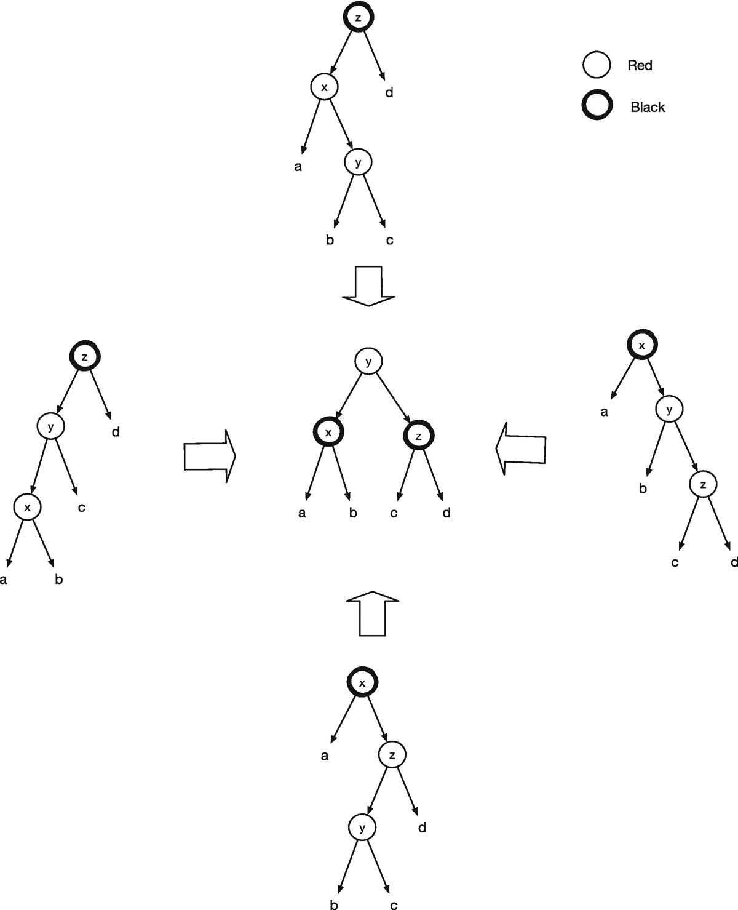

# 11. 模式匹配

在 ML 或 Haskell 这类语言中，你可以通过指定用于构造任意给定类型值的函数来定义数据类型。这本身并不太引人注目，但结合这些语言的模式匹配特性后，你就能编写出极其简洁的函数来转换数据结构。

在我的著作《Functional Data Structures in R》（Mailund，2017a）中，我描述了几种依赖于基于树结构进行转换的算法。这类转换涉及分析树的当前结构——它是否有左子树？那棵子树是叶节点吗？如果是红黑搜索树，树的颜色是什么？其右子树的颜色又是什么？在该书给出的算法中，大部分函数仅用于匹配这种树结构的代码就占了几十行。

借助本章实现的编程语言，编写这类转换函数的效率将大大提高。我们将构建两个主要结构。第一个用于定义数据结构，例如我们可以这样定义红黑搜索树：

```
colour := R | B
rb_tree := E | T(col : colour, left : rb_tree, value, right : rb_tree)
```

第二个结构用于匹配此类类型的值，并据此执行相应操作。红黑搜索树的平衡函数可以简洁地实现如下：

```
balance(
  T(R, T(B, a, x, b), y, T(B, c, z, d)),
  T(B, T(R, T(R, a, x, b), y, c), z, d) -> T(R, T(B, a, x, b), y, T(B, c, z, d)),
  T(B, a, x, T(R, b, y, T(R, c, z, d))) -> T(R, T(B, a, x, b), y, T(B, c, z, d)),
  T(B, a, x, T(R, T(R, b, y, c), z, d)) -> T(R, T(B, a, x, b), y, T(B, c, z, d)),
  otherwise -> tree
)
```

这个函数仅需八行代码，而《Functional Data Structures in R》中则用了 42 行代码，尽管那里也使用了一些模式匹配技巧，但并没有专为它设计的领域特定语言。这种语言正是本章要实现的目标。

本章我们将使用以下 R 包：

```r
library(rlang)
library(magrittr)
library(dplyr)
```

此外还需要使用我们在第 6 章定义的 `make_args_list` 函数。

```r
make_args_list <- function(args) {
  res <- replicate(length(args), substitute())
  names(res) <- args
  as.pairlist(res)
}
```

如需包含本章及更多功能的完整 R 包，可参考 [`https://mailund.github.io/pmatch/`](https://mailund.github.io/pmatch/)。

## 构造器

这种领域特定语言的核心特性在于类型构造器——即我们如何定义给定类型的值。DSL 的模式匹配部分将由嵌套的构造器调用组成，因此构造器的定义方式是该语言的核心要素。

这里我们借鉴函数调用的方式。构造器将采用与变量和函数调用相匹配的语法。

```
TYPEDEF ::= TYPENAME ':=' CONSTRUCTORS
CONSTRUCTORS ::= CONSTRUCTOR | CONSTRUCTOR '|' CONSTRUCTORS
CONSTRUCTOR ::= NAME | NAME '(' ARGS ')'
ARGS ::= ARG | ARG ',' ARGS
ARG ::= NAME | NAME ':' TYPE
TYPE ::= NAME
```

### 实现 `:=` 操作符

我们通过实现 `:=` 操作符来解析上述语法。赋值操作拥有最低优先级，这意味着该操作符左右两侧的内容都将成为函数的参数。我们无需担心语言中的表达式会被翻译成其他类型的 `call` 对象。由于无法重写其他赋值操作符（如 `<-`、`->` 和 `=`），因此必须使用 `:=`。这恰好与传统上表示“定义为等于”的用法一致。

实现模式匹配 DSL 这部分的方法与之前示例不同。我们既不会创建可分析的数据结构，也不会直接基于新语言的表达式求值。相反，我们将解析表达式与代码生成相结合——在解析规范的同时生成新的函数和对象。我们将这些函数及其他用于常量的对象添加到调用 `:=` 的环境中。将这些对象添加到环境后，我们无需额外编码即可使用这些构造器，但这意味着调用 `:=` 会产生副作用。

该构造函数将类型名称作为左侧参数，右侧参数则是描述构造类型元素的不同方式的表达式。我们将左侧参数转换为 quosure，以便获取其关联环境。右侧参数则转换为表达式。对于构造规范，我们不希望对任何元素求值（除非用户调用准引用）。左侧参数（即要定义的类型）仅作为字符串处理（因为 S3 系统以字符串方式处理类型），因此需确保其为单个符号并获取其字符串表示。为此可使用 `rlang` 的 `quo_name` 函数。右侧参数需进行解析，但我们将此任务委托给后续定义的独立函数。最后，我们为定义的新类型指定格式化打印函数。

```r
`:=` <- function(data_type, constructors) {
  data_type <- enquo(data_type)
  constructors <- enexpr(constructors)
  stopifnot(quo_is_symbol(data_type))
  data_type_name <- quo_name(data_type)
  process_alternatives(
    constructors,
    data_type_name,
    get_env(data_type)
  )
  assign(paste0("toString.", data_type_name),
         deparse_construction, envir = get_env(data_type))
  assign(paste0("print.", data_type_name),
         construction_printer, envir = get_env(data_type))
}
```

该函数中的最后两个语句，即对 `assign` 的调用，创建了用于打印我们所创建类型元素的函数。我们稍后将实现 `deparse_construction` 和 `construction_printer` 函数。它们从我们将存储在新类型对象中的元信息里提取有关值的信息，并且我们可以将这些函数用于我们语言中定义的所有类型。我们使用它们来专门化针对此特定类型的 `toString` 和 `print` 函数。`paste0` 调用创建了泛型 `toString` 和 `print` 函数专门化版本的名称。然后，`assign` 函数将 `deparse_construction` 和 `construction_printer` 存储在从 `get_env(data_type)` 获取的环境中的适当名称下，换句话说，也就是我们定义类型的环境。

### 处理构造器规范

`:=` 右侧的表达式定义了我们如何构造新类型的元素。我们允许存在不止一种构造方式，并使用或运算符 `|` 来分隔各种选择。这种方法类似于我们在指定语法时描述不同替代方案的方式，因此它是一个自然的选择。为了处理右侧内容，我们使用 `process_alternatives` 函数。

```r
process_alternatives <- function(constructors,
                                 data_type_name,
                                 env) {
  if (is_lang(constructors) && constructors[[1]] == "|") {
    process_alternatives(
      constructors[[2]],
      data_type_name,
      env
    )
    process_alternatives(
      constructors[[3]],
      data_type_name,
      env
    )
  } else {
    process_constructor(
      constructors,
      data_type_name,
      env
    )
  }
}
```

除了构造函数表达式之外，我们还将类型名称和定义该类型的环境作为参数传递。我们不会在此函数中直接使用它们，而只是将它们传递下去。稍后在我们创建实际构造函数时会用到它们。

`process_alternatives` 函数递归地解析表达式，以获取所有由 `|` 分隔的替代项。实际的构造函数要么是一个函数，要么是一个符号，因此构造函数的规范不会比或运算符具有更高的优先级。当我们第一次看到不是 `|` 调用的内容时，我们就找到了一个构造函数。我们使用 `process_constructor` 函数来处理这些内容。

```
process_constructor <- function(constructor,
data_type_name,
env) {
if (is_lang(constructor)) {
process_constructor_function(
constructor,
data_type_name,
env
)
} else {
process_constructor_constant(
constructor,
data_type_name,
env
)
}
}
```

该函数判断我们正在查看的是一个函数构造函数还是一个常量（即一个符号）。我们使用 `is_lang` 函数来测试正在查看的项是否为一个函数。它的作用与 `base` 包中的 `is.call` 相同；只是在本章中我更喜欢使用 `rlang` 函数。

常量构造函数是最简单的。它们仅仅是符号，因此，为了使程序员能够使用它们，我们需要为每个此类符号定义一个值。我们将使用 `NA` 作为这些变量的值，并为其存储一些元信息。我们设置了类，这样当我们尝试打印该对象时，会调用 `construction_printer` 函数；我们还设置了属性 `constructor_constant`，稍后在模式匹配时需要用到。

```
process_constructor_constant <- function(constructor,
data_type_name,
env) {
stopifnot(is_symbol(constructor))
constructor_name <- as_string(constructor)
constructor_object <- structure(
NA,
constructor_constant = constructor_name,
class = data_type_name
)
assign(constructor_name, constructor_object, envir = env)
}
```

对于函数构造函数，如你所料，我们需要创建函数。我们分析提供给构造函数规范的参数，并基于此构建一个函数，然后将这个函数存储在定义构造函数的环境中。我们允许构造函数有两种参数：要么是一个符号，要么是一个带有类型的符号。对于后者，我们使用 `:` 运算符。如果参数是一个 `:` 调用，那么我们将左侧视为参数，右侧视为类型。我们使用类型来保证我们构造的值符合预期类型。如果没有指定类型，我们将允许参数保存任何值。我们使用以下函数将来自函数构造函数表达式的参数列表转换成一个数据框，其中第一列保存参数名称，第二列保存其类型。我们使用 `NA` 来表示允许任何类型。该函数的工作原理是：首先将参数（以 `call` 对象的形式）转换成一个列表。为此，我们必须使用基础的 `as.list` 函数，而不是 `rlang` 的 `as_list`，因为后者不会将 `call` 对象转换成列表。一旦我们将参数作为列表获取后，我们就在这些元素上映射 `process_arg` 函数。该函数为每个元素创建数据框的一行，然后我们使用 `dplyr` 中的 `bind_rows` 函数将这些行合并起来。

```
process_arguments <- function(arguments) {
  arguments %>%
    as.list %>%
    purrr::map(process_arg) %>%
    bind_rows
}
```

`process_constructor_function` 将一个函数构造规范转换成一个函数。规范（一个 `call` 对象）的第一个元素是函数的名称。对于其余元素，我们使用刚才看到的函数将它们转换成数据框。之后，我们需要创建一个将用作构造函数的函数。在这里，我们创建一个没有参数的闭包，然后像上一章那样，随后添加形式参数，并使用 `as_list(environment())` 技巧获取调用闭包时的实际参数。

我们从闭包返回的值只是提供给它的参数列表，但带有我们可用于模式匹配的 `constructor` 属性，以及设置为我们在定义的类型（用于类型检查）的 `class`。类型检查是构造函数的主要部分。在这里，我们检查是否获得了正确数量的参数，并且如果指定了类型，还要检查参数是否具有正确的类型。

一旦我们创建了闭包并设置了它的形式参数，我们还会更新其类，使其既是 `constructor` 又是 `function`。给构造函数赋予 `constructor` 类也是我们在进行模式匹配时所需要的。然后，我们将其分配给与规范关联的环境，以便程序员可以使用它。

```
process_constructor_function <- function(constructor,
data_type_name,
env) {
stopifnot(is_lang(constructor))
constructor_name <- quo_name(constructor[[1]])
constructor_arguments <- process_arguments(constructor[-1])
# 创建构造函数
constructor <- function() {
args <- as_list(environment())
# 类型检查！
stopifnot(length(args) == length(constructor_arguments$arg))
for (i in seq_along(args)) {
arg <- args[[constructor_arguments$arg[i]]]
type <- constructor_arguments$type[i]
stopifnot(is_na(type) || inherits(arg, type))
}
structure(args,
constructor = constructor_name,
class = data_type_name)
}
formals(constructor) <- make_args_list(constructor_arguments$arg)
# 设置关于构造函数的元信息
class(constructor) <- c("constructor", "function")
# 将构造函数放入绑定作用域
assign(constructor_name, constructor, envir = env)
}
```

构造函数需要编写的最后一个函数是打印它们的函数。这里，我们编写一个将构造对象转换为字符串的函数；我们可以递归地使用这个函数，将任何构造元素转换为字符串。然后，在 `construction_printer` 中调用这个函数，该函数被赋值给我们定义的任何类型的专用 `print` 函数。

这个函数并不复杂。我们首先检查对象是否具有 `constructor` 属性。严格来说，只有函数构造函数具备此属性——常量构造函数具有 `constructor_constant` 属性，但 `attire` 函数如果收到唯一前缀时会自动选取属性，因此也能获取到。如果没有 `constructor` 属性，那就不是由我们语言定义的内容构造的元素，它必然是其他类型的值——我们只需将其转换为字符串并返回。为此，我们使用通用的 `toString` 函数。该函数可将任何对象转换为字符串。它未必是对象的漂亮表示，但如果有需要，你可以对其进行特化。

如果我们处理的对象是构造函数，那它要么是常量，要么是构造函数函数调用的结果。如果是后者，它将是一个列表。若是一个列表，我们必须将列表中的所有元素转换为字符串并拼接在一起。否则，构造函数的名称就是该对象的字符串表示。

```
deparse_construction <- function(x) {
if (has_attr(x, "constructor")) {
constructor_name <- attr(x, "constructor")
if (is.list(x)) {
components <- purrr::map_chr(x, deparse_construction)
values <- components
print_args <- vector("character", length = length(components))
for (i in seq_along(components)) {
print_args[i] <- paste0(components[i], "=", values[i])
}
print_args <- paste0(print_args, collapse = ", ")
paste0(constructor_name, "(", print_args, ")")
} else {
constructor_name
}
} else {
toString(x)
}
}
construction_printer <- function(x, ...) {
cat(deparse_construction(x), "\n")
}
```

作为使用构造语言的一个示例，我们可以将二叉树定义为：要么是一棵包含左子树和右子树的树，要么是一片叶子。

```
tree <- T(left : tree, right : tree) | L(value : numeric)
```

我们可以使用构造函数创建一棵树：

```
x <- T(T(L(1),L(2)),L(3))
x
## T(left=T(left=L(value=1), right=L(value=2)), right=L(value=3))
```

我们将 `test_pattern_rec` 函数封装在一个闭包 `tester` 中，该闭包被调用时传入一个我们称之为 `escape` 的函数。这个函数就是 `callCC` 将提供的函数。如果在任何时候，我们调用了 `escape` 函数，它将终止我们正在执行的任何操作，并返回到我们调用 `callCC` 的那个点。这意味着，如果我们发现某个模式与表达式不匹配，我们可以使用 `escape` 从深层递归中跳出。我们无需将不匹配的结果通过递归函数调用逐层向上传播。一旦我们调用 `escape`，我们就会立即返回到 `test_pattern` 的末尾。无论我们用 `escape` 传入什么参数——它是一个单参数函数——都将成为 `callCC` 调用的返回值。因此，如果我们发现某个模式不匹配，我们将调用传入 `NULL` 的 `escape`。然后这将成为 `test_pattern` 的结果。如果我们从未调用 `escape`，而是从 `test_pattern_rec` 正常返回，那么该函数的返回值也将成为 `callCC` 调用的返回值。因此，如果我们匹配了模式并从 `test_pattern_rec` 返回一个环境，这也将成为 `test_pattern` 调用的返回值。

```r
test_pattern <- function(expr, test_expr, eval_env) {
  # 用于存储匹配变量的环境
  match_env <- env()
  
  if (test_expr == quote(otherwise))
    return(match_env)
  
  # 测试模式
  tester <- function(escape)
    test_pattern_rec(escape, expr, test_expr,
                     eval_env, match_env)
  
  callCC(tester)
}
```

真正的工作是在 `test_pattern_rec` 中完成的。它分析存储在 `test_expr` 变量中的模式表达式，并将其与存储在 `expr` 变量中的值进行匹配。它还接收两个环境作为参数。一个是表达式和模式定义时所在的环境；它需要这个环境来查找变量以检查它们是什么。另一个是它应该在其中绑定模式变量的环境。当然，它也知晓 `escape` 函数，当其发现模式不匹配时可以使用该函数。

```r
test_pattern_rec <- function(escape, expr, test_expr,
                             eval_env, match_env) {
  # 这是一个函数构造器吗？
  if (is_lang(test_expr)) {
    func <- get(as_string(test_expr[[1]]), eval_env)
    if (inherits(func, "constructor")) {
      # 这是一个构造器。
      # 检查它是否是正确类型
      constructor <- as_string(test_expr[[1]])
      expr_constructor <- attr(expr, "constructor")
      if (is_null(expr_constructor) ||
          constructor != expr_constructor)
        escape(NULL) # 类型错误
      
      # 现在递归检查
      for (i in seq_along(expr)) {
        test_pattern_rec(
          escape,
          expr[[i]], test_expr[[i+1]],
          eval_env, match_env
        )
      }
    }
  }
}
```

分析以下代码片段：

```r
  # 如果运行到这里，说明匹配成功
  return(match_env)
}
}
  # 这是一个常量构造器吗？
  if (is_symbol(test_expr) &&
      exists(as_string(test_expr), eval_env)) {
    constructor <- as_string(test_expr)
    val <- get(constructor, eval_env)
    val_constructor <- attr(val, "constructor_constant")
    if (!is_null(val_constructor)) {
      expr_constructor <- attr(expr, "constructor")
      if (is_null(expr) || constructor != expr_constructor)
        escape(NULL) # 类型错误
      else
        return(match_env) # 匹配成功
    }
  }
  # 不是构造器。
  # 必须是待比较的值或待绑定的变量
  if (is_symbol(test_expr)) {
    assign(as_string(test_expr), expr, match_env)
  } else {
    value <- eval_tidy(test_expr, eval_env)
    if (expr != value) escape(NULL)
  }
  match_env
}
```

这里有三种情况需要考虑。`test_expr` 要么是一个构造器函数、一个构造器常量，要么是其他东西。

如果 `test_expr` 是一个函数调用（我们使用 `rlang` 中的 `is_lang` 来测试），那么它可能是一个函数构造器。为了确定是否是，我们在求值环境（也就是编写测试模式的环境）中查找该函数名称。然后我们测试该函数是否继承自 `constructor`。我们在 DSL 中创建的函数也将是构造器对象，因此如果它确实继承了 `constructor`，我们就知道它是构造器。然后我们检查 `expr` 是否有一个名为 `constructor` 的属性。如果 `expr` 是通过调用构造器生成的，它就会有这个属性。如果没有，则无法匹配，我们使用 `NULL` 作为参数调用 `escape` 退出。如果构造器的名称不匹配，我们也会退出。如果匹配，我们就遍历模式和表达式调用中的所有元素，并尝试匹配它们。如果它们不匹配，我们将永远不会从递归调用中返回——它们会使用 `escape` 函数直接跳转到 `test_pattern` 中的 `callCC` 点。如果它们返回了，说明模式与表达式匹配，我们返回包含在匹配过程中绑定的所有变量的 `match_env` 环境。

如果 `test_expr` 不是一个函数调用，它仍然可能是一个构造器。如果是，它将是一个符号，并且该符号将是 `eval_env` 作用域中的一个变量——我们使用 `exists` 函数来测试这一点。这两个测试仅仅告诉我们 `eval_env` 中存在一个名为 `test_expr` 的变量。这并不能说明它是一个常量构造器。为了测试这一点，我们使用 `get` 函数获取该变量求值后的值，并检查它是否有一个名为 `constructor_constant` 的属性。如果有，那么这就是构造器的名称，我们可以将其与 `expr` 中的值进行比较，`expr` 中的值要么是表示该常量的对象（在这种情况下匹配成功），要么是其他东西（在这种情况下我们退出）。

如果通过了前两个测试，那么我们就不是构造器。现在我们要么有一个必须与 `expr` 比较的值，要么有一个应该绑定到 `expr` 值的变量。在这里，我决定任何符号都将被解释为应该绑定的变量，而其他任何东西都应该是我们求值后与 `expr` 进行比较的值。我们也可以检查该变量是否已绑定，并在这种情况下使用它的值，但这显然会导致难以修复的错误。无论如何，你总是可以使用准引用（quasi-quoting）来实现相同的效果。

```
x  "x",
L(!!y) -> "y")
## [1] "x"
```

因此，我们通过将 `expr` 的值赋值给 `match_env` 环境中的符号来绑定任何变量。任何不是符号的东西都应该是一个与 `expr` 相等的值。为了获取这个值，我们在 `eval_env` 中对 `test_expr` 进行求值。

这就是模式匹配的整个实现。它可能不是简单的代码，但也并非极其复杂，并且我们在不到 200 行的代码中创建了一个高效的语言。

现在，我们可以通过实现我们之前定义的二叉树类型的深度优先遍历来尝试它。下面的函数是一个简单的遍历，它将叶子中找到的所有值相加。`match` 调用考虑了基础情况（叶子）和递归情况（具有 `left` 和 `right` 子树的树），并且不需要 `otherwise` 情况。

```
dft  v,
T(left, right) -> dft(left) + dft(right))
}
dft(L(1))
## [1] 1
dft(T(L(1),L(2)))
## [1] 3
dft(T(T(L(1),L(2)),L(3)))
## [1] 6
```

### 列表

我们在本书中多次使用了链表，但所用到的函数必须通过 `list` 来访问列表元素。现在，我们可以使用新语言像这样定义链表：

```r
linked_list := NIL | CONS(car, cdr : linked_list)
```

一个列表要么为空（我们使用常量 `NIL` 表示），要么包含一个头元素 (`car`) 和一个尾元素 (`cdr`)。由于我们将从语言中构造的值实现为 `list` 对象，因此我们会自动从该规范中获得链表的实现。

借助模式匹配，我们可以编写简单的函数来操作列表。例如，以下函数使用累加器列表来反转列表。在基本情况下，当第一个列表为空时，我们返回累加器。否则，我们取出列表的头部，将其前置到累加列表上，然后进行递归。我们 `force` 对累加器的求值，以避免惰性求值。在惰性求值下，我们会构建越来越大的 `CONS` 表达式，这些表达式直到递归结束时才会被求值。到那时，我们构建的表达式可能已经大到超出函数求值所需的栈空间。例如，请参阅 Mailund (2017b) 和 Mailund (2017a) 以了解递归和惰性求值如何共同导致栈空间溢出的解释。

```r
reverse_list  acc,
CONS(car, cdr) -> reverse_list(cdr, CONS(car, acc)))
}
```

我们可以编写一个类似的函数来计算列表的长度。它将遵循相同的累加器模式，在基本情况下返回累加器，并在递归情况下更新它。

```r
list_length  acc,
CONS(car, cdr) -> list_length(cdr, acc + 1))
}
```

将链表转换为 `list` 对象的函数稍微复杂一些，但仍然可以使用模式匹配简洁地编写。我们需要先确定 `list` 对象的长度，然后为其分配空间，最后迭代链表以更新该 `list`。我们使用一个闭包 `f` 来递归遍历链表。在基本情况下，我返回 `NULL`。这里返回什么并不重要，因为我们只为了其副作用而进行递归，这些副作用在递归情况下处理。在这里，我使用一个代码块——花括号运算符——来求值两个语句。第一个更新列表 `v`，第二个继续递归。正是因为我们使用了整洁求值，这个函数才能工作。至关重要的是，递归情况中的赋值操作要在编写表达式的环境中进行求值。否则，我们将无法更新正确的列表。

```r
list_to_vector  NULL,
CONS(car, cdr) -> {
v[[i]] % unlist
}
```

将 `list` 转换为链表非常简单，并且不需要使用任何模式匹配——毕竟我们无法对 `list` 对象进行模式匹配。

```r
vector_to_list <- function(vec) {
lst <- NIL
for (i in seq_along(vec)) {
lst <- CONS(vec[[i]], lst)
}
reverse_list(lst)
}
```

借助这几个函数，我们可以在向量和列表之间进行转换，并处理列表。

```r
lst % reverse_list %>% list_to_vector
## [1] 5 4 3 2 1
```

至于用更多函数扩展链表的功能，我将把它留给感兴趣的读者作为练习。您可以尽情尝试。

### 搜索树

作为另一个例子，我们可以实现搜索树。这些树包含有序的值，并满足递归性质：搜索树的**左**子树中的所有元素的值都小于存储在树根处的值，而搜索树的**右**子树中的所有元素的值都大于树根中的值。

# 搜索树与红黑搜索树

为了定义搜索树，我们采用了一种与之前二叉树不同的方法。我们定义了一个空树 `E`，以及一个具有两个子树 `left` 和 `right` 以及一个 `value` 的树。

```
search_tree :=
E | T(left : search_tree, value, right : search_tree)
```

对于这个例子，我们将只实现两个函数：`insert` 和 `member`。关于搜索树的更多函数，请参阅 Mailund (2017a, 第 6 章)。

这两个函数都在树中递归搜索，直到它们分别找到要插入的值，或者找到要检查其成员资格的值在树中。对于插入操作，基本情况是当到达叶子节点时，在该处插入元素。它将创建一个树，包含两个空子树，并存储该值。递归函数通过在递归调用中使用 `T` 构造函数创建新树来构建树。因此，在叶子节点处创建的树将被放入 `insert` 函数创建的更新后的树中。对于 `member` 函数，我们不需要更新树。如果到达叶子节点，我们就知道该元素不在树中，可以直接返回 `FALSE`。在这两个函数中，搜索都会检查在递归情况下看到的树的节点值。如果该值大于 `x`，则 `x` 可能存在的唯一位置是左子树，因此我们继续在那里搜索。另一方面，如果 `x` 大于该值，则我们必须搜索右子树。如果它既不小于也不大于该值，则它必定等于该值。对于插入操作，这意味着我们无需执行任何操作，可以直接返回已经包含 `x` 的树。对于成员测试，我们可以返回 `TRUE`。

```
insert  T(E, x, E),
T(left, val, right) -> {
if (x  val)
T(left, val, insert(right, x))
else
T(left, x, right)
})
}
member  FALSE,
T(left, val, right) -> {
if (x  val) member(right, x)
else TRUE
})
}
```

我们可以像这样构建一棵树：

```
tree <- E
for (i in sample(2:4))
tree <- insert(tree, i)
```

树构建完成后，我们可以像这样测试成员资格：

```
for (i in 1:6) {
cat(i, “ : “, member(tree, i), “\n”)
}
## 1  :  FALSE
## 2  :  TRUE
## 3  :  TRUE
## 4  :  TRUE
## 5  :  FALSE
## 6  :  FALSE
```

这两个函数的最坏情况时间开销与树的深度成正比，而树的深度可能随树中存储的元素数量线性增长。但是，如果我们保持树的平衡，则时间开销会减少到树大小的对数级别。一种用于保持搜索树平衡的经典数据结构是所谓的红黑搜索树。在 C/C++ 或 Java 等语言中使用指针或引用操作来实现这些树可能相当具有挑战性，但在函数式语言中，平衡此类树只是基于局部结构进行树变换的简单问题。例如，请参阅 Okasaki (1999)、Germane 和 Might (2014) 或 Mailund (2017a)。

# 红黑搜索树

红黑搜索树是二叉搜索树，其中每个树都有一个关联的颜色，红色或黑色。我们可以像这样使用构造器来定义颜色：

```
colour :=
R | B
```

我们可以像这样为所有非空树添加颜色：

```
rb_tree :=
E | T(col : colour, left : rb_tree, value, right : rb_tree)
```

除了在模式匹配中包含颜色之外，此数据结构的 `member` 函数与普通搜索树的完全相同。

```
member(_, FALSE),
T(col, left, val, right) -> {
  if (x < val) member(left, x)
  else if (x > val) member(right, x)
  else TRUE
})

tree <- T(R, E, 2, T(B, E, 5, E))
for (i in 1:6) {
  cat(i, " : ", member(tree, i), "\n")
}
## 1  :  FALSE
## 2  :  TRUE
## 3  :  FALSE
## 4  :  FALSE
## 5  :  TRUE
## 6  :  FALSE
```

红黑搜索树保持平衡的关键在于，我们始终强制要求以下两个不变量：

*   没有红色节点拥有红色父节点。

*   从根节点到每个叶子节点的所有路径上，黑色节点的数量相同。

如果从根节点到每个叶子节点的所有路径上黑色节点数量相同，那么忽略红色节点后，这棵树就是完全平衡的。由于没有红色节点拥有红色父节点，当考虑红色节点时，最长路径的长度也不会超过最短路径长度的两倍。

## 插入与再平衡

为了保证这些不变量，我们总是在红色叶子节点中插入新值（这可能会违反第一个不变量），然后重新平衡所有违反该不变量的子树，最后将根节点设为黑色。重新平衡的操作是在递归插入调用返回时进行的，其他方面的操作与普通搜索树的插入相同。

```
insert_rec(_, x, E) = T(R, E, x, E),
insert_rec(T(col, left, val, right), x) -> {
  if (x < val)
    balance(T(col, insert_rec(left, x), val, right))
  else if (x > val)
    balance(T(col, left, val, insert_rec(right, x)))
  else
    T(col, left, x, right) # 已存在
})

insert <- function(tree, x) {
  tree <- insert_rec(tree, x)
  tree$col <- B
  tree
}
```



图 11-1 展示了 `balance` 函数的变换规则。当我们看到边缘处四种树结构中的任何一种时，都需要将其变换为中间的树结构。我在 Mailund (2017a) 中给出的实现主要包含测试树结构以进行匹配的代码，而用于构建修改后树的代码很少。通过模式匹配，我们可以通过匹配以下四种情况来实现这些规则：

```
balance(T(B,T(R,T(R,a,x,b),y,c),z,d)) -> T(R,T(B,a,x,b),y,T(B,c,z,d)),
balance(T(B,T(R,a,x,T(R,b,y,c)),z,d)) -> T(R,T(B,a,x,b),y,T(B,c,z,d)),
balance(T(B,a,x,T(R,b,y,T(R,c,z,d)))) -> T(R,T(B,a,x,b),y,T(B,c,z,d)),
balance(T(B,a,x,T(R,T(R,b,y,c),z,d))) -> T(R,T(B,a,x,b),y,T(B,c,z,d)),
balance(tree) -> tree
```

这个函数正是我们用来引出领域特定语言的动机。至此，我们完成了一个完整的循环，实现了我们最初想要的语言。