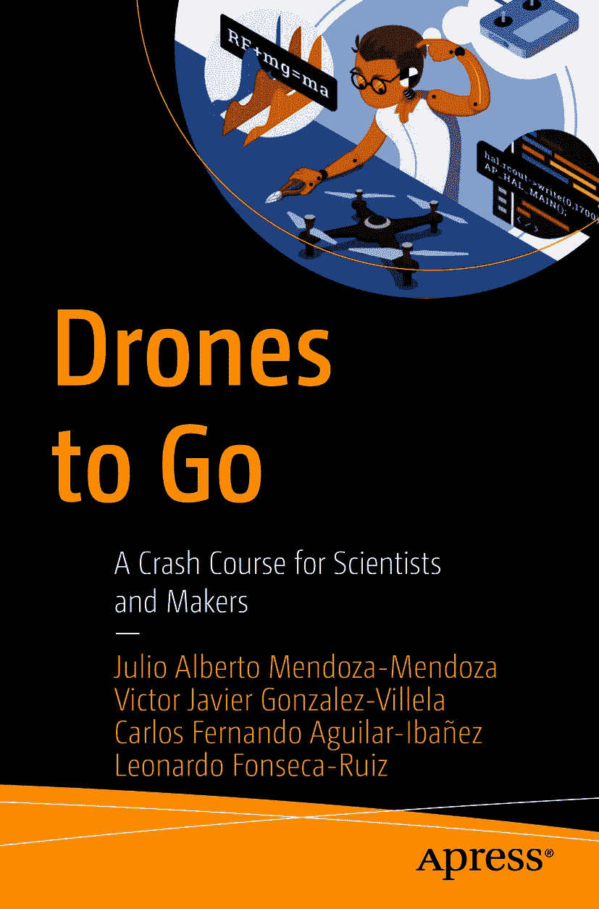

# 封面与版权信息

ISBN 978-1-4842-6787-5 e-ISBN 978-1-4842-6788-2 [`doi.org/10.1007/978-1-4842-6788-2`](https://doi.org/10.1007/978-1-4842-6788-2)

© Julio Alberto Mendoza-Mendoza, Victor Javier Gonzalez-Villela, Carlos Fernando Aguilar-Ibañez, Leonardo Fonseca-Ruiz 2021

本作品受版权保护。所有权利均由出版社独家许可，无论涉及材料的全部或部分，具体包括翻译、重印、插图复用、讲解、广播、以缩微胶卷或任何其他物理形式复制，以及电子改编、计算机软件或任何当前已知或未来开发的相似或不同方法的传输或信息存储与检索。本出版物中使用一般描述性名称、注册商标、商标、服务标记等，即便未作特别声明，也不意味着此类名称不受相关保护性法律和法规的约束，因此可自由使用。出版社、作者及编辑默认，本书中的建议和信息在出版之日是真实且准确的。出版社和作者或编辑均不对书中所含材料或可能存在的任何错误或遗漏提供明示或暗示的保证。出版社对已出版地图中的管辖权主张和机构隶属关系保持中立。本书通过 Springer Science+Business Media New York 在全球图书贸易中发行，地址：1 NY Plaza, New York, NY 10014。电话：1-800-SPRINGER，传真：(201) 348-4505，电子邮件：`orders-ny@springer-sbm.com`，或访问 `www.springeronline.com`。Apress Media, LLC 是加州有限责任公司，其唯一成员（所有者）是 Springer Science + Business Media Finance Inc（SSBM Finance Inc）。SSBM Finance Inc 是特拉华州的一家公司。

# 前言

本书可被视为关于无人机，特别是多旋翼飞行器（重点关注四旋翼飞行器）的最完整教程之一。其目标读者涵盖从创客到科学家的各类人群。书中包含了设计、建模、控制、仿真和编程的必要元素，以简洁但详尽的方式阐述，尤其关注许多其他书籍忽略的要点。此外，它将创客知识与技术细节、科学知识与设计细节融合于一书之中。

本书是多年在该领域研究的成果。它采用循序渐进的教学设计，使无人机领域的新手或已有基础者都能获得坚实的基础，以便进一步学习。

书中包含其他作品中没有的详细分步推导，例如控制器的详尽证明及其仿真。

书中明确指出了如何将此处发展的知识扩展到各种飞行器或航空系统中，并提供了充足的参考文献。

最后，附录为那些希望在该主题上扩展知识的人提供了非常全面的参考书目。

本书假设读者至少具备高中或技术学士学位，并理解导数、积分、基本常微分方程等概念，以及算法和编程的基本概念。

## 许可与版权

* `MATLAB®` 和 `Simulink®` 是 The MathWorks, Inc. 的注册商标。请参阅 `mathworks.com/trademarks` 了解其他商标列表。

* ArduPilot 库和 Mission Planner 软件是 GPLv3 许可的自由软件。它们可以根据自由软件基金会（`www.fsf.org/`）描述的 GNU GPLv3 条款和限制进行重新分发和/或修改。这些代码和程序分发时希望能有用，但不提供任何担保，甚至不包含适销性或特定用途适用性的默示担保。更多详情请参见 GNU 项目的通用公共许可部分。ArduPilot 库可从 `http://ardupilot.org/dev/docs/apmcopter-programming-libraries.html` 下载。

* PX4 库采用 BSD 3-Clause 许可证（`https://opensource.org/licenses/BSD-3-Clause`）。

* Pixhawk 自动驾驶仪采用 CC-BY-SA 3.0 许可证（`https://creativecommons.org/licenses/by-sa/3.0/deed.es`），版权归 Lorenz Meier 所有。

* DroneKit-Python 采用 Apache 许可证 2.0 版，2004 年 1 月（`www.apache.org/licenses/`）。

* Scilab 在 GPL 许可证下可用。Xcos 是免费提供的，并与 Scilab 一起分发。

## 通过本书，你将学到

* 成为多旋翼飞行器开发者所需五项理想技能的入门介绍：设计、建模、控制、仿真和编程

* 关于多旋翼飞行器数学的扩展模型，这在以往任何作品中都未涉及，并配有直观和循序渐进的推导，解答了在类似讲解中经常悬而未决的许多疑问

* 一种新颖的多旋翼飞行器控制器可视化方式，与现有最先进技术完全兼容

* 对控制器及其仿真的详细描述，这在文章或其他书籍中并未广泛传播，通常仅限于课堂

* 你可以将本书作为未来学习的基础，以小型、高度可视化且易于理解的形式呈现。

* 本书的目标是通过这类飞行器统一创客世界与科学世界，包含科学书籍中省略的设计技巧和设计书籍中省略的科学技巧。

* 你可以通过适度但系统的努力，将所学知识扩展到其他类型飞行器的设计与分析中。

# 如何阅读本书

本书分为五个部分，我们认为这些内容对于无人机设计者达到可接受的知识水平是必要的：

- 在设计部分，展示了准备多旋翼飞行器原型时需要考虑的技术特性。该部分基于创客风格文本和网页的汇编。请注意，这些知识可以轻松扩展到其他类型的飞行器。

- 在建模部分，展示了与四旋翼飞行器（及通用飞行器）相关的数学知识，重点阐述了三个基本方程组：动力学方程组（用于设计控制）、运动学方程组（用于设计待执行任务）以及分配方程组（用于对每个电机进行编程，充当理论与实践之间的桥梁）。同样，此处展示的知识也较易扩展到其他类型的飞行器。

- 在控制部分，开发了四种基本的多旋翼控制器类型，并将其分为两大分支：飞行器模式控制（也称为机载模式或第一人称模式）和机器人模式控制（也称为外部模式或第三人称模式）。这种分类更为可取，因为这些飞行器根据其应用场景既可被视为飞行器，也可被视为机器人。本部分的知识在特定机动条件下可扩展到其他类型的飞行器。

- 仿真部分提供了一种简化方法（一个模板）来模拟上述系统及其控制器，使您能够理解只需要两部分代码：包含建模和控制方程的部分，以及包含常微分方程求解器的部分。尽管本书为求简便使用了`MATLAB`和`Simulink`，但根据所概述的概念，您将能够使用任何其他编程语言或图形模拟器实现相同目的。

- 最后是实现部分，展示了当前可用或使用大多数无人机系统所需的编码考虑因素和信号处理。本部分也可能对其他类型的飞行器有用。

如您所见，本书及其章节可作为制定用于教授和学习所述主题的完整计划的基础。本书本身就是一门袖珍完整课程。

本书面向与无人机世界，特别是多旋翼飞行器相关的创客、设计师、科学家和研究人员。然而，如果您是一名飞行员或爱好者，并且有兴趣了解您飞行器的每个细节，那么本文将会是实用且易于理解的读物。

如果您拥有本书的印刷版，建议同时下载其 `PDF` 版本，以便查看方程的详细特写。

## 致谢

**胡里奥·门多萨** 本书得到了 `UNAM DGAPA` 博士后资助计划 2018-2020 的支持。我还要感谢 `IPN`、`Conacyt` 和 `IMPI`，以及我的老师、学生、家人和朋友，特别是 Humberto Sossa、Jose Antonio Aquino、Gabriel Sepulveda、Rogelio Lozano、Miguel Suarez-Castanon、Marco Butron、Hazur Socconini、Francisco Arteaga-Velasquez、Jamyr Vasquez-Salinas、Carlos Vargas-Luis、David Arvizu-Rondero、Vicente Flores-Gutierrez、Mario Martinez-Ramirez、Artemisa Pedroza、Rodrigo Encinas-Porcel、Rodrigo Pelayo-Ramos、Mauricio Mendez、Tio Fox (Neftali Elorza)、Gilberto Castrejon、Rafael Martinez、Manuel Jesus Rodriguez、Orlando Garcia、Carlos Rios Ramirez、Pablo Mendoza-Iturralde、Ernesto Filio-Lopez、我们的平面设计师 Jesus Castillo、我们的编辑 Natalie Pao 及其团队、通过 Philip Rowse 及其 `CubePilot` 项目联系的 `Ardupilot` 团队、`Mathworks` 图书计划，以及许多其他人士和机构。我也深深感谢我的祖母 Guille，她不幸未能打破自己 100 岁的个人纪录。最后，我感谢医生、护士、救援人员、食品和服务提供者、研究人员以及所有公共安全团队的宝贵帮助，他们是真正的英雄，在整个人类面临真正艰难的时刻，他们冒着自身安危支持着我们。特别地，本书献给所有那些已不在我们身边，但对我们成长和生活产生了深远影响的人，包括我的另一位祖母 Carmen，也献给所有在街头默默无闻或身处贫困，未能在我们的名单中被提及的人们。

**维克多·J·冈萨雷斯-维莱拉** 感谢研究与技术创新项目支持计划 (`PAPIIT`) 和 `DGAPA` 博士后资助计划 (`UNAM`)，以及国家科学与技术委员会 (`CONACYT`) 通过其国家研究系统 (`SNI exp 262253`) 提供的支持。我还要感谢我亲爱的家人，特别是我的女儿 Brenda 和儿子 Andres，感谢他们多年来在顺境和逆境中的支持。此外，感谢机电一体化研究小组 (`MRG`) 的所有成员以及机械设计与技术创新中心 (`CDMIT`) (`FI`, `UNAM`) 的所有成员，多年来我与他们共同经历了许多个人和职业上的体验，为共同目标而工作，最后，感谢所有使本书得以出版的人。

**卡洛斯·阿吉拉尔** 我谨向我的同事和朋友们表示深切的感谢，他们是教授 Santiago Suarez、Octavio Gutierrez、Julio Mendoza、Jose de Jesus Rubio、Jose Angel Acosta、Juan Carlos Martinez、Ruben Garrido、Rafael Martinez、Eloisa García 和 Nareli Cruz，感谢他们多年来给予我的关注和无法估量的支持。我还要感谢我的新朋友和合作者，教授 Eduardo Javier、Manuel 和 Belem 对我工作的贡献。我谨向我的导师和榜样——教授 Moises Bonilla、Rogelio Lozano、Hebertt Sira 和 Romeo Ortega——表示深切的感激。对我来说，他们是我们挚爱职业中努力和奉献的典范。最后但同样重要的是，我要感谢我挚爱的妻子 Erika、我的女儿 Daira 和 Zaida，以及我的母亲、兄弟、表亲和叔伯，他们是我爱的主要源泉，也是我每天努力成为更好的人的动力。最后，我感谢上帝让我能够从事并依靠我所热爱的事业生活。

**莱昂纳多·丰塞卡-鲁伊斯** 我将本书献给 Aidee、Matilde Amelie 和 Leonardo，他们是我生命中的光。我还感谢国家理工学院；我的学生们，他们让我保持与时俱进；Julio Alberto Mendoza 博士和 Mauricio Méndez 硕士，他们从成为我的学生起就一直在我身边，并且总是全力以赴，激励我也这样做。我衷心感谢 `IPN` 的工程与高级技术跨学科专业单位 (`UPIITA`)，它让我有机会在 14 年多的时间里教授新一代机电一体化工程师。

## 关于作者 关于技术审稿人

