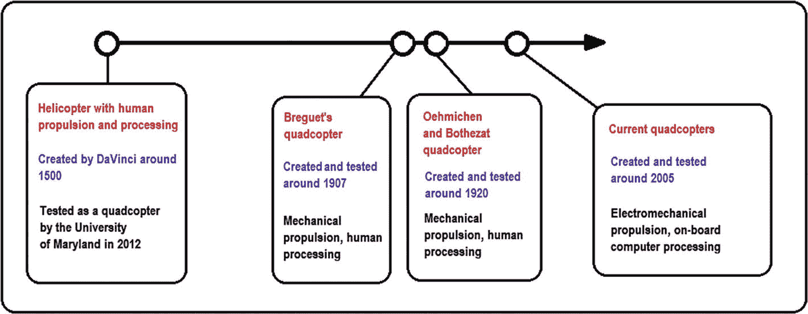

# 历史背景

观察图 1-1 你会发现，无人机，尤其是多旋翼飞行器，已有数百年的历史。它们最初源于达芬奇绘制的草图（至少西方历史是这样记载的）。近期，马里兰大学以某种复古技术将这些草图变为现实，打造了一架巨型四旋翼飞行器，其处理器和基础引擎分别是人体（分别是大脑和四肢）。多旋翼飞行器于 1907 年由布雷盖兄弟重新带回人们的视野，随后在 20 世纪 20 年代由厄米兴和博特扎特进一步推进。在这些无人机中，处理器和基础引擎分别由飞行员和负责协调每个螺旋桨与内燃机动作的机械计算机（一种机械装置）担任。此后它们一度被遗忘，直到 2010 年代，这类载具/机器人领域才迎来商业与研究热潮。如今，其处理器和引擎基础已演变为自动驾驶仪和电动机。了解了这些历史后，让我们继续学习一些有用的术语。

图 1-1

四旋翼飞行器发展史

