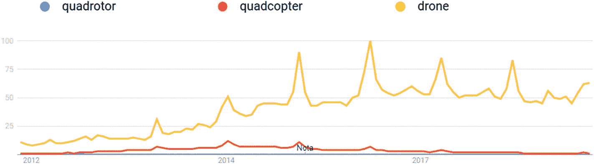
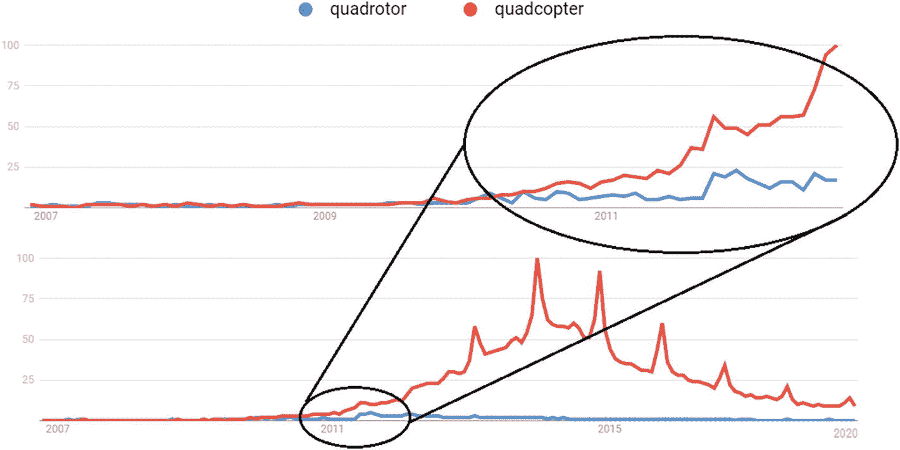

# 词源与常用名称

尽管“drone”一词正确用于指代任何无人驾驶载具，但商业推广将其与飞行器，尤其是多旋翼飞行器紧密关联。该术语源自昆虫，特指蜂巢或巢穴中仅负责繁衍种群的工蜂。

指代空中无人机更专业的词汇包括：
- 无人机（UAV）
- 无人航空系统（UAS）
- 遥控驾驶飞机系统（RPAS）

你还应熟悉“多旋翼飞行器”和“多旋翼机”这两个术语，它们大致指代多个旋转电机。“多旋翼机”一词源于法语“hélicoptère”，由古斯塔夫·达梅库尔于 1861 年创造，意为螺旋形机翼。该词基于希腊语“helix”（意为螺旋或螺旋形）和“pteron”（意为机翼）。

了解这些有何用处？或许看似琐碎，但对于希望研究无人机经典概念的人来说，了解古老的专业术语十分重要。当然，如果你只需关注当前的研究和新趋势，那么掌握现代术语就足够了。对于本书所介绍的飞行器，从经典术语到当前术语的演变如下：
- 多旋翼机（2020 年 5 月 5 日在 Google Scholar 上获得 22,400 条结果）-> 多旋翼飞行器（2020 年 5 月 5 日在 Google Scholar 上获得 10,600 条结果）
- 四旋翼机（2020 年 5 月 5 日在 Google Scholar 上获得 37,400 条结果）-> 四旋翼飞行器（2020 年 5 月 5 日在 Google Scholar 上获得 35,500 条结果）
- 以及一个不太常用的词：四旋翼直升机（2020 年 5 月 5 日在 Google Scholar 上获得 674 条结果）

图 1-2 基于 Google 趋势，显示了“quadcopter”一词开始流行的时期。大约在 2011 年初，“quadrotor”和“quadcopter”这两个词的使用频率几乎相当。事实上，在科学领域，“quadrotor”的出现非常频繁，但随着时间的推移（包括在科技研究中），“quadcopter”的使用率逐渐增长。目前，由于使用量减少以及“drone”一词的主导和普及（图 1-3），这两个术语的使用率大致持平。有趣的是，“quadcopter”和“quadrotor”已逐渐退居研究领域，而该领域内日益流行的术语是“UAV”。

**图 1-3** Google 趋势上 Quadrotor、Quadcopter 与 Drone 的搜索量对比

**图 1-2** Google 趋势上 Quadrotor 与 Quadcopter 的搜索量对比

总之，本节的价值在于指出某些术语的趋势，以便于进行必要的研究，并提供如何根据上下文使用每个术语的背景知识。既然你已了解了词源学这一搜索工具，接下来让我们考虑你需要哪种类型的无人机。