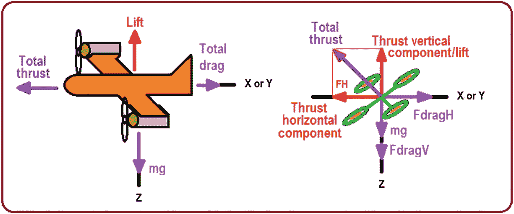
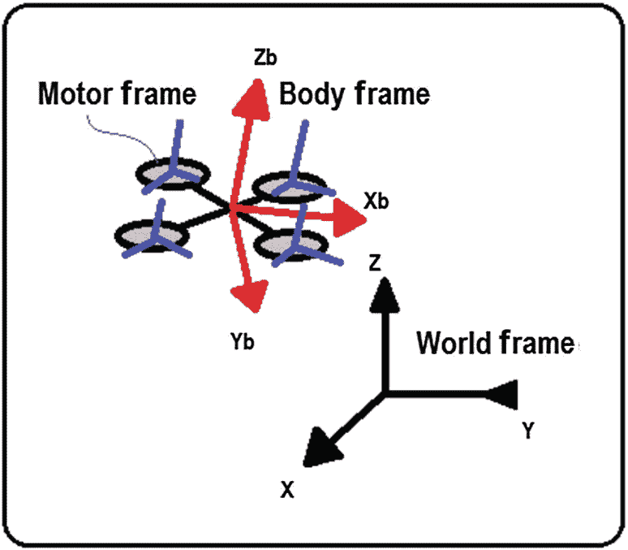

# 2. 建模

本章重点介绍无人机的建模。你将学习参考系、运动学、动力学、推进或分配模型以及线性建模注意事项。最终，你将能够对无人机进行建模，并将这些知识扩展到其他类型的运载器和飞行器。

关于空气动力学，我们不会涉及这些主题，因为本书所分析运载器的设计大多是垂直起降类型，并且相对于其他类型的运载器（例如飞机和有人驾驶飞行器），它们运行时的速度较低、重量较轻和/或尺寸面积较小。见图 2-1。

你可能注意到，多旋翼飞行器需要推力分量来实现其运动（这被称为推力矢量控制）。因此，我们将在附录中将空气动力学分析分为两个有用的部分。其中一部分是关于计算无人机最大速度，可用于比赛用无人机的设计。另一部分是关于如何将本书的知识扩展到其他类型的飞行器。在这些部分中，你将运用本章学到的知识，并通过引入空气动力学效应来加以扩展。

由于旋转速度高而对空气动力学效应影响显著的元件是螺旋桨。然而，此处将不予以考虑，因为假设你不会自己制造螺旋桨，而是会购买它们（但如果需要，你可以在附录的参考文献部分阅读更多关于其设计的内容）。同时还假设，你的飞行器大部分时间都飞行在距离地面、墙壁甚至其他物体和运载器相当远的地方；否则，你可以在附录中阅读关于限制条件的相关信息。

让我们从建模参考系的描述开始。

图 2-1

作用在飞机和等效四轴飞行器上的通用力

## 建模参考系

你很快会看到，与四轴飞行器相关联的有三个建模参考系。所述运载器的建模在混合参考系中进行，并以便于传感器和数学运算的方式完成。这些参考系是世界参考系、飞行器参考系和电机参考系，它们如图 2-2 所示。

图 2-2

建模参考系

*   世界参考系（或基座参考系，或固定参考系，或惯性参考系）表示一个固定的坐标系。飞行器相对于这个固定参考系运动。这可以是一个全球地理参考系，例如地球极点、一个简单的角落或房间的中心。

*   飞行器参考系（或机体参考系，或移动参考系，或非惯性参考系）表示通常位于飞行器上某个感兴趣点（几何中心、质量中心、重力中心或浮力中心等）的坐标系。相对于这个参考系和固定参考系来测量平移和旋转。

*   最后，电机参考系（或推进参考系，或执行器参考系，或分配参考系）是放置在每台电机上的各个参考系。它们的功能是将每台电机的力和扭矩分配到飞行器的参考系。

请注意，为了便于计算，在尽可能的情况下，世界参考系和飞行器参考系各自对应的 `Z` 轴通常平行放置。这是因为四轴飞行器的设计允许这样做，并且正如你稍后将看到的，还因为出于平稳飞行的考虑（在具有更先进机动性的运载器中，例如全向型运载器，这种对所述轴的选择简化是不可行的）。

接下来我们进入无人机的运动学部分。首先，我们将考虑平移运动学。

