# 1. 无人机设计概念

在本章中，您将找到关于无人机最相关的信息，包括其历史和社会背景。本章将涵盖国际标准、一些词源学以及您在操作这些飞行器时应牢记的某些安全注意事项。我们将描述通用组件及其选择和连接。因此，您将学习到设计无人机及其他飞行器所需的技术细节、国际标准和必要条件。请记住，本书是一本速成课程，因此本章仅为您提供快速掌握内容的方法。如果您想扩展这些知识，请参阅指导参考附录。

# 历史背景

观察图 1-1 你会发现，无人机，尤其是多旋翼飞行器，已有数百年的历史。它们最初源于达芬奇绘制的草图（至少西方历史是这样记载的）。近期，马里兰大学以某种复古技术将这些草图变为现实，打造了一架巨型四旋翼飞行器，其处理器和基础引擎分别是人体（分别是大脑和四肢）。多旋翼飞行器于 1907 年由布雷盖兄弟重新带回人们的视野，随后在 20 世纪 20 年代由厄米兴和博特扎特进一步推进。在这些无人机中，处理器和基础引擎分别由飞行员和负责协调每个螺旋桨与内燃机动作的机械计算机（一种机械装置）担任。此后它们一度被遗忘，直到 2010 年代，这类载具/机器人领域才迎来商业与研究热潮。如今，其处理器和引擎基础已演变为自动驾驶仪和电动机。了解了这些历史后，让我们继续学习一些有用的术语。

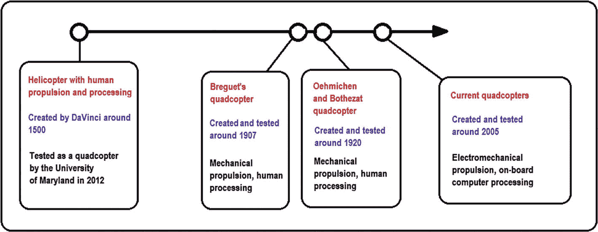

图 1-1

四旋翼飞行器发展史

# 词源与常用名称

尽管“drone”一词正确用于指代任何无人驾驶载具，但商业推广将其与飞行器，尤其是多旋翼飞行器紧密关联。该术语源自昆虫，特指蜂巢或巢穴中仅负责繁衍种群的工蜂。

指代空中无人机更专业的词汇包括：
- 无人机（UAV）
- 无人航空系统（UAS）
- 遥控驾驶飞机系统（RPAS）

你还应熟悉“多旋翼飞行器”和“多旋翼机”这两个术语，它们大致指代多个旋转电机。“多旋翼机”一词源于法语“hélicoptère”，由古斯塔夫·达梅库尔于 1861 年创造，意为螺旋形机翼。该词基于希腊语“helix”（意为螺旋或螺旋形）和“pteron”（意为机翼）。

了解这些有何用处？或许看似琐碎，但对于希望研究无人机经典概念的人来说，了解古老的专业术语十分重要。当然，如果你只需关注当前的研究和新趋势，那么掌握现代术语就足够了。对于本书所介绍的飞行器，从经典术语到当前术语的演变如下：
- 多旋翼机（2020 年 5 月 5 日在 Google Scholar 上获得 22,400 条结果）-> 多旋翼飞行器（2020 年 5 月 5 日在 Google Scholar 上获得 10,600 条结果）
- 四旋翼机（2020 年 5 月 5 日在 Google Scholar 上获得 37,400 条结果）-> 四旋翼飞行器（2020 年 5 月 5 日在 Google Scholar 上获得 35,500 条结果）
- 以及一个不太常用的词：四旋翼直升机（2020 年 5 月 5 日在 Google Scholar 上获得 674 条结果）

图 1-2 基于 Google 趋势，显示了“quadcopter”一词开始流行的时期。大约在 2011 年初，“quadrotor”和“quadcopter”这两个词的使用频率几乎相当。事实上，在科学领域，“quadrotor”的出现非常频繁，但随着时间的推移（包括在科技研究中），“quadcopter”的使用率逐渐增长。目前，由于使用量减少以及“drone”一词的主导和普及（图 1-3），这两个术语的使用率大致持平。有趣的是，“quadcopter”和“quadrotor”已逐渐退居研究领域，而该领域内日益流行的术语是“UAV”。

**图 1-3** Google 趋势上 Quadrotor、Quadcopter 与 Drone 的搜索量对比

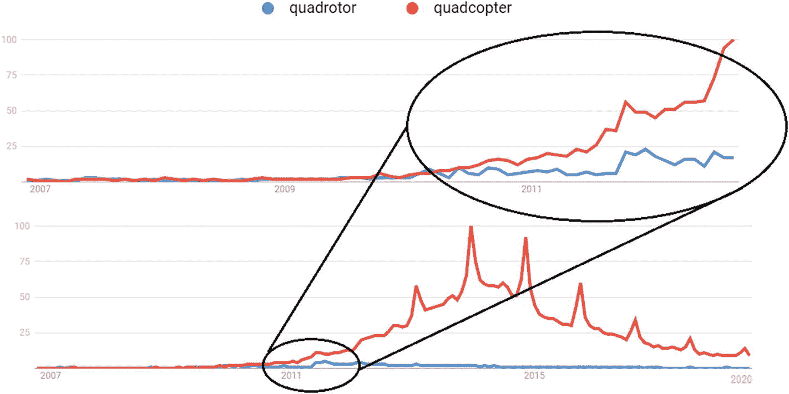
**图 1-2** Google 趋势上 Quadrotor 与 Quadcopter 的搜索量对比

总之，本节的价值在于指出某些术语的趋势，以便于进行必要的研究，并提供如何根据上下文使用每个术语的背景知识。既然你已了解了词源学这一搜索工具，接下来让我们考虑你需要哪种类型的无人机。

# 你需要哪种类型的无人机？

无人机用户分为四种类型：专业研究员、研究员（将无人机作为工具使用）、设计师和飞手。表 1-1 列出了每种用户的典型特征及推荐设备。

## 表 1-1 无人机用户类型及特征

| 用户类型 | 最常见机型 | 软件类型（参见第 5 章关于无人机编程方式的内容） | 需要了解什么？ | 示例 |
| :--- | :--- | :--- | :--- | :--- |
| 飞手 | `封闭架构（预组装无人机）` | `封闭架构的图形用户界面` | `创客风格技术知识`、`法规`及`无人驾驶飞行课程`。飞行器是工作工具。 | `竞速飞手`或`摄影师` |
| 将无人机作为工具的研究员 | 多为`封闭`或`有限开放架构` | `图形用户界面`或`第 1 类软件开发工具包` | `创客风格技术知识`。飞行器仍是工作工具，但用于与无人机本身无关的特定任务。飞行器是`测试平台`。 | `人工视觉`或`人工智能算法`（包括`SLAM`）研究 |
| 专业研究员 | `套件式开放架构` | `第 2 类`或`第 3 类软件开发工具包` | 需要具备关于`控制`与`机器人载具`的科学知识，以及`创客风格技术知识`。在此，飞行器的飞行模式是被设计的对象。 | 针对`飞行器自动控制算法`的研究 |
| 设计师 | `逐组件选择的开放架构` | `第 3 类软件开发工具包`。通常，`逐组件设计`对应于`开放软件架构`，反之，几乎所有商用无人机的软件功能都有限。 | 需要具备`飞行器控制`与`设计`方面的专业知识，以及`高级技术知识`。在此，整个飞行器是被设计的对象。 | `飞行器设计师` |

现在你对自己的目的该使用何种飞行器有了概念，但安全性和标准方面的问题呢？下面我们来解答这个问题。

# 通用安全问题与国际标准

通常情况下，只要不伤害他人、动物、建筑物或其他财产，你在家中、花园或配备适当设备和安全措施的实验室进行原型测试，不会受到追究。然而，为了降低风险和事故，我们在此提供一小节通用建议。请注意，由于地方法律不同，这些建议对每个人的影响可能有所不同。

## 通信

无人机可能通过两种方式影响并侵犯当地电信系统，在两种情况下你都可能受到处罚。

1.  **遥测系统与遥控系统**：遥测和遥控发射器必须与你所在地区允许的传输频率范围兼容。一个典型的例子是，遥测无线电通常有两种规格：`433 MHz`，适用于欧洲及采用相同标准的国家；`915 MHz`，适用于美国及采用相同标准的国家。

2.  **电力消耗**：设计和使用的四旋翼飞行器如果功耗较高，尤其是在高电流应用中，设计者和使用者都知道这会影响车辆传感器的性能，因此必须对线缆进行屏蔽、绞合、包裹，甚至分离连接。这可能会影响公共天线或民用通信设备的性能。因此，作为设计师或用户，你应该意识到你可能会因此受到处罚。

### 电气安全

通过有线电气连接（即系留操作）运行无人机，需向飞行器输送约 `400V` 的中等电压，这在某些国家（例如日本）超出了法律许可范围。

### 运输与存储

这里的关键问题涉及电池和油箱，因此务必掌握此类物资的正确储存和运输方法。

### 使用安全

您用飞行器对任何人员或财产造成的损坏都会引发法律问题。必须认识到，即使是小尺寸的无人机，由于其自身或螺旋桨所能达到的速度，也构成潜在风险。

### 买卖问题

您可能对某款飞行器感兴趣，或希望将原型机商业化。若如此，您需要验证其组件、特性和材料是否在您所在地区获得许可。某些对您而言开支不大的部件，一旦在特定国家或商业区域进行买卖，其价格或税费可能会大幅增加，甚至可能因使用非法部件而被扣押或退回。

### 法规与标准

当您阅读到第 2 章时，将会注意到如图 1-4 所示的一组非随意选取的坐标和旋转角。这种选取遵循了 `ISO 1151-2:1985` 标准，并有助于将所述理论与现成传感器和组件的使用联系起来。不过，为简化方程，我们将使用 Z 轴向上。

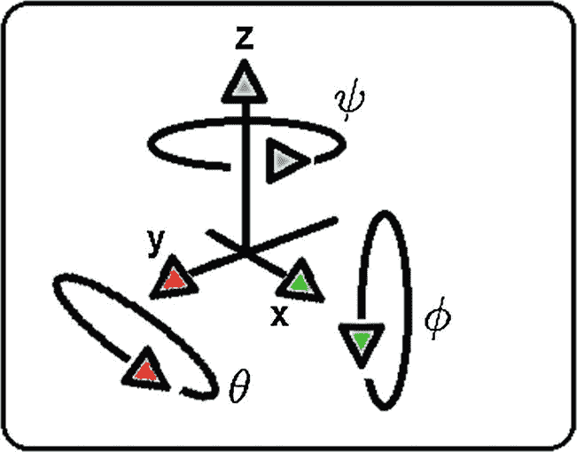

请注意，对于无人机而言，如后文所述，尽管俯仰角（`theta`）和横滚角（`phi`）分别沿 Y 轴和 X 轴测量，但 X 轴方向的运动依赖于`theta`方向的可控倾斜旋转，而 Y 轴方向的运动则依赖于`phi`方向的可控倾斜旋转，如图 1-5 所示。

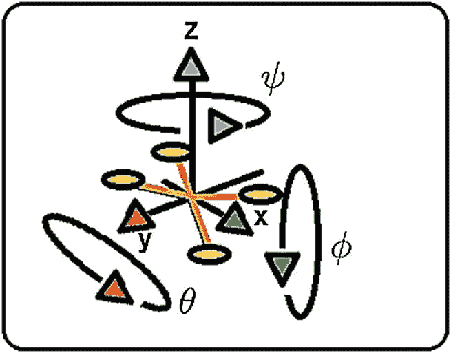

### 建议

以下是关于无人机操作的一些标准建议：

*   阅读您当地关于此处列出主题或其他方面的法规。

*   确保您的硬件符合上述法规的要求。

*   您和您的团队必须使用标准的防护装备，例如护目镜或手套。

*   当测试时有其他人在场时，请牢记原型机可能造成伤害，建议您或您的实验室负责人持有无人驾驶飞行器操作执照。

*   避免使用非专门用于测试的公共或私人空间，无论是室内还是室外。

*   请记住，您是设计者，不一定是飞行员。

*   若获得必要许可，您应在场地四周设置墙壁、防护网或塑料面板，以防零件从无人机上碎裂或脱落。您还应张贴警告标识/告示，限制未经授权人员进入。

*   在进行自由飞行测试前，先进行无螺旋桨或无人机固定状态下的全面测试。为避免无负载测试损坏电机，您可以用纸张替代螺旋桨。

*   当拥有原型机时，请确认其所有组件在您所在地点均为合法，并确定违规组件是否存在功能性替代品。

现在，该明确本书后续将分析哪种类型的无人机了。

## 无人机类型

根据运动方式，无人机可按如下方式分类（图 1-6）：

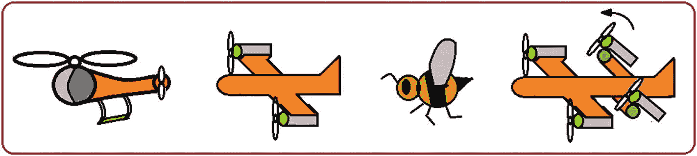

*   **旋翼型**：仅需螺旋桨即可移动。此类无人机能够垂直起降，设计用于载荷运输及短、中程任务。

*   **固定翼型**：需要长翼面才能移动，如同大多数飞机。此类无人机能够水平起降，设计用于比旋翼机更高的速度和更远的航程。

*   **扑翼型**：需要振荡翼面才能飞行，如同鸟类或昆虫的翅膀。可视为固定翼与旋翼的融合，应用场景兼具两者特点。

*   **可转换型**：能从一个构型转变为另一个构型，例如“尾座式”无人机。这类飞行器从使用螺旋桨的垂直起降模式，转变为固定翼飞行模式以执行远程任务。

本书将重点讨论基于旋翼推进的多旋翼型无人飞行器。然而，在附加约束或考虑（包括建模、控制、仿真和编程主题）下，大部分概念可推广至其他类型的飞行器。

接下来，我们来看无人机的组件。

## 组件

我们将根据用途描述无人机最相关的组件：执行组件、结构组件、测量组件、指令组件和动力组件。

### 执行组件

执行组件分为两类：机电执行组件和电气执行组件。机电类型是指电机或舵机，它们接收电信号并将其转换为机械效应。电气类型则是提供放大级或电气适配的组件。

机电执行元件可直接作用于速度（无刷电机和有刷电机）或位置（舵机）。

### 有刷电机与无刷电机

目前，由于其响应速度快，多旋翼飞行器（面向创客和科研人员）上最常见的引擎基于直流电动机。这类电机可分为有刷电机和无刷电机。在这两种情况下，都需要通过调整均方根电压等参数来增加或减小电机转速。

有刷电机是最常见的电动机类型，常用于微型无人机。电刷会因接触摩擦而降低响应速度。此外，由于会产生火花，不推荐在易爆环境中使用；由于可能发生短路，也不推荐在水生环境中使用。不过，有刷电机可与 `PWM` 占空比信号（请记住，脉宽调制是通过改变信号作用百分比来调节信号的各种技术，此处指调节电源信号的开/关百分比）配合工作，例如在 `Arduino` 开发板上通常使用这种 `PWM` 信号。

无刷电机通常用于多旋翼飞行器，原因在于其响应速度更快，且没有电触点，从而减少了摩擦。由于不产生火花，可用于易爆环境；由于没有易短路的元件（只要导线有绝缘层），也可用于水生环境。

另一方面，无刷电机比有刷电机更昂贵，并且使用一种称为 `RC` 的特殊 `PWM` 信号工作，其开/关百分比的调节方式与有刷电机不同（这里的百分比是时间的函数），因此需要额外的组件。

为了正确使用这两种类型的电机，都需要功率级，你将在下一节中看到。请注意，占空比型 `PWM` 和 `RC` 型 `PWM` 并不直接兼容。

主要区别在于，有刷电机通常是单相的，而无刷电机是三相或多相电机（在航空应用中通常为三相）。

图 1-7 显示了一个放大的有刷电机与一个无刷电机的对比，但反过来也可能发生；这完全取决于用户或设计者的需求。一个更值得注意的区别是电缆（电相）的数量，以及有刷电机通常是内转子类型（转子轴旋转），而无刷电机通常是外转子类型（外壳旋转）。

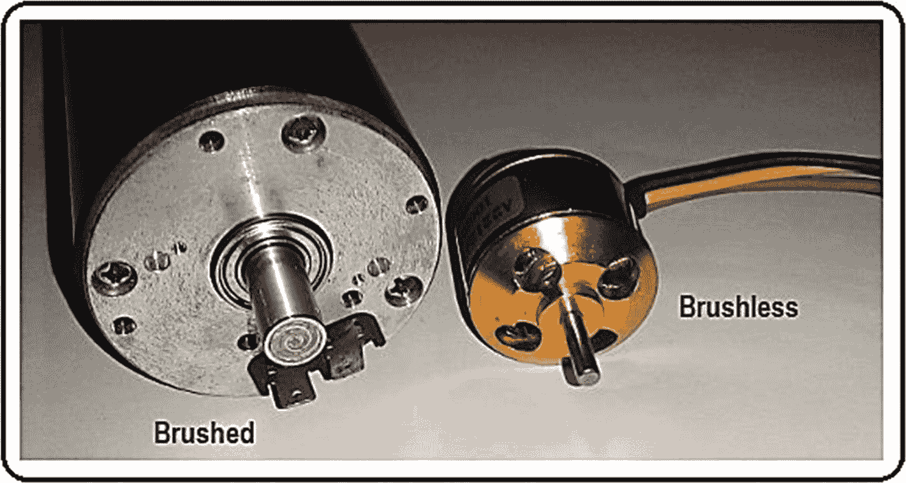

#### 电子调速器与功率级

`ESC`（电子调速器），也称为速度调节器（图 1-8），是无刷电机和一些有刷电机的功率级（对于后者，它们只是电子 `RC` 信号到占空比的适配器）。

其基本原理是，向其注入一个 `PWM RC` 格式的信号来调节其开/关状态。通过这种方式，单相直流电源信号被转换为一种控制电机旋转速度的三相信号。

对于有刷直流电机，如前所述，可以使用适配器`ESC`。它接收 `PWM RC` 信号并将其转换为 `PWM` 占空比信号。另一种在设备上更常用的选择是名为电子驱动器的装置，它以占空比 `PWM` 作为输入，然后放大信号以获得调节电机速度所需的电流或电压。

`ESC`和电子驱动器都被称为功率级，因为它们都是电子电路，用于放大自动驾驶仪或处理单元（这些单元无法提供足够的电功率）发出的电信号以驱动电机。请注意，如果你尝试不使用合适的功率级而直接从处理单元驱动电机，可能会烧毁或损坏该处理单元。

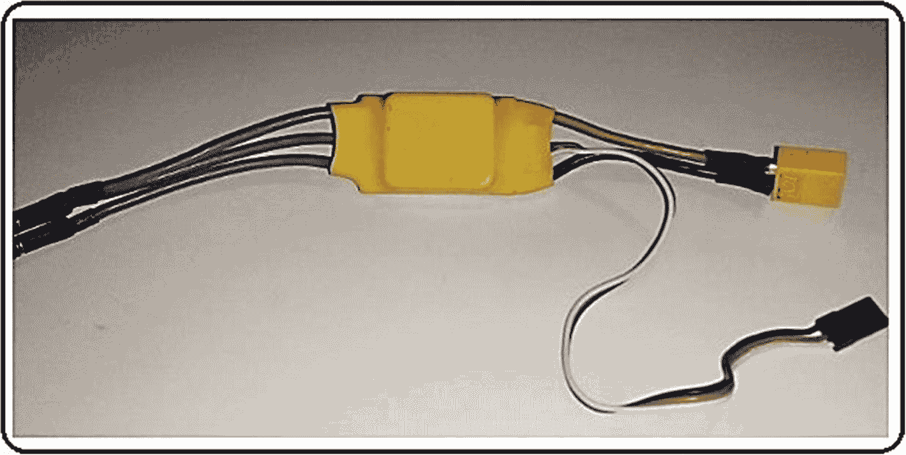

### 舵机

伺服电机（通常简称为“舵机”）是一种位置电机，它接收 `PWM RC` 型信号，并将其转换为与电机耦合的轴的位置。参见图 1-9。它们的运行方式类似于无刷电机，但区别在于，无刷电机通过改变 `PWM RC` 信号来改变速度，而舵机则改变位置。

舵机也需要它们各自的功率级。此外，它们在改变位置时不如无刷电机快速。因此，`PWM` 信号的突然变化存在损坏或烧毁舵机的风险。用于舵机的 `PWM` 信号必须比用于`BLDC`（无刷直流电机）的 `PWM` 信号更慢。

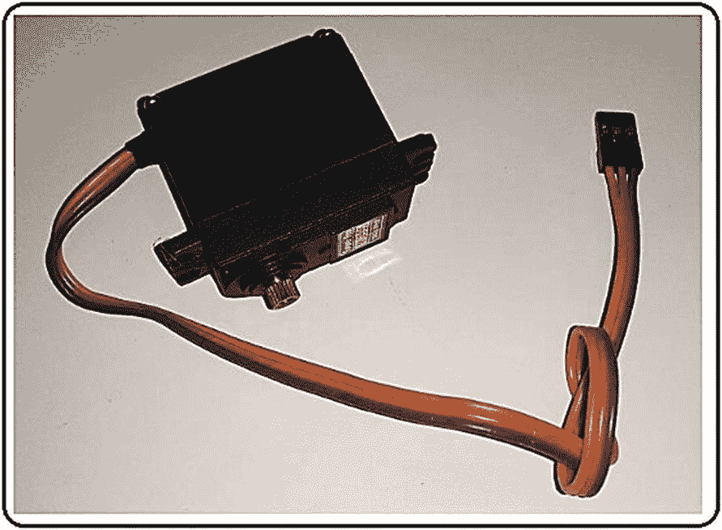

**图 1-9** 舵机

### 螺旋桨

电机很难直接作用于环境。这种相互作用需要借助诸如轮子或螺旋桨（如图 1-10 所示）之类的物体，具体取决于它是水上航行器、飞行器还是地面车辆。为了安全起见，应在获得所需的动态特性之前，在不安装螺旋桨的情况下测试飞行器。电机有两种性能状态：第一种称为满载运行，即安装螺旋桨时；第二种是空载性能，即电机轴上未安装螺旋桨或其他物体。这两种情况都代表了极端状况。在空载性能测试（常用于初始测试）中，建议使用纸片代替螺旋桨作为安全负载（重量）。在满载模式下，建议不要超过制造商推荐的最大负载值（重量）。

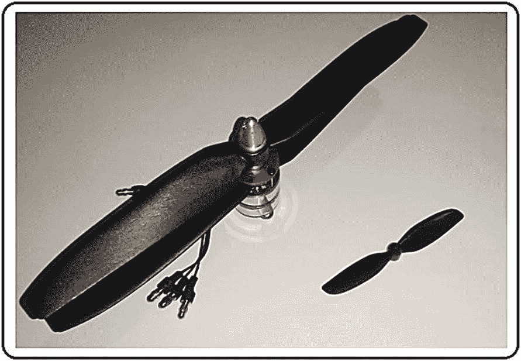

**图 1-10** 螺旋桨

## 结构组件

以下章节将讨论构成飞行器外形并提供支撑的组件。

### 机架

机架就是飞行器的底盘或机身（图 1-11），其他部件都安装在其上。

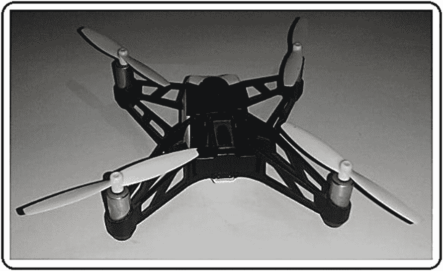

**图 1-11** 安装有螺旋桨的机架

### 减震支架

减震支架是一种用于吸收或减少飞行器振动对传感器或处理器产生的噪声的结构，从而避免错误的测量或计算错误。

### 机械连接件

显然，所有组件都必须固定，可以是永久性或长期固定（如螺丝），也可以是可更换的或短期固定（如魔术贴、扎带）。

## 测量组件

以下章节将讨论使飞行器能够感知其所在位置的组件。

### 多种传感器

多旋翼飞行器需要 XY 平面上的运动传感器和速度传感器，以及高度传感器，还需要三维旋转速度和角度传感器。它们可以是模拟传感器、数字传感器或串行传感器，甚至可以是机载传感器和外部传感器。最常见的有气压计、`IMU`（惯性测量单元）、陀螺仪、加速度计、`LIDAR`（激光雷达）、摄像头和运动跟踪系统。（更多信息请参见附录）。

### GPS

尽管全球定位系统是一个三维运动与速度传感系统（平移运动），但由于它被制作者和科学家们广泛使用，尤其在开阔地形应用中，因此单独成节进行介绍。它本质上是一个受环境影响的卫星三角测量系统，因此仅推荐用于开放空间作业。

## 指令组件

以下章节将讨论使飞行器能够执行动作并接收指令的组件。

### 自动驾驶仪

`Autopilot` 是无人飞行器的专用处理单元（见图 1-12）。此外，也有一些微控制器或开发板经过适配后可作为自动驾驶仪使用。它们采用封闭式或开放式架构（参见第 5 章中关于无人机编程方式的章节）。

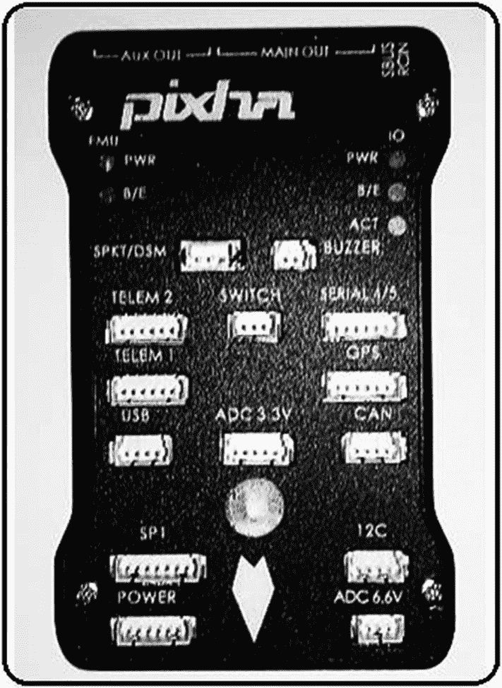

图 1-12 自动驾驶仪

### 数传模块

数传模块是用于无线远程传输信息的单元（见图 1-13）。它们的工作范围有限。数传模块可用于在两台或多台飞行器之间，或者在固定基站与一台或多台无人机之间进行相互通信。它们也可用于将动作捕捉系统获取的位置信息传输给飞行器。数传模块通常是双向模块。

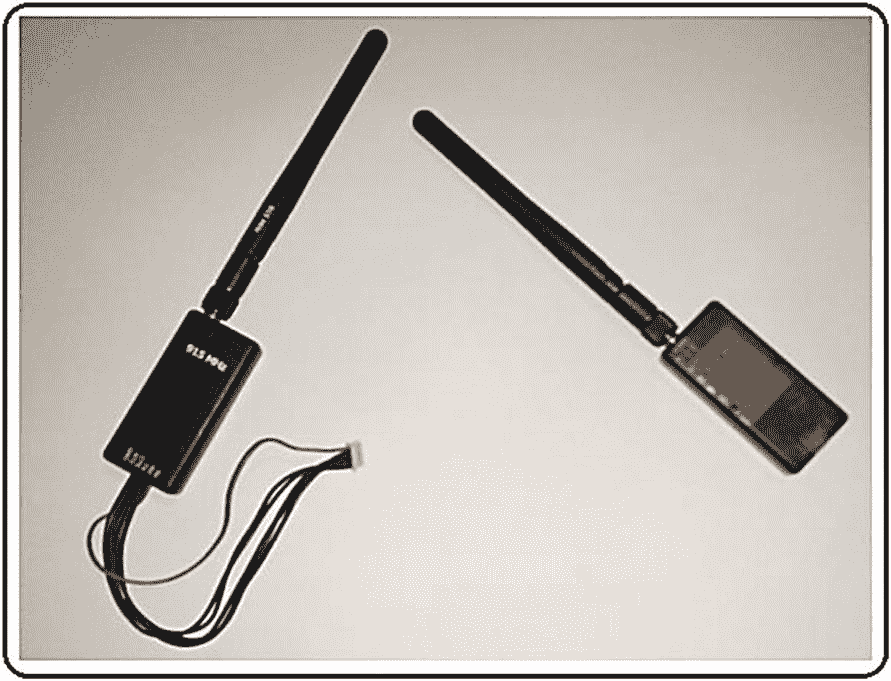

图 1-13 数传模块

### 遥控模块

与数传模块不同，`RC` 模块允许通过摇杆和按钮手动控制无人机。它们的工作范围很广，部分模块还支持视频传输。遥控模块通常是单向的，即包含一个发射器模块和一个接收设备。见图 1-14。

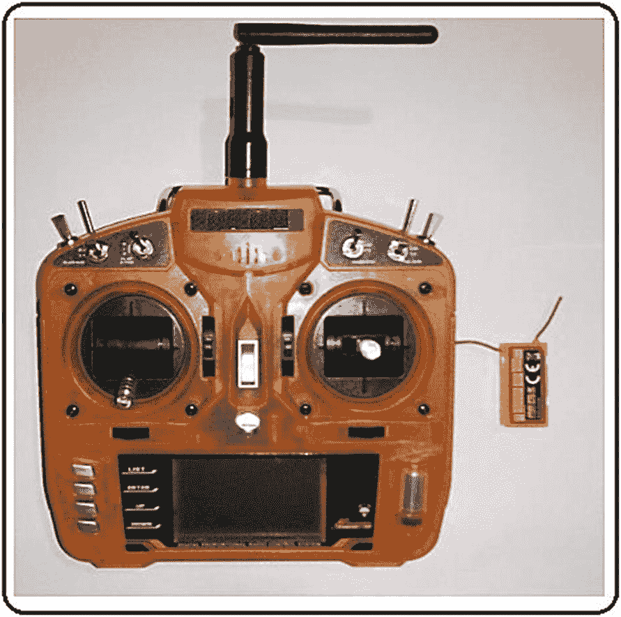

图 1-14 遥控器与接收机

### 机载计算机

机载计算机是一种板载处理单元，用于执行通常超出自动驾驶仪能力范围的高强度任务（例如实现人工视觉或 `SLAM`）。例如 `Raspberry Pi` 单板计算机、微控制器、微处理器或 `FPGA`。简单来说，自动驾驶仪直接用于飞行控制，而机载计算机则用于与该飞行相关的间接任务。

## 动力组件

以下章节将讨论为飞行器提供能量的组件。

### 电池/线缆供电

使用电池或线缆供电为系统提供能量是显而易见的。虽然目前大多数无人机在长期应用中采用 `LIPO` 型电池（见图 1-15 右侧），但市场上也存在电源转换器或电源供应器，这意味着飞行器会通过电源延长线固定连接。显然，这种延长线会带来特殊的使用条件和移动限制。这些电源的理想工况是，其电压和电流的纹波或尖峰尽可能小，使得提供的数值尽可能恒定。由于电池已有大量文档介绍，这里我们将重点讨论有线或线缆供电。

线缆供电有四种类型：

*   **通过电源供应器**：在这种情况下，最大的障碍是成本，因为基于无刷电机的多旋翼无人机消耗的电流远大于电压（一个小型飞行器轻松消耗约 12V/60A 的电力）。如此一来，在拥有能够提供上述电压和电流的电源的同时，还必须考虑电缆和导线必须能够承受这些参数，并且消耗如此大电流的电缆本身必然沉重而粗大，因而不适合高空使用。因此，如果您的应用是在飞行器高度几乎不超过一米五的实验室级别，那么推荐使用此选项。

*   **通过汽车电池**：与上一种情况类似，但考虑到汽车电池是非常商业化的单元，成本略有降低。然而，汽车电池通常很重，并且运输和充电需要特殊处理。

*   **通过电源转换器**：在这种情况下，需要提供中电压、低电流，例如 400V/3A，以便为能够将输入转换为 12V/100A 的电源转换器供电。这些电源转换器可以从某些制造商处购得（例如 `VICOR`）。它们（含散热器）通常重约 200 克，是这类线缆供电应用中一个可行的选择。

*   **通过太阳能电池**：其限制与上述情况类似，但存在太阳能电池本身所特有的问题（如尺寸和功率密度）。

您可能会争辩说存在基于燃料的选项，因为它们在标准直升机上已使用数十年；然而，对于电动多旋翼飞行器而言，它们仍面临研究挑战（燃料发电机除外，其中使用燃料发动机作为发电厂的电源）。

### 电量指示器

如果使用电池，配备一个能在电池即将耗尽时发出警报的设备至关重要，这样可以防止飞行器因掉电而坠毁受损。这些设备本质上是带有灯光或声音指示的小型电压表。

### 电源分配器

电源分配器是一种设计用于使用单一电源为多个电机供电的设备。它们本质上是电流分配器，可以是线束形式（占用空间较大但易于操作），也可以是电子电路板形式（节省空间但难以操作）。见图 1-15 中部。

### 电源模块

电源模块是一种能够使自动驾驶仪从主电池获得电力的设备。见图 1-15 左侧。

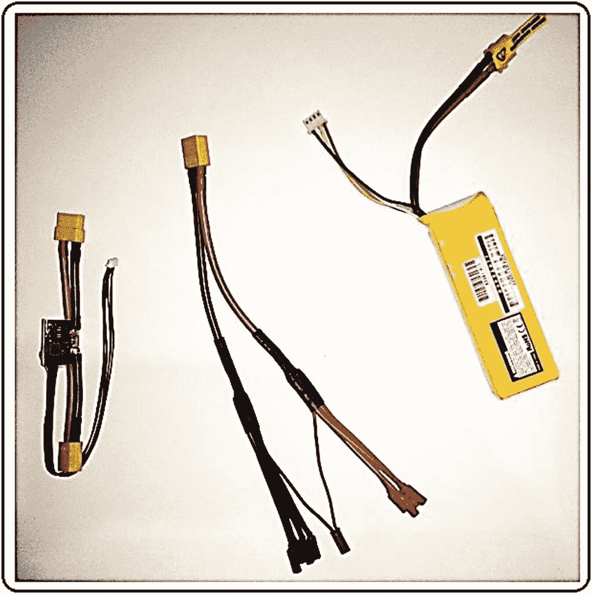

图 1-15 电源模块、电源分配器和电池

### 电气连接器

电气连接器是一种用于连接各种电气或电子设备的方式。针对电力或数据传输，有不同版本的设计。电源连接器可处理大电压和/或大电流。数据连接器则专门用于发送和接收信息，通常消耗非常低的电流或电压。

表 1-2 至 1-4 提供了关于前述组件的更多信息，并按三类呈现：电源组件、机械组件和控制组件。

#### 表 1-4 机械组件及特性

| 机械组件 | 主要特性 | 常见操作 | 类型 |
| --- | --- | --- | --- |
| 机架 | 材料、硬度、轻量性、孔位、水平度、配件、尺寸和重量、起落架、减震系统、是否可折叠、电磁屏蔽 | 组件连接、平衡调整、修复 | 常见分类依据：尺寸、材料和折叠能力 |
| 电机 | `kv`值、重量和尺寸、最大电流和电压、最大推力和扭矩 | 获取扭矩和推力相对于转速及螺旋桨的初始值及比例增益、`PWM` 绑定（与遥控器） | 有刷与无刷、速度或位置型、控制信号类型（直流、无刷直流、伺服、步进、交流、`PWM RC` 或 `PWM` 占空比等） |
| 螺旋桨 | 螺距、直径、边缘、叶片数量、柔韧性、硬度、旋转方向 | 平衡调整、边缘修剪 | 通常按材料、柔韧性和叶片数量分类 |
| 紧固件 | 材料、硬度、轻量性、配件、尺寸和重量、快速或慢速更换 | 每种机械连接都需要根据具体应用进行分析。 | 快速更换或永久连接 |
| 减震支架 | 尺寸、机架兼容性、移动性、抑制方式 | 平衡调整 | 适用于电机、自动驾驶仪、传感器 |

#### 表 1-3 控制组件及特性

| 控制组件 | 主要特性 | 常见操作 | 类型 |
| --- | --- | --- | --- |
| --- | --- | --- | --- |

### 表 1-2

电源组件及特性

| 电源组件 | 主要特性 | 常见操作 | 类型 |
|---|---|---|---|
| 电池 | 电芯数量、尺寸、重量、安时数、工作电压、`C`倍率或放电率、连接器、使用所需配件（充电器） | 充电、放电、存储、运输、连接器焊接、并联或串联 | 类型众多，但`LIPO`电池最为常见 |
| 电源 | 功率、电流、电压、纹波、频率、输入电压（110/220）、相数 | 若需要则进行滤波、若需要则进行并相、升压或降压、稳压、放电保护、变换（`AC-DC`） | 开关电源和线性电源 |
| 电池指示器 | 支持的电芯数量、灯光或声音指示 | 引脚验证 | 板载式或外接式 |
| 电源模块 | 支持的最大电流、支持的最大电压、电磁屏蔽、可测量的最大电流、连接器类型 | 若需要则进行电磁屏蔽、若需要则添加电流或电压传感器、若需要则进行并联 | 用于低电流和高电流 |
| 电源分配器 | 支持的最大电流、支持的最大电压、供电电机数量、`BEC`、尺寸、重量、电磁屏蔽类型 | 端子焊接、串联或并联、电磁屏蔽 | 集线器（线束）或电路板（电路） |
| 电源连接器 | 支持的最大电流、支持的最大电压、与组件的兼容性、热阻、柔韧性、插拔能力 | 端子焊接、更换 | 每种应用都有其特定的连接器组 |
| 功率级与电调 | 最大尺寸、重量、电流和电压、可逆性、`BEC`或光耦隔离 | 配置（通常通过软件界面） | 可逆或不可逆、`PWM-RC`或`PWM`占空比、标准或光耦隔离、适用于无刷或有刷电机 |

现在你已经了解了关于无人机组件的基础概念，接下来看看如何选择它们。

## 组件选择

按照推荐的设计流程，这一过程分为三个子过程（为便于分析，假设使用的是无刷电机，因为这是四轴飞行器中最常用的类型）。

### 飞行器选择

飞行器选择是一个迭代过程，包括：

1. 选择电机。电机是根据飞行器期望的运行重量和速度来选择的。因此，你必须查阅数据手册中的两个重要参数：每个电机能提升的最大重量，以及其最大转速值（在无刷电机中，这被称为`kv`值，注意不要与电机的机电常数混淆）。

2. 根据上述内容（即飞行器的负载能力和速度），选择螺旋桨。

3. 选定电机和螺旋桨后，选择电调。同样，在无刷电机的数据手册中，你可以找到这些运行条件所需的电流和电压。这有助于选择合适的电调。建议电调的电流容量比其对应电机消耗的电流高出 30%，以克服功率损耗。

4. 结合上一点以及自动驾驶仪、辅助电机等其他组件的需求，选择合适的电池或电源。

5. 考虑所有组件的尺寸和最终重量（可以通过查阅飞行器每个元件的单独数据手册来计算），然后选择机架。

6. 考虑最终重量后，你必须返回步骤 1，验证电机是否仍能满足你的要求。如果不能，则必须重复设计过程。

### 遥控器选择

遥控器是与飞行员直接连接的设备，前提是你希望进行手动干预或至少拥有一个由人类控制的紧急停止装置。选择流程如下：

1. 操控四轴飞行器所需的最少通道数为四个（`X`、`Y`、`Z`和偏航角）。对于其他类型的载具，例如汽车，则只需两个通道（前进和转向）。但你必须考虑是否需要紧急停止功能、一个可用于开启和关闭夹具的按钮。这些任务中的每一个至少都需要一个独立的辅助通道。因此，通常会使用六通道、八通道或十通道的无线电遥控器。这些额外的通道可以是摇杆、按钮或旋钮，并且可以通过组合逻辑和激活状态来使用（如需了解更多关于状态机的信息，请参阅我关于`Ardupilot`的书籍以及附录中提供的其他参考资料）。

2. 一旦你确定了所需的通道数量，接下来要确定的是遥控器允许操作员与载具之间的最大距离。这将决定载具与人类交互的操作区域，并进而影响无人机在紧急情况下是否可回收。

3. 接下来是一些操作上的主观细节，包括自问：遥控器上是否需要摄像头显示器？是否希望用同一个遥控器操控多个载具？等等。

4. 下一步是确定你需要使用载具多长时间，因为这会影响遥控器电池的续航能力。因此，对于长时间工作，建议使用带有`LIPO`电池接口的遥控器。

5. 最后，你必须确认自动驾驶仪和遥控器接收机具有`PPM`端口。否则，你必须购买相应的适配器。

### 自动驾驶仪选择

自动驾驶仪的选择取决于你的编程技能，以及你希望与载具的交互深度。

1. 如果你不需要编程执行专门任务，购买一架通用无人机就足够了。

2. 如果需要更专门的任务，但你不懂如何编程，则建议购买一个允许你使用图形用户界面（`GUI`，如`Mission Planner`）的自动驾驶仪。这里推荐使用的自动驾驶仪是`Pixhawk`。

3. 如果你会编程，并且希望在无需专注于载具设计的情况下设计自己的任务，建议使用简化版的 `SDK`，例如`Dronekit`。这个 `SDK` 要求你掌握`Python`语言编程技能，但它允许将载具视为一个可在`X`、`Y`、`Z`方向上移动并绕自身轴旋转的质点。这里同样推荐使用`Pixhawk`。

4. 如果你（在上述基础上）还希望在预设计的载具上设计或测试控制律，那么你需要使用扩展 `SDK`。这类 `SDK` 允许以质点模式操控载具，但交互方式是通过力和力矩，而不仅仅是定义轨迹。例如，适用于`Pixhawk`自动驾驶仪的`Bebop Autonomy SDK`或`Simulink`库。

5. 如果你在第 4 点的基础上，正在设计一个实验性载具，或一个超出扩展 `SDK` 兼容标准型号范围的载具，那么你需要一个兼容完整 `SDK` 的自动驾驶仪。这类 `SDK` 的示例包括`Ardupilot`库和`PX4`库。同样，这里可以使用`Pixhawk`自动驾驶仪。

6. 如果除了第 5 点所述的之外，你还必须执行其他专门任务，例如使用人工智能视觉，则强烈建议你使用一个伴随计算机与自动驾驶仪协同工作。例如，你可以使用一个搭载`ROS`系统的`Raspberry Pi`、`Odroid`或笔记本电脑来执行人工智能视觉算法，同时结合`Pixhawk`执行飞行算法。或者，更佳方案是使用一个将自动驾驶仪和伴随计算机整合在一起的嵌入式单元，例如`NavIO`板卡或`ErleBrain`。

请注意，在选择过程中向前推进，也意味着从爱好者用户向科研用户的转变，这需要对编程、控制和数学建模有更深入的理解，但作为回报，你将拥有进行整体设计的能力，而不仅仅是在选择少数几个参数时受到限制。

你已经了解了这些组件以及如何选择它们。现在是时候学习如何组装它们了。

## 组件连接

本节将说明如何连接无人机的各个组件。这可以帮助你避免在机械、电气和控制层面常见的装配错误。

### 机械连接

机械连接的主要元件是机架，其余所有组件都安装在其上。见图 1-16。

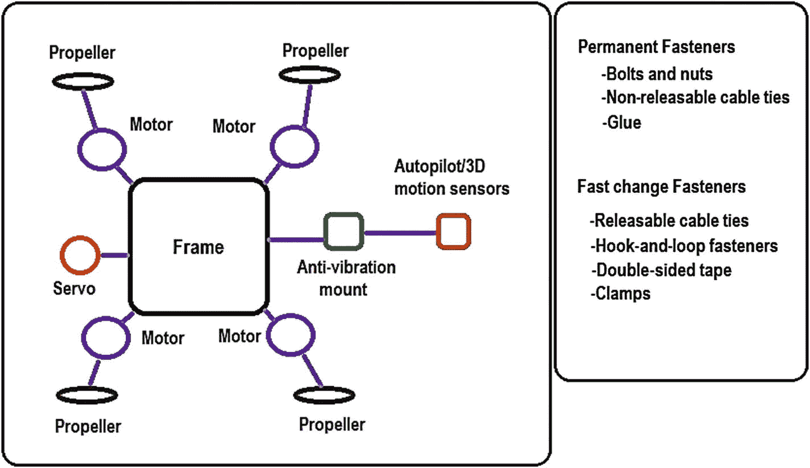

图 1-16：机械连接

### 电气连接

这里的中心元件是电池或电源。请注意，电机并非直接连接到该电源。见图 1-17。

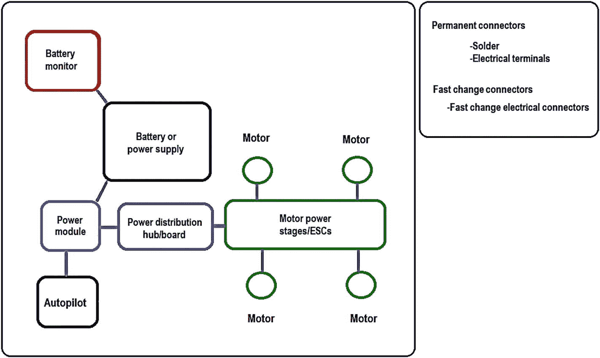

图 1-17：电气连接

### 控制连接

这里的中心元件是自动驾驶仪。在此层面，还包含了用户界面或与地面辅助计算机的接口。见图 1-18。

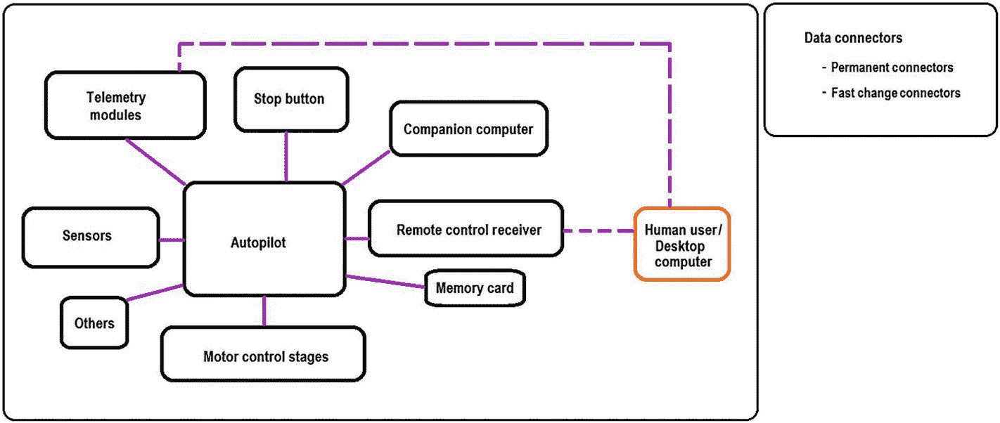

图 1-18：控制连接

## 总结

在本章中，你学习了设计无人机的组件知识，特别侧重于四轴飞行器，但这些知识也可扩展到其他类型的飞行器，包括它们的历史背景、词源学，以及为你的作品选择名称时最常见的搜索结果。你还了解了适合你活动的无人机类型、一些通用的安全措施，以及用于无人机及其组件建模和设计的、最广泛使用的国际标准。在组件方面，你学习了有用的分类、最常见的特性和流程，以及它们的连接和选择方法。我们邀请你查阅附录中的精选参考文献，以完善你在相应主题上的知识。在下一章中，你将学习无人机建模，这对于许多类型的空中载具也很有用。

