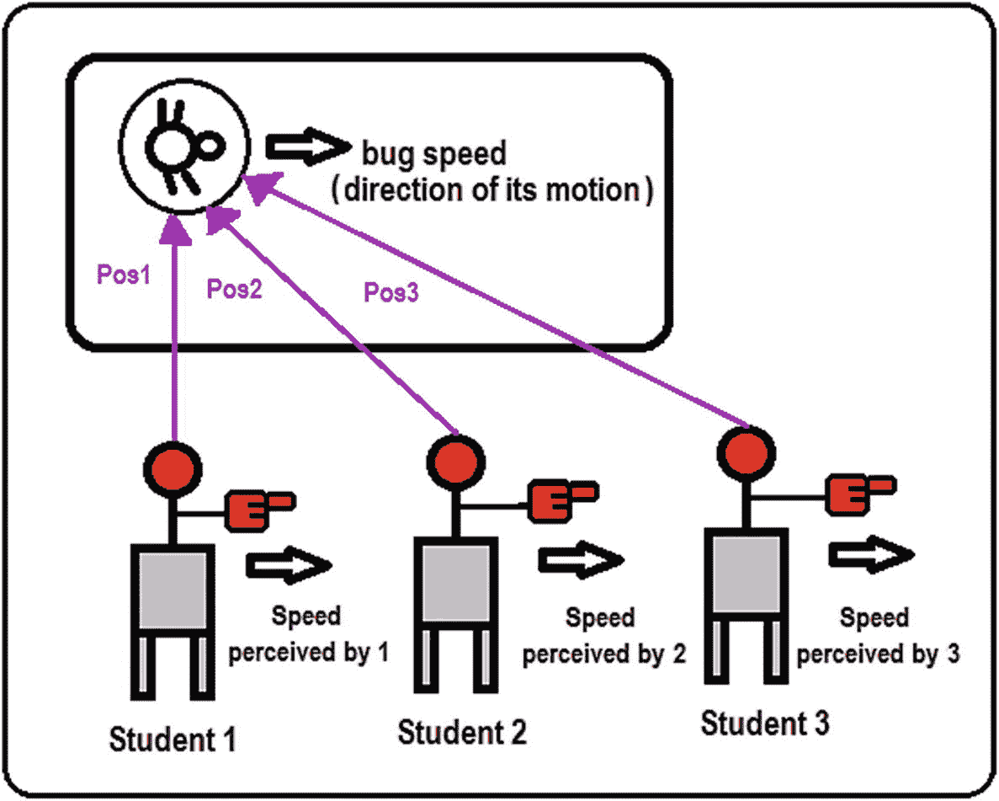
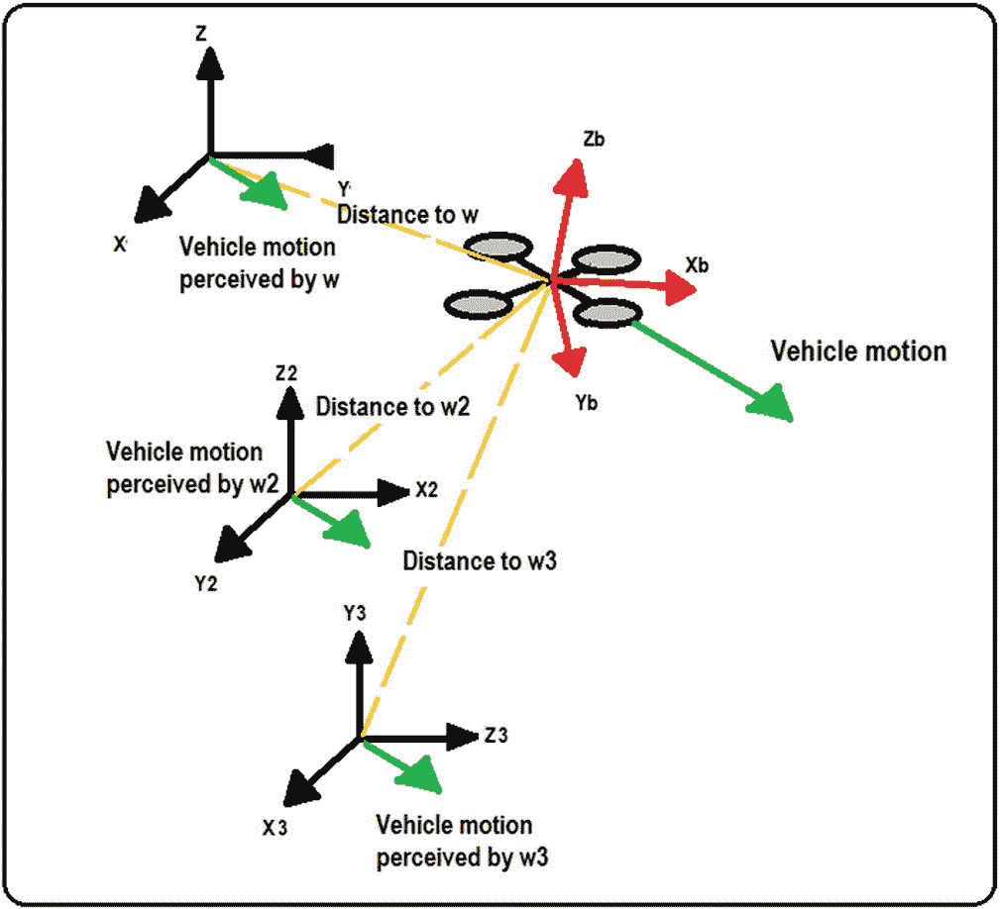
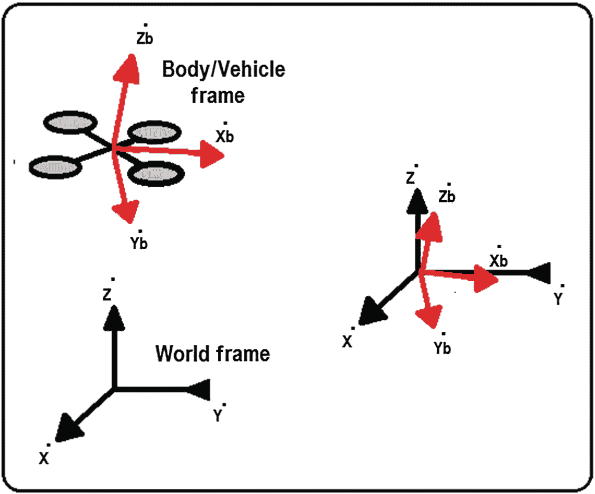
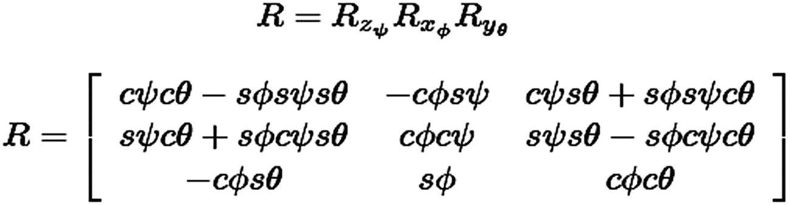
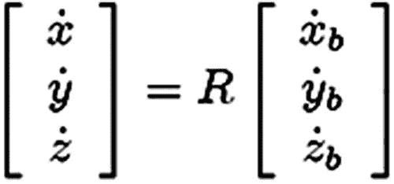
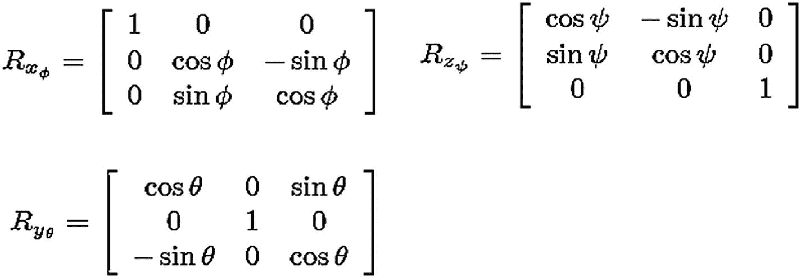

# 平移运动学

假设我们想要将世界坐标系与飞行器坐标系关联起来。尽管这乍看之下很简单，但必须记住，所有概念的关联都应在无偏的参考空间中进行。

为此，想象一下，在教室里，学生们被要求指出一只在白板上爬行的昆虫相对于他们自身所在位置的位置，如图 2-3 所示。

**图 2-3** 物体相对于外部观测者的运动与位置

如你所见，每个人对昆虫的位置都会有不同的感知，他们会给出一个取决于自身所处位置的结果。然而，无论身处何位，每个人都能指出昆虫正在沿所示方向移动。因此，在那个教室里，对于所有人而言，一个无偏的元素就是昆虫的运动，而这个运动与其速度有关。

这表明，如果世界坐标系相对于飞行器放置在不同的位置，如图 2-4 所示，那么坐标系之间的不变量关系将不在位置层面，而在速度层面（作为一个向量），这对于放置在每个世界坐标系中的观测者或传感器都是成立的。

**图 2-4** 无人机相对于不同世界坐标系的运动与位置

从前面的图中可以看出，在每个坐标系中对飞行器运动的感知并不会因坐标系之间的距离而改变。然而，如图 2-5 所示，将其中两个坐标系叠加时，可能会注意到其各自坐标轴在方向上的影响。因此，为了关联它们，需要在坐标系的各自坐标轴之间找到一个三角投影。在三维模式下，这归结为寻找旋转矩阵（注意使用了牛顿的记号，即一个带有点的字母或符号；这表示一阶导数，在我们这里表明这是速度坐标系或速度之间的关系，如前所述）。

**图 2-5** 机体坐标系与世界坐标系重叠

在旋转矩阵的家族中，为了满足 ISO 1151–2: 1985 标准，本文采用横滚、俯仰和偏航的欧拉角序列，即所谓的泰特-布莱恩角。其定义如下：

请记住，各个旋转的定义如下（注意枢轴即为旋转轴）：

这里有个很好的问题：为什么这些旋转的序列是乘法而不是加法？至少从数学一致性的角度来看，答案很简单。每个旋转矩阵必须是正交归一化的，因为其每一列都代表单位向量，这些向量的分量在 0 到 1 之间变化，并描述了相互垂直的坐标轴（若要验证此性质，请查阅推荐的关于线性代数和旋转矩阵的文献）。因此，如果我们对它们进行加法运算，结果中的元素有可能会超过单位值；而如果我们进行乘法运算，由于它们是分数、零或一，结果仍将是分数、零或一。因此，连续旋转矩阵序列的复合必须是乘法的。

请注意，我们使用的一组方程在速度层面和力层面都是有效的。这一表述将在后续章节中使用，而追求严谨的读者可以在大量文献中找到其证明和基础，这可以看作是达朗贝尔原理和虚功原理（也称为最小作用量原理）的应用。

接下来，你将学习无人机的旋转运动学。

