# 旋转运动学

考虑到存在通过旋转直接关联的参考系，获取平移运动学相对容易。然而，对于旋转变量来说情况并非如此（注意，我们通过欧拉角获得了关于世界坐标系的角信息，但并未直接在机体或飞行器坐标系中获得角信息）。为了推导运动学，有必要利用旋转矩阵的数学性质。

旋转矩阵必须满足正交归一化原则。这意味着以下内容：

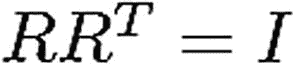

如前所述，在速度层面建立坐标系之间关系是最客观的分析方法。速度（以及由此产生的速率）由位置导数得到，因此直觉上首先会对上述方程进行求导。注意这是对时间的导数，因此如果旋转矩阵在求导时依赖于欧拉角，那么这些欧拉角的角速率就会出现（链式法则）。同时也要注意，利用乘积求导法则（矩阵乘积）和常数求导法则（单位矩阵），可以得到以下结果：

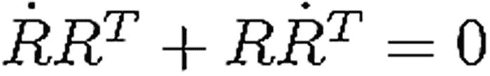

利用前一方程第二项中关于转置矩阵的以下性质：

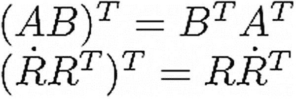

并将此性质代入替换，我们得到：

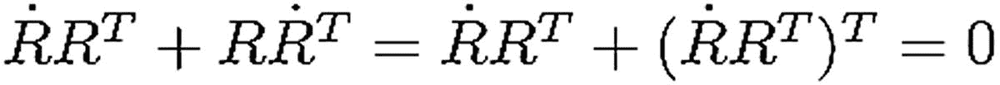

从这个结果中引出了一类特殊的矩阵，称为反对称矩阵或斜对称矩阵。它们满足以下条件：

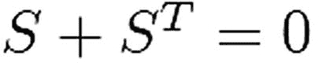

因此，以下项确实是一个斜对称矩阵：

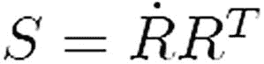

这有什么用呢？

斜对称矩阵与叉积的表示相关联。假设我们有两个向量：

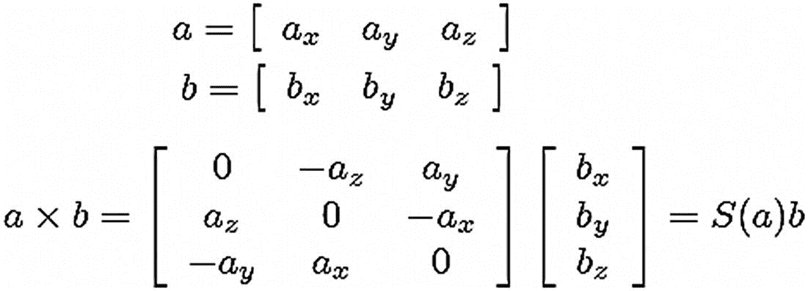

这样，一个反对称矩阵（此处是与向量 `a` 关联的矩阵）按所示方式将向量信息分布在其元素中。

关于该方程用途的问题仍然悬而未决，现在就来解答。只需记住斜对称矩阵的概念及其与叉积的关系。

假设图 2-6 中的汽车仅围绕其 `Zb` 轴旋转，角速度等于 `theta` 的导数。注意，世界坐标系的 `Z` 轴与机体坐标系（`Zb`）平行（两者均指向您）。

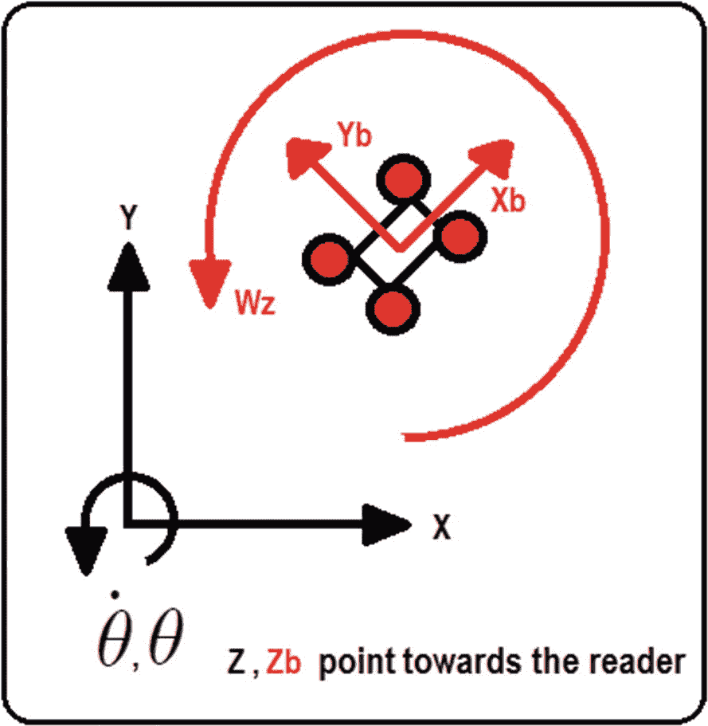

**图 2-6** 轮式车辆的机体坐标系及其与世界坐标系的关系

对于这个例子，显然机体坐标系中 `Z` 轴的角速度等于在固定坐标系中测量的 `theta` 的导数（再次重申，因为它们是平行轴）。

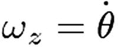

因此，我们可以通过斜对称方程得到相同的结果：

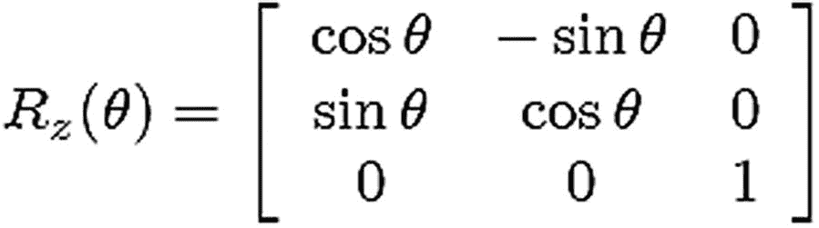

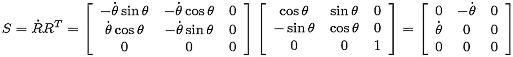

根据斜对称矩阵元素的定义，我们可以得出：

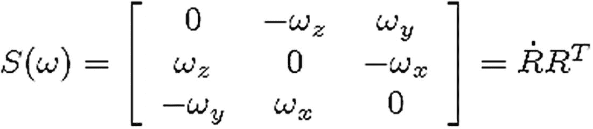

然后，利用欧拉复合旋转矩阵，通过执行上述步骤以及相应的简化，可以得到以下结果（这是一个有趣的练习，您可以推导出这些方程的完整序列；记住旋转矩阵的导数是对时间的导数，也记住全微分的概念）：

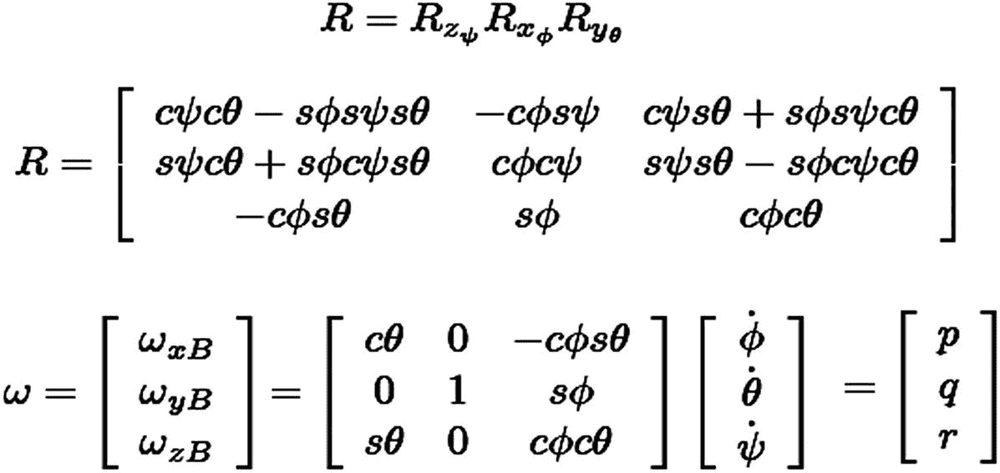

其中

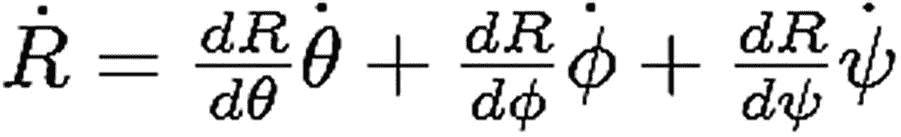

这建立了机体坐标系角速度与固定坐标系角速度之间的关系。记住，固定坐标系是用欧拉角表示的。

对于更偏好几何而非推导方程的人来说，在附录中提到的 Beedford 的书中，也有一种易于理解且直观的推导方法来获得这种速度关系。

另请注意，这些旋转正交归一化约束的施加，赋予了无人机所谓的非完整特性（在平滑或线性飞行模式下，这一点并不明显，您很快会看到）。

最后，观察引入了（`p` `q` `r`）这种命名法。这常用于飞机，当然也用于多旋翼飞行器。

现在您已经了解了无人机的运动学，接下来可以研究动力学了，但在此之前，我们先简要介绍一下作用在无人机及其螺旋桨上的力。

