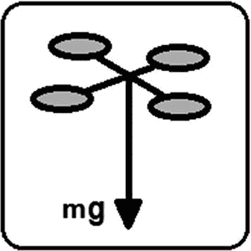

# 作用在多旋翼飞行器及其螺旋桨上的力

在推导动力学方程之前，方便先推导出作用于多旋翼飞行器上的基本力。空气动力学效应可以加入，但由于它们在室外和室内操作中会发生变化，甚至在靠近或远离地面时也不同，因此这些被视为非通用内容，可在其他著作或附录（见无人机最大速度）中简要查阅。

作用在无人机上最明显的力是重力。假设飞行器平衡良好，并且该力直接位于重心或几何中心（对于这类飞行器，期望两者重合）。见图 2-7。

**图 2-7** 作用在无人机上的重力

