# 螺旋桨受力分析

下一步是分析单个螺旋桨的受力情况。请注意，此分析针对双叶螺旋桨进行，但可通过相应的三角函数投影推广至更多桨叶的情况。

首先考虑的是，每片桨叶上的推力可等效为作用于该桨叶某一点上的力。在图 2-8 中，这些力分别标注为 `FL`（即左侧）和 `FR`（即右侧）。其次要假定螺旋桨已完全平衡，这意味着螺旋桨中心到每片桨叶分析点的距离相同（即半径 `r`）。

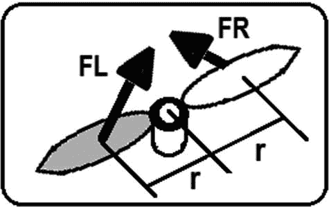

图 2-8
作用于螺旋桨桨叶的力及其力臂

此外，我们将采用图 2-9 所示的螺旋桨坐标系。

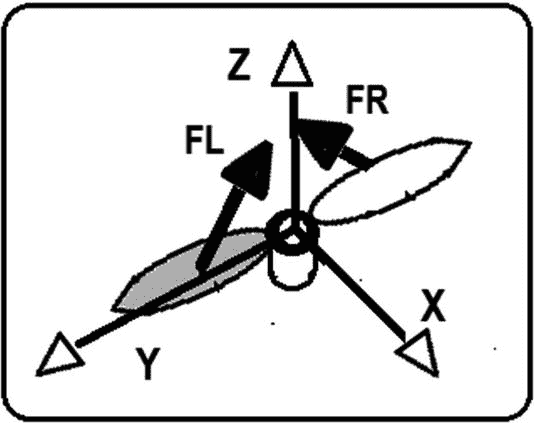

图 2-9
用于分析的螺旋桨坐标系

下一步，将每片桨叶上的力分解为垂直和水平分量（分别标注为 `Z` 和 `H`）。请参见图 2-10。

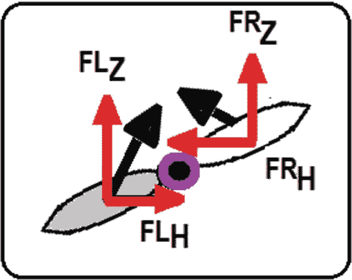

图 2-10
作用于每片桨叶的力的分量

接下来，我们将计算三个相应轴（`X`、`Y`、`Z`）上的合力与合力矩。由于假定每片桨叶具有对称性和平衡性，可建立以下等式：

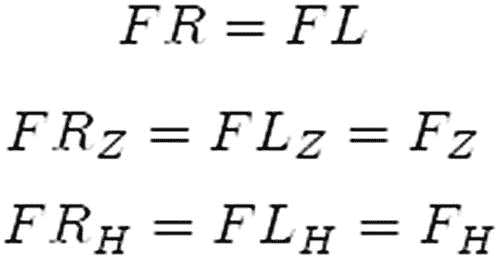

从上图可知，垂直方向的受力分析较为简单。请注意，增加桨叶数量会增加飞行器的负载能力（正如预期，每片桨叶都充当一个支撑轴）。

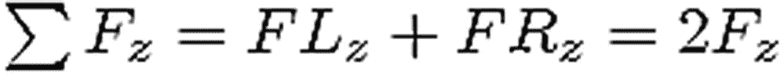

在 `X`、`Y` 轴上的分析是相同的，为此我们将利用螺旋桨的径向对称性（对奇数桨叶的分析会变得非常有趣，因为需要用到三角函数投影，但最终结果必须一致）。

假设此时螺旋桨位于 `X` 轴或 `Y` 轴上，如图 2-11 所示。

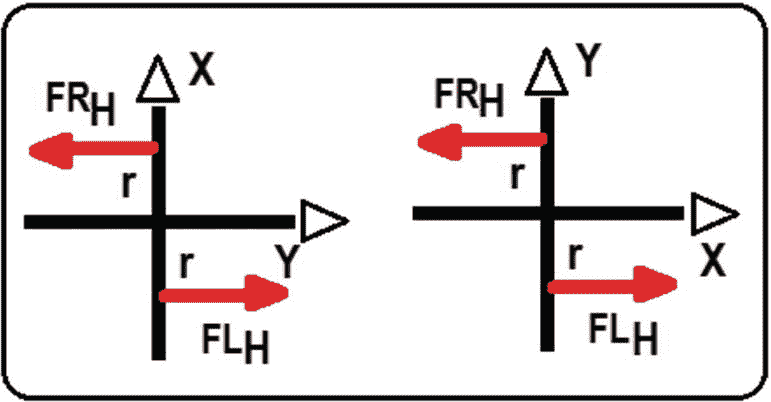

图 2-11
作用于每片桨叶的力之俯视图。`Z` 轴指向读者

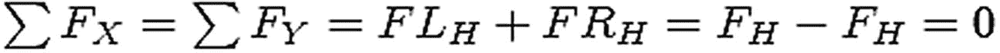

因此，这表明只要螺旋桨充分平衡，每片桨叶产生的水平力将会相互抵消。但是，正如你所注意到的，还存在作用力臂以及由此产生的力矩。下面将对此进行分析。

让我们回到上图，并补充说明 `Z` 轴指向读者，那么绕该轴的力矩如图 2-12 所示。

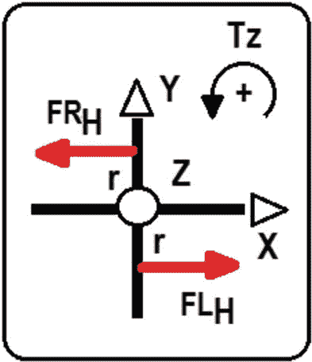

图 2-12
用于分析等效力矩的作用于每片桨叶的力之俯视图。`Z` 轴指向读者

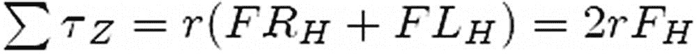

请注意，增加桨叶数量也会增加螺旋桨的力矩容量（每片桨叶都充当一个力臂）。

最后，我们将确定水平方向的力矩（绕 `X` 轴或 `Y` 轴；二者无区别）。请参见图 2-13。

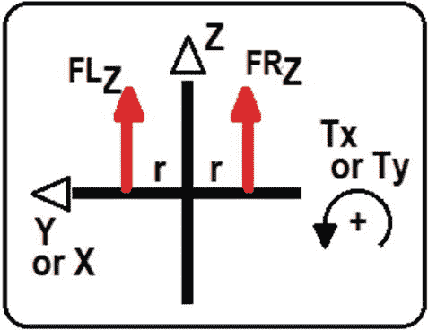

图 2-13
用于分析水平力矩的作用于每片桨叶的力之侧视图。`Y` 轴或 `X` 轴指向读者

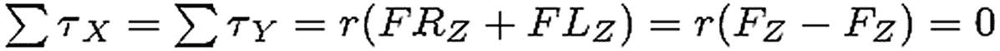

上述分析最重要的结论如下。只要螺旋桨充分平衡，它仅能在其作用轴上产生一个垂直推力，并绕该轴产生一个力矩。请参见图 2-14。

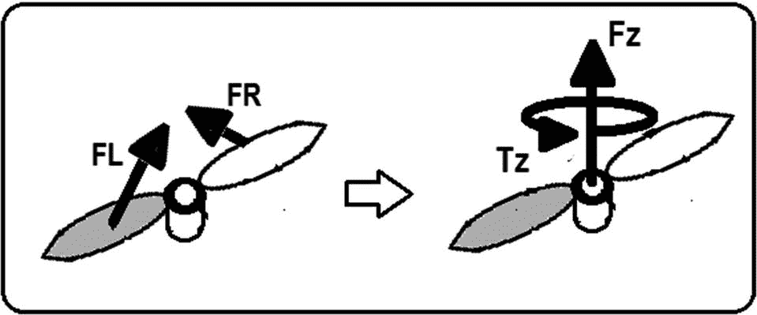

图 2-14
螺旋桨相对于其中心的等效力和力矩

一个有趣的练习题供你思考：请推导出对三片桨叶（每片间隔 120 度）的螺旋桨产生相同效果。最终结果必须一致。

### 作用在飞行器上的力

基于之前的结论，我们将把每个螺旋桨的力转移到飞行器的中心。见图 2-15。

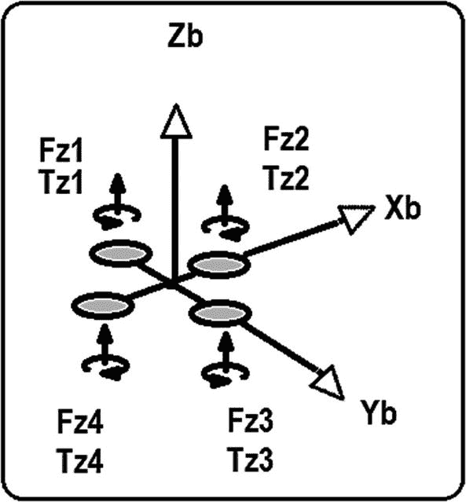

**图 2-15**
每个螺旋桨相对于四轴飞行器中心产生的力和扭矩，以及用于此分析的相应机体坐标系

对于本例以及预期的结果，我们将按照图 2-15 的情况进行处理。请注意，笛卡尔坐标轴的标记和方向，以及电机的编号、它们的旋转方向，甚至它们的几何分布，都会影响我们将要看到的内容，这被称为分配矩阵或推进矩阵。还要注意，一半的电机相对于另一半顺时针旋转，以防止自转（这意味着飞行器会绕其主轴以不希望的方式旋转）。如果所有或大多数电机都朝一个方向（顺时针或逆时针）旋转，就可能发生这种情况。

分析 `Zb` 轴上的力，我们有：

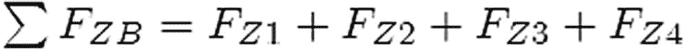

考虑到一个平衡良好的飞行器及其平衡良好的螺旋桨，在 `Yb` 和 `Xb` 轴上没有直接作用的力，只有扭矩，因此：

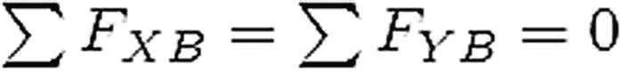

请注意，在某些条件下，这些力是存在的，并且无法从模型中消除。然而，这些效应通常出现在大型飞行器中，可以通过数学变换或控制补偿来简化。参见附录中的 Reza-Olfati 文章。

我们继续讨论扭矩。首先要做的是确定正旋转方向，如图 2-16 所示。

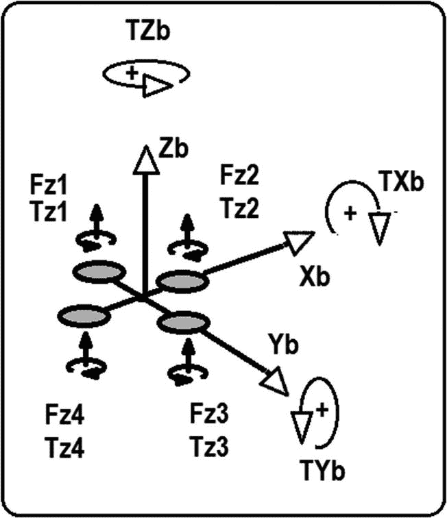

**图 2-16**
每个螺旋桨相对于四轴飞行器中心产生的力和扭矩，以及本次分析中的正旋转方向

观察到，在绕 `Zb` 轴的扭矩情况下，这是直接由每个电机的单个扭矩引起的。见图 2-17。

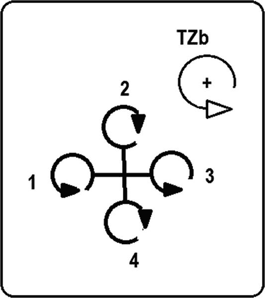

**图 2-17**
用于分析绕 `Zbody` 轴（指向你）扭矩的无人机俯视图

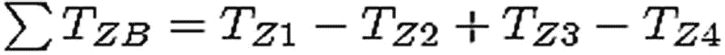

在 `Yb` 和 `Xb` 轴的情况下，扭矩是由推力及其各自半径产生的杠杆臂效应引起的。见图 2-18 和图 2-19。请注意，飞行器必须保持良好的平衡，以确保半径或杠杆臂完全相同或高度相似。

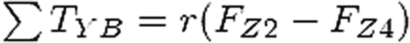

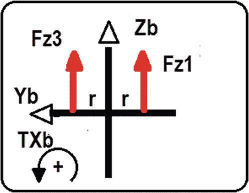

**图 2-19**
用于分析绕 `X` 轴（指向你）扭矩的无人机侧视图

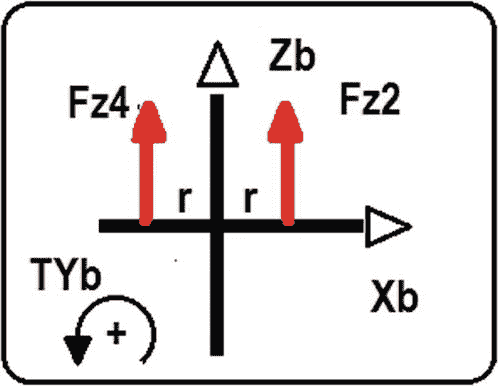

**图 2-18**
用于分析绕 `Y` 轴（指向你）扭矩的无人机侧视图

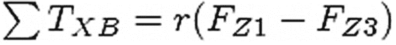

这里重要的结论是，四轴飞行器的重心（按设计与其几何中心重合）处，存在由其电机和重力作用产生的一个推力和三个扭矩。见图 2-20。请注意，重力始终垂直于地面或世界坐标系，但 `FZb`（无人机推力）并非如此，因为 `FZb` 垂直于无人机机体或机体坐标系。稍后我们将使用这些坐标系之间的适当关系。

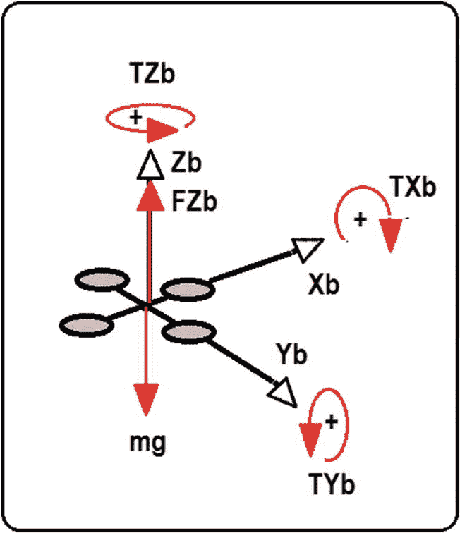

**图 2-20**
作用在无人机中心、由电机和重力产生的等效力和扭矩

了解了作用在飞行器上的力之后，是时候研究其动力学了。

## 平移动力学

在建立了坐标系之间的运动或运动学关系以及作用在四轴飞行器上的力之后，我们将推导出产生这些运动的方程。在本例中，我们从平移动力学开始。

为此，我们有必要问一下，在哪里进行以及为什么要进行这种分析。

平移动力学通常是在固定坐标系中推导的。为什么？只是为了数学上的简化以及与传感器的兼容性（大多数平移传感器指示无人机相对于固定坐标系的位置，例如 GPS）。

步骤如下：

1.  假设飞行器是对称的且为质点（四轴飞行器型无人机在设计上是平衡的，其重心通常与几何中心重合，或至少尽可能靠近）。

2.  将飞行器视为具有三维运动的质点，使用牛顿第二定律方程（这正是步骤 1 假设的目的）。

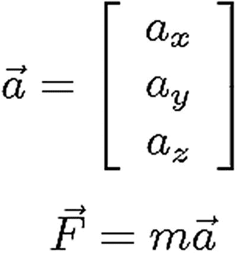

3.  由于我们关心的是控制飞行运动（建模为质点），我们根据位置重写上述方程（加速度定义为位置的二阶导数）。

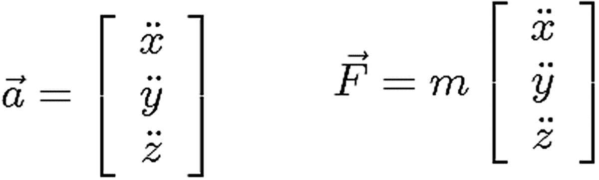

4.  我们加入自由落体效应（重力）。

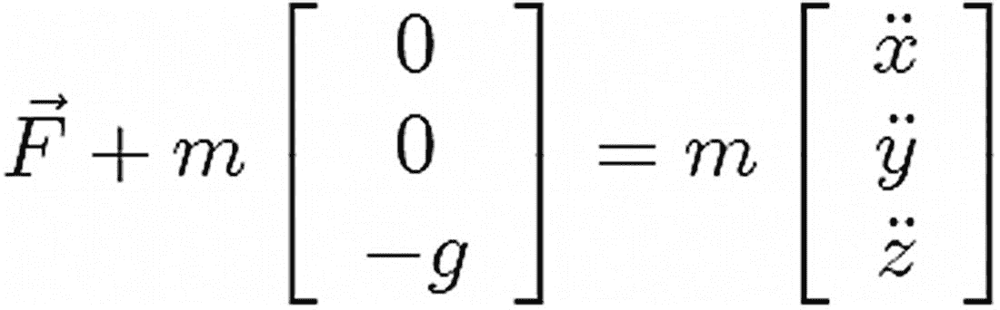

5.  因为我们想要在固定坐标系中建模无人机，而无人机的推力作用于机体坐标系，所以我们必须建立它们之间的关系，见图 2-21。本例中，作为达朗贝尔原理的扩展，可以表述如下。请记住，旋转矩阵是由 Tait-Bryan 旋转组合而成的。

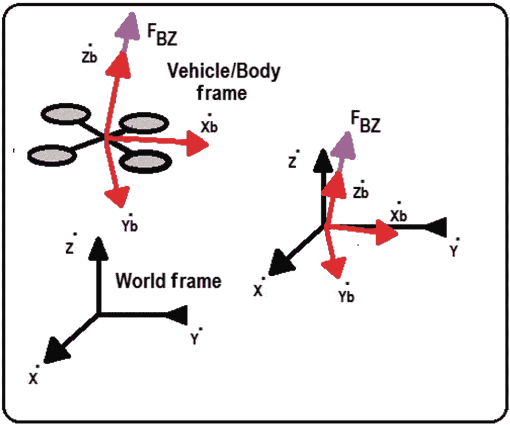

**图 2-21**
四轴飞行器在机体坐标系和世界坐标系之间重叠的推力

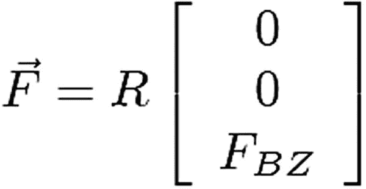

6.  因此，用于建模平移动力学的方程组为：

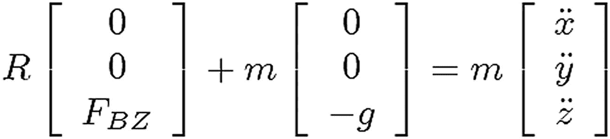

请注意，这是简化模型，但您可以根据工作需要添加空气摩擦、湍流等效应。

现在您了解了平移动力学，让我们转向旋转动力学。

