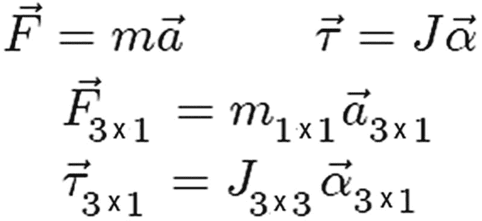
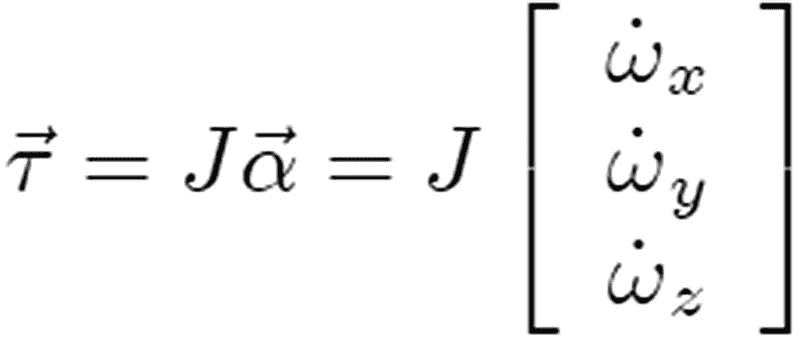
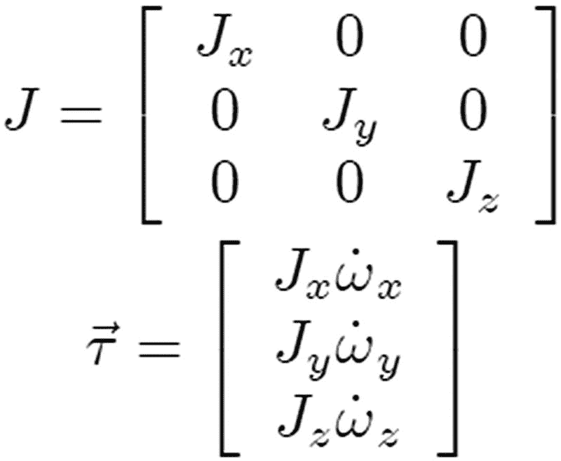
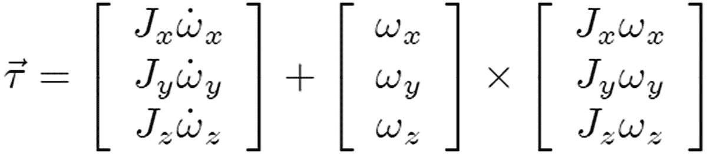
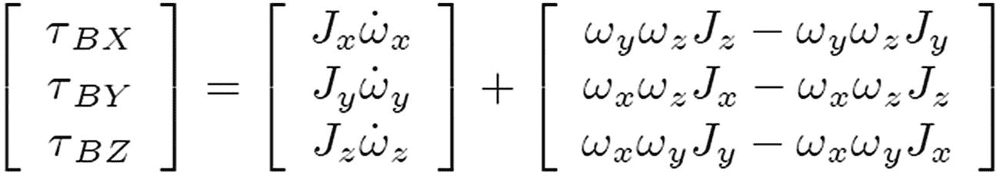

# 旋转动力学

## 欧拉方程与机体坐标系

在本部分中，我们使用欧拉方程来描述旋转运动。它们相当于牛顿第二定律在旋转运动中的形式。

与平动动力学不同，本分析是在机体坐标系中表达的。其原因同样是为了简化方程，以及与通常提供机载旋转测量的传感器相兼容。

步骤如下：

1.  我们使用牛顿第二定律的旋转等效形式或欧拉方程。注意，与之前的情况不同，`J` 不像质量那样是常量，而是一个 3x3 矩阵，当其与角加速度相乘时，会产生一个 3x1 向量。

2.  我们用已知或可测量的量（例如机载角速度）来重写方程（注意，平动分析是用位置的二阶导数来表示的）。在这种情况下，传感器通常能够测量机载角速度，这对分析很有帮助。观察可知，加速度也是速度的一阶导数。

## 刚体与对称性假设

3.  假设为刚体且对称，可以认为惯性矩阵仅在对角线上有分量，这意味着所有不在对角线上的分量均可忽略。

## 重力与离心效应分析

4.  重力效应被忽略，因为考虑到无人机是对称、刚体且相对于其中心平衡良好，由重力产生的力矩会被抵消（力臂半径趋近于零）。但应注意，对于不平衡的飞行器或大尺寸无人机（例如，运输放置在机架边缘物体（如机械臂）的无人机），情况并非如此。

然而，离心加速度的影响通常很重要（在平滑飞行简化中，你会注意到由于角速度降低，这些加速度被省略了）。

**为什么在平动分析中省略了这些离心效应？** 因为推力作用点相对于飞行器分析中心的位置几乎为零，因此它们可以忽略不计（但对于大型飞行器则不然，其情况类似于重力的旋转效应）。如你所见，在旋转运动中，它们被考虑在内，因为它们不依赖于作用半径，而是依赖于角速度。

## 动力学方程展开

5.  展开方程（叉积），旋转动力学变为

此动力学方程稍后将在平滑飞行条件下进行简化。然而，它们在几何控制部分将再次被使用。

你已经学习了运动学和动力学。为了完成我们的建模，接下来我们来讨论分配模型。