# 分配模型

推进或分配模型建立了电机与飞行器分析中心（例如重心）之间的关系。它是理论（建模、仿真和控制）与实践（设计和编程）之间的纽带。

## 获取分配模型的步骤

获取此模型的过程与演示作用在四旋翼飞行器上的力矩和力的部分所采用的方法非常相似。然而，此处将以系统化的方式重复此过程。

通常，期望得到以下关系（当然，假设电机具有线性行为）：

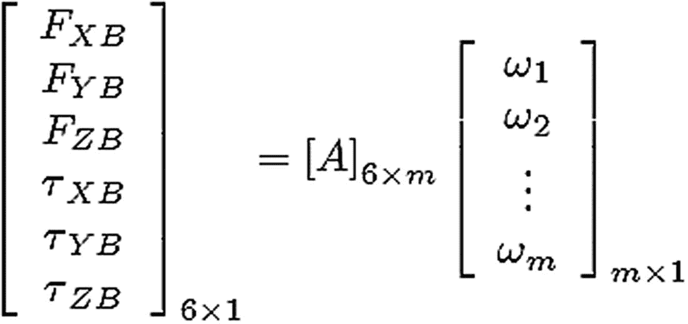

其中，`w`（索引从 1 到`m`）表示飞行器`m`个电机中每个电机的转速，`A`是一个分配矩阵，指示每个电机如何影响笛卡尔空间中三个可能的力矩和三个可能的力。该笛卡尔空间与所述飞行器的分析中心（例如重心）相关联。在大多数多旋翼飞行器中，`A`矩阵具有常数元素，但如果每个电机都配备了能够改变其位置和方向的伺服系统，则这些元素可能会变化。

请注意，此建模过程的结果会因每种无人机配置而异，但所描述的过程是通用的，步骤如下：

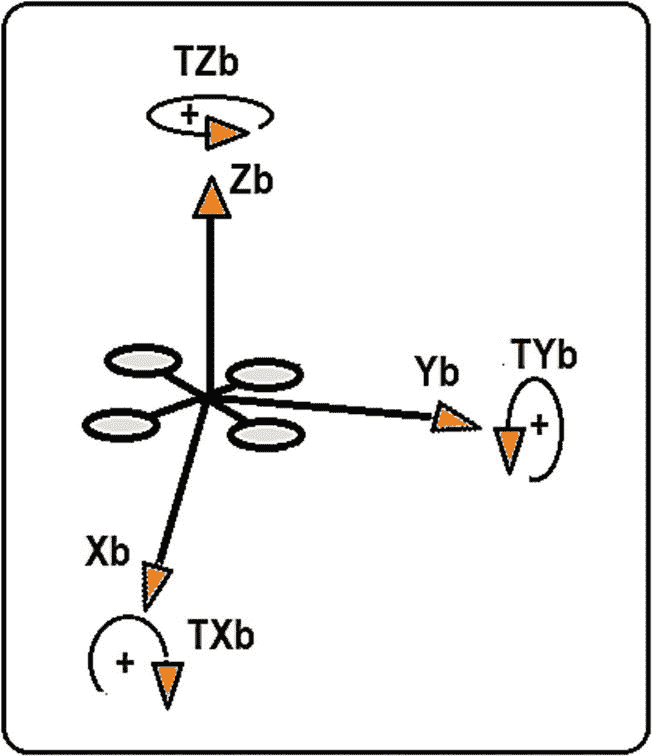

**图 2-22:** 步骤 1 的轴系约定

1.  首先要做的是建立轴系约定，包括运动的正方向。这包括定义平动和转动；参见图 2-22。在实践中，这是根据遥控器摇杆来确定的，遥控器摇杆通常基于前述的 ISO 标准（见本书的设计部分）。

1.  下一步是为电机贴上标签。这涉及它们的旋转方向以及它们相对于其他电机的几何分布。

在此，我们以一个具体示例说明，采用一种称为 X 型配置的平面几何结构，并带有指示的旋转方向、以下标签以及径向对称性，如图 2-23 所示。

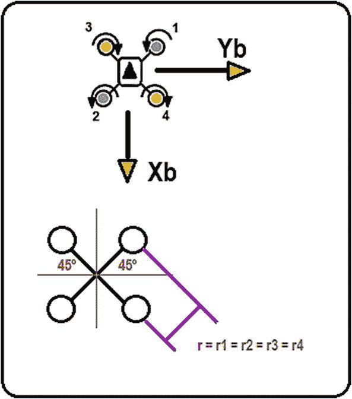

**图 2-23:** 步骤 2 的电机标签

注意，这通常是相对于自动驾驶仪参考方向（通常是一个小箭头）来进行的。

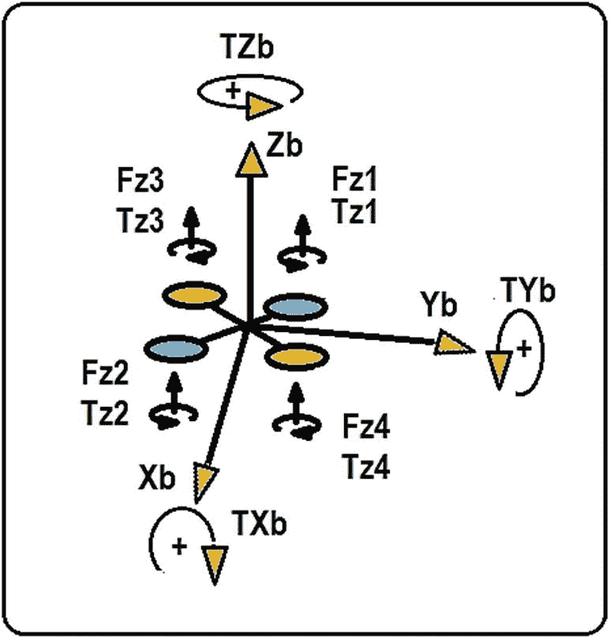

**图 2-24:** 作用于步骤 3 所选机架上的电机力和力矩

1.  现在，我们必须将步骤 1 中确定的运动与每个电机的力矩和推力效应联系起来；参见图 2-24。请记住，力矩的来源包括单个电机作用产生的力矩以及由力臂产生的力矩。

### 四旋翼飞行器的分配模型

通过采用与上一节关于四旋翼飞行器受力分析相似的步骤，可以得到以下结果（请记住，每种飞行器的配置都不同，但可以以此例为起点进行分析）：

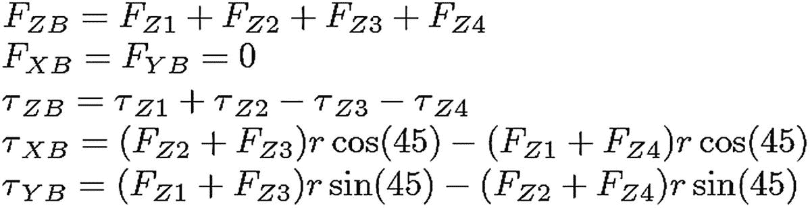

请注意，绕机体坐标系`Z`轴的扭矩直接由其他扭矩（即电机的扭矩）产生，而绕机体坐标系`X`和`Y`轴的扭矩则由力臂作用产生，如图 2-25 所示。

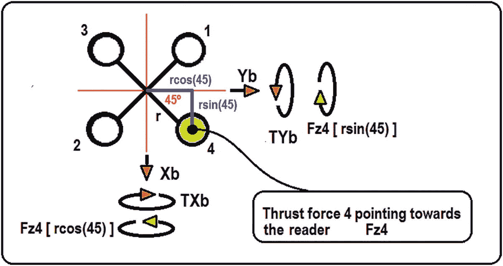

图 2-25

用于计算扭矩的电机力臂分量（以电机 4 为例）

为简单起见，此处仅以电机 4 为例进行说明，但您可以推导出其余电机的情况。观察力臂相对于坐标轴的方向及其分量。同时，牢记每个电机相对于参考轴引起的旋转方向，以确定正确的正负号。在此例中，`X`和`Y`方向的分量均为负，这反映在方程式中，因为电机 4 推力产生的旋转与之前设定的正旋转参考方向相反。

接下来，将进行一系列假设，以尽可能地简化上述方程。您需要评估这些假设在您自己的设计中是否可行。

假设力、扭矩与各电机转速之间存在以下关系（这些假设或多或少是合理的，因为电机制造商通常会保证这种线性比例程度）。注意这些将扭矩和推力与电机转速关联起来的比例常数。

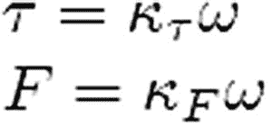

因此，同时假设所有电机均相同（如果电机为同一型号，据制造商提供的数据，其比例常数将相似或大致相同），

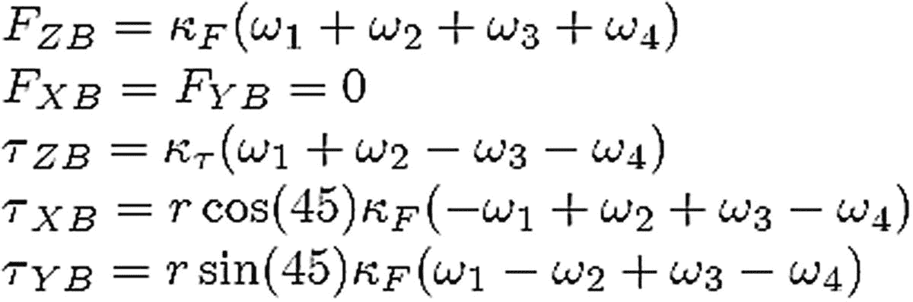

下一个假设是，项`kf`、`kt`、`rcos(45) kf`和`rsin(45) kf`为恒定增益，由于它们存在于所有包含角速度`w`的项中，因此可以被提取公因式，并通过补偿`Fzb`、`Tzb`、`Txb`和`Tyb`来吸收。

这样，我们通常可以找到这种简化表示形式。请注意，所述的补偿考虑了对称性；如果力臂的角度或距离不同（例如非对称无人机），则必须考虑这些项，而不能将其忽略：

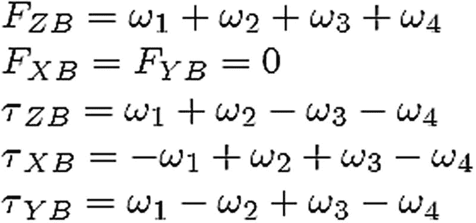

这些方程比原始方程更简洁，并且可以采用如下向量形式表示：

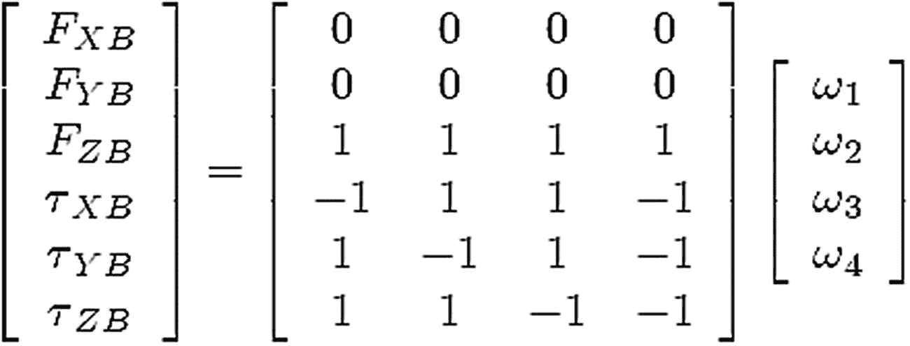

进而可以简化如下（以简化矩阵运算）：

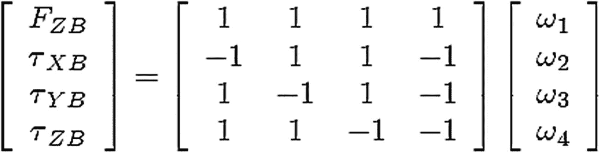

对于好奇`X`和`Y`方向运动如何控制的人，这将在本书后续的控制章节中介绍，但可以预先说明，这是由于它们对角变量的依赖关系（嵌套控制）。

注意，对于六旋翼或三旋翼飞行器，我们不可避免地会遇到非方阵的情况，此时需要使用伪逆矩阵或数值优化算法。

继续我们的分析，一旦我们设计出这个向量的控制值，

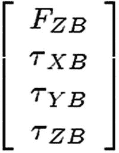

其到各电机的分配过程如下：

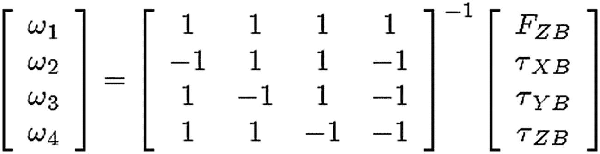

为了减少处理开销并避免反复计算上述逆矩阵和矩阵乘法，我们会以展开形式进行编程，即

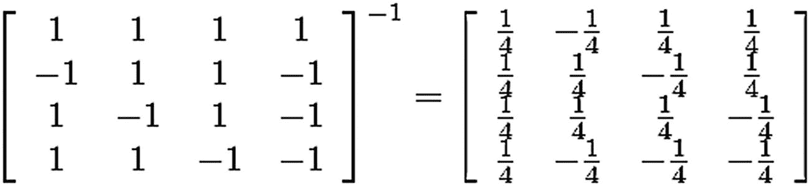

基于与上述相同的、由扭矩和力控制所吸收的常数值吸收原理，其在作用上等价于（这就是分配矩阵）

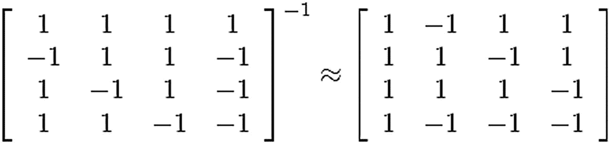

最终得到

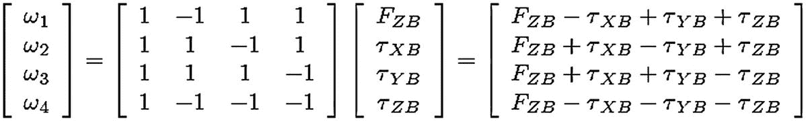

此格式必须同时应用于自动控制（由控制理论设计并引入，将在相应章节介绍）和手动控制（例如，来自遥控器）。使用遥控器时，输入到电机的向量如下：

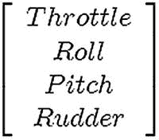

一种半自动设计（结合手动与自动操作）可能如下所示（此向量之和必须乘以分配矩阵，才能将其效应注入到每个电机）：

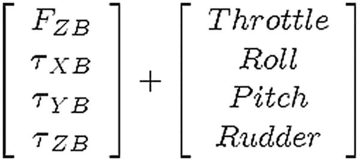

一个自然而然的问题是，上述方程是否有更简单的使用方法。答案是肯定的，但这也意味着需要满足某些特定的运行条件。让我们来看看具体是什么情况。

