# 线性简化

在进行第二组简化之前，让我们回顾一下已经完成的简化，同时请记住，在您的数学模型中应考虑重新评估是否使用它们。

-   小型化飞行器，这意味着惯性简化
-   相对于其重心具有良好的平衡性，这意味着力矩和力的简化
-   重心与几何中心对齐，这意味着径向简化，或力臂趋近于零
-   螺旋桨良好平衡，这意味着每个螺旋桨仅提供推力和扭矩
-   飞行器的对称性，以便对惯性矩阵施加简化，这也意味着离心力方程的简化
-   不考虑摩擦、湍流或其他空气动力学建模效应的基础建模。这提供了一个高度简化的模型，该模型几乎可以在任何动态仿真软件中执行。

话虽如此，让我们继续任务简化。

平稳飞行模式在此意味着滚转角和俯仰角趋近于零，而偏航角可以取任意值以重新定向飞行器，就像汽车中的方向盘一样。

平稳飞行模式也涉及平稳的角速度。

这意味着：

-   当滚转角和俯仰角趋近于零时，将遵循以下近似：

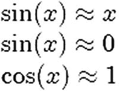

请注意正弦近似；根据最方便的情况选择使用两者。等于零的那个是一个极限，而等于直线的那个是一个线性近似（例如，泰勒级数的第一项）。这些方法并不相互矛盾，而是互补的。而且，它们同样有用（事实上，它们可能同时出现在同一个问题中）。

-   缓慢的角速度，当它们相乘时，会产生一个更小且趋近于零的结果。

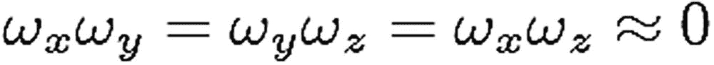

这还将以下列方式影响飞行器的动态行为。

如果我们展开平移动力学模型，

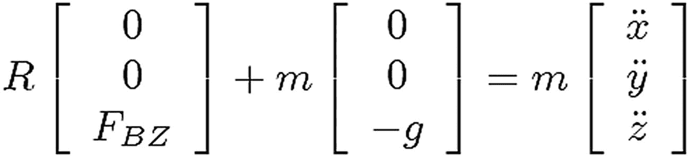

并且我们记得

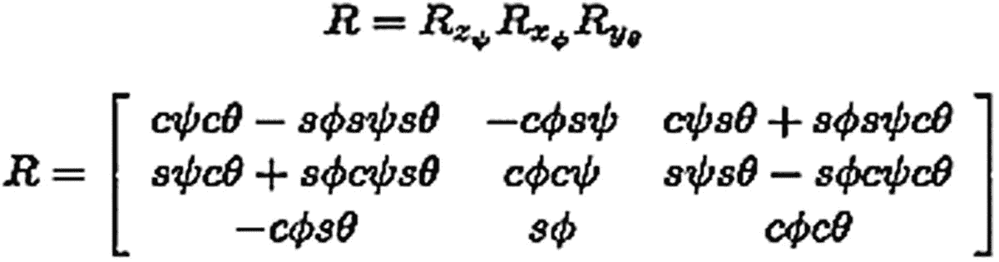

我们将得到

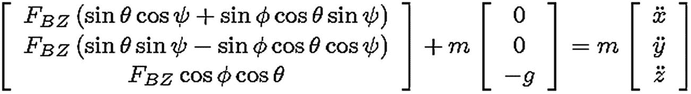

应用平稳飞行条件，平移动力学以这种方式简化（注意，其中隐含着平移运动学的简化）。观察可知，此平稳飞行仅适用于滚转角和俯仰角，而偏航角可任意指令并遵循期望值。

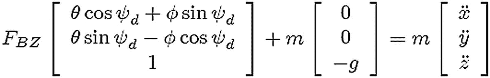

注意，这里为了方便，对小角度应用了正弦简化。如果我们使用另一种简化，我们将只得到零，就没有方程可交互了。

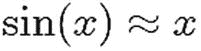

在旋转层面，我们有以下动力学模型：

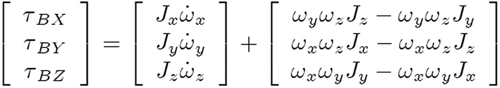

并且由于平稳飞行，缓慢的角速度以这种方式被简化：

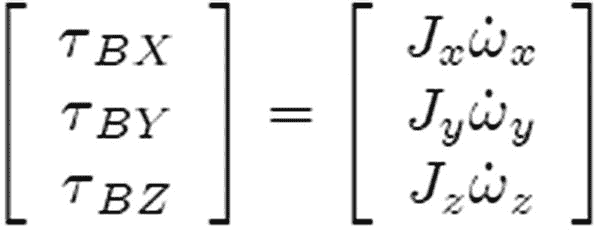

值得分析是否可以直接在固定坐标系中表达此方程。为此，需要将力矩和角速度从飞行器坐标系投影到固定坐标系。我们将使用先前推导的运动学关系：

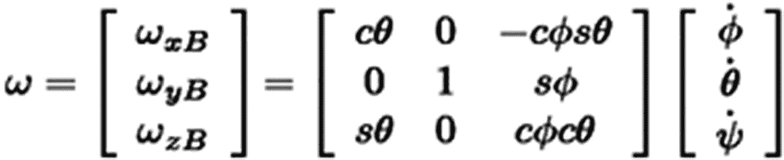

它被简化如下：

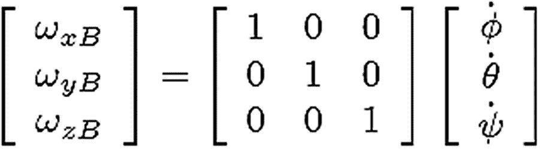

这里为了方便，对这些小角度使用了以下近似：

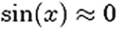

这是因为这里期望的是消除项，而不是保留它们以便进一步分析。

回到在飞行器坐标系中推导出的旋转动力学模型，我们执行以下操作将其转换到固定坐标系：

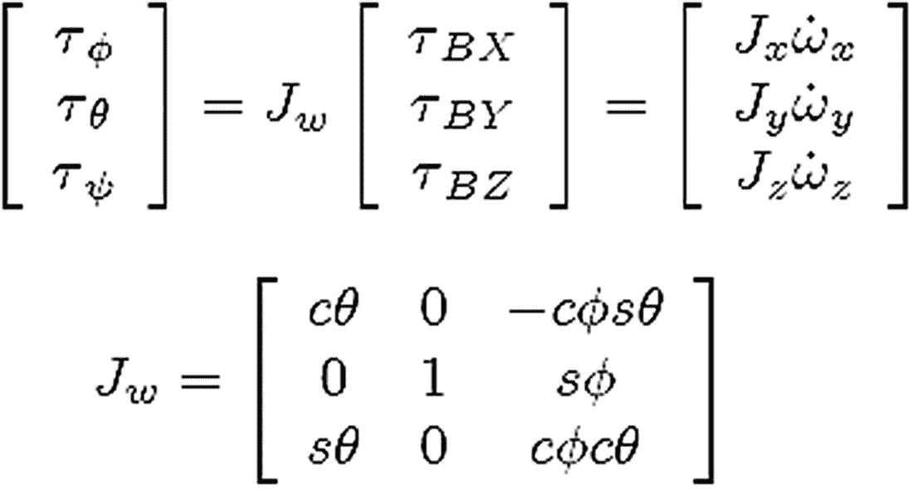

对于角速度，我们必须执行以下操作：

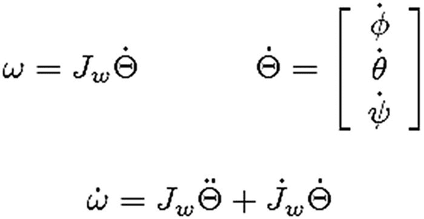

但请记住（并且记得单位矩阵的逆矩阵也是单位矩阵）：

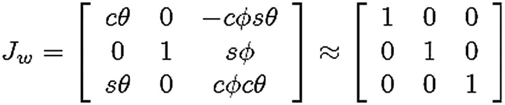

因此，

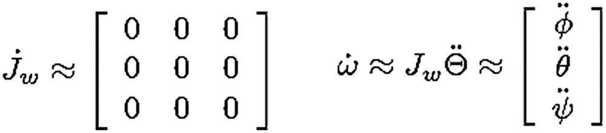

这样，飞行器坐标系中的旋转动力学就变得与固定坐标系中的相同。

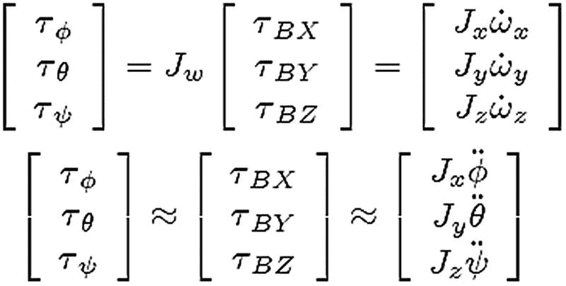

简而言之，平稳飞行简化改变了原始方程组，如图 2-26、2-27 和 2-28 所示。

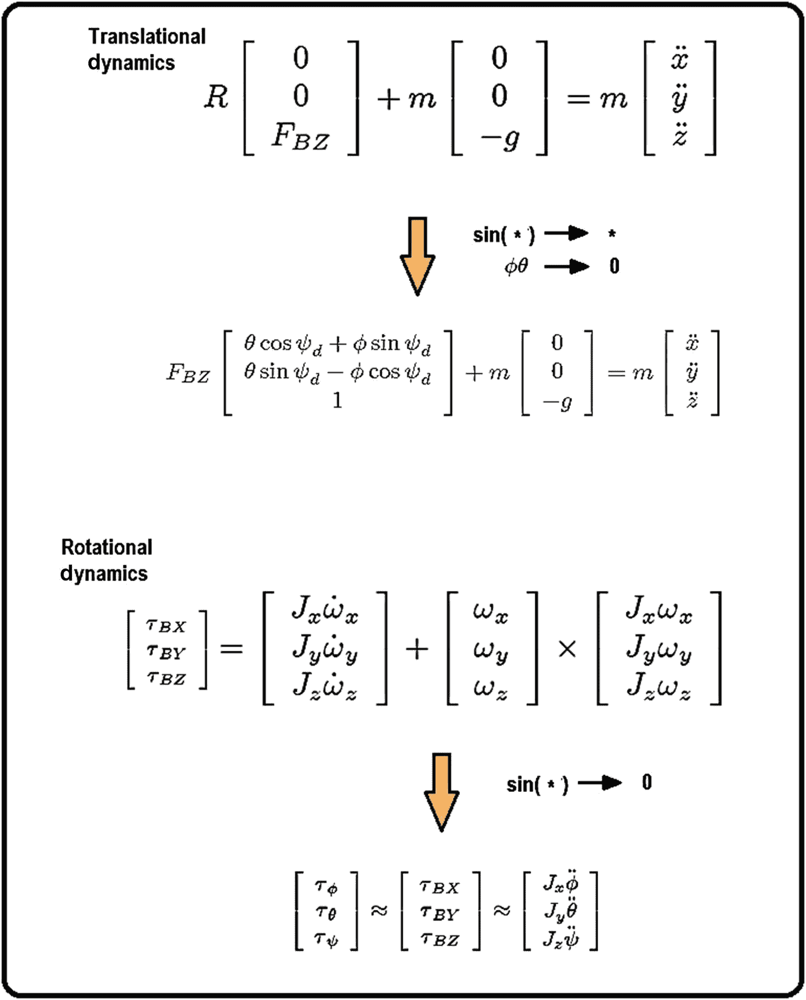

**图 2-27** 动力学的线性简化

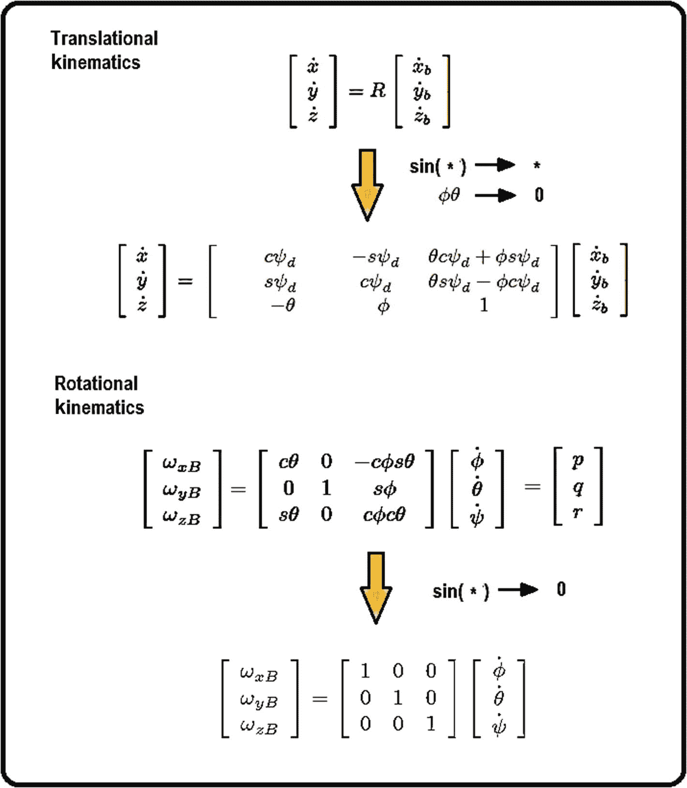

**图 2-26** 运动学的线性简化

注意，变化是在运动学关系以及动力学中进行的，但推进方程保持不变（请记住，如果您的飞行器具有推力矢量系统，分配矩阵也会改变）。

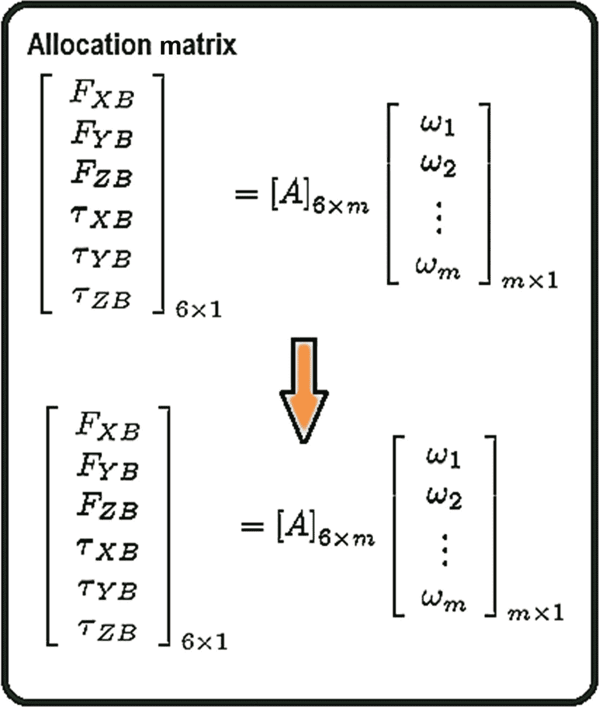

**图 2-28** 分配矩阵的线性简化（在此示例中，方程保持不变）

## 本章小结

在本章中，您学习了无人机的通用模型，该方法特别针对但并非排他性地适用于四旋翼飞行器。本章解释了建模的坐标系、旋转和平移类型的运动学和动力学方程、螺旋桨的通用建模、分配或推进模型，最后介绍了一些线性简化，这些简化将在下一章中用到。这些主题在不同关于无人机的书籍和文章中非常常见。如果您想深入学习已学知识，再次邀请您探索附录。在下一章，您将看到与控制器设计相关的主题，这些控制器被视为两类家族：飞行器模式（或第一人称视角，或称机上控制模式）和机器人模式（或第三人称视角，或称外部控制模式）。

