# 3. 无人机控制

在本章中，你将学习基于两种分类的四种最常用的无人机控制器，这两种分类分别将飞行器视为载具和机器人。本章还将向你介绍一些控制概念和李雅普诺夫稳定性理论的基本概念。最后，还包括一节关于轨迹规划的内容。因此，你将能够理解和掌握大多数现有的无人机控制器，包括强大的几何控制。有了这些知识，你可以将其扩展到其他类型的载具和飞行器。

请记住，为了将我们将要研究的控制器注入飞行器的电机（以及一般任何其他控制器），你必须使用为你各自的载具计算的分配矩阵或推进矩阵。上一章中分析的特定案例的分配矩阵如下所示：

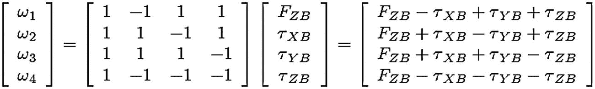

因此，本章的目标是学习设计`FZB`力以及其余三个扭矩的最通用方法。

另请注意，如果使用 SDK 类型 3（如第五章关于无人机编程方式的章节所述），此方法是有效的。如果使用 SDK 类型 2，则所述力和扭矩将直接注入飞行器，无需使用分配矩阵。最后，如果使用 SDK 类型 1 或 GUI，则你只能定义轨迹配置文件（你将无法设计自己的控制器；只能修改预装的控制器增益和路径）。

你将看到，像任何其他无人载具一样，四轴飞行器可以被分析和视为机器人或载具，在这两种情况下，控制可以是自动的，也可以不是。

在讨论这些控制器之前，让我们先来谈谈一个有用的概念：零值。

## 有用零值概念

控制目标是为了开发一个任务而引入有用的零值。

在控制理论中，通常会发现三种零值：定义零值、主导零值和近似零值。不要将这些概念与线性控制理论中的极点和零点相混淆。

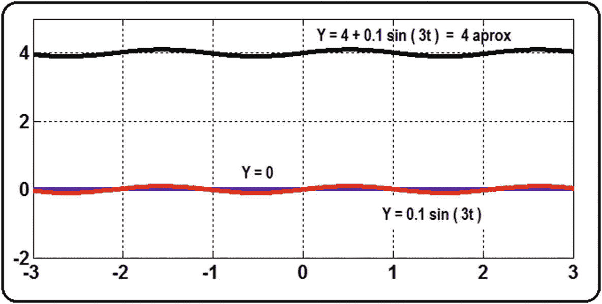

**图 3-1** 主导零值示例

* **定义零值**是一个理想的恒定值，旨在将误差或估计值趋近于此值。它也是一种静态或动态平衡，确保受力或运动平衡。

* **主导零值**是指当方程中的某一项相对于其他项过大时，方程的行为仅由主导项决定，而忽略其他项的影响。这些被忽略的项被视为主导零值。这种零值在电路和电子电路分析以及控制理论中非常常见。图 3-1 显示了一个函数的图形，其中主导效应可以近似等于 4。观察到被主导的正弦分量相对于 4 可以视为零。

另一方面，这里所称的有用零值是通过时间行为获得的。在数学上，它是任何随时间增加而趋于零的函数。

在控制理论中，广泛用作有用零值的一个函数是负指数函数。这个有用零值会随着时间推移表现出类似零的行为。注意，不存在负时间。下图只是一个展开视图：

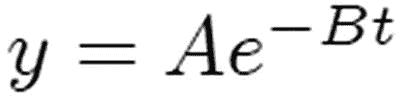

只要 `B` 为正值，该函数将始终表现出如图 3-2 所示的行为。

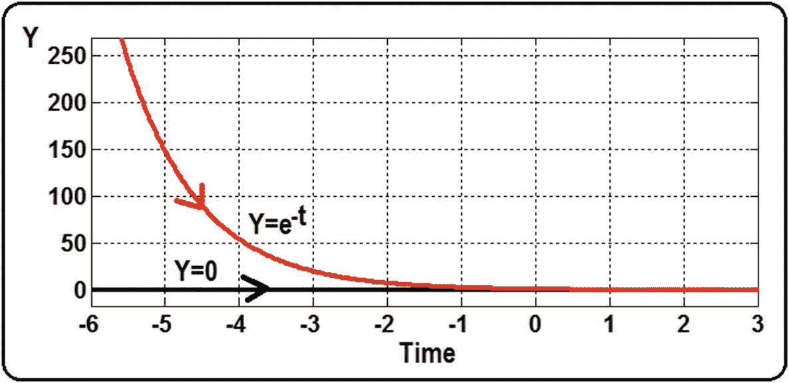

**图 3-2** 近似零值示例

请注意，有用零值是一种强制某物变为恒定零值的方法。此函数也是与此微分方程相关的解和行为：

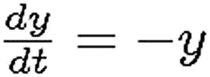

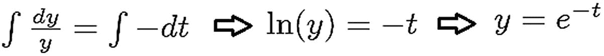

使用牛顿记法，它等同于

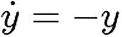

更一般地，这一系列微分方程总是得到一个递减的指数函数，只要 `B` 和 `K` 为正值，该函数就趋于零：

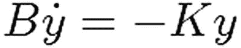

如果我们做以下变量替换，我们将得到一个称为 PD 控制器的方程：

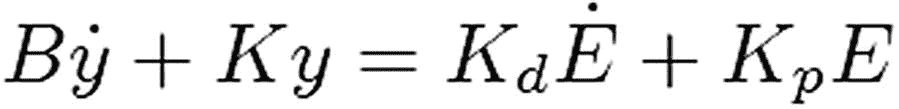

这意味着与被控误差相关的值 `E` 将趋于零，并且由于 `E` 被定义为

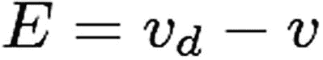

换句话说，它是变量的期望值减去实际值，例如位置或姿态：

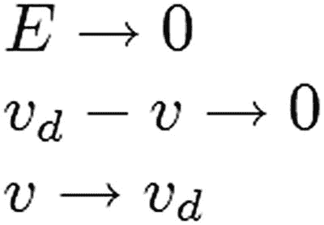

期望值将趋于等于实际值，因此我们就完成了任务！

我们稍后会用到这个有用零值概念及其 PD 应用。

请记住，一阶微分方程以及 PD 控制器有一个物理等效系统，称为无质量阻尼谐振子或弹簧-阻尼器系统。因此，比例项可以解释为诱导弹簧，微分项可以解释为诱导阻尼器；见图 3-3。所述诱导弹簧用于将实际系统拉向期望值，而诱导阻尼器用于使实际系统在该值处停止。如果只有诱导弹簧而没有诱导阻尼器，实际系统将不会停止，而是会在期望值（误差的零值）附近持续振荡。

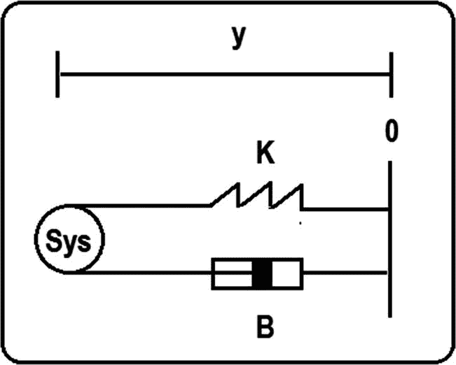

**图 3-3** PD 控制器的物理类比

另一个有用零值是二阶微分方程或质量-弹簧-阻尼器系统，也称为阻尼谐振子，条件是项 `M`、`B` 和 `K` 为正。其推导过程不太直观，属于线性控制和微分方程教材的内容。然而，就本书的目的及在给定条件下，我们只需假设该系统也是一个有用零值。

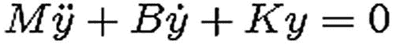

就控制而言，需要强调的是，PID 控制器的行为类似于所述质量-弹簧-阻尼器系统（至少在数学上是如此，因为在实现过程中存在物理上的考量，例如使用微分器而非积分器带来的影响）。

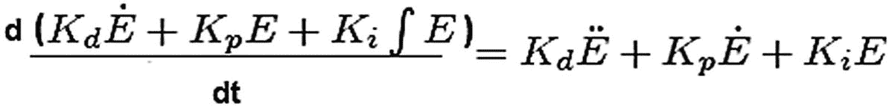

了解了有用零值概念后，让我们继续学习控制器。我们将从机器人模式控制器开始。

