# 机器人模式控制

如果将无人机视为机器人进行分析，控制设计将涉及到将其视为由第三方操控或外部视角来观察。为此，控制目标是将四旋翼飞行器的一个参考点移动至给定的三维位置，同时可以选择是否调节其朝向。请参见图 3-4。

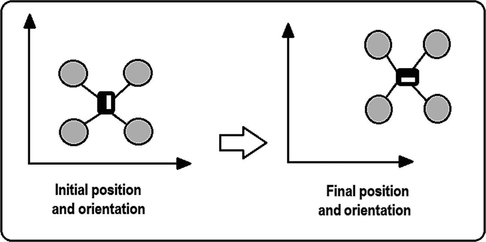
图 3-4：从第三方任务视角看的无人机机器人模式控制

现在，我们来解释一下称为无偏航变化的线性笛卡尔控制的机器人模式控制。

## 无偏航变化的完全线性笛卡尔控制

这是一种简单且基础的控制器，能够实现如图 3-5 所示的操作，即在不改变无人机朝向的情况下沿路径飞行。这在例如种植作业或房屋涂装图案中非常有用。下面我们来描述其独立和依赖的动态模块。

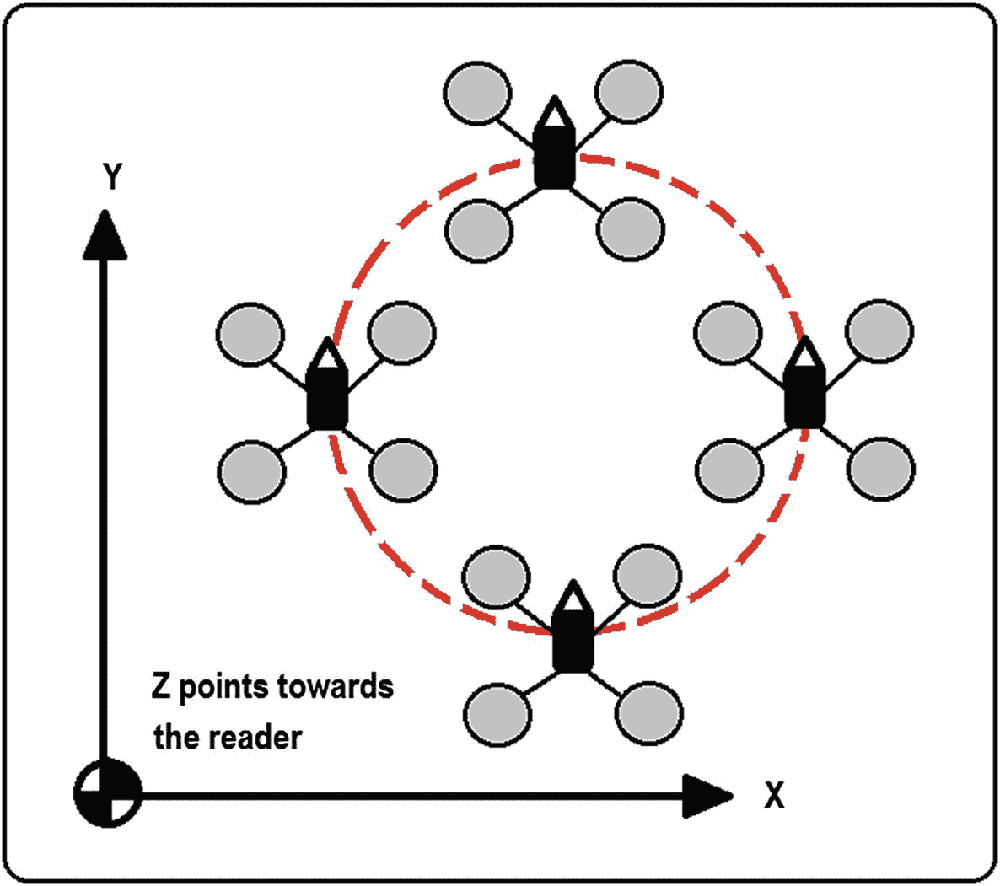
图 3-5：无偏航变化的完全线性笛卡尔控制图解说明

### 独立动态的控制

让我们回到无人机的线性化动态模型，通过分离那些不依赖于其他变量的动态（请注意，这是相对于运动变量进行的，您可以在其中识别出三个位置和三个方向）。因此，我们得到

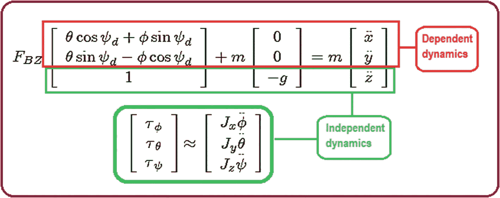

请注意，`X` 和 `Y` 方向动态依赖于 `theta` 和 `phi` 角度的动态。因此，我们隔离出那些与其他方程没有交互的方程，即 `psi` 和 `Z` 相关的方程。注意，实际的 `psi` 不同于期望的 `psi`，因为后者是一个恒定值或一条轨迹，而在我们的示例中，期望的 `psi` 将等于零。

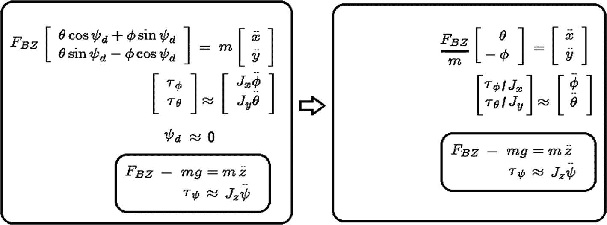

如果将 `Z` 方向上的推力定义为如下形式

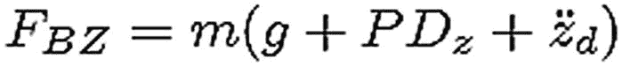

其中

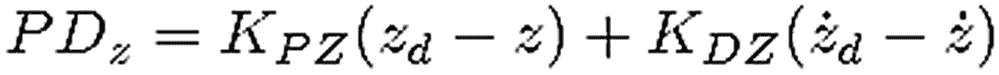

将其代入动态模型，特别是代入 `Z` 方程中，我们将得到：

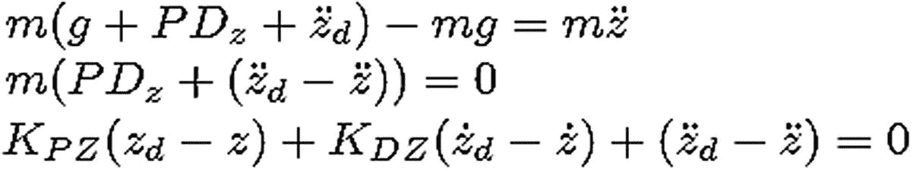

这变成了一个有用的零阻尼或阻尼谐振子。

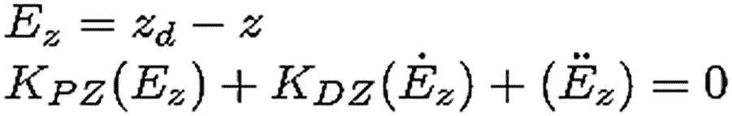

并且只要增益满足至少为正数，并符合线性控制书籍中提到的其他标准，我们知道

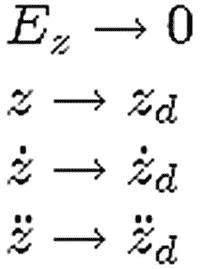

此外，根据控制理论可以证明，如果期望值为一个常数或一个其最大绝对值可以被常数限定（例如正弦或余弦）的函数，

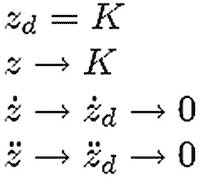

类似的推理也适用于 `PID` 控制器。您可以自行推导证明，作为练习。

这也意味着

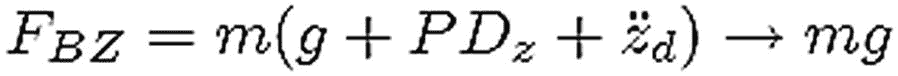

并且因此

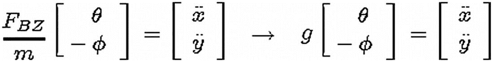

我们很快会用到这个结果。

另一方面，在实际操作和仿真中，有些人会将提出的推力控制简化为以下形式：

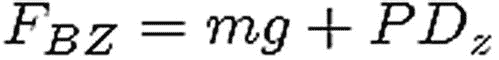

只要微分增益和比例增益足够大，它将能够正常工作，基于以下考虑：

1.  如果飞行加速度很小（这源于我们对平稳飞行的假设）。

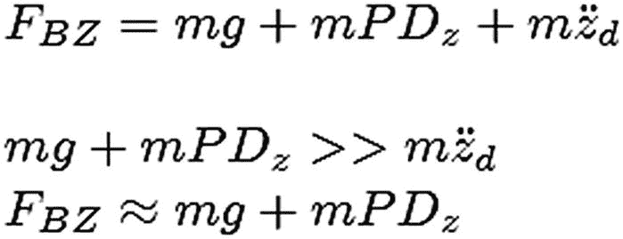

2.  如果质量是常数或被常数限定，它可以被比例增益和微分增益吸收（一个常数乘以另一个常数得到另一个常数）：

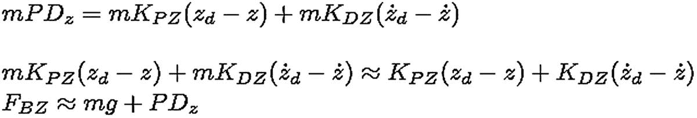

我们继续讨论与 `psi`（偏航变量）相关的方程。

在这种情况下，控制量可以定义为

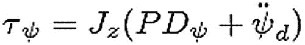

当此控制量代入偏航模型时，会得到以下结果：

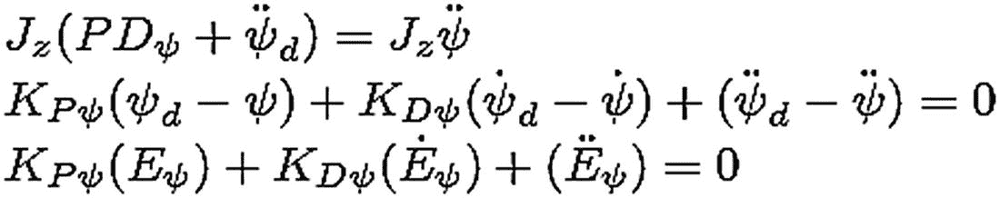

同样，如果控制器增益至少为正数，并且满足自动控制教材中描述的其他准则，我们将得到一个有用的零阻尼或质量-弹簧-阻尼系统，这意味着

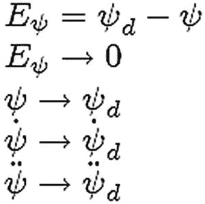

再次考虑平稳飞行条件（小加速度）和常数值的吸收。正如对变量 `Z` 的推导，我们将得到以下结果：

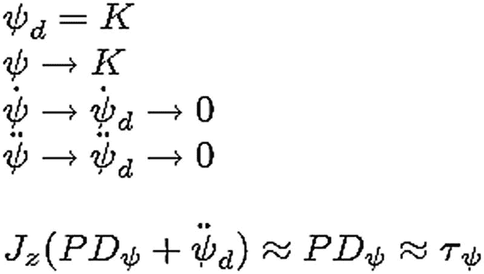

现在，我们开始控制依赖动态。

### 依赖动力学的控制

根据之前的简化，我们可以注意到剩余的系统为

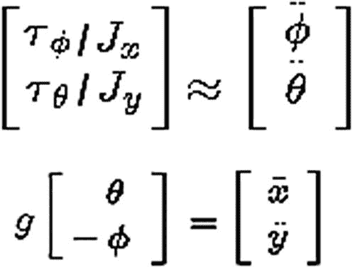

不依赖于其他变量的子系统是旋转子系统，而平移子系统则依赖于这些旋转变量。

因此，从设计旋转动力学的控制器开始是合理的。基于与偏航变量类似的论证，以及已经阐述过的平稳飞行（小加速度）和恒定吸收的原因，这里提出了滚转和俯仰的控制器：

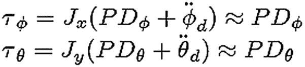

这与先前分析的变量类似，意味着

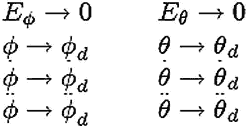

因此，依赖动力学可以通过其所依赖角度的期望值进行控制。这是合乎逻辑的，因为四旋翼飞行器能够通过滚转和俯仰倾斜在 `X` 和 `Y` 方向上移动。

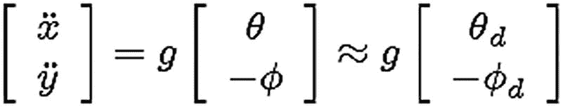

随后，`theta` 和 `phi` 的期望值以此方式选取（这被称为外环控制或嵌套控制）：

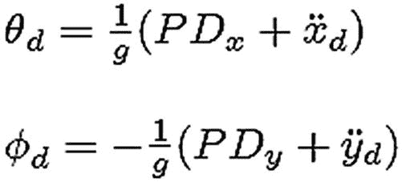

这种对平移 `X` 和 `Y` 动力学的反馈导致

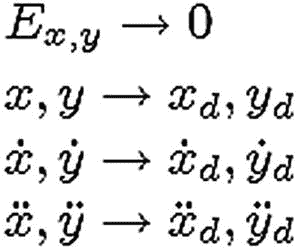

在平稳飞行、小加速度下轨迹有界以及先前使用的常数吸收的前提下，辅助控制器可以简单地设计为

总而言之，注入的控制量如下所示（请参阅下一章的仿真以观察其性能）：

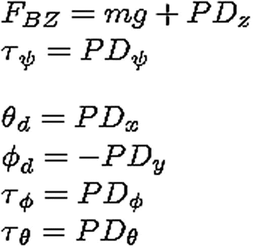

展开后如下：

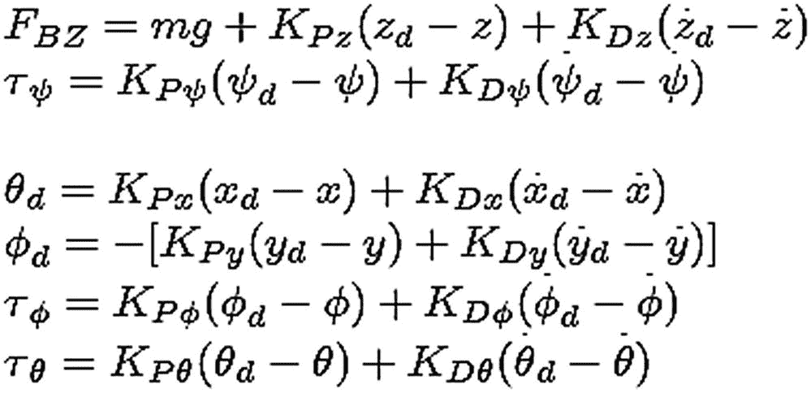

请回忆 ISO 1151–2:1985 标准的介绍，注意 `theta` 的测量是相对于 `Y` 轴进行的，但其变化会影响 `X` 方向的运动。同样，`phi` 的测量是绕 `X` 轴进行的，但其变化会影响 `Y` 方向的运动。

最后，鉴于

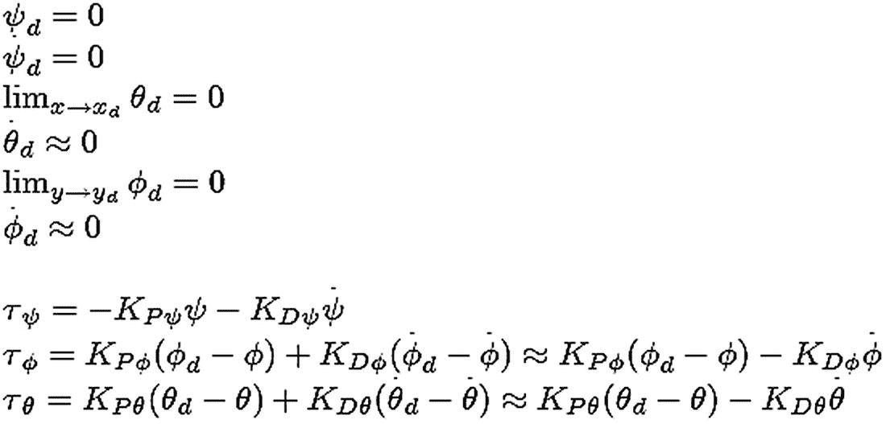

您应该注意到 `theta` 和 `phi` 的期望速度不为零，并且它们应是对应平移 PD 控制器的导数。然而，考虑到上述平稳飞行近似和变量收敛性，将期望速度设为零是一个很好的近似。

关于这种平稳飞行近似，让我们看看在此飞行模式下控制器会发生什么。

### 控制器的线性解耦

另一个重要的考虑因素是，在这种偏航角固定为零的平稳飞行中，控制器是解耦的（至少线性控制器如 PD、PID 等是如此），因此平面平移运动以及滚转和俯仰旋转运动似乎具有独立的行为，例如：

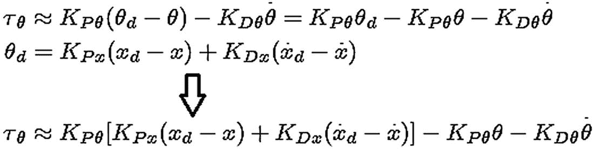

结合先前常数吸收的假设

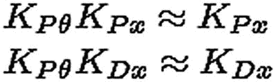

得到如下结果：

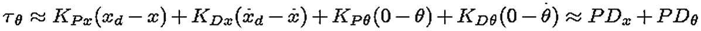

对于变量 `phi` 也能得到类似的结果。请将此作为练习。

在结束本节之前，我们来讨论一些说明。

### 说明与图形解释

从图形上看，该控制的实现顺序如图 3-6 所示。

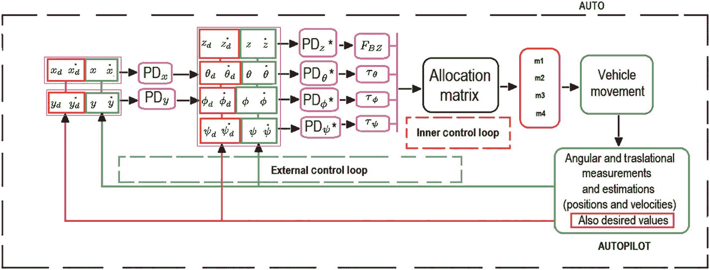

*图 3-6: 无偏航变化的完全线性笛卡尔控制图形顺序*

两种带有遥控器（半自动或手动引导模式）的版本如下。

在第一个版本中，遥控器仅改变期望值；见图 3-7。

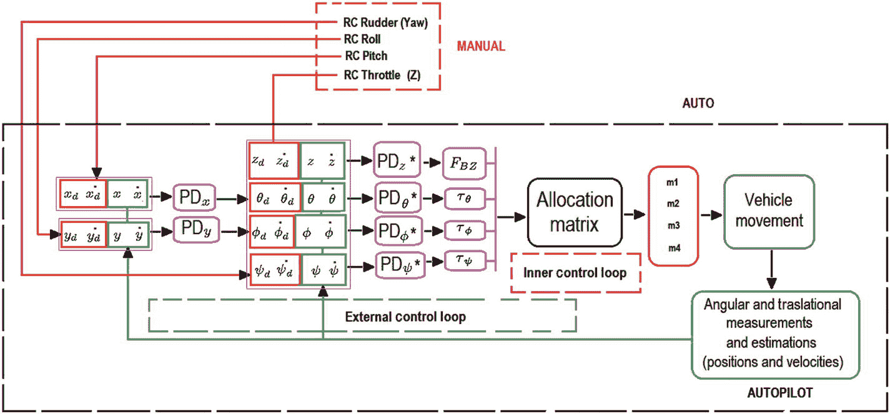

*图 3-7: 无偏航变化且通过手动遥控指令设定期望值的完全线性笛卡尔控制图形顺序*

在第二个版本中，遥控器改变力矩和力；见图 3-8。

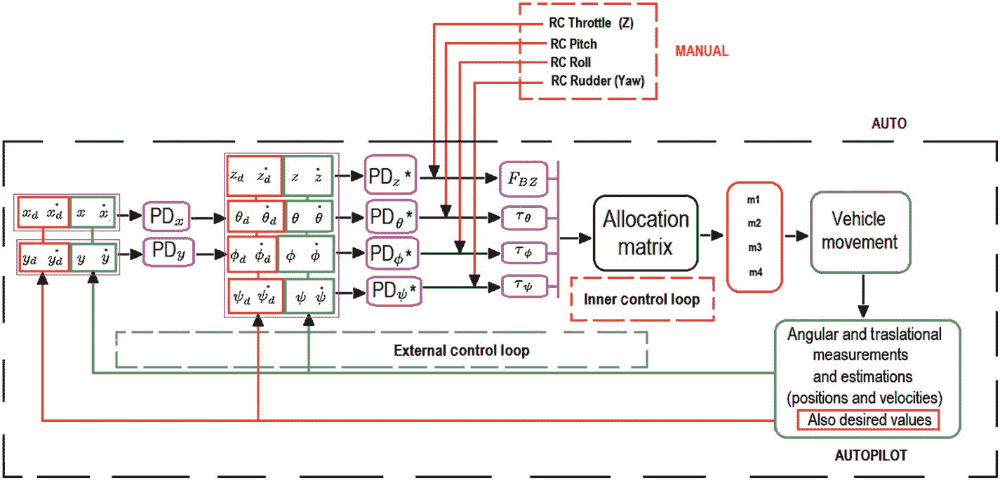

*图 3-8: 无偏航变化且通过手动遥控指令直接作用于力和力矩控制的完全线性笛卡尔控制图形顺序*

请注意，手动模式的组合可以有任意多种。在所描述的示例中，第二种模式可能很危险，因为它直接影响控制器，但如果输入的值很小且有界，则可以降低风险。

你已经学习了无偏航变化的机器人模式控制。接下来，我们进入偏航可变的情况。