# 带偏航变化的完全线性笛卡尔控制

这种控制器是前一种控制器的改进版本。现在无人机能够跟踪轨迹，并且可以修改其偏航角；见图 3-9。该操作对于记录路径内的物体、人物或建筑物非常有用，例如在监控任务中。

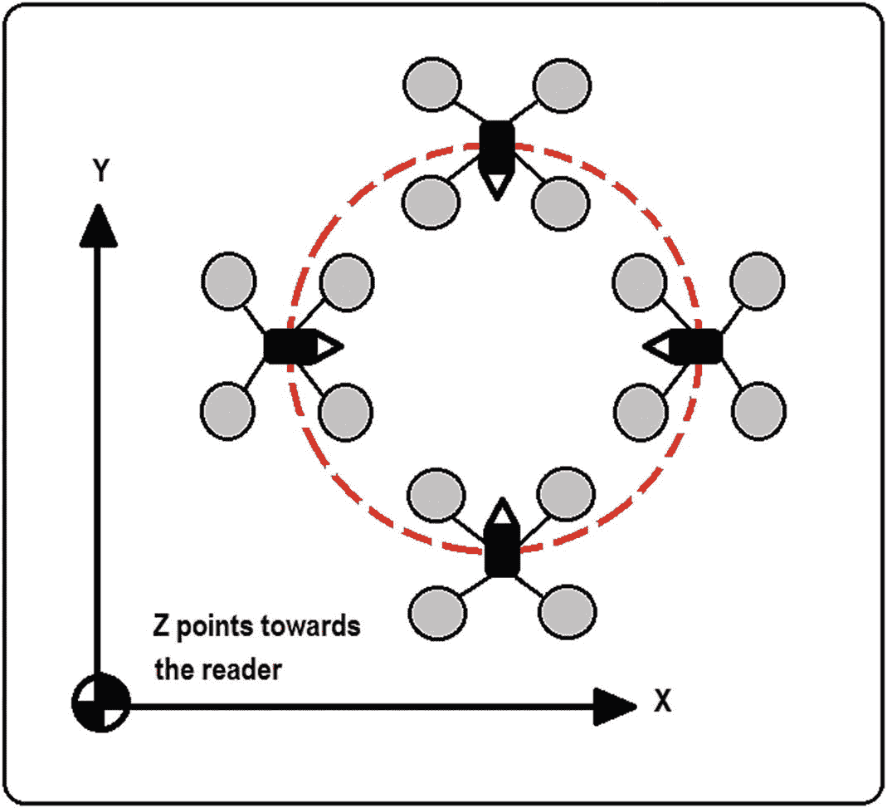

*图 3-9* – 带偏航变化的完全线性笛卡尔控制的图形表示

在这种飞行模式下，推力和扭矩控制与上一节相同：

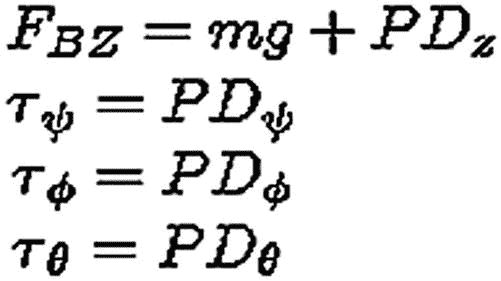

变化的是期望的 `theta` 和 `phi` 辅助控制器的设计，具体如下。

由于 `psi` 的值不为零，`XY` 动态系统无法简化：

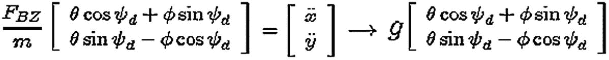

但你可以将它们重写为如下的矩阵形式：

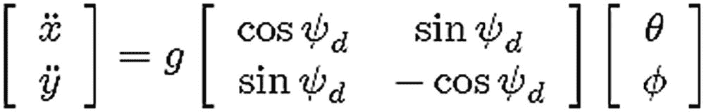

根据滚转和俯仰控制器，请记住：

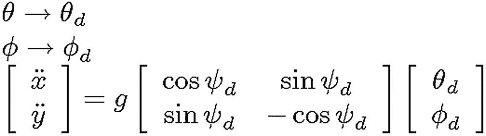

可以提出以下辅助控制器：

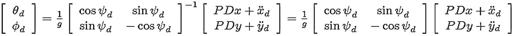

将辅助控制器代入给定的动态模型：

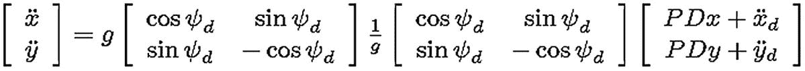

简化后：

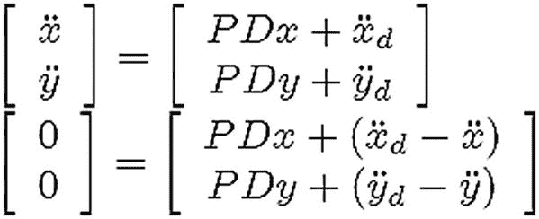

这表明：

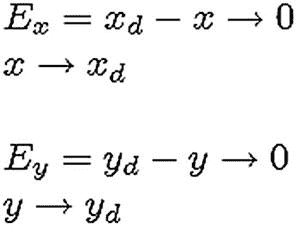

将所提出的矩阵形式重写为等效但可编程的形式（这可以避免计算机进行大量矩阵乘法运算），我们得到了无人机研究中一个已知的方程：

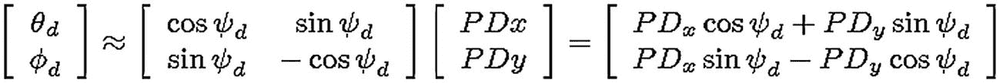

最后，注意依赖于 `psi_desired` 的矩阵是一个旋转矩阵（这对于下一节中几何控制的解读将非常有用）。

有两种方法可以验证这是一个旋转矩阵：

1. **通过变换将该矩阵转化为已知的旋转矩阵：**

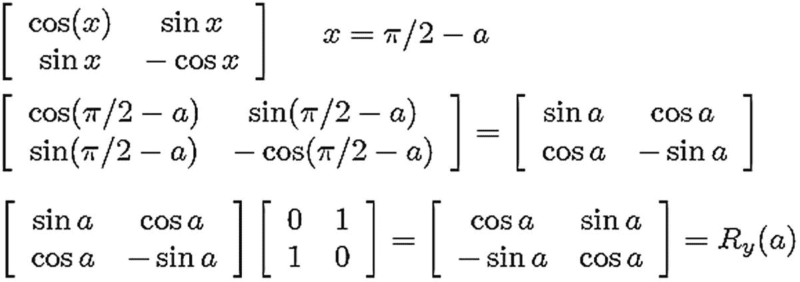

2. **利用本书先前使用过的旋转矩阵的一个性质：**

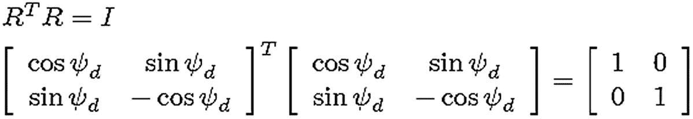

总之，本节提出的控制器如下所示（请参阅仿真部分以观察该控制器的性能）：

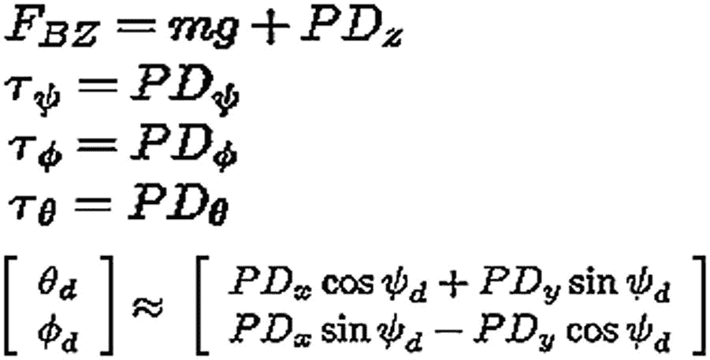

这些控制器的图形序列如图 3-10 所示。

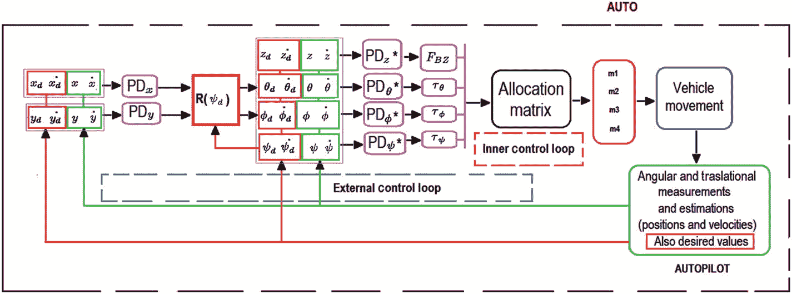

*图 3-10* – 带偏航变化的完全线性笛卡尔控制的图形序列

对于遥控变体，可以通过两种方式进行适配；见图 3-11。

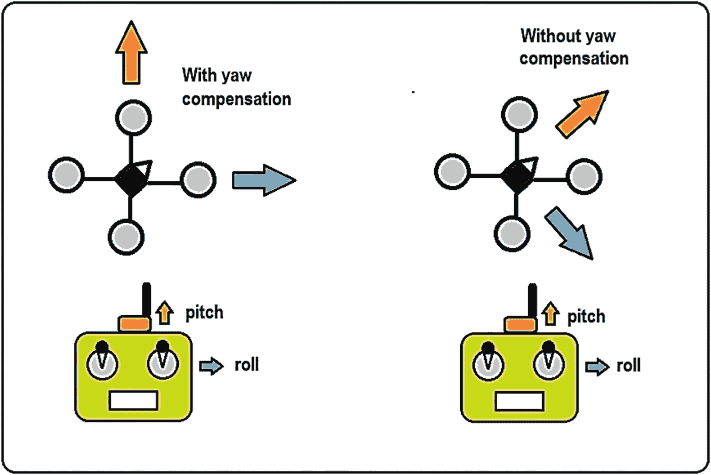

*图 3-11* – 使用带偏航变化的完全线性笛卡尔控制时的遥控变体

- 第一种方式是在滚转和俯仰的相应遥控控制中包含偏航动作（如同上一控制中通过偏航补偿那样）。这样，飞行器的手动操作行为将如图左半部分所示。
- 第二种方式是不包含这种变化，飞行器的手动操作行为将如图右半部分所示。

至此，你已经了解了机器人模式控制，该模式可实现平稳飞行。现在，是时候了解飞行器模式控制了，它允许更高的机动性以及特技或激烈运动。

## 飞行器模式控制

当将无人机作为飞行器进行分析时，其控制设计意味着将其视为第一人称模式、机载体验或“驾驶舱”视角。见图 3-12。为此，飞机的视线方向（也称为引导向量，即机上飞行员所具有的向量）应通过“舵”或“推进器”进行调节。与机器人模式或第三人称模式不同，旋转与平移控制器及其动力学之间的耦合程度更大，甚至完全依赖。这在数学上是一个缺点，但对于激烈或特技操作而言，其在多功能性和实用性方面也代表了一种优势。

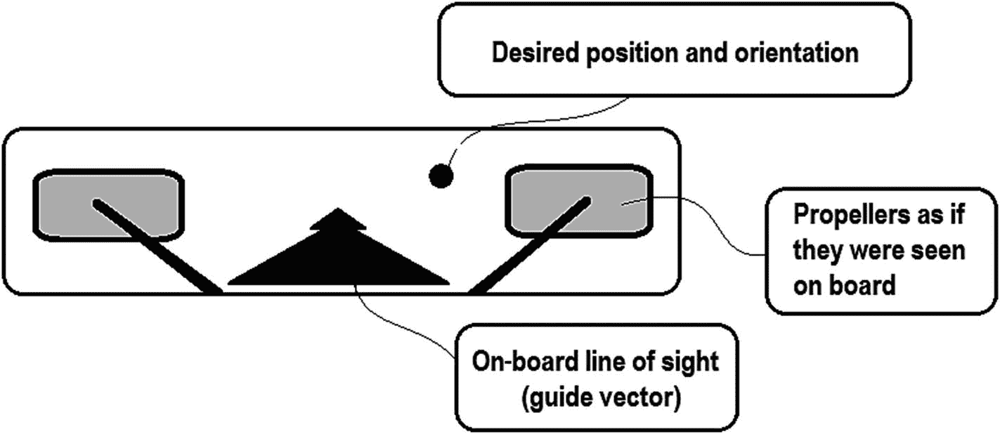

*图 3-12* – 飞行器模式控制的图形表示（第一人称视角）

让我们从球面控制（基于舵）开始，然后是几何控制（基于推进器）。

