# 2. 建模

本章重点介绍无人机的建模。你将学习参考系、运动学、动力学、推进或分配模型以及线性建模注意事项。最终，你将能够对无人机进行建模，并将这些知识扩展到其他类型的运载器和飞行器。

关于空气动力学，我们不会涉及这些主题，因为本书所分析运载器的设计大多是垂直起降类型，并且相对于其他类型的运载器（例如飞机和有人驾驶飞行器），它们运行时的速度较低、重量较轻和/或尺寸面积较小。见图 2-1。

你可能注意到，多旋翼飞行器需要推力分量来实现其运动（这被称为推力矢量控制）。因此，我们将在附录中将空气动力学分析分为两个有用的部分。其中一部分是关于计算无人机最大速度，可用于比赛用无人机的设计。另一部分是关于如何将本书的知识扩展到其他类型的飞行器。在这些部分中，你将运用本章学到的知识，并通过引入空气动力学效应来加以扩展。

由于旋转速度高而对空气动力学效应影响显著的元件是螺旋桨。然而，此处将不予以考虑，因为假设你不会自己制造螺旋桨，而是会购买它们（但如果需要，你可以在附录的参考文献部分阅读更多关于其设计的内容）。同时还假设，你的飞行器大部分时间都飞行在距离地面、墙壁甚至其他物体和运载器相当远的地方；否则，你可以在附录中阅读关于限制条件的相关信息。

让我们从建模参考系的描述开始。

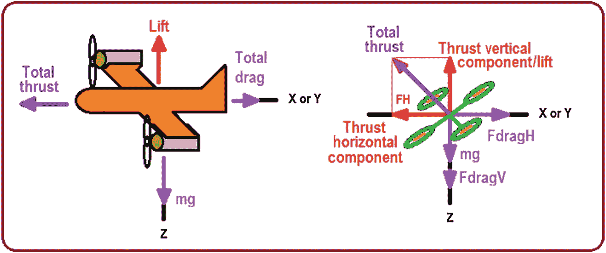

## 建模参考系

你很快会看到，与四轴飞行器相关联的有三个建模参考系。所述运载器的建模在混合参考系中进行，并以便于传感器和数学运算的方式完成。这些参考系是世界参考系、飞行器参考系和电机参考系，它们如图 2-2 所示。

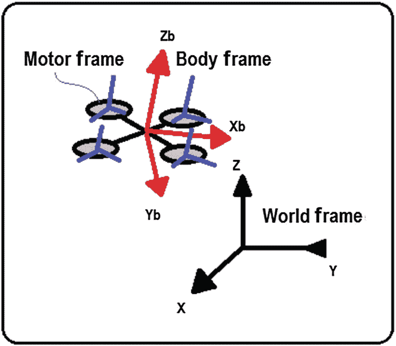

*   **世界参考系**（或基座参考系，或固定参考系，或惯性参考系）表示一个固定的坐标系。飞行器相对于这个固定参考系运动。这可以是一个全球地理参考系，例如地球极点、一个简单的角落或房间的中心。
*   **飞行器参考系**（或机体参考系，或移动参考系，或非惯性参考系）表示通常位于飞行器上某个感兴趣点（几何中心、质量中心、重力中心或浮力中心等）的坐标系。相对于这个参考系和固定参考系来测量平移和旋转。
*   最后，**电机参考系**（或推进参考系，或执行器参考系，或分配参考系）是放置在每台电机上的各个参考系。它们的功能是将每台电机的力和扭矩分配到飞行器的参考系。

请注意，为了便于计算，在尽可能的情况下，世界参考系和飞行器参考系各自对应的`Z`轴通常平行放置。这是因为四轴飞行器的设计允许这样做，并且正如你稍后将看到的，还因为出于平稳飞行的考虑（在具有更先进机动性的运载器中，例如全向型运载器，这种对所述轴的选择简化是不可行的）。

接下来我们进入无人机的运动学部分。首先，我们将考虑平移运动学。

# 平移运动学

假设我们想要将世界坐标系与飞行器坐标系关联起来。尽管这乍看之下很简单，但必须记住，所有概念的关联都应在无偏的参考空间中进行。

为此，想象一下，在教室里，学生们被要求指出一只在白板上爬行的昆虫相对于他们自身所在位置的位置，如图 2-3 所示。

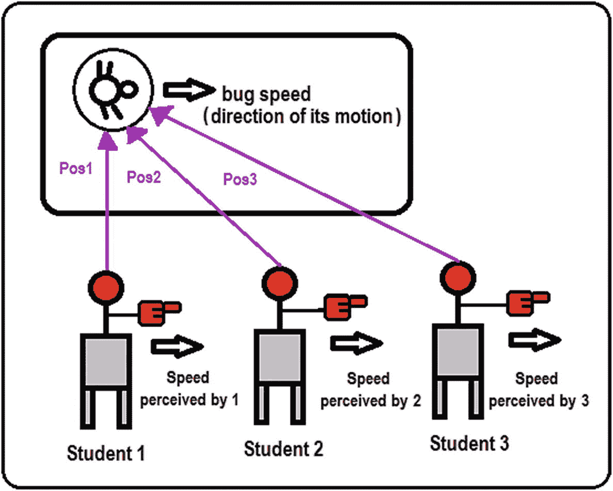

**图 2-3** 物体相对于外部观测者的运动与位置

如你所见，每个人对昆虫的位置都会有不同的感知，他们会给出一个取决于自身所处位置的结果。然而，无论身处何位，每个人都能指出昆虫正在沿所示方向移动。因此，在那个教室里，对于所有人而言，一个无偏的元素就是昆虫的运动，而这个运动与其速度有关。

这表明，如果世界坐标系相对于飞行器放置在不同的位置，如图 2-4 所示，那么坐标系之间的不变量关系将不在位置层面，而在速度层面（作为一个向量），这对于放置在每个世界坐标系中的观测者或传感器都是成立的。

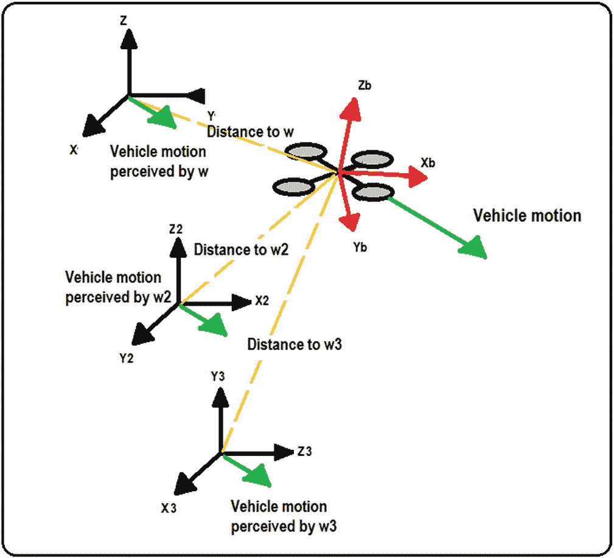

**图 2-4** 无人机相对于不同世界坐标系的运动与位置

从前面的图中可以看出，在每个坐标系中对飞行器运动的感知并不会因坐标系之间的距离而改变。然而，如图 2-5 所示，将其中两个坐标系叠加时，可能会注意到其各自坐标轴在方向上的影响。因此，为了关联它们，需要在坐标系的各自坐标轴之间找到一个三角投影。在三维模式下，这归结为寻找旋转矩阵（注意使用了牛顿的记号，即一个带有点的字母或符号；这表示一阶导数，在我们这里表明这是速度坐标系或速度之间的关系，如前所述）。

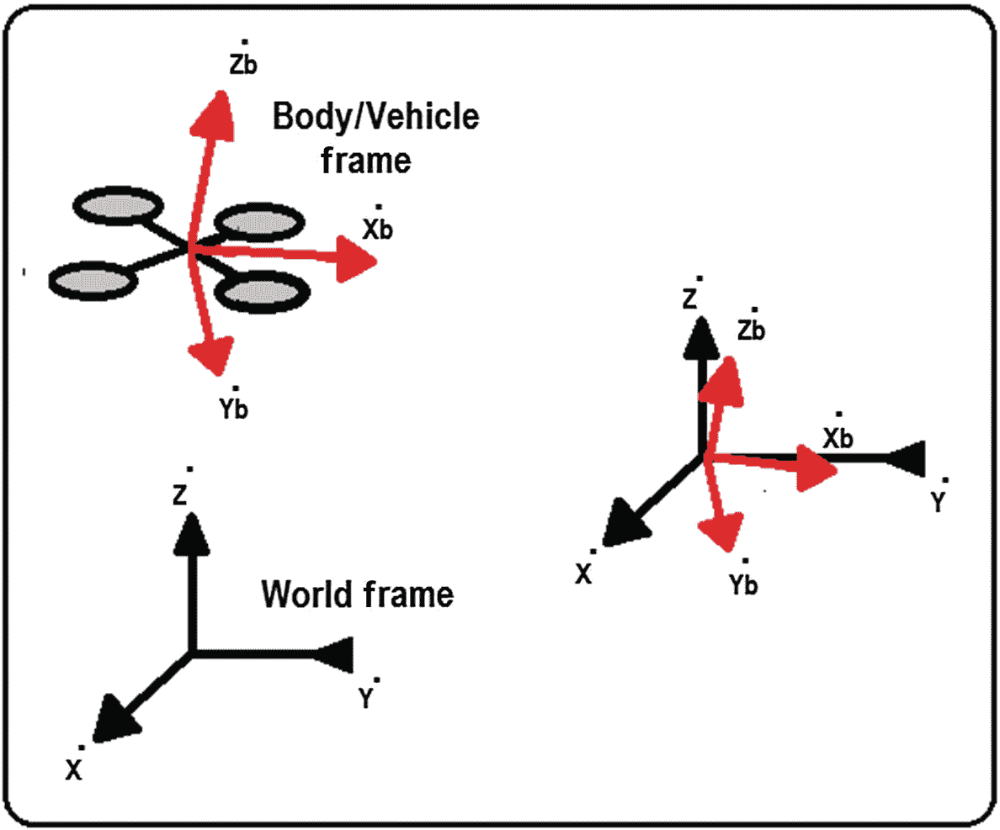

**图 2-5** 机体坐标系与世界坐标系重叠

在旋转矩阵的家族中，为了满足 ISO 1151–2: 1985 标准，本文采用横滚、俯仰和偏航的欧拉角序列，即所谓的泰特-布莱恩角。其定义如下：

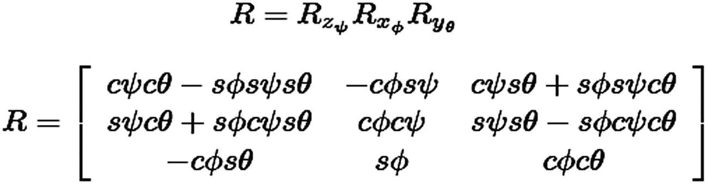

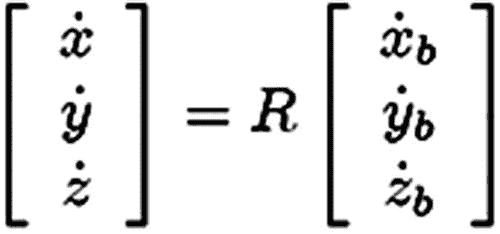

请记住，各个旋转的定义如下（注意枢轴即为旋转轴）：

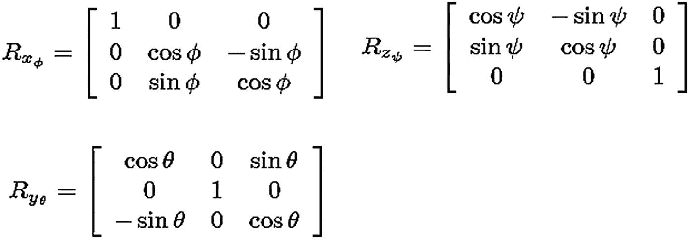

这里有个很好的问题：为什么这些旋转的序列是乘法而不是加法？至少从数学一致性的角度来看，答案很简单。每个旋转矩阵必须是正交归一化的，因为其每一列都代表单位向量，这些向量的分量在 0 到 1 之间变化，并描述了相互垂直的坐标轴（若要验证此性质，请查阅推荐的关于线性代数和旋转矩阵的文献）。因此，如果我们对它们进行加法运算，结果中的元素有可能会超过单位值；而如果我们进行乘法运算，由于它们是分数、零或一，结果仍将是分数、零或一。因此，连续旋转矩阵序列的复合必须是乘法的。

请注意，我们使用的一组方程在速度层面和力层面都是有效的。这一表述将在后续章节中使用，而追求严谨的读者可以在大量文献中找到其证明和基础，这可以看作是达朗贝尔原理和虚功原理（也称为最小作用量原理）的应用。

接下来，你将学习无人机的旋转运动学。

# 旋转运动学

考虑到存在通过旋转直接关联的参考系，获取平移运动学相对容易。然而，对于旋转变量来说情况并非如此（注意，我们通过欧拉角获得了关于世界坐标系的角信息，但并未直接在机体或飞行器坐标系中获得角信息）。为了推导运动学，有必要利用旋转矩阵的数学性质。

旋转矩阵必须满足正交归一化原则。这意味着以下内容：
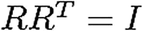

如前所述，在速度层面建立坐标系之间关系是最客观的分析方法。速度（以及由此产生的速率）由位置导数得到，因此直觉上首先会对上述方程进行求导。注意这是对时间的导数，因此如果旋转矩阵在求导时依赖于欧拉角，那么这些欧拉角的角速率就会出现（链式法则）。同时也要注意，利用乘积求导法则（矩阵乘积）和常数求导法则（单位矩阵），可以得到以下结果：
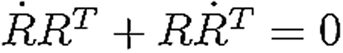

利用前一方程第二项中关于转置矩阵的以下性质：
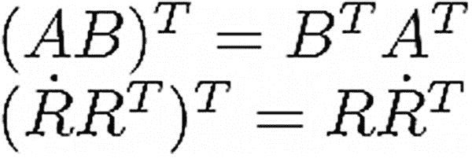

并将此性质代入替换，我们得到：
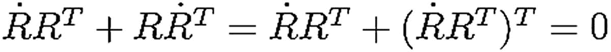

从这个结果中引出了一类特殊的矩阵，称为反对称矩阵或斜对称矩阵。它们满足以下条件：
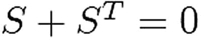

因此，以下项确实是一个斜对称矩阵：
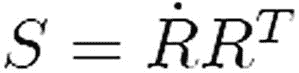

这有什么用呢？

斜对称矩阵与叉积的表示相关联。假设我们有两个向量：
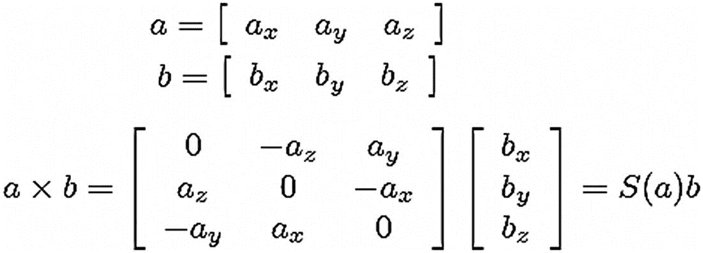

这样，一个反对称矩阵（此处是与向量 `a` 关联的矩阵）按所示方式将向量信息分布在其元素中。

关于该方程用途的问题仍然悬而未决，现在就来解答。只需记住斜对称矩阵的概念及其与叉积的关系。

假设图 2-6 中的汽车仅围绕其 `Zb` 轴旋转，角速度等于 `theta` 的导数。注意，世界坐标系的 `Z` 轴与机体坐标系（`Zb`）平行（两者均指向您）。

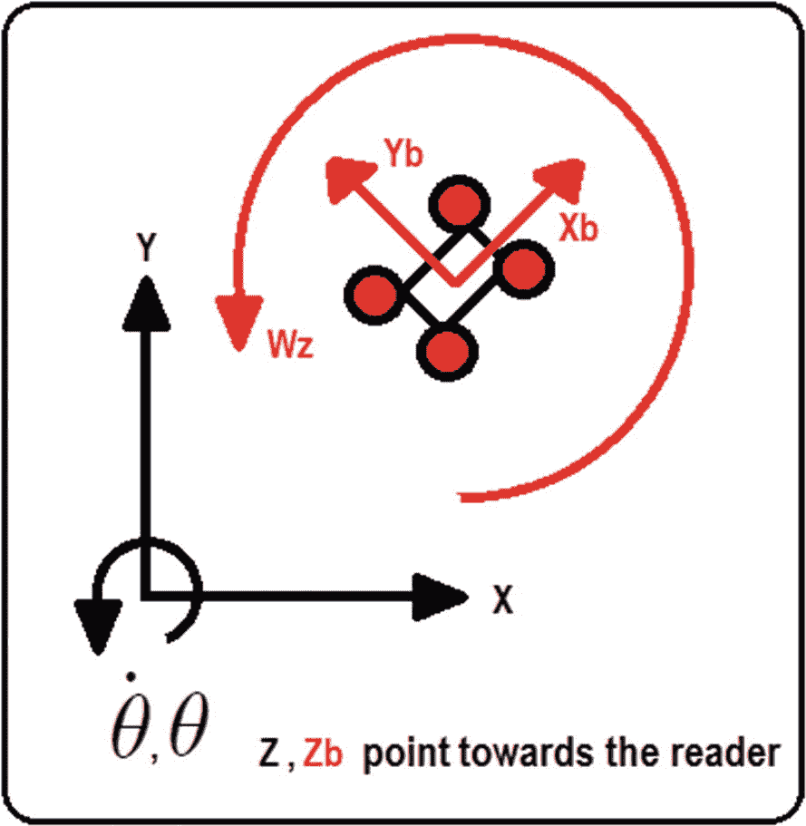

**图 2-6** 轮式车辆的机体坐标系及其与世界坐标系的关系

对于这个例子，显然机体坐标系中 `Z` 轴的角速度等于在固定坐标系中测量的 `theta` 的导数（再次重申，因为它们是平行轴）。

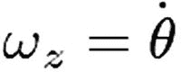

因此，我们可以通过斜对称方程得到相同的结果：
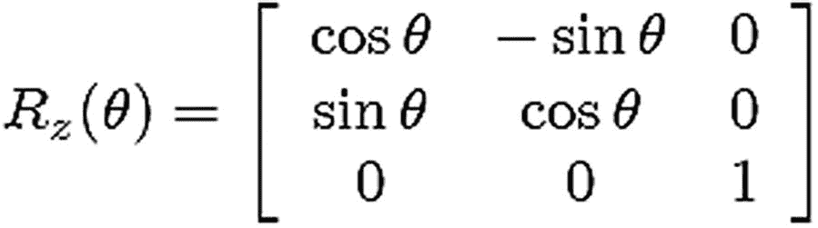

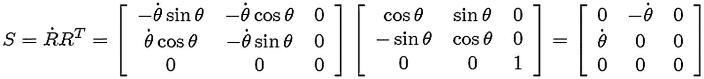

根据斜对称矩阵元素的定义，我们可以得出：
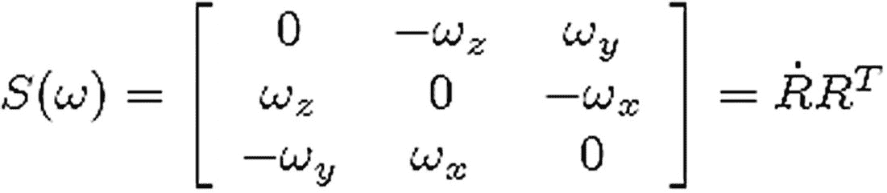

然后，利用欧拉复合旋转矩阵，通过执行上述步骤以及相应的简化，可以得到以下结果（这是一个有趣的练习，您可以推导出这些方程的完整序列；记住旋转矩阵的导数是对时间的导数，也记住全微分的概念）：
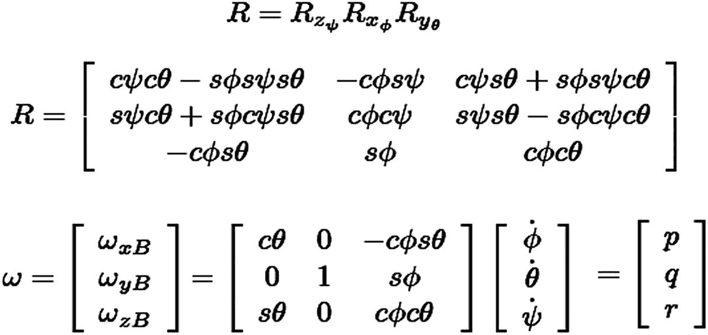

其中
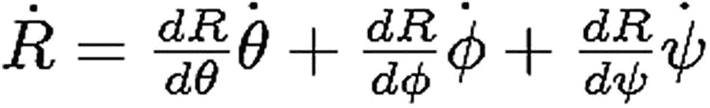

这建立了机体坐标系角速度与固定坐标系角速度之间的关系。记住，固定坐标系是用欧拉角表示的。

对于更偏好几何而非推导方程的人来说，在附录中提到的 Beedford 的书中，也有一种易于理解且直观的推导方法来获得这种速度关系。

另请注意，这些旋转正交归一化约束的施加，赋予了无人机所谓的非完整特性（在平滑或线性飞行模式下，这一点并不明显，您很快会看到）。

最后，观察引入了（`p` `q` `r`）这种命名法。这常用于飞机，当然也用于多旋翼飞行器。

现在您已经了解了无人机的运动学，接下来可以研究动力学了，但在此之前，我们先简要介绍一下作用在无人机及其螺旋桨上的力。

# 作用在多旋翼飞行器及其螺旋桨上的力

在推导动力学方程之前，方便先推导出作用于多旋翼飞行器上的基本力。空气动力学效应可以加入，但由于它们在室外和室内操作中会发生变化，甚至在靠近或远离地面时也不同，因此这些被视为非通用内容，可在其他著作或附录（见`无人机最大速度`）中简要查阅。

作用在无人机上最明显的力是重力。假设飞行器平衡良好，并且该力直接位于重心或几何中心（对于这类飞行器，期望两者重合）。见`图 2-7`。

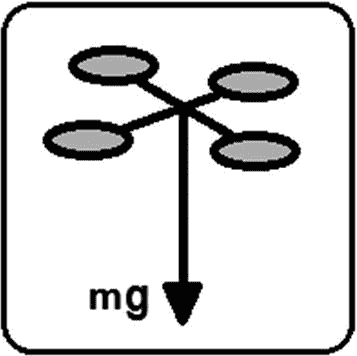

`图 2-7` 作用在无人机上的重力

# 螺旋桨受力分析

下一步是分析单个螺旋桨的受力情况。请注意，此分析针对双叶螺旋桨进行，但可通过相应的三角函数投影推广至更多桨叶的情况。

首先考虑的是，每片桨叶上的推力可等效为作用于该桨叶某一点上的力。在图 2-8 中，这些力分别标注为 `FL`（即左侧）和 `FR`（即右侧）。其次要假定螺旋桨已完全平衡，这意味着螺旋桨中心到每片桨叶分析点的距离相同（即半径 `r`）。

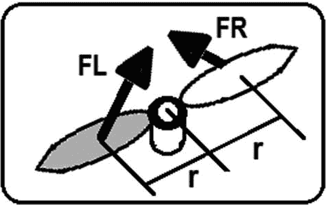

图 2-8 作用于螺旋桨桨叶的力及其力臂

此外，我们将采用图 2-9 所示的螺旋桨坐标系。

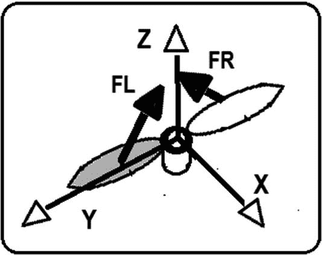

图 2-9 用于分析的螺旋桨坐标系

下一步，将每片桨叶上的力分解为垂直和水平分量（分别标注为 `Z` 和 `H`）。请参见图 2-10。

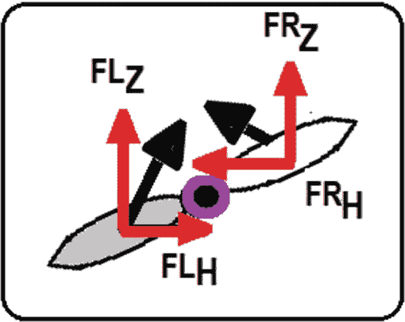

图 2-10 作用于每片桨叶的力的分量

接下来，我们将计算三个相应轴（`X`、`Y`、`Z`）上的合力与合力矩。由于假定每片桨叶具有对称性和平衡性，可建立以下等式：

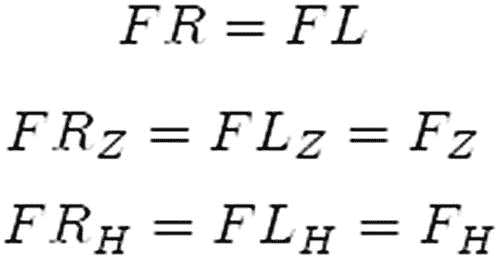

从上图可知，垂直方向的受力分析较为简单。请注意，增加桨叶数量会增加飞行器的负载能力（正如预期，每片桨叶都充当一个支撑轴）。

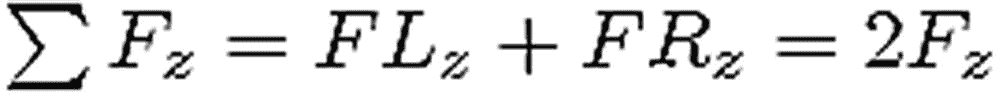

在 `X`、`Y` 轴上的分析是相同的，为此我们将利用螺旋桨的径向对称性（对奇数桨叶的分析会变得非常有趣，因为需要用到三角函数投影，但最终结果必须一致）。

假设此时螺旋桨位于 `X` 轴或 `Y` 轴上，如图 2-11 所示。

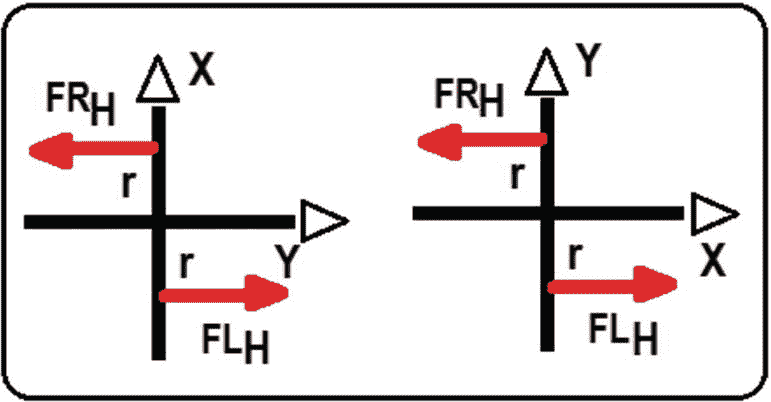

图 2-11 作用于每片桨叶的力之俯视图。`Z` 轴指向读者

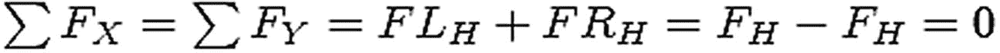

因此，这表明只要螺旋桨充分平衡，每片桨叶产生的水平力将会相互抵消。但是，正如你所注意到的，还存在作用力臂以及由此产生的力矩。下面将对此进行分析。

让我们回到上图，并补充说明 `Z` 轴指向读者，那么绕该轴的力矩如图 2-12 所示。

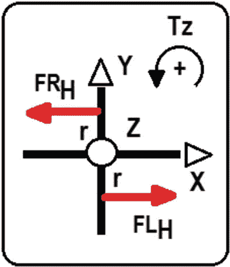

图 2-12 用于分析等效力矩的作用于每片桨叶的力之俯视图。`Z` 轴指向读者

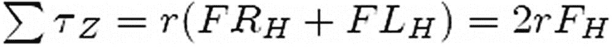

请注意，增加桨叶数量也会增加螺旋桨的力矩容量（每片桨叶都充当一个力臂）。

最后，我们将确定水平方向的力矩（绕 `X` 轴或 `Y` 轴；二者无区别）。请参见图 2-13。

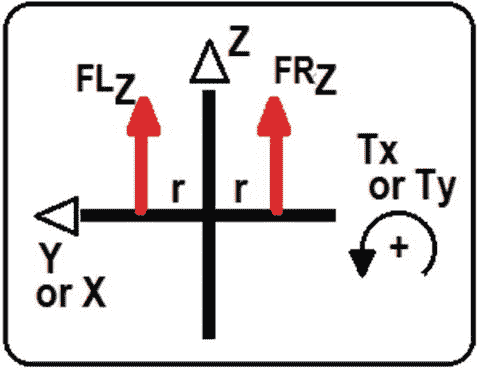

图 2-13 用于分析水平力矩的作用于每片桨叶的力之侧视图。`Y` 轴或 `X` 轴指向读者

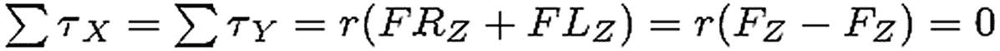

上述分析最重要的结论如下。只要螺旋桨充分平衡，它仅能在其作用轴上产生一个垂直推力，并绕该轴产生一个力矩。请参见图 2-14。

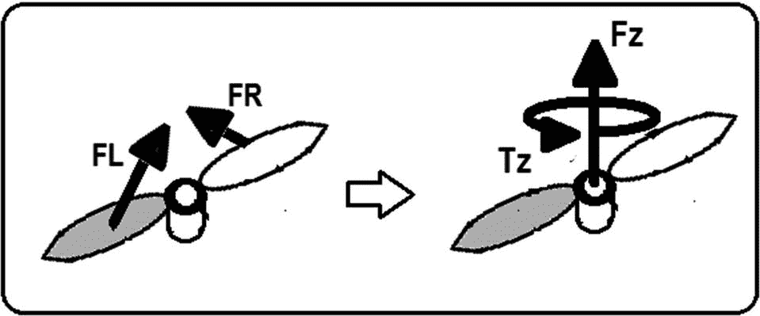

图 2-14 螺旋桨相对于其中心的等效力和力矩

一个有趣的练习题供你思考：请推导出对三片桨叶（每片间隔 120 度）的螺旋桨产生相同效果。最终结果必须一致。

## 作用在飞行器上的力

基于之前的结论，我们将把每个螺旋桨的力转移到飞行器的中心。见图 2-15。

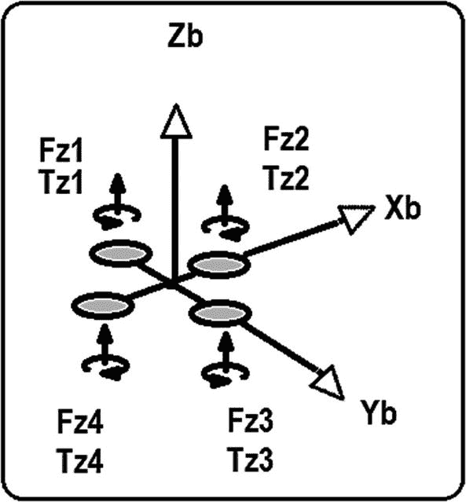

图 2-15 每个螺旋桨相对于四轴飞行器中心产生的力和扭矩，以及用于此分析的相应机体坐标系

对于本例以及预期的结果，我们将按照图 2-15 的情况进行处理。请注意，笛卡尔坐标轴的标记和方向，以及电机的编号、它们的旋转方向，甚至它们的几何分布，都会影响我们将要看到的内容，这被称为分配矩阵或推进矩阵。还要注意，一半的电机相对于另一半顺时针旋转，以防止自转（这意味着飞行器会绕其主轴以不希望的方式旋转）。如果所有或大多数电机都朝一个方向（顺时针或逆时针）旋转，就可能发生这种情况。

分析 `Zb` 轴上的力，我们有：

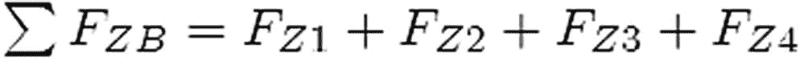

考虑到一个平衡良好的飞行器及其平衡良好的螺旋桨，在 `Yb` 和 `Xb` 轴上没有直接作用的力，只有扭矩，因此：

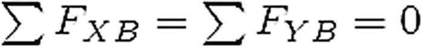

请注意，在某些条件下，这些力是存在的，并且无法从模型中消除。然而，这些效应通常出现在大型飞行器中，可以通过数学变换或控制补偿来简化。参见附录中的 Reza-Olfati 文章。

我们继续讨论扭矩。首先要做的是确定正旋转方向，如图 2-16 所示。

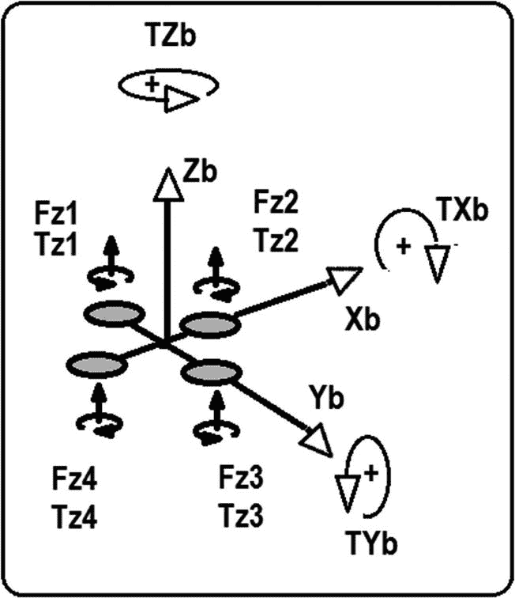

图 2-16 每个螺旋桨相对于四轴飞行器中心产生的力和扭矩，以及本次分析中的正旋转方向

观察到，在绕 `Zb` 轴的扭矩情况下，这是直接由每个电机的单个扭矩引起的。见图 2-17。

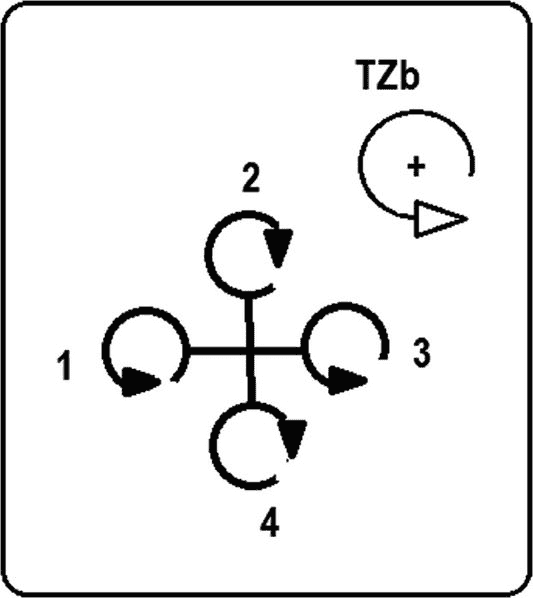

图 2-17 用于分析绕 `Zbody` 轴（指向你）扭矩的无人机俯视图

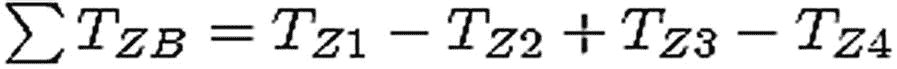

在 `Yb` 和 `Xb` 轴的情况下，扭矩是由推力及其各自半径产生的杠杆臂效应引起的。见图 2-18 和图 2-19。请注意，飞行器必须保持良好的平衡，以确保半径或杠杆臂完全相同或高度相似。

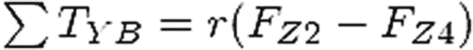

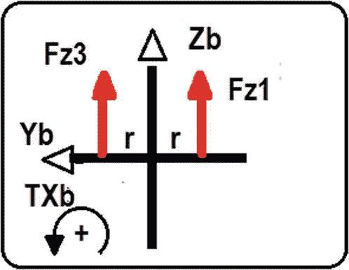

图 2-19 用于分析绕 `X` 轴（指向你）扭矩的无人机侧视图

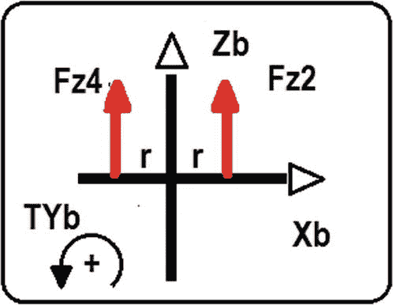

图 2-18 用于分析绕 `Y` 轴（指向你）扭矩的无人机侧视图

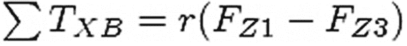

这里重要的结论是，四轴飞行器的重心（按设计与其几何中心重合）处，存在由其电机和重力作用产生的一个推力和三个扭矩。见图 2-20。请注意，重力始终垂直于地面或世界坐标系，但 `FZb`（无人机推力）并非如此，因为 `FZb` 垂直于无人机机体或机体坐标系。稍后我们将使用这些坐标系之间的适当关系。

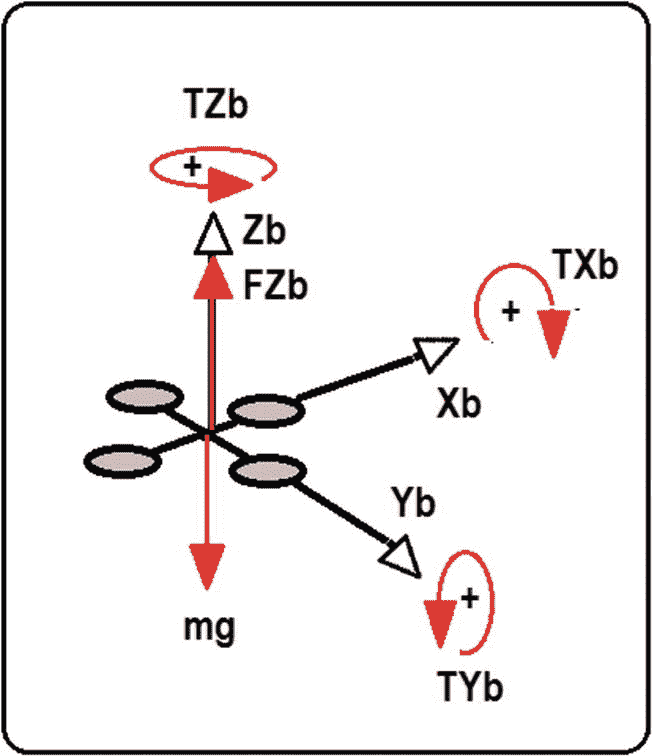

`图 2-20` 作用在无人机中心、由电机和重力产生的等效力和扭矩

了解了作用在飞行器上的力之后，是时候研究其动力学了。

## 平移动力学

在建立了坐标系之间的运动或运动学关系以及作用在四轴飞行器上的力之后，我们将推导出产生这些运动的方程。在本例中，我们从平移动力学开始。

为此，我们有必要问一下，在哪里进行以及为什么要进行这种分析。

平移动力学通常是在固定坐标系中推导的。为什么？只是为了数学上的简化以及与传感器的兼容性（大多数平移传感器指示无人机相对于固定坐标系的位置，例如 `GPS`）。

步骤如下：

1.  假设飞行器是对称的且为质点（四轴飞行器型无人机在设计上是平衡的，其重心通常与几何中心重合，或至少尽可能靠近）。

2.  将飞行器视为具有三维运动的质点，使用牛顿第二定律方程（这正是步骤 1 假设的目的）。

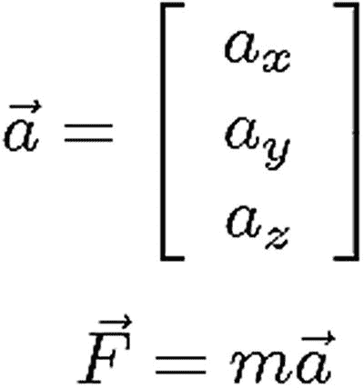

3.  由于我们关心的是控制飞行运动（建模为质点），我们根据位置重写上述方程（加速度定义为位置的二阶导数）。

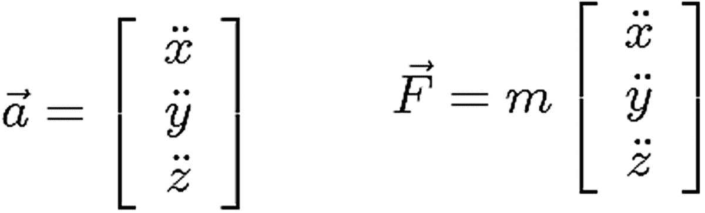

4.  我们加入自由落体效应（重力）。

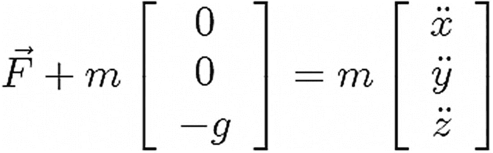

5.  因为我们想要在固定坐标系中建模无人机，而无人机的推力作用于机体坐标系，所以我们必须建立它们之间的关系，见图 2-21。本例中，作为达朗贝尔原理的扩展，可以表述如下。请记住，旋转矩阵是由 Tait-Bryan 旋转组合而成的。

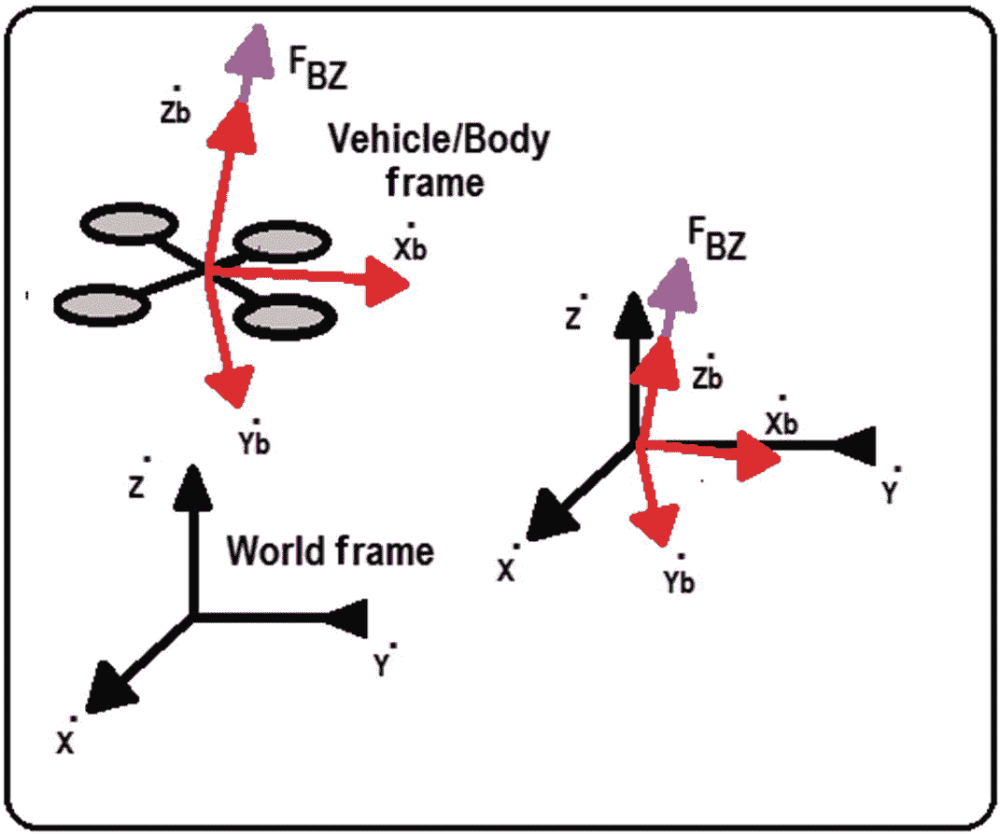

`图 2-21` 四轴飞行器在机体坐标系和世界坐标系之间重叠的推力

6.  因此，用于建模平移动力学的方程组为：

请注意，这是简化模型，但您可以根据工作需要添加空气摩擦、湍流等效应。

现在您了解了平移动力学，让我们转向旋转动力学。

# 旋转动力学

## 欧拉方程与机体坐标系

在本部分中，我们使用欧拉方程来描述旋转运动。它们相当于牛顿第二定律在旋转运动中的形式。

与平动动力学不同，本分析是在机体坐标系中表达的。其原因同样是为了简化方程，以及与通常提供机载旋转测量的传感器相兼容。

步骤如下：

1.  我们使用牛顿第二定律的旋转等效形式或欧拉方程。注意，与之前的情况不同，`J` 不像质量那样是常量，而是一个 3x3 矩阵，当其与角加速度相乘时，会产生一个 3x1 向量。

2.  我们用已知或可测量的量（例如机载角速度）来重写方程（注意，平动分析是用位置的二阶导数来表示的）。在这种情况下，传感器通常能够测量机载角速度，这对分析很有帮助。观察可知，加速度也是速度的一阶导数。

## 刚体与对称性假设

3.  假设为刚体且对称，可以认为惯性矩阵仅在对角线上有分量，这意味着所有不在对角线上的分量均可忽略。

## 重力与离心效应分析

4.  重力效应被忽略，因为考虑到无人机是对称、刚体且相对于其中心平衡良好，由重力产生的力矩会被抵消（力臂半径趋近于零）。但应注意，对于不平衡的飞行器或大尺寸无人机（例如，运输放置在机架边缘物体（如机械臂）的无人机），情况并非如此。

然而，离心加速度的影响通常很重要（在平滑飞行简化中，你会注意到由于角速度降低，这些加速度被省略了）。

**为什么在平动分析中省略了这些离心效应？** 因为推力作用点相对于飞行器分析中心的位置几乎为零，因此它们可以忽略不计（但对于大型飞行器则不然，其情况类似于重力的旋转效应）。如你所见，在旋转运动中，它们被考虑在内，因为它们不依赖于作用半径，而是依赖于角速度。

## 动力学方程展开

5.  展开方程（叉积），旋转动力学变为

此动力学方程稍后将在平滑飞行条件下进行简化。然而，它们在几何控制部分将再次被使用。

你已经学习了运动学和动力学。为了完成我们的建模，接下来我们来讨论分配模型。

# 分配模型

推进或分配模型建立了电机与飞行器分析中心（例如重心）之间的关系。它是理论（建模、仿真和控制）与实践（设计和编程）之间的纽带。

## 获取分配模型的步骤

获取此模型的过程与演示作用在四旋翼飞行器上的力矩和力的部分所采用的方法非常相似。然而，此处将以系统化的方式重复此过程。

通常，期望得到以下关系（当然，假设电机具有线性行为）：

其中，`w`（索引从 1 到 `m`）表示飞行器 `m` 个电机中每个电机的转速，`A` 是一个分配矩阵，指示每个电机如何影响笛卡尔空间中三个可能的力矩和三个可能的力。该笛卡尔空间与所述飞行器的分析中心（例如重心）相关联。在大多数多旋翼飞行器中，`A` 矩阵具有常数元素，但如果每个电机都配备了能够改变其位置和方向的伺服系统，则这些元素可能会变化。

请注意，此建模过程的结果会因每种无人机配置而异，但所描述的过程是通用的，步骤如下：

图 2-22: 步骤 1 的轴系约定

1. 首先要做的是建立轴系约定，包括运动的正方向。这包括定义平动和转动；参见图 2-22。在实践中，这是根据遥控器摇杆来确定的，遥控器摇杆通常基于前述的 ISO 标准（见本书的设计部分）。

2. 下一步是为电机贴上标签。这涉及它们的旋转方向以及它们相对于其他电机的几何分布。

在此，我们以一个具体示例说明，采用一种称为 X 型配置的平面几何结构，并带有指示的旋转方向、以下标签以及径向对称性，如图 2-23 所示。

图 2-23: 步骤 2 的电机标签

注意，这通常是相对于自动驾驶仪参考方向（通常是一个小箭头）来进行的。

图 2-24: 作用于步骤 3 所选机架上的电机力和力矩

3. 现在，我们必须将步骤 1 中确定的运动与每个电机的力矩和推力效应联系起来；参见图 2-24。请记住，力矩的来源包括单个电机作用产生的力矩以及由力臂产生的力矩。

### 四旋翼飞行器的分配模型

通过采用与上一节关于四旋翼飞行器受力分析相似的步骤，可以得到以下结果（请记住，每种飞行器的配置都不同，但可以以此例为起点进行分析）：

请注意，绕机体坐标系 `Z` 轴的扭矩直接由其他扭矩（即电机的扭矩）产生，而绕机体坐标系 `X` 和 `Y` 轴的扭矩则由力臂作用产生，如图 2-25 所示。

图 2-25 用于计算扭矩的电机力臂分量（以电机 4 为例）

为简单起见，此处仅以电机 4 为例进行说明，但您可以推导出其余电机的情况。观察力臂相对于坐标轴的方向及其分量。同时，牢记每个电机相对于参考轴引起的旋转方向，以确定正确的正负号。在此例中，`X` 和 `Y` 方向的分量均为负，这反映在方程式中，因为电机 4 推力产生的旋转与之前设定的正旋转参考方向相反。

接下来，将进行一系列假设，以尽可能地简化上述方程。您需要评估这些假设在您自己的设计中是否可行。

假设力、扭矩与各电机转速之间存在以下关系（这些假设或多或少是合理的，因为电机制造商通常会保证这种线性比例程度）。注意这些将扭矩和推力与电机转速关联起来的比例常数。

因此，同时假设所有电机均相同（如果电机为同一型号，据制造商提供的数据，其比例常数将相似或大致相同），

下一个假设是，项 `kf`、`kt`、`rcos(45) kf` 和 `rsin(45) kf` 为恒定增益，由于它们存在于所有包含角速度 `w` 的项中，因此可以被提取公因式，并通过补偿 `Fzb`、`Tzb`、`Txb` 和 `Tyb` 来吸收。

这样，我们通常可以找到这种简化表示形式。请注意，所述的补偿考虑了对称性；如果力臂的角度或距离不同（例如非对称无人机），则必须考虑这些项，而不能将其忽略：

这些方程比原始方程更简洁，并且可以采用如下向量形式表示：

进而可以简化如下（以简化矩阵运算）：

对于好奇 `X` 和 `Y` 方向运动如何控制的人，这将在本书后续的控制章节中介绍，但可以预先说明，这是由于它们对角变量的依赖关系（嵌套控制）。

注意，对于六旋翼或三旋翼飞行器，我们不可避免地会遇到非方阵的情况，此时需要使用伪逆矩阵或数值优化算法。

继续我们的分析，一旦我们设计出这个向量的控制值，

其到各电机的分配过程如下：

为了减少处理开销并避免反复计算上述逆矩阵和矩阵乘法，我们会以展开形式进行编程，即

基于与上述相同的、由扭矩和力控制所吸收的常数值吸收原理，其在作用上等价于（这就是分配矩阵）

最终得到

此格式必须同时应用于自动控制（由控制理论设计并引入，将在相应章节介绍）和手动控制（例如，来自遥控器）。使用遥控器时，输入到电机的向量如下：

一种半自动设计（结合手动与自动操作）可能如下所示（此向量之和必须乘以分配矩阵，才能将其效应注入到每个电机）：

一个自然而然的问题是，上述方程是否有更简单的使用方法。答案是肯定的，但这也意味着需要满足某些特定的运行条件。让我们来看看具体是什么情况。

# 线性简化

在进行第二组简化之前，让我们回顾一下已经完成的简化，同时请记住，在您的数学模型中应考虑重新评估是否使用它们。

-   小型化飞行器，这意味着惯性简化
-   相对于其重心具有良好的平衡性，这意味着力矩和力的简化
-   重心与几何中心对齐，这意味着径向简化，或力臂趋近于零
-   螺旋桨良好平衡，这意味着每个螺旋桨仅提供推力和扭矩
-   飞行器的对称性，以便对惯性矩阵施加简化，这也意味着离心力方程的简化
-   不考虑摩擦、湍流或其他空气动力学建模效应的基础建模。这提供了一个高度简化的模型，该模型几乎可以在任何动态仿真软件中执行。

话虽如此，让我们继续任务简化。

平稳飞行模式在此意味着滚转角和俯仰角趋近于零，而偏航角可以取任意值以重新定向飞行器，就像汽车中的方向盘一样。平稳飞行模式也涉及平稳的角速度。

这意味着：

-   当滚转角和俯仰角趋近于零时，将遵循以下近似：

请注意正弦近似；根据最方便的情况选择使用两者。等于零的那个是一个极限，而等于直线的那个是一个线性近似（例如，泰勒级数的第一项）。这些方法并不相互矛盾，而是互补的。而且，它们同样有用（事实上，它们可能同时出现在同一个问题中）。

-   缓慢的角速度，当它们相乘时，会产生一个更小且趋近于零的结果。

这还将以下列方式影响飞行器的动态行为。

如果我们展开平移动力学模型，

并且我们记得

我们将得到

应用平稳飞行条件，平移动力学以这种方式简化（注意，其中隐含着平移运动学的简化）。观察可知，此平稳飞行仅适用于滚转角和俯仰角，而偏航角可任意指令并遵循期望值。

注意，这里为了方便，对小角度应用了正弦简化。如果我们使用另一种简化，我们将只得到零，就没有方程可交互了。

在旋转层面，我们有以下动力学模型：

并且由于平稳飞行，缓慢的角速度以这种方式被简化：

值得分析是否可以直接在固定坐标系中表达此方程。为此，需要将力矩和角速度从飞行器坐标系投影到固定坐标系。我们将使用先前推导的运动学关系：

它被简化如下：

这里为了方便，对这些小角度使用了以下近似：

这是因为这里期望的是消除项，而不是保留它们以便进一步分析。

回到在飞行器坐标系中推导出的旋转动力学模型，我们执行以下操作将其转换到固定坐标系：

对于角速度，我们必须执行以下操作：

但请记住（并且记得单位矩阵的逆矩阵也是单位矩阵）：

因此，

这样，飞行器坐标系中的旋转动力学就变得与固定坐标系中的相同。

简而言之，平稳飞行简化改变了原始方程组，如图 2-26、2-27 和 2-28 所示。

**图 2-27** 动力学的线性简化

**图 2-26** 运动学的线性简化

注意，变化是在运动学关系以及动力学中进行的，但推进方程保持不变（请记住，如果您的飞行器具有推力矢量系统，分配矩阵也会改变）。

**图 2-28** 分配矩阵的线性简化（在此示例中，方程保持不变）

## 本章小结

在本章中，您学习了无人机的通用模型，该方法特别针对但并非排他性地适用于四旋翼飞行器。本章解释了建模的坐标系、旋转和平移类型的运动学和动力学方程、螺旋桨的通用建模、分配或推进模型，最后介绍了一些线性简化，这些简化将在下一章中用到。这些主题在不同关于无人机的书籍和文章中非常常见。如果您想深入学习已学知识，再次邀请您探索附录。在下一章，您将看到与控制器设计相关的主题，这些控制器被视为两类家族：飞行器模式（或第一人称视角，或称机上控制模式）和机器人模式（或第三人称视角，或称外部控制模式）。

