# 球面控制（方向舵与引导向量）

以下是一种基本的运载器模式控制方法。请注意，这类控制器广泛用于轮式机器人。参见图 3-13。

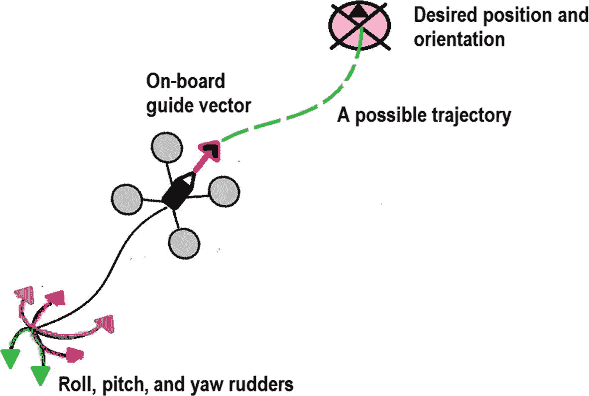

**图 3-13** 球面控制的图形表示

在这类控制中，从线性笛卡尔空间转换到基于球面坐标的空间是很方便的，其中引导向量与笛卡尔分量的合向量相关联，而方向舵则与该球体的角运动相关联。这些角度是笛卡尔分量的切向投影。

## 第一步：定义合向量（引导向量）和方向舵角。

我们需记住，动力学模型由下式给出：

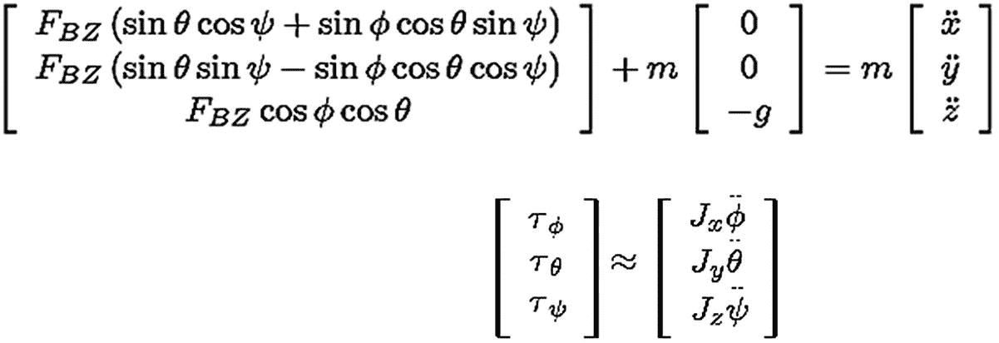

请注意，出于我们的目的，此模型不会简化为平滑飞行条件（线性化）。

从前面的章节可以注意到，这里有六个控制器：其中四个是物理的或力/力矩指令型，剩余两个是辅助的或与轨迹相关的：

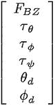

对于这个新设计，滚转、俯仰和偏航方向的力矩控制器将保持与前几节相同：

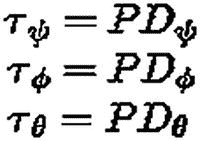

这意味着：

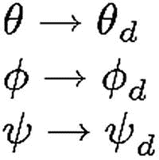

需要定义剩下的三个控制器：

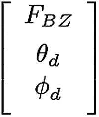

由于推力与笛卡尔向量相关，我们将其与引导向量关联。至于滚转和俯仰的辅助控制器（用于在平面上移动运载器），我们将它们与决定引导向量方向的方向舵相关联。

## 第二步：求引导向量和方向舵的值。

我们根据待定义的控制器重写平移或依赖的动力学方程。注意，唯一的独立变量是`psi`：

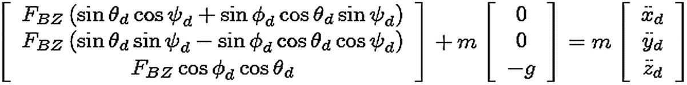

如你所见，`FBZ`以及`theta`和`phi`的期望值，可以通过整个方程组（三个未知数和三个方程）得到。还需注意，我们控制器的主要目标是使平移变量及其导数都收敛到它们的期望值。即：

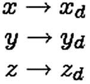

求解这些方程以得到期望的方向舵和引导向量并不简单。因此，我们通过使用投影和合向量关系逐步进行。首先，用这些向量方程的标量等价形式（向量范数）来求解`FBZ`是比较方便的。

平移动力学方程按此方式重写。注意，方向舵和引导向量变量已从独立变量`psi`中分离出来：

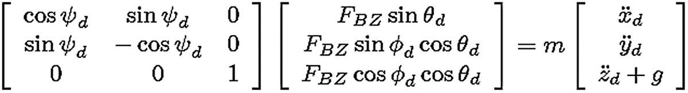

我们求解方向舵和引导向量：

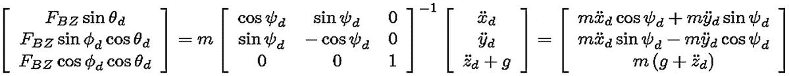

从向量获取标量的一种方法是使用点积：

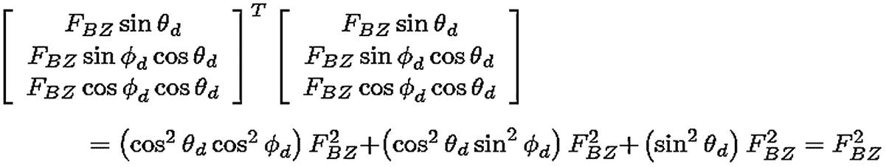

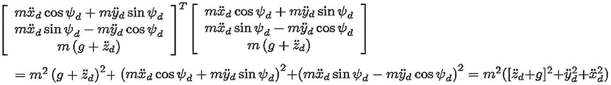

因此：

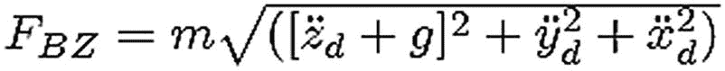

注意，`FBZ`是一个标量，它包含了来自我们引导向量的信息（它的距离）。

方向舵必须以反正切模式呈现（以便与球面坐标兼容）。它们由以下方程求得。注意，偏航角是一个独立的方向舵。

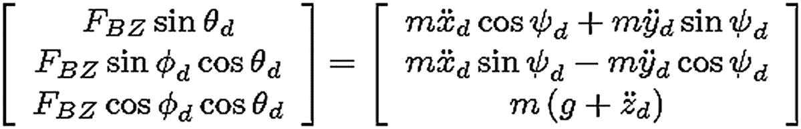

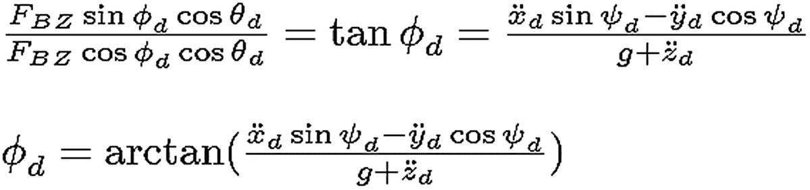

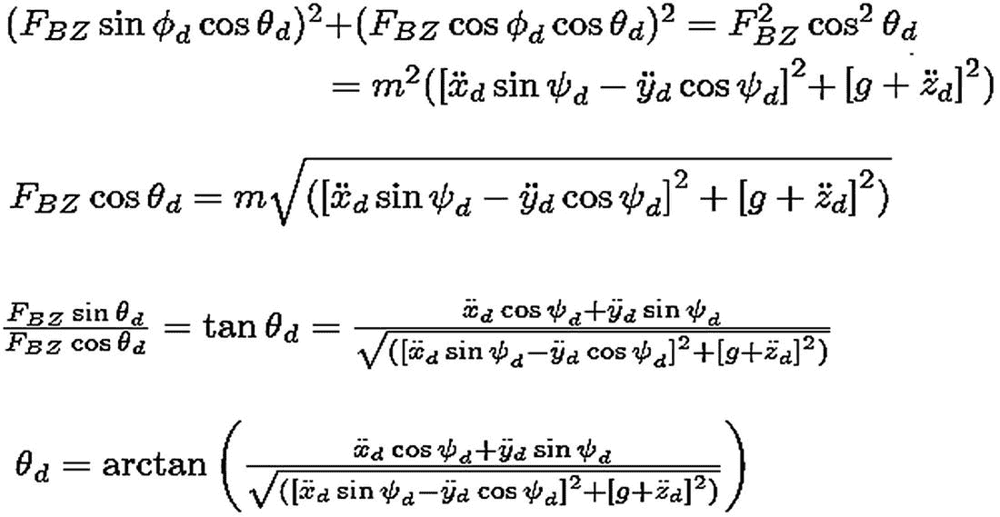

这些方程的形式蕴含了在笛卡尔坐标系中表达的球面坐标，其中半径是引导向量的大小`FBZ`，球面角由方向舵（滚转、俯仰和偏航的期望值）决定。

## 第三步：注入控制器。

通过用以下三角恒等式替换原始平移动力学中找到的引导向量大小和方向舵的值来实现：

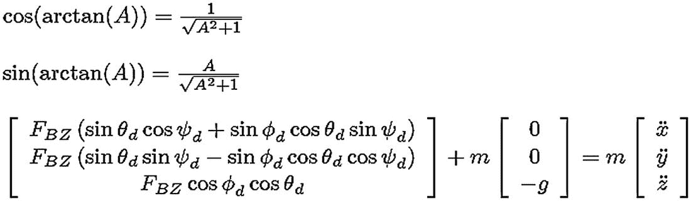

得到如下结果：

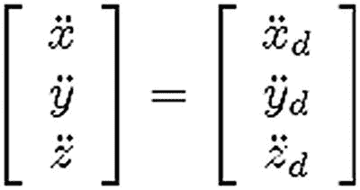

例如（这是一个繁琐但必要的示例，可借助数值计算程序如`MATLAB`来展开）：

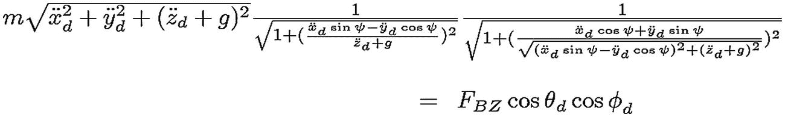

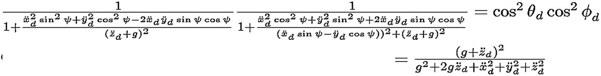

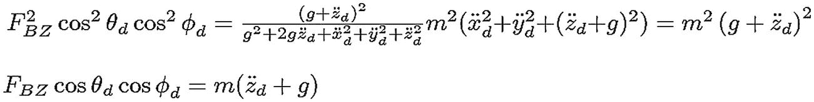

因此：

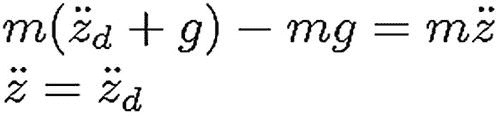

同样地，可以得到X和Y方向动力学的结果。

这意味着我们可以提出以下内容：

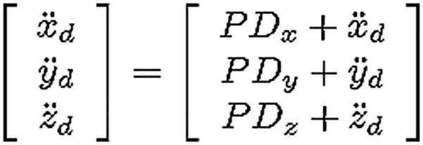

由此得到：

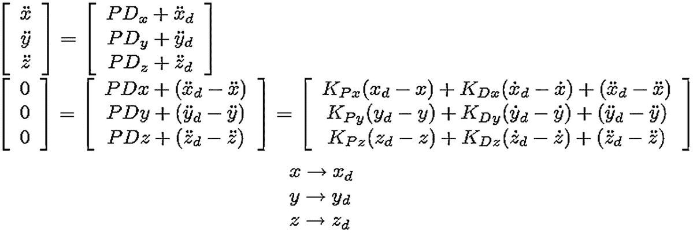

在实际应用中，并且在前面描述的平滑飞行条件下，我们可以简单地说：

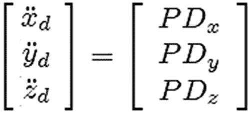

总结来说，引导向量和方向舵按如下方式注入：

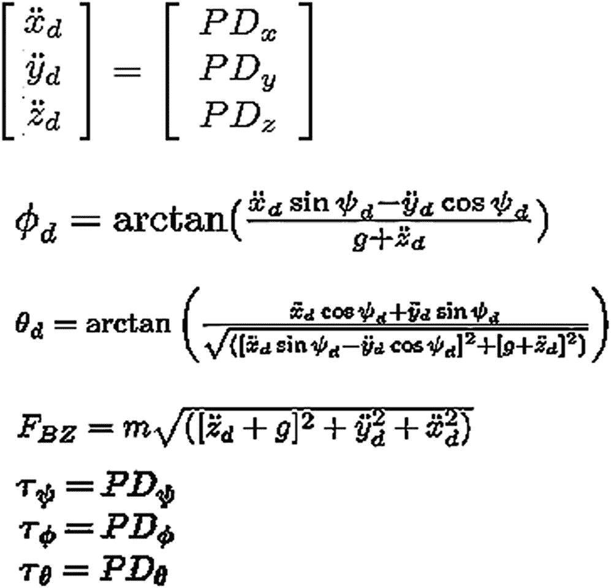

我们称此为运载器模式控制、第一人称模式控制或机载模式控制，因为这是驾驶舱内飞行员的行为方式。此外，这种类型的控制已在轮式机器人中使用了几十年。

图 3-14 以示意图的形式展示了这种控制器（请记住，这里提出的控制方法可以是`PD`以外的任何方法，但总体结构是相同的）。

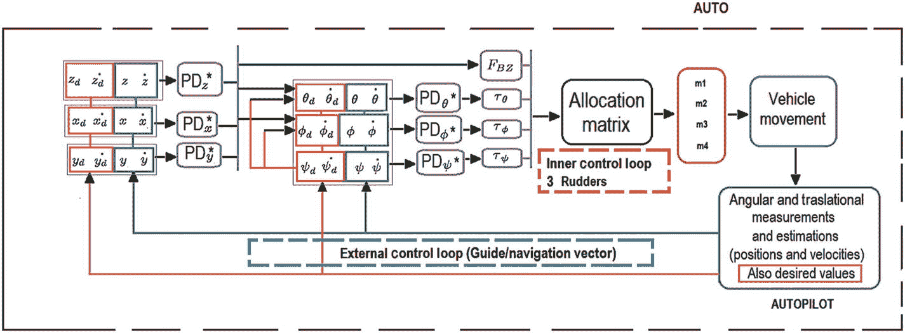

**图 3-14** 球面控制的图形流程

如前面章节所述，可以集成遥控器。

你已经了解了无人机的球面控制。现在我们将教你一种最强大的控制器——几何控制。