# 无人机几何控制导论（推进器与导引矢量）

前一案例基于三角函数原理。本节将介绍一种更高级的、基于旋转矩阵理论的控制器。

此处的飞行器将不再配备导引矢量和三个方向舵（如前一案例中，`psi` 被视为独立方向舵，`phi` 和 `theta` 亦然）。在本节案例中，飞行器将配置一个导引矢量和三个推进器，参见图 3-15。想象我们通过指令将机载的“方向盘”或“方向舵”替换为控制前后、上下和左右运动的“推进器”。这种技术在机器人领域也广泛应用，并关联着用于通过三个正交矢量修正或描述物体姿态的 `noa` 矢量；其中两个矢量可设计，仅一个矢量独立于其他两者。

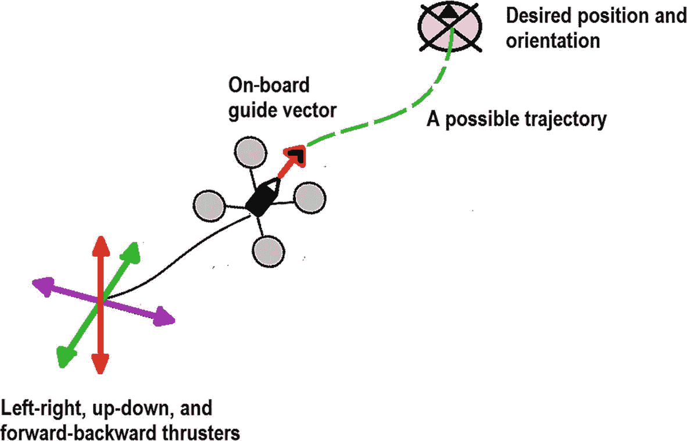

图 3-15

几何控制图示

注意，`noa` 矢量因其在机械臂操作中的应用而得名，尤其在机械爪或机器人手中：`a` 是表示机械爪接近方向的单位矢量，`n` 是相对于 `a` 的法向矢量，`o` 则是同时垂直于 `a` 和 `n` 的矢量，用于确定机械爪的朝向。参见图 3-16。

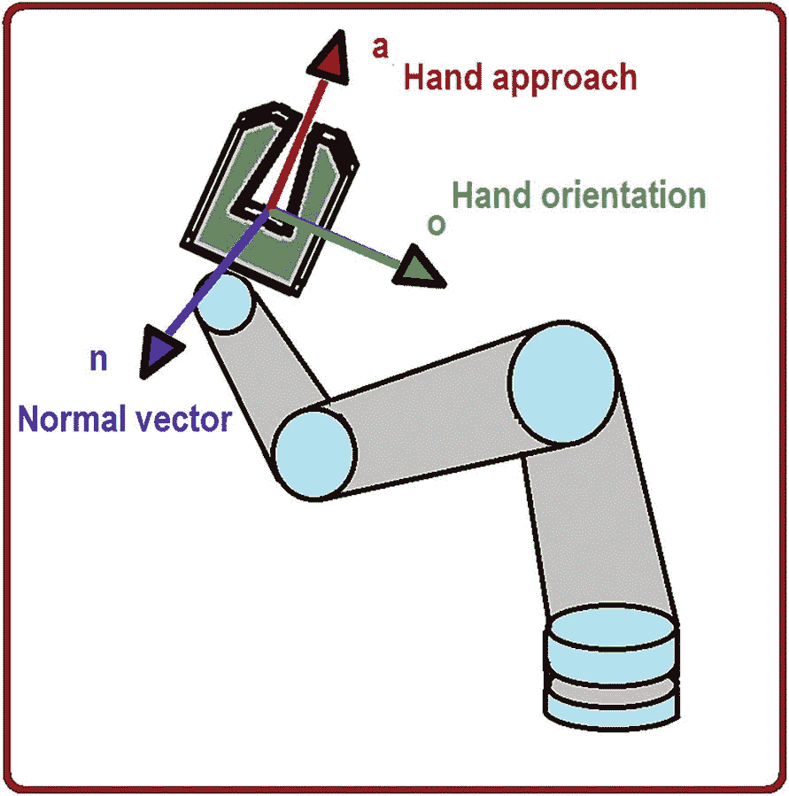

图 3-16

`noa` 矢量在机械臂中的图示

本节要求你熟练掌握以下工具（所有有用的属性会在使用时注明，但你仍需自行详细了解）：度量空间中的范数与距离（绝对值、二次距离等）；矩阵不变量（迹、行列式等）；旋转矩阵及其导数性质；矩阵的转置及其性质；矩阵的迹；以及叉积的等价矩阵表示——帽子积及其逆运算——倒 V 积。

让我们从平移部分开始。

## 平移控制

该控制方法采用基于旋转矩阵的替代运动学表示，并使用了非线性化的通用动力学模型。如下所示：

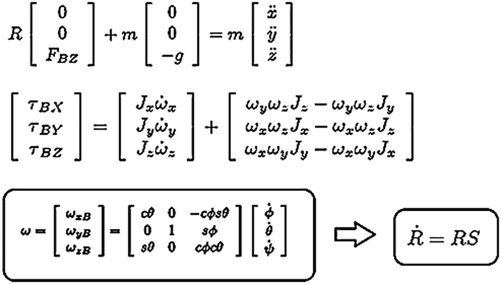

不再使用 Tait-Bryan 角运动学（该情形下控制基于三角函数），此处的运动学模型基于旋转矩阵，而控制基于这些矩阵的性质。

两者之间的等价关系其实非常简单。只需记住，从 `S` 矩阵中，你可以得到机体坐标系下的角速度分量，以及它们与世界坐标系下滚转、俯仰、偏航角速度之间的关系（这在上一章中已有证明）：

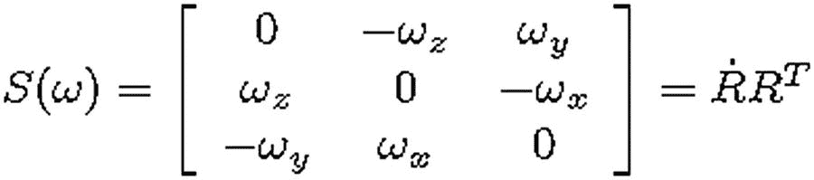

你可能会问，将模型从基于方向舵的操作改为基于推进器的操作有何优势。我们预先告知你，当机体角度较大时（这与我们此前所有设计中假设的平稳飞行模式相反），这种变换极为有用。换句话说，它适用于剧烈和特技飞行动作。

根据上一段所述，注意我们无法直接使用欧拉角进行运算，而只能通过其等效旋转矩阵间接地工作。

平移动力学控制运用了一个在控制理论中称为“湮灭器”的概念。注意，在我们所依据的 Tae Young Lee 的文章（参见附录）中，坐标轴的方向与我们此处采用的正值方向相反。请记下这些反转的坐标轴，以便在本文与上述文章之间进行对照。

一个包含导引矢量信息的推力控制器如下：

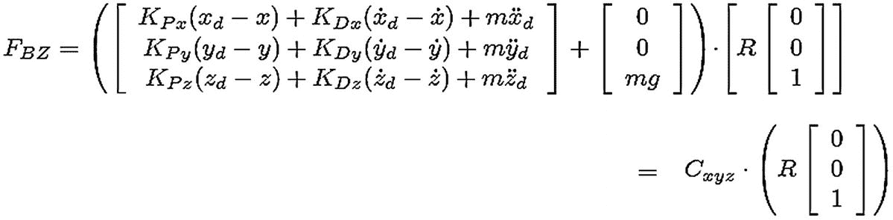

注意这里存在点积，因为 `FBZ` 是一个标量。同时注意单位矢量 `[0 0 1]` 的存在。这就是 `FBZ` 在无人机坐标系中的位置。

前述旋转矩阵的一个约束条件是：

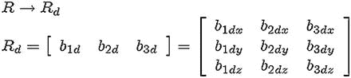

稍后你会看到，这些 `b` 矢量（即期望旋转矩阵的分量）被用作一种 `noa` 矢量，其中 `b3` 等效于矢量 `a`，`b2` 等效于 `o`，`b1` 等效于 `n`。参见图 3-17。

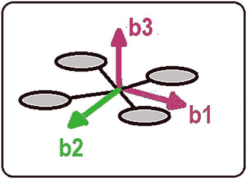

图 3-17

构成期望旋转矩阵的 `b` 矢量

注意：

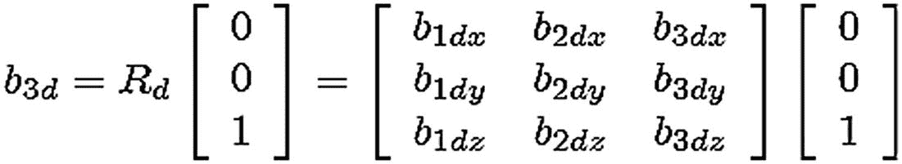

其中，我们的第一个设计约束条件如下：

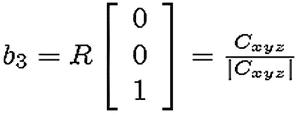

这意味着三点：

-   第一，需要为旋转矩阵设计一个控制器，使其行为如同期望旋转矩阵。这将在本节稍后完成。

-   第二，飞行器的导引矢量与推力相关联，而推力又与飞行器的 `Z` 轴或 `b3` 相关联。

-   第三，矢量 `b3` 被归一化，以确保不超过旋转矩阵所允许的最大值（正交归一性）。

这些条件同时发生，如下所述。

利用 `FBZ` 是标量这一事实，我们将动力学模型重写如下：

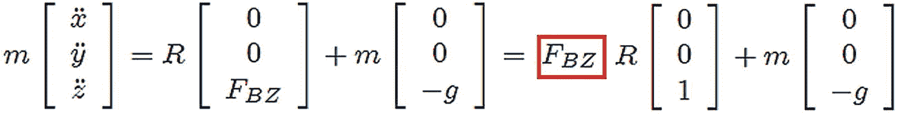

我们将包含导引矢量的推力代入平移动力学方程中：

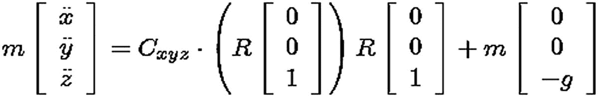

这看起来似乎是一种不相关的行为，但现在我们用 `1` 来除以包含旋转矩阵的项。

其中 `1` 等于（请记住，旋转矩阵的逆矩阵乘以该旋转矩阵的结果是单位矩阵）

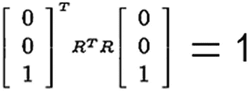

这样

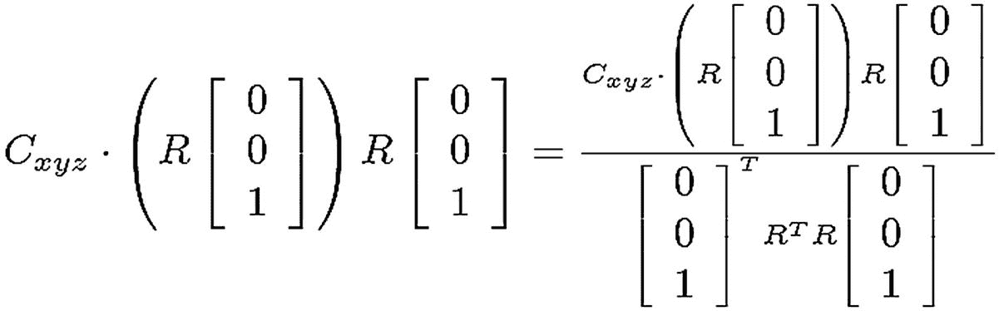

然后，进行重写（请记住我们的第一个约束条件）

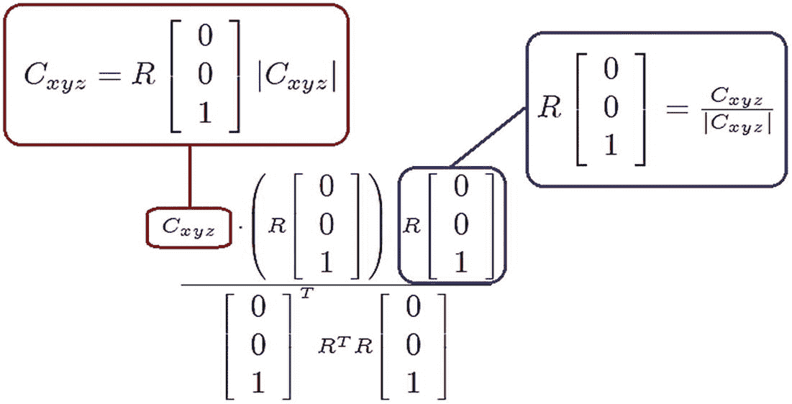

最后（这里我们使用了点积与转置运算符之间的关系）

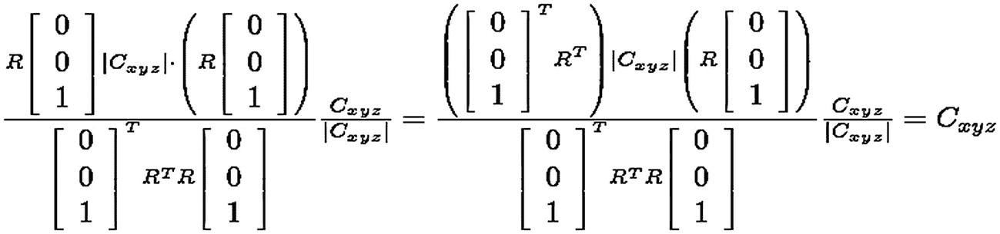

因此，平移动力系统的闭环方程变为

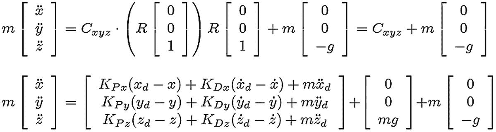

这产生了三个质量-弹簧-阻尼系统，并且通过适当选择比例和微分值意味着（详尽的正式证明见 Tae Young Lee 的文章，你可以在附录中查阅）

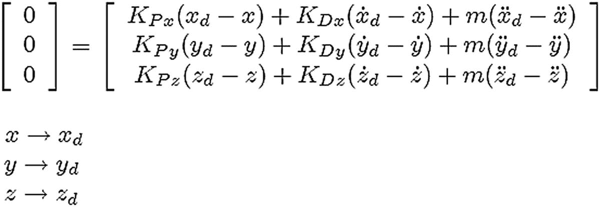

现在，我们继续讨论旋转部分。

## 旋转控制

现在是这个控制器中最困难的部分：通过调节旋转矩阵来设计姿态控制。为此，我们考虑所有闭环控制器都基于误差。误差是期望值与测量值之间的距离。对于标量，这个距离就是简单的减法。类似地，我们将定义两个旋转矩阵（测量矩阵和期望矩阵）之间距离的概念。

首先，我们已经知道矩阵 `R` 由欧拉角定义为

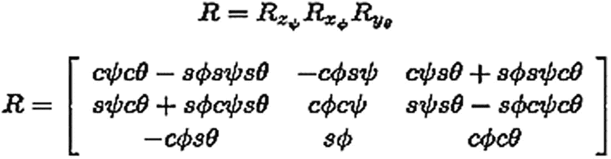

并且期望矩阵包含三个“推进器”。这是因为在旋转矩阵中，每一列都代表一个笛卡尔坐标轴的行为。同时，如前所述，每一列都是满足法向量条件的单位向量，而正交条件由以下定义满足：

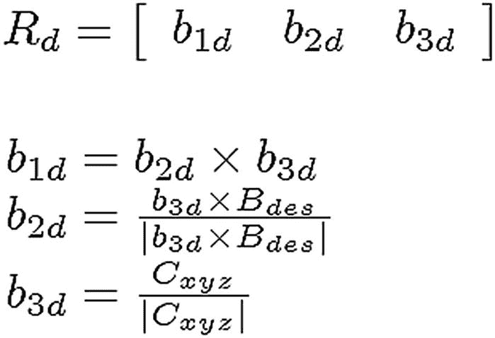

如前所述，这些向量是`noa`类型的向量，并且它们的定义要求彼此之间正交归一。这解释了叉积和归一化量的存在。最后，对于`b1d`，由于它是两个归一化向量或单位向量的叉积，因此它也是归一化或单位的。

请注意，唯一独立的向量是`Bdes`和`b3d`，并且唯一可以设计的向量是`Bdes`，因为`b3d`必须满足我们的约束条件以调节`FBZ`。而对于`b1d`，它被强制满足与其余两个向量的正交归一性。

`Bdes`的一个示例如下

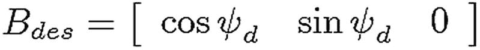

该向量与`b1d`和`b2d`相关联，并允许例如绕`ZB`轴的旋转（一种强制但功能性的偏航调节，由于`b1d`和`b2d`与`b3d`的相互作用，并未完全实现）。

在定义了测量旋转矩阵和期望旋转矩阵之后，让我们回顾一些关于距离的概念。两个标量之间的距离是减法。两个向量之间的距离，在众多定义中，是二次向量范数（其分量标量差值的平方和再开平方根）。对于矩阵，也有多种距离的定义。这里我们将使用`Frobenius`范数，因为其具有不变性（迹和行列式是矩阵中的不变量，而`Frobenius`范数基于迹）。

正如你所见，所有距离要么是标量，要么是标量函数。如果`a`和`b`是标量值，则距离为

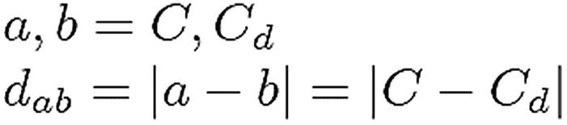

如果它们是向量，一种非常常见的距离形式是

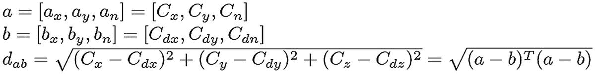

并且向量分量（单个差值）可以通过这种方式获得（了解这些分量有助于设计三维控制）：

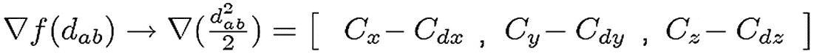

其中，这里使用的算子（倒三角符号，也称为`nabla`或`del`）被称为梯度，是一种方向导数，它从依赖于多个变量的标量函数（本例中为距离函数，它本身已经是依赖于多个变量的标量）中获取向量分量。

如果`a`和`b`是矩阵，则`Frobenius`距离为

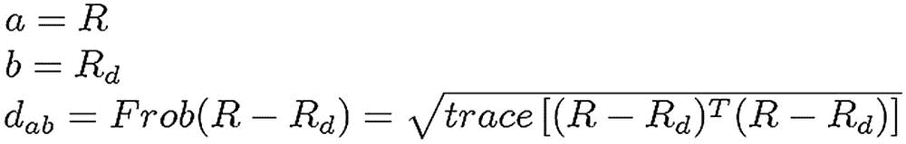

请注意，减法的顺序在维度上是扩展的。

好的，作为一名高级文档工程师和翻译员，我将遵循您的指示，将给定的英文文本翻译成中文，并严格遵守格式规范。

---

执行以下操作（对旋转矩阵有效，并使用迹积性质）：

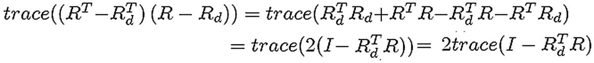

得到：

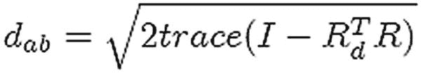

在这种情况下，由于我们有一个标量且需要设计一个三维姿态控制，我们需要一种方法从上述距离定义中获得一个三维向量。请记住，在定义了测量矩阵与期望矩阵之间的距离后，我们必须从中生成三个误差，以便生成飞行器的三个力矩。

一种方法是应用方向导数的概念（这里我们将使用一种称为平凡化右导数的方向导数），并考虑到我们的距离是一个多变量的标量函数，当我们进行方向求导时，我们将得到一个向量表达式，其方式类似于我们对两个向量之间的距离应用梯度（`nabla`）时得到的结果。

平凡化右导数广泛用于此类控制器，但鉴于其解释的复杂性，我们仅将其作为一种工具使用。更多信息，请参见附录中`Bullo`和`Taeyoung Lee`的文献。需要注意的是，此处使用`1/4`的值是为了方便，使得最终结果以`1/2`的形式表达，这对于非线性控制中通过矩阵性质或导数来消除常数值特别有用。但是，您可以使用任何其他乘数。结果只会改变在过程中需要携带的数值。

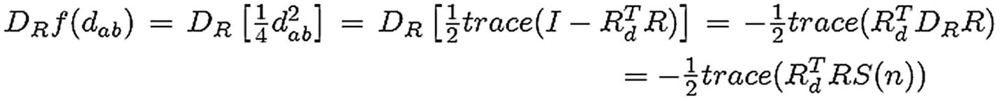

观察三点：

-   对于迹的情况，由于它是线性运算，所以迹的导数就是导数的迹。

-   此外，我们利用了旋转矩阵的通用导数会产生旋转矩阵乘以一个反对称矩阵（`S`）这一事实。但是，请注意，所述反对称矩阵与第2章中描述的之前的反对称矩阵不同。这是因为之前的导数是关于时间的导数，而这是关于变化方向的导数。然而，会生成一个依赖于变化率（`n`）的反对称矩阵。

-   最后，请注意单位矩阵的导数为零，剩余导数仅影响旋转矩阵的项，其中`Rd`被视为一个“常数”，因为它独立于`R`（此导数是关于`R`进行的）。

总之，使用了以下性质：

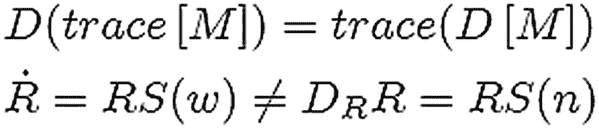

术语`S(n)`是一种表示，用于指示存在一个向量`n`，它被转换为一个反对称矩阵，以便避免使用叉积，并允许使用矩阵乘积。

从现在开始，我们将使用`hat`和`vee`符号。`S(n)`的等价符号是`hat`算子，它意味着从向量获取一个反对称矩阵。

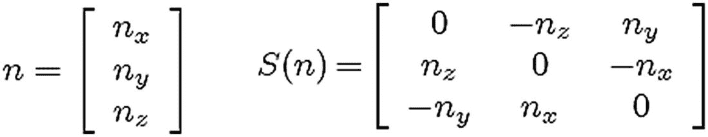

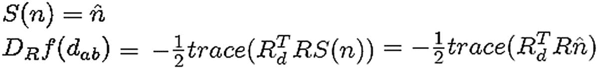

仔细观察，你会发现我们还没有得到一个可以使用的向量，因为迹是一个标量，而且应用迹的乘积本身也是一个矩阵。

然而，有三个有用的事实。

第一个是存在以下恒等式：

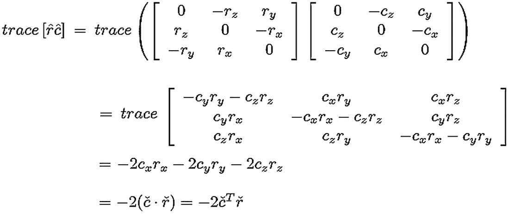

为此，我们使用`vee`算子，它是`hat`算子的逆，意味着从反对称矩阵获取向量：

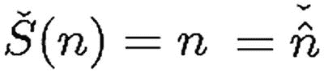

第二个是，以下矩阵以及一般的任何其他矩阵，都可以分解为一个反对称部分和一个对称部分，如下所示：

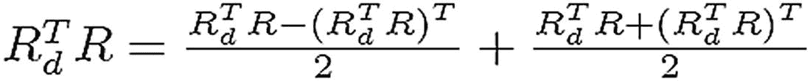

这样：

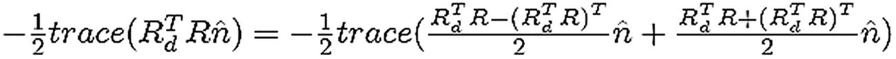

第三个事实是，对称矩阵与反对称矩阵乘积的迹为零，因此只有反对称矩阵乘积的迹能够保留：

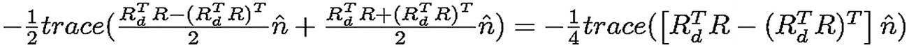

利用将两个反对称矩阵乘积的迹与它们等效的`vee`向量的点积联系起来的等式，我们得到：

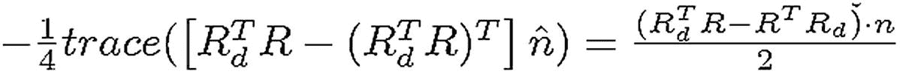

最后，我们寻找的误差向量就是这个：

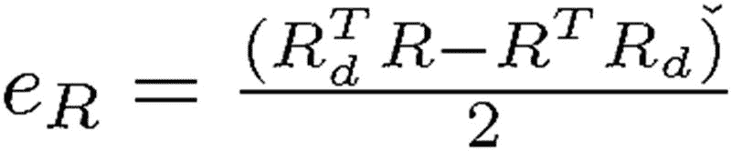

为了制定我们的姿态控制（也称为方向控制），除了方向误差分量（此处由旋转矩阵给出，用于引入比例部分）外，还需要一个角速度分量（用于引入微分部分）。这是通过以下方式完成的。

第一个尝试是提出：

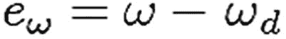

简单的逻辑表明，这些角速度（测量值和参考值）是向量，并且可以直接应用该方程中解释的内容：

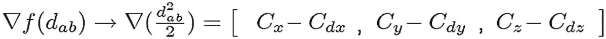

然而，期望角速度和测量角速度不能直接相减，因为它们位于不同的空间中。因此，我们将使用基于旋转矩阵导数的推导。见图 3-18。

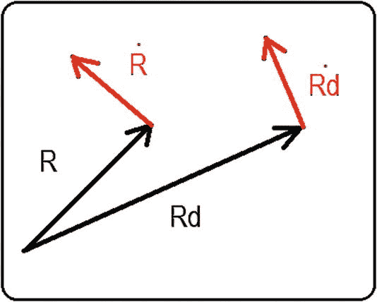

图 3-18 期望和实际旋转矩阵导数所在空间的图形表示。

简化来说，我们指出旋转矩阵的速度与其自身相切。注意，旋转矩阵及其导数都不是向量，而是矩阵，尽管我们可以使用它们的特征向量来想象和图形化表示它们。旋转矩阵导数相对于其旋转矩阵的正交性的数学证明，由旋转矩阵的导数方程给出，该方程中出现了一个依赖于角速度的反对称矩阵，并且由于该反对称矩阵等价于叉积，因此结果是一个正交矩阵。

由于期望旋转矩阵与实测旋转矩阵不在同一个空间中，因此需要进行图 3-19 所示的过程。

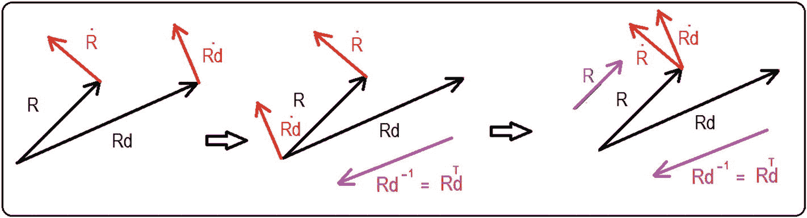

图 3-19 用于统一旋转矩阵导数的图形序列。

该图形序列的结果产生以下方程：

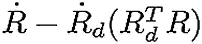

由于需要角速度之差，我们需将之前的方程改写为如下形式：

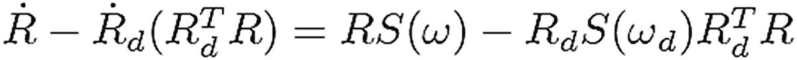

如果将第二项乘以单位矩阵（请记住，这等价于乘以 1）：

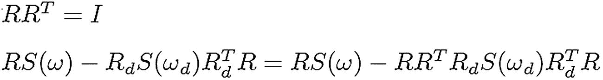

该方程被改写为关于 `R` 的表达式：

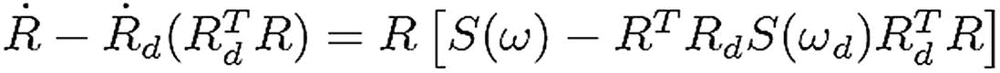

这可以改写如下（利用乘积转置的性质）：

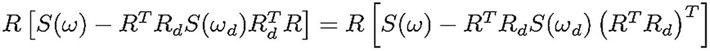

有两个有用的恒等式。请注意，为了避免使用一个巨大的帽子符号，它被放置在括号的末尾，这仅意味着它必须应用于括号内运算的结果：

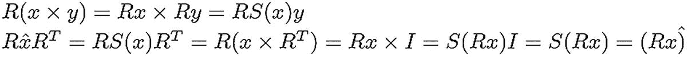

在我们将要推导的方程中使用这些恒等式（特别是其第二项），我们得到：

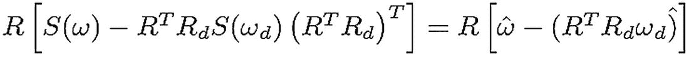

由于两个反对称矩阵之和是另一个斜对称矩阵：

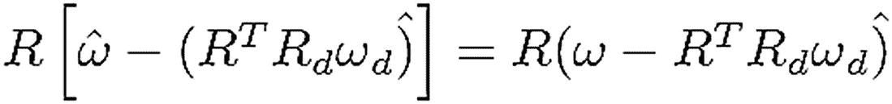

我们寻找的角速度误差简单地就是向量：

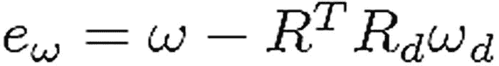

注意，`wd` 不是一个任意值，必须通过如下方式作为 `Rd` 的依赖项获得：

请注意，在我们旋转动力学的模型中，存在以下项：

它的间接使用方法（这个将在随后得到补偿）如下获得：

必须注意到：

因此：

应用斜对称矩阵的定义：

我们很快就会用到这个结果。

回到我们原始的旋转动力学，它可被改写如下：

通过使用我们之前推导出的旋转误差和角速度误差的定义，我们可以提出以下控制律：

其中 `KR` 和 `Kw` 是标量（其思想是对相应的误差向量进行相同比例的缩放，以保持它们的正交归一比例）。

如果我们将这个控制器代入原始方程，我们得到：

该方程需要对所包围的项进行动态补偿。我们将在下一节教您如何做到这一点。

## 动力学补偿与补充说明

可以看出，角速度的导数项仍然存在于方程中。正如我们之前所做的那样，可以使 PD 增益足够大以克服此项，或者对其进行补偿。为此，请记住我们推导出了这个方程：

因此，我们可以修改所提出的控制律，加入以下内容：

将修改后的控制律代入旋转动力学，我们得到：

该系统并不完全是一个质量-弹簧-阻尼器系统，但其相似性，以及由 Lee、Leok 和 McClamroch 在《基于 SE(3) 几何方法的四旋翼无人机复杂机动控制》和同一作者在《基于 SE(3) 的四旋翼无人机几何跟踪控制》中利用李雅普诺夫方法推导的必要条件（您可以在附录中查阅），意味着：

此处我们省略了这些推导过程，因为它们逐步执行起来甚至比本节中关于误差定义及其与动力学相互作用的解释还要冗长。第一步是找到旋转误差和角速度误差之间的关系，这也是前述作者所推导的。第二步是继续下一节的内容。

总之，与无人机在非平稳飞行中相关的非线性系统控制如下：

注意，该控制基于一个由三个推进器（期望旋转矩阵的分量）调节的引导向量，而这些分量又依赖于同一个引导向量。

图形化表示如图 3-20 所示（*请注意，完整运算已在先前的方程中描述，并且如您所见，可以添加动态效应以获得更精确的控制器*）。

如果您想添加遥控器，它们可以修改 `X`、`Y`、`Z` 和偏航的期望值，或者修改扭矩和力，如同先前设计的情况。

**图 3-20** 几何控制的图形序列

下一节将介绍用于证明系统稳定性的李雅普诺夫方法。这将结合之前推导的方程，使您能够更轻松地深入理解前面提及的参考文献。
