# 李雅普诺夫稳定性简介

本节适用于希望进一步了解前述文章中基于李雅普诺夫稳定性理论的扩展形式证明的读者，这些内容是对上节的补充。李雅普诺夫方法共有两种，一种针对线性系统，另一种针对非线性系统。考虑到第二种方法的适用范围更广，且线性系统只是其中的一个特例，我们将通过示例简要说明其用法，并给出图形化解释。

## 第一步

给定一个系统，例如不含控制输入的一阶系统和阻尼谐振子。请记住，正如前文所述，我们是在对动态系统施加闭环控制器后得到这些系统的。

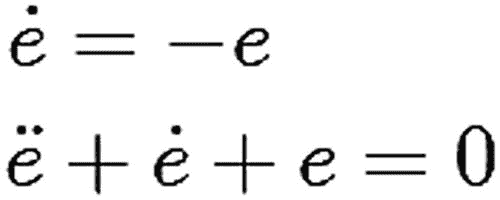

可以提出一种虚拟能量。这是一个关于多个变量的标量函数，除了在其最小值处（零值，或完全静止条件，或稳定条件）之外，该函数始终为正。通常情况下，该函数取决于我们正在分析的变量。

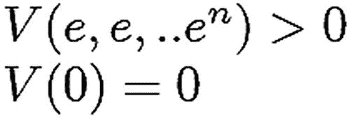

对于第一个系统，满足上述条件的函数如下所示（注意其图形表示是一个凹抛物线）：

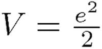

对于第二个系统，另一个满足这两个条件的函数示例如下（其图形表示是一个同样凹陷的椭圆抛物面）：

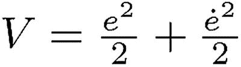

从现在起，请注意李雅普诺夫函数通常用字母 `V` 表示（这可能是因为 `V` 看起来像一个凹函数的图形表示）。此外，请注意这些函数经常被除以 2，以便在对李雅普诺夫平方函数求导时避免出现因子 2。

观察可知，李雅普诺夫函数通常具有图 3-21 所示的形状（至少当它仅依赖一个或两个变量时可以这样表示）。它们看起来像凹形容器，但不一定都是弯曲的。有些看起来像倒金字塔（该概念可以扩展到多于两个变量的情况）。

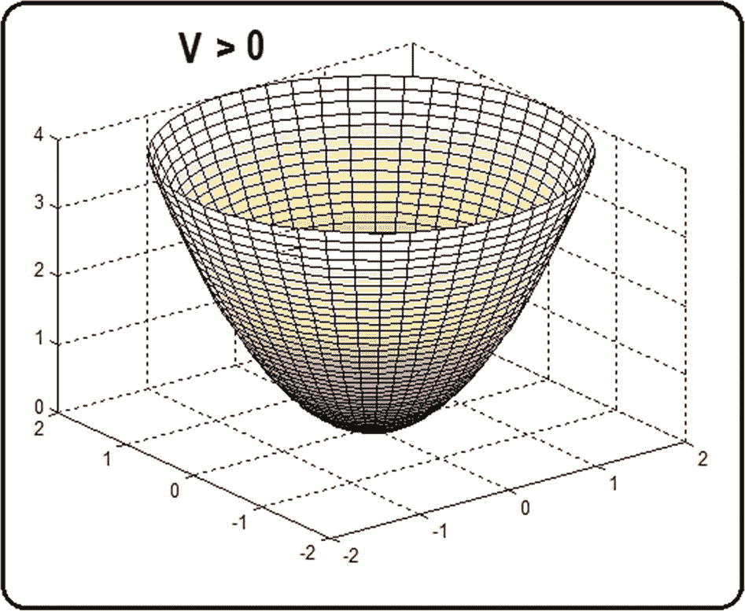

**图 3-21**  
李雅普诺夫函数的三维示例

## 第二步

李雅普诺夫函数对时间的导数必须为负，或至少为半负定，并且必须依赖于我们关心的一个或多个变量。这与图形类比密切相关。请记住，李雅普诺夫函数是凹的封闭容器，从其表面上任意一点观察，其斜率均为负。见图 3-22。这意味着，"放置"在该能量表面上的系统状态将"滑向"表面的最低点，即稳定条件或零能量状态，简单来说，系统将在能量的最小值处停止。

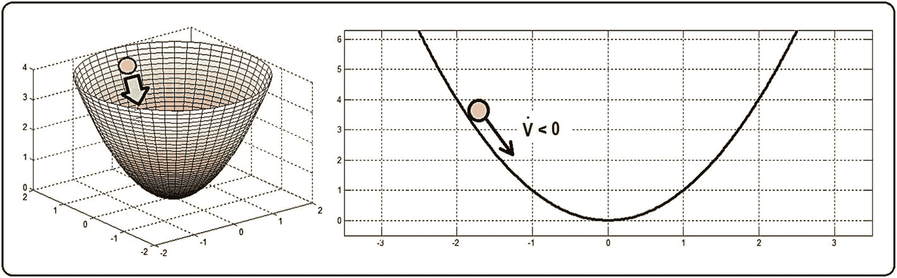

**图 3-22**  
李雅普诺夫函数的导数（三维和二维示例）

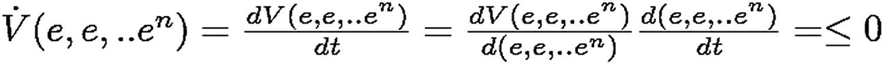

对于一阶系统：

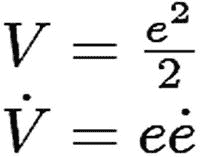

并将该李雅普诺夫函数所针对的系统代入：


该导数为半负定，且完全或部分依赖于我们所关注的状态。

对于阻尼谐振子系统，我们有

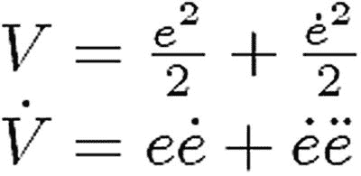

并将该李雅普诺夫函数所设计的系统代入：

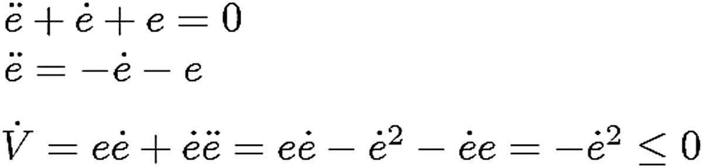

该导数为半负定，且完全或部分依赖于我们所关注的状态。（在这种情况下，它不依赖于误差，而是依赖于误差的导数。稍后我们将看到如何处理这个问题。）

如果我们对一阶系统提出了

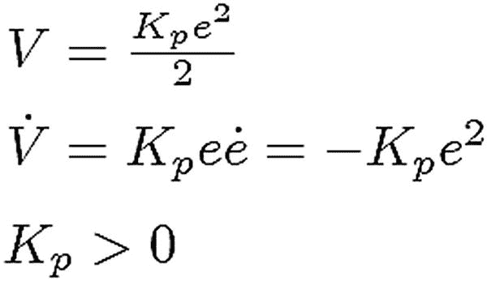

那么只要常数 `Kp` 为正，李雅普诺夫函数的导数就不会改变其负定性，李雅普诺夫函数也不会改变其正定性。你很快就会记住这个事实。

请注意，我们只能说明李雅普诺夫导数所依赖的那些状态会趋向于李雅普诺夫函数的最小能量行为；也就是说，它们趋向于 0。如果其余的状态没有出现，我们就无法对它们做出任何保证，并且必须设计并尝试一个新的李雅普诺夫函数。

### 步骤 3

通过使用辅助假设，即所谓的 Barbalat 引理或 Lasalle 原理（它们根据你所拥有的系统类型来使用，因此你必须研究它们），当 `V` 及其导数为零时，必须评估系统的状态是否也趋向于零。这是因为可能会出现局部谷底，如图 3-23 所示。在这些谷底中，能量值为零，但系统不会达到李雅普诺夫函数的最小值，而是陷入局部陷阱。

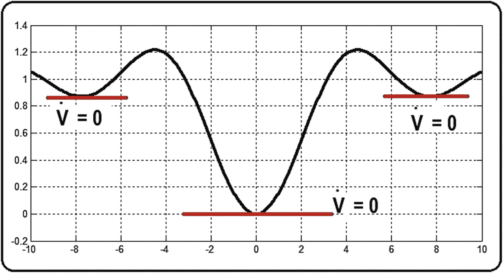

**图 3-23**  
李雅普诺夫函数中的局部和全局最小值

对于第一个例子，让我们看看当 `V` 的导数为零时会发生什么：

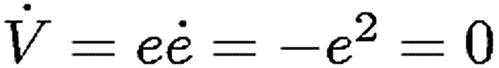

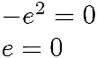

并且还有

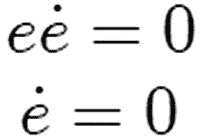

这个结果也可以通过系统方程得到：

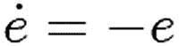

因此，

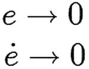

对于第二个系统，我们采用相同的方法：

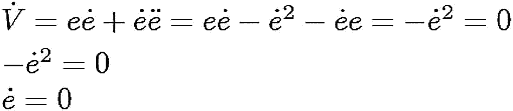

并且还有

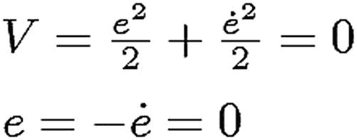

通过代入求得的 `e` 值及其一阶导数，求解 `e` 的二阶导数：

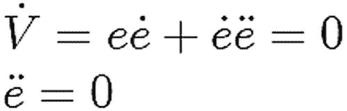

这个结果也可以通过系统方程得到：

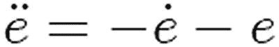

因此，

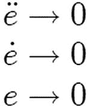

此外，一种非常常见的处理李雅普诺夫函数的方法是基于二次型。

例如，阻尼系统的李雅普诺夫函数可以重写如下：


如果你看到  

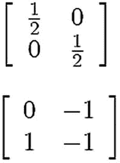

直接关注点在于证明这些矩阵分别对应于正和负，或者在线性代数中被称为正定矩阵、负定矩阵或半定矩阵。利用线性代数理论，通过特征值准则可以得出第一个矩阵是正定的，而第二个矩阵是负半定的，这与原始结果吻合。这种矩阵表示在许多控制系统的文献中都可以找到，包括 Taeyoung Lee 在之前提到的文章中给出的演示。

提出李雅普诺夫函数并证明其导数（通常包含系统及其控制器）是负定的，是一门称为非线性控制理论的科学中的广阔分支。每个动态系统都代表了通过李雅普诺夫函数寻找其稳定性的一个挑战；甚至每个单独的结果都可能代表一本书或一门新科学。

在这项研究中，能够与控制器进行代数运算的能力非常有帮助。例如，在第 4 章中，有一节专门介绍状态空间表示，其中指出一个非线性微分方程组（包括多旋翼飞行器）可以表示如下：

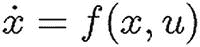

其中 `x` 是系统的状态，`u` 是其控制信号。

这样，按照李雅普诺夫方法

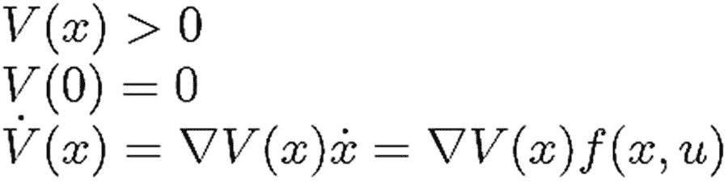

并且期望得到如下结果：

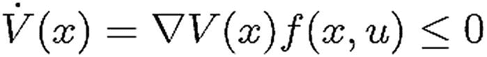

实现这一目标的方法是通过适当地修改控制量 `u`。

例如，让我们分析一个非自由输入（存在力 `u` 而非简单的 0）的二阶系统（阻尼谐振子）的情况。

目标是使变量 `Y` 趋向于一个称为 `Yd` 的期望值。

我们将有两个方程：真实系统方程和控制方程。

所以我们有两种选择：

1.  测试一个控制器，如果工作正常，我们直接尝试证明闭环系统的稳定性。这并非完全推荐，但大多数人这样做，尤其是因为几乎所有系统都可以用 PD 或 PID 控制器工作，而人们只想回答原因。
    
    如前所述，我们有一个系统和已经可用的控制器：
    
    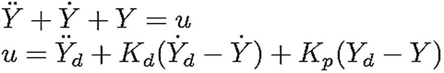
    
    分析闭环系统：
    
    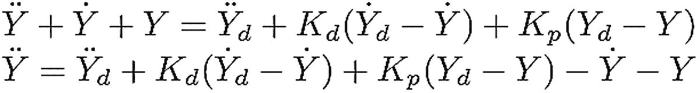
    
    做出一些主导假设。以下内容对正值且大于 1 的 `Kp` 和 `Kd` 成立：
    
    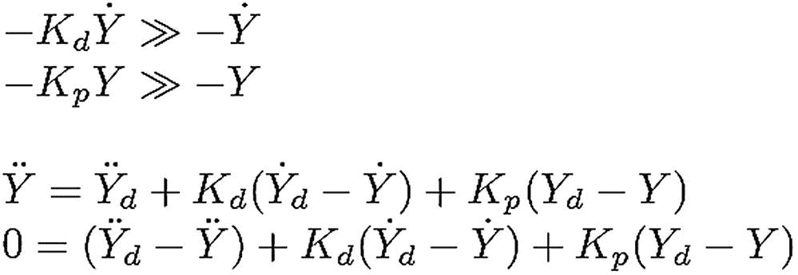
    
    重新命名：
    
    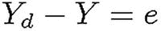
    
    并同样重命名其导数，我们得到这个系统：
    
    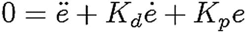
    
    最后，其闭环稳定性的证明方式与之前分析过的二阶系统类似：
    
    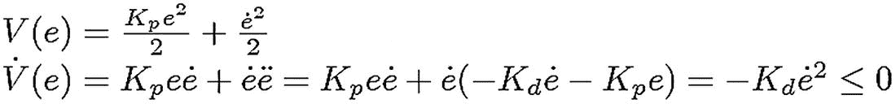

2.  证明原始系统的稳定性，并在过程中设计控制器。
    
    例如，提出这个李雅普诺夫函数，然后是其导数：
    
    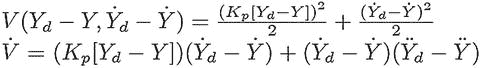
    
    我们将系统的动态引入到李雅普诺夫导数中：
    
    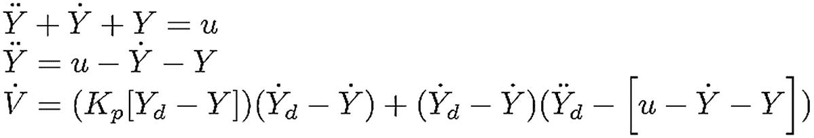
    
    此时，还不能说
    
    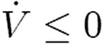
    
    但可以设计 `u`，例如：
    
    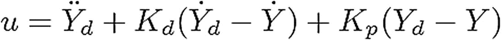
    
    那么该项
    
    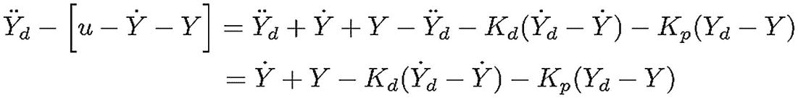
    
    再次，我们可以做出这些假设
    
    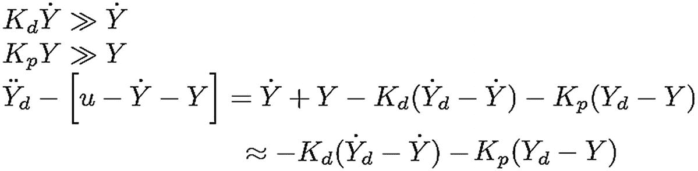
    
    在这些考虑条件下
    
    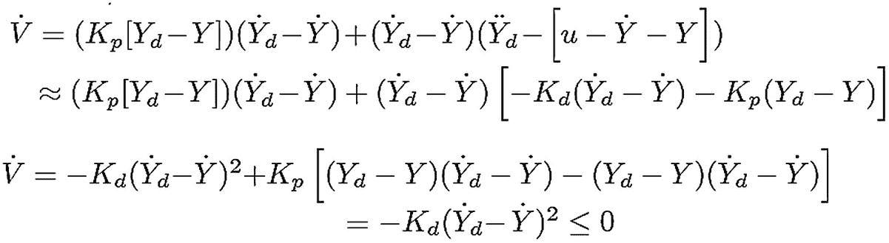

请注意，正如前面提到的 Taeyoung Lee 的文章所述，有时并不严格证明李雅普诺夫函数及其导数是正定和负定的，而只是说它们的某些方程项是有界的（这意味着它们的最大值和最小值不能超过某个值），并且由于这些项是有界的，它们的影响可以被其他负定或正定的项所主导。此外，这些界限有助于找到飞行器的物理限制及其运行范围。

最后必须提到，在线性系统中，使用李雅普诺夫方法进行稳定性分析是可选的，因为它们有许多其他工具。但在非线性系统中，就像几何控制的情况一样，李雅普诺夫方法是最流行的选择，这不是因为它简单（事实上并不简单），而是因为它有特定的方法。该方法如图 3-24 所示。

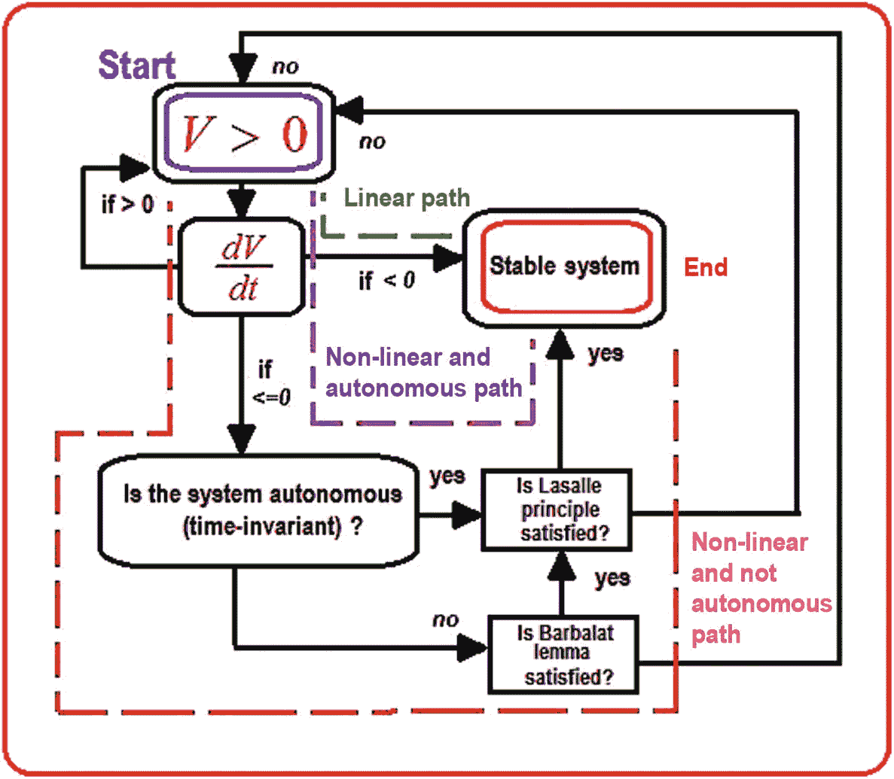

图 3-24  
李雅普诺夫方法的常用顺序

你已经了解了机器人和飞行器的模式控制器，以及李雅普诺夫理论的基础。让我们以关于期望值（记住它们是定义我们控制器的误差的一个组成部分）的一节来结束本章。


## 期望值的定义：调节、轨迹跟踪或点对点跟踪

在第四章中，我们将验证此处解释的大多数控制器，并会注意到（尤其是在几何控制情况下）路径类型会改变控制调节的方式（这不仅体现在增益的选择上，也体现在特定项的包含与否上）。

这样，我们就可以思考：是否存在一种不直接依赖执行时间，而直接依赖车辆机动性（例如其速度、加速度、加加速度（加速度的一阶导数），甚至冲击度（加速度的二阶导数））来跟踪轨迹的方法。

让我们从定义一些与期望值相关的概念开始。其他概念可以在附录中 Kelly 的文章中找到（例如，为了定义触觉误差）。

**调节**：调节任务是指系统被置于一个恒定值。在这种情况下，一个很好的例子是多旋翼飞行器的悬停任务，这意味着飞行器到达空间中的某个点，并在那里保持“静态”位置。

**轨迹跟踪**：这是指飞行器被指令跟随一个时间相关的参考信号（如圆形、余弦等）。基本任务是在关键时间点跟随参考信号，只要电机和系统本身能够以所需的速度、加速度等运动，就能实现。这里关键是复现参考信号及其运动特性，例如飞行器追逐。

**点对点跟踪**：这是前一种情况的特例，其中考虑了无人机最大特性（速度、加速度等）。其目标是让我们的无人机在不超出其自身极限值的情况下沿路线飞行，避免因惯性突变而强制驱动电机并损坏飞行器。

它涉及将给定的轨迹分割成特定的段，并将该轨迹作为点与点之间的运动来执行；见图 3-25。这样设计者就能够控制目标点之间的速度和加速度（或更高阶导数）曲线，以确保这些曲线低于飞行器的最大值。实现方法有很多，例如样条插值、埃尔米特插值、`n` 次 Catmull-Rom 多项式插值，或使用三角级数、指数傅里叶级数进行插值。定义点对点值的主要考虑是为了实现电机平稳运行。复现参考信号的执行时间并不重要，重要的是复现参考信号本身；这在例如物体搜索任务或为身体康复执行预定运动时很有用。

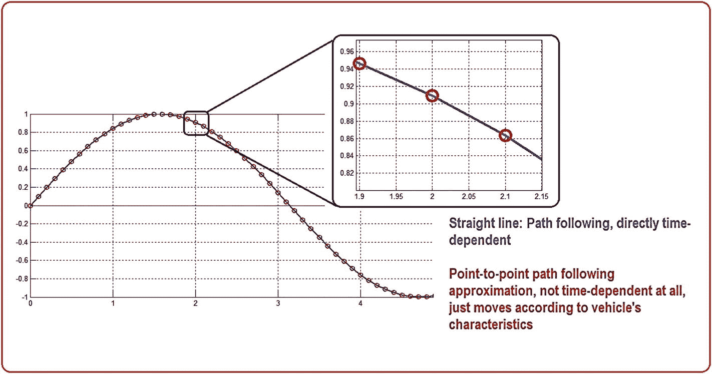

图 3-25  
当跟踪平滑函数时的点对点路径近似

请注意，点与点越接近，点对点跟踪就越接近轨迹跟踪行为。换句话说，插值阶数越高，飞行器的行为就越不像“机器人运动”，但这会以损伤飞行器执行器为代价。这代表了机动性能与电机安全性之间的权衡。还需记住，点与点越接近，越容易发生过采样误差，从而可能损坏飞行器。相反，当点与点之间的距离较大时，可能会发生欠采样跟踪。您将从给出的示例中看到，点与点之间的中间值不一定遵循轨迹的原始轮廓。

还需注意，如果待跟踪路径本身相对于飞行器的极限是缓慢且平滑的（例如，跟踪一个低频余弦信号），那么点对点跟踪可以被轨迹跟踪所替代（为了实验，请前往几何控制部分的仿真环节，修改代码以跟踪从低频到高频的三角函数）。

当然，当无法使用标准函数定义轨迹，或者待跟踪的函数不光滑（例如方形、三角形等）时，点对点跟踪就非常有用。如果我们考虑具有最小时间、加速度或其他运动曲线导数的轨迹，以及多点轨迹或点对点轨迹、单变量或多变量轨迹、平移、旋转或组合轨迹、基于多项式或三角函数的轨迹等等，轨迹规划本身就能写成一本完整的书。

我们继续。假设我们想要跟踪图 3-26 中显示的方形路径（正如你将看到的，跟踪带有顶点的图形或路径对任何控制器来说都是一个挑战）。

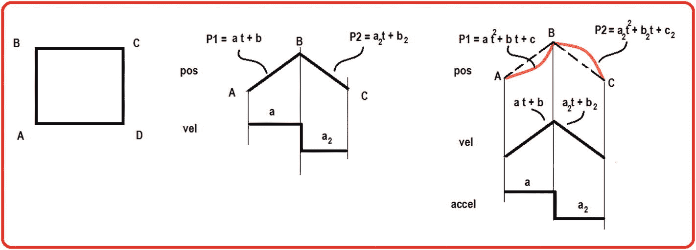

图 3-26  
通过多项式跟踪非光滑函数的位置、速度和加速度曲线

这条路径的一部分意味着我们必须经过 `ABC` 点。基于最短距离的直觉告诉我们可以沿直线行进（通过使用两个一次多项式）。

问题在于，当拐点出现时，直线轨迹的导数会呈现突变形状（导数是一个阶跃函数）。为了避免这种情况，可以使用一个二次多项式（但现在方形轨迹变成了一个近似，只有 `ABCD` 点被精确到达）。

按照同样的推理，二次多项式在速度层面上不再有突变，但在加速度层面上却会出现突变（再次发生在两个多项式之间的拐点或过渡点），这同样会损坏电机。那么，解决方案就是简单地使用三次多项式轨迹。在附录中提到的 Kumar 及其团队的 MOOC、文章和论文中，可以找到基于上述物理推理和欧拉-拉格朗日方程代价函数最小化的更深入论证。

请注意，即使如此，加速度的导数仍会继续呈现突变，并且随着每个导数层面引入新的多项式阶数，这种情况会无限延续下去。然而，这并不完全重要，因为我们感兴趣的是平滑的速度值，对应的加速度很小（趋于零），即使有这些突变，其影响也不重要。

但是，如果我们对剧烈运动感兴趣，那么我们必须考虑 Kumar（见附录）所示的高阶多项式，这些多项式在冲击度层面（加速度的二阶导数）进行点对点规划。

从现在开始，我们可以引入与车辆自身能产生的速度相兼容的速度值，具体方法如下（始终考虑一个起点和一个终点，尽管也有多点的算法）。

首先，我们注意到我们有一个所需的三次多项式，并且每个期望值都有一个这种类型的多项式。这意味着如果我们有兴趣为变量 `X`、`Y` 和 `Z` 定义期望值，我们必须为每个变量重复该过程：

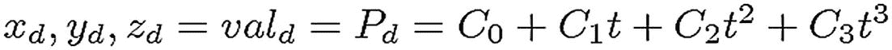


进入`/path/to/xxx`目录并找到`xxx.json`。

在表达式`cvar = avar + bvar`中，加法运算符（`+`）将`avar`和`bvar`相加，得到它们的和`cvar`。

在`List.of(arg0, arg1, arg2)`中，`List`接口的工厂方法`of()`接受一系列元素，并返回一个包含这些元素的只读列表。

然后我们像这样调用`cmd`命令：`cmd arg0 arg1 arg2`。

```
if (condVar > someVal) {console.log("xxx")}
```


