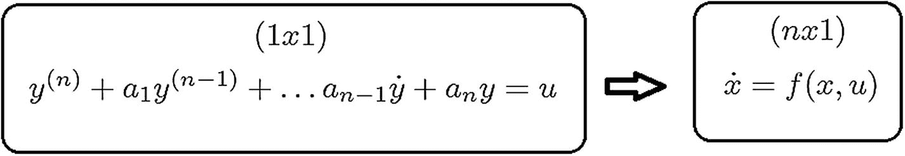
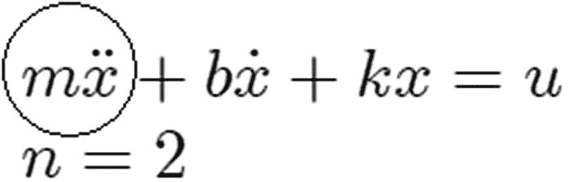
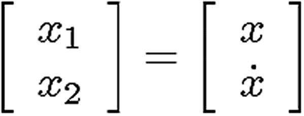
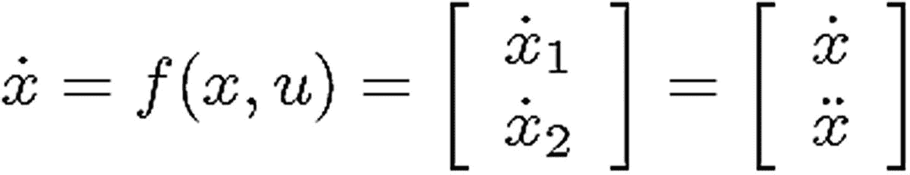
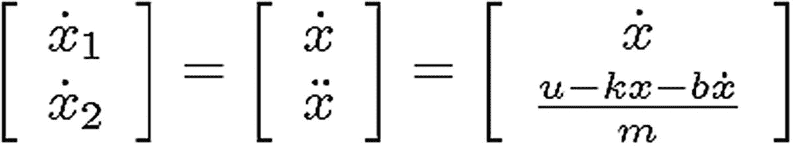
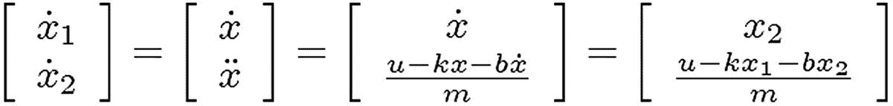
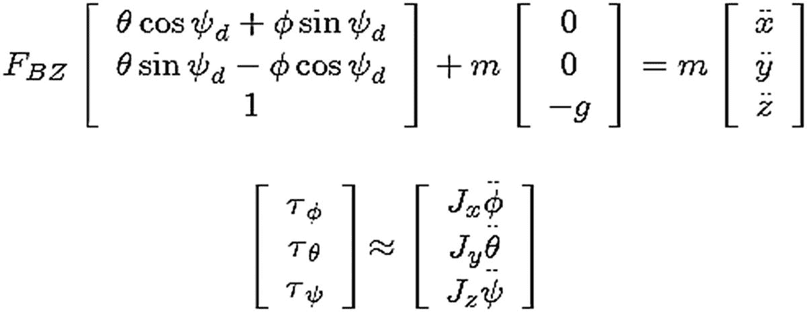
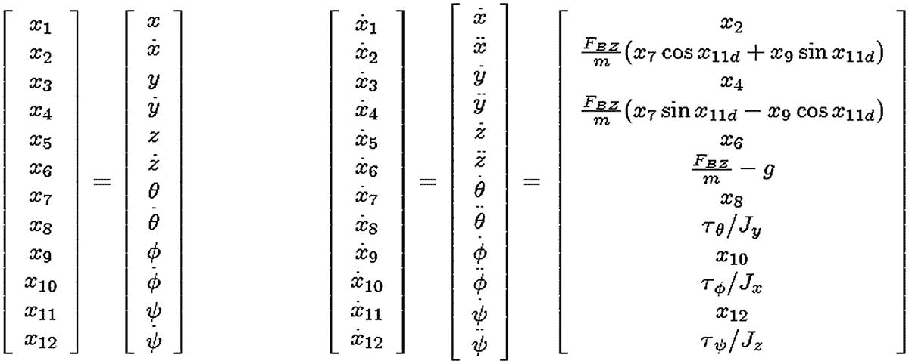
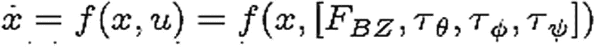

# 状态空间表示法

如果你有一个 `n` 阶微分方程，可以将其转化为 `n` 个一阶微分方程。这在仿真器中便于使用一个统一的积分模块，或者处理向量和矩阵运算，而非标量运算。

例如，回想一下质量-弹簧-阻尼系统是一个二阶系统：

这样一来，它将需要两个状态空间变量。在这种情况下，最方便的选择是选取那些相对于系统阶次而言阶次较低的变量作为状态空间变量。在这个方程中，我们选择位置和速度作为状态空间变量：

对变量求导后，我们得到了所需的表达式：

最后一个方程可以通过系统的原始方程求解：

代入状态空间变量后，结果如下：

这样，正如预期，只保留了这两个一阶方程。

根据其动力学模型，一个四旋翼飞行器可以有十二个状态空间变量（六个二阶方程；请记住，其中三个方程与平动动力学有关，其余三个与转动动力学有关）：

如果我们按以下方式选择状态空间变量（这是一种可能的方案，交替选择位置和速度），我们得到：

同时还要注意，控制输入 `u` 有四个值。它们是推力以及三个力矩：

另一种可能的方案是先选择所有位置，再选择所有速度，或者简单地采用与这里所示不同的另一种顺序。无论选择哪种方案，在后续使用中都必须保持一致。

对我们的仿真有用的第二个工具是模块表示法。下面我们就来讨论它。

