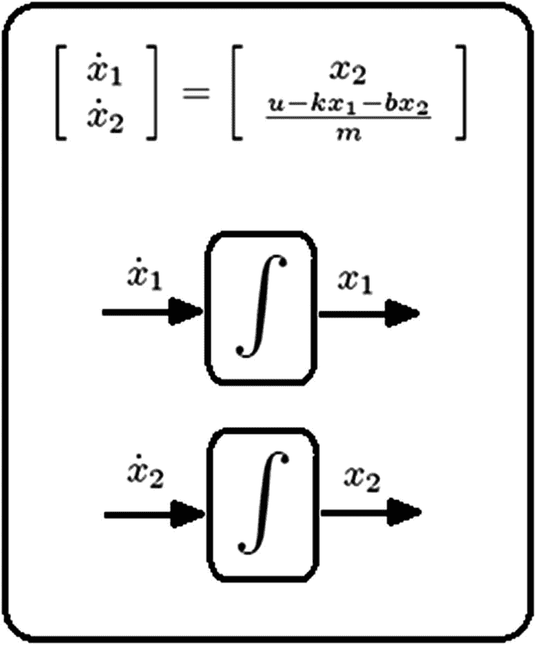
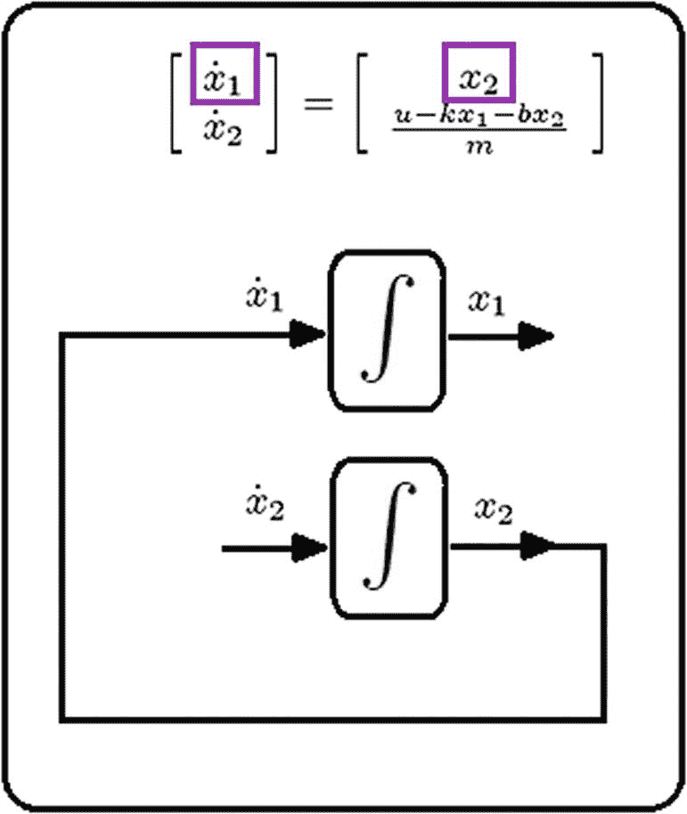
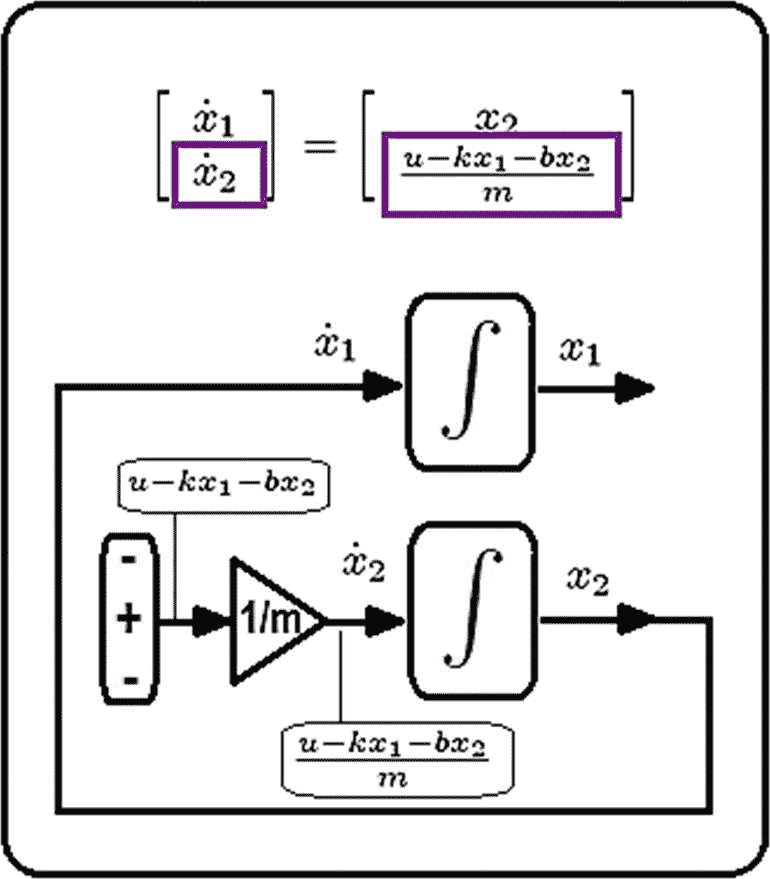
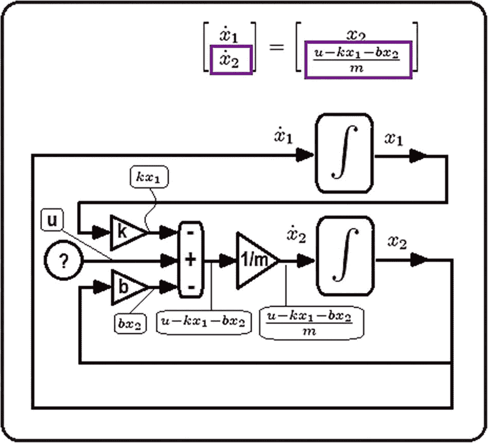
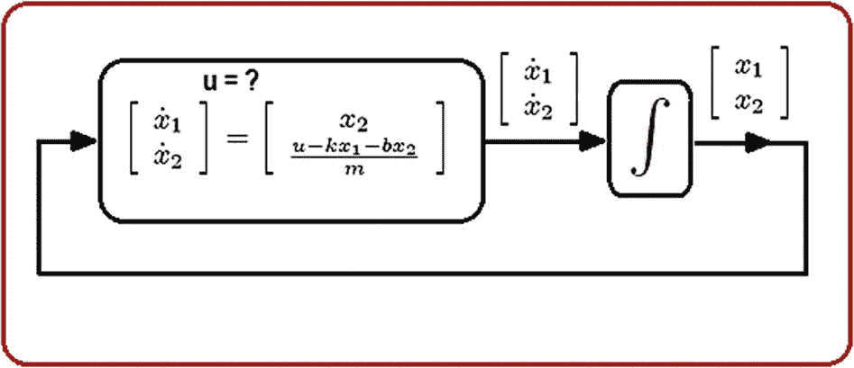
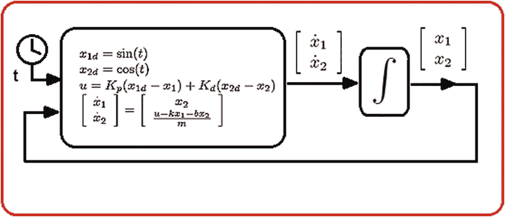

# 框图表示

在此情况下，框图是状态空间变量的图形化表示。它们非常适用于绘制图表，或在使用 Simulink 或 Labview 等旨在运用框图的视觉化语言进行仿真时发挥作用。

回到质量-弹簧-阻尼器示例，具体来说是其在状态空间变量中的表示，我们可以执行以下操作来获得其框图表示。

首先，注意有两个状态空间方程，因此需要两个主框。这些框代表积分器；见图 4-1。在此示例中，我们为状态添加了标签，这是一种有利于编程和理解的优良实践，但这种标签化处理并不常见。

图 4-1

常微分方程的框图表示，第一步

标准规定，放在框右侧的是输出，左侧的是输入。我们将从定义`x1`的导数开始。

我们进行如图 4-2 所示的连接，该连接定义了`x1`的导数。

图 4-2

常微分方程的框图表示，第一个方程连接

同样，你可以注意到`x2`的导数是求和的形式。因此，我们需要另一个框。你还应注意到，在该框的输出端必须有一个增益；见图 4-3。

图 4-3

常微分方程的框图表示，第二个方程连接

最后，按照之前的逻辑，我们得到图 4-4。

图 4-4

常微分方程的框图表示，完整连接（无控制）

尽管该系统只有几个方程和项，但其框图表示却需要许多图标和连接器（同时请注意，`u`的值尚未定义，这可能会增加框的数量）。

一种简化方法是使用矩阵和向量，将方程归并到一个框内，如图 4-5 所示。

图 4-5

将系统置于“文本文件”中的简化框图表示（无控制）

这样，诸如`u`这样的聚合项可以简化为几行代码，而不是大量的框。此外，例如变量`u`可以是一个依赖于轨迹的 PD 控制器，而轨迹本身又依赖于时间。见图 4-6。请注意，你需要一个时钟模块。

图 4-6

将系统置于“文本文件”中的简化框图表示（有控制）

注意，如果系统有很多方程，且每个方程都有多个项，例如四旋翼飞行器的情况，这种简化的框图模型就非常方便。这正是我们在下一节将要使用 Simulink-MATLAB 组合来做的。

