# 使用 Simulink 和解释型 MATLAB 函数进行仿真

如果你想使用免费软件，如 Scilab 或 Python，建议阅读本节。基于你在这里学到的知识以及本章的参考文献（你可以在附录中找到），你可以搜索上述程序和编程语言中的等效命令或模块。

请记住，通过这种组合（MATLAB/Simulink）所拥有的多个库，你可以与动画或交互式仿真软件进行交互，例如 Gazebo、X-plane、Ardupilot 库、Pixhawk 自动驾驶仪或带有物理引擎的 CAD 软件。

让我们继续。这是 Simulink 执行仿真的众多模式中一种特殊模式。它提供了框的最简化形式之一的实用性，其中专门使用文本文件来编写系统及其控制器的方程。这样，一组包含多个项的方程被归入文本文件，而一个通用模板则置于框文件中。框文件包含预编程的方程求解器，如欧拉法或 RK4 法，并设计用于简便的互联和处理。此方法适用于 MATLAB 2012b 及以上版本。这种表示和仿真类型最大的优点在于，可以对输入和输出信号进行多种修改和使用（滤波、图形编辑、引入延迟等）。这在那些不使用框的仿真器中是无法实现的。


### 所需模块

这里描述的 Simulink 模块至少具有以下三个属性之一：输入信号、输出信号以及设置自身参数的方式。见图 4-7。

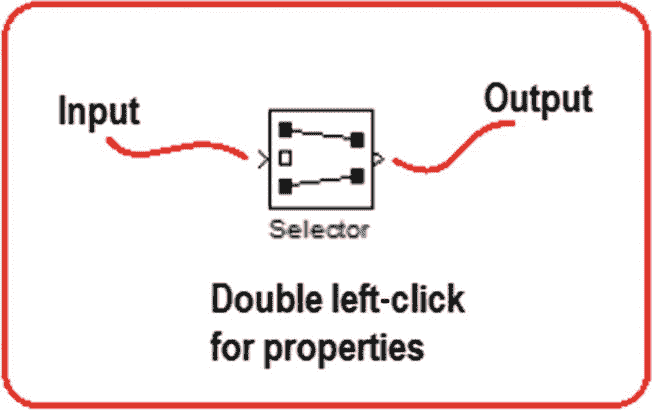

图 4-7  
Simulink 模块的属性

以下七个模块是我们最常用的。

#### Interpreted MATLAB Function

此模块用于将包含系统动力学模型及其控制器的文本文件与模块文件链接起来。见图 4-8。

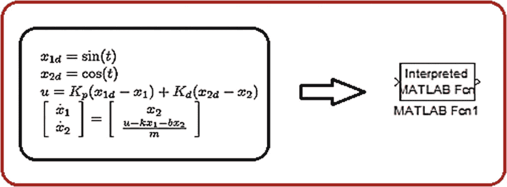

图 4-8  
`Interpreted MATLAB Function` 模块

此模块的输入是一个包含 *n* 个信号（状态、时间、辅助值等）的总线或数据通道。其输出也是一个包含 *m* 个信号（状态、辅助值、待绘制信号等）的总线或数据通道。

我们关心的该模块重要属性如下（请勿修改其他属性）：

1.  包含系统动力学模型及其控制器的文件名。此名称必须与包含所述模型的文本文件名称一致，且不包含文件扩展名。
2.  输出总线的大小（以变量数量衡量）。

修改完这些参数后，只需点击`OK`并关闭模块的对话框即可。见图 4-9。

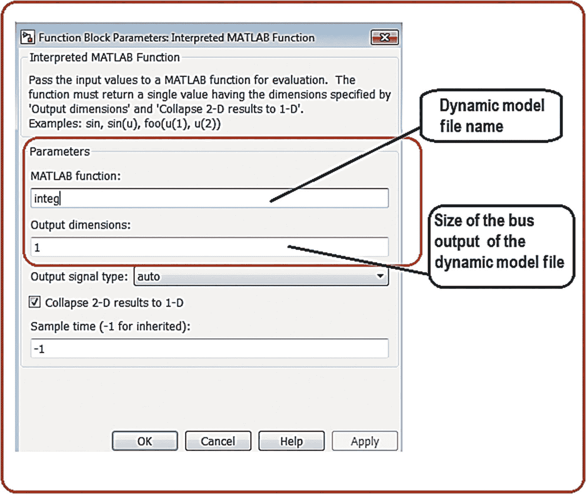

图 4-9  
`Interpreted MATLAB Function` 模块参数

请注意，我们使用前面的模块是为了实用，但您也应该研究一下 `MATLAB Function` 和 `S-function` 模块。

#### Integrator

用于对信号总线进行积分。见图 4-10。

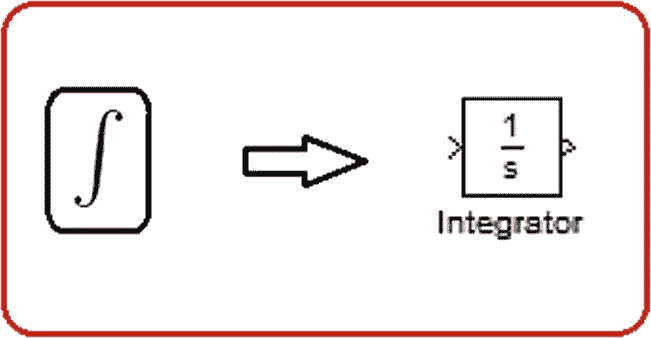

图 4-10  
`Integrator` 模块

此模块用于对信号进行积分。在 Simulink 中有不同类型的积分器，但就我们的目的而言，这是我们要用的一个。

此模块的输入是一个包含 *n* 个信号（例如，系统状态的导数）的总线或数据通道。  
其输出也是一个包含 *n* 个信号（例如，系统状态）的总线或数据通道。

我们唯一需要修改的参数是初始条件，即我们系统仿真的起始点。如果只有一个方程，只需输入一个标量。如果有多个方程，则必须按如下方式输入初始值：`[val1 val2 val3 valN]`。

修改完此参数后，我们只需点击`OK`并关闭属性对话框。见图 4-11。

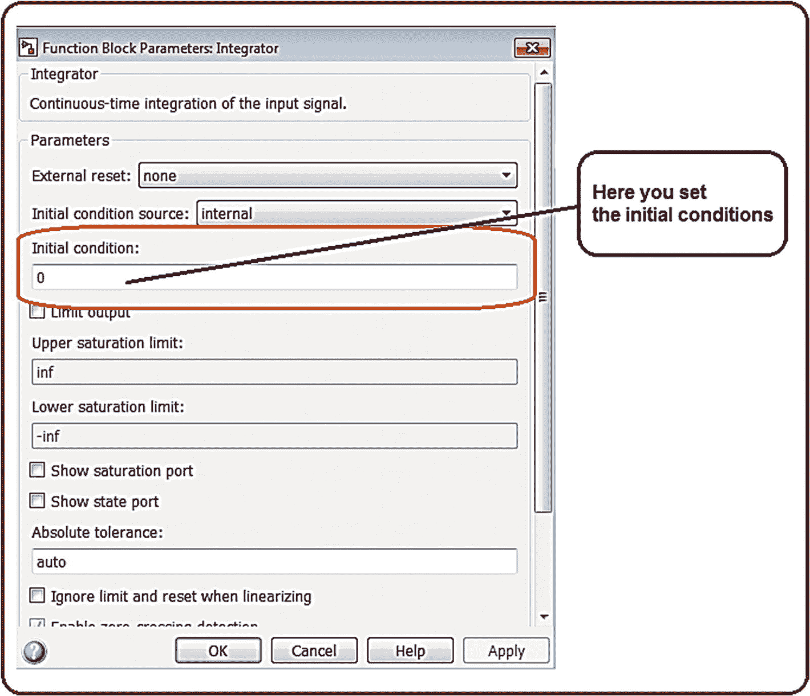

图 4-11  
`Integrator` 模块参数

#### Scope

此模块允许我们在仿真期间或仿真结束时，直接在模块框图中查看仿真的图形。见图 4-12。

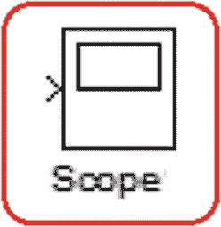

图 4-12  
`Scope` 模块

此模块没有输出。其输入是包含待绘制 *n* 个信号的总线。其相关参数如下：

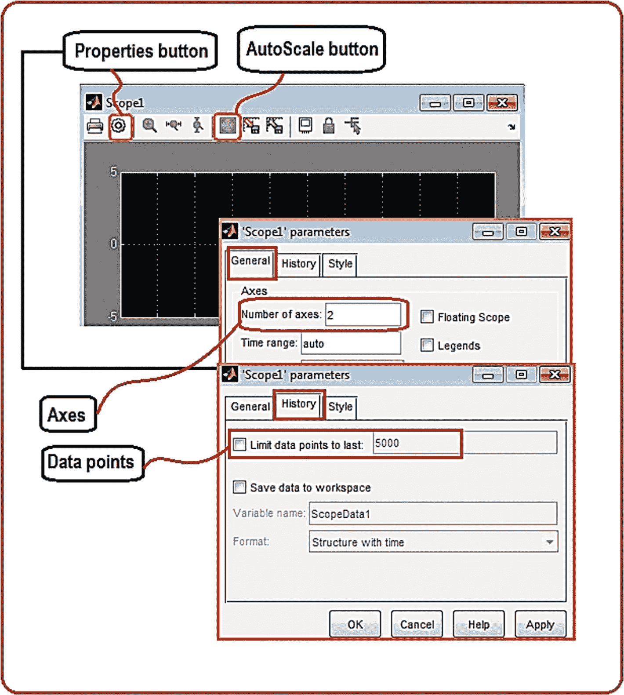

图 4-13  
`Scope` 模块参数

1.  **自动缩放按钮**：用于在仿真结束或期间调整图形。
2.  **属性按钮**：按下此按钮将出现一个辅助菜单。我们只关心两个选项：
    -   **输入轴数**：决定示波器中有多少个独立的图形。示波器的每个输入都是一个包含 *n* 个变量的独立总线。此选项通过**通用**菜单访问。
    -   **限制数据复选框**：该复选框通常处于激活状态，仅显示最近 5,000 个数据点。如果您想查看长时间的仿真，则必须取消勾选此复选框。此选项通过**历史记录**菜单访问。见图 4-13。

与之前的情况一样，您必须点击`OK`并关闭辅助菜单以保存修改。

如果您想修改图形的外观和颜色，也可以尝试 `Scope` 参数中的**样式**菜单。

#### To Workspace 模块

此模块允许在 Simulink 界面之外使用特定数据，以进行进一步处理或编辑（例如，导出图形以编辑其图表，用于出版物）。见图 4-14。

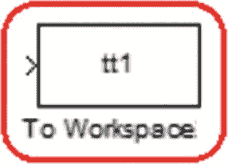

图 4-14  
`To Workspace` 模块

此模块只有一个输入，即一个数据总线。

对我们来说，其相关的参数只有两个：

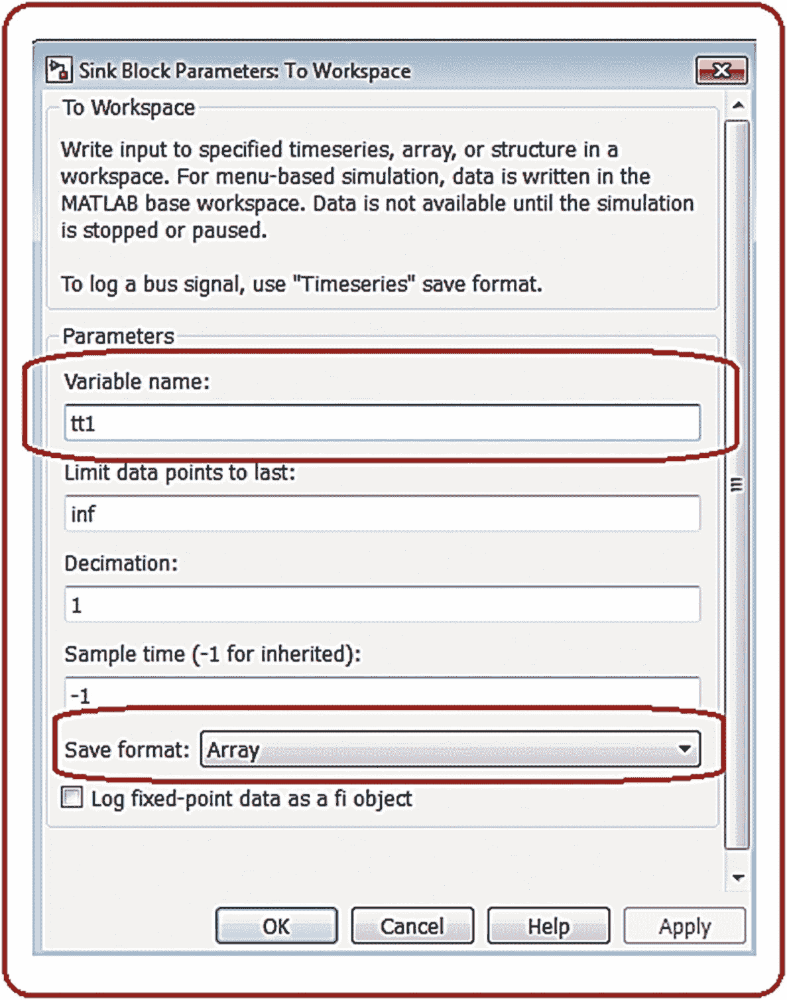

图 4-15  
`To Workspace` 模块参数

1.  将从 MATLAB 控制台用于编辑信息的变量名。
2.  输出数据的类型。在我们这里，为了简化数据访问，必须始终为 `array`。见图 4-15。

#### Selector

此模块用于从总线中选择一个或多个信号。见图 4-16。

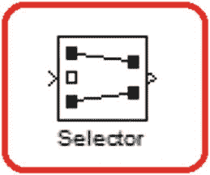

图 4-16  
`Selector` 模块

模块的输入是一个包含 *n* 个变量的数据总线。其输出是另一个包含 *p* 个变量的总线，其中 *p* 的范围是从一个信号到全部 *n* 个信号。*p* 的大小完全取决于您想要提取哪些信号。

其相关参数为：

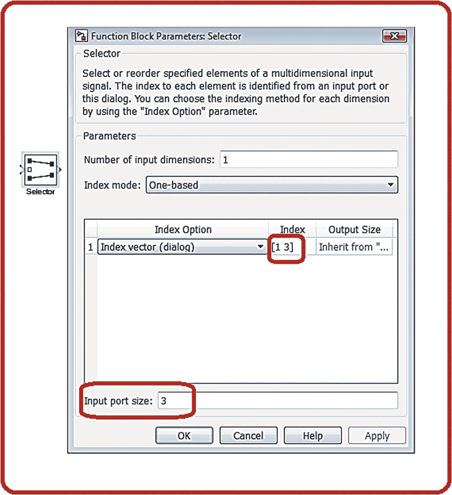

图 4-17  
`Selector` 模块参数

1.  输出信号索引，如果只选择一个信号，则使用标量格式；如果需要多个信号，则使用向量格式 `[val1 val2 val3 valN]`。
2.  输入总线的大小。见图 4-17。

我们来分析给定的示例。请注意，它在图形上很直观。图中的模块接收一个包含三个变量的数据总线，其输出是另一个包含两个变量的总线，具体来说是输入总线的第一个和第三个值。

#### Mux

它是一个多路复用器，其功能是从两个或多个数据总线的输入生成单个总线。相反的模块称为 `Demux`。此模块对于在示波器的单个通道中绘图非常有用。我们只需从不同模块中选择所有感兴趣的变量，然后使用 `Mux` 将它们发送到示波器。见图 4-18。

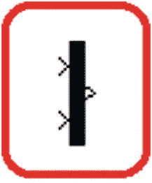

图 4-18  
`Mux` 模块

其输入是几个各包含 *n* 个变量的总线，其输出是一个包含来自所有输入总线的所有收集变量的单个总线。

对于我们的应用，其唯一相关的参数是输入总线的数量，如图 4-19 所示。

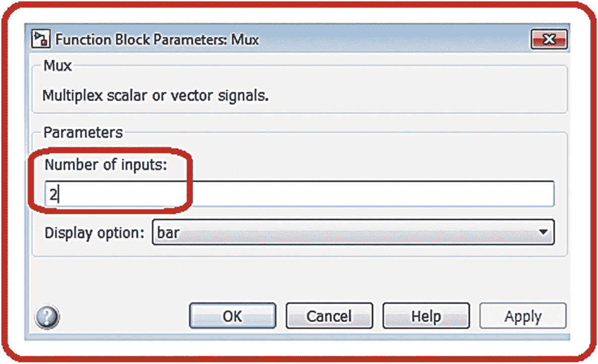

图 4-19


#### 多路复用器模块参数

**时钟**：这对于定义轨迹（时变函数）非常有用。此模块没有输入，其唯一输出是仿真时间（此时间并非实时时间）。参见图 4-20。


图 4-20  
时钟模块

就本书而言，此模块没有必须修改的参数。

**其他可能有用的模块**：更多信息，请参考增益模块、导数模块、求和模块、常量模块、数学函数模块、转向标签模块以及饱和模块等众多其他模块。

现在您已了解如何使用模块、状态空间变量以及我们将与 MATLAB 一起使用的基本模块，我们可以开始进行仿真了。

## 四轴飞行器示例，文本文件

请注意，如果我们只想模拟无人机并且只有一种基本编程语言（如 C++ 或 Python），当然是通过集成一个 ODE 求解器，那么这个文件就足够了。

请记住，通过添加更多的动力学效应，模型的精度可以达到您期望的任何程度。在此案例中，我们将使用之前没有空气动力学效应的模型，但它们足以用于测试控制设计中的一些细节，例如平面 PD 不能超过 2Pi 的值（请记住，这些 PD 代表期望角度，且它们不能达到大于 2Pi 的值）。改进模型的一种方法是添加更多效应，或通过随机函数在状态中引入噪声，甚至是通过在信号中创建延迟来模拟传感器的行为。名为 `quadmodel.m` 的文本文件如代码清单 4-1 所示。

```
function outp=quadmodel(inpt)
% system inputs: states and time
% x1-x, x2-xdot, x3-y, x4-ydot, x5-z, x6-zdot
% x7-theta, x8-thetadot, x9-phi, x10-phidot, x11-psi, x12-psidot
x1=inpt(1);
x2=inpt(2);
x3=inpt(3);
x4=inpt(4);
x5=inpt(5);
x6=inpt(6);
x7=inpt(7);
x8=inpt(8);
x9=inpt(9);
x10=inpt(10);
x11=inpt(11);
x12=inpt(12);
t=inpt(13);
% constant parameters: mass, inertial values, gravity
m=1;
g=9.8;
Jx=0.2;
Jy=0.2;
Jz=0.2;
% control gains: notice the small values at x and y gains because they
% define an angle
kpx=0.1;
kdx=0.09;
kpy=0.1;
kdy=0.09;
kpz=1;
kdz=0.7;
kptet=3;
kdtet=1;
kpfi=3;
kdfi=1;
kppsi=3;
kdpsi=1;
% planar desired values
x1d=5;
x2d=0;
x3d=-6;
x4d=0;
% planar PD: remember that these PD define desired angular values
PDx=(kpx*(x1d-x1))+(kdx*(x2d-x2));
PDy=(kpy*(x3d-x3))+(kdy*(x4d-x4));
% altitude and attitude desired values
x5d=8+sin(t);
x6d=cos(t);
x7d=PDx;
x8d=0;
x9d=-PDy;
x10d=0;
x11d=0;
x12d=0;
% altitude and attitude PDs
PDz=(kpz*(x5d-x5))+(kdz*(x6d-x6));
PDteta=(kptet*(x7d-x7))+(kdtet*(x8d-x8));
PDfi=(kpfi*(x9d-x9))+(kdfi*(x10d-x10));
PDpsi=(kppsi*(x11d-x11))+(kdpsi*(x12d-x12));
% vehicle's forces and torques
Fbz=PDz+(m*g);
taoteta=PDteta;
taofi=PDfi;
taopsi=PDpsi;
% vehicle's dynamic model xp notation implies xdot or xpoint or x
% derivative
x1p=x2;
x2p=(Fbz/m)*((x7*cos(x11d))+(x9*sin(x11d)));
x3p=x4;
x4p=(Fbz/m)*((x7*sin(x11d))-(x9*cos(x11d)));
x5p=x6;
x6p=(Fbz/m)-g;
x7p=x8;
x8p=taoteta/Jy;
x9p=x10;
x10p=taofi/Jx;
x11p=x12;
x12p=taopsi/Jz;
% output: derivatives of the system states and vehicle's force and
% torques
outp=[x1p;x2p;x3p;x4p;x5p;x6p;x7p;x8p;x9p;x10p;x11p;x12p;Fbz;taoteta;taofi;taopsi];
end
```

代码清单 4-1  
四轴飞行器模型代码，一个期望偏航角为零的控制器

**注意**：包含系统动力学模型的文本文件（扩展名为 `.m` 的文件）的名称必须与我们在函数行中编写的函数名称完全相同，如图 4-21 所示。

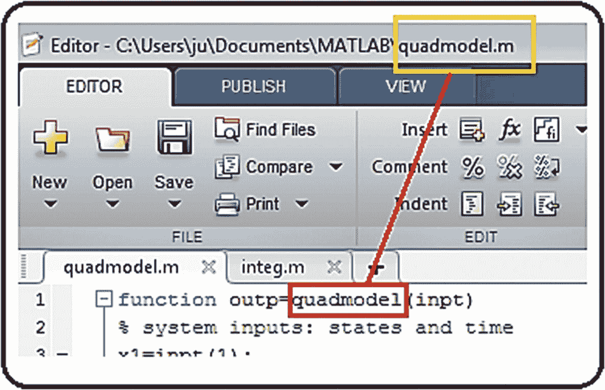

图 4-21  
用于解释型 MATLAB 函数模块 `quadmodel.m` 的文本文件

请记住，作为 MATLAB 和 Simulink 的替代方案，您可以使用 Scilab，它带有一个名为 Scicos 或 Xcos 的模块仿真器（具体取决于版本）。Scilab 是一个免费软件工具，您需要找到此处显示的七个模块的等效模块（例如，Scicos 用户自定义函数）。

## 四轴飞行器示例，模块文件

在下面名为 `blockquad.slx` 的模块文件中（见图 4-22；在 2013a 之前的 Simulink 版本中，扩展名为 `.mdl`），我们使用了之前提到的所有七个基本模块。请注意，模型的复杂性保留在文本文件中。因此，模块的数量得以减少。此模块文件可用作任何其他模型的模板。只需更改总线的尺寸和包含系统的文本文件即可。

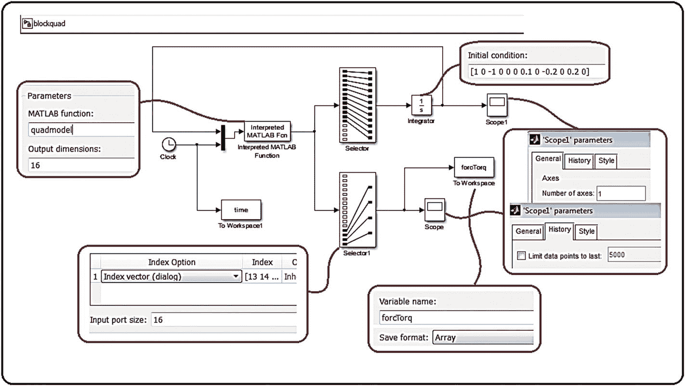

图 4-22  
用于使用解释型 MATLAB 函数模块的模块文件 `blockquad.slx`

图 4-22 中显示了需要修改的参数的特写视图。


#### 模拟器的使用

如上所述，要解微分方程，需要有一个求解器或求解方法，以及包含该模型或与该模型相关的微分方程的文件。

使用所提出的 Simulink 方法时，这两个文件必须放在同一个文件夹中，如图 4-23 所示。

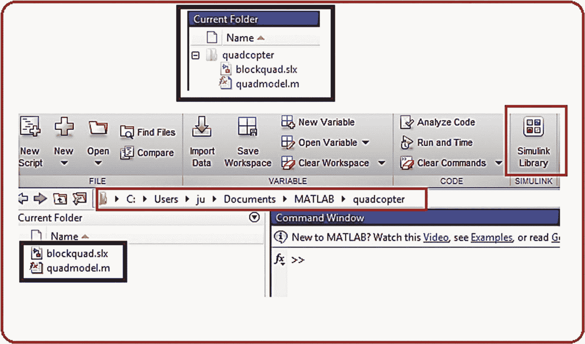

图 4-23：文件执行时的位置

如果 `blockquad.slx` 文件不存在，请点击 Simulink 库图标并创建此文件，如图 4-23 所示。

如果 `quadmodel.m` 文件不存在，则必须使用 `NewScript` 按钮生成该文件，如图 4-24 所示。切勿尝试从扩展名为 `.m` 的文件启动仿真。必须从模块图文件启动。

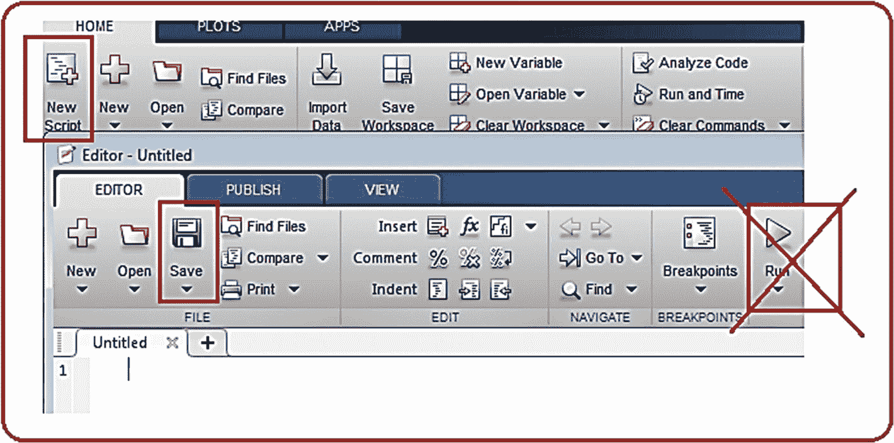

图 4-24：文本文件附加说明

进入模块文件，并在文本文件中填入所提供的代码后，你会在 Simulink 窗口中看到一些下拉菜单。如果进入“仿真”菜单，然后选择“模型配置参数”选项，你可以从多种求解器中进行选择。见图 4-25。

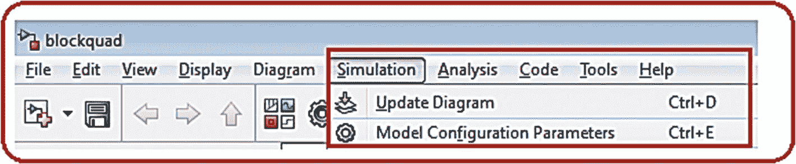

图 4-25：Simulink 模型配置参数

我们想要修改的特性如下：

- **步长类型**：在此处选择步长是固定步长还是可变步长。这意味着仿真的执行时间要么以固定的时间单位不变地执行，要么随着仿真的演进进行调整。
- **步长持续时间**：如果选择固定步长，步长的持续时间将决定仿真的精度以及随之而来的仿真速度。步长越小，仿真越详细（这将体现在图形和结果质量上），但运行时间也更长。
- **方法**：在此处选择要使用的求解器类型。最常见的是欧拉法和 RK4 法。

方法的选择与步长持续时间的组合会影响结果和执行时间。建议使用相对较小步长的简单方法。例如，具有 0.001 秒固定步长的欧拉法对于四轴飞行器来说是一个可接受的选择；见图 4-26。通常，我们将在其余的仿真中使用此组合。

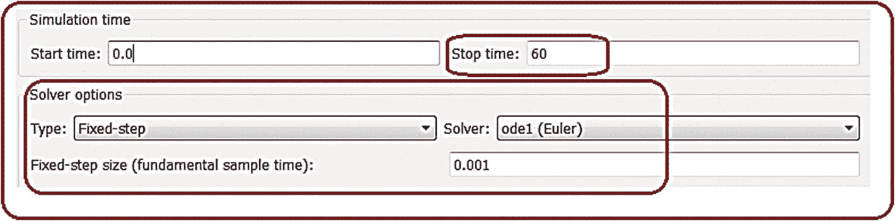

图 4-26：Simulink 求解器、时间及步长选择

选择好求解器并设置了上述特性后，你必须定义要仿真的总时间。点击“确定”，关闭辅助窗口，并保存更改。参见图 4-27 的左侧。


图 4-27：Simulink 仿真的最终说明

按下播放按钮并等待结果；见图 4-27。请注意，仿真时间和实际时间并不相同。仿真时间取决于机器处理器，并且我们希望仿真能尽可能快地执行。如果不是这样，10,000 秒的仿真时间意味着要等待将近 3 个小时。

在模块文件中点击任意示波器，仿真图形就会显示出来；见图 4-28。在此示例中，系统状态通过给定的控制器和在 `quadmodel.m` 文件中设置的参考值收敛到期望值。点击示波器菜单中的自动缩放按钮会很方便。

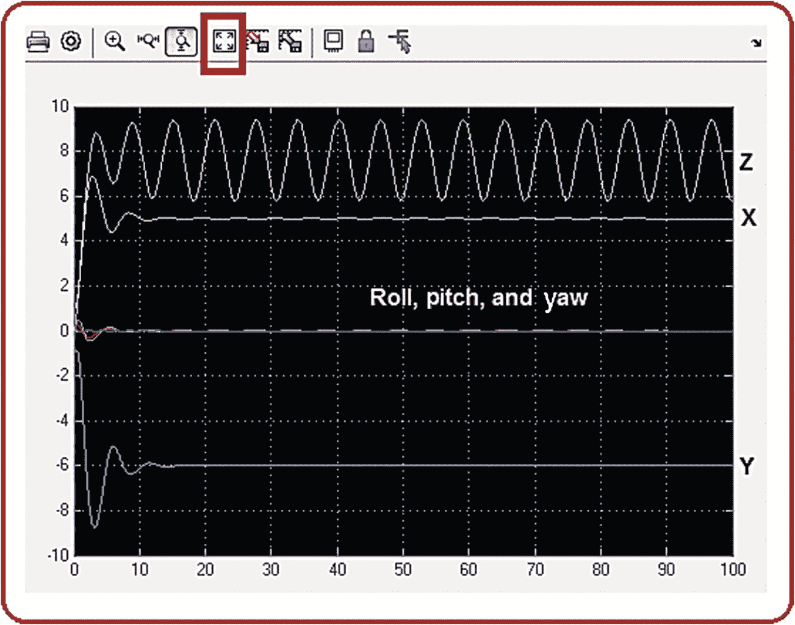

图 4-28：仿真结果与自动缩放按钮

如果我们希望使用示波器之外的图形，可以使用 `To Workspace` 模块和 MATLAB 命令窗口；见图 4-29。

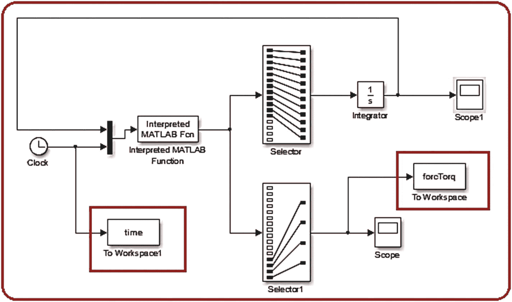

图 4-29：使用 `To Workspace` 模块

在给出的示例中，两个数据总线被发送到了工作区：名为 `time` 的仿真时间，以及名为 `forcTorq` 的力和力矩。

一旦仿真运行完毕，只需进入 MATLAB 命令窗口并输入以下内容来使用上述数据：`plot(time, forcTorq)`。将会显示如图 4-30 所示的图形。

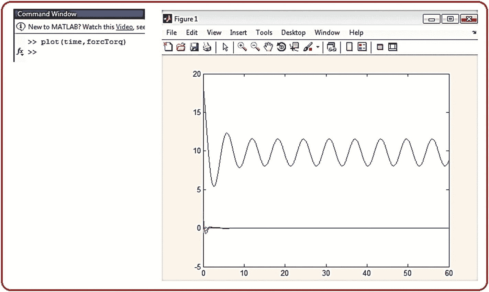

图 4-30：从命令窗口绘图

请注意，此处开发的仿真将忽略电机效应，因为它们专注于控制飞行器的重心。假设由于先前指出的对称性、平衡性和质点分布等因素，分配矩阵仅对向电机的控制传输产生线性影响。如果你想分析电机的影响，只需从仿真中获取推力和力矩信号，并将这些值乘以相应的分配矩阵即可（显然，需要包含缩放因子以使其与实际电机兼容）。具体操作如代码清单 4-2 所示。


```
function outp=allocquadmodel(inpt)
% 系统输入：状态与时间
% x1-x, x2-xdot, x3-y, x4-ydot, x5-z, x6-zdot
% x7-theta, x8-thetadot, x9-phi, x10-phidot, x11-psi, x12-psidot
x1=inpt(1);
x2=inpt(2);
x3=inpt(3);
x4=inpt(4);
x5=inpt(5);
x6=inpt(6);
x7=inpt(7);
x8=inpt(8);
x9=inpt(9);
x10=inpt(10);
x11=inpt(11);
x12=inpt(12);
t=inpt(13);
% 恒定参数：质量、惯性矩、重力
m=1;
g=9.8;
Jx=0.2;
Jy=0.2;
Jz=0.2;
% 控制增益，注意：为了可视化电机效果，我们降低了原有的微分增益
kpx=0.1;
kdx=0.03;
kpy=0.1;
kdy=0.03;
kpz=1;
kdz=0.7;
kptet=3;
kdtet=0.5;
kpfi=3;
kdfi=0.5;
kppsi=3;
kdpsi=1;
% 平面期望值
x1d=5;
x2d=0;
x3d=-6;
x4d=0;
% 平面 PD：记住，这些 PD 定义了期望的角度值
PDx=(kpx*(x1d-x1))+(kdx*(x2d-x2));
PDy=(kpy*(x3d-x3))+(kdy*(x4d-x4));
% 高度与姿态期望值
x5d=8+sin(t);
x6d=cos(t);
x7d=PDx;
x8d=0;
x9d=-PDy;
x10d=0;
x11d=0;
x12d=0;
% 高度与姿态 PD
PDz=(kpz*(x5d-x5))+(kdz*(x6d-x6));
PDteta=(kptet*(x7d-x7))+(kdtet*(x8d-x8));
PDfi=(kpfi*(x9d-x9))+(kdfi*(x10d-x10));
PDpsi=(kppsi*(x11d-x11))+(kdpsi*(x12d-x12));
% 飞行器力与力矩
Fbz=PDz+(m*g);
%Fbz=20;
taoteta=PDteta;
taofi=PDfi;
taopsi=PDpsi;
% 飞行器动力学模型
x1p=x2;
x2p=(Fbz/m)*((x7*cos(x11d))+(x9*sin(x11d)));
x3p=x4;
x4p=(Fbz/m)*((x7*sin(x11d))-(x9*cos(x11d)));
x5p=x6;
x6p=(Fbz/m)-g;
x7p=x8;
x8p=taoteta/Jy;
x9p=x10;
x10p=taofi/Jx;
x11p=x12;
x12p=taopsi/Jz;
% 此处通过分配矩阵引入电机效应
W=[1,-1,1,1;1,1,-1,1;1,1,1,-1;1,-1,-1,-1]*[Fbz;taoteta;taofi;taopsi];
w1=W(1);
w2=W(2);
w3=W(3);
w4=W(4);
% 输出：系统状态导数和飞行器力与力矩
%outp=[x1p;x2p;x3p;x4p;x5p;x6p;x7p;x8p;x9p;x10p;x11p;x12p;Fbz;taoteta
%taofi;taopsi];
% 这里我们将上述行的结尾修改为用电机转速替代力与力矩，Simulink® 文件无需修改
outp=[x1p;x2p;x3p;x4p;x5p;x6p;x7p;x8p;x9p;x10p;x11p;x12p;w1;w2;w3;w4];
end
列表 4-2
Allocquadmodel 代码，控制器设置期望偏航角为零，并修改为显示每个电机值
```

如果分析新的图表，现在角变量大约在 30 秒时达到稳定效果，而 X 和 Y 方向存在明显振荡；见图 4-31。这会影响每个电机的行为，至少持续约 30 秒，之后它们会趋于一致工作；见图 4-32（无人机将保持固定且姿态不变，仅改变高度；这样电机将表现出相同的行为）。

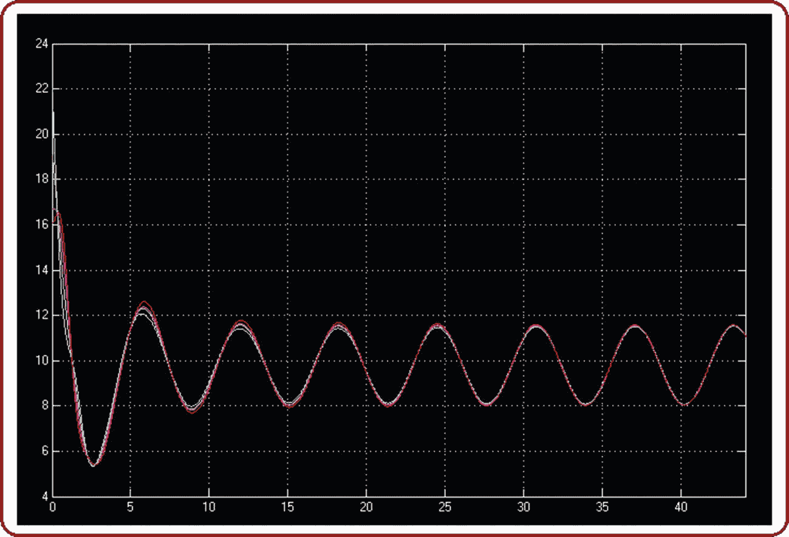

图 4-32

各电机的动作

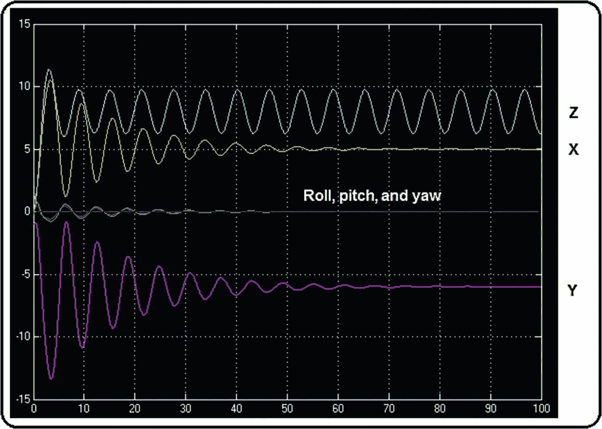

图 4-31

为观察电机动作而修改的仿真（注意刻意设计的振荡）

现在，`quadmodel.m`文件按照列表 4-3 的指示进行修改，以实现可变偏航控制，见图 4-33。`blockquad`文件保持不变。

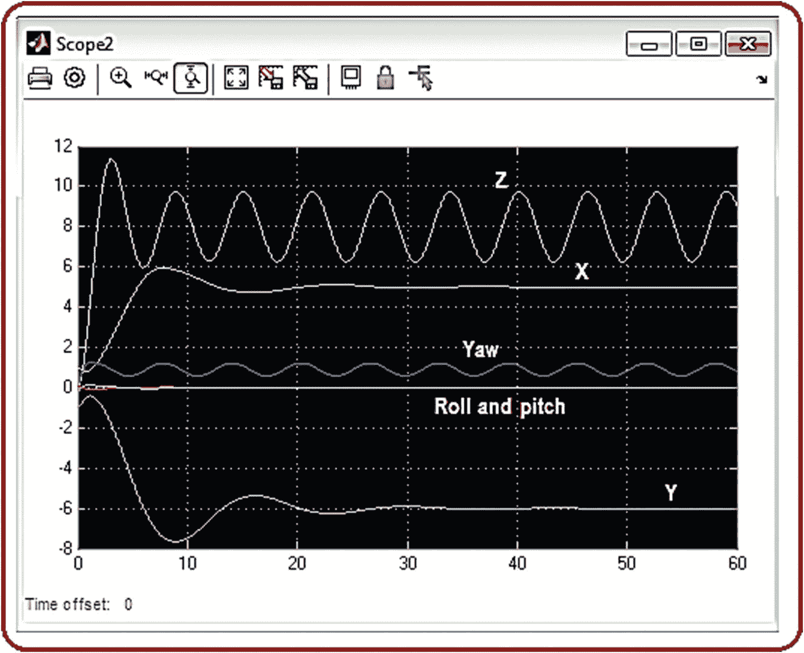

图 4-33

可变偏航控制仿真

```
function outp=quadmodel2(inpt)
% 系统输入：状态与时间
% x1-x, x2-xdot, x3-y, x4-ydot, x5-z, x6-zdot
% x7-theta, x8-thetadot, x9-phi, x10-phidot, x11-psi, x12-psidot
x1=inpt(1);
x2=inpt(2);
x3=inpt(3);
x4=inpt(4);
x5=inpt(5);
x6=inpt(6);
x7=inpt(7);
x8=inpt(8);
x9=inpt(9);
x10=inpt(10);
x11=inpt(11);
x12=inpt(12);
t=inpt(13);
% 恒定参数：质量、惯性矩、重力
m=1;
g=9.8;
Jx=0.2;
Jy=0.2;
Jz=0.2;
% 控制增益
kpx=0.2;
% 有时由于噪声或控制相互作用，微分增益可能大于比例增益
% 尝试相反设置并观察结果行为
kdx=0.35;
kpy=0.2;
kdy=0.35;
kpz=1;
kdz=0.7;
kptet=5;
kdtet=2;
kpfi=5;
kdfi=2;
kppsi=3;
kdpsi=1;
% 平面期望值
x1d=5;
x2d=0;
x3d=-6;
x4d=0;
% 平面 PD：记住，这些 PD 定义了期望的角度值
PDx=(kpx*(x1d-x1))+(kdx*(x2d-x2));
PDy=(kpy*(x3d-x3))+(kdy*(x4d-x4));
% 高度期望值
x5d=8+sin(t);
x6d=cos(t);
% 偏航期望值
x11d=0.3*sin(t)+0.9;
x12d= 0.3*cos(t);
% 横滚和俯仰期望值，尝试将 x11d 改为 x11
x7d=(1/g)*((PDx*cos(x11d))+(PDy*sin(x11d)));
% 尝试将 x8d 从零改为 x7d 的导数
x8d=0;
x9d=(1/g)*((PDx*sin(x11d))-(PDy*cos(x11d)));
% 尝试将 x10d 从零改为 x9d 的导数
x10d=0;
% 高度与姿态 PD
PDz=(kpz*(x5d-x5))+(kdz*(x6d-x6));
PDteta=(kptet*(x7d-x7))+(kdtet*(x8d-x8));
PDfi=(kpfi*(x9d-x9))+(kdfi*(x10d-x10));
PDpsi=(kppsi*(x11d-x11))+(kdpsi*(x12d-x12));
% 飞行器力与力矩
Fbz=PDz+(m*g);
taoteta=PDteta;
taofi=PDfi;
taopsi=PDpsi;
% 飞行器动力学模型
x1p=x2;
x2p=(Fbz/m)*((x7*cos(x11d))+(x9*sin(x11d)));
x3p=x4;
x4p=(Fbz/m)*((x7*sin(x11d))-(x9*cos(x11d)));
x5p=x6;
x6p=(Fbz/m)-g;
x7p=x8;
x8p=taoteta/Jy;
x9p=x10;
x10p=taofi/Jx;
x11p=x12;
x12p=taopsi/Jz;
%输出：系统状态导数和飞行器力与力矩
outp=[x1p;x2p;x3p;x4p;x5p;x6p;x7p;x8p;x9p;x10p;x11p;x12p;Fbz;taoteta;taofi;taopsi];
end
列表 4-3
Quadmodel2 代码，控制器设置偏航角可变
```

最后，展示了几何控制的仿真。我们使用一组与前述 Taeyoung Lee 发表文献中类似的轨迹，但为了应用简单的 PD 控制器，采用了较慢的运动曲线。如果你想进一步深入，可以修改以下代码，添加必要项，直至实现上述文章中的高速性能。

列表 4-4 展示了`geoquad.m`文件。


```matlab
function outp=geoquad(inpt)
% 系统输入：状态
% x x 导数 y y 导数 z z 导数
x1=inpt(1);
x2=inpt(2);
x3=inpt(3);
x4=inpt(4);
x5=inpt(5);
x6=inpt(6);
% w 和 R（角速度与姿态）
w1=inpt(7);
w2=inpt(8);
w3=inpt(9);
r11=inpt(10);
r12=inpt(11);
r13=inpt(12);
r21=inpt(13);
r22=inpt(14);
r23=inpt(15);
r31=inpt(16);
r32=inpt(17);
r33=inpt(18);
% 还需要 R 期望的导数
r11dp=inpt(19);
r12dp=inpt(20);
r13dp=inpt(21);
r21dp=inpt(22);
r22dp=inpt(23);
r23dp=inpt(24);
r31dp=inpt(25);
r32dp=inpt(26);
r33dp=inpt(27);
% 时间
t=inpt(28);
% 常量参数：质量、惯性值、重力
m=1;
g=9.8;
Jx=0.2;
Jy=0.2;
Jz=0.2;
% 根据分量构建期望旋转矩阵
Rdp=[r11dp,r12dp,r13dp;r21dp,r22dp,r23dp;r31dp,r32dp,r33dp];
% 同时构建旋转矩阵和反对称的角速度矩阵
R=[r11,r12,r13;r21,r22,r23;r31,r32,r33];
S=[0,-w3,w2;w3,0,-w1;-w2,w1,0];
% 控制增益
kpx=0.3;
% 有时由于噪声或控制交互，
% 微分增益可能大于比例增益
% 尝试相反的情况，观察结果行为
kdx=0.5;
kpy=0.3;
kdy=0.5;
kpz=0.7;
kdz=0.5;
KR=50;
Kw=30;
% 笛卡尔平动期望值
% 这是一个螺旋轨迹
x1d=0.4*t;
x2d=0.4;
x3d=0.4*sin(t/2);
x4d=0.2*cos(t/2);
x5d=0.6*cos(t/2);
x6d=-0.3*sin(t/2);
% 平面 PD 控制
PDx=(kpx*(x1d-x1))+(kdx*(x2d-x2));
PDy=(kpy*(x3d-x3))+(kdy*(x4d-x4));
PDz=(kpz*(x5d-x5))+(kdz*(x6d-x6));
% 主推力
Fbz=dot(([PDx;PDy;PDz]+[0;0;m*g]),(R*[0;0;1]));
% 尝试提高这些运动轮廓的角频率，
% 从而增加速度和加速度以扰乱控制回路。
% 在这种情况下，添加上述的完整控制器或改进版本，
% 因为这里我们只是模拟一个简单的 PD 控制器。
% Rd 定义：注意通过 Bdes 矢量间接调节偏航角（圆形运动）
psid=t/3;
Bdes=[cos(psid);sin(psid);0];
b3d=([PDx;PDy;PDz]+[0;0;m*g])/norm([PDx;PDy;PDz]+[0;0;m*g]);
b2d=cross(b3d,Bdes)/norm(cross(b3d,Bdes));
b1d=cross(b2d,b3d);
Rd=[b1d,b2d,b3d];
% 这里将期望旋转矩阵分解为其分量，
% 以便作为向量输出该模型，我们需要按此顺序发送它们以计算其导数
r11d=Rd(1,1);
r12d=Rd(1,2);
r13d=Rd(1,3);
r21d=Rd(2,1);
r22d=Rd(2,2);
r23d=Rd(2,3);
r31d=Rd(3,1);
r32d=Rd(3,2);
r33d=Rd(3,3);
% 定义旋转和角速度误差
Rmul=transpose(Rd)*Rdp;
eRM=(transpose(Rd)*R)-(transpose(R)*Rd);
w=[w1;w2;w3];
wd=[Rmul(3,2);Rmul(1,3);Rmul(2,1)];
ew=w-(transpose(R)*Rd*wd);
eR=[eRM(3,2);eRM(1,3);eRM(2,1)]/2;
% 简单的旋转 PD 控制
PDrw=-KR*eR-Kw*ew;
% 这里将 PDrw 分解，以便注入三个机体力矩中
Tbx=PDrw(1);
Tby=PDrw(2);
Tbz=PDrw(3);
% 飞行器平动动力学模型
% 速度
xp=[x2;x4;x6];
% 加速度
xpp=(R*[0;0;Fbz])-[0;0;m*g];
% 这样做是为了发送状态变量进行积分
% xdot xdoubledot ydot ydoubledot zdot zdoubledot
x1p=xp(1);
x2p=xpp(1);
x3p=xp(2);
x4p=xpp(2);
x5p=xp(3);
x6p=xpp(3);
% 飞行器转动动力学
w1p=(Tbx-(w2*w3*Jz)+(w2*w3*Jy))/Jx;
w2p=(Tby-(w1*w3*Jx)+(w1*w3*Jz))/Jy;
w3p=(Tbz-(w1*w2*Jy)+(w1*w2*Jx))/Jz;
% 旋转辅助运动学
Rp=R*(S);
% 我们将 R 导数分解为其分量，以便发送到输出进行积分并得到 R 元素。
% 注意：我们需要在 Simulink®求解器中提供 R 的初始值
r11p=Rp(1,1);
r12p=Rp(1,2);
r13p=Rp(1,3);
r21p=Rp(2,1);
r22p=Rp(2,2);
r23p=Rp(2,3);
r31p=Rp(3,1);
r32p=Rp(3,2);
r33p=Rp(3,3);
% 输出：
% 平动系统状态，元素 1-6
% 角速度，元素 7-9
% 旋转矩阵的导数，元素 10-18
% 期望旋转矩阵（用于获取其导数），元素 19-27
% 期望平动值（仅用于绘图），元素 28-30
outp=[x1p;x2p;x3p;x4p;x5p;x6p;w1p;w2p;w3p;r11p;r12p;r13p;r21p;r22p;r23p;r31p;r32p;r33p;r11d;r12d;r13d;r21d;r22d;r23d;r31d;r32d;r33d;x1d;x3d;x5d];
end
```

**列表 4-4** Geoquad 代码，几何控制器

图 4-34 显示了名为`geocopt.slx`的 Simulink 模块文件及其所需修改。为便于数据管理，旋转矩阵以向量形式处理（逐元素分解）。图 4-35 和图 4-36 展示了平动值，而图 4-37 则展示了以旋转矩阵分量形式显示的转动值。

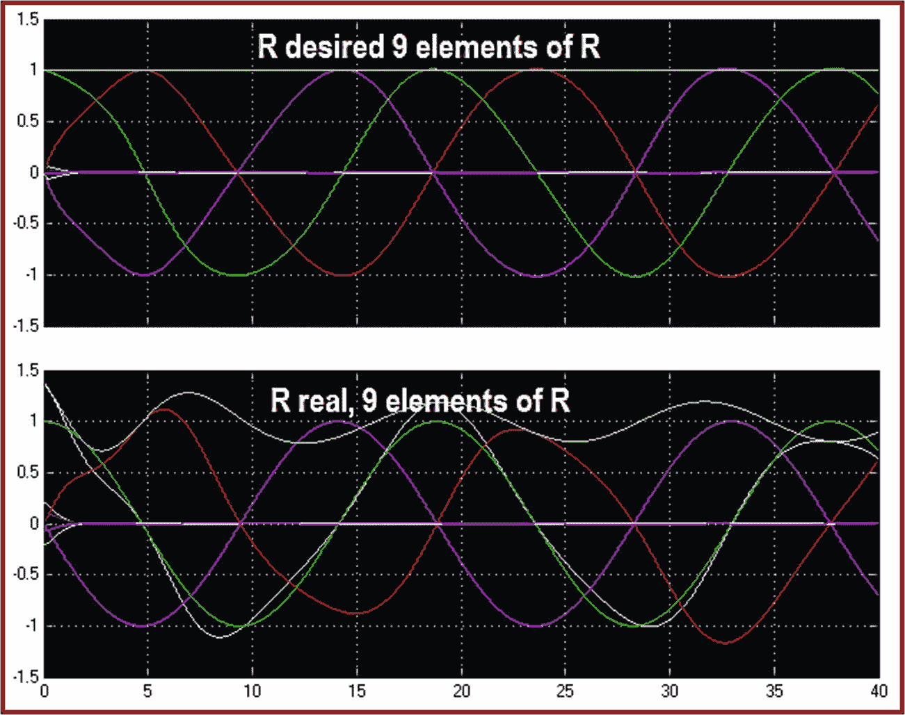

**图 4-37** 真实姿态值与期望姿态值（以旋转矩阵元素表示）

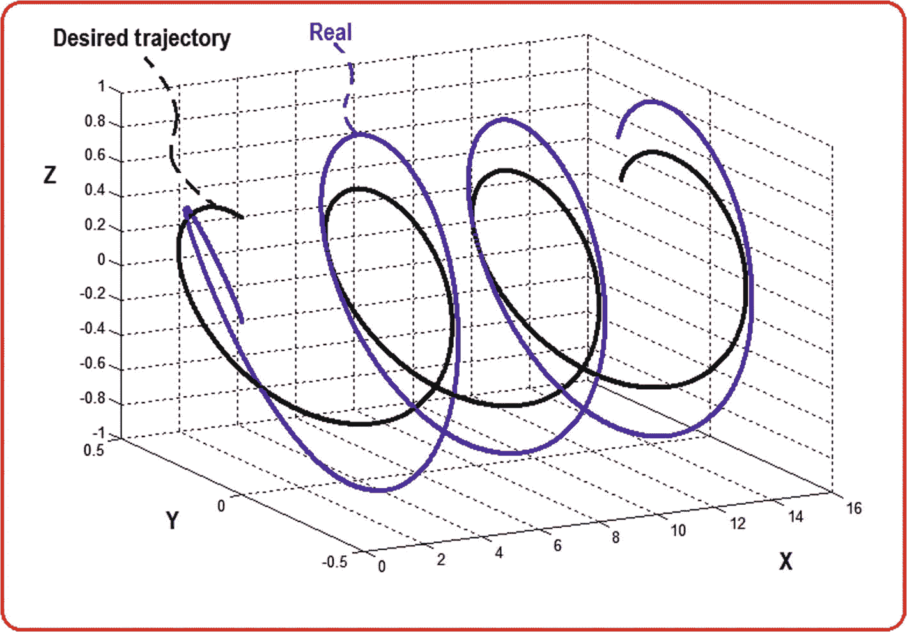

**图 4-36** 真实位置值与期望位置值（3D 轨迹）

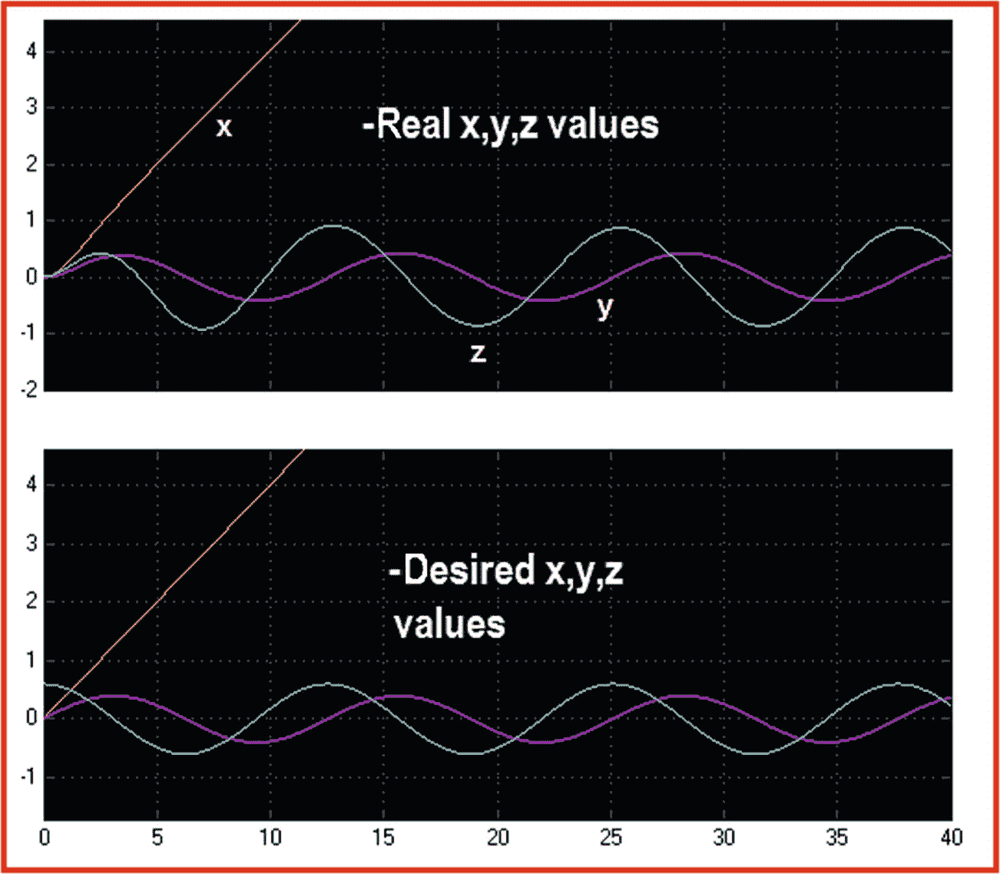

**图 4-35** 真实位置值与期望位置值（单独显示）

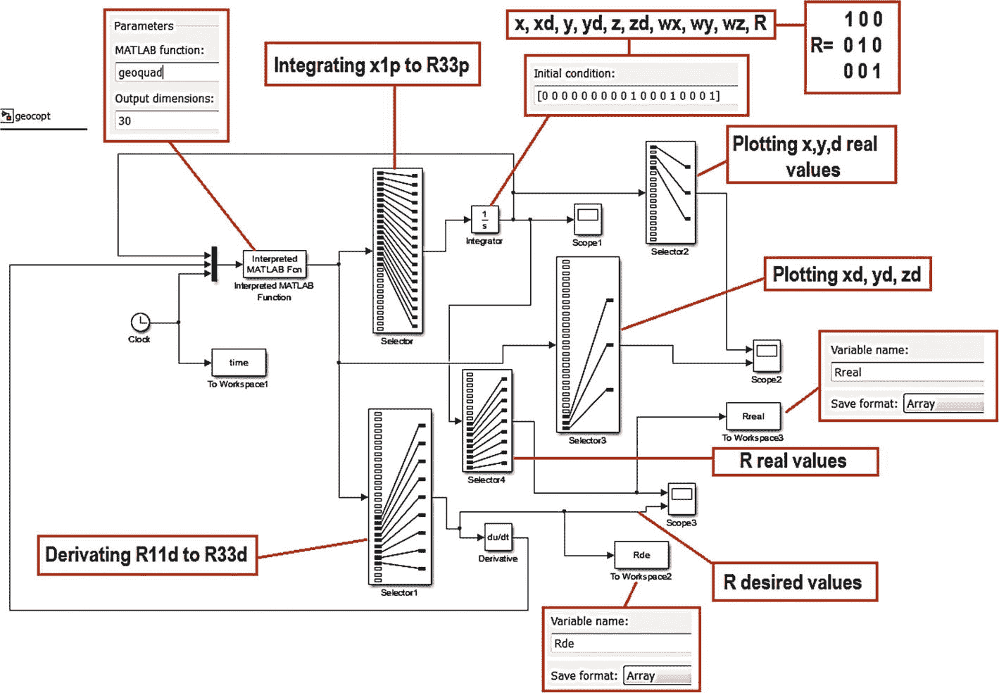

**图 4-34** 几何控制仿真的模块文件

除平动轨迹外，还展示了期望旋转矩阵和实测旋转矩阵。为了更好地可视化这些姿态结果，您可以记住：

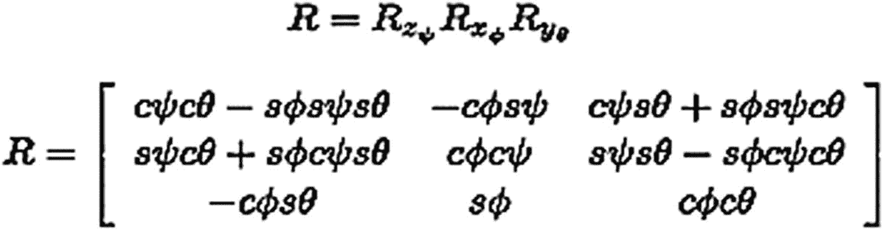

因此，执行以下操作（如果您选择其他旋转矩阵，必须确定其相应的分析）：

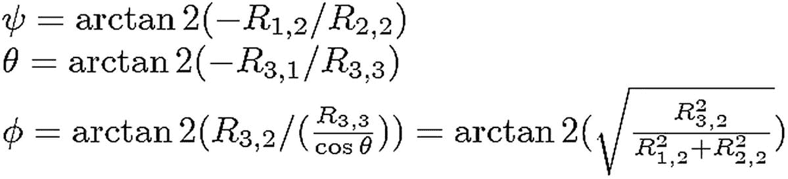

对于大范围旋转（例如偏航角），应使用`atan2`函数以避免冗余或不一致。但对于小角度运动，可以采用更直接的方法，例如：

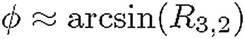

这样，以下利用`To Workspace`模块（必须在仿真结束时使用）所获信息的代码，可作为确定各欧拉角变化情况的参考；见图 4-38（可直接在命令窗口执行，或通过 m 文件执行，如列表 4-5 所示）。

```matlab
subplot(3,1,1)
% phi
plot(time,asin(Rde(:,8)))
hold on
plot(time,asin(Rreal(:,8)),'m')
subplot(3,1,2)
% psi
plot(time,atan2(-Rde(:,2),Rde(:,5)))
hold on
plot(time,atan2(-Rreal(:,2),Rreal(:,5)),'m')
subplot(3,1,3)
% teta
plot(time,atan2(-Rde(:,7),Rde(:,9)))
hold on
plot(time,atan2(-Rreal(:,7),Rreal(:,9)),'m')
```

**列表 4-5** 从旋转矩阵绘制欧拉角，`plotR.m`文件

注意，索引采用以下格式，我们使用该格式与`To Workspace`模块配合：

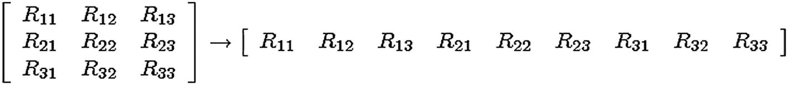

请注意，此示例有效，因为在仿真过程中，角度（除`psi`外）均为小值。见图 4-38。

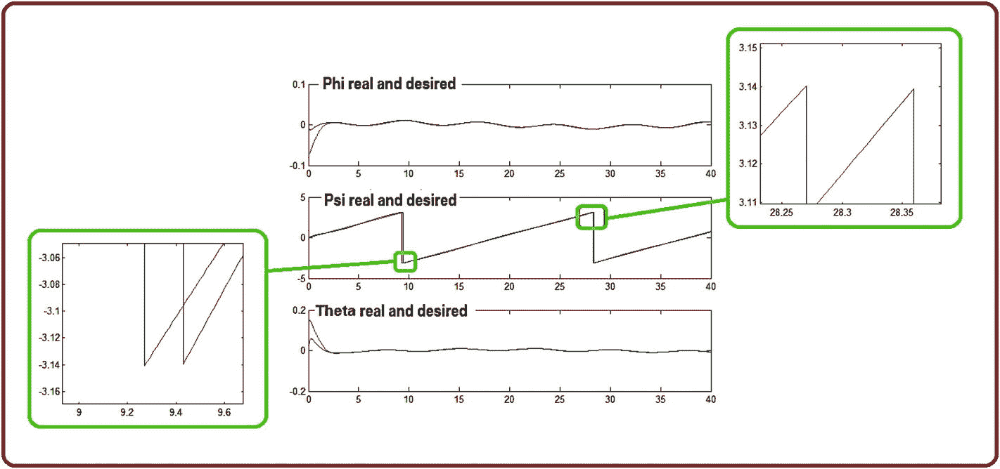

**图 4-38** 真实姿态值与期望姿态值（以欧拉角表示）

注意期望信号与控制信号之间存在微小延迟。这是由于期望信号需要处理，包括生成误差、定义控制量、并将该控制器注入电机。对于速度较慢的计算机，延迟更为显著。在本例中，可以认为该延迟并不重要。


正如预期，除了沿螺旋轨迹飞行外，无人机还围绕其 `Zb` 轴持续旋转。在图 4-38 中，看起来像是从 -180 度或 -π 弧度运动到 180 度或 π 弧度，但实际上等同于 0 到 360 度的旋转；见图 4-39。

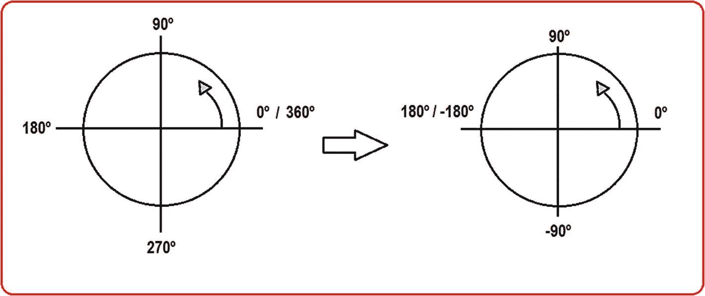

**图 4-39** 两个等效的角度范围

其解释如下。

控制飞行器机体轴旋转的向量定义为

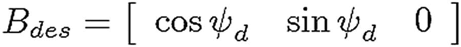

在这种情况下，`Psi` 的期望值取决于时间：

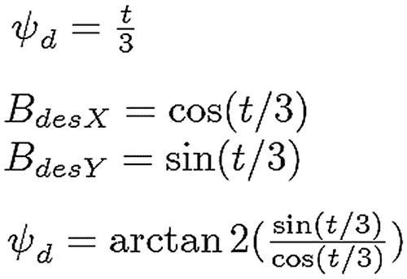

这可以用图形表示，如图 4-40 所示。

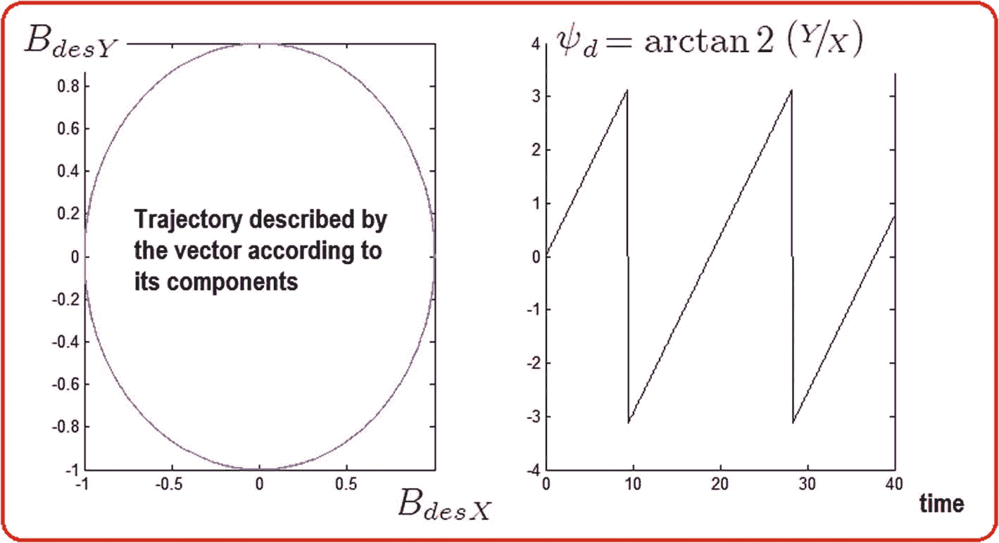

**图 4-40** `Bdes` 向量行为随偏航角期望值变化的关系

图 4-40 是使用列表 4-6 中的代码绘制的。

```
t=[0:0.1:40];
x=cos(t/3);
y=sin(t/3);
% 绕机体轴的运动轨迹
subplot(1,2,1)
plot(x,y,'m')
% 该轴与参考系之间的角度（偏航角）
subplot(1,2,2)
plot(t,atan2(y,x),'k')
列表 4-6
用于绘制 Bdes 及作为时间函数的期望偏航角的代码
```

在结束本章之前，我们来谈谈仿真的其他替代方法，这些方法同样可在 Simulink 和 MATLAB 环境内使用。

## 使用 Simulink 和 MATLAB 环境的仿真替代方法

本节将介绍使用 MATLAB/Simulink 的替代仿真方法。为此，并为了使步骤易于理解和简洁，将对一个质量-弹簧-阻尼器系统的通解进行仿真（在输入力为零且初始条件非零的情况下，该系统应回归到零）。请注意，这相当于一个带有加速度补偿的 PD 控制器（如之前所见）或一个 PID 控制器的闭环行为。基于这些示例，您可以根据需要对其进行修改，以模拟四旋翼飞行器或任何其他系统或飞行器。

本节将具体示例化的系统如下：

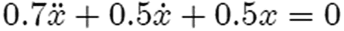

其初始条件为：

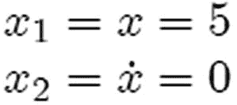

用 MATLAB 和 Simulink 仿真系统的方法有很多，但以下五种是我们认为最实用的。

### 模块与解释型 MATLAB 函数

这是之前所有仿真中已见的情况，但这次使用了上述简化系统，以便您能与其他可用技术进行比较。考虑到其实用性和易用性，我们推荐此方法。总的来说，与后续介绍的其他方法相比，此方法与其他 Simulink 模块和 MATLAB 函数的兼容性最好，且方式直观、不那么繁琐。

图 4-41 展示了名为 `msdmatBlockSim.slx` 的模块文件。请注意，我们包含了两个模块（`Goto` 和 `From` 标签），它们有助于改善布局和美观方面的互连性。没有它们，用户将需要进行直接且杂乱的连接。

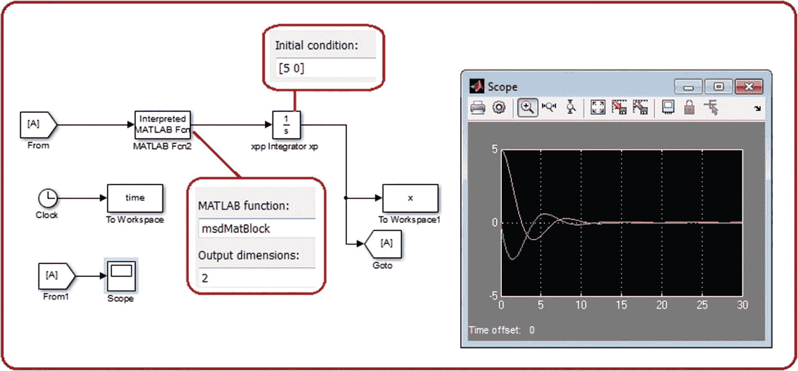

**图 4-41** 使用模块和解释型 MATLAB 函数的质量-弹簧-阻尼器仿真

动力学和控制代码（本例中控制为零）位于名为 `msdMatBlock.m` 的文件中，如列表 4-7 所示。

```
function outp=msdMatBlock(X)
% 如您所知，您可以修改以下动力学方程，加入您想要的动力学和
% 控制，例如一个四旋翼飞行器
x1=X(1);
x2=X(2);
B=0.5;
K=0.5;
M=0.7;
x1d=x2;
x2d=(1/M)*((-B*x2)-(K*x1));
outp=[x1d;x2d];
end
列表 4-7
用于“模块与解释型 MATLAB 函数”方法的代码
```

### 纯模块法

图 4-42 同样展示了前述案例，但仅使用了一个模块文件。在此示例中，它被命名为 `msdBlock.slx`。

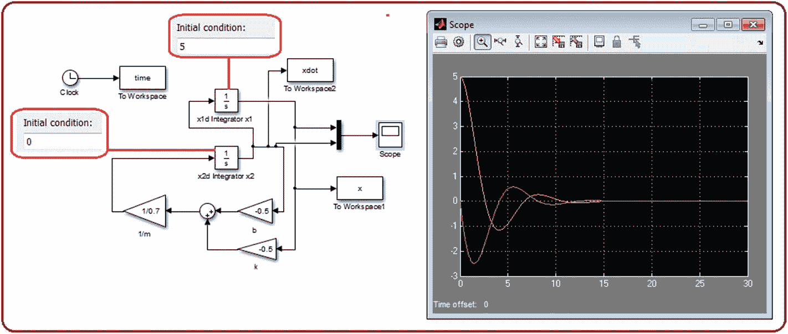

**图 4-42** 仅使用模块的质量-弹簧-阻尼器仿真

这种仿真类型仍然有用，因为有些硬件设备与 Simulink 连接，且出于某些原因不允许与用户自定义函数交互。如前所述，此技术最大的缺点是，在较大的系统中，模块的数量也会变得庞大。请记住，每个方程都需要为其所有符号和运算符（求和、乘积、指数、矩阵等）创建模块。当方程较多时，建议您阅读关于子系统使用的内容，尤其是如何从选中的模块创建子系统。您可以在以下链接中找到此信息：

[`www.mathworks.com/help/simulink/ug/creating-subsystems.html`](http://www.mathworks.com/help/simulink/ug/creating-subsystems.html)

### 模块与 S-Function

S-Function 可以被视为解释型 MATLAB 函数的一种进化，它在文本文件中包含微分动力学方程（它不需要使用积分器；只需要反馈）。它有几个优点，例如能够与 MATLAB 和 Simulink 之外的硬件和软件一起使用。这些函数存在的最大问题与时间管理有关。在下面给出的示例中，仿真对于变步长 ODE 求解器有效，但对于定步长 ODE 求解器则无效（使用 S-Function 时最苛刻的任务是必须注意仿真时间的兼容性）。

图 4-43 展示了名为 `msdSfuncBlock.slx` 的模块文件。

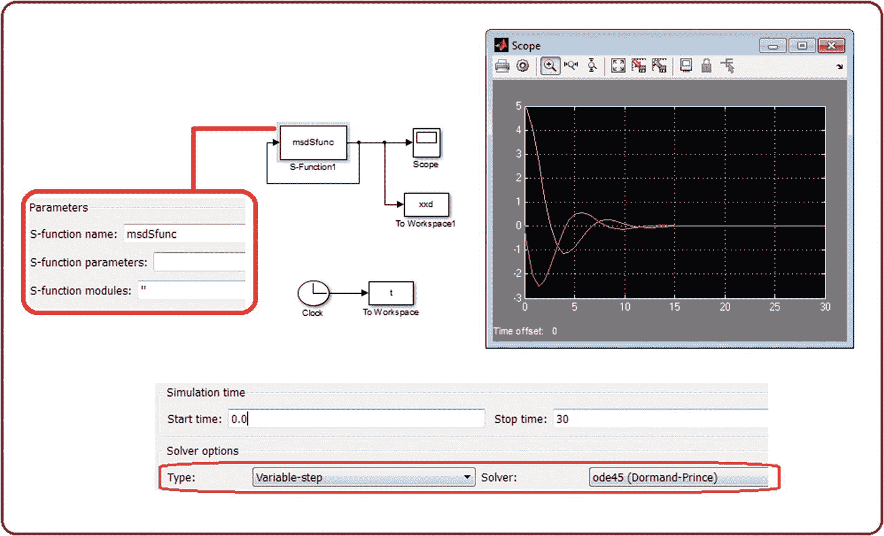

**图 4-43** 使用模块和 S-Function 的质量-弹簧-阻尼器仿真

列表 4-8 是对应的文本文件 `msdSfunc.m`。其详细描述留待您自己去研究，因为如前所述，它们不太直观且具有多种配置。您可以先从附录中提到的 Jinkun Liu 关于滑模控制的书籍开始研究这个主题。在这本书中，有很多使用 S-Function 方法的示例。

```
function [sys,x0,str,ts]=msdSfunc(t,x,u,flag)
switch flag,
case 0,
[sys,x0,str,ts]=mdlInitializeSizes;
case 1,
sys=mdlDerivatives(t,x,u);
case 3,
sys=mdlOutputs(t,x,u);
case {2, 4, 9 }
sys = [];
otherwise
error(['未处理的标志 = ',num2str(flag)]);
end
function [sys,x0,str,ts]=mdlInitializeSizes
sizes = simsizes;
sizes.NumContStates  = 2;
sizes.NumDiscStates  = 0;
sizes.NumOutputs     = 2;
sizes.NumInputs      = 2;
sizes.DirFeedthrough = 0;
sizes.NumSampleTimes = 0;
sys=simsizes(sizes);
x0=[5 0];
str=[];
ts=[];
function sys=mdlDerivatives(t,x,u)
B=0.5;
K=0.5;
M=0.7;
sys(1)=x(2);
sys(2)=(1/M)*((-B*x(2))-(K*x(1)));
function sys=mdlOutputs(t,x,u)
sys(1)=x(1);
sys(2)=x(2);
列表 4-8
用于“模块与 S-Function”方法的代码
```


好的，作为高级文档工程师和翻译员，我将严格遵循您的格式要求，将给定的英文文本翻译成中文。


### 使用预定义命令的文本模式

在这种情况下，只需要一个文本文件和一个用于绘图的辅助文件（可选）（辅助文件可以直接在命令窗口中输入来代替）。顾名思义，这里使用了预定义函数（在下面的示例中，命令`ode45`）。

这种方法的缺点是，它与 Simulink 的交互非常困难，任何额外的信号处理都意味着您必须编写辅助代码（在需要反馈时，这会变得非常困难）。另一方面，请注意，要将此代码转换为解释型 MATLAB 函数，您需要进行一些简单的调整（动力学文件的结构已经类似于解释型 MATLAB 函数）。

清单 4-9 显示了`msdPredefinedFuncSys.m`文件的代码，以及将此文件转换为解释型 MATLAB 函数代码的方法。

```
function out=msdPredefinedFuncSys(t,inpt)
% 要将此文件转换为 Interpreted MATLAB® 函数，
% 只需从函数参数中删除字母 t，并在输出行后添加
% 单词 end
x1=inpt(1);
x2=inpt(2);
B=0.5;
K=0.5;
M=0.7;
x1d=x2;
x2d=(1/M)*((-B*x2)-(K*x1));
out=[x1d;x2d];
清单 4-9
使用预定义命令的文本模式的代码
```

清单 4-10 中的代码行描述了此文件的使用方法（注意设置时间和初始条件的部分）：

```
[t,X]=ode45(@msdPredefinedFuncSys,[0 30],[5;0]);
plot(t,X)
清单 4-10
在使用预定义命令的文本模式时，用于运行仿真和绘图的补充代码
```

上述命令可以直接输入到命令窗口中，也可以通过使用一个辅助文件来输入。就本书而言，这个辅助文件是`msdPredefinedFuncPlot.m`。这种仿真的结果如图 4-44 所示。

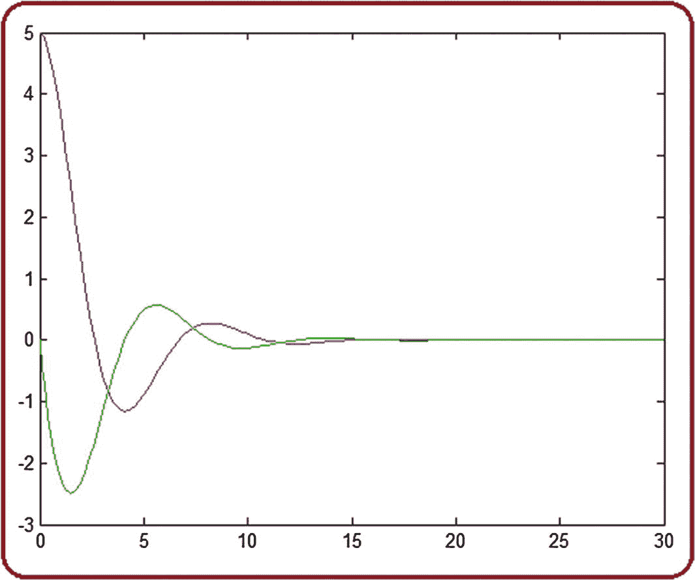

图 4-44

仅使用文本文件（使用预定义或自定义命令）进行质量-弹簧-阻尼器仿真

### 使用自定义命令的文本模式

这与前一种情况相同，但用户可以自由生成自己的 ODE 求解器（非预设函数）。这提供了一种迁移到其他编程语言的直接方法。只需记住，语法会改变，但算法或方程不会改变。

清单 4-11 显示了系统代码（`msdCustomSys.m`）。请记住，在这种情况下，控制器为零。至此，您应该已经注意到了仿真模式（一个包含系统动力学的文件，另一个包含 ODE 求解器的文件，以及用于运行仿真的行、代码段或执行接口）。

```
function h=msdCustomSys(t,X)
x1=X(1);
x2=X(2);
B=0.5;
K=0.5;
M=0.7;
x1p=x2;
x2p=(-(B*x2)-(K*x1))/M;
h=[x1p;x2p];
清单 4-11
使用自定义命令的文本模式的代码
```

执行行如清单 4-12 所示，它们包含在`msdCustomPlot.m`文件中（该文件是可选的，因为这些命令可以直接在命令窗口中执行）。

```
X0=[5;0];
t = linspace(0,30,5000);
X=ode3('msdCustomSys',t,X0);
plot(t,X)
清单 4-12
在使用自定义命令的文本模式时，用于运行仿真和绘图的补充代码
```

绘制的图形与图 4-44 几乎完全相同。名为`ode3`的求解器文件可在[`www.mathworks.com/matlabcentral/answers/98293-is-there-a-fixed-step-ordinary-differential-equation-ode-solver-in-matlab-8-0-r2012b`](http://www.mathworks.com/matlabcentral/answers/98293-is-there-a-fixed-step-ordinary-differential-equation-ode-solver-in-matlab-8-0-r2012b)的`ODE_Solvers.zip`文件夹中下载，该文件夹出现在那篇帖子的内容中。

请注意，该代码以详尽的方式提供了其自己的数值方法。对于其他求解器，您可以参考附录。

## 总结

在本章中，您学习了使用 MATLAB 和 Simulink 工具模拟无人机行为和控件的不同方法。但是，我们以这样一种方式向您呈现，以便您可以将学到的知识用于其他工具和编程语言。本章的结论是，为了模拟飞行器以及一般的任何系统，您至少需要三个程序：包含其控制代码的动力学模型、用于方程组的数值求解器以及一个执行环境。如果您想要包含图形或用户交互，文中提到了一些选项，但最终，在任何情况下，您都将需要了解上述三个程序的基本概念。附录中对这些知识进行了补充。在下一章中，您将看到侧重于信号处理、高级 UART 通信和 SDK 编程的实现细节。

