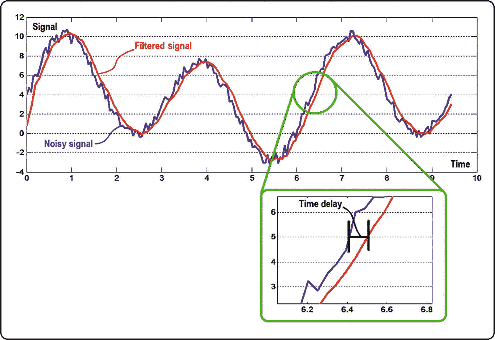
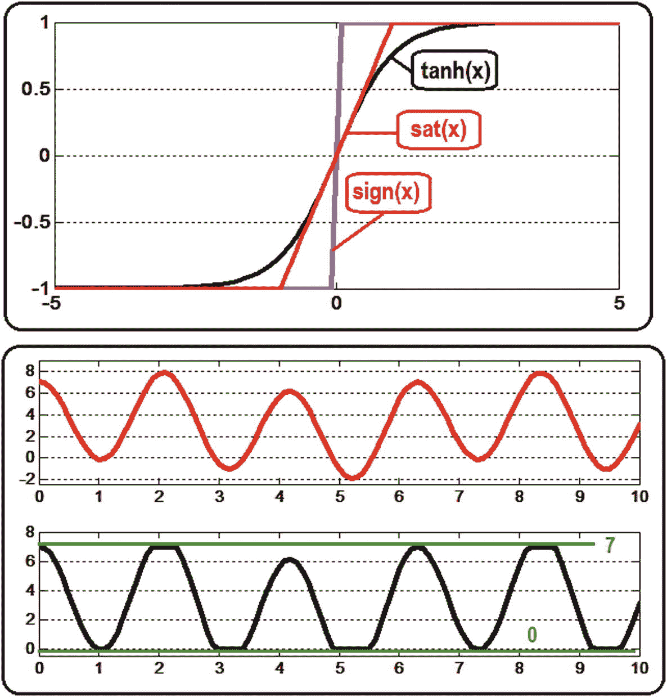
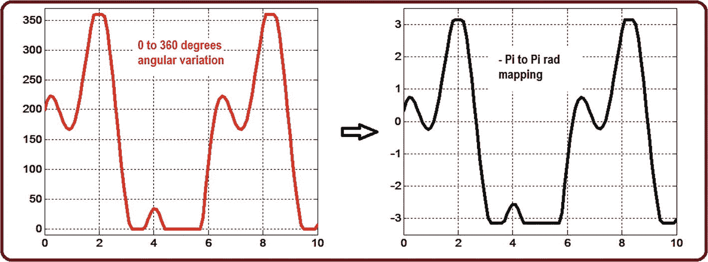
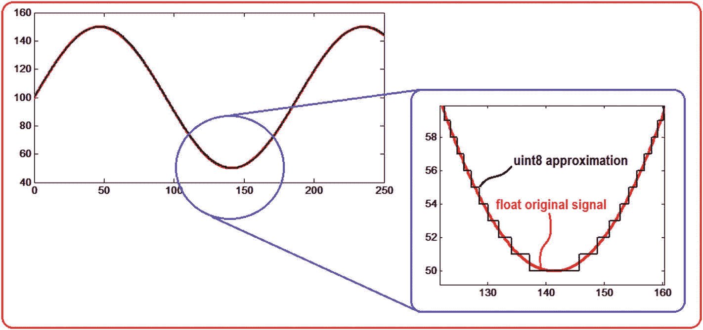
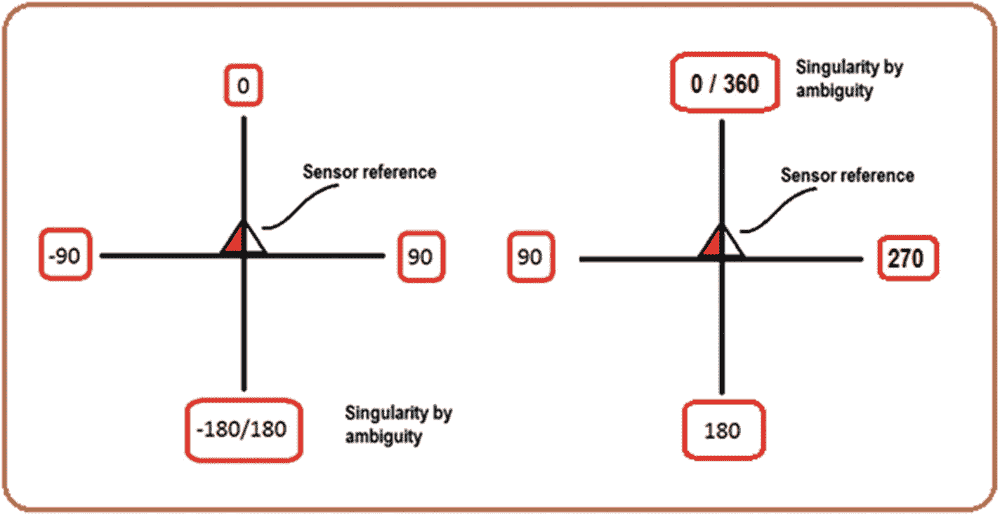
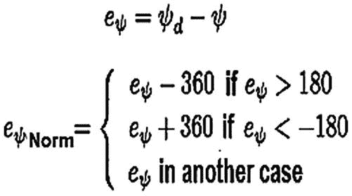
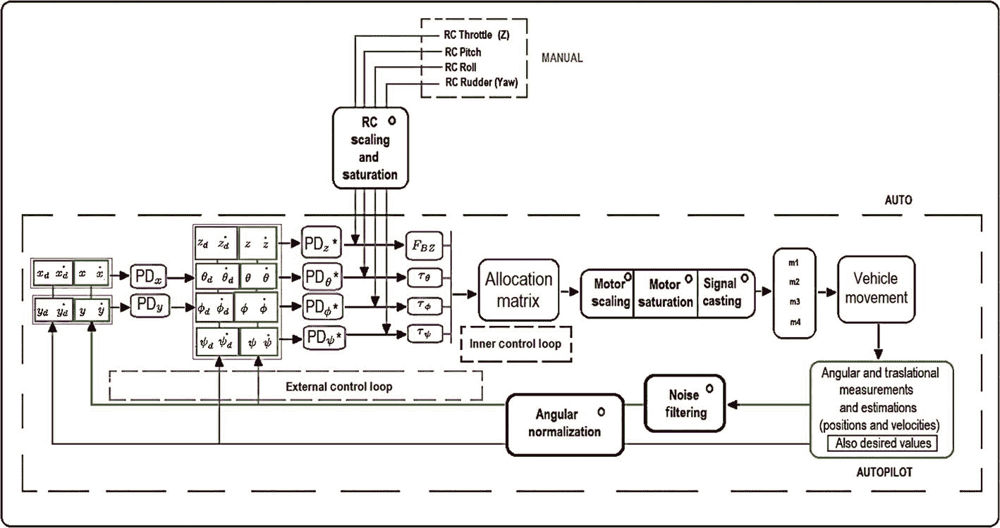

# 无人机的控制回路与控制器类型

四轴飞行器是一个很好的例子，可以用来描述各种类型的控制器和控制回路。这些将在以下章节中介绍。

## 控制回路

#### 开环与闭环

通常，无人机的高度、平面位置和方向都是闭环控制，这意味着它们的误差修正基于反馈。然而，有一个任务依赖于开环控制，即电机的速度控制。开环控制是指任务的执行更多取决于比例效应，而不是误差修正。在电机的情况下，发送一个电压，我们观察到与之成比例的电机的速度，而没有闭环来验证和修正这个速度。

#### 内环与外环

四轴飞行器有四个电机，并且由于它们的几何构型，可以直接控制四个变量：高度和姿态（其三个方向）。这被称为内环。然而，由于需要飞行器也能在 XY 平面上移动，这在外环控制回路中依赖于横滚和俯仰方向来实现。

#### 相关回路与独立回路

独立回路出现在所有其控制不需要监控额外变量的变量中；例如高度控制和偏航控制。另一方面，相关回路需要一个或多个额外变量的信息；例如依赖于飞行器方向的 X 和 Y 控制。

#### 位姿回路与速度回路

四轴飞行器是一个其位姿回路（方向和位置）依赖于每个电机速度开环控制的飞行器。伺服电机是位姿执行器，而无刷直流电机通常是速度执行器。

## 控制器类型

#### 无模型与有模型控制器

某些变量，如横滚、俯仰和偏航方向，可以用一个“简单的”PD 控制器来调节。这意味着不需要对其部分或全部动力学进行补偿。另一方面，在控制高度时，需要引入一个针对飞行器重量的补偿元件（一个部分有模型控制器）。

#### 鲁棒控制器与自适应控制器

在使用没有任何补偿的 PD 控制器来调节变量的情况下，假设 PD 控制器相对于飞行器动力学足够强大。在这种情况下，这种控制被称为主控或鲁棒控制（只要电机允许这种鲁棒性）。鲁棒控制器的另一个例子是滑模控制系列。它们基本上不需要系统的模型，只需要误差回路。对于高度，由于重量被补偿，这是一个非常初步的自适应控制例子。然而，如果 PD 增益足够大并且电机能够自行抵消这种效应，则可以省略补偿项。通常，自适应控制器被设计用于补偿部分或全部动力学，或者未建模的扰动。

#### 无限制控制与有限制控制

无限制控制是指可以使用无限范围数值的控制，例如所有正数和负数。这种控制实际上并不存在，但您可以认为由于仿真器的存在，它是一个可行的选项。另一方面，有限制控制器则引入了操作限制。在四轴飞行器中发现的第一个有限制控制是由电机提供的，因为它们具有速度和扭矩的最大值和最小值。第二个有限制控制在使用无刷电机时非常明显（假设它们不是双向的），即其操作值只能是正数。最后一个在无人机中不那么明显的有限制控制，由物理效应（如响应时间）决定。

对于第一种限制，会使用饱和函数。对于第二种，需要缩放因子。对于第三种，则采用延迟控制技术。最后一种效应在普通无人机上并不那么明显，因为自动驾驶仪和计算机的响应速度快，通常会被忽略，但在使用双向螺旋桨的飞行器上，考虑这些延迟是相关的，因为螺旋桨不会瞬时改变其旋转方向。

#### 线性控制与非线性控制

这种控制类型由操作条件决定。您看到过一些飞行模式，其中运动平稳，角度被限制在零附近的一个小范围内，因此将模型和控制器都线性化是一个正确的决定。然而，我们也描述了一些飞行模式，其中角度不受限制，飞行器可以执行激进运动；因此，控制器和模型都具有非线性特性。

#### 连续操作控制与基于事件控制

在这种情况下，始终连续且必须在飞行器整个运行过程中都存在的控制是姿态控制器。而依赖于事件（如基于时间的信号或与遥控器的交互）的控制是轨迹控制。


##### 连续控制器与离散控制器

这里给出了连续性的第二个定义，它与采样时间的大小有关。这取决于两个因素：一是计算机，二是执行器和传感器。  
对于计算机而言，如今几乎所有计算机的速度都足够快，可以将其视为基于微分方程的连续模型或系统。然而，当执行器的技术从无刷电机变为内燃机时，你会注意到后者的响应时间相对于前者更慢（它们包含大量部件、摩擦和工作循环），因此需要采用差分方程进行分析（不再能用微分方程对其建模）。

##### 电气控制与机械控制

我们有时会依赖某些技术的特性，因为电气和电子元件的制造商保证其正常运行，例如，我们无需担心电调（ESC）的工作情况。此外，我们信赖电气设备比机械部件速度更快这一事实。出于这些原因，我们的设计忽略了电气和电子元件，仅仅将无人机视为一个纯机械建模和控制的系统。然而，在电机转速中引入闭环控制的现代设计，可以被视为一种中间或机电控制，其中电机的机械转速取决于电气变量，例如电调（ESC）的电气相位。关于闭环电机控制的参考资料，请参见附录。

你已经了解了无人机的任务以及该飞行器/机器人可以使用的绝大多数控制器。接下来，让我们继续学习无人机所需的基本信号处理及应用示例。

## 无人机信号处理

也许你很想实现前面的控制器。但在实现之前，需要完成一些步骤。最常见的有以下几个：

*   信号滤波，用于传感器
*   信号映射，用于传感器、遥控器摇杆、数据传输等
*   信号类型转换或数据转换，用于将控制值注入电机或进行串行数据传输
*   信号限幅，用于限制发送给电机的值，或限制从遥控器摇杆读取的值
*   信号归一化，用于为传感器设定一个工作范围

### 信号滤波

正如你在前面几章中所见，闭环控制器的主要组成部分是误差，该误差也依赖于通过传感器测量的变量。然而，这些传感器通常会因为其自身行为或与环境的相互作用而产生电噪声。  
因此，需要一个滤波环节来减少或抑制电噪声。由于涉及计算或电子处理，噪声抑制是在平滑噪声信号和延迟平滑信号之间进行权衡。有多种方法可以实现这一点。以下是一些示例：

*   **被动滤波**：使用附加设备，这些设备通过其固有特性吸收部分环境噪声。例如，用于机械运动的耗散海绵或流体、吸收特定频率光线的透镜，或可用作滤波器的无源电子器件。
*   **主动电子滤波**：低通、高通、带通和带阻电路是众所周知的例子。
*   **主动数学滤波**：将信号送入数学滤波器。最著名的滤波器包括卡尔曼滤波器和龙伯格观测器。
*   **主动空间变换滤波**：将信号转换到另一个空间，以便在新空间中进行简便滤波，例如在频率层面而非时间层面进行滤波。这种方法也可以被视为一种数学滤波器，但它拥有独立的研究方向。例如傅里叶变换和小波变换。
*   **主动智能滤波**：通过使用任何采用人工智能的算法来实现。

噪声降低与信号延迟之间的权衡如图 5-1 所示（使用了通用低通滤波器的代码）。在代码清单 5-1 中，你可以看到使用此类滤波器（本例中使用 MATLAB）的高级通用代码。



**图 5-1** 含噪信号与滤波后的信号对比

```
filteredSignal=lowpassFilter(noisySignal)
代码清单 5-1
许多程序中可用的信号滤波通用代码（语法可能有所不同）
```

### 信号限幅

在这种情况下，有必要对控制器施加限制值，以确保输入电机的最大值和最小值不超过电机的限值。另一个应用是限制用户在遥控器摇杆上所能达到的值。  
这种限幅可以突然进行（例如，使用等价于开关动作的符号函数）或连续进行（使用称为饱和函数的函数）。即使是连续函数也可以是平滑的或陡峭的（你可以使用饱和函数家族中的许多函数，称为 S 型函数）。  
通常，饱和器的无限制部分会像标准线性函数一样复制原始信号，如代码清单 5-2 中的代码所示。然而，为了抵消不期望的表现（例如，遥控器摇杆的突变行为），有时也会使用其他类型的 S 型函数。

图 5-2 说明了两个方面。上半部分是一个饱和函数家族，本例中包括符号函数、饱和函数和双曲正切函数。显然，设计者必须对它们进行修改，使其根据应用达到最小值和最大值，而不仅仅是-1 和 1。下半部分是将饱和函数应用于给定信号，本例中允许的最小和最大值范围为 0 到 7。



**图 5-2** 不同类型的饱和函数及其对信号的应用

图 5-2 中使用的代码非常简单，如代码清单 5-2 所示。

```
Mini=0
Maxi=7
if(signal=Maxi)
satsignal=Maxi;
else
satsignal=signal;
end
代码清单 5-2
饱和函数（线性类型）的通用代码
```


### 偏置与映射

另一项重要任务是将控制信号（一个具有正负值的信号）转换为电机兼容的信号（例如，对于无刷 RC 电机，其值范围在 1000 到 2000 之间）。另一个例子是传感器的量程，它可能是任意的，必须被转换为标准的工作范围（0 到 360 度，-180 到 180 度，-1 到 1 米等）。见图 5-3。在这种情况下，会使用缩放和平移函数。

一种最常用的偏置和映射技术是两点之间的直线方程，称为线性映射，它将输入值调整为一条直线方程（输出值）。为此，输入信号必须事先被约束，使其不超过最大和最小输入限制。



图 5-3  
将信号从输入值范围映射到输出值范围

代码也很简单，如清单 5-3 所示（注意，这段映射代码描述了两点之间的一条直线）。

```
mininput=0;
minoutput=-pi;
maxinput=360;
maxoutput=pi;
mapsignal=(signal - mininput) * (maxoutput - minoutput) / (maxinput - mininput) + minoutput;
清单 5-3
映射的通用代码（线性映射）
```

### 数据类型转换

这是另一种重要的信号适配，当一条指令只接受一种数据类型，而提供的是另一种数据类型的数据时，就需要进行这种操作。例如，写入 PWM 型 RC 电机的指令通常需要整数类型的数据，但提供的值可能是浮点数或分数。在这种情况下，我们使用编程中称为**强制类型转换**的方法，即将一种数据类型转换为另一种数据类型。这可能涉及两种情况：

*   该类型转换不存在，用户必须自行设计程序。
*   该类型转换会产生混叠，影响测量或执行的质量（例如，控制器可能从平滑自然的运动变为突兀僵硬的运动，或者从高清晰度图像变为低质量图像）。

图 5-4 显示了一个常见示例。红色信号代表一个计算出的控制值（带有大量小数位），当将该信号注入电机时，由于写入命令接受其他数据类型（例如 `uint8`），原始值的精度会降低。它们看起来相似，但如果仔细观察，会出现一个称为**混叠**的阶梯效应。这种效应可能导致无人机运动行为不够平滑。



图 5-4  
执行数据类型转换时的信号混叠

根据编程语言的不同，类型转换命令可能存在也可能不存在（用户必须自行创建），但通常它们采用清单 5-4 所示的形式。

```
signal=100+50*sin(t/30);
castSignal = uint8(signal);
清单 5-4
数据类型转换的通用示例
```

请注意，如果存在类型转换，这意味着存在一些函数，它们强制信号或输入数据改变其数据类型（在此示例中为 `uint8`）。

### 冗余与奇异性归一化

这是角度传感器中常见的一个问题，问题在于它们的值会从其最大值跳变到最小值，例如从 359 度跳变到 0 度，或者存在称为**奇点**的冗余值，例如 0 度和 360 度（如果传感器以这种方式工作，-180 度和 180 度也会出现这种情况）。见图 5-5。



图 5-5  
角度冗余与奇异性

为了处理这些奇异、歧义或冗余的情况，有许多归一化方法。其中一种（考虑了图 5-5 左侧的情况）基于相对于测量值对称定义角度误差。更多细节请参阅我的著作 *《Advanced Robotic Vehicles Programming》*。



这是一种动态归一化，其额外目标是减少车辆需要进行的旋转，以实现更短的距离。为了达到期望的方向，车辆可以选择向左或向右旋转。该算法除了防止奇点外，还会选择顺时针或逆时针方向旋转哪个更好。

你还应该开发或研究替代的归一化方法，这些方法可以基于期望值而非测量值，或者基于绝对参考系而非车辆参考系，或者基于多次旋转的方法，以及用于 0 到 360 度角度测量的方法等。

### 使用示例

图 5-6 展示了对之前描述的无偏航运动（或偏航运动非常小）的半自动控制器的改进。这种变体结合了五种基本信号处理方法，具体如下：对遥控器信号应用映射和饱和处理，以调整其值，从而获得可接受的角度指令。对位姿传感器应用滤波处理，以降低其噪声水平。对角度误差进行归一化处理。在将分配矩阵注入电机之前，应用缩放处理使电机信号变为正值。通常，无人机电机具有固定的旋转方向，其速度可以从零或起始值变化到最大速度，因此对电机信号应用饱和处理，以防止其超过起始值和最大值。最后，执行数据类型转换，因为写入电机的命令通常需要整数类型，而控制信号是浮点值。



图 5-6  
应用于无人机控制器的信号处理

你已经学习了无人机信号处理的基础知识。让我们继续学习数据传输理论的基础知识，该理论用于大多数无人机编程环境，这些环境通常基于 UART 类型的串行传输。

## 数据传输理论

数据传输理论被认为是一个高度相关的主题，因为它允许无人机编队之间或单个无人机与远程基站之间的通信。在可用的介绍中，我们在此描述 UART（通用异步收发传输器）类型，因为它是最常用、最基本的协议之一，已经使用了数十年，并且在无人机 SDK 中非常常见。


