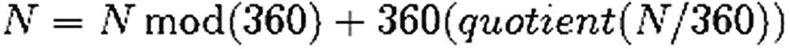
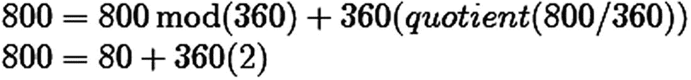
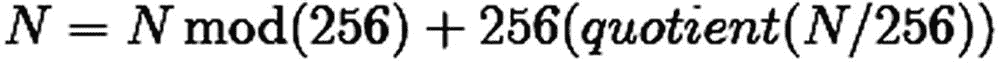
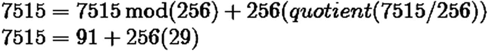
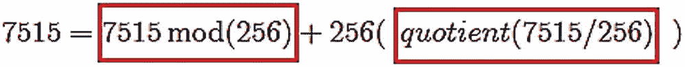

# 数据类型与子类型

在讨论本标准之前，先来了解一下数据类型与子类型的概念会很有帮助。该主题与之前介绍的数据转换相关。由于 C/C++ 是开发无人机应用的不同 SDK 中最常见的编程语言，以下段落将使用 C/C++ 的概念。不过，这实际上是其他编程语言中非常普遍的主题，每种语言都包含以下基本类型（或非常相似的类型）。请参见表 5-1。

#### 表 5-1 基本数据类型

| 类型 | 描述 |
| --- | --- |
| `int` | 用于整数 |
| `float` | 用于带有小数的数值 |
| `double` | 提高浮点数精度，适用于科学或工程计算 |
| `char` | 允许使用字符 |
| `bool` | 允许使用逻辑值 |

然而，根据所执行的操作（例如时间管理、内存管理和通信协议），经常会发现这些基本数据类型的变体。这些变体通过增加前缀和后缀来标识。在无人机编程中，使用整数类型的变体非常常见。例如，`uint8` 包含前缀 `u` 和后缀 `8`。

通常，前缀表示符号限制，后缀表示基于比特位的范围限制。存在 8、16、32 和 64 位的整数，它们分别可以存储最大值为 255（255 = 2 的 8 次方减 1，以便从 0 开始计数）、65535、4294967295 和 18446744073709551615 的值。前缀 `u` 表示可使用的值仅为正数和 0。因此，对于 `uint8`，其有效范围是 0 到 255。而如果使用 `int8` 选项，我们同样拥有 255 个值，但范围是 -128 到 127。

前缀和后缀的用途将通过示例进行说明。

假设一个过程必须以微秒为单位执行。如果我们使用 `uint8` 数据子类型，我们只有 255 微秒，这甚至不到一毫秒。如果我们使用 `uint16`，我们只有 65 毫秒。最后，选择 `uint32` 子类型，其等效时间约为 4294 秒，或者说大约 71 分钟。

让我们进一步探讨 UART 的使用，以说明这是一种仅支持无符号 8 位数据块的通信方式。因此，无法使用 16 位和 32 位子类型，更不用说带有负值的子类型了。正因如此，才体现了 `uint8` 子类型的实用性。

最后，在许多编程环境中，你会在数字后缀中看到附加的 `t`（例如 `uint16t`）。这仅表示该数据类型在不同硬件平台间具有兼容性。在开发 8、16 和 32 位数据类型时，不同计算平台在内存占用上存在差异。因此，制造商们就代码的可移植性达成一致，创建了一个用字母 `t` 标识的标准。

## UART 简介

请注意，这里假设 SDK 提供了高级 UART 命令，例如 `read()`、`write()`、`begin()` 或 `available()`，类似于 Arduino 或 Ardupilot 中提供的那些。低级 UART 的使用则留给关于机器语言、汇编语言或微控制器的书籍来讨论。

此处描述 UART 传输，是因为它是当前自动飞行器及其相应 SDK 中最广泛使用的通信方式之一。它是双向的，但却是异步的（不涉及定时器，因此无法保证发送和接收时间）。我们还指出，本标准基于 8 位正整数数据包的管理。

接下来，我们提出以下问题。

鉴于所述的限制：

-   如何处理负值数据？
-   如何处理小数数据（带有小数位的数字）？
-   如果没有定时器进行读取或写入，如何保证读取和写入操作？
-   以及，如何处理大于 255 的数据？

为了回答这些问题，我们从循环计数器的概念开始。如果参照旋转运动，这个概念就很容易理解。

在旋转运动中，一个物体可以从 0 度到 360 度或从 0 到 2π 弧度进行定向，具体取决于您采用的标准。超出此范围的值意味着要进行多次旋转，或者对该值进行模 360 或 2π 的取模运算。

因此，800 度相当于两次 360 度的旋转加上 80 度的余数。请注意，任何角度都可以表示为该角度除以 360 或 2π 底数的模（余数）和商（注意，我们只关心模和商的整数部分）。

对于前面的例子：

运用此逻辑，串行传输意味着我们的底数是 256（从 0 到 255 共有 256 个值），任何要发送的数字都可以分解为该底数的模和该底数的商：

例如：

简而言之，为了处理大于 255 的值，必须将一个数字分解为两部分，一部分与该数字的模相关，另一部分与其商相关：

接下来要解决的问题是如何发送负数。

答案是，有两种选择，具体取决于要使用的数据范围（例如，传感器的量程）。

第一种选择基本上是浪费要发送的 8 位中的一位，用来指示：如果要发送的数字是正数或 0，则该位值为 0；如果数字是负数，则该位值为 1。然而，我们的通信底数将不再是 256，而是 128（因为使用剩余的 7 位，我们只能组成 128 个不同的数字）。

第二种选择是对值进行饱和与映射（平移和缩放）（即前一节中介绍的操作）。进行饱和处理时，我们为信号设定界限，这些界限用于定义映射函数中的最小和最大输入值。平移允许我们将信号移动到正参考系，例如，将值范围从 [-100, 100] 移动到 [0, 200]。如果输入值相对于输出值很大，则缩放是可选的，例如从 [-1000, 1000] 转换到 [0, 200]。请注意，映射函数本身已包含这两种效果。

