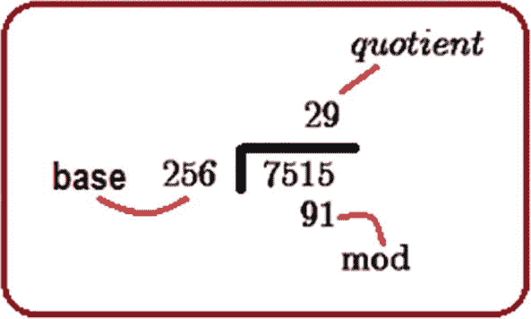
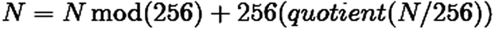
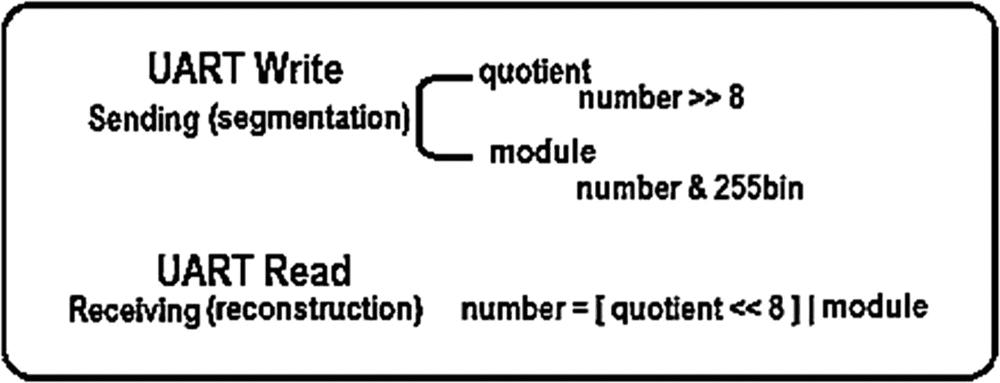
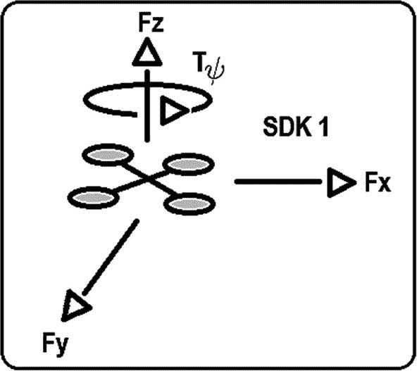
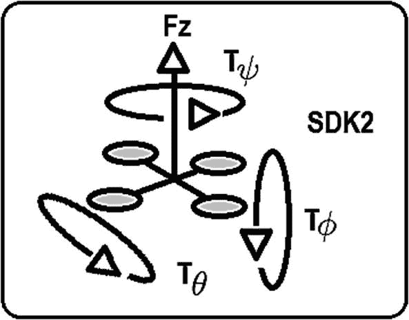
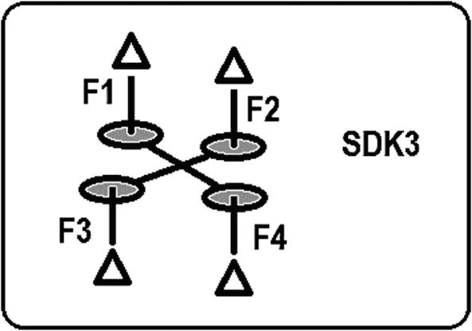

# 处理过大数值时的精度与通信

过大缩放（在数值较大时会变得更为明显）的影响在于会产生带有小数部分的数字。现在我们将回答如何处理它们。

首先要做的是确定我们想要的精度等级。我们必须评估我们感兴趣的是保留一位、两位还是更多位小数。例如，在我们`[0 200]`的范围内，我们感兴趣的是处理像`199.3`这样的数字，还是像`199.15`这样的数字。

为了传递这些数字，我们有两种基本选择。

第一种是分离整数部分和小数部分，并将它们作为两个不同的数字发送。在数字`199.15`的示例中，会先单独发送一个`199`，然后再发送一个`15`。这种方法的问题在于，其中一个数字可能在传输过程中丢失。

另一种选项是应用缩放。这样，如果我们只关心一位小数，则只需将初始范围乘以`10`即可。使用给定的示例，`199.3`将变为`1993`，而`199.15`将变为`1991`。相反，如果我们想要两位小数，则缩放因子为`100`，分别发送`19930`和`19915`。这样，发送的是一个缩放后的数字。为此，要求接收方和发送方都知道缩放因子。使用这种方法获得高精度是一个问题，因为很可能需要将待发送的数字分成两部分或更多部分。应用很简单。例如，如果我们想要两位小数，那么不应从`[-1000 1000]`映射到`[0 200]`，而应从`[-1000 1000]`映射到`[0 20000]`。

请注意，几乎任何操作都可以在发送方和接收方完成，包括浮点或双精度运算。但数据传输仅针对正整数值。因此，我们必须进行上述调整（有些开发接口如`Arduino`包含自动进行这些转换的函数；因此，它们似乎不仅支持正整数）。

最后，为了回答关于如何保证通信的剩余问题，我们将说明`UART`通信的组件是如何实现的。

此过程的基础是理解与之前介绍的操作（取模和取商）等效的二进制操作，以及其他一些二进制校验操作。这是因为在计算机上，使用处理器所熟知的语言来简化数据处理任务是很方便的。这些操作包括发送、接收、校验和通信协议。

#### UART 发送

起点是以下方程：


在十进制格式中，通过除法运算得到模和商，如图 5-7 所示。



图 5-7

十进制基数的商和模

在二进制格式中，可以通过对要分割的数字的二进制等效值的最后 8 位应用非循环右移操作（用零替换移位的数字）来获得商。此操作在`C++`中表示为`>> 8`，作为其他编程语言的参考。另一方面，通过对`255`或二进制基下的`1111 1111`应用`AND`操作来获得模。此操作在`C++`中表示为`&`，作为其他编程语言的参考。

使用同样的示例：

`7515`=`1110101011011`（二进制）

`11101 0101 1011`（二进制）`>> 8`=`0000 0000 11101`（二进制）=`29`（十进制）

另一方面：

`11101 0101 1011`（二进制）

`& 00000 1111 1111`（二进制）

`= 00000 0101 1011`（二进制）=`91`（十进制）

这样，数字（本例中为`7515`）被作为两组 8 位发送：

`0101 1011`（二进制）=`91`（十进制）

`0001 1101`（二进制）=`29`（十进制）

当然，在发送这些数字之前，它们是通过前面描述的操作（`>> 8`和`& 1111 1111`）获得的。

#### UART 接收

接收包括应用以下方程：



直接使用某些编程语言，或通过以下二进制等效值：8 位非循环左移和`OR`运算（在`C++`中为`<< 8`和`|`）：

`Binary value = Binary Quotient part << 8 | Binary Module part`

使用前面的示例：

`0001 1101`（二进制）=`29`（十进制）`<< 8`=`0000 11101 0000 0000`=`7424`（十进制）

得到这个结果后，我们继续进行`OR`运算。请注意，这里出现了超过 8 位的情况，但请记住，这是由接收计算机在收到数据后处理的。对于需要 8 位消息的通信信道来说情况并非如此。

`11101 0000 0000`

`| 00000 0101 1011`（二进制）=`91`（十进制）

`= 11101 0101 1011`（二进制）=`7515`（十进制）

读写过程总结在图 5-8 中。



图 5-8

UART 读写过程总结

现在你知道了如何发送和接收信息。但是，如何验证数据？又如何判断你是否能够通信？以下操作将回答这些问题。


##### UART 校验

在这种情况中，会丢弃错误信息，最简单的算法是校验和，其改进版本是异或校验和。

下面从十进制角度进行简单说明。

假设发送以下数据：

- `val1Send = 50`
- `val2Send = 30`

要发送的第三个值可以是前两个值的和（校验和算法的求和部分）：

`valsumSend = val1 + val2 = 80`

接收方应收到相同的数据：

- `Val1Rec = 50`
- `Val2Rec = 30`
- `valSumRec = 80`

然后构建算法的校验部分：

`Check = Val1Rec + Val2Rec = 80`

这样，`Check` 和 `valSumRec` 相同，说明这是一组有效的数据。

现在假设接收方读取到了一个错误的值：

- `Val1Rec = 20`
- `Val2Rec = 30`
- `valSumRec = 80`

我们再次构建校验部分：

`Check = Val1Rec + Val2Rec = 50`

这样，`Check` 与 `valSumRec` 不同，这组数据会被丢弃，或者要求重新发送信息。

可以看出，校验和算法存在几个重要问题：

1.  总和可能超过 `255` 的值，此时需要将数字分成两组或多组数据来发送。

2.  错误数据的求和结果可能恰好得到一个正确的校验值。

例如，发送方写入：

- `val1Send = 50`
- `val2Send = 30`
- `valsumSend = val1 + val2 = 80`

接收方读取：

- `Val1Rec = 60`
- `Val2Rec = 20`
- `valSumRec = 80`

由于校验结果仍等于 `80`，这个错误的数据包将不会被丢弃。

3.  数据本身正确到达，但校验和部分损坏了。

发送方写入：

- `val1Send = 50`
- `val2Send = 30`
- `valsumSend = val1 + val2 = 80`

接收方读取：

- `Val1Rec = 50`
- `Val2Rec = 30`
- `valSumRec = 10`

由于 `check = 80` 的值与 `valSumRec` 不同，尽管数据正确到达，信息仍会被丢弃。

为了减少这些问题（至少是溢出问题），会使用二进制校验和。其中一种是异或校验和（C++ 中的 `^` 运算符）。请注意，其余问题仍然存在。

如果你想发送一个超过 255 的和值，例如 `520`，首先要进行二进制转换：

`1000001000(bin) = 520(dec)`

之后，逐位进行异或加法：

`(1) xor (0) xor (0) xor (0) xor (0) xor (0) xor (1) xor (0) xor (0) xor (0) = 0`

因此，要发送的附加数据就是简单的 `0`。

例如：

- `Val1Send = 250`
- `Val2Send = 250`
- `Val3Send = 20`
- `ValSum = 520`

`ValSum` 无法直接发送，但可以发送其二进制分量的异或和：

`XORSend = (1) xor (0) xor (0) xor (0) xor (0) xor (0) xor (1) xor (0) xor (0) xor (0) = 0`

接收方读取：

- `Val1Rec = 250`
- `Val2Rec = 10`
- `Val3Rec = 20`
- `XORRec = 0`

然后，构建校验值：

`Check = Val1Rec + Val2Rec + Val3Rec = 280`

对 `Check` 的二进制分量进行异或求和：

`100011000(bin) = 280(dec)`

`XORCheck = (1) xor (0) xor (0) xor (0) xor (1) xor (1) xor (0) xor (0) xor (0) = 1`

由于结果与 `XORRec` 不同，数据会被丢弃或要求重新发送。

##### 轮流协议

在这种情况中，会发送额外的信息来指示在通信过程中哪些设备是接收方，哪些是发送方。该算法包括发送和评估一个逻辑值。这意味着有两架或多架搭载通信设备的无人机；所有无人机都有一个充当交通灯或标志的变量。其中一架无人机的该变量处于 ON 状态，其他无人机处于 OFF 状态。只有初始状态为 ON 的无人机能够写入数据，而其他无人机则处于读取状态。一旦初始状态为 ON 的无人机完成操作，它会将其标志或信号量更改为 OFF。当团队中的其他成员读取到初始发送方的标志变为 OFF 时，它们会启动一个序列，以确定下一个将自己的标志变为 ON 的无人机。这一过程可以循环重复、交替进行，或者只执行一次。基本上，这就像一次礼貌的交谈，每位参与者询问或轮换自己的发言权，同时等待正在发言的人结束。

##### 通用 UART 算法

结合上述操作，用于 UART 通信的通用算法如下。（每种操作的具体外观已加下划线；请注意校验和是一种共享操作。为了改进此序列，每个过程可能依赖于一个定时器来加速或确保其执行，或者只是为了避免延迟。）

1.  检查通信设备的标志位或轮次。

2.  如果当前轮次涉及写入：
    *   将要发送的信息分割成 8 位段。此信息被分成两部分：模数和商数。
    *   计算所有待发送信息的总和，然后从结果中获取其二进制分量的异或和。
    *   验证信道是否可用。
    *   发送信息。
    *   清空用于写入的变量，以便后续使用。
    *   将标志状态更改为读取。

3.  如果当前轮次涉及读取：
    *   读取接收到的数据。
    *   执行异或校验，然后与接收到的校验和进行验证。
    *   如果两者不匹配，设计者将规定后续步骤，可能包括丢弃信息或要求重新发送信息。
    *   如果两者匹配，则通过指定的位移和 OR 运算重建信息。
    *   清空用于读取的变量，以便后续使用。
    *   将标志状态更改为写入。

4.  该过程将无限期持续，直到用户、代码或电源中断通信。

现在你已经了解了控制、信号处理和 UART 通信，接下来的章节将指导你如何为无人机编写代码。首先，我们将向你展示可用于编程无人机的环境。

## 无人机编程的可用方法

目前，有两种方式可以为你的无人机编写代码：GUI 和 SDK。

### GUI（图形用户界面）

GUI 是一种简化且高度可视化的界面，专为编程技能有限或为零的用户设计。

在这种情况下，这是一个图形用户界面。许多用于编程无人机的封闭架构都包含这样一种界面。这些封闭架构的特点是允许用户修改基本参数，例如要遵循的路径、预加载控制器的增益以及传感器和执行器的基本校准。更专业的任务对用户是封闭的。一些最常用的 GUI 包括 Mission Planner 和 LibrePilot。

### SDK（软件开发工具包）

SDK 是一个软件开发工具包。在所有情况下，用户都需要掌握一种编程语言。

#### SDK 一级

对于 SDK 一级，非无人机控制或机器人学专业用户也可以为娱乐以外的目的对无人机进行编程。该架构并非完全开放，仅允许用户以类似于将飞行器视为一个能够在 X、Y、Z 方向上移动并绕其 Z 轴旋转的粒子的方式，设计一些高级控制器。请参见图 5-9。

最著名的例子之一是基于 Python 的 Dronekit SDK。在这种类型的 SDK 中，用户只能修改 X、Y、Z 和偏航的期望参考值，或它们的速度。用户无法对推力和无人机力矩，当然也无法对分配矩阵进行任何操作。



图 5-9 SDK 一级


#### SDK 级别 2

SDK 级别 2 的架构稍显开放，允许用户在力-力矩层级控制飞行器。也就是说，它让熟悉无人机控制和机器人学的用户能够将自己开发的算法和控制器集成到兼容 SDK 的预设计飞行器中。最著名的例子是基于 `C++` 的 Parrot Bebop-autonomy SDK，以及 PX4 库的一种飞行模式。

在此类 SDK 中，用户只能修改无人机的推力和力矩，无法对分配矩阵进行任何操作。参见图 5-10。由于推力和无人机力矩是空间参考量（X、Y、Z 和偏航角）的函数，因此该 SDK 的层级高于类型 1 SDK。



图 5-10

SDK 级别 2

#### SDK 级别 3

SDK 级别 3 完全开放，允许用户在电机层级控制飞行器；参见图 5-11。它还允许用户编写自己的通信协议、集成自己的传感器、监控自己关注的参数等等。简而言之，它允许用户设计自己的飞行器，即使这些飞行器没有先例。最著名的例子是基于 `C++` 的 Ardupilot 库和 PX4 库。

在此类 SDK 中，用户必须提供分配矩阵，该矩阵是无人机推力力矩和力的函数，而这些推力和力矩又是期望位置和姿态值的函数。因此，这种 SDK 的层级高于类型 2 和类型 1 的 SDK。



图 5-11

SDK 级别 3

你已经了解在哪里编写代码，那么如何编写代码呢？这将在下一节中介绍。

## 大多数 SDK 中可用的常用命令

以下是用于对空中无人机以及一般任何类型飞行器进行编程时最常用的命令。它们出现在三个最常用的 SDK 中：Ardupilot、PX4 和 Dronekit。这些命令按主题分类，并分别兼容 `C++`、用于 ROS 的 `C++` 以及 Python（尽管这些 SDK 也有其他编程语言、操作系统和计算架构的变体）。详细描述和示例可在官方网页或我的书《Advanced Robotic Vehicles Programming》中找到，该书在附录的参考文献部分中有所介绍。关于上述库，必须指出的是，唯一允许用户集成实时任务的库是 Ardupilot，最简单易用的是 Dronekit，而基于 ROS 因此具有多种兼容性的库是 PX4，其缺点在于文档有限且不易理解（至少目前如此）。

#### 官方网页

Ardupilot

[`http://ardupilot.org/dev/docs/apmcopter-programming-libraries.html`](http://ardupilot.org/dev/docs/apmcopter-programming-libraries.html)

Dronekit

[`https://dronekit-python.readthedocs.io/en/latest/`](https://dronekit-python.readthedocs.io/en/latest/)

Px4

[`https://dev.px4.io/master/en/index.html`](https://dev.px4.io/master/en/index.html)

#### 输入命令

Ardupilot 键盘输入（串口监视器）：

```
hal.console->read()
```

Ardupilot 遥控输入：

```
hal.rcin->read()
```

Dronekit 键盘输入：

```
input() or raw_input()
```

Dronekit 遥控输入：

```
vehicle.channels[channel]
```

PX4 键盘输入消息：

```
PX4_INFO
```

PX4 遥控输入消息：

```
manual_control_setpoint.msg
```

#### 输出命令

Ardupilot 用户输出（串口监视器）：

```
hal.console->printf()
```

Dronekit 用户输出：

```
Print
```

PX4 用户输出消息：

```
PX4_INFO
```

#### 传感器命令

Ardupilot 模拟量读取：

```
ch =hal.analogin->channel(channel)
read=ch->voltage_average()
```

Ardupilot 数字量读取：

```
hal.gpio->read(pin)
```

Ardupilot GPS 读取（XYZ 位置和速度）：

```
inertial_nav.get_position()
inertial_nav.get_velocity();
```

Ardupilot 姿态读取（姿态角和角速度）：

```
ahrs
ins.get_gyro()
```

Ardupilot 气压计高度：

```
barometer.get_altitude()
```

Dronekit 模拟量读取：

间接方式，例如通过 Raspberry Pi 的模拟端口

Dronekit 数字量读取：

间接方式，例如通过 Raspberry Pi 的数字端口

Dronekit GPS 读取（XYZ 位置和速度）：

```
vehicle.gps_0
vehicle.velocity
vehicle.location
```

Dronekit 姿态读取：

```
vehicle.attitude
```

PX4 模拟量读取消息：

```
adc_report.msg
```

PX4 数字量读取消息：

```
gpio_led start
```

PX4 GPS 读取消息（XYZ 位置和速度）：

```
vehicle_gps_position.msg
vehicle_odometry.msg
```

PX4 角度位置和角速度消息：

```
vehicle_odometry.msg
sensor_combined.msg
```

#### 执行器命令

Ardupilot 数字量写入：

```
hal.gpio->write(pin,value)
```

Ardupilot 写入电机和舵机（用于无刷或有刷电机的 PWM RC）：

```
hal.rcout->write()
```

Dronekit 数字量写入：

间接方式，例如通过 Raspberry Pi 的数字端口

Dronekit 飞行器写入（由于 SDK 类型限制，非直接写入电机）：

```
send_ned_velocity(vx,vy,vz,time)
```

PX4 写入电机或飞行器消息（PX4 是类型 1 和类型 3 的 SDK）：

```
actuator_controls.msg
for writing to a vehicle
actuator_direct.msg
test_motor.msg
for writing to the motors
```

#### 信号处理命令

Ardupilot 噪声信号滤波：

```
LowPassFilter2pfloat filtername(parameters)
filtername.apply(signal);
```

Dronekit 噪声信号滤波：

通过专门的 Python 库间接实现

PX4 程序

```
https://dev.px4.io/v1.9.0/en/middleware/modules_estimator.html
```

#### 通信命令（有线和无线）

Ardupilot 串口通信：

```
hal.uart#->write()
hal.uart#->read()
with #=A,B,C,D
```

Dronekit 串口通信：

通过使用 Python 库和 Raspberry 端口间接实现

PX4 程序

```
https://mavlink.io/en/
```

#### 时间命令

Ardupilot 当前时间、延时和实时：

```
hal.scheduler->millis(),micros()
hal.scheduler->delay()
scheduler.run(time)
```

Dronekit 当前时间、延时和实时：

Python 时间命令，例如 `time.sleep(time)`

使用这些库无法实现实时功能

PX4（没有生成实时调度器的方法）

```
hrt_absolute_time();
```

#### 杂项命令

Ardupilot 板载内存存储：

```
DataFlash.WriteBlock(package,size)
```

Ardupilot 电池监控：

```
battery.read( )
```

Dronekit 内存存储：

基于 Python，例如 `file.write` 或 MAVLINK 命令

Dronekit 电池监控：

```
vehicle.battery
```

PX4 使用板载内存的程序：

```
https://dev.px4.io/v1.9.0/en/log/ulog_file_format.html
```

PX4 使用电池监控的消息：

```
battery_status.msg
```


