# 3. 无人机控制

在本章中，你将学习基于两种分类的四种最常用的无人机控制器，这两种分类分别将飞行器视为载具和机器人。本章还将向你介绍一些控制概念和李雅普诺夫稳定性理论的基本概念。最后，还包括一节关于轨迹规划的内容。因此，你将能够理解和掌握大多数现有的无人机控制器，包括强大的几何控制。有了这些知识，你可以将其扩展到其他类型的载具和飞行器。

请记住，为了将我们将要研究的控制器注入飞行器的电机（以及一般任何其他控制器），你必须使用为你各自的载具计算的分配矩阵或推进矩阵。上一章中分析的特定案例的分配矩阵如下所示：

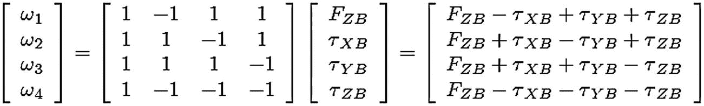

因此，本章的目标是学习设计`FZB`力以及其余三个扭矩的最通用方法。

另请注意，如果使用 SDK 类型 3（如第五章关于无人机编程方式的章节所述），此方法是有效的。如果使用 SDK 类型 2，则所述力和扭矩将直接注入飞行器，无需使用分配矩阵。最后，如果使用 SDK 类型 1 或 GUI，则你只能定义轨迹配置文件（你将无法设计自己的控制器；只能修改预装的控制器增益和路径）。

你将看到，像任何其他无人载具一样，四轴飞行器可以被分析和视为机器人或载具，在这两种情况下，控制可以是自动的，也可以不是。

在讨论这些控制器之前，让我们先来谈谈一个有用的概念：零值。

## 有用零值概念

控制目标是为了开发一个任务而引入有用的零值。

在控制理论中，通常会发现三种零值：定义零值、主导零值和近似零值。不要将这些概念与线性控制理论中的极点和零点相混淆。

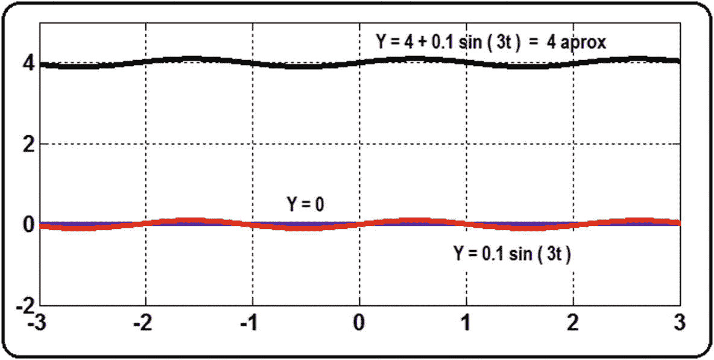

**图 3-1** 主导零值示例

* **定义零值**是一个理想的恒定值，旨在将误差或估计值趋近于此值。它也是一种静态或动态平衡，确保受力或运动平衡。
* **主导零值**是指当方程中的某一项相对于其他项过大时，方程的行为仅由主导项决定，而忽略其他项的影响。这些被忽略的项被视为主导零值。这种零值在电路和电子电路分析以及控制理论中非常常见。图 3-1 显示了一个函数的图形，其中主导效应可以近似等于 4。观察到被主导的正弦分量相对于 4 可以视为零。

另一方面，这里所称的有用零值是通过时间行为获得的。在数学上，它是任何随时间增加而趋于零的函数。

在控制理论中，广泛用作有用零值的一个函数是负指数函数。这个有用零值会随着时间推移表现出类似零的行为。注意，不存在负时间。下图只是一个展开视图：

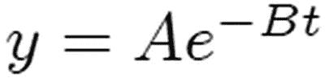

只要 `B` 为正值，该函数将始终表现出如图 3-2 所示的行为。

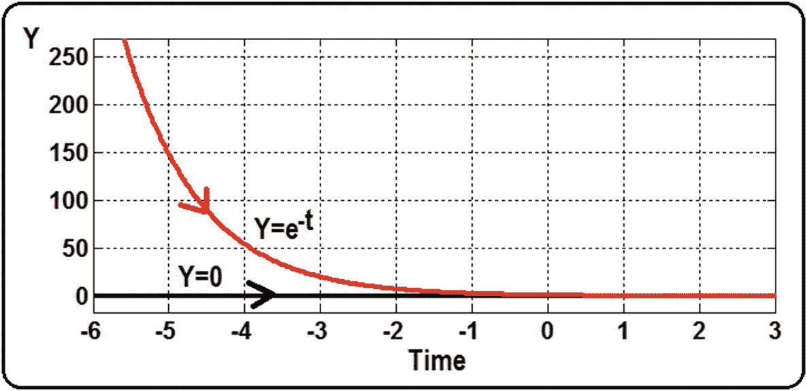

**图 3-2** 近似零值示例

请注意，有用零值是一种强制某物变为恒定零值的方法。此函数也是与此微分方程相关的解和行为：

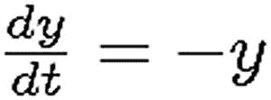

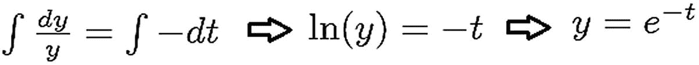

使用牛顿记法，它等同于

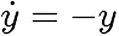

更一般地，这一系列微分方程总是得到一个递减的指数函数，只要 `B` 和 `K` 为正值，该函数就趋于零：

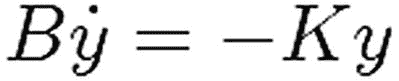

如果我们做以下变量替换，我们将得到一个称为 PD 控制器的方程：

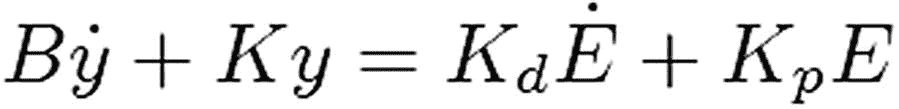

这意味着与被控误差相关的值 `E` 将趋于零，并且由于 `E` 被定义为

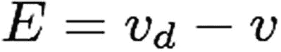

换句话说，它是变量的期望值减去实际值，例如位置或姿态：

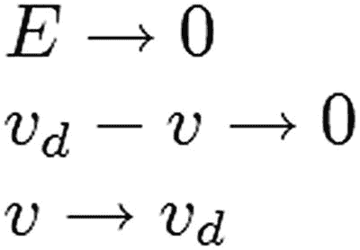

期望值将趋于等于实际值，因此我们就完成了任务！

我们稍后会用到这个有用零值概念及其 PD 应用。

请记住，一阶微分方程以及 PD 控制器有一个物理等效系统，称为无质量阻尼谐振子或弹簧-阻尼器系统。因此，比例项可以解释为诱导弹簧，微分项可以解释为诱导阻尼器；见图 3-3。所述诱导弹簧用于将实际系统拉向期望值，而诱导阻尼器用于使实际系统在该值处停止。如果只有诱导弹簧而没有诱导阻尼器，实际系统将不会停止，而是会在期望值（误差的零值）附近持续振荡。

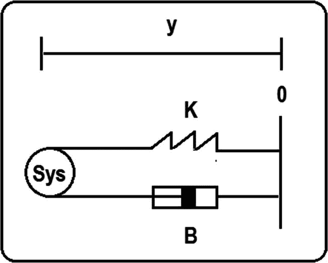

**图 3-3** PD 控制器的物理类比

另一个有用零值是二阶微分方程或质量-弹簧-阻尼器系统，也称为阻尼谐振子，条件是项 `M`、`B` 和 `K` 为正。其推导过程不太直观，属于线性控制和微分方程教材的内容。然而，就本书的目的及在给定条件下，我们只需假设该系统也是一个有用零值。

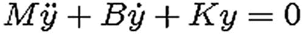

就控制而言，需要强调的是，PID 控制器的行为类似于所述质量-弹簧-阻尼器系统（至少在数学上是如此，因为在实现过程中存在物理上的考量，例如使用微分器而非积分器带来的影响）。

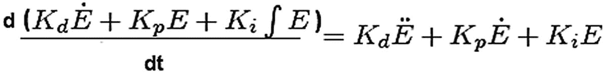

了解了有用零值概念后，让我们继续学习控制器。我们将从机器人模式控制器开始。

# 机器人模式控制

如果将无人机视为机器人进行分析，控制设计将涉及到将其视为由第三方操控或外部视角来观察。为此，控制目标是将四旋翼飞行器的一个参考点移动至给定的三维位置，同时可以选择是否调节其朝向。请参见图 3-4。

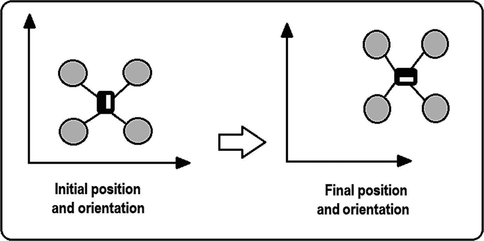
图 3-4：从第三方任务视角看的无人机机器人模式控制

现在，我们来解释一下称为无偏航变化的线性笛卡尔控制的机器人模式控制。

## 无偏航变化的完全线性笛卡尔控制

这是一种简单且基础的控制器，能够实现如图 3-5 所示的操作，即在不改变无人机朝向的情况下沿路径飞行。这在例如种植作业或房屋涂装图案中非常有用。下面我们来描述其独立和依赖的动态模块。

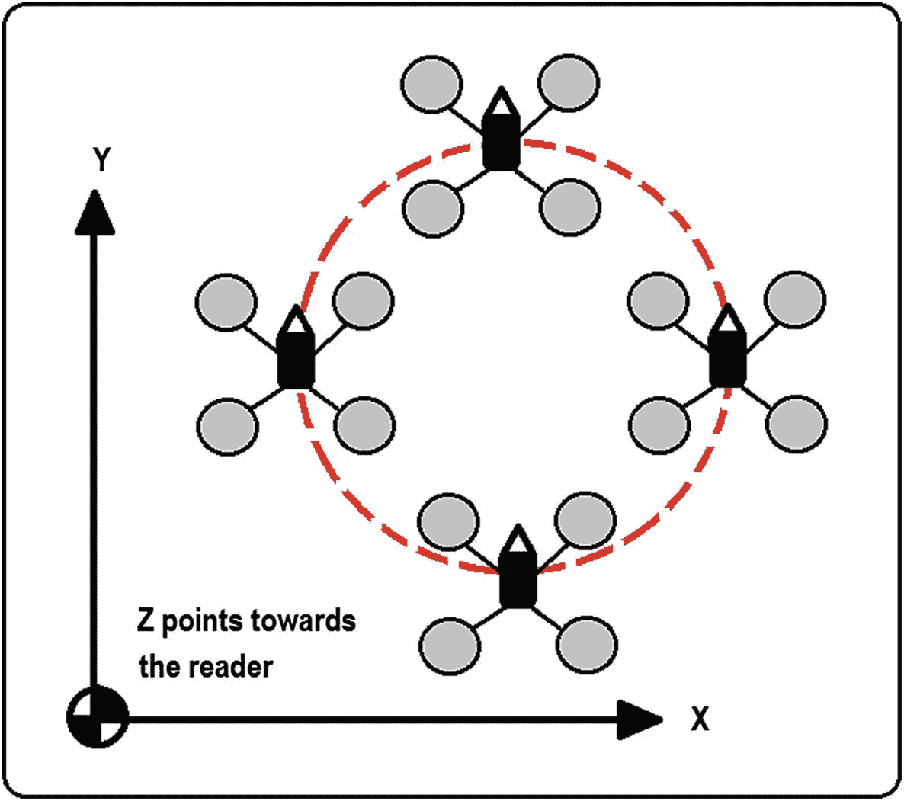
图 3-5：无偏航变化的完全线性笛卡尔控制图解说明

### 独立动态的控制

让我们回到无人机的线性化动态模型，通过分离那些不依赖于其他变量的动态（请注意，这是相对于运动变量进行的，您可以在其中识别出三个位置和三个方向）。因此，我们得到

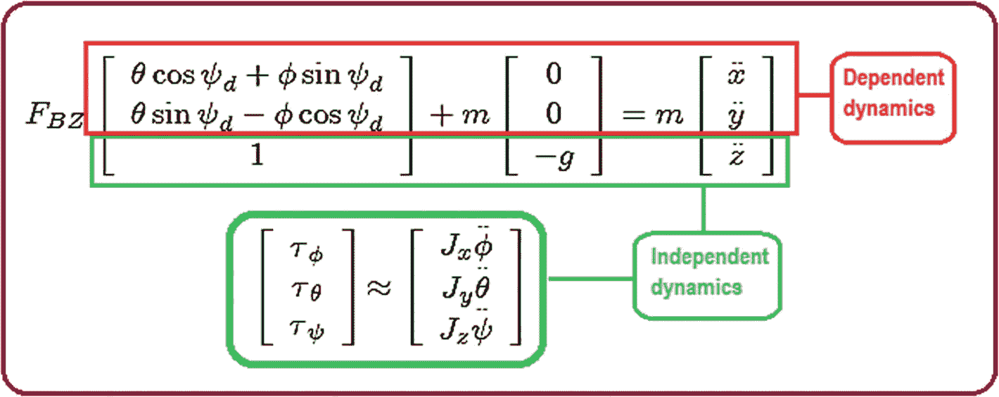

请注意，`X` 和 `Y` 方向动态依赖于 `theta` 和 `phi` 角度的动态。因此，我们隔离出那些与其他方程没有交互的方程，即 `psi` 和 `Z` 相关的方程。注意，实际的 `psi` 不同于期望的 `psi`，因为后者是一个恒定值或一条轨迹，而在我们的示例中，期望的 `psi` 将等于零。

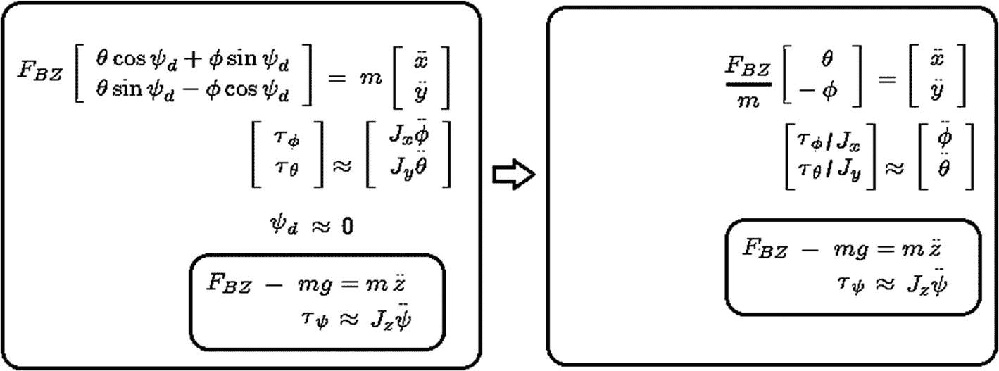

如果将 `Z` 方向上的推力定义为如下形式

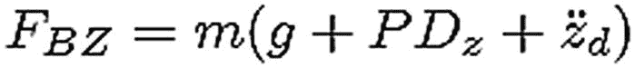

其中

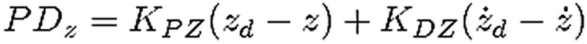

将其代入动态模型，特别是代入 `Z` 方程中，我们将得到：

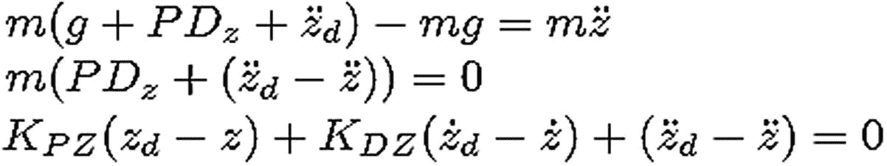

这变成了一个有用的零阻尼或阻尼谐振子。

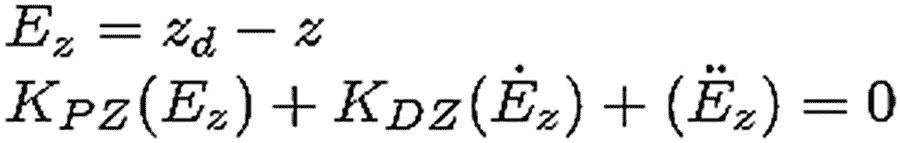

并且只要增益满足至少为正数，并符合线性控制书籍中提到的其他标准，我们知道

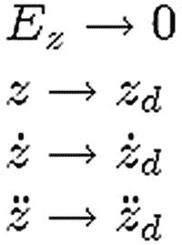

此外，根据控制理论可以证明，如果期望值为一个常数或一个其最大绝对值可以被常数限定（例如正弦或余弦）的函数，

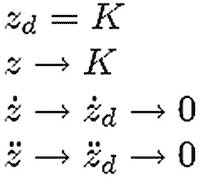

类似的推理也适用于 `PID` 控制器。您可以自行推导证明，作为练习。

这也意味着

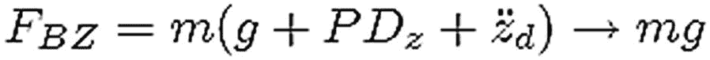

并且因此

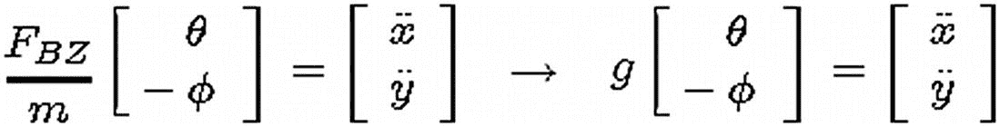

我们很快会用到这个结果。

另一方面，在实际操作和仿真中，有些人会将提出的推力控制简化为以下形式：

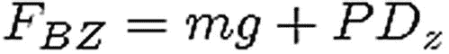

只要微分增益和比例增益足够大，它将能够正常工作，基于以下考虑：

1.  如果飞行加速度很小（这源于我们对平稳飞行的假设）。

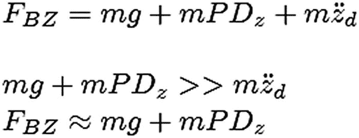

2.  如果质量是常数或被常数限定，它可以被比例增益和微分增益吸收（一个常数乘以另一个常数得到另一个常数）：

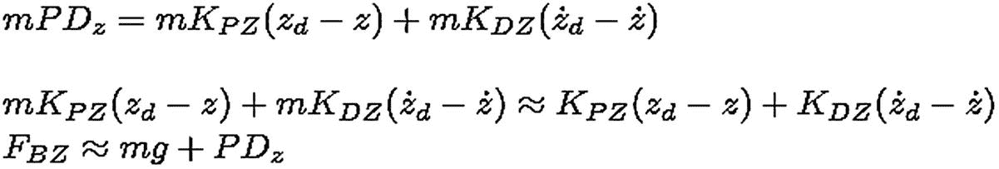

我们继续讨论与 `psi`（偏航变量）相关的方程。

在这种情况下，控制量可以定义为

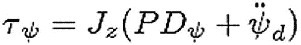

当此控制量代入偏航模型时，会得到以下结果：

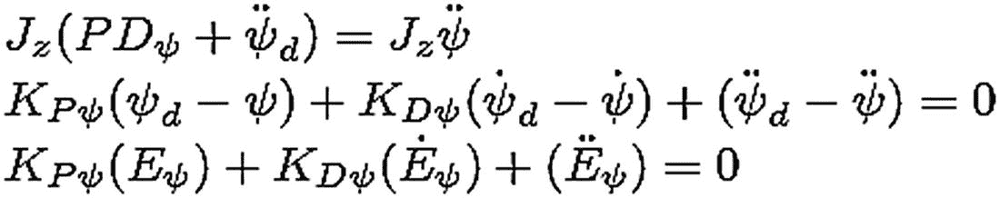

同样，如果控制器增益至少为正数，并且满足自动控制教材中描述的其他准则，我们将得到一个有用的零阻尼或质量-弹簧-阻尼系统，这意味着

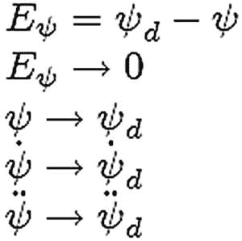

再次考虑平稳飞行条件（小加速度）和常数值的吸收。正如对变量 `Z` 的推导，我们将得到以下结果：

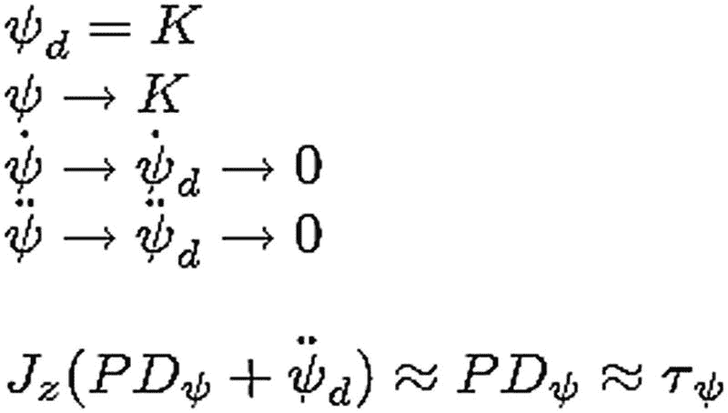

现在，我们开始控制依赖动态。

### 依赖动力学的控制

根据之前的简化，我们可以注意到剩余的系统为

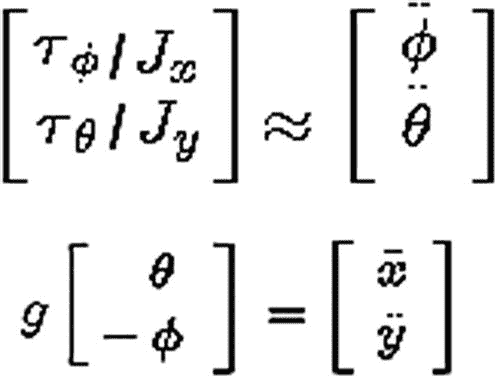

不依赖于其他变量的子系统是旋转子系统，而平移子系统则依赖于这些旋转变量。

因此，从设计旋转动力学的控制器开始是合理的。基于与偏航变量类似的论证，以及已经阐述过的平稳飞行（小加速度）和恒定吸收的原因，这里提出了滚转和俯仰的控制器：

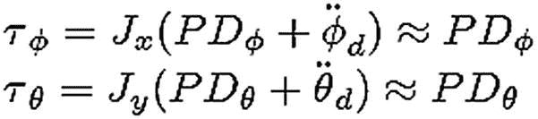

这与先前分析的变量类似，意味着

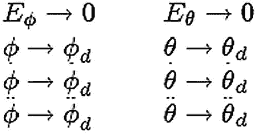

因此，依赖动力学可以通过其所依赖角度的期望值进行控制。这是合乎逻辑的，因为四旋翼飞行器能够通过滚转和俯仰倾斜在 `X` 和 `Y` 方向上移动。

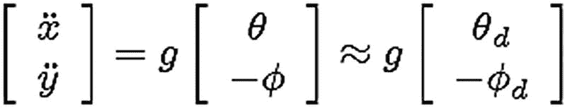

随后，`theta` 和 `phi` 的期望值以此方式选取（这被称为外环控制或嵌套控制）：

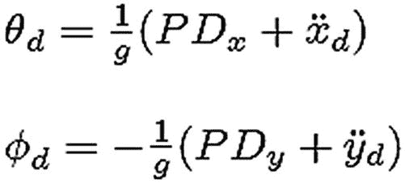

这种对平移 `X` 和 `Y` 动力学的反馈导致

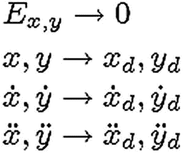

在平稳飞行、小加速度下轨迹有界以及先前使用的常数吸收的前提下，辅助控制器可以简单地设计为

总而言之，注入的控制量如下所示（请参阅下一章的仿真以观察其性能）：

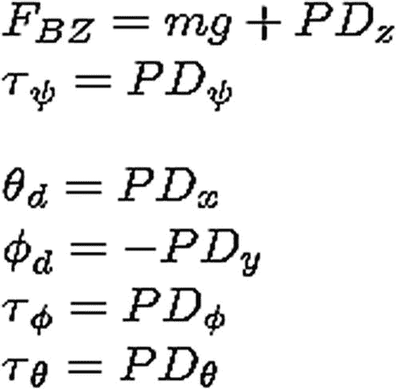

展开后如下：

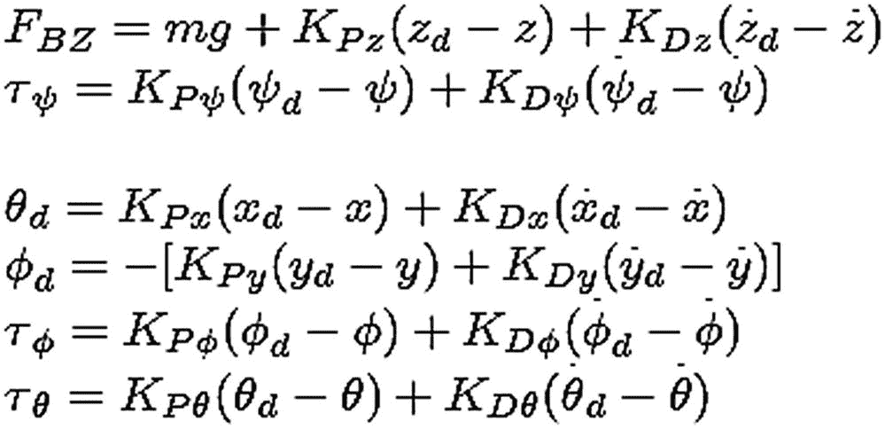

请回忆 ISO 1151–2:1985 标准的介绍，注意 `theta` 的测量是相对于 `Y` 轴进行的，但其变化会影响 `X` 方向的运动。同样，`phi` 的测量是绕 `X` 轴进行的，但其变化会影响 `Y` 方向的运动。

最后，鉴于

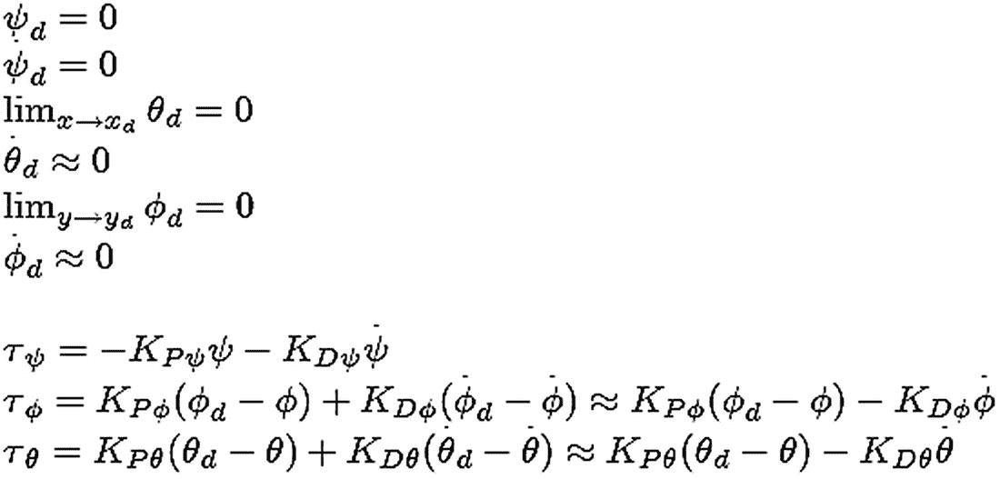

您应该注意到 `theta` 和 `phi` 的期望速度不为零，并且它们应是对应平移 PD 控制器的导数。然而，考虑到上述平稳飞行近似和变量收敛性，将期望速度设为零是一个很好的近似。

关于这种平稳飞行近似，让我们看看在此飞行模式下控制器会发生什么。

### 控制器的线性解耦

另一个重要的考虑因素是，在这种偏航角固定为零的平稳飞行中，控制器是解耦的（至少线性控制器如 PD、PID 等是如此），因此平面平移运动以及滚转和俯仰旋转运动似乎具有独立的行为，例如：

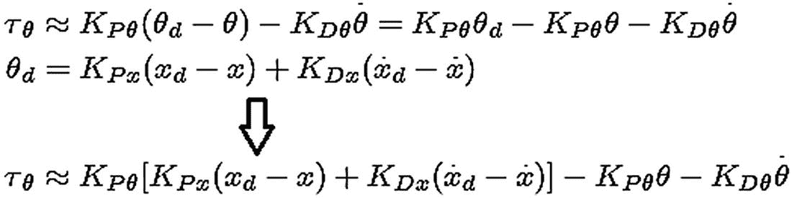

结合先前常数吸收的假设

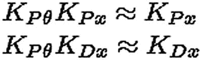

得到如下结果：

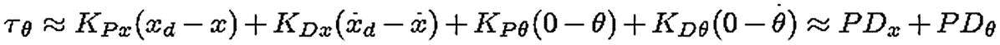

对于变量 `phi` 也能得到类似的结果。请将此作为练习。

在结束本节之前，我们来讨论一些说明。

### 说明与图形解释

从图形上看，该控制的实现顺序如图 3-6 所示。

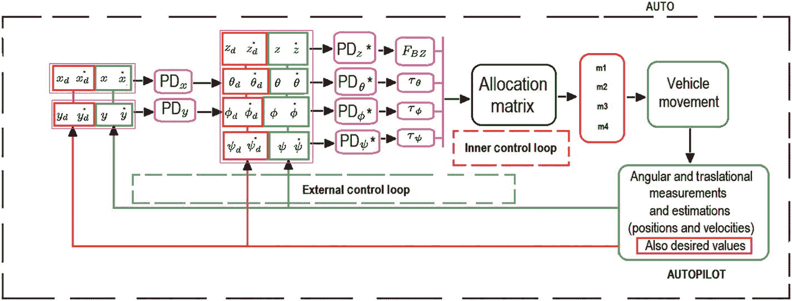

*图 3-6: 无偏航变化的完全线性笛卡尔控制图形顺序*

两种带有遥控器（半自动或手动引导模式）的版本如下。

在第一个版本中，遥控器仅改变期望值；见图 3-7。

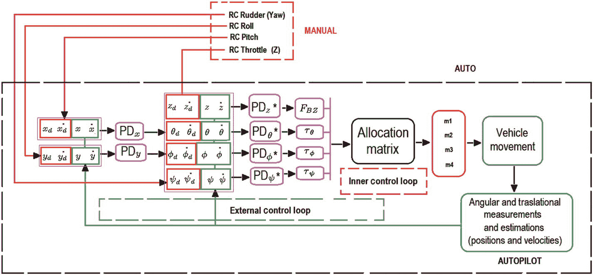

*图 3-7: 无偏航变化且通过手动遥控指令设定期望值的完全线性笛卡尔控制图形顺序*

在第二个版本中，遥控器改变力矩和力；见图 3-8。

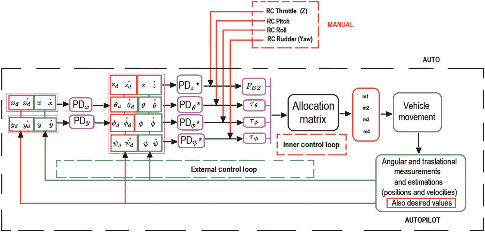

*图 3-8: 无偏航变化且通过手动遥控指令直接作用于力和力矩控制的完全线性笛卡尔控制图形顺序*

请注意，手动模式的组合可以有任意多种。在所描述的示例中，第二种模式可能很危险，因为它直接影响控制器，但如果输入的值很小且有界，则可以降低风险。

你已经学习了无偏航变化的机器人模式控制。接下来，我们进入偏航可变的情况。

# 带偏航变化的完全线性笛卡尔控制

这种控制器是前一种控制器的改进版本。现在无人机能够跟踪轨迹，并且可以修改其偏航角；见图 3-9。该操作对于记录路径内的物体、人物或建筑物非常有用，例如在监控任务中。

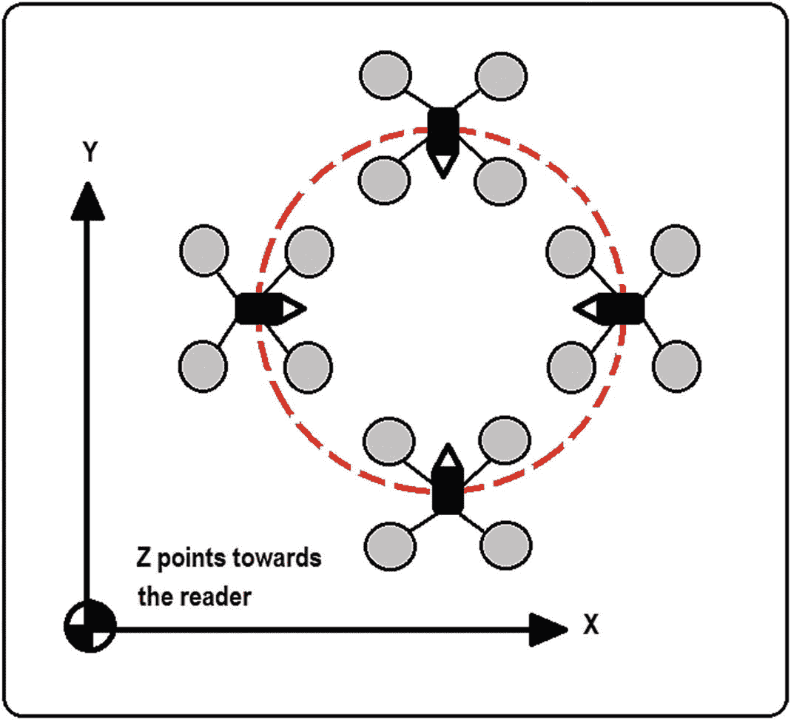
*图 3-9* – 带偏航变化的完全线性笛卡尔控制的图形表示

在这种飞行模式下，推力和扭矩控制与上一节相同：
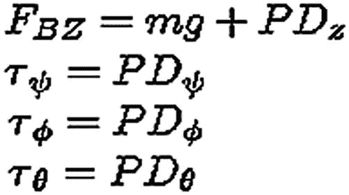

变化的是期望的`theta`和`phi`辅助控制器的设计，具体如下。由于`psi`的值不为零，`XY`动态系统无法简化：


但你可以将它们重写为如下的矩阵形式：


根据滚转和俯仰控制器，请记住：


可以提出以下辅助控制器：


将辅助控制器代入给定的动态模型：


简化后：


这表明：


将所提出的矩阵形式重写为等效但可编程的形式（这可以避免计算机进行大量矩阵乘法运算），我们得到了无人机研究中一个已知的方程：


最后，注意依赖于`psi_desired`的矩阵是一个旋转矩阵（这对于下一节中几何控制的解读将非常有用）。

有两种方法可以验证这是一个旋转矩阵：
1. 通过变换将该矩阵转化为已知的旋转矩阵：

2. 利用本书先前使用过的旋转矩阵的一个性质：


总之，本节提出的控制器如下所示（请参阅仿真部分以观察该控制器的性能）：


这些控制器的图形序列如图 3-10 所示。

*图 3-10* – 带偏航变化的完全线性笛卡尔控制的图形序列

对于遥控变体，可以通过两种方式进行适配；见图 3-11。

*图 3-11* – 使用带偏航变化的完全线性笛卡尔控制时的遥控变体

- 第一种方式是在滚转和俯仰的相应遥控控制中包含偏航动作（如同上一控制中通过偏航补偿那样）。这样，飞行器的手动操作行为将如图左半部分所示。
- 第二种方式是不包含这种变化，飞行器的手动操作行为将如图右半部分所示。

至此，你已经了解了机器人模式控制，该模式可实现平稳飞行。现在，是时候了解飞行器模式控制了，它允许更高的机动性以及特技或激烈运动。

## 飞行器模式控制

当将无人机作为飞行器进行分析时，其控制设计意味着将其视为第一人称模式、机载体验或“驾驶舱”视角。见图 3-12。为此，飞机的视线方向（也称为引导向量，即机上飞行员所具有的向量）应通过“舵”或“推进器”进行调节。与机器人模式或第三人称模式不同，旋转与平移控制器及其动力学之间的耦合程度更大，甚至完全依赖。这在数学上是一个缺点，但对于激烈或特技操作而言，其在多功能性和实用性方面也代表了一种优势。


*图 3-12* – 飞行器模式控制的图形表示（第一人称视角）

让我们从球面控制（基于舵）开始，然后是几何控制（基于推进器）。

# 球面控制（方向舵与引导向量）

以下是一种基本的运载器模式控制方法。请注意，这类控制器广泛用于轮式机器人。参见图 3-13。


**图 3-13** 球面控制的图形表示

在这类控制中，从线性笛卡尔空间转换到基于球面坐标的空间是很方便的，其中引导向量与笛卡尔分量的合向量相关联，而方向舵则与该球体的角运动相关联。这些角度是笛卡尔分量的切向投影。

## 第一步：定义合向量（引导向量）和方向舵角。

我们需记住，动力学模型由下式给出：


请注意，出于我们的目的，此模型不会简化为平滑飞行条件（线性化）。

从前面的章节可以注意到，这里有六个控制器：其中四个是物理的或力/力矩指令型，剩余两个是辅助的或与轨迹相关的：


对于这个新设计，滚转、俯仰和偏航方向的力矩控制器将保持与前几节相同：


这意味着：


需要定义剩下的三个控制器：


由于推力与笛卡尔向量相关，我们将其与引导向量关联。至于滚转和俯仰的辅助控制器（用于在平面上移动运载器），我们将它们与决定引导向量方向的方向舵相关联。

## 第二步：求引导向量和方向舵的值。

我们根据待定义的控制器重写平移或依赖的动力学方程。注意，唯一的独立变量是`psi`：


如你所见，`FBZ`以及`theta`和`phi`的期望值，可以通过整个方程组（三个未知数和三个方程）得到。还需注意，我们控制器的主要目标是使平移变量及其导数都收敛到它们的期望值。即：


求解这些方程以得到期望的方向舵和引导向量并不简单。因此，我们通过使用投影和合向量关系逐步进行。首先，用这些向量方程的标量等价形式（向量范数）来求解`FBZ`是比较方便的。

平移动力学方程按此方式重写。注意，方向舵和引导向量变量已从独立变量`psi`中分离出来：


我们求解方向舵和引导向量：


从向量获取标量的一种方法是使用点积：


因此：


注意，`FBZ`是一个标量，它包含了来自我们引导向量的信息（它的距离）。

方向舵必须以反正切模式呈现（以便与球面坐标兼容）。它们由以下方程求得。注意，偏航角是一个独立的方向舵。


这些方程的形式蕴含了在笛卡尔坐标系中表达的球面坐标，其中半径是引导向量的大小`FBZ`，球面角由方向舵（滚转、俯仰和偏航的期望值）决定。

## 第三步：注入控制器。

通过用以下三角恒等式替换原始平移动力学中找到的引导向量大小和方向舵的值来实现：


得到如下结果：


例如（这是一个繁琐但必要的示例，可借助数值计算程序如`MATLAB`来展开）：


因此：


同样地，可以得到X和Y方向动力学的结果。

这意味着我们可以提出以下内容：


由此得到：


在实际应用中，并且在前面描述的平滑飞行条件下，我们可以简单地说：


总结来说，引导向量和方向舵按如下方式注入：


我们称此为运载器模式控制、第一人称模式控制或机载模式控制，因为这是驾驶舱内飞行员的行为方式。此外，这种类型的控制已在轮式机器人中使用了几十年。

图 3-14 以示意图的形式展示了这种控制器（请记住，这里提出的控制方法可以是`PD`以外的任何方法，但总体结构是相同的）。


**图 3-14** 球面控制的图形流程

如前面章节所述，可以集成遥控器。

你已经了解了无人机的球面控制。现在我们将教你一种最强大的控制器——几何控制。

# 无人机几何控制导论（推进器与导引矢量）

前一案例基于三角函数原理。本节将介绍一种更高级的、基于旋转矩阵理论的控制器。

此处的飞行器将不再配备导引矢量和三个方向舵（如前一案例中，`psi` 被视为独立方向舵，`phi` 和 `theta` 亦然）。在本节案例中，飞行器将配置一个导引矢量和三个推进器，参见图 3-15。想象我们通过指令将机载的“方向盘”或“方向舵”替换为控制前后、上下和左右运动的“推进器”。这种技术在机器人领域也广泛应用，并关联着用于通过三个正交矢量修正或描述物体姿态的 `noa` 矢量；其中两个矢量可设计，仅一个矢量独立于其他两者。


图 3-15

几何控制图示

注意，`noa` 矢量因其在机械臂操作中的应用而得名，尤其在机械爪或机器人手中：`a` 是表示机械爪接近方向的单位矢量，`n` 是相对于 `a` 的法向矢量，`o` 则是同时垂直于 `a` 和 `n` 的矢量，用于确定机械爪的朝向。参见图 3-16。


图 3-16

`noa` 矢量在机械臂中的图示

本节要求你熟练掌握以下工具（所有有用的属性会在使用时注明，但你仍需自行详细了解）：度量空间中的范数与距离（绝对值、二次距离等）；矩阵不变量（迹、行列式等）；旋转矩阵及其导数性质；矩阵的转置及其性质；矩阵的迹；以及叉积的等价矩阵表示——帽子积及其逆运算——倒 V 积。

让我们从平移部分开始。

## 平移控制

该控制方法采用基于旋转矩阵的替代运动学表示，并使用了非线性化的通用动力学模型。如下所示：


不再使用 Tait-Bryan 角运动学（该情形下控制基于三角函数），此处的运动学模型基于旋转矩阵，而控制基于这些矩阵的性质。

两者之间的等价关系其实非常简单。只需记住，从 `S` 矩阵中，你可以得到机体坐标系下的角速度分量，以及它们与世界坐标系下滚转、俯仰、偏航角速度之间的关系（这在上一章中已有证明）：


你可能会问，将模型从基于方向舵的操作改为基于推进器的操作有何优势。我们预先告知你，当机体角度较大时（这与我们此前所有设计中假设的平稳飞行模式相反），这种变换极为有用。换句话说，它适用于剧烈和特技飞行动作。

根据上一段所述，注意我们无法直接使用欧拉角进行运算，而只能通过其等效旋转矩阵间接地工作。

平移动力学控制运用了一个在控制理论中称为“湮灭器”的概念。注意，在我们所依据的 Tae Young Lee 的文章（参见附录）中，坐标轴的方向与我们此处采用的正值方向相反。请记下这些反转的坐标轴，以便在本文与上述文章之间进行对照。

一个包含导引矢量信息的推力控制器如下：


注意这里存在点积，因为 `FBZ` 是一个标量。同时注意单位矢量 `[0 0 1]` 的存在。这就是 `FBZ` 在无人机坐标系中的位置。

前述旋转矩阵的一个约束条件是：


稍后你会看到，这些 `b` 矢量（即期望旋转矩阵的分量）被用作一种 `noa` 矢量，其中 `b3` 等效于矢量 `a`，`b2` 等效于 `o`，`b1` 等效于 `n`。参见图 3-17。


图 3-17

构成期望旋转矩阵的 `b` 矢量

注意：


其中，我们的第一个设计约束条件如下：


这意味着三点：

-   第一，需要为旋转矩阵设计一个控制器，使其行为如同期望旋转矩阵。这将在本节稍后完成。

-   第二，飞行器的导引矢量与推力相关联，而推力又与飞行器的 `Z` 轴或 `b3` 相关联。

-   第三，矢量 `b3` 被归一化，以确保不超过旋转矩阵所允许的最大值（正交归一性）。

这些条件同时发生，如下所述。

利用 `FBZ` 是标量这一事实，我们将动力学模型重写如下：


我们将包含导引矢量的推力代入平移动力学方程中：


这看起来似乎是一种不相关的行为，但现在我们用 `1` 来除以包含旋转矩阵的项。

其中 `1` 等于（请记住，旋转矩阵的逆矩阵乘以该旋转矩阵的结果是单位矩阵）


这样


然后，进行重写（请记住我们的第一个约束条件）


最后（这里我们使用了点积与转置运算符之间的关系）


因此，平移动力系统的闭环方程变为


这产生了三个质量-弹簧-阻尼系统，并且通过适当选择比例和微分值意味着（详尽的正式证明见 Tae Young Lee 的文章，你可以在附录中查阅）


现在，我们继续讨论旋转部分。

## 旋转控制

现在是这个控制器中最困难的部分：通过调节旋转矩阵来设计姿态控制。为此，我们考虑所有闭环控制器都基于误差。误差是期望值与测量值之间的距离。对于标量，这个距离就是简单的减法。类似地，我们将定义两个旋转矩阵（测量矩阵和期望矩阵）之间距离的概念。

首先，我们已经知道矩阵 `R` 由欧拉角定义为


并且期望矩阵包含三个“推进器”。这是因为在旋转矩阵中，每一列都代表一个笛卡尔坐标轴的行为。同时，如前所述，每一列都是满足法向量条件的单位向量，而正交条件由以下定义满足：


如前所述，这些向量是`noa`类型的向量，并且它们的定义要求彼此之间正交归一。这解释了叉积和归一化量的存在。最后，对于`b1d`，由于它是两个归一化向量或单位向量的叉积，因此它也是归一化或单位的。

请注意，唯一独立的向量是`Bdes`和`b3d`，并且唯一可以设计的向量是`Bdes`，因为`b3d`必须满足我们的约束条件以调节`FBZ`。而对于`b1d`，它被强制满足与其余两个向量的正交归一性。

`Bdes`的一个示例如下


该向量与`b1d`和`b2d`相关联，并允许例如绕`ZB`轴的旋转（一种强制但功能性的偏航调节，由于`b1d`和`b2d`与`b3d`的相互作用，并未完全实现）。

在定义了测量旋转矩阵和期望旋转矩阵之后，让我们回顾一些关于距离的概念。两个标量之间的距离是减法。两个向量之间的距离，在众多定义中，是二次向量范数（其分量标量差值的平方和再开平方根）。对于矩阵，也有多种距离的定义。这里我们将使用`Frobenius`范数，因为其具有不变性（迹和行列式是矩阵中的不变量，而`Frobenius`范数基于迹）。

正如你所见，所有距离要么是标量，要么是标量函数。如果`a`和`b`是标量值，则距离为


如果它们是向量，一种非常常见的距离形式是


并且向量分量（单个差值）可以通过这种方式获得（了解这些分量有助于设计三维控制）：


其中，这里使用的算子（倒三角符号，也称为`nabla`或`del`）被称为梯度，是一种方向导数，它从依赖于多个变量的标量函数（本例中为距离函数，它本身已经是依赖于多个变量的标量）中获取向量分量。

如果`a`和`b`是矩阵，则`Frobenius`距离为


请注意，减法的顺序在维度上是扩展的。

好的，作为一名高级文档工程师和翻译员，我将遵循您的指示，将给定的英文文本翻译成中文，并严格遵守格式规范。

---

执行以下操作（对旋转矩阵有效，并使用迹积性质）：


得到：


在这种情况下，由于我们有一个标量且需要设计一个三维姿态控制，我们需要一种方法从上述距离定义中获得一个三维向量。请记住，在定义了测量矩阵与期望矩阵之间的距离后，我们必须从中生成三个误差，以便生成飞行器的三个力矩。

一种方法是应用方向导数的概念（这里我们将使用一种称为平凡化右导数的方向导数），并考虑到我们的距离是一个多变量的标量函数，当我们进行方向求导时，我们将得到一个向量表达式，其方式类似于我们对两个向量之间的距离应用梯度（`nabla`）时得到的结果。

平凡化右导数广泛用于此类控制器，但鉴于其解释的复杂性，我们仅将其作为一种工具使用。更多信息，请参见附录中`Bullo`和`Taeyoung Lee`的文献。需要注意的是，此处使用`1/4`的值是为了方便，使得最终结果以`1/2`的形式表达，这对于非线性控制中通过矩阵性质或导数来消除常数值特别有用。但是，您可以使用任何其他乘数。结果只会改变在过程中需要携带的数值。


观察三点：

-   对于迹的情况，由于它是线性运算，所以迹的导数就是导数的迹。

-   此外，我们利用了旋转矩阵的通用导数会产生旋转矩阵乘以一个反对称矩阵（`S`）这一事实。但是，请注意，所述反对称矩阵与第2章中描述的之前的反对称矩阵不同。这是因为之前的导数是关于时间的导数，而这是关于变化方向的导数。然而，会生成一个依赖于变化率（`n`）的反对称矩阵。

-   最后，请注意单位矩阵的导数为零，剩余导数仅影响旋转矩阵的项，其中`Rd`被视为一个“常数”，因为它独立于`R`（此导数是关于`R`进行的）。

总之，使用了以下性质：


术语`S(n)`是一种表示，用于指示存在一个向量`n`，它被转换为一个反对称矩阵，以便避免使用叉积，并允许使用矩阵乘积。

从现在开始，我们将使用`hat`和`vee`符号。`S(n)`的等价符号是`hat`算子，它意味着从向量获取一个反对称矩阵。


仔细观察，你会发现我们还没有得到一个可以使用的向量，因为迹是一个标量，而且应用迹的乘积本身也是一个矩阵。

然而，有三个有用的事实。

第一个是存在以下恒等式：


为此，我们使用`vee`算子，它是`hat`算子的逆，意味着从反对称矩阵获取向量：


第二个是，以下矩阵以及一般的任何其他矩阵，都可以分解为一个反对称部分和一个对称部分，如下所示：


这样：


第三个事实是，对称矩阵与反对称矩阵乘积的迹为零，因此只有反对称矩阵乘积的迹能够保留：


利用将两个反对称矩阵乘积的迹与它们等效的`vee`向量的点积联系起来的等式，我们得到：


最后，我们寻找的误差向量就是这个：


为了制定我们的姿态控制（也称为方向控制），除了方向误差分量（此处由旋转矩阵给出，用于引入比例部分）外，还需要一个角速度分量（用于引入微分部分）。这是通过以下方式完成的。

第一个尝试是提出：


简单的逻辑表明，这些角速度（测量值和参考值）是向量，并且可以直接应用该方程中解释的内容：


然而，期望角速度和测量角速度不能直接相减，因为它们位于不同的空间中。因此，我们将使用基于旋转矩阵导数的推导。见图 3-18。


图 3-18 期望和实际旋转矩阵导数所在空间的图形表示。

简化来说，我们指出旋转矩阵的速度与其自身相切。注意，旋转矩阵及其导数都不是向量，而是矩阵，尽管我们可以使用它们的特征向量来想象和图形化表示它们。旋转矩阵导数相对于其旋转矩阵的正交性的数学证明，由旋转矩阵的导数方程给出，该方程中出现了一个依赖于角速度的反对称矩阵，并且由于该反对称矩阵等价于叉积，因此结果是一个正交矩阵。

由于期望旋转矩阵与实测旋转矩阵不在同一个空间中，因此需要进行图 3-19 所示的过程。


图 3-19 用于统一旋转矩阵导数的图形序列。

该图形序列的结果产生以下方程：


由于需要角速度之差，我们需将之前的方程改写为如下形式：


如果将第二项乘以单位矩阵（请记住，这等价于乘以 1）：


该方程被改写为关于 `R` 的表达式：


这可以改写如下（利用乘积转置的性质）：


有两个有用的恒等式。请注意，为了避免使用一个巨大的帽子符号，它被放置在括号的末尾，这仅意味着它必须应用于括号内运算的结果：


在我们将要推导的方程中使用这些恒等式（特别是其第二项），我们得到：


由于两个反对称矩阵之和是另一个斜对称矩阵：


我们寻找的角速度误差简单地就是向量：


注意，`wd` 不是一个任意值，必须通过如下方式作为 `Rd` 的依赖项获得：


请注意，在我们旋转动力学的模型中，存在以下项：


它的间接使用方法（这个将在随后得到补偿）如下获得：


必须注意到：


因此：


应用斜对称矩阵的定义：


我们很快就会用到这个结果。

回到我们原始的旋转动力学，它可被改写如下：


通过使用我们之前推导出的旋转误差和角速度误差的定义，我们可以提出以下控制律：


其中 `KR` 和 `Kw` 是标量（其思想是对相应的误差向量进行相同比例的缩放，以保持它们的正交归一比例）。

如果我们将这个控制器代入原始方程，我们得到：


该方程需要对所包围的项进行动态补偿。我们将在下一节教您如何做到这一点。

## 动力学补偿与补充说明

可以看出，角速度的导数项仍然存在于方程中。正如我们之前所做的那样，可以使 PD 增益足够大以克服此项，或者对其进行补偿。为此，请记住我们推导出了这个方程：


因此，我们可以修改所提出的控制律，加入以下内容：


将修改后的控制律代入旋转动力学，我们得到：


该系统并不完全是一个质量-弹簧-阻尼器系统，但其相似性，以及由 Lee、Leok 和 McClamroch 在《基于 SE(3) 几何方法的四旋翼无人机复杂机动控制》和同一作者在《基于 SE(3) 的四旋翼无人机几何跟踪控制》中利用李雅普诺夫方法推导的必要条件（您可以在附录中查阅），意味着：


此处我们省略了这些推导过程，因为它们逐步执行起来甚至比本节中关于误差定义及其与动力学相互作用的解释还要冗长。第一步是找到旋转误差和角速度误差之间的关系，这也是前述作者所推导的。第二步是继续下一节的内容。

总之，与无人机在非平稳飞行中相关的非线性系统控制如下：


注意，该控制基于一个由三个推进器（期望旋转矩阵的分量）调节的引导向量，而这些分量又依赖于同一个引导向量。

图形化表示如图 3-20 所示（*请注意，完整运算已在先前的方程中描述，并且如您所见，可以添加动态效应以获得更精确的控制器*）。

如果您想添加遥控器，它们可以修改 `X`、`Y`、`Z` 和偏航的期望值，或者修改扭矩和力，如同先前设计的情况。


**图 3-20** 几何控制的图形序列

下一节将介绍用于证明系统稳定性的李雅普诺夫方法。这将结合之前推导的方程，使您能够更轻松地深入理解前面提及的参考文献。


# 李雅普诺夫稳定性简介

本节适用于希望进一步了解前述文章中基于李雅普诺夫稳定性理论的扩展形式证明的读者，这些内容是对上节的补充。李雅普诺夫方法共有两种，一种针对线性系统，另一种针对非线性系统。考虑到第二种方法的适用范围更广，且线性系统只是其中的一个特例，我们将通过示例简要说明其用法，并给出图形化解释。

## 第一步

给定一个系统，例如不含控制输入的一阶系统和阻尼谐振子。请记住，正如前文所述，我们是在对动态系统施加闭环控制器后得到这些系统的。


可以提出一种虚拟能量。这是一个关于多个变量的标量函数，除了在其最小值处（零值，或完全静止条件，或稳定条件）之外，该函数始终为正。通常情况下，该函数取决于我们正在分析的变量。


对于第一个系统，满足上述条件的函数如下所示（注意其图形表示是一个凹抛物线）：


对于第二个系统，另一个满足这两个条件的函数示例如下（其图形表示是一个同样凹陷的椭圆抛物面）：


从现在起，请注意李雅普诺夫函数通常用字母 `V` 表示（这可能是因为 `V` 看起来像一个凹函数的图形表示）。此外，请注意这些函数经常被除以 2，以便在对李雅普诺夫平方函数求导时避免出现因子 2。

观察可知，李雅普诺夫函数通常具有图 3-21 所示的形状（至少当它仅依赖一个或两个变量时可以这样表示）。它们看起来像凹形容器，但不一定都是弯曲的。有些看起来像倒金字塔（该概念可以扩展到多于两个变量的情况）。


**图 3-21**  
李雅普诺夫函数的三维示例

## 第二步

李雅普诺夫函数对时间的导数必须为负，或至少为半负定，并且必须依赖于我们关心的一个或多个变量。这与图形类比密切相关。请记住，李雅普诺夫函数是凹的封闭容器，从其表面上任意一点观察，其斜率均为负。见图 3-22。这意味着，"放置"在该能量表面上的系统状态将"滑向"表面的最低点，即稳定条件或零能量状态，简单来说，系统将在能量的最小值处停止。


**图 3-22**  
李雅普诺夫函数的导数（三维和二维示例）


对于一阶系统：


并将该李雅普诺夫函数所针对的系统代入：

该导数为半负定，且完全或部分依赖于我们所关注的状态。

对于阻尼谐振子系统，我们有


并将该李雅普诺夫函数所设计的系统代入：


该导数为半负定，且完全或部分依赖于我们所关注的状态。（在这种情况下，它不依赖于误差，而是依赖于误差的导数。稍后我们将看到如何处理这个问题。）

如果我们对一阶系统提出了


那么只要常数 `Kp` 为正，李雅普诺夫函数的导数就不会改变其负定性，李雅普诺夫函数也不会改变其正定性。你很快就会记住这个事实。

请注意，我们只能说明李雅普诺夫导数所依赖的那些状态会趋向于李雅普诺夫函数的最小能量行为；也就是说，它们趋向于 0。如果其余的状态没有出现，我们就无法对它们做出任何保证，并且必须设计并尝试一个新的李雅普诺夫函数。

### 步骤 3

通过使用辅助假设，即所谓的 Barbalat 引理或 Lasalle 原理（它们根据你所拥有的系统类型来使用，因此你必须研究它们），当 `V` 及其导数为零时，必须评估系统的状态是否也趋向于零。这是因为可能会出现局部谷底，如图 3-23 所示。在这些谷底中，能量值为零，但系统不会达到李雅普诺夫函数的最小值，而是陷入局部陷阱。


**图 3-23**  
李雅普诺夫函数中的局部和全局最小值

对于第一个例子，让我们看看当 `V` 的导数为零时会发生什么：


并且还有


这个结果也可以通过系统方程得到：


因此，


对于第二个系统，我们采用相同的方法：


并且还有


通过代入求得的 `e` 值及其一阶导数，求解 `e` 的二阶导数：


这个结果也可以通过系统方程得到：


因此，


此外，一种非常常见的处理李雅普诺夫函数的方法是基于二次型。

例如，阻尼系统的李雅普诺夫函数可以重写如下：

如果你看到  


# 李雅普诺夫方法与稳定性分析

直接关注点在于证明这些矩阵分别对应于正和负，或者在线性代数中被称为正定矩阵、负定矩阵或半定矩阵。利用线性代数理论，通过特征值准则可以得出第一个矩阵是正定的，而第二个矩阵是负半定的，这与原始结果吻合。这种矩阵表示在许多控制系统的文献中都可以找到，包括 Taeyoung Lee 在之前提到的文章中给出的演示。

提出李雅普诺夫函数并证明其导数（通常包含系统及其控制器）是负定的，是一门称为非线性控制理论的科学中的广阔分支。每个动态系统都代表了通过李雅普诺夫函数寻找其稳定性的一个挑战；甚至每个单独的结果都可能代表一本书或一门新科学。

在这项研究中，能够与控制器进行代数运算的能力非常有帮助。例如，在第 4 章中，有一节专门介绍状态空间表示，其中指出一个非线性微分方程组（包括多旋翼飞行器）可以表示如下：


其中 `x` 是系统的状态，`u` 是其控制信号。

这样，按照李雅普诺夫方法


并且期望得到如下结果：


实现这一目标的方法是通过适当地修改控制量 `u`。

例如，让我们分析一个非自由输入（存在力 `u` 而非简单的 0）的二阶系统（阻尼谐振子）的情况。

目标是使变量 `Y` 趋向于一个称为 `Yd` 的期望值。

我们将有两个方程：真实系统方程和控制方程。

所以我们有两种选择：

1.  测试一个控制器，如果工作正常，我们直接尝试证明闭环系统的稳定性。这并非完全推荐，但大多数人这样做，尤其是因为几乎所有系统都可以用 PD 或 PID 控制器工作，而人们只想回答原因。

    如前所述，我们有一个系统和已经可用的控制器：

    

    分析闭环系统：

    

    做出一些主导假设。以下内容对正值且大于 1 的 `Kp` 和 `Kd` 成立：

    

    重新命名：

    

    并同样重命名其导数，我们得到这个系统：

    

    最后，其闭环稳定性的证明方式与之前分析过的二阶系统类似：

    

2.  证明原始系统的稳定性，并在过程中设计控制器。

    例如，提出这个李雅普诺夫函数，然后是其导数：

    

    我们将系统的动态引入到李雅普诺夫导数中：

    

    此时，还不能说

    

    但可以设计 `u`，例如：

    

    那么该项

    

    再次，我们可以做出这些假设

    

    在这些考虑条件下

    

请注意，正如前面提到的 Taeyoung Lee 的文章所述，有时并不严格证明李雅普诺夫函数及其导数是正定和负定的，而只是说它们的某些方程项是有界的（这意味着它们的最大值和最小值不能超过某个值），并且由于这些项是有界的，它们的影响可以被其他负定或正定的项所主导。此外，这些界限有助于找到飞行器的物理限制及其运行范围。

最后必须提到，在线性系统中，使用李雅普诺夫方法进行稳定性分析是可选的，因为它们有许多其他工具。但在非线性系统中，就像几何控制的情况一样，李雅普诺夫方法是最流行的选择，这不是因为它简单（事实上并不简单），而是因为它有特定的方法。该方法如图 3-24 所示。


图 3-24  

李雅普诺夫方法的常用顺序

你已经了解了机器人和飞行器的模式控制器，以及李雅普诺夫理论的基础。让我们以关于期望值（记住它们是定义我们控制器的误差的一个组成部分）的一节来结束本章。

## 期望值的定义：调节、轨迹跟踪或点对点跟踪

在第四章中，我们将验证此处解释的大多数控制器，并会注意到（尤其是在几何控制情况下）路径类型会改变控制调节的方式（这不仅体现在增益的选择上，也体现在特定项的包含与否上）。

这样，我们就可以思考：是否存在一种不直接依赖执行时间，而直接依赖车辆机动性（例如其速度、加速度、加加速度（加速度的一阶导数），甚至冲击度（加速度的二阶导数））来跟踪轨迹的方法。

让我们从定义一些与期望值相关的概念开始。其他概念可以在附录中 Kelly 的文章中找到（例如，为了定义触觉误差）。

**调节**：调节任务是指系统被置于一个恒定值。在这种情况下，一个很好的例子是多旋翼飞行器的悬停任务，这意味着飞行器到达空间中的某个点，并在那里保持“静态”位置。

**轨迹跟踪**：这是指飞行器被指令跟随一个时间相关的参考信号（如圆形、余弦等）。基本任务是在关键时间点跟随参考信号，只要电机和系统本身能够以所需的速度、加速度等运动，就能实现。这里关键是复现参考信号及其运动特性，例如飞行器追逐。

**点对点跟踪**：这是前一种情况的特例，其中考虑了无人机最大特性（速度、加速度等）。其目标是让我们的无人机在不超出其自身极限值的情况下沿路线飞行，避免因惯性突变而强制驱动电机并损坏飞行器。

它涉及将给定的轨迹分割成特定的段，并将该轨迹作为点与点之间的运动来执行；见图 3-25。这样设计者就能够控制目标点之间的速度和加速度（或更高阶导数）曲线，以确保这些曲线低于飞行器的最大值。实现方法有很多，例如样条插值、埃尔米特插值、`n` 次 Catmull-Rom 多项式插值，或使用三角级数、指数傅里叶级数进行插值。定义点对点值的主要考虑是为了实现电机平稳运行。复现参考信号的执行时间并不重要，重要的是复现参考信号本身；这在例如物体搜索任务或为身体康复执行预定运动时很有用。


图 3-25

# 当跟踪平滑函数时的点对点路径近似

请注意，点与点越接近，点对点跟踪就越接近轨迹跟踪行为。换句话说，插值阶数越高，飞行器的行为就越不像“机器人运动”，但这会以损伤飞行器执行器为代价。这代表了机动性能与电机安全性之间的权衡。还需记住，点与点越接近，越容易发生过采样误差，从而可能损坏飞行器。相反，当点与点之间的距离较大时，可能会发生欠采样跟踪。您将从给出的示例中看到，点与点之间的中间值不一定遵循轨迹的原始轮廓。

还需注意，如果待跟踪路径本身相对于飞行器的极限是缓慢且平滑的（例如，跟踪一个低频余弦信号），那么点对点跟踪可以被轨迹跟踪所替代（为了实验，请前往几何控制部分的仿真环节，修改代码以跟踪从低频到高频的三角函数）。

当然，当无法使用标准函数定义轨迹，或者待跟踪的函数不光滑（例如方形、三角形等）时，点对点跟踪就非常有用。如果我们考虑具有最小时间、加速度或其他运动曲线导数的轨迹，以及多点轨迹或点对点轨迹、单变量或多变量轨迹、平移、旋转或组合轨迹、基于多项式或三角函数的轨迹等等，轨迹规划本身就能写成一本完整的书。

我们继续。假设我们想要跟踪图 3-26 中显示的方形路径（正如你将看到的，跟踪带有顶点的图形或路径对任何控制器来说都是一个挑战）。


图 3-26  

## 通过多项式跟踪非光滑函数的位置、速度和加速度曲线

这条路径的一部分意味着我们必须经过 `ABC` 点。基于最短距离的直觉告诉我们可以沿直线行进（通过使用两个一次多项式）。

问题在于，当拐点出现时，直线轨迹的导数会呈现突变形状（导数是一个阶跃函数）。为了避免这种情况，可以使用一个二次多项式（但现在方形轨迹变成了一个近似，只有 `ABCD` 点被精确到达）。

按照同样的推理，二次多项式在速度层面上不再有突变，但在加速度层面上却会出现突变（再次发生在两个多项式之间的拐点或过渡点），这同样会损坏电机。那么，解决方案就是简单地使用三次多项式轨迹。在附录中提到的 Kumar 及其团队的 MOOC、文章和论文中，可以找到基于上述物理推理和欧拉-拉格朗日方程代价函数最小化的更深入论证。

请注意，即使如此，加速度的导数仍会继续呈现突变，并且随着每个导数层面引入新的多项式阶数，这种情况会无限延续下去。然而，这并不完全重要，因为我们感兴趣的是平滑的速度值，对应的加速度很小（趋于零），即使有这些突变，其影响也不重要。

但是，如果我们对剧烈运动感兴趣，那么我们必须考虑 Kumar（见附录）所示的高阶多项式，这些多项式在冲击度层面（加速度的二阶导数）进行点对点规划。

从现在开始，我们可以引入与车辆自身能产生的速度相兼容的速度值，具体方法如下（始终考虑一个起点和一个终点，尽管也有多点的算法）。

首先，我们注意到我们有一个所需的三次多项式，并且每个期望值都有一个这种类型的多项式。这意味着如果我们有兴趣为变量 `X`、`Y` 和 `Z` 定义期望值，我们必须为每个变量重复该过程：


进入 `/path/to/xxx` 目录并找到 `xxx.json`。

在表达式 `cvar = avar + bvar` 中，加法运算符（`+`）将 `avar` 和 `bvar` 相加，得到它们的和 `cvar`。

在 `List.of(arg0, arg1, arg2)` 中，`List` 接口的工厂方法 `of()` 接受一系列元素，并返回一个包含这些元素的只读列表。

然后我们像这样调用 `cmd` 命令：`cmd arg0 arg1 arg2`。

```
if (condVar > someVal) {console.log("xxx")}
```

# 仿真器类型

我们有四种仿真器：

## 带符号的数字仿真器
它们只需要方程，具体来说是系统的数学模型及其控制器。这类仿真器是任何能够求解这些方程的程序。根据模型的复杂程度，程序可能能够或无法求解。以无人机为例，可以使用标准编程语言（如编写求解常微分方程的数值算法，例如欧拉法、`RK4` 等）来实现。这种仿真器至少需要两个代码部分：求解器和待求解的系统。

## 带模块的数字仿真器
与上一种情况类似，但它不是用符号表示方程和控制器，而是采用基于模块的图形化表示。这是一种比符号编程更直观的编程形式，并且便于组件互联（除非组件数量众多）。已知的例子有 `LabView`、`Simulink` 或 `Scilab/Scicos`。在使用模块的情况下，求解器本身就是命令接口，而待求解的系统则是一个包含示意图的文件。

## 动画仿真器
在这种情况下，它们是具有三维图形的界面，能够模拟一个系统。例如 `V-rep`、`Gazebo`，或 `Mission Planner` 的图形用户界面及其虚拟的 `SITL`（软件在环）仿真器。通常，它们由两部分组成：动画对象及其世界，以及建模文件。许多这类仿真器都包含物理引擎，能够模拟风或气压等环境效应。

## 交互式仿真器
这里是指能够与上述任何类型的仿真器进行交互，或与硬件进行交互的能力。例如 `X-Plane`，或处于 `HITL`（硬件在环）模式的 `Mission Planner`。

在本文中，我们将重点讨论两种最易于使用（从安装角度来看）的仿真器：数字仿真器。当然，它们需要数学知识，但用户可以根据需要将其设计得简单或复杂。此外，许多仿真器可以按照下文所述的方法组合使用并进行交互。

在确定了我们将使用哪种仿真器后，接下来我们继续介绍状态空间表示法，这是一种能让我们与仿真器协同工作的工具。

# 状态空间表示法

如果你有一个`n`阶微分方程，可以将其转化为`n`个一阶微分方程。这在仿真器中便于使用一个统一的积分模块，或者处理向量和矩阵运算，而非标量运算。


例如，回想一下质量-弹簧-阻尼系统是一个二阶系统：


这样一来，它将需要两个状态空间变量。在这种情况下，最方便的选择是选取那些相对于系统阶次而言阶次较低的变量作为状态空间变量。在这个方程中，我们选择位置和速度作为状态空间变量：


对变量求导后，我们得到了所需的表达式：


最后一个方程可以通过系统的原始方程求解：


代入状态空间变量后，结果如下：


这样，正如预期，只保留了这两个一阶方程。

根据其动力学模型，一个四旋翼飞行器可以有十二个状态空间变量（六个二阶方程；请记住，其中三个方程与平动动力学有关，其余三个与转动动力学有关）：


如果我们按以下方式选择状态空间变量（这是一种可能的方案，交替选择位置和速度），我们得到：


同时还要注意，控制输入`u`有四个值。它们是推力以及三个力矩：


另一种可能的方案是先选择所有位置，再选择所有速度，或者简单地采用与这里所示不同的另一种顺序。无论选择哪种方案，在后续使用中都必须保持一致。

对我们的仿真有用的第二个工具是模块表示法。下面我们就来讨论它。

# 框图表示

在此情况下，框图是状态空间变量的图形化表示。它们非常适用于绘制图表，或在使用 `Simulink` 或 `Labview` 等旨在运用框图的视觉化语言进行仿真时发挥作用。

回到质量-弹簧-阻尼器示例，具体来说是其在状态空间变量中的表示，我们可以执行以下操作来获得其框图表示。

首先，注意有两个状态空间方程，因此需要两个主框。这些框代表积分器；见图 4-1。在此示例中，我们为状态添加了标签，这是一种有利于编程和理解的优良实践，但这种标签化处理并不常见。


图 4-1
常微分方程的框图表示，第一步

标准规定，放在框右侧的是输出，左侧的是输入。我们将从定义`x1`的导数开始。

我们进行如图 4-2 所示的连接，该连接定义了`x1`的导数。


图 4-2
常微分方程的框图表示，第一个方程连接

同样，你可以注意到`x2`的导数是求和的形式。因此，我们需要另一个框。你还应注意到，在该框的输出端必须有一个增益；见图 4-3。


图 4-3
常微分方程的框图表示，第二个方程连接

最后，按照之前的逻辑，我们得到图 4-4。


图 4-4
常微分方程的框图表示，完整连接（无控制）

尽管该系统只有几个方程和项，但其框图表示却需要许多图标和连接器（同时请注意，`u`的值尚未定义，这可能会增加框的数量）。

一种简化方法是使用矩阵和向量，将方程归并到一个框内，如图 4-5 所示。


图 4-5
将系统置于“文本文件”中的简化框图表示（无控制）

这样，诸如`u`这样的聚合项可以简化为几行代码，而不是大量的框。此外，例如变量`u`可以是一个依赖于轨迹的 PD 控制器，而轨迹本身又依赖于时间。见图 4-6。请注意，你需要一个时钟模块。


图 4-6
将系统置于“文本文件”中的简化框图表示（有控制）

注意，如果系统有很多方程，且每个方程都有多个项，例如四旋翼飞行器的情况，这种简化的框图模型就非常方便。这正是我们在下一节将要使用 `Simulink`-`MATLAB` 组合来做的。

# 使用 Simulink 和解释型 MATLAB 函数进行仿真

如果你想使用免费软件，如 Scilab 或 Python，建议阅读本节。基于你在这里学到的知识以及本章的参考文献（你可以在附录中找到），你可以搜索上述程序和编程语言中的等效命令或模块。

请记住，通过这种组合（MATLAB/Simulink）所拥有的多个库，你可以与动画或交互式仿真软件进行交互，例如 Gazebo、X-plane、Ardupilot 库、Pixhawk 自动驾驶仪或带有物理引擎的 CAD 软件。

让我们继续。这是 Simulink 执行仿真的众多模式中一种特殊模式。它提供了框的最简化形式之一的实用性，其中专门使用文本文件来编写系统及其控制器的方程。这样，一组包含多个项的方程被归入文本文件，而一个通用模板则置于框文件中。框文件包含预编程的方程求解器，如欧拉法或 RK4 法，并设计用于简便的互联和处理。此方法适用于 MATLAB 2012b 及以上版本。这种表示和仿真类型最大的优点在于，可以对输入和输出信号进行多种修改和使用（滤波、图形编辑、引入延迟等）。这在那些不使用框的仿真器中是无法实现的。

### 所需模块

这里描述的 Simulink 模块至少具有以下三个属性之一：输入信号、输出信号以及设置自身参数的方式。见图 4-7。


以下七个模块是我们最常用的。

#### `Interpreted MATLAB Function`

此模块用于将包含系统动力学模型及其控制器的文本文件与模块文件链接起来。见图 4-8。


此模块的输入是一个包含 *n* 个信号（状态、时间、辅助值等）的总线或数据通道。其输出也是一个包含 *m* 个信号（状态、辅助值、待绘制信号等）的总线或数据通道。

我们关心的该模块重要属性如下（请勿修改其他属性）：

1.  包含系统动力学模型及其控制器的文件名。此名称必须与包含所述模型的文本文件名称一致，且不包含文件扩展名。
2.  输出总线的大小（以变量数量衡量）。

修改完这些参数后，只需点击`OK`并关闭模块的对话框即可。见图 4-9。


请注意，我们使用前面的模块是为了实用，但您也应该研究一下 `MATLAB Function` 和 `S-function` 模块。

#### `Integrator`

用于对信号总线进行积分。见图 4-10。


此模块用于对信号进行积分。在 Simulink 中有不同类型的积分器，但就我们的目的而言，这是我们要用的一个。

此模块的输入是一个包含 *n* 个信号（例如，系统状态的导数）的总线或数据通道。其输出也是一个包含 *n* 个信号（例如，系统状态）的总线或数据通道。

我们唯一需要修改的参数是初始条件，即我们系统仿真的起始点。如果只有一个方程，只需输入一个标量。如果有多个方程，则必须按如下方式输入初始值：`[val1 val2 val3 valN]`。

修改完此参数后，我们只需点击`OK`并关闭属性对话框。见图 4-11。


#### `Scope`

此模块允许我们在仿真期间或仿真结束时，直接在模块框图中查看仿真的图形。见图 4-12。


此模块没有输出。其输入是包含待绘制 *n* 个信号的总线。其相关参数如下（见图 4-13）：


1.  **自动缩放按钮**：用于在仿真结束或期间调整图形。
2.  **属性按钮**：按下此按钮将出现一个辅助菜单。我们只关心两个选项：
    -   **输入轴数**：决定示波器中有多少个独立的图形。示波器的每个输入都是一个包含 *n* 个变量的独立总线。此选项通过**通用**菜单访问。
    -   **限制数据复选框**：该复选框通常处于激活状态，仅显示最近 5,000 个数据点。如果您想查看长时间的仿真，则必须取消勾选此复选框。此选项通过**历史记录**菜单访问。

与之前的情况一样，您必须点击`OK`并关闭辅助菜单以保存修改。

如果您想修改图形的外观和颜色，也可以尝试 `Scope` 参数中的**样式**菜单。

#### `To Workspace` 模块

此模块允许在 Simulink 界面之外使用特定数据，以进行进一步处理或编辑（例如，导出图形以编辑其图表，用于出版物）。见图 4-14。


此模块只有一个输入，即一个数据总线。

对我们来说，其相关的参数只有两个（见图 4-15）：


1.  将从 MATLAB 控制台用于编辑信息的变量名。
2.  输出数据的类型。在我们这里，为了简化数据访问，必须始终为 `array`。

#### `Selector`

此模块用于从总线中选择一个或多个信号。见图 4-16。


模块的输入是一个包含 *n* 个变量的数据总线。其输出是另一个包含 *p* 个变量的总线，其中 *p* 的范围是从一个信号到全部 *n* 个信号。*p* 的大小完全取决于您想要提取哪些信号。

其相关参数为（见图 4-17）：


1.  输出信号索引，如果只选择一个信号，则使用标量格式；如果需要多个信号，则使用向量格式 `[val1 val2 val3 valN]`。
2.  输入总线的大小。

我们来分析给定的示例。请注意，它在图形上很直观。图中的模块接收一个包含三个变量的数据总线，其输出是另一个包含两个变量的总线，具体来说是输入总线的第一个和第三个值。

#### `Mux`

它是一个多路复用器，其功能是从两个或多个数据总线的输入生成单个总线。相反的模块称为 `Demux`。此模块对于在示波器的单个通道中绘图非常有用。我们只需从不同模块中选择所有感兴趣的变量，然后使用 `Mux` 将它们发送到示波器。见图 4-18。


其输入是几个各包含 *n* 个变量的总线，其输出是一个包含来自所有输入总线的所有收集变量的单个总线。

对于我们的应用，其唯一相关的参数是输入总线的数量，如图 4-19 所示。


图 4-19

## 多路复用器模块参数

`时钟`：这对于定义轨迹（时变函数）非常有用。此模块没有输入，其唯一输出是仿真时间（此时间并非实时时间）。参见图 4-20。


图 4-20

时钟模块

就本书而言，此模块没有必须修改的参数。

`其他可能有用的模块`：更多信息，请参考增益模块、导数模块、求和模块、常量模块、数学函数模块、转向标签模块以及饱和模块等众多其他模块。

现在您已了解如何使用模块、状态空间变量以及我们将与 MATLAB 一起使用的基本模块，我们可以开始进行仿真了。

## 四轴飞行器示例，文本文件

请注意，如果我们只想模拟无人机并且只有一种基本编程语言（如 C++ 或 Python），当然是通过集成一个 ODE 求解器，那么这个文件就足够了。

请记住，通过添加更多的动力学效应，模型的精度可以达到您期望的任何程度。在此案例中，我们将使用之前没有空气动力学效应的模型，但它们足以用于测试控制设计中的一些细节，例如平面 PD 不能超过 2Pi 的值（请记住，这些 PD 代表期望角度，且它们不能达到大于 2Pi 的值）。改进模型的一种方法是添加更多效应，或通过随机函数在状态中引入噪声，甚至是通过在信号中创建延迟来模拟传感器的行为。名为 `quadmodel.m` 的文本文件如代码清单 4-1 所示。

```matlab
function outp=quadmodel(inpt)
% system inputs: states and time
% x1-x, x2-xdot, x3-y, x4-ydot, x5-z, x6-zdot
% x7-theta, x8-thetadot, x9-phi, x10-phidot, x11-psi, x12-psidot
x1=inpt(1);
x2=inpt(2);
x3=inpt(3);
x4=inpt(4);
x5=inpt(5);
x6=inpt(6);
x7=inpt(7);
x8=inpt(8);
x9=inpt(9);
x10=inpt(10);
x11=inpt(11);
x12=inpt(12);
t=inpt(13);
% constant parameters: mass, inertial values, gravity
m=1;
g=9.8;
Jx=0.2;
Jy=0.2;
Jz=0.2;
% control gains: notice the small values at x and y gains because they
% define an angle
kpx=0.1;
kdx=0.09;
kpy=0.1;
kdy=0.09;
kpz=1;
kdz=0.7;
kptet=3;
kdtet=1;
kpfi=3;
kdfi=1;
kppsi=3;
kdpsi=1;
% planar desired values
x1d=5;
x2d=0;
x3d=-6;
x4d=0;
% planar PD: remember that these PD define desired angular values
PDx=(kpx*(x1d-x1))+(kdx*(x2d-x2));
PDy=(kpy*(x3d-x3))+(kdy*(x4d-x4));
% altitude and attitude desired values
x5d=8+sin(t);
x6d=cos(t);
x7d=PDx;
x8d=0;
x9d=-PDy;
x10d=0;
x11d=0;
x12d=0;
% altitude and attitude PDs
PDz=(kpz*(x5d-x5))+(kdz*(x6d-x6));
PDteta=(kptet*(x7d-x7))+(kdtet*(x8d-x8));
PDfi=(kpfi*(x9d-x9))+(kdfi*(x10d-x10));
PDpsi=(kppsi*(x11d-x11))+(kdpsi*(x12d-x12));
% vehicle's forces and torques
Fbz=PDz+(m*g);
taoteta=PDteta;
taofi=PDfi;
taopsi=PDpsi;
% vehicle's dynamic model xp notation implies xdot or xpoint or x
% derivative
x1p=x2;
x2p=(Fbz/m)*((x7*cos(x11d))+(x9*sin(x11d)));
x3p=x4;
x4p=(Fbz/m)*((x7*sin(x11d))-(x9*cos(x11d)));
x5p=x6;
x6p=(Fbz/m)-g;
x7p=x8;
x8p=taoteta/Jy;
x9p=x10;
x10p=taofi/Jx;
x11p=x12;
x12p=taopsi/Jz;
% output: derivatives of the system states and vehicle's force and
% torques
outp=[x1p;x2p;x3p;x4p;x5p;x6p;x7p;x8p;x9p;x10p;x11p;x12p;Fbz;taoteta;taofi;taopsi];
end
```

代码清单 4-1

四轴飞行器模型代码，一个期望偏航角为零的控制器

**注意**：包含系统动力学模型的文本文件（扩展名为`.m`的文件）的名称必须与我们在函数行中编写的函数名称完全相同，如图 4-21 所示。


图 4-21

用于解释型 MATLAB 函数模块 `quadmodel.m` 的文本文件

请记住，作为 MATLAB 和 Simulink 的替代方案，您可以使用 Scilab，它带有一个名为 Scicos 或 Xcos 的模块仿真器（具体取决于版本）。Scilab 是一个免费软件工具，您需要找到此处显示的七个模块的等效模块（例如，Scicos 用户自定义函数）。

## 四轴飞行器示例，模块文件

在下面名为 `blockquad.slx` 的模块文件中（见图 4-22；在 2013a 之前的 Simulink 版本中，扩展名为 `.mdl`），我们使用了之前提到的所有七个基本模块。请注意，模型的复杂性保留在文本文件中。因此，模块的数量得以减少。此模块文件可用作任何其他模型的模板。只需更改总线的尺寸和包含系统的文本文件即可。


图 4-22

用于使用解释型 MATLAB 函数模块的模块文件 `blockquad.slx`

图 4-22 中显示了需要修改的参数的特写视图。

## 模拟器的使用

如上所述，要解微分方程，需要有一个求解器或求解方法，以及包含该模型或与该模型相关的微分方程的文件。

使用所提出的 Simulink 方法时，这两个文件必须放在同一个文件夹中，如图 4-23 所示。


图 4-23：文件执行时的位置

如果 `blockquad.slx` 文件不存在，请点击 Simulink 库图标并创建此文件，如图 4-23 所示。

如果 `quadmodel.m` 文件不存在，则必须使用 `NewScript` 按钮生成该文件，如图 4-24 所示。切勿尝试从扩展名为 `.m` 的文件启动仿真。必须从模块图文件启动。


图 4-24：文本文件附加说明

进入模块文件，并在文本文件中填入所提供的代码后，你会在 Simulink 窗口中看到一些下拉菜单。如果进入“仿真”菜单，然后选择“模型配置参数”选项，你可以从多种求解器中进行选择。见图 4-25。


图 4-25：Simulink 模型配置参数

我们想要修改的特性如下：

- **步长类型**：在此处选择步长是固定步长还是可变步长。这意味着仿真的执行时间要么以固定的时间单位不变地执行，要么随着仿真的演进进行调整。

- **步长持续时间**：如果选择固定步长，步长的持续时间将决定仿真的精度以及随之而来的仿真速度。步长越小，仿真越详细（这将体现在图形和结果质量上），但运行时间也更长。

- **方法**：在此处选择要使用的求解器类型。最常见的是欧拉法和 RK4 法。

方法的选择与步长持续时间的组合会影响结果和执行时间。建议使用相对较小步长的简单方法。例如，具有 0.001 秒固定步长的欧拉法对于四轴飞行器来说是一个可接受的选择；见图 4-26。通常，我们将在其余的仿真中使用此组合。


图 4-26：Simulink 求解器、时间及步长选择

选择好求解器并设置了上述特性后，你必须定义要仿真的总时间。点击“确定”，关闭辅助窗口，并保存更改。参见图 4-27 的左侧。


图 4-27：Simulink 仿真的最终说明

按下播放按钮并等待结果；见图 4-27。请注意，仿真时间和实际时间并不相同。仿真时间取决于机器处理器，并且我们希望仿真能尽可能快地执行。如果不是这样，10,000 秒的仿真时间意味着要等待将近 3 个小时。

在模块文件中点击任意示波器，仿真图形就会显示出来；见图 4-28。在此示例中，系统状态通过给定的控制器和在 `quadmodel.m` 文件中设置的参考值收敛到期望值。点击示波器菜单中的自动缩放按钮会很方便。


图 4-28：仿真结果与自动缩放按钮

如果我们希望使用示波器之外的图形，可以使用 `To Workspace` 模块和 MATLAB 命令窗口；见图 4-29。


图 4-29：使用 `To Workspace` 模块

在给出的示例中，两个数据总线被发送到了工作区：名为 `time` 的仿真时间，以及名为 `forcTorq` 的力和力矩。

一旦仿真运行完毕，只需进入 MATLAB 命令窗口并输入以下内容来使用上述数据：`plot(time, forcTorq)`。将会显示如图 4-30 所示的图形。


图 4-30：从命令窗口绘图

请注意，此处开发的仿真将忽略电机效应，因为它们专注于控制飞行器的重心。假设由于先前指出的对称性、平衡性和质点分布等因素，分配矩阵仅对向电机的控制传输产生线性影响。如果你想分析电机的影响，只需从仿真中获取推力和力矩信号，并将这些值乘以相应的分配矩阵即可（显然，需要包含缩放因子以使其与实际电机兼容）。具体操作如代码清单 4-2 所示。

```matlab
function outp=allocquadmodel(inpt)
% 系统输入：状态与时间
% x1-x, x2-xdot, x3-y, x4-ydot, x5-z, x6-zdot
% x7-theta, x8-thetadot, x9-phi, x10-phidot, x11-psi, x12-psidot
x1=inpt(1);
x2=inpt(2);
x3=inpt(3);
x4=inpt(4);
x5=inpt(5);
x6=inpt(6);
x7=inpt(7);
x8=inpt(8);
x9=inpt(9);
x10=inpt(10);
x11=inpt(11);
x12=inpt(12);
t=inpt(13);
% 恒定参数：质量、惯性矩、重力
m=1;
g=9.8;
Jx=0.2;
Jy=0.2;
Jz=0.2;
% 控制增益，注意：为了可视化电机效果，我们降低了原有的微分增益
kpx=0.1;
kdx=0.03;
kpy=0.1;
kdy=0.03;
kpz=1;
kdz=0.7;
kptet=3;
kdtet=0.5;
kpfi=3;
kdfi=0.5;
kppsi=3;
kdpsi=1;
% 平面期望值
x1d=5;
x2d=0;
x3d=-6;
x4d=0;
% 平面 PD：记住，这些 PD 定义了期望的角度值
PDx=(kpx*(x1d-x1))+(kdx*(x2d-x2));
PDy=(kpy*(x3d-x3))+(kdy*(x4d-x4));
% 高度与姿态期望值
x5d=8+sin(t);
x6d=cos(t);
x7d=PDx;
x8d=0;
x9d=-PDy;
x10d=0;
x11d=0;
x12d=0;
% 高度与姿态 PD
PDz=(kpz*(x5d-x5))+(kdz*(x6d-x6));
PDteta=(kptet*(x7d-x7))+(kdtet*(x8d-x8));
PDfi=(kpfi*(x9d-x9))+(kdfi*(x10d-x10));
PDpsi=(kppsi*(x11d-x11))+(kdpsi*(x12d-x12));
% 飞行器力与力矩
Fbz=PDz+(m*g);
%Fbz=20;
taoteta=PDteta;
taofi=PDfi;
taopsi=PDpsi;
% 飞行器动力学模型
x1p=x2;
x2p=(Fbz/m)*((x7*cos(x11d))+(x9*sin(x11d)));
x3p=x4;
x4p=(Fbz/m)*((x7*sin(x11d))-(x9*cos(x11d)));
x5p=x6;
x6p=(Fbz/m)-g;
x7p=x8;
x8p=taoteta/Jy;
x9p=x10;
x10p=taofi/Jx;
x11p=x12;
x12p=taopsi/Jz;
% 此处通过分配矩阵引入电机效应
W=[1,-1,1,1;1,1,-1,1;1,1,1,-1;1,-1,-1,-1]*[Fbz;taoteta;taofi;taopsi];
w1=W(1);
w2=W(2);
w3=W(3);
w4=W(4);
% 输出：系统状态导数和飞行器力与力矩
%outp=[x1p;x2p;x3p;x4p;x5p;x6p;x7p;x8p;x9p;x10p;x11p;x12p;Fbz;taoteta
%taofi;taopsi];
% 这里我们将上述行的结尾修改为用电机转速替代力与力矩，Simulink® 文件无需修改
outp=[x1p;x2p;x3p;x4p;x5p;x6p;x7p;x8p;x9p;x10p;x11p;x12p;w1;w2;w3;w4];
end
```

列表 4-2 `Allocquadmodel` 代码，控制器设置期望偏航角为零，并修改为显示每个电机值

如果分析新的图表，现在角变量大约在 30 秒时达到稳定效果，而 X 和 Y 方向存在明显振荡；见图 4-31。这会影响每个电机的行为，至少持续约 30 秒，之后它们会趋于一致工作；见图 4-32（无人机将保持固定且姿态不变，仅改变高度；这样电机将表现出相同的行为）。


图 4-32 各电机的动作


图 4-31 为观察电机动作而修改的仿真（注意刻意设计的振荡）

现在，`quadmodel.m`文件按照列表 4-3 的指示进行修改，以实现可变偏航控制，见图 4-33。`blockquad`文件保持不变。


图 4-33 可变偏航控制仿真

```matlab
function outp=quadmodel2(inpt)
% 系统输入：状态与时间
% x1-x, x2-xdot, x3-y, x4-ydot, x5-z, x6-zdot
% x7-theta, x8-thetadot, x9-phi, x10-phidot, x11-psi, x12-psidot
x1=inpt(1);
x2=inpt(2);
x3=inpt(3);
x4=inpt(4);
x5=inpt(5);
x6=inpt(6);
x7=inpt(7);
x8=inpt(8);
x9=inpt(9);
x10=inpt(10);
x11=inpt(11);
x12=inpt(12);
t=inpt(13);
% 恒定参数：质量、惯性矩、重力
m=1;
g=9.8;
Jx=0.2;
Jy=0.2;
Jz=0.2;
% 控制增益
kpx=0.2;
% 有时由于噪声或控制相互作用，微分增益可能大于比例增益
% 尝试相反设置并观察结果行为
kdx=0.35;
kpy=0.2;
kdy=0.35;
kpz=1;
kdz=0.7;
kptet=5;
kdtet=2;
kpfi=5;
kdfi=2;
kppsi=3;
kdpsi=1;
% 平面期望值
x1d=5;
x2d=0;
x3d=-6;
x4d=0;
% 平面 PD：记住，这些 PD 定义了期望的角度值
PDx=(kpx*(x1d-x1))+(kdx*(x2d-x2));
PDy=(kpy*(x3d-x3))+(kdy*(x4d-x4));
% 高度期望值
x5d=8+sin(t);
x6d=cos(t);
% 偏航期望值
x11d=0.3*sin(t)+0.9;
x12d= 0.3*cos(t);
% 横滚和俯仰期望值，尝试将 x11d 改为 x11
x7d=(1/g)*((PDx*cos(x11d))+(PDy*sin(x11d)));
% 尝试将 x8d 从零改为 x7d 的导数
x8d=0;
x9d=(1/g)*((PDx*sin(x11d))-(PDy*cos(x11d)));
% 尝试将 x10d 从零改为 x9d 的导数
x10d=0;
% 高度与姿态 PD
PDz=(kpz*(x5d-x5))+(kdz*(x6d-x6));
PDteta=(kptet*(x7d-x7))+(kdtet*(x8d-x8));
PDfi=(kpfi*(x9d-x9))+(kdfi*(x10d-x10));
PDpsi=(kppsi*(x11d-x11))+(kdpsi*(x12d-x12));
% 飞行器力与力矩
Fbz=PDz+(m*g);
taoteta=PDteta;
taofi=PDfi;
taopsi=PDpsi;
% 飞行器动力学模型
x1p=x2;
x2p=(Fbz/m)*((x7*cos(x11d))+(x9*sin(x11d)));
x3p=x4;
x4p=(Fbz/m)*((x7*sin(x11d))-(x9*cos(x11d)));
x5p=x6;
x6p=(Fbz/m)-g;
x7p=x8;
x8p=taoteta/Jy;
x9p=x10;
x10p=taofi/Jx;
x11p=x12;
x12p=taopsi/Jz;
%输出：系统状态导数和飞行器力与力矩
outp=[x1p;x2p;x3p;x4p;x5p;x6p;x7p;x8p;x9p;x10p;x11p;x12p;Fbz;taoteta;taofi;taopsi];
end
```

Quadmodel2 代码，控制器设置偏航角可变。

最后，展示了几何控制的仿真。我们使用一组与前述 Taeyoung Lee 发表文献中类似的轨迹，但为了应用简单的 PD 控制器，采用了较慢的运动曲线。如果你想进一步深入，可以修改以下代码，添加必要项，直至实现上述文章中的高速性能。

列表 4-4 展示了`geoquad.m`文件。

# Geoquad 代码，几何控制器

```matlab
function outp=geoquad(inpt)
% 系统输入：状态
% x x 导数 y y 导数 z z 导数
x1=inpt(1);
x2=inpt(2);
x3=inpt(3);
x4=inpt(4);
x5=inpt(5);
x6=inpt(6);
% w 和 R（角速度与姿态）
w1=inpt(7);
w2=inpt(8);
w3=inpt(9);
r11=inpt(10);
r12=inpt(11);
r13=inpt(12);
r21=inpt(13);
r22=inpt(14);
r23=inpt(15);
r31=inpt(16);
r32=inpt(17);
r33=inpt(18);
% 还需要 R 期望的导数
r11dp=inpt(19);
r12dp=inpt(20);
r13dp=inpt(21);
r21dp=inpt(22);
r22dp=inpt(23);
r23dp=inpt(24);
r31dp=inpt(25);
r32dp=inpt(26);
r33dp=inpt(27);
% 时间
t=inpt(28);
% 常量参数：质量、惯性值、重力
m=1;
g=9.8;
Jx=0.2;
Jy=0.2;
Jz=0.2;
% 根据分量构建期望旋转矩阵
Rdp=[r11dp,r12dp,r13dp;r21dp,r22dp,r23dp;r31dp,r32dp,r33dp];
% 同时构建旋转矩阵和反对称的角速度矩阵
R=[r11,r12,r13;r21,r22,r23;r31,r32,r33];
S=[0,-w3,w2;w3,0,-w1;-w2,w1,0];
% 控制增益
kpx=0.3;
% 有时由于噪声或控制交互，
% 微分增益可能大于比例增益
% 尝试相反的情况，观察结果行为
kdx=0.5;
kpy=0.3;
kdy=0.5;
kpz=0.7;
kdz=0.5;
KR=50;
Kw=30;
% 笛卡尔平动期望值
% 这是一个螺旋轨迹
x1d=0.4*t;
x2d=0.4;
x3d=0.4*sin(t/2);
x4d=0.2*cos(t/2);
x5d=0.6*cos(t/2);
x6d=-0.3*sin(t/2);
% 平面 PD 控制
PDx=(kpx*(x1d-x1))+(kdx*(x2d-x2));
PDy=(kpy*(x3d-x3))+(kdy*(x4d-x4));
PDz=(kpz*(x5d-x5))+(kdz*(x6d-x6));
% 主推力
Fbz=dot(([PDx;PDy;PDz]+[0;0;m*g]),(R*[0;0;1]));
% 尝试提高这些运动轮廓的角频率，
% 从而增加速度和加速度以扰乱控制回路。
% 在这种情况下，添加上述的完整控制器或改进版本，
% 因为这里我们只是模拟一个简单的 PD 控制器。
% Rd 定义：注意通过 Bdes 矢量间接调节偏航角（圆形运动）
psid=t/3;
Bdes=[cos(psid);sin(psid);0];
b3d=([PDx;PDy;PDz]+[0;0;m*g])/norm([PDx;PDy;PDz]+[0;0;m*g]);
b2d=cross(b3d,Bdes)/norm(cross(b3d,Bdes));
b1d=cross(b2d,b3d);
Rd=[b1d,b2d,b3d];
% 这里将期望旋转矩阵分解为其分量，
% 以便作为向量输出该模型，我们需要按此顺序发送它们以计算其导数
r11d=Rd(1,1);
r12d=Rd(1,2);
r13d=Rd(1,3);
r21d=Rd(2,1);
r22d=Rd(2,2);
r23d=Rd(2,3);
r31d=Rd(3,1);
r32d=Rd(3,2);
r33d=Rd(3,3);
% 定义旋转和角速度误差
Rmul=transpose(Rd)*Rdp;
eRM=(transpose(Rd)*R)-(transpose(R)*Rd);
w=[w1;w2;w3];
wd=[Rmul(3,2);Rmul(1,3);Rmul(2,1)];
ew=w-(transpose(R)*Rd*wd);
eR=[eRM(3,2);eRM(1,3);eRM(2,1)]/2;
% 简单的旋转 PD 控制
PDrw=-KR*eR-Kw*ew;
% 这里将 PDrw 分解，以便注入三个机体力矩中
Tbx=PDrw(1);
Tby=PDrw(2);
Tbz=PDrw(3);
% 飞行器平动动力学模型
% 速度
xp=[x2;x4;x6];
% 加速度
xpp=(R*[0;0;Fbz])-[0;0;m*g];
% 这样做是为了发送状态变量进行积分
% xdot xdoubledot ydot ydoubledot zdot zdoubledot
x1p=xp(1);
x2p=xpp(1);
x3p=xp(2);
x4p=xpp(2);
x5p=xp(3);
x6p=xpp(3);
% 飞行器转动动力学
w1p=(Tbx-(w2*w3*Jz)+(w2*w3*Jy))/Jx;
w2p=(Tby-(w1*w3*Jx)+(w1*w3*Jz))/Jy;
w3p=(Tbz-(w1*w2*Jy)+(w1*w2*Jx))/Jz;
% 旋转辅助运动学
Rp=R*(S);
% 我们将 R 导数分解为其分量，以便发送到输出进行积分并得到 R 元素。
% 注意：我们需要在 Simulink®求解器中提供 R 的初始值
r11p=Rp(1,1);
r12p=Rp(1,2);
r13p=Rp(1,3);
r21p=Rp(2,1);
r22p=Rp(2,2);
r23p=Rp(2,3);
r31p=Rp(3,1);
r32p=Rp(3,2);
r33p=Rp(3,3);
% 输出：
% 平动系统状态，元素 1-6
% 角速度，元素 7-9
% 旋转矩阵的导数，元素 10-18
% 期望旋转矩阵（用于获取其导数），元素 19-27
% 期望平动值（仅用于绘图），元素 28-30
outp=[x1p;x2p;x3p;x4p;x5p;x6p;w1p;w2p;w3p;r11p;r12p;r13p;r21p;r22p;r23p;r31p;r32p;r33p;r11d;r12d;r13d;r21d;r22d;r23d;r31d;r32d;r33d;x1d;x3d;x5d];
end
```

图 4-34 显示了名为 `geocopt.slx` 的 Simulink 模块文件及其所需修改。为便于数据管理，旋转矩阵以向量形式处理（逐元素分解）。图 4-35 和图 4-36 展示了平动值，而图 4-37 则展示了以旋转矩阵分量形式显示的转动值。


*图 4-37 真实姿态值与期望姿态值（以旋转矩阵元素表示）*


*图 4-36 真实位置值与期望位置值（3D 轨迹）*


*图 4-35 真实位置值与期望位置值（单独显示）*


*图 4-34 几何控制仿真的模块文件*

除平动轨迹外，还展示了期望旋转矩阵和实测旋转矩阵。为了更好地可视化这些姿态结果，您可以记住：


因此，执行以下操作（如果您选择其他旋转矩阵，必须确定其相应的分析）：


对于大范围旋转（例如偏航角），应使用 `atan2` 函数以避免冗余或不一致。但对于小角度运动，可以采用更直接的方法，例如：


这样，以下利用 `To Workspace` 模块（必须在仿真结束时使用）所获信息的代码，可作为确定各欧拉角变化情况的参考；见图 4-38（可直接在命令窗口执行，或通过 m 文件执行，如列表 4-5 所示）。

```matlab
subplot(3,1,1)
% phi
plot(time,asin(Rde(:,8)))
hold on
plot(time,asin(Rreal(:,8)),'m')
subplot(3,1,2)
% psi
plot(time,atan2(-Rde(:,2),Rde(:,5)))
hold on
plot(time,atan2(-Rreal(:,2),Rreal(:,5)),'m')
subplot(3,1,3)
% teta
plot(time,atan2(-Rde(:,7),Rde(:,9)))
hold on
plot(time,atan2(-Rreal(:,7),Rreal(:,9)),'m')
```

**列表 4-5** 从旋转矩阵绘制欧拉角，`plotR.m`文件

注意，索引采用以下格式，我们使用该格式与`To Workspace`模块配合：


请注意，此示例有效，因为在仿真过程中，角度（除`psi`外）均为小值。见图 4-38。


**图 4-38** 真实姿态值与期望姿态值（以欧拉角表示）

注意期望信号与控制信号之间存在微小延迟。这是由于期望信号需要处理，包括生成误差、定义控制量、并将该控制器注入电机。对于速度较慢的计算机，延迟更为显著。在本例中，可以认为该延迟并不重要。

正如预期，除了沿螺旋轨迹飞行外，无人机还围绕其`Zb`轴持续旋转。在图 4-38 中，看起来像是从 -180 度或 -π 弧度运动到 180 度或 π 弧度，但实际上等同于 0 到 360 度的旋转；见图 4-39。


**图 4-39** 两个等效的角度范围

其解释如下。

控制飞行器机体轴旋转的向量定义为


在这种情况下，`Psi`的期望值取决于时间：


这可以用图形表示，如图 4-40 所示。


**图 4-40** `Bdes`向量行为随偏航角期望值变化的关系

图 4-40 是使用列表 4-6 中的代码绘制的。

```
t=[0:0.1:40];
x=cos(t/3);
y=sin(t/3);
% 绕机体轴的运动轨迹
subplot(1,2,1)
plot(x,y,'m')
% 该轴与参考系之间的角度（偏航角）
subplot(1,2,2)
plot(t,atan2(y,x),'k')
```
**列表 4-6** 用于绘制`Bdes`及作为时间函数的期望偏航角的代码

在结束本章之前，我们来谈谈仿真的其他替代方法，这些方法同样可在 Simulink 和 MATLAB 环境内使用。

## 使用 Simulink 和 MATLAB 环境的仿真替代方法

本节将介绍使用 MATLAB/Simulink 的替代仿真方法。为此，并为了使步骤易于理解和简洁，将对一个质量-弹簧-阻尼器系统的通解进行仿真（在输入力为零且初始条件非零的情况下，该系统应回归到零）。请注意，这相当于一个带有加速度补偿的 PD 控制器（如之前所见）或一个 PID 控制器的闭环行为。基于这些示例，您可以根据需要对其进行修改，以模拟四旋翼飞行器或任何其他系统或飞行器。

本节将具体示例化的系统如下：


其初始条件为：


用 MATLAB 和 Simulink 仿真系统的方法有很多，但以下五种是我们认为最实用的。

### 模块与解释型 MATLAB 函数

这是之前所有仿真中已见的情况，但这次使用了上述简化系统，以便您能与其他可用技术进行比较。考虑到其实用性和易用性，我们推荐此方法。总的来说，与后续介绍的其他方法相比，此方法与其他 Simulink 模块和 MATLAB 函数的兼容性最好，且方式直观、不那么繁琐。

图 4-41 展示了名为`msdmatBlockSim.slx`的模块文件。请注意，我们包含了两个模块（`Goto`和`From`标签），它们有助于改善布局和美观方面的互连性。没有它们，用户将需要进行直接且杂乱的连接。


**图 4-41** 使用模块和解释型 MATLAB 函数的质量-弹簧-阻尼器仿真

动力学和控制代码（本例中控制为零）位于名为`msdMatBlock.m`的文件中，如列表 4-7 所示。

```
function outp=msdMatBlock(X)
% 如您所知，您可以修改以下动力学方程，加入您想要的动力学和
% 控制，例如一个四旋翼飞行器
x1=X(1);
x2=X(2);
B=0.5;
K=0.5;
M=0.7;
x1d=x2;
x2d=(1/M)*((-B*x2)-(K*x1));
outp=[x1d;x2d];
end
```
**列表 4-7** 用于“模块与解释型 MATLAB 函数”方法的代码

### 纯模块法

图 4-42 同样展示了前述案例，但仅使用了一个模块文件。在此示例中，它被命名为`msdBlock.slx`。


**图 4-42** 仅使用模块的质量-弹簧-阻尼器仿真

这种仿真类型仍然有用，因为有些硬件设备与 Simulink 连接，且出于某些原因不允许与用户自定义函数交互。如前所述，此技术最大的缺点是，在较大的系统中，模块的数量也会变得庞大。请记住，每个方程都需要为其所有符号和运算符（求和、乘积、指数、矩阵等）创建模块。当方程较多时，建议您阅读关于子系统使用的内容，尤其是如何从选中的模块创建子系统。您可以在以下链接中找到此信息：

[`www.mathworks.com/help/simulink/ug/creating-subsystems.html`](http://www.mathworks.com/help/simulink/ug/creating-subsystems.html)

### 模块与 S-Function

S-Function 可以被视为解释型 MATLAB 函数的一种进化，它在文本文件中包含微分动力学方程（它不需要使用积分器；只需要反馈）。它有几个优点，例如能够与 MATLAB 和 Simulink 之外的硬件和软件一起使用。这些函数存在的最大问题与时间管理有关。在下面给出的示例中，仿真对于变步长 ODE 求解器有效，但对于定步长 ODE 求解器则无效（使用 S-Function 时最苛刻的任务是必须注意仿真时间的兼容性）。

图 4-43 展示了名为`msdSfuncBlock.slx`的模块文件。


**图 4-43** 使用模块和 S-Function 的质量-弹簧-阻尼器仿真

列表 4-8 是对应的文本文件`msdSfunc.m`。其详细描述留待您自己去研究，因为如前所述，它们不太直观且具有多种配置。您可以先从附录中提到的 Jinkun Liu 关于滑模控制的书籍开始研究这个主题。在这本书中，有很多使用 S-Function 方法的示例。


# 使用预定义命令的文本模式

在这种情况下，只需要一个文本文件和一个用于绘图的辅助文件（可选）（辅助文件可以直接在命令窗口中输入来代替）。顾名思义，这里使用了预定义函数（在下面的示例中，命令`ode45`）。

这种方法的缺点是，它与Simulink的交互非常困难，任何额外的信号处理都意味着您必须编写辅助代码（在需要反馈时，这会变得非常困难）。另一方面，请注意，要将此代码转换为解释型MATLAB函数，您需要进行一些简单的调整（动力学文件的结构已经类似于解释型MATLAB函数）。

清单4-9显示了`msdPredefinedFuncSys.m`文件的代码，以及将此文件转换为解释型MATLAB函数代码的方法。

```
function out=msdPredefinedFuncSys(t,inpt)
% 要将此文件转换为 Interpreted MATLAB® 函数，
% 只需从函数参数中删除字母 t，并在输出行后添加
% 单词 end
x1=inpt(1);
x2=inpt(2);
B=0.5;
K=0.5;
M=0.7;
x1d=x2;
x2d=(1/M)*((-B*x2)-(K*x1));
out=[x1d;x2d];
```

清单4-9 使用预定义命令的文本模式的代码

清单4-10中的代码行描述了此文件的使用方法（注意设置时间和初始条件的部分）：

```
[t,X]=ode45(@msdPredefinedFuncSys,[0 30],[5;0]);
plot(t,X)
```

清单4-10 在使用预定义命令的文本模式时，用于运行仿真和绘图的补充代码

上述命令可以直接输入到命令窗口中，也可以通过使用一个辅助文件来输入。就本书而言，这个辅助文件是`msdPredefinedFuncPlot.m`。这种仿真的结果如图4-44所示。


**图 4-44** 仅使用文本文件（使用预定义或自定义命令）进行质量-弹簧-阻尼器仿真

# 使用自定义命令的文本模式

这与前一种情况相同，但用户可以自由生成自己的ODE求解器（非预设函数）。这提供了一种迁移到其他编程语言的直接方法。只需记住，语法会改变，但算法或方程不会改变。

清单4-11显示了系统代码（`msdCustomSys.m`）。请记住，在这种情况下，控制器为零。至此，您应该已经注意到了仿真模式（一个包含系统动力学的文件，另一个包含ODE求解器的文件，以及用于运行仿真的行、代码段或执行接口）。

```
function h=msdCustomSys(t,X)
x1=X(1);
x2=X(2);
B=0.5;
K=0.5;
M=0.7;
x1p=x2;
x2p=(-(B*x2)-(K*x1))/M;
h=[x1p;x2p];
```

清单4-11 使用自定义命令的文本模式的代码

执行行如清单4-12所示，它们包含在`msdCustomPlot.m`文件中（该文件是可选的，因为这些命令可以直接在命令窗口中执行）。

```
X0=[5;0];
t = linspace(0,30,5000);
X=ode3('msdCustomSys',t,X0);
plot(t,X)
```

清单4-12 在使用自定义命令的文本模式时，用于运行仿真和绘图的补充代码

绘制的图形与图4-44几乎完全相同。名为`ode3`的求解器文件可在[`www.mathworks.com/matlabcentral/answers/98293-is-there-a-fixed-step-ordinary-differential-equation-ode-solver-in-matlab-8-0-r2012b`](http://www.mathworks.com/matlabcentral/answers/98293-is-there-a-fixed-step-ordinary-differential-equation-ode-solver-in-matlab-8-0-r2012b)的`ODE_Solvers.zip`文件夹中下载，该文件夹出现在那篇帖子的内容中。

请注意，该代码以详尽的方式提供了其自己的数值方法。对于其他求解器，您可以参考附录。

# 总结

在本章中，您学习了使用MATLAB和Simulink工具模拟无人机行为和控件的不同方法。但是，我们以这样一种方式向您呈现，以便您可以将学到的知识用于其他工具和编程语言。本章的结论是，为了模拟飞行器以及一般的任何系统，您至少需要三个程序：包含其控制代码的动力学模型、用于方程组的数值求解器以及一个执行环境。如果您想要包含图形或用户交互，文中提到了一些选项，但最终，在任何情况下，您都将需要了解上述三个程序的基本概念。附录中对这些知识进行了补充。在下一章中，您将看到侧重于信号处理、高级UART通信和SDK编程的实现细节。


