# 5. 实现

本章具有科学和创客方面的影响力，您将学习到许多出版物中也忽略的主题，这些主题涉及核心实现细节，例如传感器和执行器的信号处理、数据传输、无人机编程方式，以及一个包含最流行软件开发接口中使用的主要命令的词汇表。因此，您将能够简明地理解如何对无人机或任何其他机器人车辆进行编程。您还将能够通过附录中精选的参考文献来提升您的知识水平。

# 无人机的任务

无人机有六个基本任务：

## `电机`
这是最基本也是最重要的任务。通常，它由一个自动开环控制组成，该控制是飞行器其他闭环控制器的函数。每个电机的速度都会被调整，从而影响无人机的行为。该任务呈现最快的变化，因此需要高频更新。电机必须以自动方式接收推进或分配矩阵。

## `姿态或方向`
这是第二重要的任务（在执行频率上也是如此）。它比高度任务更重要，因为它意味着飞行器得到了充分的平衡。如果情况并非如此，无人机可能会在平面上随机移动，最坏的情况下会坠落。由于其在飞行器飞行中的重要性，它通常是一个全自动的闭环控制。

## `高度或仰角`
这在重要性上排在第三位，因为任何飞行器都意味着能够悬浮。因此，具有入门知识的人认为这个任务是最重要的，但正如我们已指出的，不平衡往往会导致无人机失稳。它通常是一个自动的闭环控制，但您可以通过遥控器赋予它半自动行为。

## `平面位置`
这在相关性上排在第四位。它涉及控制无人机的位置，该位置垂直于仰角轴（飞行器在地面上保持的位置）。这个任务也可以是自动或半自动的。

## `轨迹规划`
在这种情况下，这是姿态、高度和平面位置任务的同步变化。这种变化根据时间或特定的点到点路径来执行。它可以是自动或半自动的。基本上，它是通过一系列点的导航。

## `遥控`
这是飞行任务中的人为组成部分。它是一个人类闭环控制，因为飞行员是根据其视觉提供的测量值以及控制按钮的动作来调节误差的人。由于动作依赖于人，该任务与飞行员的能力一样缓慢且不精确。它与其他任务结合使用，赋予了它们半自动模式。在某些情况下，飞行员只改变期望值，在其他情况下则直接修改控制效果。不建议遥控直接修改方向任务（按钮和摇杆的动作比所需的自动姿态动作更慢且更突兀）。

现在您了解了无人机的任务，我们来谈谈它们所使用的控制器类型。

# 无人机的控制回路与控制器类型

四轴飞行器是一个很好的例子，可以用来描述各种类型的控制器和控制回路。这些将在以下章节中介绍。

## 控制回路

### 开环与闭环

通常，无人机的高度、平面位置和方向都是闭环控制，这意味着它们的误差修正基于反馈。然而，有一个任务依赖于开环控制，即电机的速度控制。开环控制是指任务的执行更多取决于比例效应，而不是误差修正。在电机的情况下，发送一个电压，我们观察到与之成比例的电机的速度，而没有闭环来验证和修正这个速度。

### 内环与外环

四轴飞行器有四个电机，并且由于它们的几何构型，可以直接控制四个变量：高度和姿态（其三个方向）。这被称为内环。然而，由于需要飞行器也能在 XY 平面上移动，这在外环控制回路中依赖于横滚和俯仰方向来实现。

### 相关回路与独立回路

独立回路出现在所有其控制不需要监控额外变量的变量中；例如高度控制和偏航控制。另一方面，相关回路需要一个或多个额外变量的信息；例如依赖于飞行器方向的 X 和 Y 控制。

### 位姿回路与速度回路

四轴飞行器是一个其位姿回路（方向和位置）依赖于每个电机速度开环控制的飞行器。伺服电机是位姿执行器，而无刷直流电机通常是速度执行器。

## 控制器类型

### 无模型与有模型控制器

某些变量，如横滚、俯仰和偏航方向，可以用一个“简单的”`PD`控制器来调节。这意味着不需要对其部分或全部动力学进行补偿。另一方面，在控制高度时，需要引入一个针对飞行器重量的补偿元件（一个部分有模型控制器）。

### 鲁棒控制器与自适应控制器

在使用没有任何补偿的`PD`控制器来调节变量的情况下，假设`PD`控制器相对于飞行器动力学足够强大。在这种情况下，这种控制被称为主控或鲁棒控制（只要电机允许这种鲁棒性）。鲁棒控制器的另一个例子是滑模控制系列。它们基本上不需要系统的模型，只需要误差回路。对于高度，由于重量被补偿，这是一个非常初步的自适应控制例子。然而，如果`PD`增益足够大并且电机能够自行抵消这种效应，则可以省略补偿项。通常，自适应控制器被设计用于补偿部分或全部动力学，或者未建模的扰动。

### 无限制控制与有限制控制

无限制控制是指可以使用无限范围数值的控制，例如所有正数和负数。这种控制实际上并不存在，但您可以认为由于仿真器的存在，它是一个可行的选项。另一方面，有限制控制器则引入了操作限制。在四轴飞行器中发现的第一个有限制控制是由电机提供的，因为它们具有速度和扭矩的最大值和最小值。第二个有限制控制在使用无刷电机时非常明显（假设它们不是双向的），即其操作值只能是正数。最后一个在无人机中不那么明显的有限制控制，由物理效应（如响应时间）决定。

对于第一种限制，会使用饱和函数。对于第二种，需要缩放因子。对于第三种，则采用延迟控制技术。最后一种效应在普通无人机上并不那么明显，因为自动驾驶仪和计算机的响应速度快，通常会被忽略，但在使用双向螺旋桨的飞行器上，考虑这些延迟是相关的，因为螺旋桨不会瞬时改变其旋转方向。

### 线性控制与非线性控制

这种控制类型由操作条件决定。您看到过一些飞行模式，其中运动平稳，角度被限制在零附近的一个小范围内，因此将模型和控制器都线性化是一个正确的决定。然而，我们也描述了一些飞行模式，其中角度不受限制，飞行器可以执行激进运动；因此，控制器和模型都具有非线性特性。

### 连续操作控制与基于事件控制

在这种情况下，始终连续且必须在飞行器整个运行过程中都存在的控制是姿态控制器。而依赖于事件（如基于时间的信号或与遥控器的交互）的控制是轨迹控制。

#### 连续控制器与离散控制器

这里给出了连续性的第二个定义，它与采样时间的大小有关。这取决于两个因素：一是计算机，二是执行器和传感器。

对于计算机而言，如今几乎所有计算机的速度都足够快，可以将其视为基于微分方程的连续模型或系统。然而，当执行器的技术从无刷电机变为内燃机时，你会注意到后者的响应时间相对于前者更慢（它们包含大量部件、摩擦和工作循环），因此需要采用差分方程进行分析（不再能用微分方程对其建模）。

#### 电气控制与机械控制

我们有时会依赖某些技术的特性，因为电气和电子元件的制造商保证其正常运行，例如，我们无需担心电调（`ESC`）的工作情况。此外，我们信赖电气设备比机械部件速度更快这一事实。出于这些原因，我们的设计忽略了电气和电子元件，仅仅将无人机视为一个纯机械建模和控制的系统。然而，在电机转速中引入闭环控制的现代设计，可以被视为一种中间或机电控制，其中电机的机械转速取决于电气变量，例如电调（`ESC`）的电气相位。关于闭环电机控制的参考资料，请参见附录。

你已经了解了无人机的任务以及该飞行器/机器人可以使用的绝大多数控制器。接下来，让我们继续学习无人机所需的基本信号处理及应用示例。

## 无人机信号处理

也许你很想实现前面的控制器。但在实现之前，需要完成一些步骤。最常见的有以下几个：

*   信号滤波，用于传感器
*   信号映射，用于传感器、遥控器摇杆、数据传输等
*   信号类型转换或数据转换，用于将控制值注入电机或进行串行数据传输
*   信号限幅，用于限制发送给电机的值，或限制从遥控器摇杆读取的值
*   信号归一化，用于为传感器设定一个工作范围

### 信号滤波

正如你在前面几章中所见，闭环控制器的主要组成部分是误差，该误差也依赖于通过传感器测量的变量。然而，这些传感器通常会因为其自身行为或与环境的相互作用而产生电噪声。

因此，需要一个滤波环节来减少或抑制电噪声。由于涉及计算或电子处理，噪声抑制是在平滑噪声信号和延迟平滑信号之间进行权衡。有多种方法可以实现这一点。以下是一些示例：

*   **被动滤波**：使用附加设备，这些设备通过其固有特性吸收部分环境噪声。例如，用于机械运动的耗散海绵或流体、吸收特定频率光线的透镜，或可用作滤波器的无源电子器件。
*   **主动电子滤波**：低通、高通、带通和带阻电路是众所周知的例子。
*   **主动数学滤波**：将信号送入数学滤波器。最著名的滤波器包括卡尔曼滤波器和龙伯格观测器。
*   **主动空间变换滤波**：将信号转换到另一个空间，以便在新空间中进行简便滤波，例如在频率层面而非时间层面进行滤波。这种方法也可以被视为一种数学滤波器，但它拥有独立的研究方向。例如傅里叶变换和小波变换。
*   **主动智能滤波**：通过使用任何采用人工智能的算法来实现。

噪声降低与信号延迟之间的权衡如图 5-1 所示（使用了通用低通滤波器的代码）。在代码清单 5-1 中，你可以看到使用此类滤波器（本例中使用`MATLAB`）的高级通用代码。

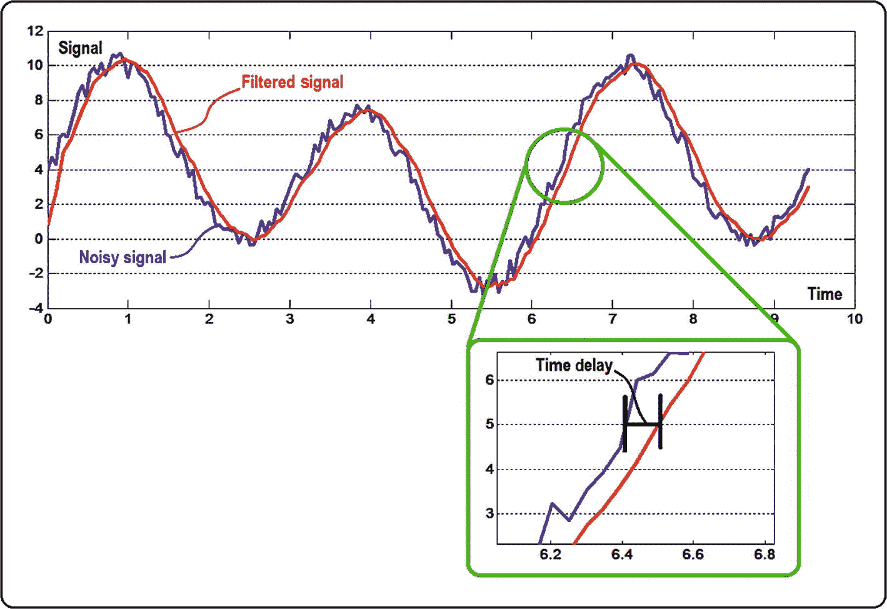
图 5-1 含噪信号与滤波后的信号对比

```
filteredSignal=lowpassFilter(noisySignal)
代码清单 5-1
许多程序中可用的信号滤波通用代码（语法可能有所不同）
```

### 信号限幅

在这种情况下，有必要对控制器施加限制值，以确保输入电机的最大值和最小值不超过电机的限值。另一个应用是限制用户在遥控器摇杆上所能达到的值。

这种限幅可以突然进行（例如，使用等价于开关动作的符号函数）或连续进行（使用称为饱和函数的函数）。即使是连续函数也可以是平滑的或陡峭的（你可以使用饱和函数家族中的许多函数，称为 S 型函数）。

通常，饱和器的无限制部分会像标准线性函数一样复制原始信号，如代码清单 5-2 中的代码所示。然而，为了抵消不期望的表现（例如，遥控器摇杆的突变行为），有时也会使用其他类型的 S 型函数。

图 5-2 说明了两个方面。上半部分是一个饱和函数家族，本例中包括符号函数、饱和函数和双曲正切函数。显然，设计者必须对它们进行修改，使其根据应用达到最小值和最大值，而不仅仅是-1 和 1。下半部分是将饱和函数应用于给定信号，本例中允许的最小和最大值范围为 0 到 7。

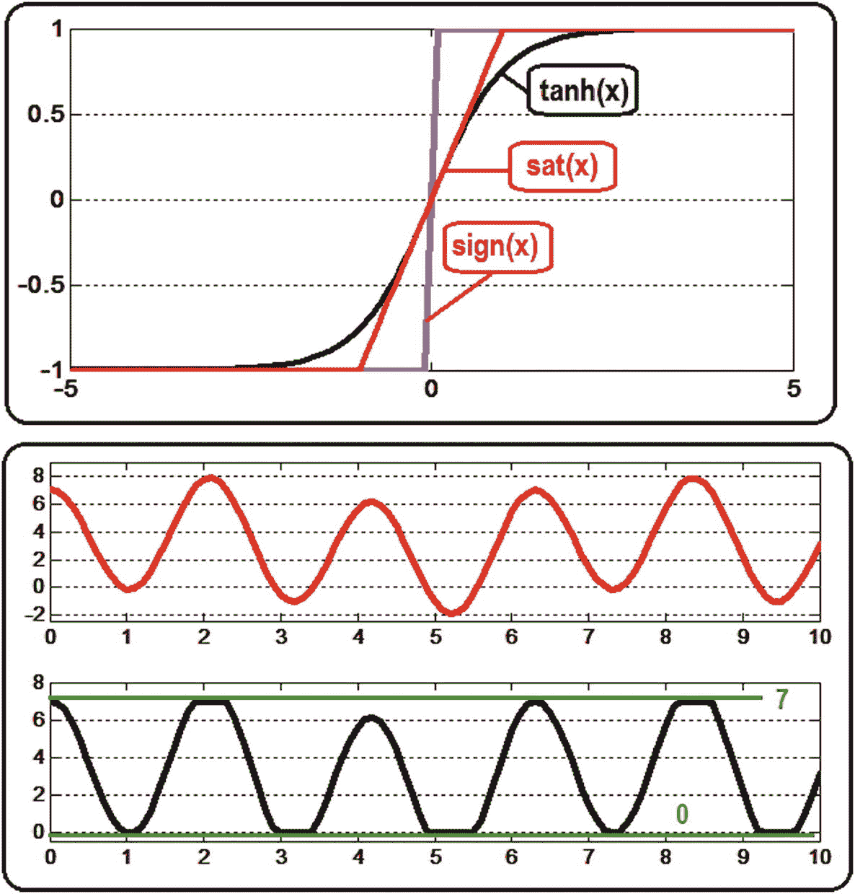
图 5-2 不同类型的饱和函数及其对信号的应用

图 5-2 中使用的代码非常简单，如代码清单 5-2 所示。

```
Mini=0
Maxi=7
if(signal=Maxi)
satsignal=Maxi;
else
satsignal=signal;
end
代码清单 5-2
饱和函数（线性类型）的通用代码
```

### 偏置与映射

另一项重要任务是将控制信号（一个具有正负值的信号）转换为电机兼容的信号（例如，对于无刷 RC 电机，其值范围在 1000 到 2000 之间）。另一个例子是传感器的量程，它可能是任意的，必须被转换为标准的工作范围（0 到 360 度，-180 到 180 度，-1 到 1 米等）。见图 5-3。在这种情况下，会使用缩放和平移函数。

一种最常用的偏置和映射技术是两点之间的直线方程，称为线性映射，它将输入值调整为一条直线方程（输出值）。为此，输入信号必须事先被约束，使其不超过最大和最小输入限制。

# 数据传输理论

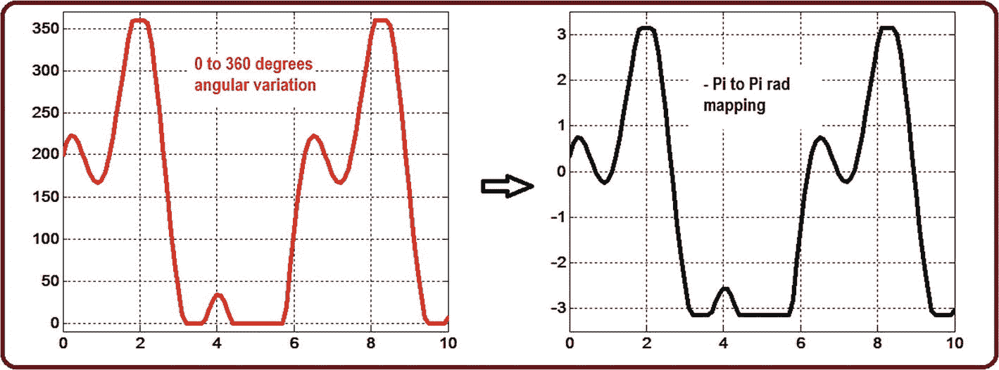

图 5-3 将信号从输入值范围映射到输出值范围

代码也很简单，如清单 5-3 所示（注意，这段映射代码描述了两点之间的一条直线）。

```
mininput=0;
minoutput=-pi;
maxinput=360;
maxoutput=pi;
mapsignal=(signal - mininput) * (maxoutput - minoutput) / (maxinput - mininput) + minoutput;
清单 5-3
映射的通用代码（线性映射）
```

## 数据类型转换

这是另一种重要的信号适配，当一条指令只接受一种数据类型，而提供的是另一种数据类型的数据时，就需要进行这种操作。例如，写入 PWM 型 RC 电机的指令通常需要整数类型的数据，但提供的值可能是浮点数或分数。在这种情况下，我们使用编程中称为**强制类型转换**的方法，即将一种数据类型转换为另一种数据类型。这可能涉及两种情况：

* 该类型转换不存在，用户必须自行设计程序。

* 该类型转换会产生混叠，影响测量或执行的质量（例如，控制器可能从平滑自然的运动变为突兀僵硬的运动，或者从高清晰度图像变为低质量图像）。

图 5-4 显示了一个常见示例。红色信号代表一个计算出的控制值（带有大量小数位），当将该信号注入电机时，由于写入命令接受其他数据类型（例如 `uint8`），原始值的精度会降低。它们看起来相似，但如果仔细观察，会出现一个称为**混叠**的阶梯效应。这种效应可能导致无人机运动行为不够平滑。

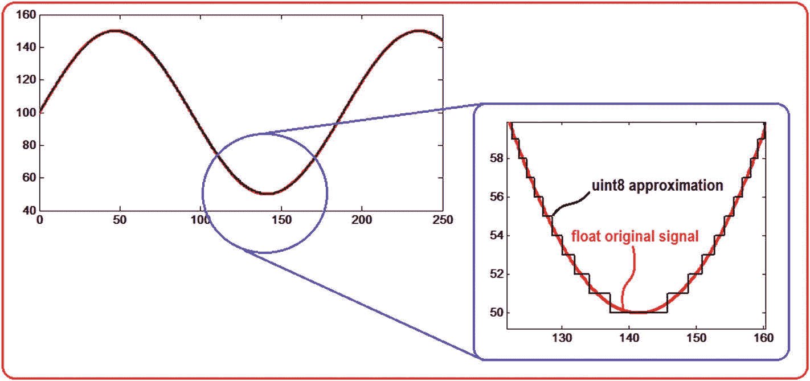

图 5-4 执行数据类型转换时的信号混叠

根据编程语言的不同，类型转换命令可能存在也可能不存在（用户必须自行创建），但通常它们采用清单 5-4 所示的形式。

```
signal=100+50*sin(t/30);
castSignal = uint8(signal);
清单 5-4
数据类型转换的通用示例
```

请注意，如果存在类型转换，这意味着存在一些函数，它们强制信号或输入数据改变其数据类型（在此示例中为 `uint8`）。

## 冗余与奇异性归一化

这是角度传感器中常见的一个问题，问题在于它们的值会从其最大值跳变到最小值，例如从 359 度跳变到 0 度，或者存在称为**奇点**的冗余值，例如 0 度和 360 度（如果传感器以这种方式工作，-180 度和 180 度也会出现这种情况）。见图 5-5。

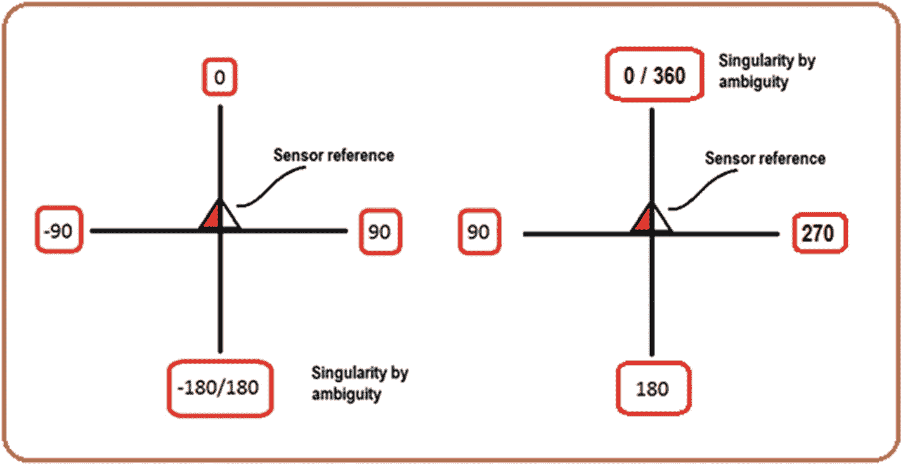

图 5-5 角度冗余与奇异性

为了处理这些奇异、歧义或冗余的情况，有许多归一化方法。其中一种（考虑了图 5-5 左侧的情况）基于相对于测量值对称定义角度误差。更多细节请参阅我的著作 *《Advanced Robotic Vehicles Programming》*。

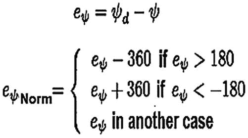

这是一种动态归一化，其额外目标是减少车辆需要进行的旋转，以实现更短的距离。为了达到期望的方向，车辆可以选择向左或向右旋转。该算法除了防止奇点外，还会选择顺时针或逆时针方向旋转哪个更好。

你还应该开发或研究替代的归一化方法，这些方法可以基于期望值而非测量值，或者基于绝对参考系而非车辆参考系，或者基于多次旋转的方法，以及用于 0 到 360 度角度测量的方法等。

## 使用示例

图 5-6 展示了对之前描述的无偏航运动（或偏航运动非常小）的半自动控制器的改进。这种变体结合了五种基本信号处理方法，具体如下：对遥控器信号应用映射和饱和处理，以调整其值，从而获得可接受的角度指令。对位姿传感器应用滤波处理，以降低其噪声水平。对角度误差进行归一化处理。在将分配矩阵注入电机之前，应用缩放处理使电机信号变为正值。通常，无人机电机具有固定的旋转方向，其速度可以从零或起始值变化到最大速度，因此对电机信号应用饱和处理，以防止其超过起始值和最大值。最后，执行数据类型转换，因为写入电机的命令通常需要整数类型，而控制信号是浮点值。

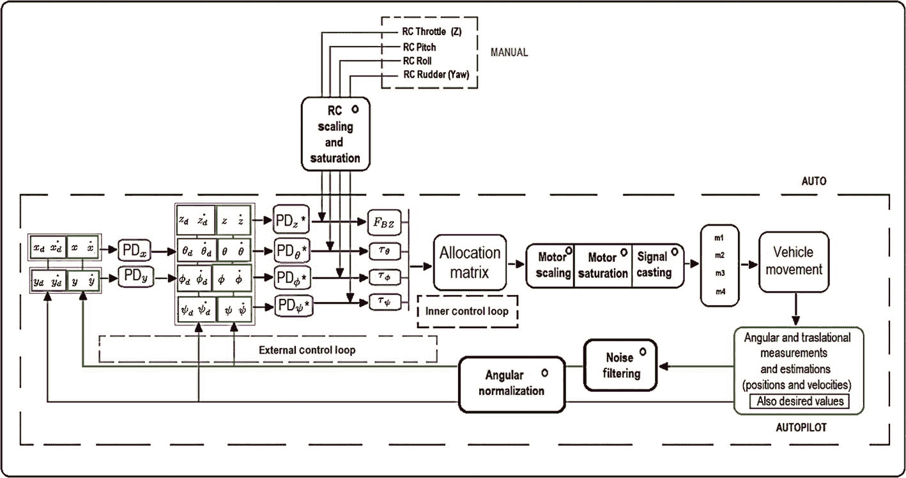

图 5-6 应用于无人机控制器的信号处理

你已经学习了无人机信号处理的基础知识。让我们继续学习数据传输理论的基础知识，该理论用于大多数无人机编程环境，这些环境通常基于 UART 类型的串行传输。数据传输理论被认为是一个高度相关的主题，因为它允许无人机编队之间或单个无人机与远程基站之间的通信。在可用的介绍中，我们在此描述 UART（通用异步收发传输器）类型，因为它是最常用、最基本的协议之一，已经使用了数十年，并且在无人机 SDK 中非常常见。

# 数据类型与子类型

在讨论本标准之前，先来了解一下数据类型与子类型的概念会很有帮助。该主题与之前介绍的数据转换相关。由于 C/C++ 是开发无人机应用的不同 SDK 中最常见的编程语言，以下段落将使用 C/C++ 的概念。不过，这实际上是其他编程语言中非常普遍的主题，每种语言都包含以下基本类型（或非常相似的类型）。请参见表 5-1。

## 表 5-1 基本数据类型

| 类型 | 描述 |
| --- | --- |
| `int` | 用于整数 |
| `float` | 用于带有小数的数值 |
| `double` | 提高浮点数精度，适用于科学或工程计算 |
| `char` | 允许使用字符 |
| `bool` | 允许使用逻辑值 |

然而，根据所执行的操作（例如时间管理、内存管理和通信协议），经常会发现这些基本数据类型的变体。这些变体通过增加前缀和后缀来标识。在无人机编程中，使用整数类型的变体非常常见。例如，`uint8` 包含前缀 `u` 和后缀 `8`。

通常，前缀表示符号限制，后缀表示基于比特位的范围限制。存在 8、16、32 和 64 位的整数，它们分别可以存储最大值为 255（255 = 2 的 8 次方减 1，以便从 0 开始计数）、65535、4294967295 和 18446744073709551615 的值。前缀 `u` 表示可使用的值仅为正数和 0。因此，对于 `uint8`，其有效范围是 0 到 255。而如果使用 `int8` 选项，我们同样拥有 255 个值，但范围是 -128 到 127。

前缀和后缀的用途将通过示例进行说明。

假设一个过程必须以微秒为单位执行。如果我们使用 `uint8` 数据子类型，我们只有 255 微秒，这甚至不到一毫秒。如果我们使用 `uint16`，我们只有 65 毫秒。最后，选择 `uint32` 子类型，其等效时间约为 4294 秒，或者说大约 71 分钟。

让我们进一步探讨 UART 的使用，以说明这是一种仅支持无符号 8 位数据块的通信方式。因此，无法使用 16 位和 32 位子类型，更不用说带有负值的子类型了。正因如此，才体现了 `uint8` 子类型的实用性。

最后，在许多编程环境中，你会在数字后缀中看到附加的 `t`（例如 `uint16t`）。这仅表示该数据类型在不同硬件平台间具有兼容性。在开发 8、16 和 32 位数据类型时，不同计算平台在内存占用上存在差异。因此，制造商们就代码的可移植性达成一致，创建了一个用字母 `t` 标识的标准。

## UART 简介

请注意，这里假设 SDK 提供了高级 UART 命令，例如 `read()`、`write()`、`begin()` 或 `available()`，类似于 Arduino 或 Ardupilot 中提供的那些。低级 UART 的使用则留给关于机器语言、汇编语言或微控制器的书籍来讨论。

此处描述 UART 传输，是因为它是当前自动飞行器及其相应 SDK 中最广泛使用的通信方式之一。它是双向的，但却是异步的（不涉及定时器，因此无法保证发送和接收时间）。我们还指出，本标准基于 8 位正整数数据包的管理。

接下来，我们提出以下问题。

鉴于所述的限制：

-   如何处理负值数据？

-   如何处理小数数据（带有小数位的数字）？

-   如果没有定时器进行读取或写入，如何保证读取和写入操作？

-   以及，如何处理大于 255 的数据？

为了回答这些问题，我们从循环计数器的概念开始。如果参照旋转运动，这个概念就很容易理解。

在旋转运动中，一个物体可以从 0 度到 360 度或从 0 到 2π 弧度进行定向，具体取决于您采用的标准。超出此范围的值意味着要进行多次旋转，或者对该值进行模 360 或 2π 的取模运算。

因此，800 度相当于两次 360 度的旋转加上 80 度的余数。请注意，任何角度都可以表示为该角度除以 360 或 2π 底数的模（余数）和商（注意，我们只关心模和商的整数部分）。

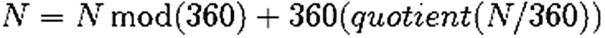

对于前面的例子：

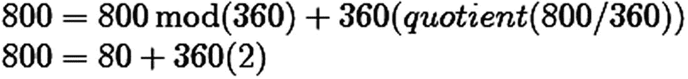

运用此逻辑，串行传输意味着我们的底数是 256（从 0 到 255 共有 256 个值），任何要发送的数字都可以分解为该底数的模和该底数的商：

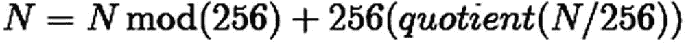

例如：

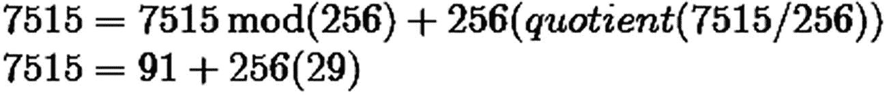

简而言之，为了处理大于 255 的值，必须将一个数字分解为两部分，一部分与该数字的模相关，另一部分与其商相关：

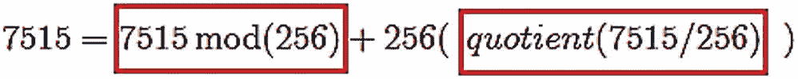

接下来要解决的问题是如何发送负数。

答案是，有两种选择，具体取决于要使用的数据范围（例如，传感器的量程）。

第一种选择基本上是浪费要发送的 8 位中的一位，用来指示：如果要发送的数字是正数或 0，则该位值为 0；如果数字是负数，则该位值为 1。然而，我们的通信底数将不再是 256，而是 128（因为使用剩余的 7 位，我们只能组成 128 个不同的数字）。

第二种选择是对值进行饱和与映射（平移和缩放）（即前一节中介绍的操作）。进行饱和处理时，我们为信号设定界限，这些界限用于定义映射函数中的最小和最大输入值。平移允许我们将信号移动到正参考系，例如，将值范围从 [-100, 100] 移动到 [0, 200]。如果输入值相对于输出值很大，则缩放是可选的，例如从 [-1000, 1000] 转换到 [0, 200]。请注意，映射函数本身已包含这两种效果。

# 处理过大数值时的精度与通信

过大缩放（在数值较大时会变得更为明显）的影响在于会产生带有小数部分的数字。现在我们将回答如何处理它们。

首先要做的是确定我们想要的精度等级。我们必须评估我们感兴趣的是保留一位、两位还是更多位小数。例如，在我们`[0 200]`的范围内，我们感兴趣的是处理像`199.3`这样的数字，还是像`199.15`这样的数字。

为了传递这些数字，我们有两种基本选择。

第一种是分离整数部分和小数部分，并将它们作为两个不同的数字发送。在数字`199.15`的示例中，会先单独发送一个`199`，然后再发送一个`15`。这种方法的问题在于，其中一个数字可能在传输过程中丢失。

另一种选项是应用缩放。这样，如果我们只关心一位小数，则只需将初始范围乘以`10`即可。使用给定的示例，`199.3`将变为`1993`，而`199.15`将变为`1991`。相反，如果我们想要两位小数，则缩放因子为`100`，分别发送`19930`和`19915`。这样，发送的是一个缩放后的数字。为此，要求接收方和发送方都知道缩放因子。使用这种方法获得高精度是一个问题，因为很可能需要将待发送的数字分成两部分或更多部分。应用很简单。例如，如果我们想要两位小数，那么不应从`[-1000 1000]`映射到`[0 200]`，而应从`[-1000 1000]`映射到`[0 20000]`。

请注意，几乎任何操作都可以在发送方和接收方完成，包括浮点或双精度运算。但数据传输仅针对正整数值。因此，我们必须进行上述调整（有些开发接口如`Arduino`包含自动进行这些转换的函数；因此，它们似乎不仅支持正整数）。

最后，为了回答关于如何保证通信的剩余问题，我们将说明`UART`通信的组件是如何实现的。

此过程的基础是理解与之前介绍的操作（取模和取商）等效的二进制操作，以及其他一些二进制校验操作。这是因为在计算机上，使用处理器所熟知的语言来简化数据处理任务是很方便的。这些操作包括发送、接收、校验和通信协议。

## UART 发送

起点是以下方程：


在十进制格式中，通过除法运算得到模和商，如图 5-7 所示。

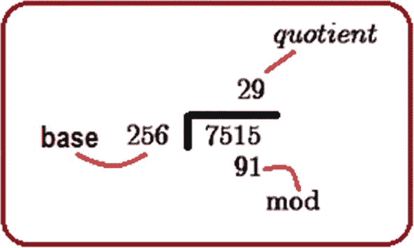

图 5-7 十进制基数的商和模

在二进制格式中，可以通过对要分割的数字的二进制等效值的最后 8 位应用非循环右移操作（用零替换移位的数字）来获得商。此操作在`C++`中表示为`>> 8`，作为其他编程语言的参考。另一方面，通过对`255`或二进制基下的`1111 1111`应用`AND`操作来获得模。此操作在`C++`中表示为`&`，作为其他编程语言的参考。

使用同样的示例：

`7515`=`1110101011011`（二进制）

`11101 0101 1011`（二进制）`>> 8`=`0000 0000 11101`（二进制）=`29`（十进制）

另一方面：

`11101 0101 1011`（二进制）

`& 00000 1111 1111`（二进制）

`= 00000 0101 1011`（二进制）=`91`（十进制）

这样，数字（本例中为`7515`）被作为两组 8 位发送：

`0101 1011`（二进制）=`91`（十进制）

`0001 1101`（二进制）=`29`（十进制）

当然，在发送这些数字之前，它们是通过前面描述的操作（`>> 8`和`& 1111 1111`）获得的。

## UART 接收

接收包括应用以下方程：

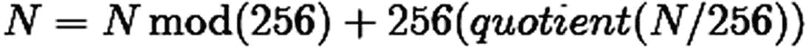

直接使用某些编程语言，或通过以下二进制等效值：8 位非循环左移和`OR`运算（在`C++`中为`<< 8`和`|`）：

`Binary value = Binary Quotient part << 8 | Binary Module part`

使用前面的示例：

`0001 1101`（二进制）=`29`（十进制）`<< 8`=`0000 11101 0000 0000`=`7424`（十进制）

得到这个结果后，我们继续进行`OR`运算。请注意，这里出现了超过 8 位的情况，但请记住，这是由接收计算机在收到数据后处理的。对于需要 8 位消息的通信信道来说情况并非如此。

`11101 0000 0000`

`| 00000 0101 1011`（二进制）=`91`（十进制）

`= 11101 0101 1011`（二进制）=`7515`（十进制）

读写过程总结在图 5-8 中。

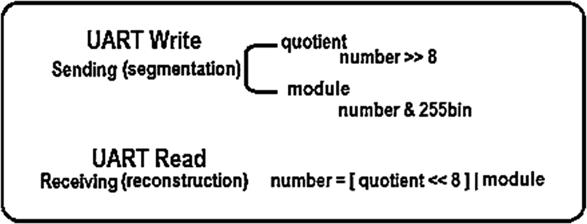

图 5-8 UART 读写过程总结

现在你知道了如何发送和接收信息。但是，如何验证数据？又如何判断你是否能够通信？以下操作将回答这些问题。

## UART 校验

在这种情况中，会丢弃错误信息，最简单的算法是校验和，其改进版本是异或校验和。

下面从十进制角度进行简单说明。

假设发送以下数据：

- `val1Send = 50`

- `val2Send = 30`

要发送的第三个值可以是前两个值的和（校验和算法的求和部分）：

`valsumSend = val1 + val2 = 80`

接收方应收到相同的数据：

- `Val1Rec = 50`

- `Val2Rec = 30`

- `valSumRec = 80`

然后构建算法的校验部分：

`Check = Val1Rec + Val2Rec = 80`

这样，`Check` 和 `valSumRec` 相同，说明这是一组有效的数据。

现在假设接收方读取到了一个错误的值：

- `Val1Rec = 20`

- `Val2Rec = 30`

- `valSumRec = 80`

我们再次构建校验部分：

`Check = Val1Rec + Val2Rec = 50`

这样，`Check` 与 `valSumRec` 不同，这组数据会被丢弃，或者要求重新发送信息。

可以看出，校验和算法存在几个重要问题：

1.  总和可能超过 `255` 的值，此时需要将数字分成两组或多组数据来发送。

2.  错误数据的求和结果可能恰好得到一个正确的校验值。

例如，发送方写入：

- `val1Send = 50`

- `val2Send = 30`

- `valsumSend = val1 + val2 = 80`

接收方读取：

- `Val1Rec = 60`

- `Val2Rec = 20`

- `valSumRec = 80`

由于校验结果仍等于 `80`，这个错误的数据包将不会被丢弃。

3.  数据本身正确到达，但校验和部分损坏了。

发送方写入：

- `val1Send = 50`

- `val2Send = 30`

- `valsumSend = val1 + val2 = 80`

接收方读取：

- `Val1Rec = 50`

- `Val2Rec = 30`

- `valSumRec = 10`

由于 `check = 80` 的值与 `valSumRec` 不同，尽管数据正确到达，信息仍会被丢弃。

为了减少这些问题（至少是溢出问题），会使用二进制校验和。其中一种是异或校验和（C++ 中的 `^` 运算符）。请注意，其余问题仍然存在。

如果你想发送一个超过 255 的和值，例如 `520`，首先要进行二进制转换：

`1000001000(bin) = 520(dec)`

之后，逐位进行异或加法：

`(1) xor (0) xor (0) xor (0) xor (0) xor (0) xor (1) xor (0) xor (0) xor (0) = 0`

因此，要发送的附加数据就是简单的 `0`。

例如：

- `Val1Send = 250`

- `Val2Send = 250`

- `Val3Send = 20`

- `ValSum = 520`

`ValSum` 无法直接发送，但可以发送其二进制分量的异或和：

`XORSend = (1) xor (0) xor (0) xor (0) xor (0) xor (0) xor (1) xor (0) xor (0) xor (0) = 0`

接收方读取：

- `Val1Rec = 250`

- `Val2Rec = 10`

- `Val3Rec = 20`

- `XORRec = 0`

然后，构建校验值：

`Check = Val1Rec + Val2Rec + Val3Rec = 280`

对 `Check` 的二进制分量进行异或求和：

`100011000(bin) = 280(dec)`

`XORCheck = (1) xor (0) xor (0) xor (0) xor (1) xor (1) xor (0) xor (0) xor (0) = 1`

由于结果与 `XORRec` 不同，数据会被丢弃或要求重新发送。

## 轮流协议

在这种情况中，会发送额外的信息来指示在通信过程中哪些设备是接收方，哪些是发送方。该算法包括发送和评估一个逻辑值。这意味着有两架或多架搭载通信设备的无人机；所有无人机都有一个充当交通灯或标志的变量。其中一架无人机的该变量处于 ON 状态，其他无人机处于 OFF 状态。只有初始状态为 ON 的无人机能够写入数据，而其他无人机则处于读取状态。一旦初始状态为 ON 的无人机完成操作，它会将其标志或信号量更改为 OFF。当团队中的其他成员读取到初始发送方的标志变为 OFF 时，它们会启动一个序列，以确定下一个将自己的标志变为 ON 的无人机。这一过程可以循环重复、交替进行，或者只执行一次。基本上，这就像一次礼貌的交谈，每位参与者询问或轮换自己的发言权，同时等待正在发言的人结束。

## 通用 UART 算法

结合上述操作，用于 UART 通信的通用算法如下。（每种操作的具体外观已加下划线；请注意校验和是一种共享操作。为了改进此序列，每个过程可能依赖于一个定时器来加速或确保其执行，或者只是为了避免延迟。）

1.  检查通信设备的标志位或轮次。

2.  如果当前轮次涉及写入：
    *   将要发送的信息分割成 8 位段。此信息被分成两部分：模数和商数。
    *   计算所有待发送信息的总和，然后从结果中获取其二进制分量的异或和。
    *   验证信道是否可用。
    *   发送信息。
    *   清空用于写入的变量，以便后续使用。
    *   将标志状态更改为读取。

3.  如果当前轮次涉及读取：
    *   读取接收到的数据。
    *   执行异或校验，然后与接收到的校验和进行验证。
    *   如果两者不匹配，设计者将规定后续步骤，可能包括丢弃信息或要求重新发送信息。
    *   如果两者匹配，则通过指定的位移和 OR 运算重建信息。
    *   清空用于读取的变量，以便后续使用。
    *   将标志状态更改为写入。

4.  该过程将无限期持续，直到用户、代码或电源中断通信。

现在你已经了解了控制、信号处理和 UART 通信，接下来的章节将指导你如何为无人机编写代码。首先，我们将向你展示可用于编程无人机的环境。

## 无人机编程的可用方法

目前，有两种方式可以为你的无人机编写代码：GUI 和 SDK。

### GUI（图形用户界面）

GUI 是一种简化且高度可视化的界面，专为编程技能有限或为零的用户设计。

在这种情况下，这是一个图形用户界面。许多用于编程无人机的封闭架构都包含这样一种界面。这些封闭架构的特点是允许用户修改基本参数，例如要遵循的路径、预加载控制器的增益以及传感器和执行器的基本校准。更专业的任务对用户是封闭的。一些最常用的 GUI 包括 `Mission Planner` 和 `LibrePilot`。

### SDK（软件开发工具包）

SDK 是一个软件开发工具包。在所有情况下，用户都需要掌握一种编程语言。

#### SDK 一级

对于 SDK 一级，非无人机控制或机器人学专业用户也可以为娱乐以外的目的对无人机进行编程。该架构并非完全开放，仅允许用户以类似于将飞行器视为一个能够在 X、Y、Z 方向上移动并绕其 Z 轴旋转的粒子的方式，设计一些高级控制器。请参见图 5-9。

最著名的例子之一是基于 Python 的 `Dronekit` SDK。在这种类型的 SDK 中，用户只能修改 X、Y、Z 和偏航的期望参考值，或它们的速度。用户无法对推力和无人机力矩，当然也无法对分配矩阵进行任何操作。

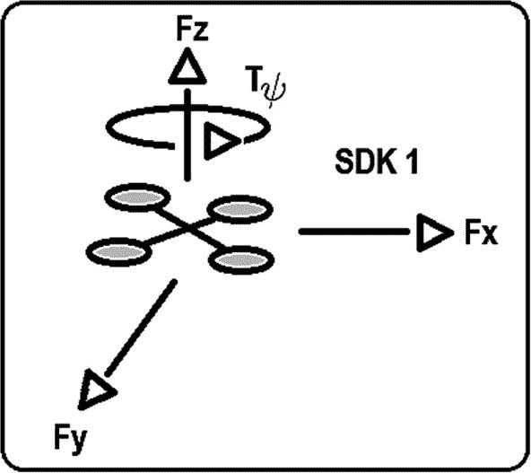

图 5-9 SDK 一级

#### SDK 级别 2

SDK 级别 2 的架构稍显开放，允许用户在力-力矩层级控制飞行器。也就是说，它让熟悉无人机控制和机器人学的用户能够将自己开发的算法和控制器集成到兼容 SDK 的预设计飞行器中。最著名的例子是基于 `C++` 的 `Parrot` Bebop-autonomy SDK，以及 `PX4` 库的一种飞行模式。

在此类 SDK 中，用户只能修改无人机的推力和力矩，无法对分配矩阵进行任何操作。参见图 5-10。由于推力和无人机力矩是空间参考量（X、Y、Z 和偏航角）的函数，因此该 SDK 的层级高于类型 1 SDK。

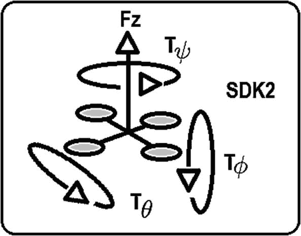

图 5-10

SDK 级别 2

#### SDK 级别 3

SDK 级别 3 完全开放，允许用户在电机层级控制飞行器；参见图 5-11。它还允许用户编写自己的通信协议、集成自己的传感器、监控自己关注的参数等等。简而言之，它允许用户设计自己的飞行器，即使这些飞行器没有先例。最著名的例子是基于 `C++` 的 `Ardupilot` 库和 `PX4` 库。

在此类 SDK 中，用户必须提供分配矩阵，该矩阵是无人机推力力矩和力的函数，而这些推力和力矩又是期望位置和姿态值的函数。因此，这种 SDK 的层级高于类型 2 和类型 1 的 SDK。

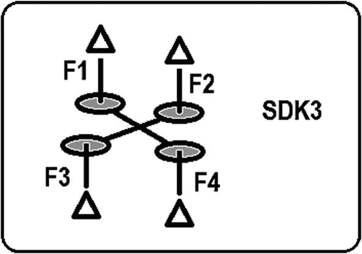

图 5-11

SDK 级别 3

你已经了解在哪里编写代码，那么如何编写代码呢？这将在下一节中介绍。

## 大多数 SDK 中可用的常用命令

以下是用于对空中无人机以及一般任何类型飞行器进行编程时最常用的命令。它们出现在三个最常用的 SDK 中：`Ardupilot`、`PX4` 和 `Dronekit`。这些命令按主题分类，并分别兼容 `C++`、用于 ROS 的 `C++` 以及 Python（尽管这些 SDK 也有其他编程语言、操作系统和计算架构的变体）。详细描述和示例可在官方网页或我的书《Advanced Robotic Vehicles Programming》中找到，该书在附录的参考文献部分中有所介绍。关于上述库，必须指出的是，唯一允许用户集成实时任务的库是 `Ardupilot`，最简单易用的是 `Dronekit`，而基于 ROS 因此具有多种兼容性的库是 `PX4`，其缺点在于文档有限且不易理解（至少目前如此）。

#### 官方网页

Ardupilot
[`http://ardupilot.org/dev/docs/apmcopter-programming-libraries.html`](http://ardupilot.org/dev/docs/apmcopter-programming-libraries.html)

Dronekit
[`https://dronekit-python.readthedocs.io/en/latest/`](https://dronekit-python.readthedocs.io/en/latest/)

Px4
[`https://dev.px4.io/master/en/index.html`](https://dev.px4.io/master/en/index.html)

#### 输入命令

Ardupilot 键盘输入（串口监视器）：
```c
hal.console->read()
```

Ardupilot 遥控输入：
```c
hal.rcin->read()
```

Dronekit 键盘输入：
```python
input() or raw_input()
```

Dronekit 遥控输入：
```python
vehicle.channels[channel]
```

PX4 键盘输入消息：
```c
PX4_INFO
```

PX4 遥控输入消息：
```
manual_control_setpoint.msg
```

#### 输出命令

Ardupilot 用户输出（串口监视器）：
```c
hal.console->printf()
```

Dronekit 用户输出：
```
Print
```

PX4 用户输出消息：
```c
PX4_INFO
```

#### 传感器命令

Ardupilot 模拟量读取：
```c
ch =hal.analogin->channel(channel)
read=ch->voltage_average()
```

Ardupilot 数字量读取：
```c
hal.gpio->read(pin)
```

Ardupilot GPS 读取（XYZ 位置和速度）：
```c
inertial_nav.get_position()
inertial_nav.get_velocity();
```

# 飞控平台命令参考

## Ardupilot

### 姿态读取（姿态角和角速度）
```
ahrs
ins.get_gyro()
```

### 气压计高度
```
barometer.get_altitude()
```

### 串口通信
```
hal.uart#->write()
hal.uart#->read()
with #=A,B,C,D
```

### 当前时间、延时和实时
```
hal.scheduler->millis(),micros()
hal.scheduler->delay()
scheduler.run(time)
```

### 板载内存存储
```
DataFlash.WriteBlock(package,size)
```

### 电池监控
```
battery.read( )
```

### 数字量写入
```
hal.gpio->write(pin,value)
```

### 写入电机和舵机（用于无刷或有刷电机的PWM RC）
```
hal.rcout->write()
```

### 噪声信号滤波
```
LowPassFilter2pfloat filtername(parameters)
filtername.apply(signal);
```

## Dronekit

### 模拟量读取
间接方式，例如通过 Raspberry Pi 的模拟端口

### 数字量读取
间接方式，例如通过 Raspberry Pi 的数字端口

### GPS 读取（XYZ 位置和速度）
```
vehicle.gps_0
vehicle.velocity
vehicle.location
```

### 姿态读取
```
vehicle.attitude
```

### 数字量写入
间接方式，例如通过 Raspberry Pi 的数字端口

### 飞行器写入（由于SDK类型限制，非直接写入电机）
```
send_ned_velocity(vx,vy,vz,time)
```

### 串口通信
通过使用Python库和Raspberry端口间接实现

### 噪声信号滤波
通过专门的Python库间接实现

### 当前时间、延时和实时
Python 时间命令，例如 `time.sleep(time)`  
使用这些库无法实现实时功能

### 内存存储
基于Python，例如 `file.write` 或 MAVLINK 命令

### 电池监控
```
vehicle.battery
```

## PX4

### 模拟量读取消息
```
adc_report.msg
```

### 数字量读取消息
```
gpio_led start
```

### GPS 读取消息（XYZ 位置和速度）
```
vehicle_gps_position.msg
vehicle_odometry.msg
```

### 角度位置和角速度消息
```
vehicle_odometry.msg
sensor_combined.msg
```

### 写入电机或飞行器消息（PX4是类型1和类型3的SDK）
```
actuator_controls.msg
for writing to a vehicle
actuator_direct.msg
test_motor.msg
for writing to the motors
```

### 程序
```
https://dev.px4.io/v1.9.0/en/middleware/modules_estimator.html
```

### 串口通信程序
```
https://mavlink.io/en/
```

### 当前时间、延时和实时
```
hrt_absolute_time();
```

### 使用板载内存的程序
```
https://dev.px4.io/v1.9.0/en/log/ulog_file_format.html
```

### 使用电池监控的消息
```
battery_status.msg
```

# 总结

在本章中，你学习了无人机的各项任务，以及使用它所必需的基本信号处理类型。所阐述的信号处理包括：信号滤波、信号饱和、信号映射、数据转换，以及冗余与奇异性的归一化。所有这些方法均可应用于传感器、执行器，以及通信或控制阶段。针对通信任务，你了解了高级 UART 的常见组成部分。最后，你学习了编程无人机的四种方法，并掌握了基于三种最常用 SDK 的无人机命令主题列表。

至此，我们已完成本书的主题内容，但我们建议你继续阅读附录。附录包含与无人机相关的主题，例如其最大功率与速度极限的估算、滑模控制、微分平坦性、线性控制简介、表示飞行器朝向的几种替代方法，以及如何将本书所述主题扩展应用于除四旋翼之外的其他类型飞行器。
