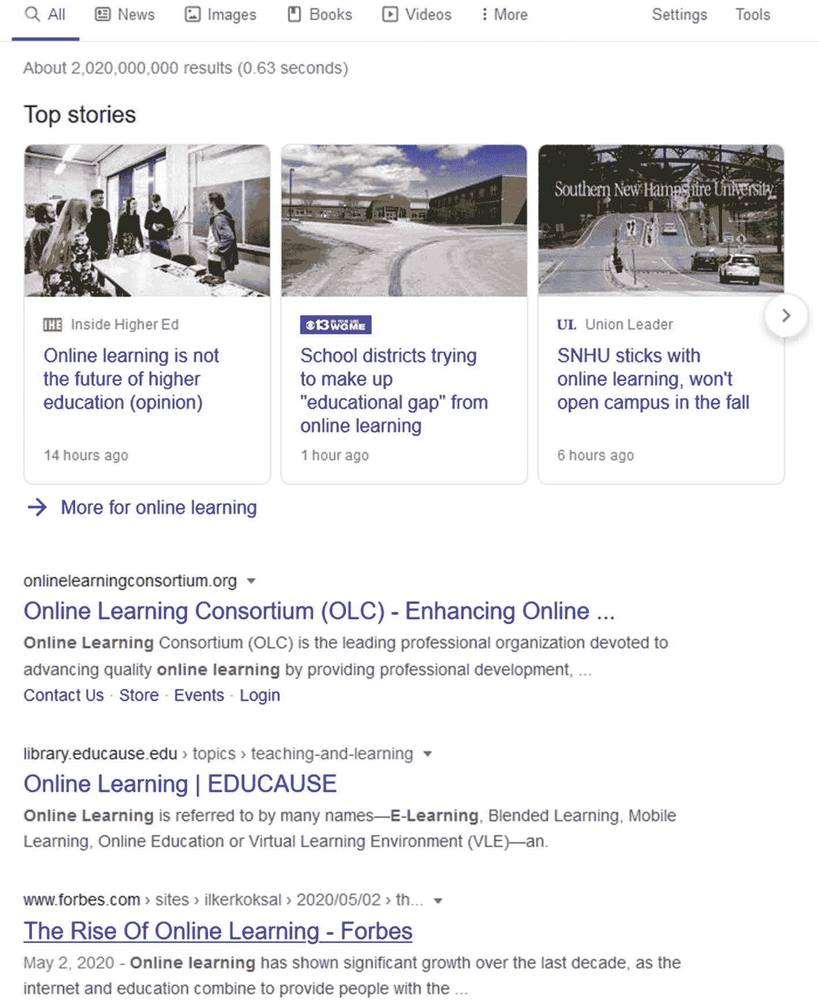

# 1. 在线学习的兴起

当大多数人听到“学习”或“教育”这两个词时，脑海中立刻会浮现出学生坐在课桌前专心听老师讲课的学校场景。大多数人在其一生中都经历过这种模式。美国、加拿大和澳大利亚的公共教育被定义为“由联邦政府资助、在一定程度上由政府管理、并负责教育所有公民的学校”。^(¹) 公共教育的定义包括以下学校：

- 小学和中学
- 公立大学

公共教育是免费的。为了了解公共教育取得了多大的进步，回顾其历史总是有益的。

---

**ISBN** 978-1-4842-6863-6  

**电子书 ISBN** 978-1-4842-6864-3  

[`doi.org/10.1007/978-1-4842-6864-3`](https://doi.org/10.1007/978-1-4842-6864-3)  

© Lisa Sims 2021  

本作品受版权保护。出版商保留所有权利，无论是全部还是部分材料，特别是翻译、重印、重新使用插图、朗诵、广播、以缩微胶卷或任何其他物理方式复制，以及信息存储与检索的传输、电子改编、计算机软件，或使用目前已知或以后开发的类似或不同方法。在本出版物中使用通用描述性名称、注册商标、商标、服务标志等，即使在缺乏明确声明的情况下，也不意味着这些名称不受相关保护法律和法规的约束，因此可供一般使用。出版商、作者和编辑假定本书中的建议和信息在出版之日是真实和准确的。出版商、作者或编辑均不对本书所含材料或可能存在的任何错误或遗漏提供明示或暗示的保证。对于已出版地图和机构归属中的管辖权主张，出版商保持中立。本书由 Springer Science+Business Media New York 在全球图书贸易中发行，地址：1 New York Plaza, New York, NY 100043。电话：1-800-SPRINGER，传真：(201) 348-4505，电子邮件：`orders-ny@springer-sbm.com`，或访问 `www.springeronline.com`。Apress Media, LLC 是加利福尼亚州的有限责任公司，唯一成员（所有者）是 Springer Science + Business Media Finance Inc (SSBM Finance Inc)。SSBM Finance Inc 是特拉华州的一家公司。

本书献给所有孜孜不倦的教育工作者，尤其是在新冠疫情期间，他们为所有学习者创造了一个充满活力和创造性的数字学习环境与体验。尽管没有得到足够的口头或书面表达，但你们和你们的努力值得感激。


## 引言

多年来，学习方式基本保持不变。尽管新的方法论不断涌现，但人们对学习的普遍态度并未改变。如果你问大多数人最好的学习方式是什么，大部分人可能会说是在实体学校。在过去 10 到 20 年间，不仅为学习者，也为教育者提供了更多的学习选择。直到 2020 年 3 月，学习者和教育者仍然可以在传统的面对面学习和在线学习之间进行选择。

2020 年 3 月中旬，学习发生了转变。随着新冠疫情的爆发和病例数的增加，安全问题随之浮现。由于新冠病毒是一种新型病毒，科学家和医生几乎没有相关信息可参考，并且不知道如何有效预防或治疗。为了保障教育者、学习者以及学校工作人员的安全，传统的面对面学习转向了线上。

由于转向数字化或虚拟学习的决定来得非常突然且缺乏充分预警，许多教育者没有足够的时间做好充分准备。许多教育者只有传统面对面教学环境的经验。在线学习是一片未知领域。他们依靠在职培训来摸索如何将传统的面对面教学技能转化为数字化或虚拟环境下的技能。你可能就属于这一群体。经验丰富的在线教育者则希望为自己的工具箱增添新的工具和策略，以吸引学习者。你可能也属于这一群体。同样，许多学习者缺乏诸如电脑和互联网接入等必需的设备来完成在线学习。不用说，每个人都很快变得沮丧起来。

`《有效的数字学习》` 提供了深刻的见解和资源，帮助新手和经验丰富的在线教育者在虚拟学习环境中取得成功。每一章都从一位经验丰富的在线教育者的角度提供实用信息，并附有如何应用的建议。无需在网上搜索这些信息，你将它们集中在一处，这有助于节省时间。你将学习到的一些主题包括：

- 在线学习的兴起
- 在线学习设备
- 在线学习规划
- 内容规划
- 学习管理系统
- 演示工具
- 网络研讨会
- 免费学习资源

疫情结束后，数字学习仍将持续。本书中的信息将具有适用性，并能促进有效的数字学习。众所周知，学习者是学习过程中最重要的组成部分。他们值得你付出最好的努力。这本书不仅能让你为他们提供最好的东西，也能为你自己提供最好的东西。你和你的学习者都将从本书中受益匪浅。我很乐意收到你的反馈。请随时在社交媒体上关注我，并告诉我你对本书的喜爱程度。

让我们开始吧！


## 致谢

我必须首先感谢上帝赐予我创作这本书的灵感。在疫情期间写书并非易事，但上帝帮助我保持专注，实现了我的目标。

特别感谢并感激 Apress 再次给我机会撰写另一本 Apress 书籍。我感谢 Apress 图书团队在整个项目中所付出的全部奉献和辛勤工作。所有的反馈都极具价值，并促成了本书的完成。感谢 Matthew 和 Nancy，让这一切成为愉快而难忘的经历。

最重要的是，我想再次感谢我的丈夫 Timothy Sr.，以及我的两个儿子 Timothy Jr. 和 William，感谢他们在新冠疫情期间，在我清晨撰写这个项目时对我的包容。写书没有完美的时间，但只要你下定决心，无论情况如何，你都能做到。

最后但同样重要的是，感谢你投资学习数字学习策略，为你自己以及你的学习者提供积极且引人入胜的学习体验！


## 关于作者


## 公共教育史

据《国家地理》杂志报道，1635 年 4 月 23 日，波士顿拉丁学校在马萨诸塞州波士顿成立，成为第一所公立学校。^(²) 该校至今仍存在。据 `EducationBug.org` 记载，1647 年，马萨诸塞湾殖民地大议会响应建立小学和拉丁学校的法令，创建了兼具公立与私立性质的学校，这些学校向所有人开放，但教授清教徒价值观和圣经阅读。^(³) 尽管大多数学习在家中进行，但只有社会经济特权阶层才将儿子送入实体拉丁学校。

快进近十年后，马萨诸塞州制定法律，要求人口达到 50 人以上的城镇聘请教师，教授镇上儿童基础学业。人口达 100 人以上的城镇必须设立小学，教授阅读、写作和宗教。多年来，这成为学习和获取新知识的主要途径，而其他人则通过学徒制学技能。19 世纪中期，马萨诸塞州民众要求为所有儿童提供免费的义务教育，但直到 1851 年才得以实现。

尽管马萨诸塞州已实行义务教育，但南方的教育之争仍在继续。在重建时期，非裔美国人争取公共教育。其他州也在进行各自的斗争。根据美国最高法院对`普莱西诉弗格森案`的判决，公共教育被要求依法实行种族隔离。据`EducationBug.org`记载，美国最高法院在 1954 年对`布朗诉托皮卡教育局案`的裁决中判定，种族隔离学校是不平等的，必须废除。直到 1957 年，联邦法院才裁决要求阿肯色州小石城的公立学校废除种族隔离。


## 教育的演变

远程学习首次出现于 19 世纪。最初，远程学习类似于函授课程，学生根据预先分配的课程学习，并通过美国邮政服务寄送给教授。在函授课程中，学生与教师之间的互动有限，反馈亦有延迟。由于材料通过美国邮政服务寄送，很容易不完整或丢失。多年来，远程学习已演变为以下形式：
-   电视课程
-   光盘课程
-   在线学习
-   移动学习

随着时间的推移，随着计算机和互联网等技术进步的普及，另一种学习方式应运而生：在线学习。在线学习，也称为电子学习或虚拟学习，利用互联网创建在线课堂。课堂通常通过基于云的学习管理系统（`LMS`）进行，教师和学生在此与课程材料互动。它利用技术模拟面对面互动，将传统的实体课堂转变为在线环境。在线学习是远程学习的一种形式。

如今，通过计算机或移动设备进行的在线学习已成为最流行的远程学习形式。与传统远程学习相比，在线学习显著增加了学生与教师的互动。此外，学生可以立即获取课程材料，而无需等待通过美国邮政服务寄送。学生也能以电子邮件、视频、音频或文本等多种形式更快速地获得反馈。

第一次在线学习发生在 1989 年，当时菲尼克斯大学利用`CompuServe`（首批面向消费者的在线服务之一）提供其教育项目。1990 年，蒂姆·伯纳斯-李创建了首个名为`WorldWideWeb`的网页浏览器。三年后，网页浏览器`Mosaic`问世。在此之前，大多数网页浏览器都是基于文本的。`Mosaic`是首个允许将图像嵌入 HTML 页面并显示给用户的网页浏览器。随着网页浏览器功能的进步，在线学习开始发展。据`EducationData.org`统计，2017 年，共有 1970 万名学生就读于授予学位的中学后教育机构，其中 660 万人注册了某种形式的远程教育/在线学习课程。^(⁴) 这些数字表明，在线学习并非新趋势。随着技术的发展，它将继续增长。

```
if (condVar > someVal) {console.log("xxx")}
```


## 为何关注？

如今，几乎所有销售产品或服务的公司都会向其员工、客户或潜在客户提供某种类型的在线学习培训，而不仅仅局限于中小学、高等院校和培训机构。如果你在`Google`上搜索“online learning”一词，如图 1-1 所示，你将获得超过 20 亿条结果，涵盖各种类型的在线学习组织。


图 1-1
谷歌搜索“online learning”的结果

无论你的年龄、能力或技能如何，在线学习都为当今的学习者和教育者提供了诸多益处。


# 在线学习的优势

对于刚开始接触在线学习的人来说，适应过程可能颇具挑战。这是一种与许多人所经历的传统学习截然不同的方式。改变从来都不容易，但有时却必不可少。让我们来看看在线学习的一些优势。


## 灵活性
与在固定日期和时间进行的传统学习不同，大多数在线学习是异步的。`Asynchronous`（异步）意味着教师和学习者无需在特定时间上课。不过，可能仍需要满足一定的出勤和参与天数要求。大多数人都希望在生活中找到工作与生活的平衡，而在线学习凭借其灵活性，让学习者和教师可以自行安排时间表。


## 节省时间
时间是我们最宝贵的资产之一。每个人每天都有 24 小时，并尽量充分利用它们。时间一旦流逝，便一去不复返。在繁忙的日程中，每个人都在寻找节省时间的方法，以便做更多事情。在线学习使学习者和教师能够通过使用互联网（而非在交通拥堵中浪费时间）来节省时间。


## 节省开支
除了节省时间，在线学习还可以为学习者和教师节省开支。对于在线学习者而言，某些在线学习和课程的费用可能低于传统的面对面课程。除了公立中小学教育本身固有的费用外，许多高等教育机构和其他现场培训可能费用高昂。无需前往实体建筑，有助于学习者和教师节省油费、停车费、住宿费、伙食费及其他开支。


## 随时随地课堂
在线学习允许学习者和教师在任何有互联网连接以及电脑或移动设备的时间和地点创建虚拟课堂。传统教育要求学习者围绕就读实体学校来重新安排生活。在线学习则需要并引发思维模式的转变，允许学习者将教育与生活结合起来安排。`Covid-19`（新冠疫情）就是一个绝佳的例子。当学校和其他教育机构因疫情被迫关闭时，学习活动转向了线上。通过将学习迁移到线上，学习者、教师和其他学校管理人员在免受新冠病毒潜在传播风险的同时，依然能够继续学习。

另一个例子是现役军人。军人经常被部署到世界各地。然而，他们仍通过在线学习来完成教育目标。否则，他们只能等到任务结束后才能继续学业。


## 移动学习
移动设备技术的进步、屏幕尺寸的增大，以及诸如`Chromebooks`（ Chromebook 笔记本电脑）和安卓平板电脑等更便宜的选择，使得在线学习者比以往更容易连接网络。据`Pew Internet Research`（皮尤互联网研究）数据，拥有智能手机的人群比例从 2011 年的 35%上升到了 2019 年的 81%。^(⁵) 该研究进一步指出，2019 年，96%的人拥有智能手机。


## 总结

在线学习将随着技术继续发展。随着劳动力市场对知识工作者的需求持续增长，学习者将更容易在方便的时候获得所需的技能。同时，其成本也将更加亲民。对于教育者而言，分享和展示其专业知识的机会将是无限的。

脚注 1   2   3   4   5


# 在线学习的考量因素

尽管在线学习有诸多优势，但它似乎并非万能之策。然而，情况并非总是如此。有一些关于在线学习的因素必须加以考虑。


## 数字鸿沟

尽管我们生活在 21 世纪，但并非所有人都能接入高速互联网。例如，一些农村地区仍然难以获得稳定、高速的互联网接入。他们当前的互联网服务要么速度太慢，要么根本不存在。因此，他们很难进一步学习。


## 学习质量

在线学习能与面对面学习相媲美吗？学习者真的学到东西了吗？技术能否作为有效的媒介，在教育模式中复现教学法？随着越来越多的小学、中学、高等院校及学习机构实施在线学习，这些问题以及其他相关问题将会被提出。在线学习或许永远无法完全取代传统学习模式。但随着技术的进步，网络会议和虚拟现实等工具提供了可行的替代方案。


## 特殊需求学习者

一些有特殊需求的学习者无法进行在线学习。根据他们的残疾类型及其严重程度，在线学习可能不如面对面学习有效。例如，作业治疗和言语治疗等远程治疗服务是在线进行的。对于需要更多实践指导的学习者来说，在线学习可能并不合适，但对于那些能够使用它的人来说，它仍然是可及的。


