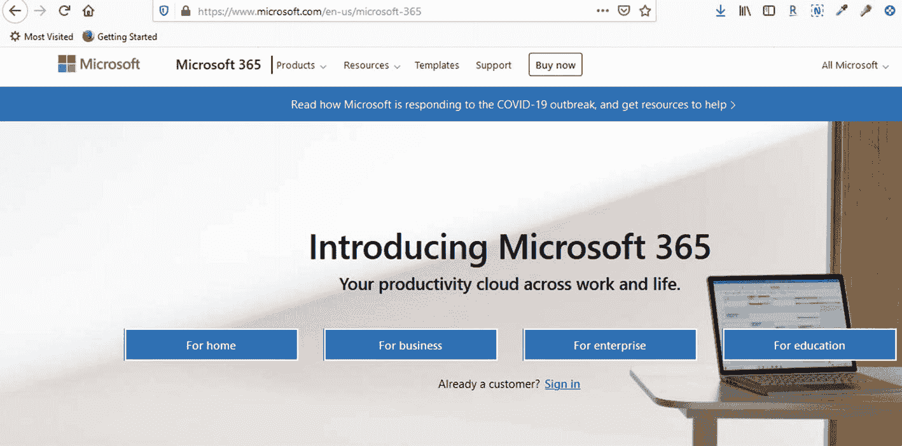
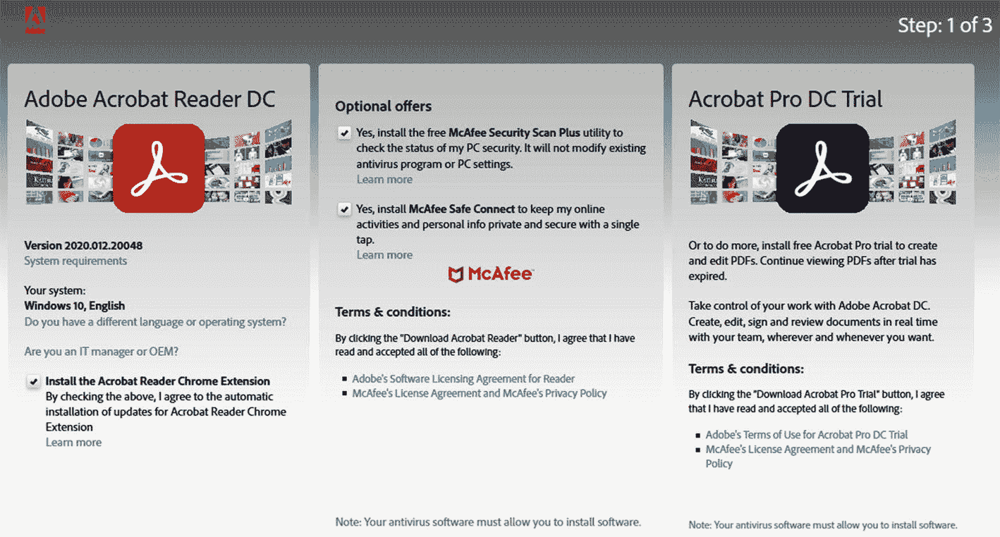
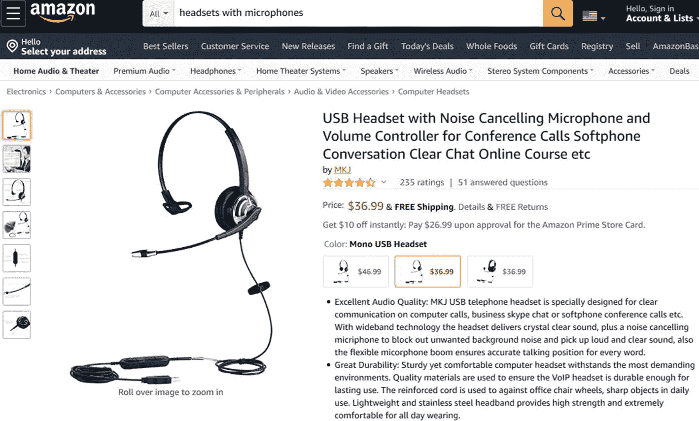
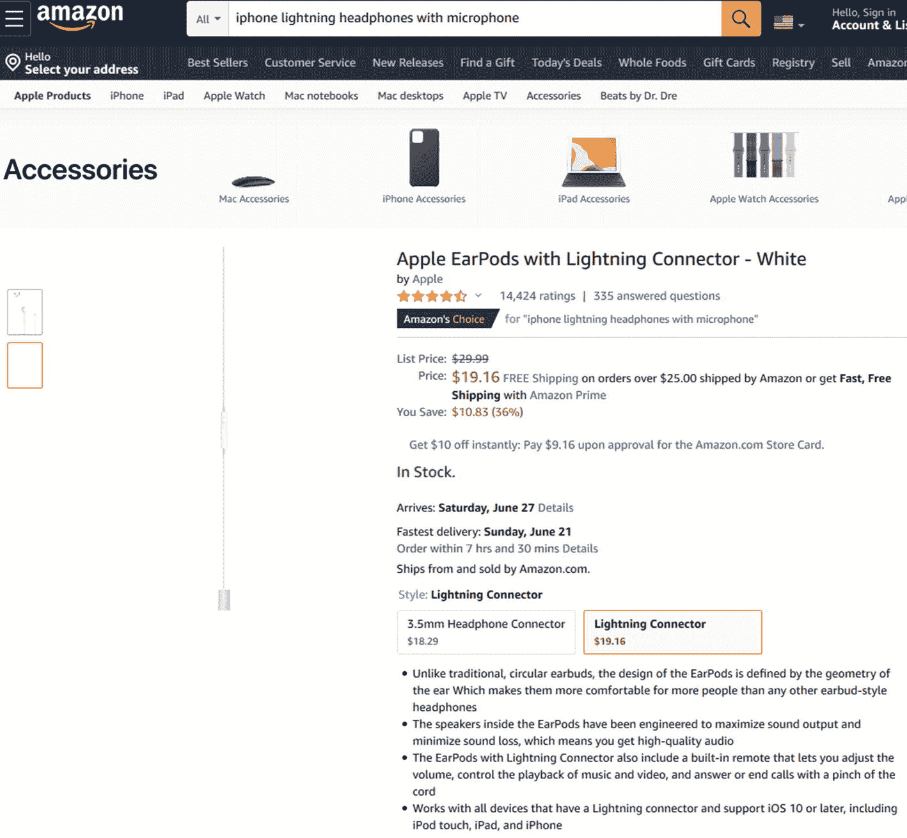

# 2. 在线学习设备

正如你在前一章所学到的，传统的实体学习环境已被在线学习所改变。传统学习不再是学习者和教育者唯一的选择。多年来，在线学习赋予了学习者灵活性，使他们能够利用当时可用的任何媒介，在方便的时候学习新技能。同时，它也允许教育者按照自己的时间表授课。如今，互联网是主要的在线学习媒介。物理课堂环境不再是唯一的选择，这有助于消除一些教育障碍。你可能渴望成为一名在线学习者或在线教育者，但不确定需要哪些必要的设备。你需要准备些什么才能开始呢？


## 技术需求

无论你想成为在线学习者还是在线教育者，成功都取决于一个关键因素：技术。技术是在线学习的核心。它是学习发生的通道。如果没有合适的技术，你的效率或生产力将大打折扣。同样，你也会浪费宝贵的时间和金钱。结果就是，你无法享受到在线学习所提供的优势。好消息是，在线学习所需的技术门槛其实非常低。


# 硬件

虽然你不需要拥有最新的电脑，但它至少不能超过 2 到 4 年的使用年限。计算机技术日新月异，今天流行的配置大约在 2 到 5 年内就会过时。大多数教育机构会为学习者和教育者提供与自身技术基础设施相匹配的硬件要求。一条值得遵循的好原则是，使用一台使用年限在 2 到 3 年之间的台式机或笔记本电脑，并满足以下最低配置要求：

*   `Windows 7` 操作系统或 `Mac 10.2 Sierra` 操作系统或更高版本
*   `Intel i3` 双核处理器或等效的 `AMD` 处理器或更高版本
*   `2 GHZ` 或更高主频的处理器
*   `1GB` 可用磁盘空间
*   `4GB` 或更高容量的内存
*   网络摄像头

你也可以使用更旧的电脑。但这会影响你的在线学习体验。处理器速度和内存越高，能同时打开的应用程序就越多，电脑运行速度也会更快。

`Chromebook` 是屏幕较小的小型笔记本电脑，运行谷歌的操作系统 `Chrome OS`。通常，它们比台式机和笔记本电脑便宜，并可使用 Google 的云端应用程序，例如 `Gmail` 和 `Google Drive`。由于其处理器速度慢、内存容量小，它们不应作为涉及编程或其他处理器密集型课程的高等在线学习首选设备。然而，对于中小学生来说，它们是个不错的选择。`Chromebook` 的另一个限制是，没有网络连接就无法使用。

随着移动设备尺寸的不断增大，它们将继续为传统和在线学习增添灵活性。许多学习资源都可以通过这些设备上的应用程序获取。像`Remind` 和 `Show My Homework` 这类的通知应用，可以帮助教育工作者与学生及其家长进行沟通。一些移动设备可能比台式机或笔记本电脑更昂贵。它们也缺少物理键盘，这需要额外购买。最后，它们的处理速度和内存有限。凭借其便携性，它们非常适合用来辅助进行移动学习。


# 打印机

尽管你的大部分在线学习都在网上进行，但有时你还是需要打印文档。拥有一台喷墨或激光打印机，你就可以在需要时进行打印。喷墨打印机的初始购置成本可能低于激光打印机。然而，与喷墨打印机相比，激光打印机使用其碳粉盒可以打印更多页面。如今，许多一体式打印机都带有扫描功能，这可以为你节省金钱和空间。


# 扫描仪

有扫描仪很好，但并非必需。如果还没有扫描仪，也不用担心。许多扫描应用程序可以在移动设备上免费或付费使用。例如，`Notes` 应用在 `iOS` 设备上是免费提供的，并且可以用来扫描文档。


# 软件

你所需的主要软件是一个网络浏览器，例如 `Firefox`、`Safari`、`Edge` 或 `Google Chrome`。学习资料通常通过浏览器来访问。除了浏览器之外，你还需要一些额外的软件。


## Microsoft 365

`Microsoft Office` 是学校和组织机构使用的行业标准应用。它允许你使用其广受欢迎的程序，如 `Word`、`PowerPoint` 和 `Excel`，来创建文档、演示文稿、电子表格等。它还包含用于电子邮件的 `Microsoft Outlook` 和用于云端存储需求的 `OneNote`。对于中小学、高等院校的学生以及使用以 `.edu` 结尾的电子邮件地址的教育工作者，可以从微软官方网站免费下载 `Microsoft 365`（图 2-1）。订阅信息可在微软官网上找到。


图 2-1 Microsoft 365 的微软官网

此外，`Microsoft 365` 和 `Google Docs` 的应用在 `Apple App Store` 和 `Google Play Store` 上也是免费提供的。许多基于云的应用程序使得在电脑和移动设备上使用这些应用变得更加容易。然而，如果没有付费订阅 `Microsoft 365`，其功能是受限的。


## 杀毒软件

由于你将要在网上工作并上传、下载文件，因此最好在你的电脑或移动设备上安装杀毒软件。杀毒软件可以保护你的电脑免受病毒和其他可能感染并损害你电脑或移动设备的威胁。一旦安装杀毒软件，应对其进行设置，使其能自动更新，以保护你的电脑或设备免受每日出现的新型威胁。一些既提供免费选项也提供付费选项的流行杀毒软件包括：

*   `Avast` – `www.avast.com`
*   `AVG` – `www.avg.com`

其他流行的付费杀毒软件选项包括：

*   `McAfee` – `www.mcafee.com`
*   `Norton` – `www.norton.com`


## PDF 阅读器

`PDF` 是网络上使用的标准文档格式。只要安装了诸如 `Adobe Acrobat Reader` 之类的程序，就可以在所有设备上查看 PDF 文件。`Adobe Acrobat Reader` 是查看 PDF 文件的行业标准，可从 Adobe 官网免费下载（图 2-2）。


图 2-2 `Adobe Acrobat Reader` 可从 Adobe 官网免费下载：`https://get.adobe.com/reader/`


## 云端存储

由于在线学习提供了随时随地工作的灵活性，你需要能够从任何地方、任何设备访问你的文件。云端存储也可用于备份重要文件。一些流行的云端存储选项包括：

*   `Microsoft OneDrive`（随 `Microsoft Office 365` 附送）
*   `Dropbox` – `www.dropbox.com`
*   `Google Drive` – `www.google.com/drive/`


## 图形设计软件

除了你常用的软件需求外，你可能还需要图形设计软件来为视频、网站、摄影等创建图形。为满足你的图形设计需求，`Adobe Creative Cloud` 包含了如 `Photoshop` 和 `InDesign` 等业界标准应用，可在 `www.adobe.com` 获取。它提供了满足你创意需求的桌面和移动应用。你可以按月或按年订阅单独的应用或所有 Adobe 应用。拥有有效资格证明（如学生证或学校邮箱）的教师和学生可在购买时享受折扣。

尽管 `Adobe Creative Suite` 非常适合图形设计，但它可能价格不菲。一些免费且开源的图形设计软件包括：

*   `Gimp` – `www.gimp.org`
*   `Canva` – `www.canva.com`


# 网络连接

没有网络连接，在线学习便无从谈起。如今的智能手机和平板电脑（如 iPad）可作为个人热点提供网络接入，但其速度通常无法与家庭、图书馆或餐厅的网络连接速度相提并论。新冠疫情之前，人们可以去当地的图书馆或餐厅免费使用网络。然而，疫情期间出于安全考虑，许多场所都关门了。在许多社区和农村地区，存在“数字鸿沟”，高速网络或宽带网络既不可用也负担不起。结果，许多人仍然无法上网。

由于如今的在线学习包含多媒体及其他资源，因此需要高速网络连接。根据[`www.reviews.org`](https://www.reviews.org)的定义，高速网络连接是指下载速度至少达到 25 Mbps 的网络。^(⁶) 拥有高速网络的美国家庭比例已从 2018 年的 65%增长至 2019 年的 73%。^(⁷)


# 配件

既然您已经了解了核心硬件和软件需求，那么还需要购买一些必要的配件。这些配件将为您带来更好的在线学习体验。


## 带麦克风的耳机

根据您的环境，配备带麦克风的耳机总是个好主意。耳机可以让您在不依赖设备扬声器的情况下私密地查看多媒体内容，同时也不会打扰到周围的人。对于需要使用语音的学习活动，投资一款带降噪麦克风的耳机是明智之举。它可以过滤背景噪音，让听众清晰地听到您的声音。大多数电脑和移动设备都内置了麦克风，但它们往往具有方向性，会拾取房间内的所有背景噪音而非过滤或降低噪音。此外，与外部麦克风相比，其语音质量也欠佳。

一款带降噪麦克风的外部耳机并不昂贵。平均价格约为 40 美元，但根据降噪级别不同会有所上涨。无论选择哪款耳机，请注意其接口类型是`USB`、`Lightning`端口还是`3.5 毫米`插头，以适配您的设备（图 2-3）。



图 2-3 可从亚马逊购买的、适用于电脑在线学习的`USB`耳机

对于`iPhone`用户，苹果公司带`Lightning`接口的`EarPods`是另一选择（图 2-4）。它也支持`3.5 毫米`转接器，可用于电脑，以及新款`iPhone`、`iPad`和其他移动设备。大多数智能手机都附带带麦克风的耳机，可在您找到替代品前使用。尽管苹果`EarPods`带有麦克风，但并未提供降噪功能。



图 2-4 适用于在线学习的苹果`EarPod`耳机选项


## 网络摄像头

虽然对于某些在线学习来说，网络摄像头是可选项，但它是一个不错的补充。大多数电脑和移动设备都内置了网络摄像头。对于学习者而言，它能为在线课堂带来传统学习的面对面元素。对于教育者而言，网络摄像头也有很多好处。首先，它允许教育者录制课程内容并在虚拟课堂中分享。这些内容还可以被重新利用，并在各种社交媒体平台上分享。网络摄像头让教育者能与学习者建立个人联系。当学习者能将名字与面孔对应起来时，可以缓解在线学习中的一些孤立感和焦虑感。

如果您没有网络摄像头，移动设备的摄像头也能派上用场。大多数移动设备摄像头分辨率很高，不仅能拍摄出色的照片，还能录制视频。例如，`iPhone 7`之后的新款`iPhone`拥有卓越的摄像头，不仅可用于拍照，还能制作视频。新款`iPad`也是如此。如果您使用这些设备，还需要购买一个三脚架来稳定设备。


## 总结

正如我们所看到的，在线学习对技术设备的要求其实很低。您可能已经拥有其中的许多物品，这可以节省您的时间和金钱。这也有助于打消您可能听过的关于开始在线学习的某些误解。第一次尝试任何事情都可能看起来令人生畏，但您能做到。有了合适的设备，您的旅程就能从一个积极的开始起步。在下一章中，您将探索如何成功规划您的在线学习之旅。正如那句老话所说：“*如果你不做计划，那你就是在计划失败*。”您将制定一个计划。

```
脚注 1 2
```


