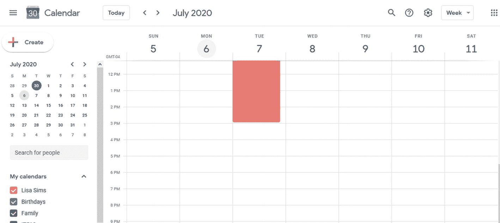
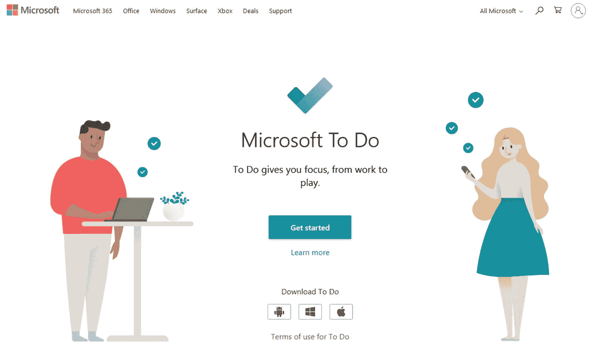

# 3. 在线学习规划

在上一章中，我们探讨了学生和教育者所需的在线学习技术设备。如果没有合适的技术，教育者和学生可能会经历本可避免的不必要的挫败感。尽管技术是在线学习体验的核心，但其他关键组成部分也至关重要。规划有助于教育者利用各种在线学习技术组件，为学习者创造最佳学习体验。

规划需要着眼于全局，确定在线学习环境中哪些独立的组成部分能协同工作以惠及学习者。如果没有一个深思熟虑的计划来统筹所有部分如何协同工作，在线学习可能会变得困难重重，无法为教育者和学生带来预期的成果。正如那句老话所说：“*如果你不做计划，那你就是在计划失败*。”一份详细的计划可能是成功与失败的分水岭。在制定计划之前，您必须先明确目标。

## 目标

清晰的目标能让您专注于自己的目标。在传统学习中，许多教育者利用教案来安排每日工作并保持专注。尽管由于新冠疫情，学习环境有所不同，但方法依然不变。您必须有计划和目标。目标驱动您的动力，并引领您的一天。在典型的学习日里，您会被各种事务分散精力，因此清晰界定的目标能降低您分心的可能性。在线学习对教育者或学生来说都不容易，尤其是在疫情期间。这是一片未知领域，每个人都在学习如何每日探索。清晰的目标提供了一张路线图，您可以据此保持正轨或根据需要调整方向。为了确定目标，您可以问自己一些可能的问题，包括：

-   您想要达成什么成果？
-   您为什么进行在线教学？
-   在线教学对您为什么重要？
-   您希望通过在线学习实现什么？

一旦回答了这些问题，您应该将它们记下来，可以写在日志里，也可以写在您最喜欢的笔记类移动应用中，比如 `Evernote` 或 `Microsoft OneNote`，以便定期回顾。它们将成为您日常的动力。既然目标已经明确，还有一些其他因素需要考虑。

## 在线学习组织

组织学习材料是一个重要步骤，但在在线学习中常常被忽视。如果没有直观的组织系统，你可能会浪费宝贵的时间去寻找学习资源。在创建学习资源时，请确保为它们起好描述性名称，并将其保存在计算机上描述性明确的文件夹中。此外，将学习资源备份到云端系统（如`Microsoft OneDrive`或`Google Drive`）也是一种良好实践。

虽然你的学习管理系统已经具备了组织架构，但你仍需确保添加的学习资源能让学习者直观地找到所需材料。没有什么比在在线学习环境中难以轻松找到内容更让学习者沮丧的了。在创建任何学习资源之前，始终要优先考虑你的受众，以保证获得最佳效果。

# 心态

最难改变的事情之一是我们对某些事物的心态。没有人喜欢改变，但改变是不可避免的。本杰明·富兰克林的名言概括了大多数人对生活确定性的感受：*世上唯有死亡和纳税是确定的*。当我们遇到新事物或与常规不同的变化时，我们可能会感到害怕。正如我们在新冠疫情中所见，那些曾被视作我们生活各方面常态的事物已不复存在。一切都已改变，我们必须适应。通常，让我们害怕的更多是对未知的恐惧，而非改变本身。

在线学习可能让你感觉不太舒适。当你将一个新概念与熟悉的概念进行比较时，忧虑很容易产生。许多教育工作者在没有接受任何培训的情况下就被推入了在线学习的模式，只能边做边摸索。对许多人来说，传统学习模式多年来已深深根植于他们的思想和生活中。这是大多数人熟悉且一直在使用的教学模式。而其他一些教育工作者则已经熟悉在线学习，并正在寻找提升自己技能的方法。

当在线学习最初作为传统学习的另一种选择出现时，许多教育界人士都持怀疑态度，因为这是对常规的改变，令他们感到陌生。他们无法理解学习如何能够在实体教室之外进行。对一些人来说，克服这些感受可能很困难，这会导致他们错失在线学习的机会。无论使用何种媒介，学习仍然可以发生。以下是一些有助于影响你的心态，同时提升在线教学技能和知识的资源：

*   Corwin – [`https://us.corwin.com/en-us/nam/online-teaching-toolkit`](https://us.corwin.com/en-us/nam/online-teaching-toolkit)
*   Future Learn – [`www.futurelearn.com/info/blog/resources-for-online-teaching-during-coronavirus`](http://www.futurelearn.com/info/blog/resources-for-online-teaching-during-coronavirus)
*   eLearning Industry – [`https://elearningindustry.com/`](https://elearningindustry.com/)
*   Edutopia – [`www.edutopia.org/`](http://www.edutopia.org/)
*   Faculty Focus – [`www.facultyfocus.com`](http://www.facultyfocus.com)

作为教育工作者，能够克服这些感受至关重要。这些感受会间接和直接地影响你对在线学习的态度，并可能在你的在线教学实践中悄然显现，暗中破坏你的努力。在线学习不应被视为传统学习的替代品，而应被视为一种补充。每个人的学习方式不同，并在适合自己的教学模式下表现出色。保持开放和积极的心态，能激励你付出最佳的教学努力，帮助学生有效学习。

# 时间管理

每个人一天都有 24 小时。在这 24 小时内，我们要同时处理那些可能完成也可能无法完成的日常事务。一旦这些时间过去，我们就无法挽回，必须第二天重新开始。与传统学习相比，在线学习没有固定的在校时间，这需要更好的时间管理能力。与许多人的看法相反，在线学习需要大量的准备和努力。很多时候，在努力平衡学习者的需求以及自己的职业和个人需求时，你的工作日似乎永无止境。有时，这可能会让人感到不堪重负。由于没有传统学习提供的预排日程表，在规划教学安排时很容易忘记事情。

在线学习提供的灵活性有助于平衡工作与生活。然而，许多教育工作者仍然被生活中的各种任务压得喘不过气来。在新冠疫情期间，许多教育工作者既要进行在线教学，又要帮助自己的孩子进行在线学习。有些人可能还需要照顾他人或应对个人健康问题。在传统学习和在线学习模式中，教育工作者都需遵守出勤和参与要求，同时要学会在这种新常态下保障安全并开展教学。兼顾这些并不容易。尽管你可能已经有了日程安排工具，但多一些选择总没坏处。

`Google Calendar` 是一个免费的在线日历系统，用于安排约会和其他重要事件。你可以把它看作一个具有时间管理功能的在线计划本。这些事件不仅可以在线查看，还可以保存到你的移动设备日历中（图 3-1）。通过使用像`Google Calendar`这样的日历系统，你可以安排备课时间、作业截止日期、办公时间等，而不会遗漏任何事项。由于它是基于云端并通过`Gmail`账户使用的，可以在任何设备上查看。同样，`Google Calendar`应用程序可以下载到`iOS`和`Android`移动设备上。

图 3-1

可用于约会和提醒的`Google Calendar`

另一种选择是使用你移动设备的日历。由于我们很多人总是随身携带移动设备，我们可以轻松地安排活动并接收通知。你甚至可以提前几天设置提醒，通知你会议、办公时间和评分截止日期。

`Microsoft To Do` 是另一个可以加入你教学工具箱的工具。它可以作为个人计划本，用于创建待办事项列表和提醒，帮助你在一天中保持专注和条理清晰。它是免费的，可以通过网络使用，也可以在`Windows`、`Android`和`iOS`平台上作为应用程序使用（图 3-2）。

图 3-2

`Microsoft To Do` 允许你创建待办事项列表，以保持条理清晰和专注

# 工作区域

虽然在线学习允许你在任何地方工作或教学，但一个专门的教学区域可以提高你的效率。一旦进入这个空间，你的身心就会像走进实体教室一样知道教学活动即将开始。教学区域还能减少干扰，让你保持专注。

每个人都听过这样的说法：杂乱的工作空间代表杂乱的思维。在某种程度上，这是真的。杂乱不仅会影响我们有意识的思维，还会影响我们的潜意识。根据《今日心理学》的说法，杂乱会导致我们的思维不如应有的那般敏锐。⁸ 杂乱还会加剧我们的压力和焦虑水平。拥有一个整洁的教学工作区域，能为你做好准备并激励你走向成功。在视频会议期间，整洁的区域还能展现专业的形象。虽然这些看似小事，但它们积累起来会对你的教学成功产生重大影响。

# 社交媒体支持

有时，在线学习会让人感到孤立无援。但这并非必然。有许多在线群组可以加入，以获得在线教学环境的协助。例如，Facebook 上有许多群组和主页可以加入或关注，以获取关于在线学习的新见解和资源。同样，你也可以与其他在线教育者建立联系。你可能会想关注的一些 Facebook 主页包括：
-   Global Online Academy
-   TED-Ed
-   Global Educator Collective
-   edX
-   Khan Academy

你可能想加入的 Facebook 群组包括：
-   Digital Resources for Distance Learning
-   Distance Learning Educators
-   Online Teaching Strategies for Educators

LinkedIn 是另一个不错的社交媒体资源，它提供了可以加入的群组，不仅能建立人脉，还能学习新的在线学习策略。

# 自我关怀

教育工作者往往将学生的需求置于自身需求之上。对于在线学习，你很容易在电脑或移动设备上投入比传统面对面教学更多的时间。有时候，你必须稍微“自私”一点。务必牢记那句老话：“你不能从空杯里倒水出来。”照顾好自己，安排一些时间进行自我关怀，以便充电和重整旗鼓。否则，你很快就会感到精力耗竭。一些简单的自我关怀建议包括：

-   安排每日锻炼，例如散步或瑜伽
-   设定固定的工作时间
-   健康饮食
-   多喝水
-   保证充足休息
-   在一天中适时休息

## 总结

在线学习不仅仅是技术问题。你必须有一个深思熟虑的计划作为你的路线图。然而，你也需要根据需要调整计划。罗伯特·伯恩斯在《致小鼠》中的一句话概括了你应如何看待计划：*老鼠和人的最佳计划往往落空*。

无论一个项目规划得多么周密，总可能出岔子。要灵活变通。

