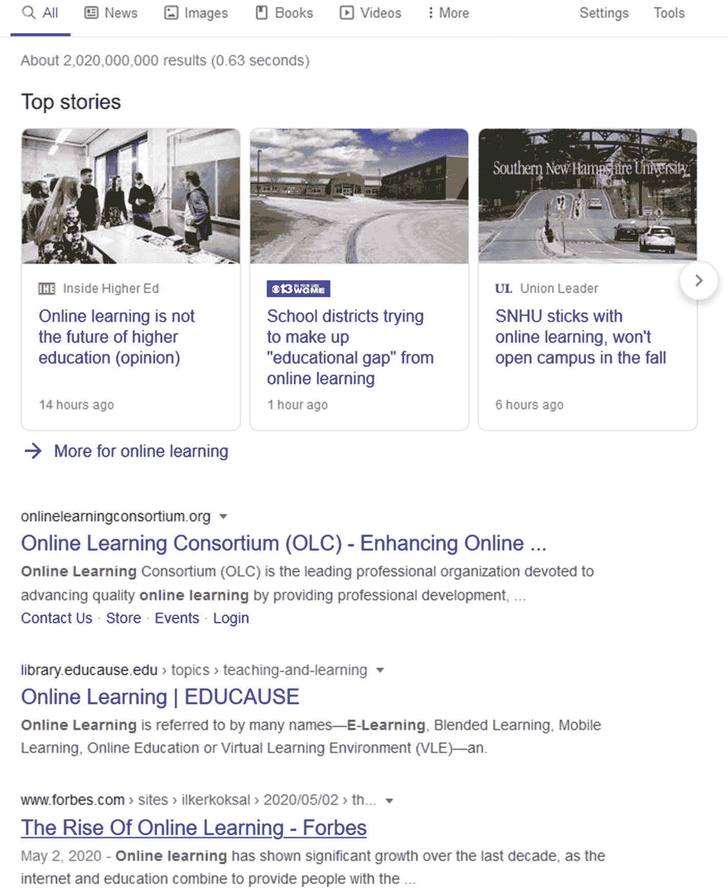

# 为何关注？

如今，几乎所有销售产品或服务的公司都会向其员工、客户或潜在客户提供某种类型的在线学习培训，而不仅仅局限于中小学、高等院校和培训机构。如果你在`Google`上搜索“online learning”一词，如图 1-1 所示，你将获得超过 20 亿条结果，涵盖各种类型的在线学习组织。

图 1-1

谷歌搜索“online learning”的结果

无论你的年龄、能力或技能如何，在线学习都为当今的学习者和教育者提供了诸多益处。

