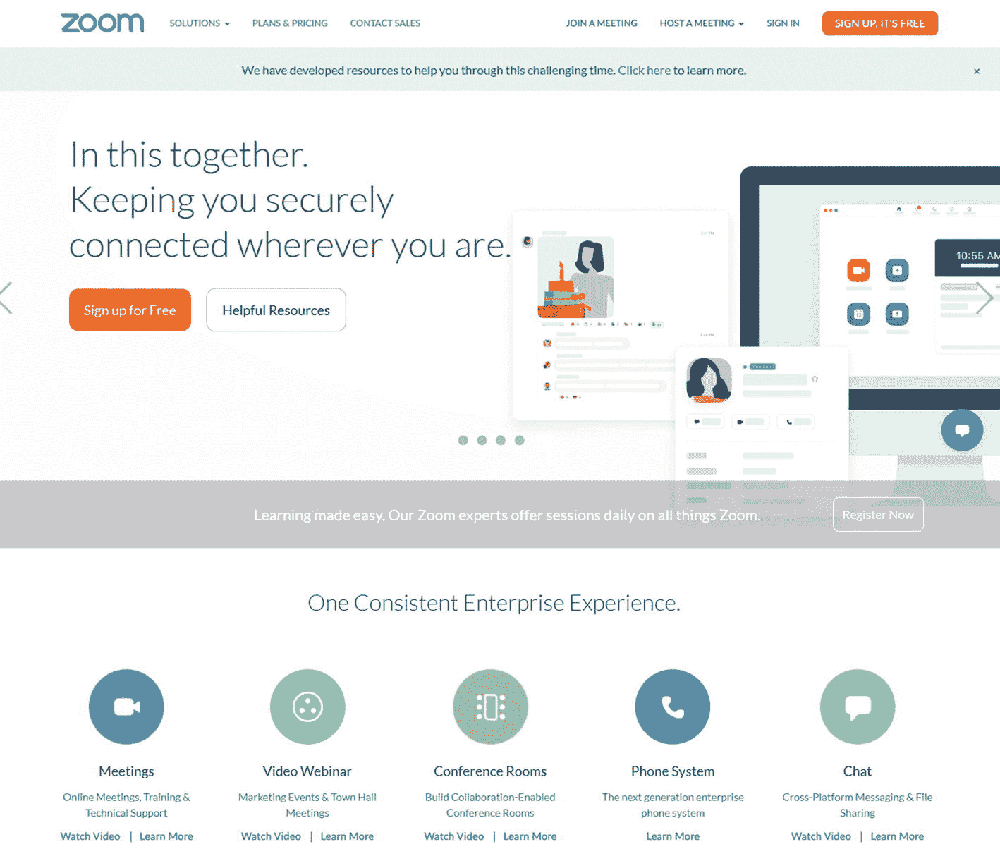
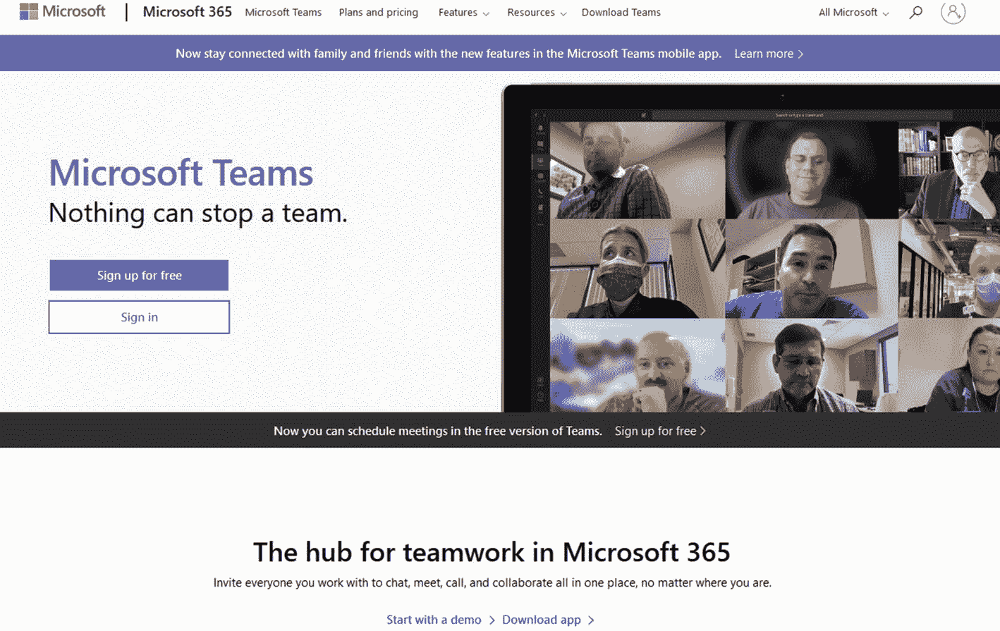
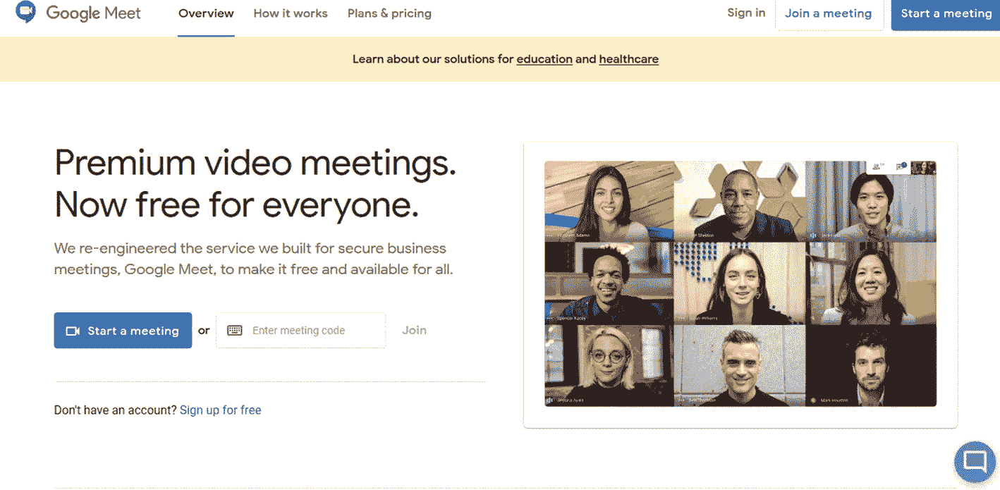

# 7. 网络研讨会

以有趣的方式向学习者展示主题内容以激发参与，是教学的本质。这在在线学习中尤为重要。如第 6 章所述，教育工作者使用演示文稿向学习者解释特定主题，同时保持美观。它们不仅将内容组织成易于理解的部分，还引导学习者沿着预定的学习路径前进。由于有众多免费和付费的演示文稿应用可供选择，教育工作者可以以新颖的方式传递内容。

在新冠疫情时代，演示文稿通常与网络研讨会结合使用。在在线学习环境中，学习者有时容易感觉自己像是孤岛上的唯一一人。尽管学习者和教育工作者之间可以进行沟通和协作，但他们仍需要感受到与教育工作者的联系，而不仅仅是看到教育者的头像或阅读其个人简介。在某些情况下，教育工作者会预先录制“发言者头部”视频，仅显示上半身在讲解内容。作为教育工作者，你需要另一种媒介来与学习者建立联系。这就是网络研讨会在在线学习环境中发挥作用的地方，它可以帮助弥合这一差距。

## 新的会议场所

根据`webopedia.com`的定义，网络研讨会是网络研讨会的简称，可定义为“通过网络使用`视频会议软件`进行的演示、讲座、工作坊或研讨会”。^(¹⁶) 在新冠疫情大流行期间，网络研讨会迅速成为许多人在保持社交距离的同时安全会面的首选方式。尽管许多组织在大流行之前就已经在使用网络研讨会，但许多犹豫不决的组织也加入了网络研讨会的潮流。结果，网络研讨会的使用量猛增。组织开始使用网络研讨会与远程员工保持联系，教育工作者开始使用网络研讨会与学习者建立联系并传递课程内容。

## 网络研讨会的优势

网络研讨会不需要人们身处在同一物理房间或地点。只要人们拥有快速的互联网连接，他们就可以在地理上位于世界任何地方参加网络研讨会。在在线学习中，网络研讨会可被视为传统学习中的现代大学演讲厅或礼堂。与传统演讲厅或礼堂相比，座位是虚拟的，出勤有时是可选的。网络研讨会在指定的时间进行。如果学习者错过了现场安排的网络研讨会，通常会提供录制版本，以便在更方便的时间观看。在传统学习中，学习者没有这个选择。除了讲座、工作坊和研讨会之外，你还可以通过提供以下内容来增强学习效果：
- 办公时间
- 小组讨论
- 头脑风暴会议
- 员工会议
- 团队项目

许多网络研讨会平台提供无障碍选项，例如为可能需要的学习者提供隐藏式字幕。网络研讨会是使用定制内容吸引学习者的有效方式。然而，也存在一些限制。例如，许多免费网络研讨会平台限制了会议时长和参会人数。此外，让学习者保持参与度也可能很困难。

## 网络研讨会的要求

大多数线下活动都可以修改并通过网络研讨会进行。技术的进步使得从任何联网设备进行或参与网络研讨会变得相对容易且成本效益高。大多数笔记本电脑和移动设备已经配备了摄像头和内置麦克风，可用于网络研讨会。为了确保高质量的视频和音频，你可能希望使用高清网络摄像头和领夹式麦克风。然而，网络研讨会的主要要求之一是快速的互联网连接。没有快速的互联网连接，你和学习者可能会遇到视频和音频质量的延迟，这会影响学习体验。由于大多数网络研讨会发生在网络浏览器或网络研讨会平台的移动应用中，教育工作者和学习者可以从任何联网设备和任何地点参与。你所需要做的只是通过电子邮件或网络研讨会平台向学生发送网络研讨会邀请，或在你的学习管理系统中发布包含网络研讨会链接的公告。最后，一个干净且光线充足的背景至关重要。许多网络研讨会平台（如`Zoom`）提供虚拟背景选项，有助于呈现更专业的网络研讨会体验。

# 网络研讨会授课策略

与传统的面对面教学模式类似，网络研讨会平台为师生在网络学习环境中实时互动提供了媒介。这些平台也有助于维持一定形式的社交互动。然而，许多教育工作者在使用网络研讨会及其工具来呈现教学内容并吸引学生参与方面存在困难。网络研讨会的工具能够实现比单纯使用演示文稿向学生讲课更多的互动。为了最大化学生的学习体验，熟悉你所选网络研讨会平台的功能至关重要。例如，`YouTube`是获取有关如何使用特定网络研讨会平台技巧与窍门的一个良好起点。你的学生视你为专家。如果准备不足，你不希望自己表现得像个新手。学生们会很快察觉并失去参与感。为防止这种情况发生，你可以采用一些策略来进行准备。

## 风格与基调

在开展第一次网络研讨会之前，确定你的研讨会风格非常重要。你的研讨会风格将极大地影响学生的参与度。是采用带 `PowerPoint` 的讲课形式，还是更偏向开放式讨论？你的基调是什么？是权威型、对话型，还是娱乐型？许多教育工作者已开始效仿 TED 演讲的风格来设计他们的网络研讨会。^(¹⁷) TED 演讲在很大程度上依赖于演讲者的信息传达而非 PowerPoint 幻灯片。演讲者通常使用图片来支撑论点，而不是使用充满文本和要点的幻灯片。演讲者必须运用讲故事、幽默、声音、肢体语言等技巧来保持观众的注意力。观看几个 TED 演讲是个好主意，看看这种风格是否适合你和你的学生。其他可供借鉴灵感的替代方案包括：

*   The Moth – themoth.org

*   Ignite – ignitetalks.io

*   99U – 99u.adobe.com

*   Talks at Google – talksat.withgoogle.com

*   Big Think – bigthink.com

## 投票

人人都爱投票。学生也不例外。像 `Zoom` 这样的网络研讨会平台提供了创建投票的功能，可以在研讨会期间展示。然而，此功能仅对付费账户开放。投票可以在会议或研讨会期间让学生保持参与。例如，在会议或研讨会开始前，你可以在 `Zoom` 门户会议管理中创建简单的投票，让学生就各种课程主题进行投票。一旦所有人投票完毕，你可以公布结果。根据投票结果，你和学生可以参与有趣的讨论。

## 白板

大多数网络研讨会平台都提供白板功能，类似于传统面对面教室中的白板。在在线环境中，白板可用于阐述复杂的概念。例如，你可以使用白板向学生展示如何解决一个数学问题。你也可以绘制一个流程图，使学生更容易理解。白板还可以用于集思广益。就像传统课堂一样，你可以点名让学生到白板上写出答案。所有这些都有助于提高学生的参与度和积极的课程成果。

## 分组讨论室

在传统教学中，教师可以将学生分成小组进行小组作业。小组作业不仅支持学生共同合作，还能让他们开放地接受他人的观点。同样的概念可以应用于网络研讨会。例如，`Zoom` 允许你手动或自动将学生分配到称为“分组讨论室”的小组中。`Zoom` 参与者也可以选择加入一个分组讨论室。这些分组讨论室可以在安排会议时或会议期间创建。在分组讨论室内，学生们可以合作完成作业，同时你可以监控每个分组讨论室的情况。时间到了之后，你可以将所有人员召集回主研讨会进行讨论。分组讨论室可以为许多学生和教师在虚拟环境中提供社交和互动的机会。然而，在 `Zoom` 中，分组讨论室仅适用于付费计划。`Microsoft Teams` 提供了类似的概念。

## 问答环节

学生喜欢提问，为什么不让他们问呢？在你的网络研讨会中，你可以允许学生这样做。许多网络研讨会平台（如 `Zoom`）都提供“举手”按钮，学生可以点击该按钮来示意他们有问题。一旦你注意到他们，你可以要求他们将问题保留到研讨会结束，或者一次取消一个学生麦克风的静音让其发言。你也可以鼓励学生在聊天框中输入问题。但是，你需要确保正在监控聊天记录，以免错过任何可能出现的问题。

## 视频

在网络研讨会中分享一段与课程内容相关的视频是与学生建立联系并保持其参与度的另一种方式。你可以从自己的电脑或 `YouTube` 分享视频，帮助学生理解课程材料。注意不要选择太长的视频。记住，学生的注意力持续时间较短，因此视频应控制在 2 分钟以内。你还需确保视频具有吸引力并提供隐藏式字幕。由于你的网速会影响视频的播放速度，因此在任何在线会议和网络研讨会之前，最好使用 [`www.speedtest.org`](http://www.speedtest.org) 测试你的网络连接速度。

## 游戏化

无论年龄大小，人人都爱游戏。还记得《愤怒的小鸟》和《糖果粉碎传奇》的热潮吗？游戏很有趣，还能缓解压力。它们也具有教育意义。为什么不将能辅助你课程的游戏融入网络研讨会中，以此来保持学生的参与度呢？你可以利用网络上可用的 `PowerPoint` 模板创建诸如“家庭问答”或“危险边缘”之类的游戏。你也可以在网上找到免费的游戏，用于你的网络研讨会环节。选定游戏后，你可以将学生分配到不同的队伍，或者让学生之间进行在线对战。同样，你也可以使用诸如 [`www.accredible.com`](http://www.accredible.com) 等工具提供数字徽章来庆祝学生的成功。一些优质的在线游戏资源包括：

*   [`Quizlet.com`](http://Quizlet.com)

*   [`Quizzizz.com`](http://Quizzizz.com)

*   美国自然历史博物馆 – [`www.amnh.org/explore/ology/games`](http://www.amnh.org/explore/ology/games)

# 直播

你上一次观看通过 Zoom 或其他网络研讨会平台录制的 Facebook Live 活动是什么时候？直播功能可在以下社交媒体平台上使用：

- `Facebook`
- `LinkedIn`
- `Periscope`
- `Instagram`

在过去几年中，直播变得越来越流行。什么是直播？直播让任何人都能通过互联网广播自己的视频信息。`Facebook`、`LinkedIn`、`Instagram` 等社交媒体平台提供免费选项。直播还能节省时间，让你能够触达社交媒体平台上那些可能未注册你的网络研讨会但更广泛的受众。

借助直播软件，网络研讨会可以同时向多个社交媒体平台进行广播。使用直播软件，你可以将网络研讨会同时直播到多个社交媒体平台。在进行直播之前，你必须在目标平台上拥有社交媒体账号。你还必须拥有社交媒体平台提供的 `RTMP URL` 和推流密钥。推流密钥由你的每个社交媒体账户生成，并提供给你的直播软件用于同步广播。一些流行的直播程序包括：

- `Restream Studio`
- `Castr.io`
- `OBS Studio`
- `StreamYard`

在将直播软件用于你的网络研讨会之前，你应该确定要面向哪些社交媒体平台。其次，你还需要一台拥有快速处理器（i5 或更高）和充足内存（8GB 或更多）的计算机来满足直播需求。同时，快速网络也是必需的。同样，最好对你的网络研讨会进行演练以纠正任何问题，使其看起来更加专业。

# 网络研讨会平台选项

既然你已经知道如何让网络研讨会更具吸引力，那么现在就该选择一个网络研讨会平台了。有许多免费和付费的网络研讨会平台可供选择，它们共享一些核心功能，同时提供不同的特性。让我们来审视几个平台。

## Zoom

自从新冠疫情迫使学校、企业、教堂和其他机构关闭以来，Zoom 的使用量激增。在撰写本文时，Zoom 提供免费账户，允许最多 100 名参与者进行 40 分钟的三人以上会议，或无限时长的一对一会议（图 7-1）。它既可以在网页浏览器中使用，也可以通过适用于 Apple App Store 或 Google Play Store 的 Zoom 应用程序使用。

**图 7-1** — 可从 [www.zoom.us](http://www.zoom.us) 获取的 Zoom 平台

大多数教育者和学习者已经熟悉 Zoom。它易于使用。对于那些不熟悉它的人来说，其学习曲线并不陡峭。然而，安全性一直是一个令人担忧的领域。在新冠疫情期间，“Zoom 轰炸”已成为一种新常态。根据 howtogeek.com 的说法，“Zoom 轰炸”是指“不请自来的陌生人加入 Zoom 会议，试图通过提供不当内容或评论来牺牲参与者利益博取廉价笑声”。^(¹⁸) 由于“Zoom 轰炸”事件，Zoom 加强了其安全性，并建议会议主持人执行以下操作：

- 为会议提供密码
- 启用等候室以验证和批准已注册用户
- 在所有与会者到达后锁定会议
- 在与会者加入时将其麦克风静音
- 锁定与会者共享屏幕的能力

Zoom 提供了可安装的应用程序，以便在 Zoom 会议、网络研讨会和分组讨论中更轻松地实现协作、分析、日程安排等功能。要安装这些应用程序，你需要通过 `zoom.us` 登录你的 Zoom 账户。Zoom 应用市场的一些应用包括：

- 分析
- 客户关系管理
- 协作
- 客户服务
- 教育
- 活动管理

Zoom 还提供了使用虚拟背景的功能。虚拟背景会用你选择的计算机生成背景，替换通过摄像头对学习者可见的真实背景。它能让你的会议或网络研讨会看起来更专业，并隐藏杂乱的背景。要启用虚拟背景，请导航至 Zoom 网页门户中的 `设置 ➤ 会议中（高级）` 选项，并启用虚拟背景选项。要浏览 Zoom 账户中可用的虚拟背景，请点击 `资源` 链接，然后点击虚拟背景链接。虚拟背景可以在线购买，或使用 Canva.com 等工具创建。

## Microsoft Teams

另一个网络研讨会解决方案是 Microsoft Teams。作为 Microsoft 365 的一部分，Microsoft Teams 提供免费和付费计划（图 7-2）。你可以在 Microsoft Teams 中使用任何 Microsoft Office 应用程序进行协作，也可以在会议期间使用。它可以在网页浏览器、桌面应用程序或来自 Apple App Store 或 Google Play Store 的移动应用程序中使用。它支持 Google Chrome、Firefox 和 Microsoft Edge 浏览器。在撰写本文时，为应对新冠疫情，会议时长和参与人数均无限制。

**图 7-2** — Microsoft Teams 用于在线协作等

使用 Microsoft Teams，一切都围绕团队概念展开。在安排会议之前，你必须创建一个团队。创建团队后，你可以分配成员并邀请他们参加包含音频和视频的在线会议。Microsoft Teams 还根据会议中的发言提供实时字幕，这对有辅助功能需求的学习者很有帮助。然而，会议结束后这些字幕不会被保存。由于它是 Microsoft 365 的一部分，它提供安全性以保护你的会议及其材料免受 Zoom 中遇到的类似“Zoom 轰炸”的威胁。

## AnyMeeting

另一个可用的网络研讨会方案是 AnyMeeting。这是一款视频会议软件，可通过网页浏览器（`www.anymeeting.com`）或 Apple App Store 或 Google Play Store 中的应用程序使用。在撰写本文时，它在 2020 年 12 月 31 日前免费，无会议时长限制（图 7-3），并允许使用所有专业功能。与前面提到的其他网络研讨会软件类似，AnyMeeting 提供相同的功能。

**图 7-3** — 可从 [www.anymeeting.com](http://www.anymeeting.com) 获取的 AnyMeeting 视频会议软件

## Google Meet

Google Meet 原名 Google Hangouts，是另一个选择。它由 Google 运营，需要一个 Google 账户。与其他选项一样，它提供免费和付费计划（图 7-4）。它也可以在网页浏览器、通过 Gmail，或通过可从 Apple Play Store 或 Google Play Store 下载的应用程序中使用。在撰写本文时，免费账户可以举行包含 100 名参与者、时长 60 分钟的会议。组织和学校可以增加参与人数和会议时长，但必须拥有 G Suite 账户。

**图 7-4** — 可在 `apps.google.com/meet` 使用的 Google Meet

# 摘要

网络研讨会是在在线学习环境中增添人情味的一种有效方式。它能让你通过互联网与全球各地的学习者建立联系。如你所见，有许多软件方案可供选择。然而，并没有绝对正确或错误的网络研讨会软件解决方案。哪种方案最适合你，完全取决于学习者人数、时间限制、预算以及你的目标。

脚注 1 2 3

